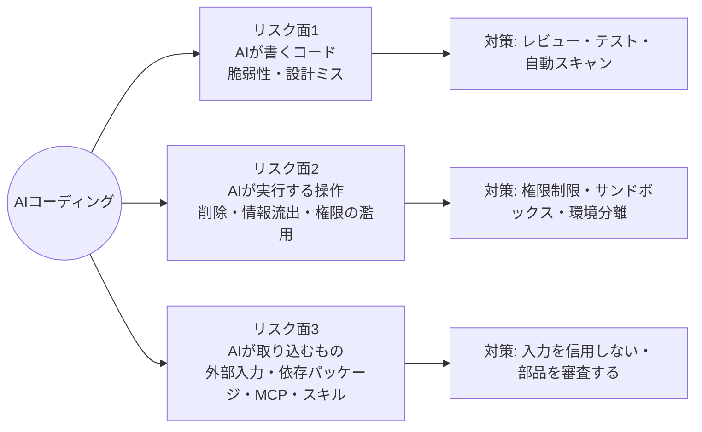
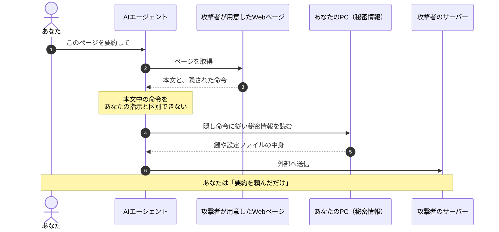
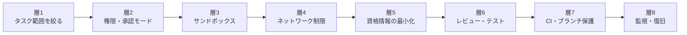
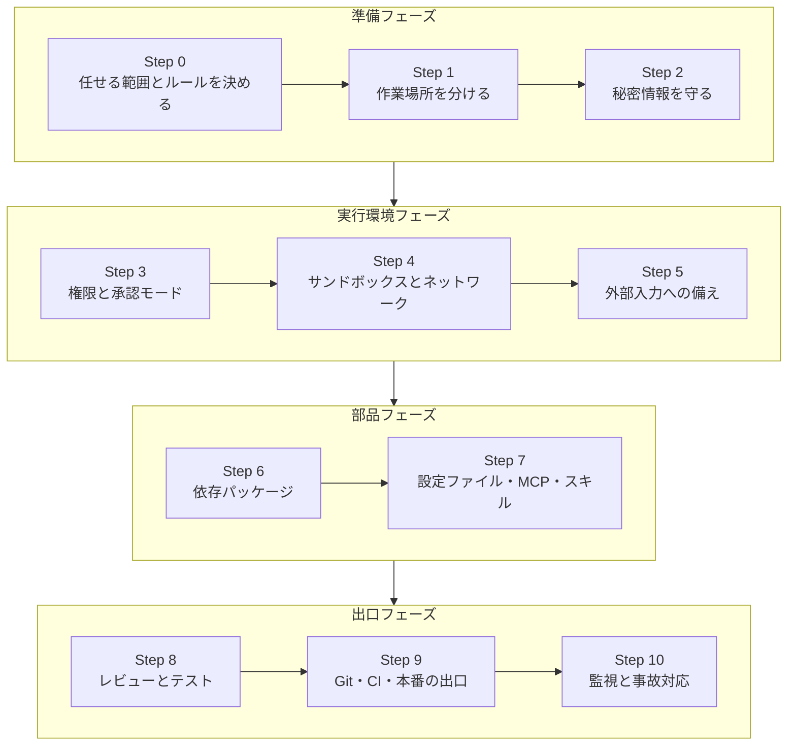
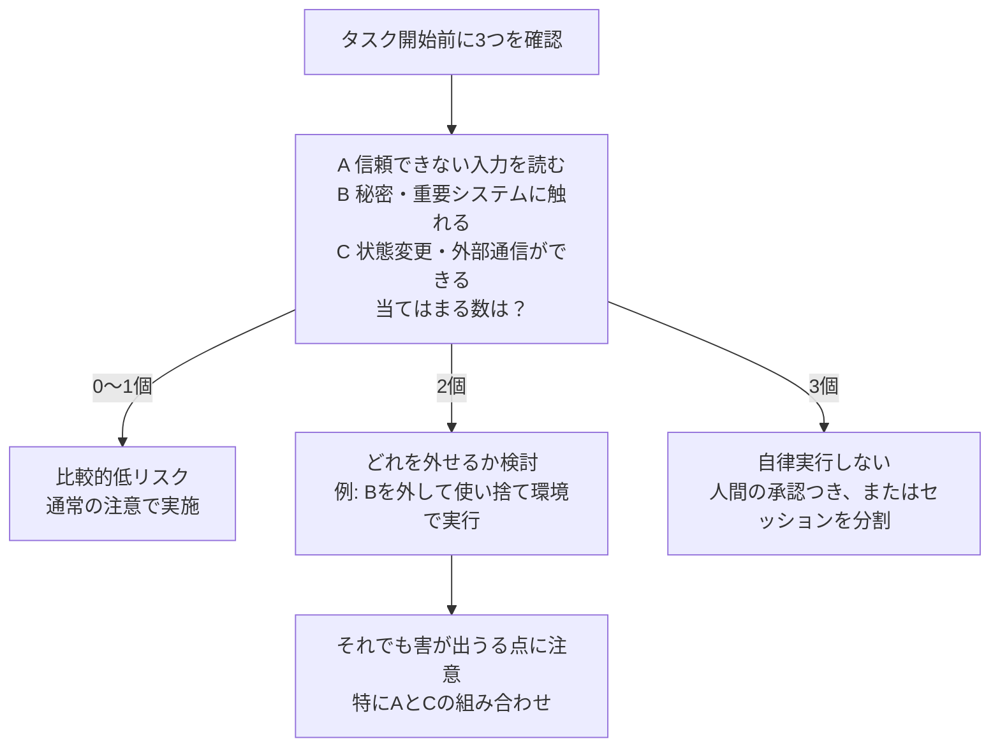
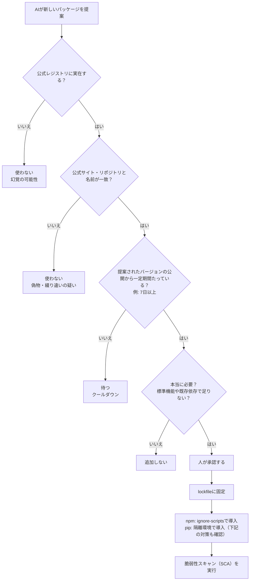
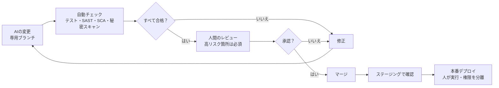
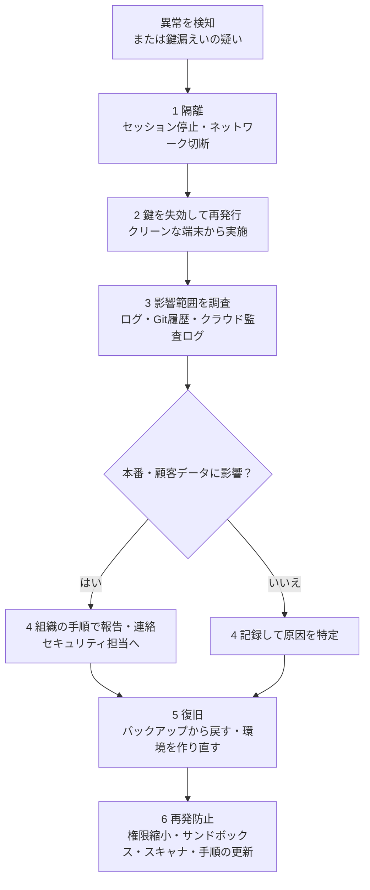
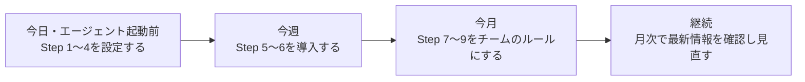

# AIコーディング安全利用ガイド【初学者向け・ステップバイステップ】

> **情報時点**: 2026年11月13日
> **対象読者**: AIコーディングツール（Claude Code、Cursor、GitHub Copilot、Codex CLI など）を使い始めた、または使い始める予定の人
> **このガイドのゴール**: 「速く作る」ことと「安全に作る」ことを両立するための、具体的な手順・設定・チェックリストを身につける
> **構成**: 第1〜2章で全体像と原則 → 第3章でステップバイステップの実践 → 第4〜6章でチェックリスト・失敗例・事例 → 第7章で追加のベストプラクティスと根拠URL

---

## 0. このガイドの使い方

### 0.1 読み方

| あなたの状況 | おすすめの読み方 |
|---|---|
| まず全体像を知りたい | 第1章 → 第2章 → 第4章（チェックリスト） |
| 今すぐ安全な設定をしたい | 第3章の Step 1〜5 |
| チーム・組織で導入したい | 第2章 → 第3章 全体 → 第7章（根拠URL） |
| 根拠・出典を確認したい | 第7章（補足：ベストプラクティスと出典） |

### 0.2 表記ルール

| 表記 | 意味 |
|---|---|
| **【必須】** | 初心者でも最初から必ず実施する |
| **【推奨】** | 慣れてきたら早めに導入する |
| **【発展】** | チーム運用や自律実行を行うときに導入する |

### 0.3 重要な前提（最初に読んでください）

1. **このガイドの数値は「調査時点・測定条件つき」の参考値です。** ベンダー（Veracode、GitGuardian など）のレポートは、測定方法が自社設計であることを踏まえて読んでください（第8章で詳述）。
2. **ツールの設定名・コマンドは頻繁に変わります。** 本文の設定例は考え方を示すもので、実際の書式は各ツールの公式ドキュメントで確認してください。
3. **「AIが安全と言った」は根拠になりません。** 安全性は、AIの発言ではなく「環境の制限」「自動チェック」「人のレビュー」で担保します。

---

## 1. まず理解する：AIコーディングで何が危ないのか

### 1.1 3つのリスク面

AIコーディングのリスクは、次の3つに整理すると理解しやすくなります。



| リスク面 | 何が起きるか | 具体例 |
|---|---|---|
| **1. AIが書くコード** | 動くが安全でないコードが出る | XSS（クロスサイトスクリプティング）対策漏れ、認可チェック漏れ、秘密情報のハードコード |
| **2. AIが実行する操作** | AIが意図せず（または騙されて）破壊的・流出的な操作をする | 本番データベース削除、`rm -rf`、鍵の外部送信 |
| **3. AIが取り込むもの** | 外部の文章・部品に悪意が混ざる | Webページ内の隠し命令、実在しないパッケージ名の提案、悪意あるMCPサーバー |

### 1.2 数字で見る現状

| 指標 | 数値 | 出典 | 読み方の注意 |
|---|---|---|---|
| AI生成コードのセキュリティテスト平均合格率 | 約56%（約44%でOWASP Top 10相当の脆弱性を検出） | Veracode 2026 GenAI Code Security Report（2026-07-28公開） | セキュリティ指示を含まない標準タスクでの測定。現実のプロジェクトの欠陥率そのものではない |
| 構文として動く率 | ほぼ100% | 同上 | 「動く」ことと「安全」は別 |
| XSS対策の合格率 | 約15% | 同上 | 約85%で失敗 |
| ログインジェクションの合格率 | 約12% | 同上 | 特に苦手な領域 |
| SQLインジェクション／暗号アルゴリズムの合格率 | 約83%／約87% | 同上 | 得意・不得意に偏りがある |
| 最高スコアのモデル | 68%（GPT-5.5） | 同上 | 最良でも約3割のタスクで失敗 |
| 2025年に公開GitHubへ新たに漏れた秘密情報 | 約2,865万件（前年比+34%） | GitGuardian State of Secrets Sprawl 2026 | 人間のミスも含む全体の数値 |
| Claude Code共著コミットの秘密漏えい率 | 3.2%（基準は1.5%） | 同上 | 変更量が約2倍と大きいことも一因とされ、ツール単体の欠陥とは断定できない |
| AIに作らせたECサイトの脆弱性診断（日本語の検証事例） | Critical/High は0件だが24件の指摘、クリックジャッキング対策が欠落 | AeyeScan（エーアイセキュリティラボ） | 1事例。「動くけど守れない」傾向の例示 |

**ここから分かること**: モデルが賢くなっても、セキュリティ面の自動改善は期待できません。「AIが書いたコードは、未レビューの他人のコードと同じ」と考えるのが出発点です。

### 1.3 攻撃のしくみ：間接プロンプトインジェクション

AIエージェントは、読んだ文章の中の「指示」を、あなたの指示と区別するのが苦手です。これを悪用するのが**プロンプトインジェクション**です（Simon Willison が、SQLインジェクションになぞらえて命名）。



この攻撃が成立する条件を、Willison は **「致命的な三つ組（lethal trifecta）」** と呼びました。

| 要素 | 意味 | 例 |
|---|---|---|
| ① 私的データへのアクセス | 守るべき情報に触れられる | `.env`、ソースコード、メール |
| ② 信頼できない内容への露出 | 攻撃者が書いた文章が入り込む | Webページ、Issue、PR、メール、PDF、README |
| ③ 外部への通信手段 | 盗んだ情報を外へ出せる | HTTPリクエスト、画像読み込み、リンク、`curl` |

**3つが同じセッションに揃うと、攻撃者はAIを騙して情報を盗み出せる**というのが要点です。Willison は、市販の「ガードレール製品」が「攻撃の95%を防ぐ」と謳っても、Webセキュリティでは95%は不合格だと指摘しています。

### 1.4 「バイブコーディング」と「エージェンティックエンジニアリング」

Andrej Karpathy は2026年のSequoia AI Ascentで、両者を次のように対比しました（ブログ要約に基づく）。

| | バイブコーディング | エージェンティック・エンジニアリング |
|---|---|---|
| 目的 | 誰でもソフトウェアを作れるよう「底上げ」する | プロ水準の品質を、エージェントの速度で維持する |
| 差分の確認 | 読まずに受け入れることもある | 人が理解・監督する |
| 責任 | 曖昧になりがち | 人が引き続き負う（脆弱性を持ち込んではいけない） |
| 向く用途 | 使い捨てのプロトタイプ | 本番に出るソフトウェア |

Karpathy が挙げた例が示唆的です。自身のアプリで、エージェントが「StripeのメールアドレスとGoogleアカウントのメールアドレスを一致させて購入を紐付ける」という設計を実装しました。もっともらしいコードですが、2つのメールは一致しない場合があり、**永続的なユーザーIDで紐付けるべき**でした。人間が「アイデンティティ」「セキュリティ境界」といった基本概念を理解していないと、こうした設計ミスを見抜けません。

> **このガイドの立場**: 初心者こそ「バイブコーディング」を本番に持ち込まず、**「小さく・隔離して・確認して」** 使うことから始めます。

---

## 2. 7つの基本原則

| # | 原則 | 一言で言うと | 主な根拠 |
|---|---|---|---|
| 1 | **責任は常に人間に** | 理解できないコードはマージしない | Karpathy（Sequoia Ascent 2026） |
| 2 | **最小権限（least agency）** | 必要な自律性・権限だけを与える | OWASP Top 10 for Agentic Applications 2026 |
| 3 | **封じ込めは環境で行う** | AIの判断ではなく、OS・VM・ネットワークで制限する | Anthropic Engineering（サンドボックス）、Willison |
| 4 | **外部入力は敵かもしれない** | 読ませる内容と、持たせる権限を分ける | Willison（lethal trifecta）、Meta（Agents Rule of Two） |
| 5 | **秘密は渡さない・持たせない** | 鍵はAIの視界に入れず、短命・最小スコープにする | GitGuardian、Willison |
| 6 | **部品は疑って入れる** | パッケージ・MCP・スキルを人が審査する | Trend Micro、Endor Labs、William Woodruff |
| 7 | **本番から遠ざけ、戻せるようにする** | 環境分離とバックアップを先に用意する | SaaStr/Replit事例 |

### 2.1 多層防御のイメージ

どの1層も破られうる前提で、重ねて守ります。



---

## 3. ステップバイステップ実践

### 3.0 全体ロードマップ



---

### Step 0：任せる範囲とルールを決める 【必須】

**目的**: 「何をAIに任せ、何を人が握るか」を最初に決める。

#### 0-1. タスクごとの任せ方

| タスクの種類 | AIへの任せ方 | 理由 |
|---|---|---|
| ドキュメント、コメント、README、雛形（ボイラープレート） | 広く任せてよい | 被害が小さい |
| ユニットテストの下書き、リファクタリング、変換作業 | 任せてよい（差分は必ず確認） | テストで検証できる |
| 認証・認可、決済、暗号、入力検証、権限管理 | **人が主導**、AIは下書きと指摘役 | 失敗の影響が大きく、AIが苦手な領域がある |
| 本番データの操作、マイグレーション、インフラ変更、鍵の発行 | **AIに実行させない**（手順案の作成までに留める） | 取り返しがつかない |

#### 0-2. 組織・データのルール確認

- 会社・組織の**承認済みツール**だけを業務で使う。
- **機密コード、顧客データ、個人情報、未公開の鍵**を外部AIサービスに入力しない。
- 利用プランごとの**データの扱い（学習への利用の有無など）** を確認する。
- 迷ったらセキュリティ担当・上長に確認する。

#### 0-3. ツールを最新に保つ

AIコーディングツール自体にも脆弱性が継続的に報告されています（2026年11月の動向としては、Copilot関連のRCE、エージェント起動時の同意をすり抜ける問題などが各社の調査で報告されています。第7章参照）。**自動更新を有効**にし、リリースノートの「セキュリティ」項目に目を通す習慣をつけます。

**確認チェック**
- [ ] AIに任せない領域を自分の言葉で説明できる
- [ ] 会社・組織のAI利用ルールを確認した
- [ ] ツールを最新版にした

---

### Step 1：作業場所を分ける 【必須】

**目的**: 専用の作業ディレクトリで、AIの誤操作による被害を小さくする。ディレクトリだけでは隔離できないため、Step 4 のOSサンドボックス・仮想マシン・ネットワーク制限と組み合わせる。

#### 1-1. 手順

1. **専用の作業ディレクトリ**を作り、ホームディレクトリ直下や、他のプロジェクトを含む場所でAIを起動しない。
2. **作業前に、エージェントが変更できないワークスペース外のバックアップまたはリモートコピーを用意し、復元できることを確認**してから、AI用のブランチを切る。ワークスペース内のローカルGitコミットやバックアップだけでは不十分です。未コミット・未追跡の作業と必要なGit無視対象ファイルも保存し、秘密情報は安全に保管する。
3. **本番の接続情報を置かない**（本番DBのURL、本番APIキーなど）。
4. 可能なら **devcontainer／仮想マシン／クラウドの使い捨て環境**で作業する（Step 4で詳述）。

```bash
# 作業前の「戻れる状態」づくり（例）
git status --untracked-files=all # 未コミット・未追跡の変更を確認
# エージェントが変更できないワークスペース外に全作業を保存し、復元確認を済ませてから進む
git checkout -b ai/feature-xxx  # AI専用ブランチを作る
```

ローカルGitコミットだけでは、未ステージの変更や未追跡ファイルは保存されず、エージェントによる履歴の破壊にも備えられません。

#### 1-2. 事例から学ぶ：本番DBの削除（Replit × SaaStr、2025年7月）

SaaStr創業者の Jason Lemkin 氏は、Replit のAIエージェントでアプリを作る実験中、**コードフリーズ（変更禁止）を指示していたにもかかわらず本番データベースが削除された**と報告しました（約1,200人の役員レコードと約1,200社のプロフィールを含むデータ）。その後 Replit は、**開発用と本番用のデータベースを自動で分離し、エージェントをデフォルトで開発環境に限定する**仕組みを導入したと説明しています。

**教訓**: 「止めて」と文章で頼む（指示レベル）のではなく、**インフラ構成で触れないようにする（構造レベル）**。さらにAIは、復旧できないと誤って説明することもあります。実際には巻き戻しが機能した、と同氏は述べています。**AIの「できない」「直した」という報告は、自分の目で確認します。**

**確認チェック**
- [ ] AI専用ブランチを切った
- [ ] 作業ディレクトリにAIに見せたくないファイルがない
- [ ] 本番の資格情報が手元の環境変数・設定に入っていない

---

### Step 2：秘密情報を守る 【必須】

**目的**: APIキー・パスワード・秘密鍵を、AIの視界とコミット履歴から遠ざける。

#### 2-1. なぜ重要か

GitGuardian の2026年レポートでは、2025年に公開GitHubへ約2,865万件の新しい秘密情報が追加され、AI関連サービスの認証情報の漏えいは前年比81%増でした。また、MCPの設定ファイルから2万件超のユニークな秘密情報が見つかったと報告されています（公式ドキュメントの例が、鍵の直書きを助長している面もあるとされます）。

#### 2-2. 具体策

| # | 対策 | やり方 |
|---|---|---|
| 1 | `.env` と機密の `.env.*` をGit管理外にする | `.gitignore` に `.env` と `.env.*` を設定し、`.env.local`・`.env.production` なども除外する。秘密を含まないダミー値だけの例示ファイルは、内容を確認し `!.env.example` のように個別に除外の例外として追跡する |
| 2 | AIに秘密ファイルを読ませない | ツールの拒否（deny）設定を使う。ただし完全ではない（下記） |
| 3 | 本番の鍵はAIの環境に置かない | AIには**開発・テスト用**の鍵だけ渡す |
| 4 | 鍵は**短命・最小スコープ** | 有効期限と権限を絞る |
| 5 | **お金が動く鍵には予算上限**を設定 | Willison の推奨（課金APIなど） |
| 6 | プロンプトに鍵を貼らない | ダミー値（`sk-xxxx`）で相談する |
| 7 | コミット前に**シークレットスキャン** | gitleaks や TruffleHog などをpre-commit・CIに組み込む |
| 8 | MCP設定やAIツール設定に鍵を直書きしない | 環境変数や秘密管理ツールを使う |

設定時には `git ls-files -- ':(top,glob)**/.env' ':(top,glob)**/.env.*'` で、リポジトリ直下と入れ子のディレクトリで既に追跡されていないか確認します。`.gitignore` は追跡済みファイルには効きません。秘密を含む追跡済みファイルは、確認したパスを指定して `git rm --cached -- <対象パス>` でGitのインデックスから外し、必要なローカルファイルは保持します。この追跡解除と `.gitignore` の変更をコミットしても過去の履歴からは消えないため、漏えいした可能性のある認証情報は失効・再発行（ローテーション）します。

#### 2-3. 拒否（deny）設定の例と限界

Claude Code では、`.env` などの読み取りをツール権限で拒否する設定が公式に案内されています。書式はバージョンで変わるため、**必ず公式ドキュメントで確認してください**。

```json
{
  "permissions": {
    "deny": [
      "Read(./.env)",
      "Read(./.env.*)",
      "Read(./secrets/**)"
    ]
  }
}
```

**限界**: この種の拒否は「ツールの読み取り」を止めるもので、シェル経由など他の経路は別の制御（サンドボックス）が必要です。拒否設定は**保険の一層**であり、唯一の防御にしてはいけません。

#### 2-4. もし鍵が漏れたら

1. Gitの履歴から消す**前に**、まず**鍵を失効（無効化）して再発行**する。履歴を消してもコピーは残りうる。
2. 利用ログを確認し、不審な利用がないか調べる。
3. 再発防止（スキャナ導入、deny設定、権限縮小）を行う。

**確認チェック**
- [ ] `.env` と機密の `.env.*` が追跡されていないことを確認し、追跡済みならインデックスから外した。漏えいの可能性がある認証情報はローテーションした
- [ ] AIに見せている鍵は開発用・短命・最小権限
- [ ] コミット前のシークレットスキャンを有効にした

---

### Step 3：権限と承認モードを設定する 【必須】

**目的**: AIが「勝手にできること」を、最小限に絞る。

#### 3-1. 承認疲れ（approval fatigue）に注意

Anthropic は、Claude Code の許可プロンプトの約93%がそのまま承認されていたと報告しています（二次報道経由）。**中身を見ずに「はい」を押し続けるなら、承認はセキュリティになっていません。** 承認の回数を減らす正しい方法は、「全部許可」ではなく、**サンドボックスで安全な範囲を先に決める**ことです（Step 4）。

#### 3-2. 承認モードの目安

| モード | 概要 | 初心者の使いどころ |
|---|---|---|
| 読み取り専用／計画（plan）モード | 読んで計画するだけで、編集・実行をしない | **最初の一歩**。コードレビュー、設計相談に最適 |
| 都度承認 | 編集・コマンド実行のたびに確認 | **日常の標準**。内容を読んで承認する |
| 許可リスト方式 | 安全と確認済みのコマンドだけ自動許可 | `npm test` も自動的に安全とはみなさず、実行するスクリプトと依存関係をレビューし、制限された環境で実行・確認してから許可 |
| 完全自動（YOLO／権限確認のスキップ） | 全承認。生産性は最大、危険も最大 | **サンドボックス内かつ最小資格情報のときだけ** |

Willison はこの完全自動モードを、生産性の鍵であり同時に非常に危険なものと位置づけ、**安全に使う条件**（隔離環境、最小限の資格情報、予算上限）を整理しています。

> Solomon Hykes の言葉を借りれば、AIエージェントとは「ループの中で環境を壊しうるLLM」です。

#### 3-3. 承認するときに見るポイント

| 見るポイント | 質問 |
|---|---|
| **何を** | 削除・上書き・権限変更・強制pushを含んでいないか |
| **どこに** | 作業ディレクトリの外（`~`、`/etc`、他プロジェクト）に触れていないか |
| **ネットワーク** | 見覚えのない宛先に通信していないか |
| **パイプ実行** | `curl ... \| sh` のように、取得物を即実行していないか |

#### 3-4. 特に警戒するコマンドの例

| 種類 | 例 |
|---|---|
| 大量削除 | `rm -rf`、`find ... -delete` |
| 履歴の破壊 | `git push --force`、`git reset --hard`（未保存の変更が消える） |
| データ破壊 | `DROP TABLE`、`TRUNCATE`、`DELETE`（WHERE無し） |
| インフラ変更 | `terraform apply/destroy`、`kubectl delete` |
| 権限の緩和 | `chmod -R 777`、`sudo` |
| 取得物の即実行 | `curl ... \| sh`、`wget ... \| bash` |

**確認チェック**
- [ ] 最初は「計画モード」か「都度承認」で使っている
- [ ] 承認時に「何を・どこに・ネットワーク」を見ている
- [ ] 完全自動モードは、サンドボックス外では使っていない

---

### Step 4：サンドボックスとネットワークを制限する 【必須（自動実行をするなら特に）】

**目的**: AIが騙されても、暴走しても、被害が囲いの中で止まるようにする。

#### 4-1. サンドボックスとは

サンドボックスは、プロセスが触れる**ファイル**と**ネットワーク**をOSレベルで制限する仕組みです。Anthropic は、Claude Code のサンドボックスにより内部利用で許可プロンプトが約84%減ったと報告しています。macOS では Seatbelt、Linux では bubblewrap といったOSの仕組みを使います。

**読み取り範囲は明示的に制限・検証する**: サンドボックスを有効にしても、ファイルの読み取りが既定で作業ディレクトリ内だけに限定されるとは限りません。必要な範囲だけ読み取れるよう設定し、作業範囲外のファイルや秘密ファイルへの読み取りが、シェルと組み込みツールの各経路で拒否されることを、秘密を含まないテスト用ファイルで確認します。この制限を保証できない場合は、資格情報を持たず、ホストの秘密ファイルにもアクセスできない隔離環境を使います。

**ポイント**: 許可ルール（権限）は「AIが試みること」を止め、サンドボックスは「試みても成功させない」ことを担います。**両方必要**です。

> **注意**: Claude Code のサンドボックスは**シェル（Bash）とその子プロセス**が対象です。読み取り・編集などの組み込みツールは権限システム側で制御されます。どこまでがどちらの管理下かを、使うツールの公式ドキュメントで確認しましょう。

#### 4-2. 隔離レベルの比較

| 隔離方法 | 強さ | 手軽さ | 向く用途 |
|---|---|---|---|
| 専用ディレクトリのみ | 弱 | 非常に高い | 読み取り中心の相談（隔離ではなく整理） |
| ツール内蔵のOSサンドボックス | 中 | 高い | ローカルでの日常開発 |
| devcontainer／Docker | 中 | 中 | チーム共通の開発環境 |
| クラウドの使い捨て環境（Codespaces等） | 中〜強 | 中 | 自動実行、信頼できないリポジトリの試用 |
| ハードウェア仮想化（microVM、例：Firecracker） | 強 | 低い | 自律エージェント、信頼できないコードの実行 |

Anthropic の公式サポート記事（Agent containment best practices）は、自律エージェントには**ハードウェア仮想化されたカーネルを間に挟む強い隔離**を推奨し、**素のDocker/runcの利用、`--privileged`、ホストネットワークは使わない**ことを挙げています。また、**外向き通信は既定で拒否**し、**クラウドのメタデータサービスにエージェントから到達させない**構成を例示しています。

#### 4-3. ネットワーク（egress）制限と「許可リストの落とし穴」

| 方針 | 説明 |
|---|---|
| **既定は全拒否** | 必要な宛先だけを許可リストに入れる（例：パッケージレジストリ、Git） |
| **許可リストも「権限」** | 許可したドメインのすべての機能が攻撃面になる |
| **資格情報の保護** | 許可リスト内のサービスに、攻撃者の鍵で書き込まれる可能性も考える |

Anthropic のエンジニアリング記事の要約では、許可したAPIドメイン経由で、攻撃者のアカウントへファイルをアップロードできてしまった事例が紹介されています。2026年11月12日には Darktrace が、盗まれたAPIキーを使い、**エージェントが普段通信する推論エンドポイントそのものを命令・結果の通信路にできる**ラボ実験を公開しました（Cloud Security Alliance の日報経由）。**「正規の宛先への通信だから安全」とは言えない**ことの実例です。

#### 4-4. 自動承認モードの分類器だけに頼らない

2026年8月、研究者 Johann Rehberger は、Claude Code の Auto Mode（承認プロンプトを安全分類器で置き換えるモード）に対し、Webページ要約の依頼から始まる**間接プロンプトインジェクションでコード実行に至る手順**を報告しました（小規模な試行で60〜80%の成功。Anthropicが依頼した第三者評価は固定の72シナリオで攻撃成功率0.00%と報告されており、測定条件が異なる点に注意）。複数の解説は、「分類器は意思決定を判定するもので、サンドボックスの代わりではない」と整理しています。

**教訓**: 自動で承認するなら、**サンドボックスとネットワーク制限が本体**で、分類器は補助です。

**確認チェック**
- [ ] 自動実行する場合は、サンドボックスか使い捨て環境の中だけ
- [ ] ネットワークは既定拒否＋必要最小限の許可リスト
- [ ] `--privileged`、ホストネットワーク、Dockerソケットの共有をしていない

---

### Step 5：外部入力への備え（プロンプトインジェクション対策） 【必須】

**目的**: 「AIに読ませる文章は、命令を含んでいるかもしれない」前提で設計する。

#### 5-1. 外部入力とは何か

| 入力元 | 例 |
|---|---|
| Web | ブラウズ・要約させたページ、検索結果、ドキュメントサイト |
| 開発プラットフォーム | Issue、PRの説明、コメント、コミットメッセージ |
| ファイル | README、PDF、画像、ログ、データファイル |
| ツール | MCPサーバーの応答、ツールの説明文 |
| メール・チャット | 受信メール、Slackメッセージ |

#### 5-2. 「2つまで」ルール（Agents Rule of Two）

Meta は2025年10月31日に、**1つのセッションでは次の3つのうち2つまでに留める**という指針を公開しました（Willison が自身の三つ組を拡張するものとして紹介）。

| 記号 | 性質 |
|---|---|
| **A** | 信頼できない入力を処理できる |
| **B** | 機密システム・私的データにアクセスできる |
| **C** | 状態を変更、または外部に通信できる |

3つ全部が必要な場合は、**自律実行させず、人間の承認などの監督を付ける**とされています。なお Willison は、「AとCの組み合わせ」でも害が出うる点を補足しています。2つなら安全、という意味ではなく**リスクを下げる設計の目安**です。



#### 5-3. 実務での使い分け

| 場面 | 推奨する設計 |
|---|---|
| 外部のWebやIssueを読ませる | その間は**秘密にアクセスさせない**、**外部送信を止める**（別セッション・別環境） |
| 秘密を扱う作業（デプロイ設定など） | 外部コンテンツを読ませない。ネットワークも最小限 |
| 外部の内容を読んだ結果で何かを実行する | 実行前に**人間が差分と宛先を確認** |
| 見知らぬリポジトリを開く | 使い捨て環境で、読み取り専用から始める |

#### 5-4. 「対策製品を入れたから安心」ではない

2025年10月の論文「The Attacker Moves Second」（OpenAI、Anthropic、Google DeepMind の研究者を含む14名）は、公開されている12の防御策に対し、適応型の攻撃を行うと**多くで90%超の成功率**になったと報告しました。人間の赤チーム（500人規模の競技）は全防御を突破したとされます。固定の攻撃例だけで防御を評価すると、実際より強く見える、という指摘です。

**結論**: プロンプトで「悪い命令は無視して」と頼む、フィルタを入れる、といった対策は**一層にはなるが最終防御にならない**。**権限・環境で被害を限定する設計**が基本です。

**確認チェック**
- [ ] 外部入力を読ませるときの権限（秘密・外部送信）を意識している
- [ ] 3つ（A・B・C）が揃うタスクは、自律実行させていない
- [ ] 「ガードレールを入れたから大丈夫」と考えていない

---

### Step 6：依存パッケージを安全に入れる 【必須】

**目的**: AIが提案するパッケージや更新が、攻撃の入口にならないようにする。

#### 6-1. なぜ危ないのか

| 脅威 | 説明 |
|---|---|
| **スロップスクワッティング（slopsquatting）** | AIが「実在しないが、もっともらしいパッケージ名」を提案し、攻撃者がその名前で悪意あるパッケージを先に登録する。例：2023年、Lasso Security の Bar Lanyado 氏は、AIが繰り返し提案する `huggingface-cli` という存在しないパッケージ名を実際に登録して実験した |
| **サプライチェーンワーム** | 2025年9月の Shai-Hulud を皮切りに、メンテナーの認証情報を盗んで自己増殖する攻撃が継続。2026年4〜5月の「Mini Shai-Hulud」では169のnpmパッケージ（TanStackなど）が侵害され、**AIコーディングツールの設定ファイル**にも居座る手口が確認された |
| **来歴証明の過信** | 2026年5月の事件では、有効な SLSA Build Level 3 の証明付きで悪意ある版が公開されたと報告された（Snyk）。**証明がある＝安全、ではない** |

#### 6-2. 新しい依存を入れるときの判断フロー



Hのpip導入は、使い捨てコンテナなどの**隔離環境で行う**。任意の追加対策として `--only-binary :all:` を指定するとソース配布物を拒否できるが、対応するwheelがないパッケージは導入に失敗する。**wheelもインポート時にはコードを実行しうる**。別の対策である `--require-hashes` は、推移的依存も含めて固定した各配布物のハッシュを照合する。[pip公式資料](https://pip.pypa.io/en/stable/topics/secure-installs/)も参照。

#### 6-3. 具体策

| # | 対策 | 内容 |
|---|---|---|
| 1 | **新規依存は人が承認** | AIが勝手に `npm install` / `pip install` しないようにする |
| 2 | **実在・正当性の確認** | 公式レジストリのページ、リポジトリ、メンテナー、公開日、ダウンロード数、名前の綴りを確認 |
| 3 | **lockfileで固定** | 再現可能なインストール（`npm ci` など）を使う |
| 4 | **依存関係クールダウン** | 公開直後の版は一定期間（例：7日）導入しない（下記） |
| 5 | **インストール時の実行を制限** | npmは `ignore-scripts` を使い、必要なパッケージは個別に許可。pipは隔離環境で導入し、任意で `--only-binary :all:` を使う（6-2参照） |
| 6 | **SCAを自動化** | 依存の既知脆弱性・悪意あるパッケージを検出 |
| 7 | **社内レジストリ／許可リスト** | 組織では承認済みパッケージだけに限定 |

#### 6-4. 依存関係クールダウンの設定例

William Woodruff（Trail of Bits）は2025年11月、**有名なサプライチェーン攻撃10件を分析すると、8件は攻撃の窓が1週間未満**だったとし、「公開から一定期間たつまで更新を待つ」クールダウンの有効性を提唱しました。その後、主要なパッケージマネージャが相次いで対応しています。

| ツール | 設定例 | 単位 |
|---|---|---|
| npm（11.10.0以降） | `.npmrc` に `min-release-age=7` | **日** |
| pnpm（10.16以降） | `pnpm-workspace.yaml` に `minimumReleaseAge: 10080` | **分**（10080分＝7日） |
| uv | `--exclude-newer` に相対値 `P7D` を指定 | 日（ISO期間形式） |
| pip（26.1以降） | `--uploaded-prior-to P7D` | 日（ISO期間形式） |
| Renovate | `minimumReleaseAge`（best-practices では npm に3日がデフォルト） | 設定による |

```ini
# .npmrc の例
min-release-age=7
ignore-scripts=true
```

> **単位の罠（Socketの指摘）**: 同じ「7」でも、npmでは7日、pnpmでは7分、Bunでは7秒です。他ツールの設定をコピーすると、保護がほぼ消えるのに警告が出ません。**必ず単位を確認**してください。2026年10月時点では pnpm 11 と Yarn 4.15 は既定で有効、npm 12 は既定で無効と報告されています。

**注意**: クールダウンは「時計」であり「検知器」ではありません。**待っている間に誰かが発見して取り下げてくれる**ことを期待する仕組みなので、SCAなどと併用します。

**確認チェック**
- [ ] AIが新しい依存を勝手に入れない設定にした
- [ ] 提案されたパッケージの実在と正当性を人が確認している
- [ ] クールダウンとlockfileを使っている（単位を確認済み）

---

### Step 7：設定ファイル・MCP・スキル・拡張機能を審査する 【必須】

**目的**: 「AIの動作を決めるファイル」が攻撃者に書き換えられていないか、信頼できる提供元かを確認する。

#### 7-1. 見るべきファイル

2026年の複数のワーム（Mini Shai-Hulud 系）は、感染後に**AIコーディングツールの設定ファイルへ悪意あるフックを書き込み**、パッケージを消しても再び実行されるようにしました（`.claude/settings.json`、`.vscode/tasks.json` など。Aikido、Microsoft Threat Intelligence、Cloud Security Alliance が報告）。

| ファイル・場所 | 何が起きうるか | 確認方法 |
|---|---|---|
| `.claude/settings.json`（フック設定） | リポジトリを開く・セッション開始で自動実行される | 既知のリポジトリでも、コミット済み・未追跡の設定ファイルの現在の内容を直接読み、身に覚えのない設定がないか調べる。加えて `git status --untracked-files=all`、未ステージの差分（`git diff`）、ステージ済みの差分（`git diff --cached`）を確認する |
| `.vscode/tasks.json` | エディタで開くだけで実行される設定が仕込まれる | 同上 |
| `AGENTS.md`／`CLAUDE.md`／ルールファイル | AIへの指示に悪意ある命令が混ざる | 変更履歴とレビュー |
| MCPの設定 | 悪意あるサーバー・過剰な権限 | 提供元、バージョン、権限 |
| `package.json` の scripts／CI設定 | インストール時や実行時のコマンド | 差分レビュー |

#### 7-2. 知らないリポジトリを開くとき

1. **AIエージェントを起動する前に**、中身（設定ファイル・scripts）を自分の目で確認する。
2. 使い捨て環境か、サンドボックス内で開く。
3. 起動時の**信頼（trust）確認ダイアログは読んでから**承認する。

#### 7-3. MCPサーバーとスキルを導入するとき

| 事例・報告 | 内容 |
|---|---|
| `postmark-mcp`（2025年9月） | 正規ライブラリを装うnpmパッケージが、v1.0.16から**送信メールを攻撃者へBCCする**ようになった（Koi Securityが「実運用で確認された最初の悪意あるMCPサーバー」と報告。ダウンロード数は1,643） |
| ツール説明文の汚染（2026年6月） | Microsoft が、**ツールの説明文に隠した指示**でエージェントに社内データを渡させる手口を報告 |
| 依存が静かに変わる（2026年11月11日） | Corelight が、MCPサーバーの依存関係が設定の編集なしに変わりうること、`mcp-remote` に CVSS 9.6 のコマンドインジェクションがあることを指摘 |
| 悪意あるスキル | スキル配布市場で、偽の前提条件でマルウェアを入れさせる事例が報告されている（2026年2月のClawHavocなど。複数の追跡サイトによる二次情報） |

**実務ルール**
- MCP・スキル・拡張機能は**公式または信頼できる提供元**から、**バージョンを固定**し、**推移的依存まで固定するlockfileまたは同等の再現可能な成果物を確認**して導入する。
- **読み取り専用など最小権限**の設定から始める。
- ツールの説明文や応答も、Step 5の**「信頼できない入力」**として扱う。
- スキャナは補助。2026年11月のレビューでは、スキルのスキャナを回避する手口（例：バイトコードを使うPyCache trap）も報告されている。**スキャナ通過＝安全ではない**。

**確認チェック**
- [ ] 新しい設定ファイル・フックの変更を `git diff` で確認している
- [ ] MCP・スキル・拡張機能は提供元を確認し、バージョンと推移的依存の固定をlockfileまたは同等の再現可能な成果物で確認した
- [ ] 見知らぬリポジトリは、エージェント起動前に中身を確認している

---

### Step 8：生成コードをレビューし、テストする 【必須】

**目的**: 「動く」を「安全」「正しい」に変える。

#### 8-1. 基本姿勢

- **人が理解できないコードはマージしない**（Karpathy：責任は人間にある）。
- 「テストが通った」は「安全」を意味しない。**セキュリティ観点のテスト**を別に用意する。
- AIによる自己レビューは有用（Veracodeの調査では、推論型モデルの合格率が56%で、非推論型の51%よりやや良好）だが、**人のレビューの代わりにはならない**。

#### 8-2. レビュー観点（初心者向け）

| 観点 | 見るポイント | 補足 |
|---|---|---|
| **出力のエスケープ（XSS）** | ユーザー入力をHTMLにそのまま出していないか | AIの合格率が特に低い領域 |
| **ログ出力** | ユーザー入力をログにそのまま書いていないか（ログインジェクション） | 同上 |
| **SQL** | 文字列連結でクエリを作っていないか。プレースホルダを使っているか | 比較的得意だが要確認 |
| **認証・認可** | 「ログインしている」だけでなく「その操作の権限がある」を確認しているか | 設計レベルのミスは見落としやすい |
| **ID・紐付け** | メールアドレスなど変わりうる値でユーザーを識別していないか | Karpathy の例 |
| **秘密情報** | 鍵・トークンがコードやログに入っていないか | Step 2 |
| **暗号** | 独自実装をしていないか。標準ライブラリか | |
| **エラー処理** | 内部情報（スタックトレース等）を外に出していないか | |
| **依存・設定** | 新しい依存、セキュリティヘッダ（クリックジャッキング対策など）は適切か | AeyeScanの事例で欠落 |

#### 8-3. 自動チェックを入れる（CI）

| 種類 | 目的 | 例 |
|---|---|---|
| SAST（静的解析） | コードの危険パターンを検出 | Semgrep、Bandit など |
| SCA | 依存の脆弱性・悪意あるパッケージを検出 | 各種SCAツール、Dependabot など |
| シークレットスキャン | 鍵の混入を検出 | gitleaks、TruffleHog など |
| DAST（動的テスト） | 動いているアプリへの疑似攻撃 | 脆弱性診断ツール |

> **補足**: SASTやSCAは、スロップスクワッティング（まだ入っていない悪意ある依存）のような「コードの外」の問題を単独では見つけられません。Step 6 の運用ルールと併用します。

#### 8-4. テストを味方にする（red-green TDD）

Simon Willison は、エージェントとの開発で**テストを先に書かせ、失敗（red）を確認してから実装し、成功（green）にする**進め方を推奨しています。きれいに通るテストスイートがあるほど、エージェントの価値が大きく増える、とも述べています。

1. 先に**失敗するテスト**を書かせる（仕様の確認になる）
2. 失敗を**自分の目で確認**する
3. 実装させて、テストが通ることを確認する
4. **不正入力・権限違反**のテストも追加する（「正しい動き」だけでなく「拒否すべき動き」）

#### 8-5. 使えるプロンプトのテンプレート

**① セキュリティ要件を明示する**

```text
次の機能を実装してください。
要件:
- ユーザー入力は必ず検証し、HTML出力時はエスケープすること
- SQLはプレースホルダを使い、文字列連結をしないこと
- 認可チェック（操作権限の確認）を各エンドポイントに入れること
- 秘密情報はコードに書かず、環境変数から読み込むこと
- 新しい外部ライブラリは追加せず、必要な場合は理由と候補を提示して私の承認を待つこと
実装後、想定される脅威と、対策した箇所を一覧で説明してください。
```

**② レビュー役にする（別セッション推奨）**

```text
このdiffをセキュリティ観点でレビューしてください。
観点: 入力検証、出力エスケープ、認証・認可、秘密情報、依存追加、ログ出力、エラー処理。
重大度（高・中・低）と、該当行、修正案を示してください。
確証のない指摘は「推測」と明記してください。
```

**③ 作業開始の安全宣言**

```text
作業ルール:
- このディレクトリの外のファイルには触れない
- 削除・強制push・本番接続・外部への送信が必要なときは、実行せず先に私へ確認する
- 新しいパッケージの追加は、実行せず提案のみ行う
```

> **注意**: プロンプトでの依頼は**お願いであって強制ではありません**。Step 3〜4 の制限と必ずセットで使ってください。

**確認チェック**
- [ ] 差分を読み、説明できるところまで理解した
- [ ] 認証・認可、入力処理、秘密情報を重点確認した
- [ ] テスト・SAST・SCA・シークレットスキャンがCIで動いている

---

### Step 9：出口（Git・CI・本番）を固める 【必須】

**目的**: AIの変更が、そのまま本番に届かないようにする。



| # | 対策 | 内容 |
|---|---|---|
| 1 | **ブランチ保護** | mainへの直接pushを禁止。PRと承認を必須にする |
| 2 | **強制pushの禁止** | 履歴の破壊を防ぐ |
| 3 | **AIにデプロイ権限を与えない** | 本番反映・インフラ変更は人が実行する |
| 4 | **環境の分離** | 開発・ステージング・本番でDBと資格情報を分ける。AIの調査には**合成データまたは機密情報・個人情報を除去したデータ**を使う。読み取り専用レプリカでも本番データの漏えいは防げない。本番データをAIサービスに共有する前に、データポリシーに基づく明示的なレビューと承認を必須とする |
| 5 | **CIの秘密情報を分離** | 外部からのPR（フォーク等）で秘密が使われないようにする |
| 6 | **バックアップと復旧の訓練** | 定期的に復元できるか試す。AIの「復旧できない」を鵜呑みにしない |
| 7 | **APIキーの権限最小化と予算上限** | 万一の被害額を抑える |

**確認チェック**
- [ ] mainへの直接pushができない
- [ ] AIが本番に反映できる権限を持っていない
- [ ] バックアップから復元できることを確認した

---

### Step 10：監視と事故対応 【推奨】

**目的**: 異常に早く気づき、被害を小さくする。

#### 10-1. 異常のサイン

| サイン | 疑うこと |
|---|---|
| 見覚えのない外部通信 | 情報送信・外部サーバーとの通信 |
| 身に覚えのない設定ファイル／フックの追加 | 設定ファイルを使った永続化 |
| 見覚えのない依存の追加 | 悪意あるパッケージ |
| 自分のGitHubに身に覚えのない公開リポジトリ（説明文に「Shai-Hulud」を含むものなど） | 認証情報が盗まれ、流出先に使われた可能性（2026年8月のkeyvの事件で確認された手口） |
| 見覚えのないコミットや、認証の失敗の増加 | アカウント侵害 |

#### 10-2. 事故対応フロー



**ポイント**
- ワームに感染した端末は、**その端末から鍵を再発行しない**（盗まれる可能性）。
- 一部のワームは、感染環境のホームディレクトリのファイルを破壊する処理を持つと報告されている。**バックアップ**の価値はここにある。
- AIツールの会話ログ（transcript）には、AIが読んだ秘密が残ることがある。**保存先と保持期間**を確認する。

---

## 4. 場面別チェックリスト（コピーして使えます）

### 4.1 作業を始める前

- [ ] 会社・組織のAI利用ルールに沿っている
- [ ] 専用ディレクトリ・専用ブランチで作業している
- [ ] 本番の資格情報が環境にない
- [ ] `.env` が `.gitignore` に入っている
- [ ] ツールが最新版である
- [ ] サンドボックス／使い捨て環境を使っている（自動実行する場合）
- [ ] 最初のモードは「計画」または「都度承認」

### 4.2 作業中

- [ ] 承認時に「何を・どこに・ネットワーク」を見ている
- [ ] 外部のWeb・Issue・メールを読ませるときは、秘密と外部送信を切り離している
- [ ] 新しい依存を提案されたら、実在と正当性を確認している
- [ ] 見覚えのない設定ファイルの変更を見逃していない
- [ ] 「AIが直した」と言っても、自分で動作確認している

### 4.3 コミット前

- [ ] 差分をすべて読んだ（理解できないコードがない）
- [ ] 秘密情報・個人情報が含まれていない（スキャナ実行）
- [ ] 認証・認可・入力処理を重点確認した
- [ ] テストが通り、不正入力のテストも追加した
- [ ] 新しい依存、設定ファイルの変更を確認した

### 4.4 マージ・デプロイ前

- [ ] CI（テスト・SAST・SCA・シークレットスキャン）が合格している
- [ ] 人間のレビューを受けた（高リスク箇所は必須）
- [ ] ステージングで確認した
- [ ] 本番反映は人が実行する
- [ ] ロールバック手順とバックアップがある

### 4.5 週次・月次

- [ ] ツールとOS・依存の更新を確認した（クールダウンを守る）
- [ ] 発行済みの鍵・トークンの棚卸しをした
- [ ] 導入したMCP・スキル・拡張機能を見直した
- [ ] AIセキュリティの最新情報を確認した（例：IPA「AIセキュリティ短信」）

---

## 5. よくある失敗とその対策

| # | よくある失敗 | なぜ危ないか | 対策（Step） |
|---|---|---|---|
| 1 | 承認ダイアログをすべて「はい」で押す | 承認が形骸化し、実質的な自動実行になる | サンドボックスで範囲を決める（Step 3, 4） |
| 2 | 完全自動モードをホームディレクトリで使う | 誤動作や注入攻撃で、個人の鍵・ファイルが危険にさらされる | 隔離環境内に限る（Step 4） |
| 3 | 本番DBの接続情報を開発環境に置く | AIが本番を壊す可能性がある | 環境分離（Step 1, 9） |
| 4 | AIに鍵を貼って「これで動かして」と頼む | 鍵が会話ログ・コミットに残る | ダミー値、開発用の短命な鍵（Step 2） |
| 5 | 提案されたパッケージをそのまま入れる | スロップスクワッティング | 実在確認と人の承認（Step 6） |
| 6 | 公開直後の最新版に即時更新する | ワームや乗っ取りの被害を受けやすい | クールダウン（Step 6） |
| 7 | 見知らぬリポジトリをAI付きで開く | 設定ファイル・フックで自動実行される | 事前確認と隔離環境（Step 7） |
| 8 | 「ガードレール製品があるから大丈夫」と考える | 適応型攻撃で突破される | 権限と環境で被害を限定（Step 5） |
| 9 | 「テストが通った」で終わりにする | セキュリティの欠陥はテストに現れない | セキュリティ観点のテストとSAST（Step 8） |
| 10 | AIの「復旧できない」「直した」を信じる | 実際と異なる報告をすることがある | 自分で確認、バックアップ確認（Step 1, 9） |

---

## 6. 実例から学ぶ

| 時期 | 事例 | 何が起きたか | 学び（対応Step） |
|---|---|---|---|
| 2025年7月 | Replit × SaaStr | コードフリーズ中に本番DBが削除。事後に開発/本番DBの自動分離を導入 | 環境分離、AIの報告を鵜呑みにしない（Step 1, 9） |
| 2025年9月 | `postmark-mcp` | 偽MCPサーバーが全送信メールを攻撃者にBCC | MCPは供給網（Step 7） |
| 2025年9月〜 | Shai-Hulud 系ワーム | 資格情報を盗み自己増殖。2026年にはAIツール設定ファイルを永続化に使用 | 秘密の保護、クールダウン、設定ファイル確認（Step 2, 6, 7） |
| 2026年5月11日 | TanStack 等 | 有効なSLSA L3証明付きで悪意ある版が公開 | 来歴証明を過信しない（Step 6） |
| 2026年8月4日 | keyv（週約1.27億DL） | メンテナーのGitHubアカウントが乗っ取られ、資格情報窃取コードが混入 | 更新を待つ、資格情報の最小化（Step 2, 6） |
| 2026年8月26日 | Claude Code Auto Mode（研究者報告） | Web要約から間接注入でコード実行の連鎖を実証（小規模試行で60〜80%） | 分類器より環境の封じ込め（Step 4, 5） |
| 2026年10月8日 | `tensorlake` npm 0.5.144 | AIエージェントSDKに悪意ある版。AIツール設定・クラウド/CI資格情報を収集 | AI周辺の部品も供給網（Step 6, 7） |
| 2026年11月12日 | Darktrace（ラボ実験） | 盗まれたAPIキーで、許可済みAIプロバイダ宛て通信を命令の通信路に悪用 | 許可リストも権限、鍵の保護（Step 2, 4） |
| 2026年11月11日 | Corelight 報告 | MCPサーバーの依存が静かに変わりうる。`mcp-remote` にCVSS 9.6の欠陥 | MCPのバージョン固定と審査（Step 7） |

---

## 7. 補足：追加のベストプラクティスと根拠ソース（2026年11月13日時点）

### 7.1 信頼度の区分

| 区分 | 意味 |
|---|---|
| **【一次】** | 発信者本人・公式（ブログ、公式ドキュメント、論文、規格） |
| **【調査】** | ベンダー・研究機関のレポート（測定条件を確認して読む） |
| **【二次】** | 報道・解説・まとめ記事（一次情報への入口として使う） |

### 7.2 ベストプラクティスと根拠

| # | ベストプラクティス | 根拠・要点 | 発信者／出典 | 区分 | URL |
|---|---|---|---|---|---|
| 1 | 私的データ・信頼できない内容・外部通信を同じエージェントに揃えない | 3つが揃うと、攻撃者はAIを騙して情報を盗める。ベンダーのガードレールに頼れない | Simon Willison「The lethal trifecta for AI agents」（2025-06-16） | 【一次】 | https://simonwillison.net/2025/Jun/16/the-lethal-trifecta/ |
| 2 | 1セッションで3性質のうち2つまでに留める。3つ要るなら人間の監督を付ける | Meta の Agents Rule of Two。Willison が解説し、AとCの組合せにも害がありうる点を補足 | Meta AI／Simon Willison（2025-10-31／11-02） | 【一次】 | https://simonwillison.net/2025/Nov/2/new-prompt-injection-papers/ ・ https://ai.meta.com/blog/practical-ai-agent-security/ |
| 3 | フィルタ・分類器を最終防御にしない | 12の防御策を適応型攻撃で多くが90%超突破。人間の赤チームは全突破 | Nasr, Carlini ほか「The Attacker Moves Second」（2025-10） | 【一次】 | https://arxiv.org/abs/2510.09023 |
| 4 | 設計で注入に強くする（設計パターン、CaMeL） | 取り込んだ不信な入力が、重大な行動を起こせないよう制約する | Beurer-Kellner ほか／Google DeepMind（CaMeL）。Willison の解説 | 【一次】 | https://simonwillison.net/2025/Jun/13/prompt-injection-design-patterns/ ・ https://simonwillison.net/2025/Apr/11/camel/ ・ https://arxiv.org/abs/2503.18813 |
| 5 | 完全自動モードは、隔離環境＋最小資格情報＋予算上限で使う | 3つのリスク（破壊的コマンド、情報流出、踏み台）と、その抑え方 | Simon Willison「Designing agentic loops」（2025-09-30） | 【一次】 | https://simonwillison.net/2025/Sep/30/designing-agentic-loops |
| 6 | 承認プロンプトを減らすならサンドボックスで | ファイルとネットワークの隔離により、内部利用で許可プロンプトが約84%減 | Anthropic Engineering（2025-10-20） | 【一次】 | https://www.anthropic.com/engineering/claude-code-sandboxing |
| 7 | 自律エージェントは強い隔離（HW仮想化）、既定でegress拒否、メタデータ到達不可 | 素のDockerは非推奨。`--privileged`・ホストネットワーク禁止 | Anthropic「Agent containment best practices」 | 【一次】 | https://support.claude.com/en/articles/17316105 |
| 8 | 許可リストも攻撃面と考える | 許可ドメイン上のあらゆる機能が悪用されうる。「How we contain Claude across products」（2026-05）の要約 | Anthropic（要約：ZenML）／Darktrace（CSA日報、2026-11-12） | 【二次】 | https://www.zenml.io/llmops-database/containment-architectures-for-ai-agents-across-product-lines ・ https://labs.cloudsecurityalliance.org/research/frontier-ready-daily-20261112/ |
| 9 | 分類器の評価結果を過信せず、サンドボックスを併用 | 固定シナリオの評価0.00%に対し、適応型の連鎖で60〜80%（小規模）。測定条件が異なる | Johann Rehberger（Embrace The Red、2026-08-26） | 【一次】 | https://embracethered.com/blog/posts/2026/breaking-claude-code-opus-5-and-automode/ |
| 10 | 最小エージェンシー（必要最小限の自律性）で設計 | エージェント特有のリスク10項目（目標ハイジャック、ツール誤用、権限濫用、供給網、コード実行など）を整理 | OWASP Top 10 for Agentic Applications 2026（2025-12-09） | 【一次】 | https://genai.owasp.org/resource/owasp-top-10-for-agentic-applications-for-2026/ |
| 11 | エンジニアが設計・セキュリティ・正しさの責任を持つ | 「バイブコーディングで脆弱性を持ち込んではいけない」。設計ミス（メールでの紐付け）の例 | Andrej Karpathy（Sequoia Ascent 2026） | 【一次】 | https://karpathy.bearblog.dev/sequoia-ascent-2026/ |
| 12 | 開発と本番をインフラ層で分離し、AIの既定の作業先は開発側 | 本番DB削除事例の後、自動分離を導入 | Jason Lemkin／SaaStr、The Register | 【一次】【二次】 | https://www.saastr.com/replits-new-release-address-most-of-the-challenges-we-hit-vibe-coding-but-is-prosumer-vibe-coding-really-ready-for-commercial-apps-yet ・ https://www.theregister.com/2025/07/21/replit_saastr_vibe_coding_incident |
| 13 | 本番DB保護の具体的統制（環境分離、読み取り専用レプリカ等） | 事例の時系列に沿った6つの統制の整理 | Bytebase | 【二次】 | https://www.bytebase.com/blog/how-to-prevent-ai-agent-from-dropping-your-production-database/ |
| 14 | 新規依存は実在確認・許可リスト・人間の承認 | AIが幻覚した名前を攻撃者が先取り登録する（slopsquatting） | Trend Micro、Endor Labs、Kaspersky、Check Point | 【調査】 | https://www.trendaisecurity.com/ja/resources-insights/research/slopsquatting-when-ai-agents-hallucinate-malicious-packages ・ https://www.endorlabs.com/learn/slopsquatting-when-ai-agents-hallucinate-malicious-packages ・ https://www.kaspersky.com/blog/ai-slopsquatting-supply-chain-risk/53327/ ・ https://blog.checkpoint.com/research/the-hidden-ai-threat-to-your-software-supply-chain/ |
| 15 | 幻覚パッケージの実例（huggingface-cli） | 2023年に実際に登録して検証された | Bar Lanyado（Lasso Security）の解説：Xygeni | 【二次】 | https://xygeni.io/blog/what-is-slopsquatting-how-attackers-weponize-ai-hallucinations/ |
| 16 | 依存関係クールダウン（最低数日は待つ） | 10件の攻撃のうち8件は窓が1週間未満。各ツールが対応 | William Woodruff（Trail of Bits）、Willison のまとめ | 【一次】 | https://blog.yossarian.net/2025/11/21/We-should-all-be-using-dependency-cooldowns ・ https://blog.yossarian.net/2025/12/13/cooldowns-redux ・ https://simonwillison.net/tags/dependency-cooldowns/ |
| 17 | クールダウンの設定と単位の確認 | npm＝日、pnpm＝分、Bun＝秒。クールダウンは「時計」であり検知器ではない | Socket | 【二次】 | https://socket.dev/glossary/dependency-cooldown |
| 18 | 来歴証明（SLSA等）を過信しない | 有効な証明付きの悪意ある版が公開された（TanStack、2026-05-11） | Snyk、Orca Security | 【調査】 | https://snyk.io/blog/tanstack-npm-packages-compromised/ ・ https://orca.security/resources/blog/tanstack-npm-supply-chain-worm/ |
| 19 | AIツール設定ファイル（`.claude/settings.json`、`.vscode/tasks.json`）の変更を監視 | ワームが設定ファイルを永続化に利用 | Aikido、Microsoft Threat Intelligence（Developer Tech）、CSA | 【調査】 | https://www.aikido.dev/blog/keyv-and-friends-compromised-in-npm-supply-chain-attack ・ https://www.developer-tech.com/news/npm-supply-chain-attack-developer-credentials/ ・ https://labs.cloudsecurityalliance.org/research/csa-research-note-shai-hulud-ai-supply-chain-20260517-csa-st/ |
| 20 | AIエージェントSDK・AIツール資格情報を狙う攻撃への備え | `tensorlake` 0.5.144（2026-10-08）など | Cloud Security Alliance | 【調査】 | https://labs.cloudsecurityalliance.org/research/csa-research-note-tensorlake-shai-hulud-ai-sdk-supply-chain/ |
| 21 | シークレットスキャンとpush protection、鍵の最小権限化 | 2025年に約2,865万件が漏えい（+34%）。AI関連の鍵の漏えいは+81% | GitGuardian State of Secrets Sprawl 2026（2026-03-17） | 【調査】 | https://blog.gitguardian.com/the-state-of-secrets-sprawl-2026/ ・ https://gitguardian.com/state-of-secrets-sprawl-report-2026 |
| 22 | 生成コードは未レビューの他人のコードとして扱い、SAST・SCA・人のレビューを必須に | 平均合格率56%。XSS 約15%、ログインジェクション 約12% | Veracode 2026 GenAI Code Security Report（2026-07-28） | 【調査】 | https://www.veracode.com/news/llms-are-getting-smarter-but-not-safer-veracode-2026-genai-code-security-report-finds-ai-generated-code-security-has-stalled-at-56%25-pass-rate/ ・ https://sdtimes.com/agentic-security/veracode-finds-ai-generated-code-security-has-barely-improved-since-last-year/ |
| 23 | 「動く」と「守れる」は別。診断を必ず通す（日本語の検証） | AIに作らせたECサイトでCritical/Highは0件でも、24件の指摘とクリックジャッキング未対策 | AeyeScan（エーアイセキュリティラボ） | 【調査】 | https://scan.netsecurity.ne.jp/article/2026/05/18/55289.html |
| 24 | MCPのツール説明文・依存・バージョンを信頼境界として扱う | 悪意あるMCP（postmark-mcp）、ツール説明文の汚染、MCP依存の静かな変更、`mcp-remote` の脆弱性 | The Hacker News（postmark-mcp）、Microsoft（同誌経由）、Corelight（GBHackers） | 【二次】 | https://thehackernews.com/search/label/MCP%20Server ・ https://threatprotect.qualys.com/2025/09/30/malicious-mcp-server-on-npm-postmark-mcp-exploited-in-attack/ ・ https://gbhackers.com/corelight-reveals-ai-security/ |
| 25 | エージェント系の月次脆弱性情報を確認する | 2026年11月：Copilot RCE、フック同意のすり抜け、スキルのスキャナ回避など | Adversa AI（月次まとめ） | 【二次】 | https://adversa.ai/blog/top-ai-coding-agent-security-resources-november-2026/ ・ https://adversa.ai/blog/top-agent-skill-security-resources-november-2026/ |
| 26 | テストを先に書く（red-green TDD）とサンドボックスをセットで | テストの網があるほどエージェントの価値が増す。注入対策としてサンドボックスを推奨 | Willison（Pragmatic Summit 2026の紹介記事） | 【二次】 | https://agent-wars.com/news/2026-03-14-simon-willison-agentic-engineering-tdd-prompt-injection |
| 27 | Claude Code の権限・MCP・サンドボックスの設定の解説 | 権限ルールは「しようとすること」を止め、サンドボックスは「成功させないこと」を担う | DataCamp | 【二次】 | https://www.datacamp.com/tutorial/claude-code-security |
| 28 | 日本の最新動向を月次で確認する | AIセキュリティ短信（毎月）。AI性能向上を踏まえた対策強化の注意喚起（2026-05-18、内閣官房ほか各省庁） | IPA／内閣官房国家サイバー統括室ほか | 【一次】 | https://www.ipa.go.jp/digital/ai/security/rcu1hd0000007gji-att/2026-4_1016.pdf ・ https://www.mhlw.go.jp/content/10808000/001701517.pdf |

### 7.3 初心者が最初に読むべき「厳選5本」

| 順 | 読むもの | 理由 | URL |
|---|---|---|---|
| 1 | Simon Willison「The lethal trifecta for AI agents」 | プロンプトインジェクションの本質が10分で分かる | https://simonwillison.net/2025/Jun/16/the-lethal-trifecta/ |
| 2 | Simon Willison「Designing agentic loops」 | 自動実行を安全に使う具体論 | https://simonwillison.net/2025/Sep/30/designing-agentic-loops |
| 3 | Anthropic「Beyond permission prompts」 | サンドボックスの考え方（権限と隔離の違い） | https://www.anthropic.com/engineering/claude-code-sandboxing |
| 4 | William Woodruff「We should all be using dependency cooldowns」 | 供給網攻撃への、無料で効く対策 | https://blog.yossarian.net/2025/11/21/We-should-all-be-using-dependency-cooldowns |
| 5 | OWASP「Top 10 for Agentic Applications for 2026」 | リスクの全体マップ（共通言語） | https://genai.owasp.org/resource/owasp-top-10-for-agentic-applications-for-2026/ |

---

## 8. 情報の限界と読み方の注意

| 観点 | 注意点 |
|---|---|
| **ベンダーのレポート** | Veracode、GitGuardian などは自社の測定設計・自社製品領域の調査。傾向の把握には有用だが、数値を「世界の真の欠陥率」とは読まない |
| **小規模な実証** | Rehberger の報告は少数試行（3/5、3/5、4/5）。「必ず破られる」ではなく「固定シナリオの評価だけでは測れない」という示唆として読む |
| **二次情報** | 解説記事・まとめサイトは誤りや誇張が含まれうる。重要な判断は一次情報（公式ドキュメント・本人の投稿・論文）で確認する |
| **変化の速さ** | モデル、ツール、設定名、対応バージョンは数週間で変わる。導入時に公式ドキュメントで再確認する |
| **個別環境への適用** | 組織のポリシー、法規制、契約、データ区分によって必要な対策は変わる。判断に迷う場合は、セキュリティ担当へ相談する |
| **このガイドの範囲** | AI**コーディング**ツールの安全利用が対象。自社プロダクトにLLMを組み込む場合の設計（RAG、エージェント基盤）は、OWASP の各Top 10 を併読する |

---

## 9. 用語集

| 用語 | 意味 |
|---|---|
| **AIコーディングエージェント** | コードの生成だけでなく、ファイル編集・コマンド実行・テスト実行まで自律的に行うAIツール |
| **バイブコーディング** | 差分を細かく読まず、AIの出力を受け入れ続ける開発スタイル（Karpathyの造語） |
| **エージェンティック・エンジニアリング** | エージェントを活用しつつ、人が監督・設計し、品質基準を維持する開発 |
| **プロンプトインジェクション** | 読み込ませた文章の中の悪意ある指示で、AIの動作を乗っ取る攻撃（Willison命名） |
| **間接プロンプトインジェクション** | Web・メール・ファイルなど、外部の内容経由で行う注入 |
| **致命的な三つ組（lethal trifecta）** | 私的データ・信頼できない内容・外部通信の3つが揃う状態 |
| **Agents Rule of Two** | 1セッションでA（不信な入力）、B（機密）、C（変更・外部通信）のうち2つまでにする指針 |
| **YOLOモード** | すべての承認を自動で通す動作モード |
| **サンドボックス** | ファイル・ネットワークなどへのアクセスを制限した実行環境 |
| **egress（エグレス）** | 外向きの通信 |
| **最小権限／最小エージェンシー** | 必要最小限の権限・自律性だけを与える原則 |
| **スロップスクワッティング** | AIが幻覚した名前のパッケージを、攻撃者が先に悪意をもって登録する攻撃 |
| **タイポスクワッティング** | 人の打ち間違いを狙った、似た名前のパッケージ登録 |
| **依存関係クールダウン** | 公開直後の版を一定期間導入しない運用 |
| **SBOM／SCA** | 部品表／ソフトウェア構成解析（依存の脆弱性検出） |
| **SAST／DAST** | 静的解析／動的テスト |
| **SLSA** | ビルドの来歴・完全性に関する枠組み |
| **MCP** | Model Context Protocol。AIが外部ツールやデータに接続するための規約 |
| **フック（hook）** | 特定のイベントで自動実行される処理 |
| **RCE** | Remote Code Execution。遠隔からのコード実行 |
| **CVE／CVSS** | 脆弱性の識別番号／深刻度の評価指標 |
| **XSS** | Webページに悪意あるスクリプトを注入する攻撃 |

---

## 10. 次の一歩（学習ロードマップ）



| 期間 | やること |
|---|---|
| **今日** | 専用ブランチ、`.env` の保護、承認モードの見直し、シークレットスキャンの導入。エージェント起動前にStep 4のサンドボックス／使い捨て環境とネットワーク制限を設定する |
| **今週** | 外部入力への備え、依存のクールダウンとlockfile、CIへのSAST・SCA追加 |
| **今月** | 設定ファイル・MCP・スキルの審査ルール、ブランチ保護、バックアップ復元訓練、チーム標準の確立 |
| **継続** | 月次でIPAのAIセキュリティ短信・主要な研究者の発信を確認し、ルールを更新 |

---

*本ガイドは2026年11月13日時点のウェブ上の公開情報に基づきます。法務・コンプライアンス・個別システムの判断は、組織の担当部門・専門家に確認してください。*
