# Applied Cryptography 初学者向けステップバイステップ解説ガイド

> **対象書籍**: *Applied Cryptography: Protocols, Algorithms, and Source Code in C*（Bruce Schneier）
> **情報時点**: 2026年10月9日
> **想定読者**: 暗号の知識がほぼない、ソフトウェア／QA／AIエンジニア
> **本書の方針**: 日本語を主体に、技術用語は英語のまま残します。図は Mermaid と Markdown の表のみを使い、ASCII アートは使いません。根拠となる出典は `[S1]` のような番号で示し、末尾の「参考文献」に URL をまとめています。

---

## 目次

1. [この文書の読み方と注意点](#1-この文書の読み方と注意点)
2. [書籍 Applied Cryptography とは](#2-書籍-applied-cryptography-とは)
3. [Step 0: 暗号は何を守るのか（全体像）](#3-step-0-暗号は何を守るのか全体像)
4. [Step 1: 共通鍵暗号と AEAD](#4-step-1-共通鍵暗号と-aead)
5. [Step 2: ハッシュ関数と MAC](#5-step-2-ハッシュ関数と-mac)
6. [Step 3: 公開鍵暗号・鍵交換・デジタル署名](#6-step-3-公開鍵暗号鍵交換デジタル署名)
7. [Step 4: 乱数と鍵管理](#7-step-4-乱数と鍵管理)
8. [Step 5: パスワードの保存](#8-step-5-パスワードの保存)
9. [Step 6: プロトコル（TLS 1.3 と書籍 Part I の現代的な読み方）](#9-step-6-プロトコルtls-13-と書籍-part-i-の現代的な読み方)
10. [Step 7: ポスト量子暗号（2026年10月時点の最新動向）](#10-step-7-ポスト量子暗号2026年10月時点の最新動向)
11. [Step 8: 実装で失敗しないための「正解」集](#11-step-8-実装で失敗しないための正解集)
12. [この本を2026年に読むときの注意（古くなった部分）](#12-この本を2026年に読むときの注意古くなった部分)
13. [学習ロードマップと推薦図書](#13-学習ロードマップと推薦図書)
14. [確認問題](#14-確認問題)
15. [用語集](#15-用語集)
16. [参考文献（出典 URL 一覧）](#16-参考文献出典-url-一覧)

---

## 1. この文書の読み方と注意点

### 1.1 3つの前提

1. **書籍は古典ですが、そのまま実装の手本にはできません。** 第2版は1996年、20周年記念版は2015年の刊行です [S1][S2]。DES や RC4 など、現在は使ってはいけないアルゴリズムも丁寧に解説されています。
2. **著者自身が「暗号だけでは安全にならない」と述べています。** Schneier は後年の著書 *Secrets and Lies* の序文で、Applied Cryptography では暗号を「万能の答え」であるかのように書いてしまった、と反省しています [S4]。この文書でも「どのアルゴリズムか」だけでなく「どう組み込むか」を重視します。
3. **自分で暗号を発明・実装しないでください。** 実務では、実績のあるライブラリ（libsodium、OpenSSL、Python の `cryptography` など）を使うのが鉄則です [S5]。この文書のコードは「仕組みを理解するための最小例」です。

### 1.2 この文書の情報の確かさ

| 区分 | 内容 | 確かさ |
|------|------|--------|
| 書誌情報・目次 | Google Books と Schneier 公式サイトで確認 | 高 |
| NIST の標準化状況 | NIST の公式ページ（2026年8月更新）で確認 | 高 |
| RFC の状況 | rfc-editor.org で確認 | 高 |
| FIPS 206（FN-DSA）の草案公開状況 | 二次情報の間で記述が食い違う | **要確認**（後述） |
| 通信量に占める PQ 暗号の割合 | Cloudflare 自身の発表値（同社の観測範囲） | 中（ネット全体の値ではない） |
| 量子コンピュータの実現時期 | 各社の推定・見解であり確定事実ではない | 低〜中 |

---

## 2. 書籍 Applied Cryptography とは

### 2.1 書誌情報

| 項目 | 内容 |
|------|------|
| 書名 | Applied Cryptography: Protocols, Algorithms, and Source Code in C |
| 著者 | Bruce Schneier |
| 版 | 第2版（1996年）／20周年記念版（Wiley、2015年） |
| ISBN | 1119183472 / 9781119183471（Google Books 掲載のもの） |
| 特徴 | プロトコル、アルゴリズム、C 言語のソースコード、実装上の助言を網羅 |

出典: [S1][S2]

Schneier の公式ページによると、第2版は初版に比べて語数が約50%増え、章が7つ増え、参考文献が1600件以上追加された大幅な改訂でした [S2]。

### 2.2 書籍の構成（Part と章）

Schneier 公式サイトの目次 [S3] から、主要な部と章を整理します。

| Part | 名称 | 主な内容 | 現代での価値 |
|------|------|----------|--------------|
| Part I | Cryptographic Protocols | 基本・中間・上級・特殊プロトコル（Ch.3〜6） | 考え方は今も有効 |
| Part II | Cryptographic Techniques | 鍵長、鍵管理、アルゴリズムの使い方（Ch.7〜10） | 原則は有効、数値は更新が必要 |
| Part III | Cryptographic Algorithms | ブロック暗号、ストリーム暗号、ハッシュ、公開鍵など（Ch.11〜23） | 歴史資料として有益、多くは非推奨 |
| Part IV | The Real World | 実装例、政治・法規制（Ch.24〜25） | 歴史的背景として有益 |
| Part V | Source Code | C 言語のソース | 学習用。本番では使わない |

> **注意**: 章番号は第2版の目次に基づきます。20周年記念版では新しい序文が追加されています [S1]。

### 2.3 この本の最大の価値

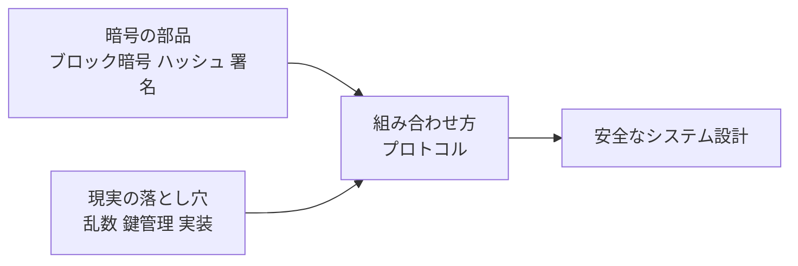

この本の価値は、個々のアルゴリズムの暗記ではなく、**「部品をどう組み合わせて問題を解くか」という設計思考**を学べる点にあります。アルゴリズム自体は時代とともに入れ替わりますが、プロトコルの考え方は長く使えます。

---

## 3. Step 0: 暗号は何を守るのか（全体像）

### 3.1 暗号の4つの目的

初学者が最初に押さえるべきなのは、暗号の目的は「秘密にする」だけではないという点です。

| 目的 | 英語 | 意味 | 代表的な道具 |
|------|------|------|--------------|
| 機密性 | Confidentiality | 第三者に内容を読まれない | 共通鍵暗号（AES-GCM など） |
| 完全性 | Integrity | 内容が改ざんされていない | MAC、デジタル署名（ハッシュは、信頼できる別経路で取得したダイジェストと照合する場合のみ） |
| 認証 | Authentication | 相手が本物であると確認できる | MAC、デジタル署名、証明書 |
| 否認防止 | Non-repudiation | 「私は送っていない」と言い逃れできない | デジタル署名 |

### 3.2 部品と用途の対応

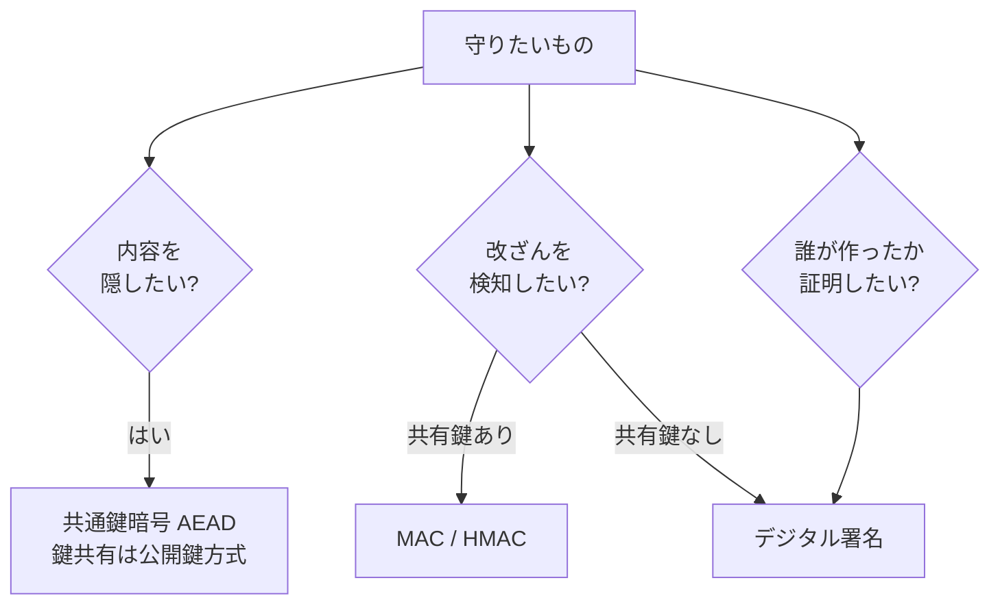

### 3.3 基本用語（最初に覚える8語）

| 用語 | 説明 |
|------|------|
| 平文（plaintext） | 暗号化前のデータ |
| 暗号文（ciphertext） | 暗号化後のデータ |
| 鍵（key） | 暗号化・復号に使う秘密の値 |
| 暗号化／復号 | 平文から暗号文へ／その逆 |
| 共通鍵暗号 | 暗号化と復号に同じ鍵を使う方式 |
| 公開鍵暗号 | 公開してよい鍵と秘密にする鍵のペアを使う方式 |
| ハッシュ関数 | 任意長のデータを固定長の「指紋」に変換する一方向関数 |
| 乱数 | 予測できない値。鍵や nonce の元になる |

### 3.4 絶対に守る原則: Kerckhoffs の原則

> アルゴリズムが全て敵に知られても、鍵さえ秘密なら安全であるように設計する。

「アルゴリズムを秘密にして安全にする」方式（security through obscurity）は、漏れた瞬間に崩壊します。現在使われている AES や ML-KEM など、信頼されている方式は全て仕様が公開され、世界中の研究者に検証されています。NIST のポスト量子暗号標準化も、8年にわたる公開評価を経て決まりました [S9]。

---

## 4. Step 1: 共通鍵暗号と AEAD

### 4.1 ブロック暗号とストリーム暗号

| 種類 | 仕組み | 例 |
|------|--------|----|
| ブロック暗号 | 固定長のブロック（AES なら16バイト）単位で変換 | AES、（歴史的に）DES |
| ストリーム暗号 | 鍵から擬似乱数列を作り、データと XOR | ChaCha20、（歴史的に）RC4 |

書籍 Part III では DES を中心に多数のブロック暗号が詳しく解説されています [S3]。ただし、現在の新規設計で選ぶべきなのは AES か ChaCha20 です。

### 4.2 「暗号化だけ」では危険: 改ざんされる

暗号文は読めなくても、**ビットを書き換えられる**場合があります。そのため現代では、暗号化と改ざん検知を一体にした **AEAD（Authenticated Encryption with Associated Data）** を使うのが標準です。

Latacora は、AEAD を選ぶのが「正しい答え」であり、AES-CBC 単体や AES-CTR 単体などは避けるよう助言しています [S5]。

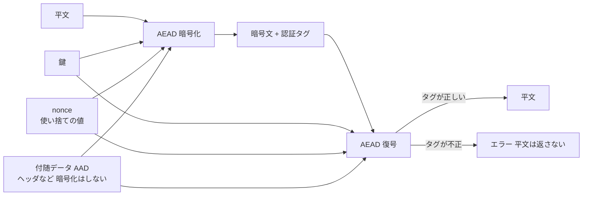

### 4.3 nonce の落とし穴

AEAD の多くは **nonce（number used once）** を要求し、**同じ鍵で nonce を再利用すると致命的**です。Latacora は、特に AES-GCM では nonce の扱いが難しく、ランダム nonce の利用が「安全の境界ぎりぎり」であると指摘しています [S5]。

| 方式 | nonce 長（一般的な値） | nonce の扱い |
|------|------------------------|--------------|
| AES-GCM | 12バイト | 再利用は絶対禁止。カウンタ管理かライブラリ任せ |
| ChaCha20-Poly1305 | 12バイト | 同上 |
| XChaCha20-Poly1305 / XSalsa20-Poly1305 | 24バイト | 長いのでランダム生成が現実的 |

### 4.4 Python での最小例（学習用）

`cryptography` ライブラリの AEAD API を使います。

```python
import os
from cryptography.hazmat.primitives.ciphers.aead import AESGCM

key = AESGCM.generate_key(bit_length=256)   # 256ビット鍵
aead = AESGCM(key)

nonce = os.urandom(12)                      # 毎回新しく生成する。再利用は禁止
aad = b"header-v1"                          # 暗号化はしないが改ざん検知の対象にする
ciphertext = aead.encrypt(nonce, b"secret message", aad)

plaintext = aead.decrypt(nonce, ciphertext, aad)
assert plaintext == b"secret message"
```

`ChaCha20Poly1305` も同じ形で使えます。

```python
from cryptography.hazmat.primitives.ciphers.aead import ChaCha20Poly1305

key = ChaCha20Poly1305.generate_key()
aead = ChaCha20Poly1305(key)
nonce = os.urandom(12)
ct = aead.encrypt(nonce, b"hello", None)
assert aead.decrypt(nonce, ct, None) == b"hello"
```

### 4.5 鍵長の目安

Percival（2009）、Ptacek（2015）、Latacora（2018）の3者とも、共通鍵は256ビットを勧めています [S5]。Latacora は「AES 鍵が破られるより公開鍵ペアが破られる方がはるかに起こりやすい」とも述べています [S5]。

### 4.6 避けるべきもの

| 避けるもの | 理由 | 代わりに |
|------------|------|----------|
| RC4 | 深刻な弱点があり使用禁止 | AES-GCM / ChaCha20-Poly1305 |
| DES / 3DES / Blowfish など64ビットブロック | ブロックが小さく衝突の危険 | AES（128ビットブロック） |
| AES-CBC 単体、AES-CTR 単体 | 改ざん検知がない | AEAD |
| OFB モード | 非推奨 | AEAD |
| 自作の暗号 | 脆弱性の温床 | 既存ライブラリ |

出典: [S5]（Latacora の「Avoid」リスト）

---

## 5. Step 2: ハッシュ関数と MAC

### 5.1 ハッシュ関数とは

ハッシュ関数は、どんな長さのデータも固定長の「指紋」に変換する関数です。良いハッシュ関数には次の3つの性質が求められます。

| 性質 | 意味 | 破られると |
|------|------|-----------|
| 原像計算困難性 | 指紋から元データを逆算できない | 元データが復元される |
| 第二原像計算困難性 | あるデータと同じ指紋を持つ別データを作れない | 文書のすり替えが可能になる |
| 衝突困難性 | 同じ指紋になる2つのデータの組を作れない | 偽の証明書や署名の偽造につながる |

書籍 Ch.18 は MD5 や SHA-1 などを扱いますが、これらは衝突が実際に作れるため、**新規の用途では使いません**。Latacora は、SHA-2 系（SHA-256 など）を使うのが基本で、長さ延長攻撃への対策として SHA-512/256 や BLAKE2 なども選択肢になると述べています [S5]。

| 用途 | 推奨 | 避けるもの |
|------|------|-----------|
| 一般的な指紋 | SHA-256 / SHA-512 / SHA-3 / BLAKE2 | MD5、SHA-1 |
| パスワード保存 | **ハッシュではなく専用方式**（次章） | 素の SHA-256 |

```python
import hashlib

digest = hashlib.sha256(b"hello").hexdigest()
print(digest)  # 64文字の16進文字列
```

### 5.2 MAC（メッセージ認証コード）

ハッシュは誰でも計算できるため、改ざん検知には使えません。**共有鍵を使う指紋**が MAC です。代表例が HMAC です。

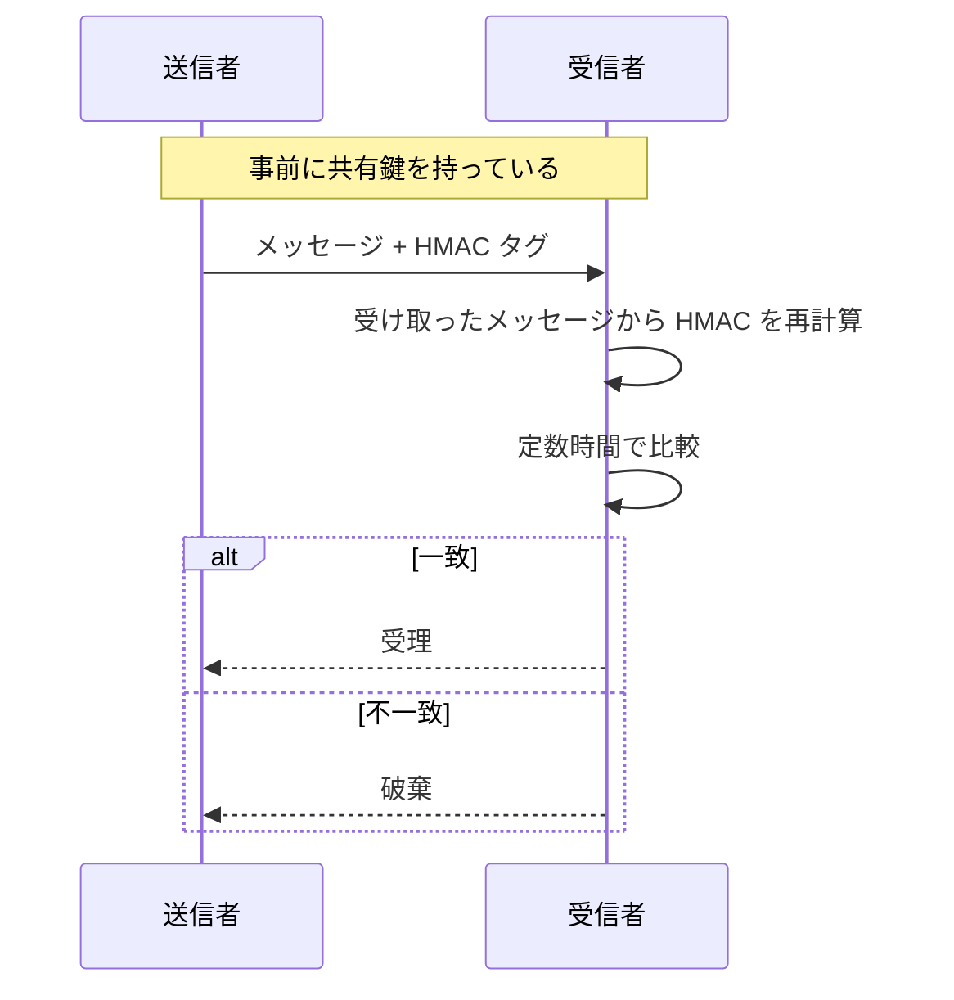

```python
import hmac, hashlib, secrets

key = secrets.token_bytes(32)
msg = b"transfer:100"
tag = hmac.new(key, msg, hashlib.sha256).digest()

# 受信側: 受け取ったメッセージと共有鍵から期待タグを再計算する
def verify(key: bytes, received_msg: bytes, received_tag: bytes) -> bool:
    expected = hmac.new(key, received_msg, hashlib.sha256).digest()
    # == ではなく compare_digest を使う（タイミング攻撃対策）
    return hmac.compare_digest(expected, received_tag)

if not verify(key, msg, tag):
    raise ValueError("MAC 検証失敗: メッセージを破棄する")
```

> **ポイント**: タグの比較に `==` を使うと、一致する先頭バイト数の違いによる処理時間差から情報が漏れる場合があります。必ず定数時間比較を使います。

---

## 6. Step 3: 公開鍵暗号・鍵交換・デジタル署名

### 6.1 なぜ公開鍵暗号が必要か

共通鍵暗号には「最初にどうやって鍵を安全に共有するか」という問題があります。公開鍵暗号はこれを解決します。

| 方式 | 目的 | 代表例 | 備考 |
|------|------|--------|------|
| 鍵交換 | 2者が共通の秘密を作る | Diffie-Hellman、X25519 | 現在の主流は楕円曲線 |
| 公開鍵暗号 | 公開鍵で暗号化し秘密鍵で復号 | RSA-OAEP | 新規設計では鍵交換＋AEAD が一般的 |
| デジタル署名 | 秘密鍵で署名し公開鍵で検証 | Ed25519、ECDSA、RSA-PSS | 認証・否認防止 |

### 6.2 ハイブリッド暗号: 実際の使い方

公開鍵暗号は遅く、大きなデータには向きません。実際には**公開鍵方式で鍵を共有し、実データは共通鍵（AEAD）で暗号化**します。

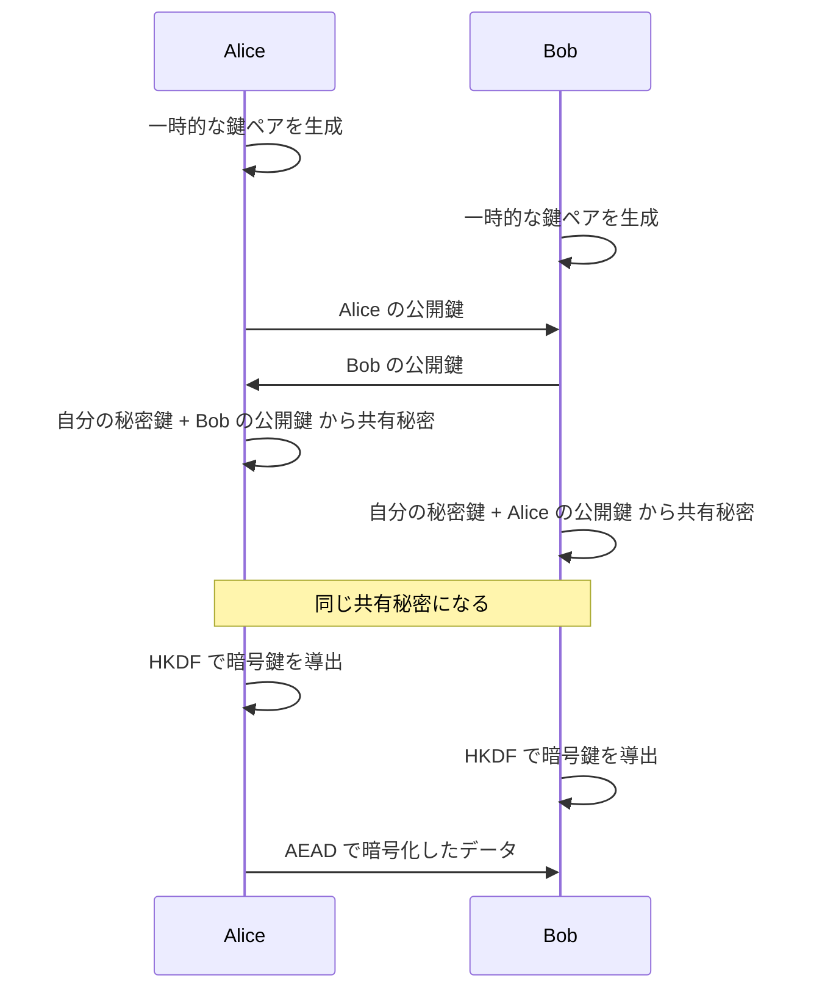

```python
from cryptography.hazmat.primitives import hashes
from cryptography.hazmat.primitives.asymmetric.x25519 import X25519PrivateKey
from cryptography.hazmat.primitives.kdf.hkdf import HKDF

alice_priv = X25519PrivateKey.generate()
bob_priv = X25519PrivateKey.generate()

shared_a = alice_priv.exchange(bob_priv.public_key())
shared_b = bob_priv.exchange(alice_priv.public_key())
assert shared_a == shared_b          # 同じ共有秘密

# 共有秘密をそのまま鍵にせず、HKDF で鍵として整形する
key = HKDF(
    algorithm=hashes.SHA256(),
    length=32,
    salt=None,
    info=b"my-app v1 session key",
).derive(shared_a)
```

> **注意**: 上の例は「相手が本物か」を確認していません。実際には署名や証明書による認証が必要です（中間者攻撃への対策）。

### 6.3 デジタル署名の例（Ed25519）

```python
from cryptography.exceptions import InvalidSignature
from cryptography.hazmat.primitives.asymmetric.ed25519 import Ed25519PrivateKey

sk = Ed25519PrivateKey.generate()
pk = sk.public_key()

message = b"release v1.0.0"
signature = sk.sign(message)

try:
    pk.verify(signature, message)
    print("署名は有効")
except InvalidSignature:
    print("署名は無効")
```

### 6.4 RSA と楕円曲線の選び方

Latacora（2018）は、新規設計では Curve25519 系（X25519、Ed25519）を勧め、RSA は避けるが、どうしても必要なら RSA-OAEP や RSA-PSS を使うとしています [S5]。ただし **2026年現在は、これらの古典公開鍵暗号はいずれも量子コンピュータに弱い**ため、第10章のポスト量子暗号への移行計画も同時に考える必要があります。

---

## 7. Step 4: 乱数と鍵管理

### 7.1 乱数は全ての出発点

鍵、nonce、ソルトは全て乱数から作られます。乱数が予測できると、どんなに強いアルゴリズムでも意味を失います。書籍 Ch.16〜17 では擬似乱数生成器が詳しく扱われています [S3]。

| やるべきこと | 具体例（Python） |
|--------------|-------------------|
| OS の暗号論的乱数を使う | `secrets` モジュール、`os.urandom` |
| 自分で乱数生成器を作らない | — |
| 時刻やプロセス ID を種にしない | — |

```python
import secrets
token = secrets.token_bytes(32)   # 256ビットの鍵素材
```

> `random` モジュールは暗号用途に使ってはいけません。予測可能です。

### 7.2 鍵管理（書籍 Ch.8）

書籍 Part II のテーマの一つが鍵管理です [S3]。「アルゴリズムが強くても、鍵の扱いが悪ければ全てが崩れる」という点は、今も変わりません。

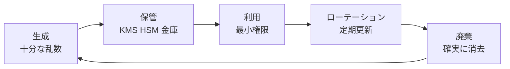

| 工程 | 良い例 | 悪い例 |
|------|--------|--------|
| 生成 | OS の乱数、KMS で生成 | 固定文字列、短いパスワードをそのまま鍵にする |
| 保管 | KMS、HSM、シークレット管理サービス | ソースコードや Git に直接書く |
| 利用 | 用途ごとに鍵を分ける | 1本の鍵を全用途に使い回す |
| 更新 | 計画的なローテーション | 一度作ったら永遠に同じ |
| 廃棄 | 不要になったら確実に削除 | 古い鍵がバックアップに残り続ける |

---

## 8. Step 5: パスワードの保存

### 8.1 なぜ「ただのハッシュ」では不十分か

SHA-256 のような高速ハッシュは、攻撃者が1秒間に何十億回も試せるため、パスワードには不向きです。**わざと遅く、メモリを大量に使う**専用方式を使います。

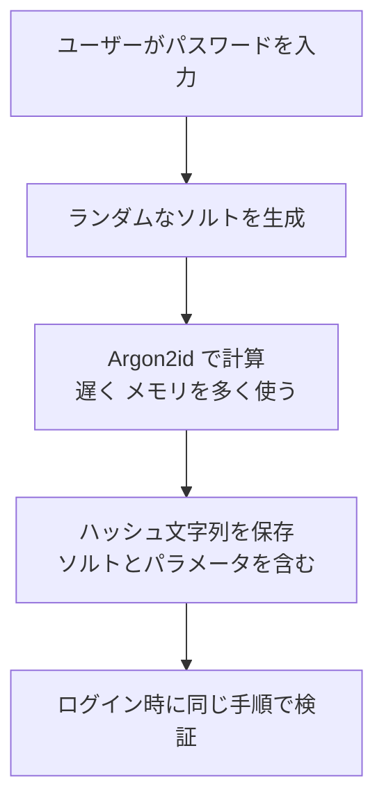

### 8.2 OWASP の推奨

OWASP の Password Storage Cheat Sheet は、第一選択として **Argon2id** を挙げ、最小構成の目安として、メモリ19 MiB、反復回数2、並列度1という設定を示しています [S17]。Argon2 は RFC 9106 で規格化されています。

| 方式 | 位置づけ |
|------|----------|
| Argon2id | 第一選択 |
| scrypt | 代替 |
| bcrypt | レガシーシステム向け（入力長の制限に注意） |
| PBKDF2 | FIPS 準拠が必要な場合 |

```python
from argon2 import PasswordHasher
from argon2.exceptions import VerifyMismatchError

ph = PasswordHasher(time_cost=2, memory_cost=19 * 1024, parallelism=1)  # memory_cost は KiB 単位

stored = ph.hash("correct horse battery staple")

try:
    ph.verify(stored, "correct horse battery staple")
    print("認証成功")
except VerifyMismatchError:
    print("認証失敗")
```

> パラメータは時間とともに見直す必要があります。最新の推奨値は必ず OWASP の最新版で確認してください [S17]。

---

## 9. Step 6: プロトコル（TLS 1.3 と書籍 Part I の現代的な読み方）

### 9.1 書籍 Part I をどう読むか

書籍 Part I（Ch.3〜6）は、暗号の部品を組み合わせた「プロトコル」を扱います [S3]。現代の言葉に直すと次のとおりです。

| 書籍の主題 | 現代での姿 | 実例 |
|------------|-----------|------|
| 鍵交換 | 一時鍵による Diffie-Hellman | TLS 1.3、Signal |
| 認証 | 証明書＋署名 | HTTPS、コード署名 |
| 秘密分散 | しきい値方式の鍵管理 | 鍵のバックアップ、マルチシグ |
| コミットメント | 「今は見せず、後で開示」 | 公平な抽選、ブロックチェーン |
| ゼロ知識証明 | 中身を明かさず正しさを証明 | プライバシー保護の認証 |
| 秘匿計算 | データを見せずに共同計算 | プライバシー保護の分析 |

### 9.2 TLS 1.3 のハンドシェイク

HTTPS の土台である TLS の最新版は 1.3 です。仕様は長く RFC 8446 でしたが、**2026年7月に RFC 9846 が公開され、RFC 8446 を置き換えました**（rfc-editor.org で確認）[S12]。

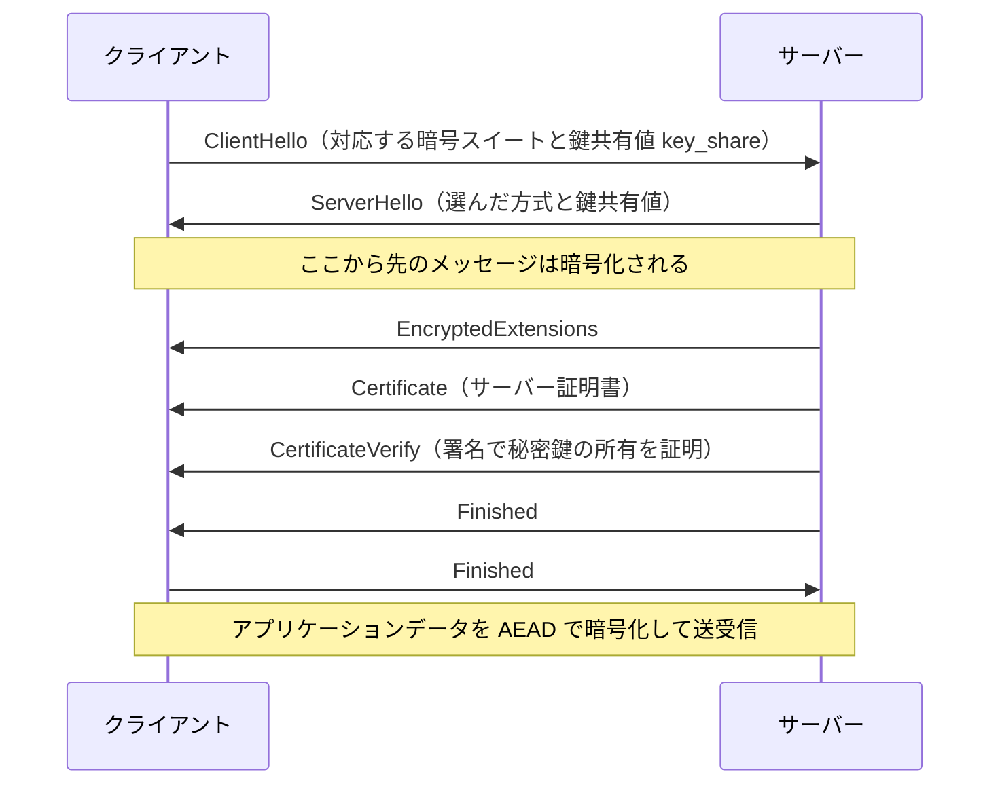

### 9.3 ハンドシェイクで使われる部品の対応

| 場面 | 使われる部品 | この文書の章 |
|------|--------------|--------------|
| 鍵共有 | X25519 など（PQ ではハイブリッド） | 6章・10章 |
| サーバー認証 | 証明書と署名 | 6章 |
| 鍵導出 | HKDF | 6章 |
| データ保護 | AES-GCM / ChaCha20-Poly1305 | 4章 |
| 整合性確認 | Finished メッセージ（MAC 相当） | 5章 |

### 9.4 秘密分散（Shamir）の最小例（教育用）

書籍が扱う「しきい値方式」の理解のため、Shamir の秘密分散を示します。**本番利用は禁止**です。

```python
import secrets

P = 2**127 - 1   # 十分大きな素数（教育用）

def split(secret: int, k: int, n: int):
    """secret を n 個に分割し、k 個集めれば復元できるようにする"""
    if not 1 <= k <= n < P:
        raise ValueError("k と n は 1 <= k <= n < P を満たさなければならない")
    if not 0 <= secret < P:
        raise ValueError("secret は 0 以上 P 未満でなければならない")
    coeffs = [secret] + [secrets.randbelow(P) for _ in range(k - 1)]

    def f(x: int) -> int:
        y = 0
        for c in reversed(coeffs):
            y = (y * x + c) % P
        return y

    return [(x, f(x)) for x in range(1, n + 1)]

def combine(shares):
    """ラグランジュ補間で x=0 の値を求める"""
    if not shares:
        raise ValueError("shares が空のため復元できない")
    s = 0
    for i, (xi, yi) in enumerate(shares):
        num = den = 1
        for j, (xj, _) in enumerate(shares):
            if i != j:
                num = (num * (-xj)) % P
                den = (den * (xi - xj)) % P
        s = (s + yi * num * pow(den, -1, P)) % P
    return s

shares = split(123456789, k=3, n=5)
assert combine(shares[:3]) == 123456789      # 任意の3個で復元できる
assert combine(shares[2:5]) == 123456789
```

---

## 10. Step 7: ポスト量子暗号（2026年10月時点の最新動向）

書籍が書かれた時代にはなかった最大の変化が、**量子コンピュータを前提にした暗号の入れ替え**です。

### 10.1 何が問題なのか

十分に大きな量子コンピュータが実現すると、RSA・Diffie-Hellman・楕円曲線暗号（ECC）の土台である数学的問題が効率よく解かれてしまいます。一方、AES などの共通鍵暗号やハッシュは、鍵長・出力長を十分に取れば影響は限定的です。

| 種類 | 量子コンピュータの影響 | 対応 |
|------|------------------------|------|
| RSA / DH / ECC（鍵交換・署名） | **破られる** | ポスト量子暗号へ移行 |
| AES などの共通鍵暗号 | 実効強度が下がる（鍵長を確保すれば可） | 256ビット鍵を使う |
| SHA-2 / SHA-3 | 影響は限定的 | 出力長を十分に取る |

### 10.2 「今すぐ」対応が必要な理由: Harvest Now, Decrypt Later

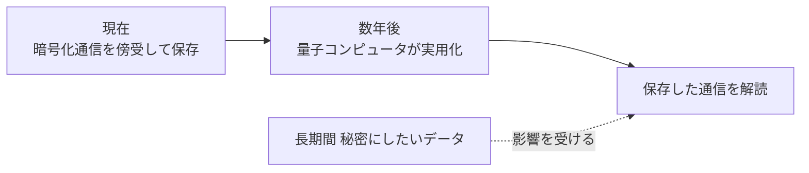

通信を今のうちに保存しておき、将来解読する攻撃です。**長期間秘密にしたいデータの鍵交換は、今から保護する必要があります。** HNDL が主に脅かすのは通信の**機密性**です。TLS ハンドシェイクのようにその場で検証が終わる署名は、後から偽造されても過去の通信の解読にはつながらないため、HNDL の直接の対象ではありません。

ただし、署名の移行が後回しでよいわけではありません。ファームウェア署名、コード署名、長期保存文書の署名、ルート CA などの信頼の起点のように、**何年も後に検証される署名や長く使われる公開鍵**は、量子コンピュータが実用化した時点で偽造される可能性があります。これらは HNDL とは別の脅威として、更新に時間がかかる長寿命デバイスほど早く移行計画を立てる必要があります（10.8 節も参照）。

### 10.3 NIST の標準化状況（公式ページに基づく）

NIST は2024年8月に最初の3つの標準を確定させました [S9][S10]。

| 標準 | アルゴリズム | 用途 | 元の名称 |
|------|--------------|------|----------|
| FIPS 203 | **ML-KEM** | 鍵カプセル化（鍵交換） | CRYSTALS-Kyber |
| FIPS 204 | **ML-DSA** | デジタル署名 | CRYSTALS-Dilithium |
| FIPS 205 | **SLH-DSA** | デジタル署名（ハッシュベース） | SPHINCS+ |

続く動きは次のとおりです。

| 項目 | 状況 | 確かさ |
|------|------|--------|
| HQC | 2025年3月に、ML-KEM とは数学的基盤が異なる予備の鍵カプセル化方式として選定。標準化作業中 | NIST 公式で確認 [S9] |
| FN-DSA（FIPS 206 / 元 Falcon） | 標準化作業中 | **草案の公開状況は二次情報で食い違うため、NIST の公式ページで要確認** |
| NIST IR 8547 | 量子耐性のない RSA・ECC を2030年以降非推奨、2035年までに廃止する移行方針案 | 初期草案ベース [S11] |

> **学習者へのアドバイス**: FIPS 206 のような進行中の標準は、記事ごとに記述が異なることがあります。実装や調達の判断に使うときは、必ず NIST の一次情報を確認してください。

### 10.4 実際の導入: ハイブリッド方式

ポスト量子方式は新しく、実績が古典方式より短いため、**古典方式（X25519）とポスト量子方式（ML-KEM）を同時に使い、どちらか一方が安全なら全体が安全**になる「ハイブリッド」が主流です。

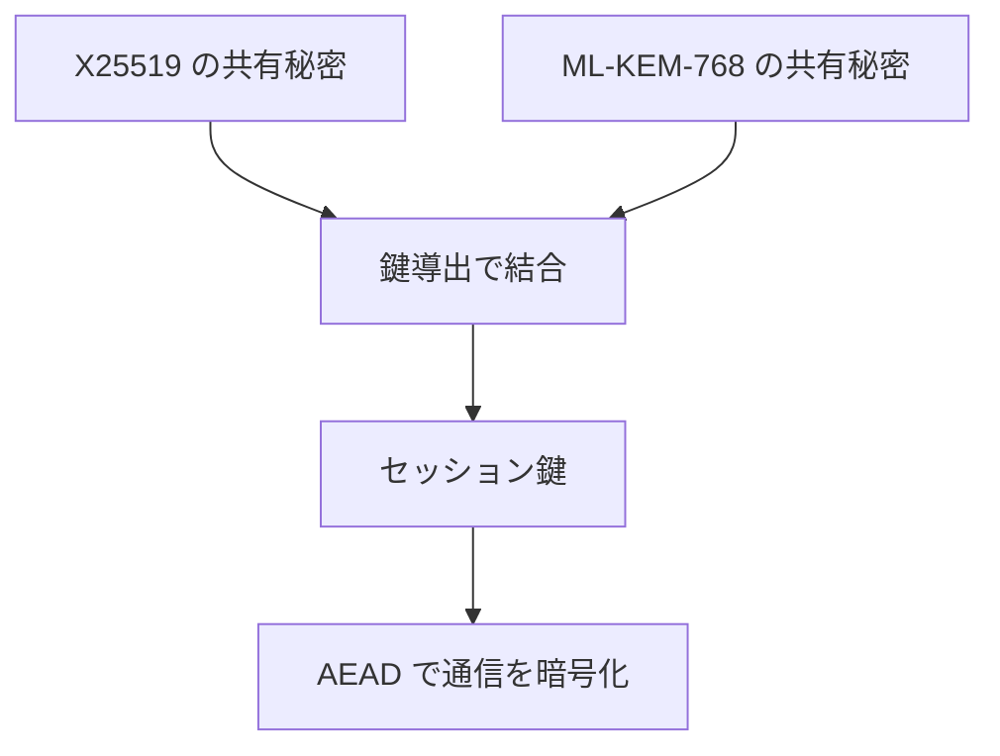

| 項目 | 内容 |
|------|------|
| 標準 | **RFC 10024**（2026年8月）: TLS 1.3 向けのポスト量子／従来型ハイブリッド鍵合意 [S13] |
| 代表的な組み合わせ | X25519MLKEM768 |
| 実装が進んだ場所 | ブラウザ、Cloudflare などの CDN、Signal など |

**サイズの違い**（ML-KEM-768 の例）:

| 項目 | サイズ | 出典 |
|------|--------|------|
| ML-KEM-768 公開鍵 | 1184 バイト | [S18] |
| ML-KEM-768 暗号文 | 1088 バイト | [S18] |
| 共有秘密 | 32 バイト | [S18] |
| X25519MLKEM768 のクライアント鍵共有値 | 1216 バイト（X25519 の32バイト + 1184バイト） | [S19] |

X25519 単体の公開鍵は32バイトなので、通信量は大きく増えます。これが実運用で性能面の工夫が必要になる理由です。

### 10.5 業界の動き（2026年）

| 組織 | 動き | 出典 |
|------|------|------|
| Google | 暗号移行のタイムラインを2029年とする見解を公表 | [S14] |
| Cloudflare | 2029年までの完全なポスト量子対応を目標に掲げたロードマップを公表。同社の観測では、ポスト量子の鍵交換を使う接続が急増 | [S15] |
| Signal | 2025年10月、ポスト量子対応の「Triple Ratchet（SPQR）」を発表 | [S16] |
| IETF | RFC 9846（TLS 1.3 改訂）と RFC 10024（ハイブリッド）を公開 | [S12][S13] |

> **注意**: 「量子コンピュータがいつ実用化するか」には確定した答えがありません。各社の年限は**計画上の目標**であり、予言ではありません。

**Cloudflare の通信量に関する数字**: Cloudflare は自社ネットワーク上のポスト量子利用率を公開しており、過半数が対応済みとされています [S15]。ただしこれは**同社の観測範囲の値であって、インターネット全体の値ではありません**。最新の数値は Cloudflare Radar などで確認してください。

### 10.6 Signal の Triple Ratchet（概念）

Signal は、従来の Double Ratchet に、ML-KEM に基づく「スパース・ポスト量子ラチェット（SPQR）」を並走させる設計です [S16]。

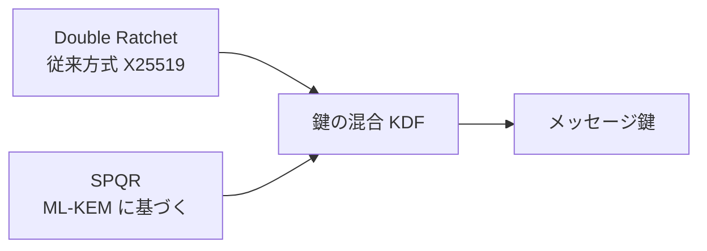

「どちらか一方が破られても、もう一方が守る」というハイブリッドの発想が、プロトコル全体に適用された例です。

### 10.7 自分のサーバーで確認する

Cloudflare のドキュメントには、オリジンサーバーがポスト量子鍵交換に対応しているか確認する `bssl` コマンドの例があります [S15]。

```bash
bssl client -connect <ORIGIN_HOSTNAME>:443 -curves X25519MLKEM768
```

出力に `X25519MLKEM768` が表示されれば、その鍵共有グループで接続できています。

### 10.8 移行の進め方（初学者向けチェックリスト）

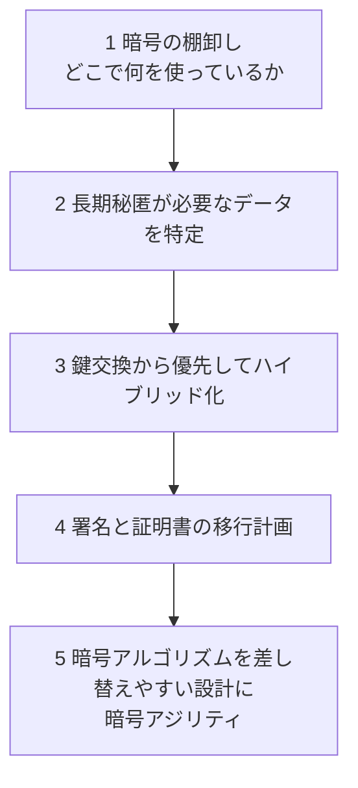

| 優先度 | 対象 | 理由 |
|--------|------|------|
| 高 | 長期保存が必要なデータの鍵交換 | Harvest Now, Decrypt Later の対象 |
| 中 | TLS（外部公開サービス） | ライブラリ・CDN の更新で対応しやすい |
| 中 | 署名・証明書・ファームウェア署名 | 更新が難しく、長寿命な機器ほど早めの検討が必要 |
| 低〜中 | 共通鍵暗号 | 256ビット鍵の確保でおおむね対応 |

---

## 11. Step 8: 実装で失敗しないための「正解」集

### 11.1 Schneier 自身の教訓

Schneier は後年、暗号の数学的な強さよりも、**実装・運用・人間・システム全体**の方に現実の弱点が多いと述べています [S4]。書籍を読んで「アルゴリズムを選べば終わり」と考えないことが重要です。

### 11.2 「Cryptographic Right Answers」の系譜

Colin Percival（2009）、Thomas Ptacek（2015）、Latacora（2018）と、「結局どれを使えばよいか」を示す記事が更新されてきました。Latacora の記事 [S5] は最新の標準的な参照先の一つで、ポスト量子対応版（2024年8月）も同社のブログに公開されています [S6]。

| 用途 | Latacora（2018）の基本的な答え | 補足（2026年） |
|------|----------------------------------|----------------|
| 対称暗号化 | AEAD（ChaCha20-Poly1305 / XSalsa20-Poly1305、または AES-GCM） | 変わらず |
| 対称鍵長 | 256ビット | 変わらず |
| ハッシュ | SHA-2 系（長さ延長攻撃に注意）、BLAKE2 | SHA-3 も選択肢 |
| 鍵交換・公開鍵 | Curve25519 系 | **ML-KEM とのハイブリッドを検討** |
| 署名 | Ed25519 | **ML-DSA の移行計画を検討** |
| パスワード保存 | scrypt / bcrypt / Argon2 など | **OWASP は Argon2id を第一選択** [S17] |
| 乱数 | OS の CSPRNG | 変わらず |

### 11.3 やってはいけないことと、その代わり

| やってしまいがち | 何が起きるか | 代わりに |
|------------------|--------------|----------|
| 独自暗号・独自プロトコルの設計 | 検証されていない脆弱性が残る | 標準プロトコル（TLS、Signal 系など）とライブラリ |
| 同じ鍵と nonce の再利用 | 平文の復元や改ざんにつながる | ライブラリに nonce 管理を任せる、または長い nonce |
| 暗号化のみで認証なし | 改ざんされる | AEAD |
| `random` や時刻から鍵を作る | 鍵が推測される | `secrets` / `os.urandom` |
| MAC を `==` で比較 | タイミング攻撃 | `hmac.compare_digest` |
| パスワードを素の SHA-256 で保存 | 高速に総当たりされる | Argon2id |
| 鍵をソースコードや Git に置く | 漏洩 | KMS / シークレット管理 |
| 暗号アルゴリズムを固定配線 | 将来の移行が困難 | 暗号アジリティを設計に入れる |
| 証明書検証の無効化（テスト用のまま本番へ） | 中間者攻撃 | 検証を常に有効にする |

### 11.4 暗号選択の判断フロー

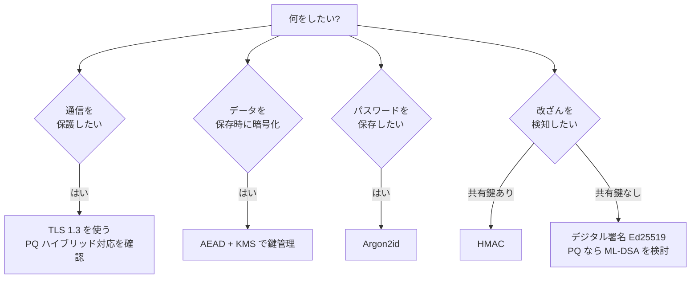

---

## 12. この本を2026年に読むときの注意（古くなった部分）

| 書籍の内容 | 現在の状況 | 読み方 |
|------------|-----------|--------|
| DES | 鍵が短く廃止済み | 暗号設計の歴史（Feistel 構造）として読む |
| IDEA、Blowfish、RC2 など | 実務ではほぼ使われない | 設計の多様性を知る教材 |
| RC4 | 深刻な弱点で使用禁止 | 「なぜ破られたか」の事例として |
| MD5、SHA-1 | 衝突が実際に作られており使用禁止 | 同上 |
| RSA 単体の鍵交換 | 前方秘匿性がなく、量子にも弱い | 概念の理解用 |
| 鍵長の推奨値 | 当時の計算能力に基づく | 現行の NIST／OWASP の推奨を参照 |
| 輸出規制や Clipper チップなど（Part IV の政治） | 状況が大きく変化 | 暗号政策の歴史として読む |
| Part V の C ソース | 教育用 | **本番に使わない** |
| プロトコル設計（Part I） | 今も有効な考え方が多い | 現代の用語に置き換えて読む |

> 書籍の価値は「結論（どのアルゴリズムを使うか）」ではなく、「なぜそう考えるのか」にあります。

---

## 13. 学習ロードマップと推薦図書

### 13.1 学習の進め方

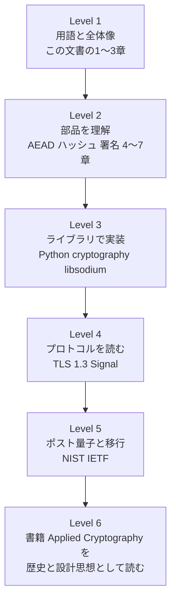

### 13.2 併読をおすすめする書籍・資料

| 資料 | 著者 | 特徴 |
|------|------|------|
| Real-World Cryptography | David Wong（Manning） | 実世界の暗号を現代的に解説。初学者から実務者向け [S8] |
| Cryptography Engineering | Ferguson, Schneier, Kohno | 実装の落とし穴に焦点 |
| Secrets and Lies | Bruce Schneier | 暗号だけでは安全にならないという視点 [S4] |
| Cryptographic Right Answers | Latacora | 「結局何を使うか」の早見 [S5] |
| NIST PQC プロジェクトページ | NIST | ポスト量子標準の一次情報 [S9] |

---

## 14. 確認問題

理解度を確認してみましょう。答えは各問の下に折りたたんであります。

**Q1.** 暗号の4つの目的を挙げてください。

<details><summary>答え</summary>

機密性、完全性、認証、否認防止。

</details>

**Q2.** なぜ AES-CBC 単体より AEAD が推奨されるのですか。

<details><summary>答え</summary>

AES-CBC 単体は暗号化のみで、改ざんを検知できないため。AEAD は暗号化と認証を一体で提供します。

</details>

**Q3.** AES-GCM で同じ鍵に同じ nonce を再利用すると何が問題ですか。

<details><summary>答え</summary>

平文情報の漏洩や、認証の破綻（偽造）につながります。nonce は鍵ごとに一意でなければなりません。

</details>

**Q4.** MAC のタグを `==` で比較してはいけない理由は何ですか。

<details><summary>答え</summary>

比較にかかる時間の差から情報が漏れるタイミング攻撃のおそれがあるため。定数時間比較（`hmac.compare_digest` など）を使います。

</details>

**Q5.** パスワード保存に SHA-256 を直接使ってはいけない理由は何ですか。

<details><summary>答え</summary>

高速すぎて、攻撃者が大量の候補を短時間で試せるため。Argon2id のように遅くメモリを要する専用方式を使います。

</details>

**Q6.** Harvest Now, Decrypt Later とは何ですか。

<details><summary>答え</summary>

現在の暗号化通信を保存しておき、将来量子コンピュータが実用化したときに解読する攻撃。長期秘匿が必要な通信の鍵交換は今から保護すべきです。

</details>

**Q7.** ML-KEM、ML-DSA、SLH-DSA はそれぞれ何の用途ですか。

<details><summary>答え</summary>

ML-KEM は鍵カプセル化（鍵交換）、ML-DSA と SLH-DSA はデジタル署名です。

</details>

**Q8.** ハイブリッド方式にする利点は何ですか。

<details><summary>答え</summary>

古典方式とポスト量子方式を組み合わせることで、片方が破られてももう片方が安全なら全体の安全性が保たれる点。新しい方式の実績の短さを補えます。

</details>

---

## 15. 用語集

| 用語 | 説明 |
|------|------|
| AEAD | 認証付き暗号。暗号化と改ざん検知を同時に行う |
| AAD | 付随データ。暗号化はしないが改ざん検知の対象にする |
| nonce | 一度だけ使う値 |
| MAC / HMAC | 共有鍵を使うメッセージ認証コード |
| KDF / HKDF | 鍵導出関数。秘密から用途別の鍵を作る |
| CSPRNG | 暗号論的擬似乱数生成器 |
| X25519 | Curve25519 を使う鍵交換 |
| Ed25519 | 楕円曲線を使うデジタル署名 |
| Argon2id | パスワード保存向けの鍵導出関数 |
| 前方秘匿性（Forward Secrecy） | 長期鍵が漏れても過去の通信は解読されない性質 |
| ML-KEM | NIST が標準化したポスト量子の鍵カプセル化方式（FIPS 203） |
| ML-DSA | NIST が標準化したポスト量子署名（FIPS 204） |
| SLH-DSA | ハッシュベースのポスト量子署名（FIPS 205） |
| ハイブリッド方式 | 古典方式とポスト量子方式を併用する方式 |
| 暗号アジリティ | 暗号アルゴリズムを後から差し替えやすい設計 |
| Harvest Now, Decrypt Later | 今傍受し、将来解読する攻撃戦略 |

---

## 16. 参考文献（出典 URL 一覧）

調査日: 2026年10月9日時点。`[S番号]` は本文中の出典番号です。

### 16.1 書籍・著者の一次情報

| 番号 | 内容 | URL |
|------|------|-----|
| S1 | Google Books: Applied Cryptography（書誌情報） | https://books.google.co.jp/books/about/Applied_Cryptography.html?id=01vfjgEACAAJ&redir_esc=y |
| S2 | Bruce Schneier 公式: Applied Cryptography | https://www.schneier.com/books/applied_cryptography/ |
| S3 | Schneier 公式: Applied Cryptography 目次 | https://www.schneier.com/books/applied_cryptography/toc.html |
| S4 | Schneier 公式: Secrets and Lies 序文 | https://www.schneier.com/books/secrets_and_lies/pref.html |

### 16.2 実務上の「正解」を示す著名な開発者の記事

| 番号 | 内容 | URL |
|------|------|-----|
| S5 | Latacora: Cryptographic Right Answers | https://www.latacora.com/blog/cryptographic-right-answers/ |
| S6 | Latacora ブログ（暗号カテゴリ。ポスト量子版を含む） | https://www.latacora.com/categories/cryptography |
| S7 | Colin Percival: Cryptographic Right Answers（2009年の原典） | http://www.daemonology.net/blog/2009-06-11-cryptographic-right-answers.html |
| S8 | David Wong: Real-World Cryptography（Manning） | https://www.manning.com/books/real-world-cryptography |
| S8b | David Wong のブログ | https://cryptologie.net/ |
| S20 | Julia Evans: Cryptographic Right Answers の紹介 | https://jvns.ca/til/cryptographic-right-answers/ |

### 16.3 標準化機関・仕様

| 番号 | 内容 | URL |
|------|------|-----|
| S9 | NIST: Post-Quantum Cryptography プロジェクト | https://csrc.nist.gov/projects/post-quantum-cryptography |
| S10 | NIST FIPS 203（ML-KEM） | https://csrc.nist.gov/pubs/fips/203/final |
| S10b | NIST FIPS 204（ML-DSA） | https://csrc.nist.gov/pubs/fips/204/final |
| S10c | NIST FIPS 205（SLH-DSA） | https://csrc.nist.gov/pubs/fips/205/final |
| S11 | NIST IR 8547（量子耐性への移行・初期草案） | https://csrc.nist.gov/pubs/ir/8547/ipd |
| S12 | RFC 9846: TLS 1.3（RFC 8446 を置き換え） | https://www.rfc-editor.org/rfc/rfc9846.html |
| S13 | RFC 10024: TLS 1.3 向け PQ/T ハイブリッド鍵合意 | https://www.rfc-editor.org/rfc/rfc10024 |
| S17 | OWASP: Password Storage Cheat Sheet | https://cheatsheetseries.owasp.org/cheatsheets/Password_Storage_Cheat_Sheet.html |
| S18 | IETF Internet-Draft: PQC アルゴリズムのガイダンス（サイズ表） | https://www.ietf.org/archive/id/draft-prabel-pquip-pqc-guidance-00.html |

### 16.4 産業界の動向

| 番号 | 内容 | URL |
|------|------|-----|
| S14 | Google: 暗号移行のタイムライン | https://blog.google/innovation-and-ai/technology/safety-security/cryptography-migration-timeline/ |
| S15 | Cloudflare: ポスト量子ロードマップ | https://blog.cloudflare.com/post-quantum-roadmap/ |
| S15b | Cloudflare: ドメインのポスト量子対応状況の可視化 | https://blog.cloudflare.com/post-quantum-visibility/ |
| S15c | Cloudflare Docs: オリジンへのポスト量子暗号 | https://developers.cloudflare.com/ssl/post-quantum-cryptography/pqc-to-origin/ |
| S16 | Signal: Signal Protocol and Post-Quantum Ratchets | https://signal.org/blog/spqr/ |
| S16b | PQShield: Signal の新ポスト量子プロトコルの解説 | https://pqshield.com/?p=9081 |
| S19 | SDxCentral: Cloudflare とポスト量子鍵交換（鍵共有値のサイズ） | https://www.sdxcentral.com/news/cloudflare-45-billion-daily-connections-see-automated-post-quantum-key-exchange/ |

### 16.5 この文書の限界について

- **FIPS 206（FN-DSA）の草案公開状況**: 二次情報の間で記述が一致しなかったため、本文では「標準化作業中」とし、断定を避けました。判断前に NIST の公式ページを確認してください。
- **NIST IR 8547**: 本文は初期公開草案に基づく方針案として記述しています。最終版の内容は NIST で確認してください。
- **企業の発表値**: Cloudflare や Google の年限・利用率は各社の見解・観測値であり、業界全体の確定事実ではありません。
- **書籍の章構成**: 第2版の目次に基づいています。20周年記念版の細部は版により異なる可能性があります。
- **コード例**: 仕組みの理解を目的とした最小例です。本番利用前に、使用するライブラリの最新ドキュメントとセキュリティレビューを必ず経てください。
