# Bulletproof TLS and PKI 初学者向けステップバイステップ解説ガイド

> **対象書籍**: *Bulletproof TLS and PKI, Second Edition*（著: Ivan Ristić / 出版: Feisty Duck / 2022年1月 / 512ページ / ISBN 978-1907117091）
> **情報基準日**: 2026年10月11日（Web検索で確認できた範囲）
> **想定読者**: TLS/PKI を初めて体系的に学ぶ開発者・インフラ担当・QA・セキュリティ担当
> **表記ルール**: 本文は日本語、技術用語は英語のまま表記します。図解は Mermaid と Markdown の表のみを使用し、ASCII アートは使いません。

---

## 0. はじめに：このガイドの位置づけ

### 0.1 書籍についての注意（Google Books のページについて）

ご指定の Google Books ページ（`id=fQOLBAAAQBAJ`）は、2014年刊の初版 **Bulletproof SSL and TLS** として登録されています。同書は2022年に改訂され、書名が **Bulletproof TLS and PKI** に変わりました。第2版は「SSL を減らし TLS を増やした」改訂で、次の点が大きく変わっています（著者の公式ページより）。

| 変更点 | 内容 |
|---|---|
| TLS 1.3 の章 | 完全な新規章として追加 |
| 設定ガイドの章 | 全面的に書き直し |
| その他の章 | 多くが大幅に更新・書き直し |
| 初版の終盤4章 | 削除 |

そこで本ガイドは、**第2版の章構成（全13章・4部構成）に沿って**、初学者向けに再構成しています。

### 0.2 著作権への配慮

本ガイドは書籍の本文を転載・翻訳したものではありません。公式サイトで公開されている目次・章紹介と、IETF の RFC、ブラウザベンダー、Let's Encrypt などの公開一次情報をもとに、筆者の言葉で解説しています。詳細を読みたい場合は書籍を購入してください。

### 0.3 「書籍刊行後」に変わったこと

書籍の最終更新は2022年1月です。その後の4年半で、TLS/PKI の世界は大きく動きました。本ガイドでは第10章で **2026年10月時点の最新動向** をまとめています。

| 分野 | 主な変化（詳細は第10章） |
|---|---|
| 証明書の有効期間 | 2026年3月に最大200日へ短縮。2029年3月に47日へ |
| 失効確認 | Let's Encrypt が OCSP を停止。CRL に一本化 |
| 短命証明書 | Let's Encrypt が6日証明書と IP アドレス証明書を一般提供 |
| 証明書の用途分離 | Chrome が serverAuth 専用の階層を要求（clientAuth EKU の廃止） |
| ポスト量子暗号 | `X25519MLKEM768` が RFC 10024 として標準化。主要ブラウザで既定有効 |
| プライバシー | Encrypted Client Hello（ECH）が RFC 9849 として標準化 |
| TLS 1.3 の仕様 | RFC 8446 が RFC 9846 に置き換え |
| Certificate Transparency | Static CT API（Sunlight / TesseraCT）の普及 |

---

## 1. 全体像とロードマップ

### 1.1 学習の流れ

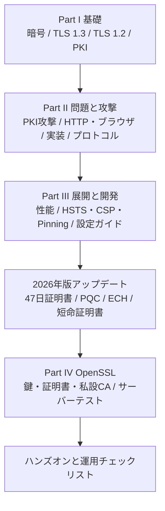

### 1.2 書籍の章と本ガイドの対応表

| 部 | 書籍の章 | 本ガイドの章 | 初学者向けの難易度 |
|---|---|---|---|
| Part I | 1. SSL, TLS, and Cryptography | 第2章 | 易 |
| Part I | 2. TLS 1.3 | 第3章 | 中 |
| Part I | 3. TLS 1.2 | 第4章 | 中 |
| Part I | 4. Public Key Infrastructure | 第5章 | 中 |
| Part II | 5. Attacks against PKI | 第6章 | 易 |
| Part II | 6. HTTP and Browser Issues | 第6章 | 中 |
| Part II | 7. Implementation Issues | 第6章 | 中 |
| Part II | 8. Protocol Attacks | 第6章 | 難 |
| Part III | 9. Performance | 第7章 | 中 |
| Part III | 10. HSTS, CSP, and Pinning | 第8章 | 中 |
| Part III | 11. TLS Configuration Guide | 第9章 | 易（実務で最重要） |
| Part IV | 12. OpenSSL / 13. Testing with OpenSSL | 第11章 | 中 |

### 1.3 最初に押さえる 5 つの用語

| 用語 | 一言で言うと |
|---|---|
| TLS | 通信を暗号化し、改ざんと盗聴を防ぎ、相手が本物かを確認するプロトコル |
| SSL | TLS の古い名前。現在の SSL 3 以前は使用禁止。「SSL証明書」は慣習的な呼び名 |
| 証明書（Certificate） | 「この公開鍵はこのドメインのもの」と CA が署名した電子的な身分証 |
| CA（Certificate Authority） | 証明書に署名して発行する機関 |
| PKI（Public Key Infrastructure） | CA、証明書、失効、ルールなど信頼の仕組み全体 |

---

## 2. 【第1章】SSL・TLS・暗号の基礎

### Step 1：TLS はどこに入るのか

TLS は、アプリケーション（HTTP など）と TCP や QUIC の間に挟まる「安全な通信の層」です。

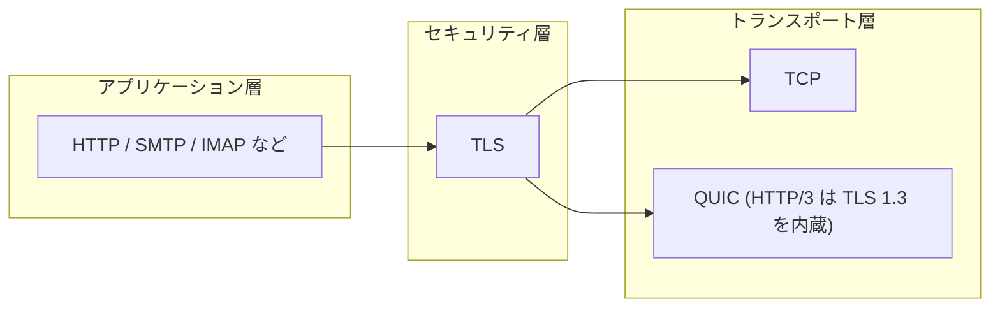

HTTP に TLS を重ねたものが **HTTPS** です。アプリケーションのプロトコルは変わらず、下の層で暗号化されます。

### Step 2：TLS が守る 3 つのこと

| 性質 | 意味 | 破られると起きること |
|---|---|---|
| 機密性（Confidentiality） | 第三者が内容を読めない | 盗聴 |
| 完全性（Integrity） | 途中で改ざんされない | 通信内容の書き換え |
| 認証（Authentication） | 相手が本物だと確認できる | なりすまし（Man-in-the-Middle） |

「暗号化だけ」では不十分です。偽サーバーと暗号化通信をしてしまえば、中身は攻撃者に筒抜けになるからです。そこで **認証** を担う PKI が必要になります。

### Step 3：脅威モデル（アクティブなネットワーク攻撃者）

書籍は、攻撃者が通信路を **読むだけでなく、書き換え・遮断・挿入もできる** という前提で考えます。

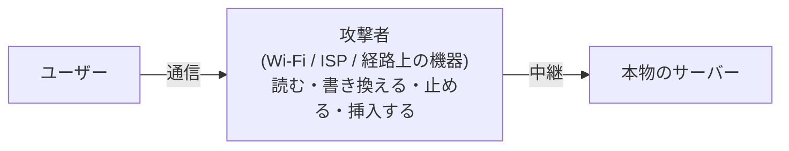

この前提から、TLS には次の対策が組み込まれます。

- 通信内容は暗号化する（読ませない）
- 全メッセージに認証タグを付ける（書き換えを検知する）
- 証明書で相手を確かめる（偽サーバーを見破る）
- バージョンや暗号スイートの選択をハンドシェイクで保護する（ダウングレードを防ぐ）

### Step 4：暗号の部品を 6 つ覚える

| 部品 | 役割 | 代表例 | 覚え方 |
|---|---|---|---|
| 共通鍵暗号（Symmetric） | 高速に大量データを暗号化 | AES-GCM、ChaCha20-Poly1305 | 同じ鍵で施錠・解錠 |
| 公開鍵暗号（Asymmetric） | 鍵共有や署名に使う | RSA、ECDSA、Ed25519 | 公開鍵と秘密鍵のペア |
| ハッシュ関数（Hash） | データの指紋を作る | SHA-256、SHA-384 | 一方向、元に戻せない |
| MAC | 共通鍵で改ざんを検知 | HMAC | 鍵付きの指紋 |
| 鍵交換（Key Exchange） | 盗聴されても共通鍵を安全に共有 | ECDHE、X25519、ML-KEM | 秘密を直接送らず、合意する |
| デジタル署名（Signature） | 作成者の証明と改ざん検知 | ECDSA、RSA-PSS | 秘密鍵でしか作れない印鑑 |

**AEAD** は、暗号化と改ざん検知を一度にこなす方式です。AES-GCM と ChaCha20-Poly1305 が代表で、TLS 1.3 では AEAD のみが使えます。

### Step 5：TLS の基本的な考え方（ハイブリッド方式）

公開鍵暗号は遅いため、TLS は次のように役割分担します。

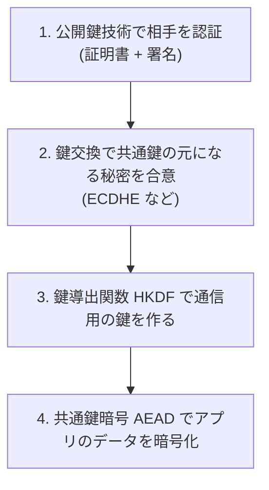

### Step 6：前方秘匿性（Forward Secrecy）

**前方秘匿性** とは、サーバーの秘密鍵が将来漏れても、過去の通信は解読できない性質です。毎回使い捨ての鍵（Ephemeral）で鍵交換を行うことで実現します。

| 鍵交換方式 | 前方秘匿性 | 現状 |
|---|---|---|
| 静的 RSA 鍵交換 | なし | TLS 1.3 で廃止。使わない |
| DHE / ECDHE | あり | TLS 1.2 でも推奨 |
| TLS 1.3 の全スイート | 常にあり | 標準 |

背景には「**Harvest Now, Decrypt Later**（今は記録だけして、将来の量子コンピューターで解読する）」という脅威があり、第10章のポスト量子暗号の話につながります。

### Step 7：この章のまとめクイズ

1. TLS が提供する3つの性質は何か。
2. なぜ公開鍵暗号だけでデータを暗号化しないのか。
3. 前方秘匿性を持たない鍵交換は何か。

<details>
<summary>答え</summary>

1. 機密性、完全性、認証。
2. 公開鍵暗号は遅いため、鍵交換と署名だけに使い、データは高速な共通鍵暗号（AEAD）で暗号化する。
3. 静的 RSA 鍵交換。

</details>

---

## 3. 【第2章】TLS 1.3（今の標準を理解する）

書籍は「今の仕組みを理解するならこの章」と位置づけています。TLS 1.3 の仕様は、IETF から **RFC 9846**（2026年7月、著者 Eric Rescorla）として改訂版が発行され、**RFC 8446 を置き換えました**。RFC 9846 は TLS 1.2 の RFC 5246 なども obsolete にし、TLS 1.2 の実装に対する新しい要求事項も規定しています。

### Step 1：TLS 1.3 の特徴

| 特徴 | 内容 |
|---|---|
| 1-RTT ハンドシェイク | 通常、往復1回で暗号化通信を開始 |
| 前方秘匿性が必須 | (EC)DHE のみ |
| AEAD 暗号のみ | CBC や RC4 は廃止 |
| 証明書以降を暗号化 | サーバー証明書がネットワーク上で見えにくい |
| ダウングレード耐性 | TLS 1.2 以下へ落とす攻撃を検出する仕掛け |
| 0-RTT（任意） | 再接続時に初回データを即送信（再送攻撃に注意） |

### Step 2：TLS 1.3 ハンドシェイク

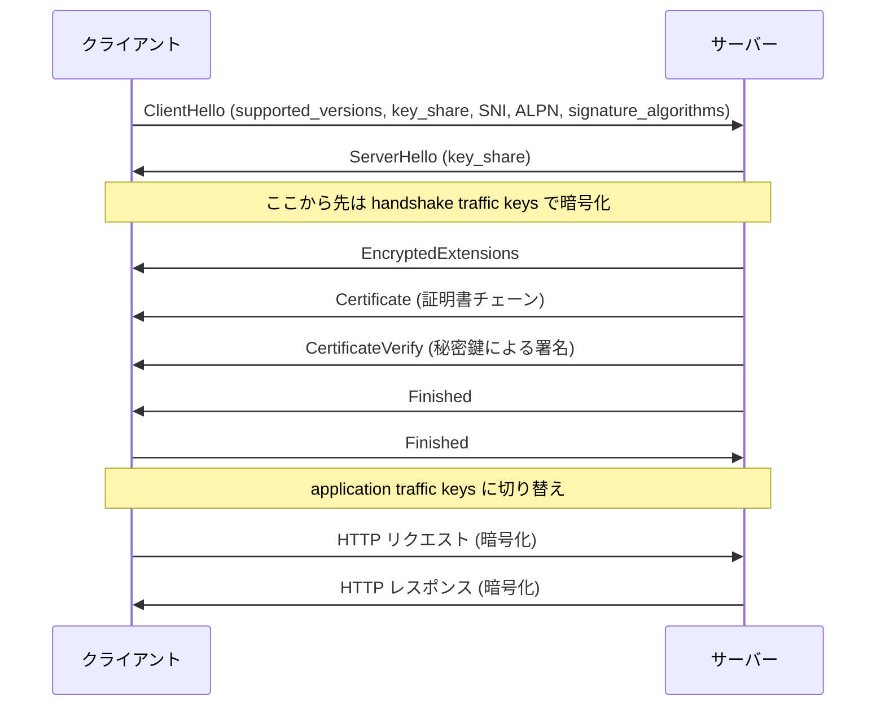

各メッセージの役割を整理します。

| メッセージ | 役割 |
|---|---|
| ClientHello | 対応バージョン、暗号スイート、鍵交換の公開値（key_share）、接続先ホスト名（SNI）などを送る |
| ServerHello | サーバーが選んだ暗号スイートと鍵交換の公開値を返す。ここで共通秘密が確定する |
| EncryptedExtensions | 追加のパラメータ（ALPN の結果など）。すでに暗号化されている |
| Certificate | サーバー証明書と中間 CA 証明書 |
| CertificateVerify | ここまでのやり取りに対する署名。「秘密鍵の持ち主」であることを証明 |
| Finished | ここまでのやり取りが改ざんされていないことの確認 |

### Step 3：鍵スケジュール（概念だけ）

TLS 1.3 は、ECDHE で得た共有秘密から **HKDF** という鍵導出関数を段階的に使い、用途ごとに別の鍵を作ります。

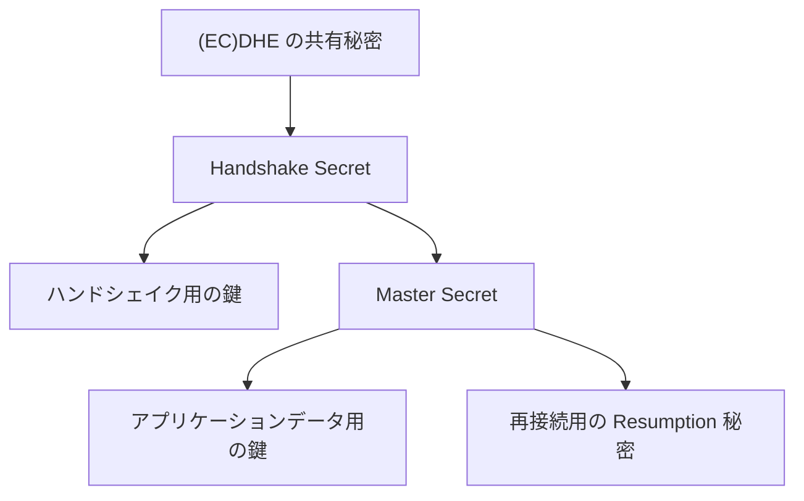

初学者は「**用途ごとに鍵を分け、1つが漏れても他に影響しにくくしている**」と理解すれば十分です。

### Step 4：TLS 1.3 で消えたもの

| 廃止された機能 | 理由 |
|---|---|
| 静的 RSA 鍵交換 | 前方秘匿性がない。ROBOT 攻撃の原因 |
| CBC 暗号、RC4 | BEAST、Lucky 13、RC4 バイアスなどの原因 |
| 圧縮（Compression） | CRIME 攻撃 |
| 再ネゴシエーション | 複雑さと攻撃の温床 |
| SHA-1、MD5 署名 | 衝突攻撃に弱い |
| 任意の DH パラメータ | Logjam 攻撃 |

TLS 1.3 を使うだけで、過去の多くの攻撃が **原理的に起こらなくなります**。

### Step 5：TLS 1.3 の暗号スイート

TLS 1.3 のスイートは5種類のみで、実務で使うのは通常次の3つです。

| 暗号スイート | 特徴 |
|---|---|
| `TLS_AES_128_GCM_SHA256` | 標準的で高速 |
| `TLS_AES_256_GCM_SHA384` | 鍵長が長い |
| `TLS_CHACHA20_POLY1305_SHA256` | AES のハードウェア支援がない端末でも速い |

TLS 1.2 のような長い暗号スイート名の組み合わせ（鍵交換＋署名＋暗号＋MAC）はなくなり、鍵交換と署名は別の拡張（supported_groups、signature_algorithms）で決まります。

### Step 6：0-RTT の注意点

0-RTT（Early Data）は再接続時の速度向上に有効ですが、**リプレイ攻撃（同じリクエストの再送）を完全には防げません**。

| 用途 | 0-RTT の可否 |
|---|---|
| 参照だけの GET（冪等） | 一般に許容できる |
| 決済、状態変更の POST | 使ってはいけない |

### Step 7：TLS 1.3 の「見えてしまう」情報とECH

TLS 1.3 でも、ClientHello の **SNI（接続先ホスト名）は平文** です。これを隠すのが **Encrypted Client Hello（ECH）** で、第10章で扱います。

### Step 8：この章のまとめクイズ

1. TLS 1.3 のハンドシェイクは通常何往復か。
2. TLS 1.3 で廃止された、前方秘匿性のない鍵交換方式は何か。
3. 0-RTT で注意すべき攻撃は何か。

<details>
<summary>答え</summary>

1. 1往復（1-RTT）。
2. 静的 RSA 鍵交換。
3. リプレイ攻撃。

</details>

---
## 4. 【第3章】TLS 1.2（いまも現役の前世代）

TLS 1.2 は、古いクライアントや組み込み機器との互換性のため、**まだ多くの現場で必要**です。また、TLS 1.3 が「何を改善したのか」を理解するための教材にもなります。

### Step 1：TLS 1.2 ハンドシェイク（ECDHE 使用時）

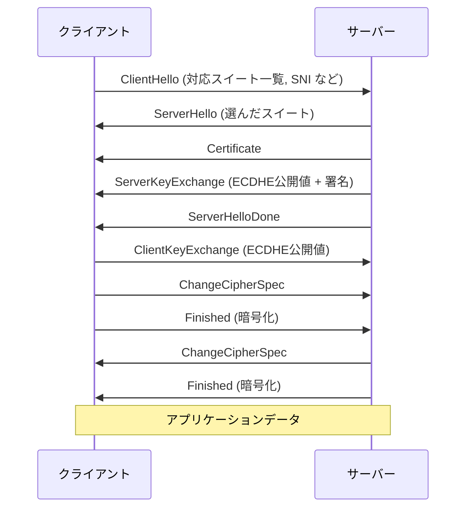

TLS 1.3 との最大の違いは **往復回数（2-RTT）と、証明書が平文で流れる点** です。

### Step 2：TLS 1.3 との比較

| 項目 | TLS 1.2 | TLS 1.3 |
|---|---|---|
| ハンドシェイクの往復 | 2-RTT | 1-RTT |
| 証明書の秘匿 | 平文 | 暗号化 |
| 鍵交換 | RSA / DHE / ECDHE から選択 | (EC)DHE のみ |
| 暗号 | CBC、RC4、AEAD などが混在 | AEAD のみ |
| 圧縮 / 再ネゴシエーション | あり（攻撃の原因） | なし |
| 設定の難しさ | 高（組み合わせが多い） | 低 |

### Step 3：TLS 1.2 を使う場合の最低条件

TLS 1.2 を有効にするなら、次の条件を守ります。

| 項目 | 推奨 |
|---|---|
| 鍵交換 | ECDHE のみ（前方秘匿性） |
| 暗号 | AEAD（AES-GCM、ChaCha20-Poly1305） |
| 署名 | ECDSA または RSA（2048bit 以上）+ SHA-256 以上 |
| 拡張 | Extended Master Secret、Secure Renegotiation |
| 禁止 | RC4、3DES、CBC、SHA-1 署名、圧縮、静的 RSA 鍵交換 |

### Step 4：SSL から TLS への歴史

| バージョン | 登場時期 | 現状 |
|---|---|---|
| SSL 2 | 1995年 | 使用禁止 |
| SSL 3 | 1996年 | 使用禁止（POODLE 攻撃） |
| TLS 1.0 | 1999年 | 使用禁止（主要ブラウザは対応を終了） |
| TLS 1.1 | 2006年 | 使用禁止 |
| TLS 1.2 | 2008年 | 現役。ECDHE + AEAD で使う |
| TLS 1.3 | 2018年 | 推奨。2026年7月に RFC 9846 として改訂 |

歴史の詳細は Feisty Duck が公開している「SSL/TLS and PKI History」が参考になります（参考文献参照）。

---

## 5. 【第4章】PKI（Public Key Infrastructure）

### Step 1：なぜ PKI が必要か

公開鍵を受け取っても、それが本当に `example.com` のものかは分かりません。そこで「**信頼できる第三者（CA）が、ドメインと公開鍵の結びつきを保証する**」仕組みが必要になります。

### Step 2：証明書チェーン

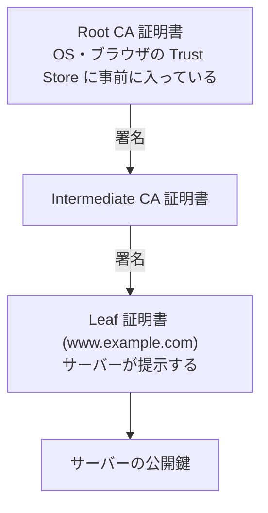

| 証明書 | 置き場所 | 特徴 |
|---|---|---|
| Root CA | クライアントの Trust Store | 秘密鍵はオフラインで厳重に保管 |
| Intermediate CA | サーバーが送る | Root の代わりに日常の署名を担当 |
| Leaf（End-entity） | サーバーが送る | ドメイン用。有効期間が短い |

### Step 3：クライアントは証明書をどう検証するか

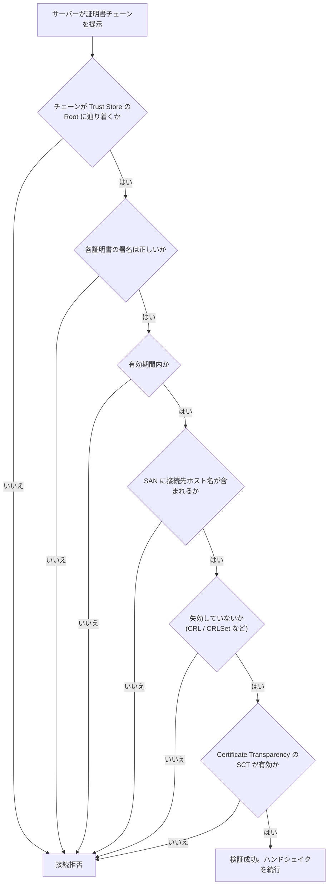

現在のホスト名検証は **Subject Alternative Name（SAN）** を使います。Common Name（CN）だけで判定する方式は廃止されています。

### Step 4：証明書の中身（主要フィールド）

| フィールド | 意味 |
|---|---|
| Subject | 持ち主（組織名など） |
| Subject Alternative Name | 有効なドメイン名（または IP アドレス）の一覧 |
| Issuer | 発行した CA |
| Validity | 有効期間（notBefore / notAfter） |
| Public Key | サーバーの公開鍵 |
| Key Usage / Extended Key Usage | 用途（serverAuth など） |
| Basic Constraints | CA かどうか、チェーンの深さ制限 |
| Authority Information Access | 発行元証明書の場所、OCSP の場所（OCSP は縮小傾向） |
| CRL Distribution Points | CRL の場所 |
| SCT リスト | Certificate Transparency のログに登録済みの証明 |

### Step 5：証明書の種類（検証レベル）

| 種類 | 確認内容 | 現状 |
|---|---|---|
| DV（Domain Validated） | ドメインの管理権限のみ | 大半の Web サイトで利用。自動化しやすい |
| OV（Organization Validated） | 組織の実在性 | 企業サイトの一部 |
| EV（Extended Validation） | 厳格な組織確認 | ブラウザ UI での特別扱いは薄れた |

### Step 6：誰がルールを決めるのか

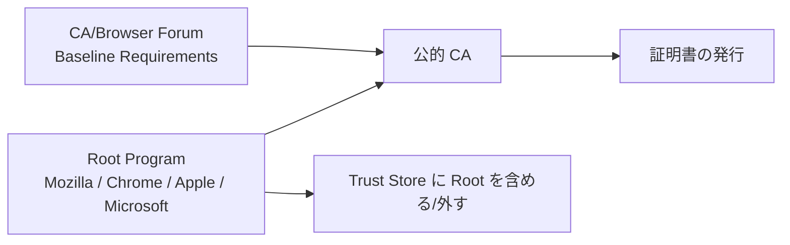

| 主体 | 役割 |
|---|---|
| CA/Browser Forum | CA とブラウザベンダーが集まり、証明書発行の最低基準（Baseline Requirements）を決める |
| Root Program | Mozilla、Chrome、Apple、Microsoft が各々の Trust Store を運営し、問題ある CA を外す |
| CA | ルールに従って発行し、監査を受ける |

### Step 7：ドメイン所有の確認と ACME

Let's Encrypt などの CA は、**ACME（RFC 8555）** というプロトコルで、証明書の発行と更新を自動化します。

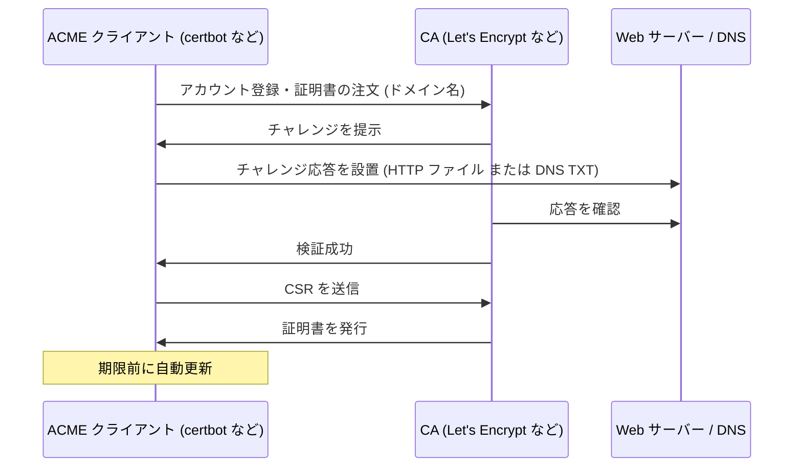

| チャレンジ | 方法 | 向いている用途 |
|---|---|---|
| HTTP-01 | `/.well-known/acme-challenge/` にファイルを置く | 単一サーバー |
| DNS-01 | `_acme-challenge` に TXT レコードを作る | ワイルドカード証明書、非公開サーバー |
| TLS-ALPN-01 | TLS 接続で応答する | ポート 443 のみ使える環境 |

IP アドレス証明書では DNS が関与しないため、dns-01 は使えません。

### Step 8：CAA レコード（誰が発行できるかを DNS で制限）

CAA は、**「この CA だけが自社ドメインの証明書を発行してよい」と DNS に宣言する仕組み**です。CA は発行前に CAA を確認する義務があります。

| CAA の例 | 意味 |
|---|---|
| `example.com. CAA 0 issue "letsencrypt.org"` | Let's Encrypt のみ発行を許可 |
| `example.com. CAA 0 iodef "mailto:sec@example.com"` | 違反の通知先 |

### Step 9：失効（Revocation）

秘密鍵の漏洩や誤発行があった場合、有効期間内でも証明書を無効にしたくなります。

| 方式 | 仕組み | 課題 |
|---|---|---|
| CRL | 失効した証明書の一覧を配布 | 大きくなりやすい |
| OCSP | 1枚ずつ CA に問い合わせ | 訪問先が CA に知られる（プライバシー）。到達できない場合に多くのクライアントが「失敗しても続行」する |
| OCSP Stapling | サーバーが OCSP 応答を添付 | 設定が必要。Let's Encrypt では利用不可に |
| ブラウザ独自配布 | Chrome の CRLSet、Firefox の CRLite など | 全証明書を網羅しない場合がある |
| **短命証明書** | 寿命を数日〜数十日にして失効に頼らない | 自動更新が前提 |

2025年8月に Let's Encrypt が OCSP を停止し、失効情報を **CRL のみ** で公開する方針に移りました。理由は、OCSP では訪問者の IP アドレスと訪問先サイトが CA に伝わってしまうプライバシーの問題と、運用の単純化です。詳細は第10章で扱います。

### Step 10：Certificate Transparency（CT）

**CT** は、発行された公開証明書を **誰でも検証できる公開ログ** に記録する仕組みです。CA が密かに偽証明書を出しても、ログを監視する側が見つけられます。

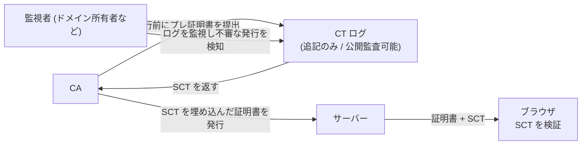

| 項目 | 内容 |
|---|---|
| 仕様 | RFC 6962、後継の RFC 9162。ブラウザは実務上 RFC 6962 を実装 |
| Static CT API | 従来の DB 型ではなく、静的ファイルとして配信する新方式。Filippo Valsorda 設計の **Sunlight**、Google の **TesseraCT**、Cloudflare の Azul などの実装がある |
| 自分でできること | 自社ドメインの発行を CT 監視サービスで監視する |

### Step 11：この章のまとめクイズ

1. 証明書チェーンの3階層を答えよ。
2. 現在のホスト名検証で使われる証明書のフィールドは何か。
3. CT の目的は何か。
4. OCSP の最大のプライバシー問題は何か。

<details>
<summary>答え</summary>

1. Root CA、Intermediate CA、Leaf 証明書。
2. Subject Alternative Name（SAN）。
3. 公開証明書をログに記録し、不正な発行を発見できるようにする。
4. CA が、利用者の IP アドレスと訪問先サイトを知ってしまう。

</details>

---
## 6. 【第5〜8章】問題と攻撃（Part II）

### 6.1 【第5章】PKI への攻撃

PKI は「CA を信頼する」モデルなので、**1つの CA が破られると、世界中のどのドメインの偽証明書も作られうる**という弱点があります。書籍は主要な CA 侵害を歴史順に整理しています。

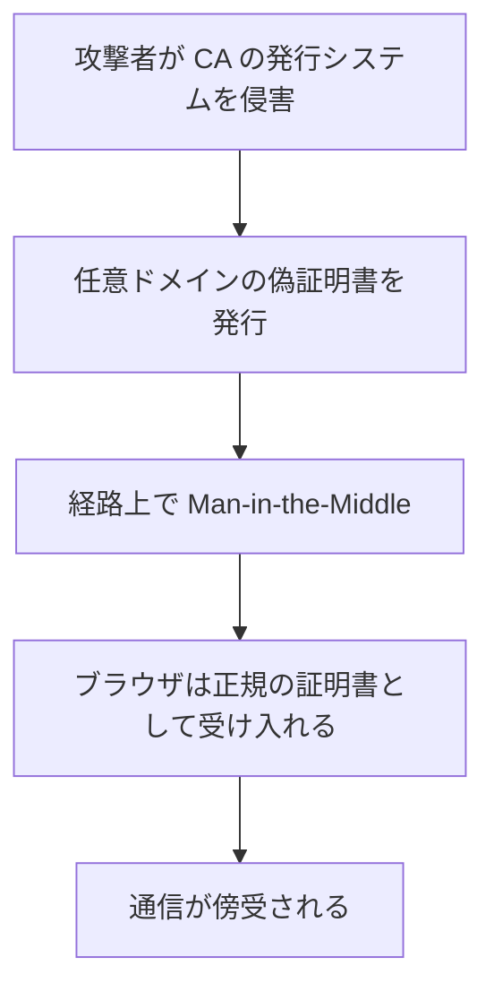

代表的な事例（一般に広く報じられている事例です。本ガイドでは各事例の一次情報までは取得していないため、詳細は書籍の第5章と各ベンダーの公式発表で確認してください）。

| 事例 | 時期 | 教訓 |
|---|---|---|
| Comodo の登録代行業者の侵害 | 2011年 | 下位の委任先も攻撃面になる |
| DigiNotar の侵害 | 2011年 | 侵害の発覚が遅れ、CA 自体が信頼を失い、市場から退場した |
| TURKTRUST の誤発行 | 2012〜2013年 | 設定ミスの中間 CA 証明書が重大な事故になる |
| WoSign / StartCom の不正 | 2016〜2017年 | 信頼を失った CA は Root Program から外される |
| Symantec の段階的な不信任 | 2017〜2018年 | 大手 CA でも、誤発行が続けば信頼は失われる |
| Entrust の不信任 | 2024年 | 継続的な不遵守と不誠実な対応が問題視された |

こうした事件から、現在の次の対策が生まれました。

| 対策 | 内容 |
|---|---|
| Certificate Transparency | 誤発行を公開ログで検知 |
| CAA レコード | 発行できる CA をドメイン所有者が制限 |
| Baseline Requirements と監査 | CA の運用基準を強制 |
| 証明書の短命化 | 被害の期間を縮める（第10章） |
| Root Program による不信任 | 問題 CA を Trust Store から外す |

### 6.2 【第6章】HTTP とブラウザの問題

TLS が完璧でも、**HTTP やブラウザの使い方で穴が開く**ことがあります。

| 問題 | 内容 | 対策 |
|---|---|---|
| Mixed Content | HTTPS ページが HTTP のスクリプトや画像を読み込む | すべて HTTPS 化。CSP の `upgrade-insecure-requests` |
| SSL Stripping | 初回の HTTP アクセスを攻撃者が HTTPS に変えずに中継 | HSTS と HSTS Preload |
| Cookie の漏洩 | HTTPS 用 Cookie が HTTP でも送られる | `Secure` 属性、`__Host-` プレフィックス |
| 証明書エラーの慣れ | ユーザーが警告を無視する | 正しい証明書を運用し、警告が出ない状態を保つ |
| HTTP/2 の接続共有 | 複数ホスト名で1つの接続を使い、混乱が起きる | 証明書の SAN の範囲を最小限にする |

#### Mixed Content の判断フロー

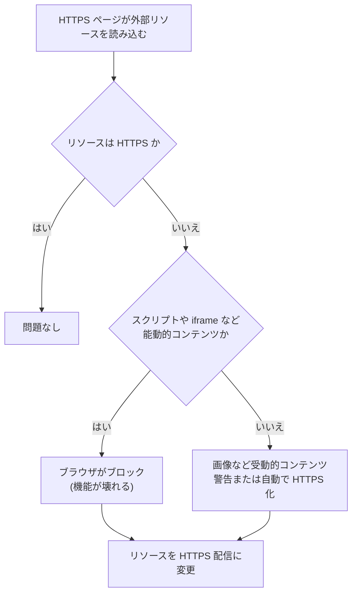

### 6.3 【第7章】実装の問題

プロトコルが安全でも、**ライブラリやアプリの実装バグ**で破られます。

| 事例 | 概要 | 教訓 |
|---|---|---|
| Heartbleed（CVE-2014-0160） | OpenSSL の Heartbeat 実装のバッファ読み出しで、サーバーのメモリ（秘密鍵を含む）が漏れた | 修正後は **証明書の再発行と秘密鍵の入れ替え** が必要 |
| FREAK / Logjam | 古い「輸出用」暗号や弱い DH に落とされる | 古い暗号は完全に無効化する |
| Apple の「goto fail」（CVE-2014-1266） | 証明書検証のコードの重複行で、検証がスキップされた | 検証コードのテストが重要 |
| Debian の乱数バグ（CVE-2008-0166） | 乱数の質が低く、鍵が予測可能になった | 乱数は OS 提供のものを使う |
| 証明書検証の不備 | アプリが「検証を無効化」したまま出荷 | **検証を無効にするコードを本番に入れない** |

#### 開発者が絶対にやってはいけないこと

```python
# 危険: 証明書検証を無効にするコード (テストでも本番に残さない)
import ssl
ctx = ssl.create_default_context()
ctx.check_hostname = False
ctx.verify_mode = ssl.CERT_NONE
```

「開発中は面倒だから」と無効化したコードが本番に残る事故は後を絶ちません。テスト環境では **私設 CA の証明書を Trust Store に追加する**（第11章）のが正しい方法です。

### 6.4 【第8章】プロトコルへの攻撃

本書で最も長い章です。覚えるべきは個々の仕組みより、**「なぜ今の推奨設定になっているか」** です。

| 攻撃（発見年） | 狙い | 原因 | 現在の対処 |
|---|---|---|---|
| Insecure Renegotiation（2009） | 再ネゴシエーションでの偽データ挿入 | 再ネゴの認証不足 | RFC 5746、TLS 1.3 は再ネゴ自体を廃止 |
| BEAST（2011） | CBC の予測可能な IV | TLS 1.0 の設計 | TLS 1.1 以上、AEAD |
| CRIME（2012） | 圧縮のサイズ差から Cookie を推測 | TLS 圧縮 | TLS 圧縮を無効化 |
| BREACH / TIME（2013） | HTTP 圧縮のサイズ差から秘密を推測 | HTTP 圧縮 | トークンのマスク化、レート制限、秘密を含むページの扱い |
| Lucky 13（2013） | CBC パディングのタイミング差 | CBC の MAC-then-Encrypt | AEAD のみ使用 |
| POODLE（2014） | SSL 3 のパディングを悪用 | SSL 3 の設計 | SSL 3 を無効化 |
| RC4 のバイアス | RC4 の出力の偏りで平文を推測 | RC4 の設計 | RC4 を無効化 |
| Triple Handshake（2014） | 3回のハンドシェイクで認証を混乱 | マスターシークレットの結びつき不足 | Extended Master Secret（RFC 7627） |
| Sweet32（2016） | 64bit ブロック暗号の誕生日攻撃 | 3DES などの小さなブロック | 3DES を無効化 |
| ROBOT（2017） | RSA 鍵交換の Bleichenbacher 攻撃の再来 | RSA 暗号化の実装 | RSA 鍵交換を使わない（ECDHE） |
| Raccoon（2020） | DH 共有秘密の先頭ゼロのタイミング差 | DH の実装 | ECDHE、TLS 1.3 |

#### 共通の教訓（フローチャートで整理）

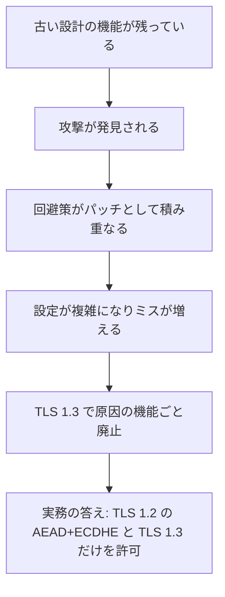

書籍はこの章で、NSA の大規模な盗聴計画（Bullrun）がTLSの安全性に与えた影響にも簡潔に触れています。

---

## 7. 【第9章】性能（Performance）

「TLS は遅い」は過去の話です。ただし、**設定次第で体感速度は大きく変わります**。

### Step 1：遅さの主因は暗号計算ではなく「待ち時間」

| 要因 | 内容 |
|---|---|
| 往復回数（RTT） | ハンドシェイク前の TCP 往復、TLS の往復 |
| 証明書チェーンのサイズ | 大きいと初期の送信量が増える |
| 失効確認 | OCSP の問い合わせ待ち（現在は縮小傾向） |
| 新規接続の多さ | 接続を使い捨てにしている |

### Step 2：効果の大きい最適化

| 最適化 | 効果 | 注意点 |
|---|---|---|
| TLS 1.3 の採用 | ハンドシェイクが1往復に | 互換性のためTLS 1.2 を併用 |
| 接続の再利用（Keep-Alive） | 新規ハンドシェイクを減らす | タイムアウトの調整 |
| HTTP/2、HTTP/3 | 多重化。HTTP/3 は QUIC 上で TLS 1.3 内蔵 | ファイアウォールの UDP 443 許可 |
| セッション再開（Resumption） | 再接続を高速化 | Session Ticket の鍵を **定期ローテーション** しないと前方秘匿性が弱まる |
| ECDSA 証明書 | RSA より小さく速い | 古い環境との互換性を確認 |
| 証明書チェーンの最小化 | 不要な中間証明書を送らない | 順序とブリッジ証明書の確認 |
| 0-RTT | 再接続の最初のデータを即送信 | リプレイ攻撃に注意（第3章） |

### Step 3：Session Ticket の落とし穴

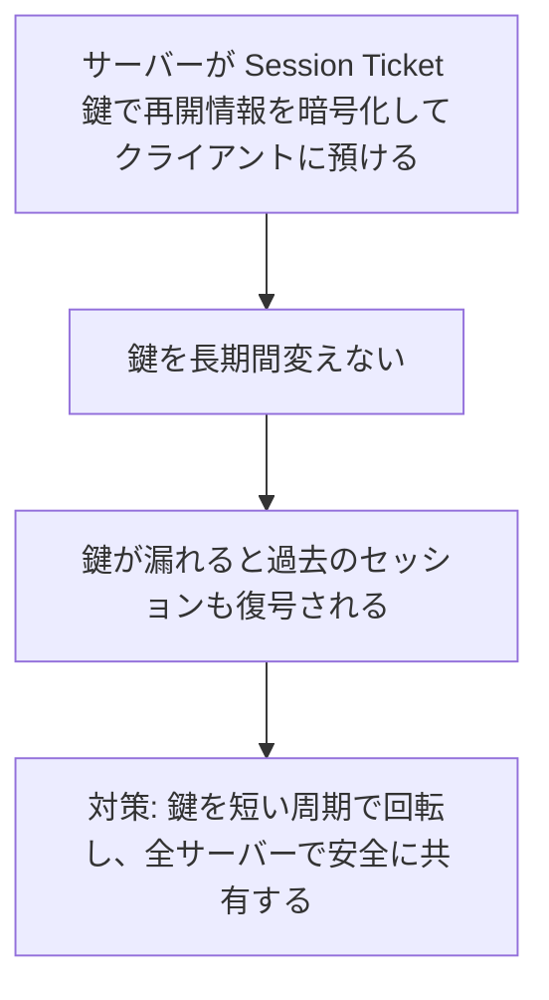

---

## 8. 【第10章】HSTS・CSP・Pinning

### 8.1 HSTS（HTTP Strict Transport Security）

HSTS は、「**このサイトは今後、必ず HTTPS で接続せよ**」とブラウザに記憶させるヘッダーです。SSL Stripping と、証明書エラーの回避クリックを防ぎます。

```http
Strict-Transport-Security: max-age=31536000; includeSubDomains; preload
```

| ディレクティブ | 意味 |
|---|---|
| `max-age` | 記憶する秒数。31536000 は1年 |
| `includeSubDomains` | すべてのサブドメインにも適用 |
| `preload` | ブラウザ組み込みの HSTS リストへの登録を希望 |

#### 安全な導入手順（段階的に延ばす）

HSTS は **戻しにくい** ため、短い期間から段階的に延ばします。

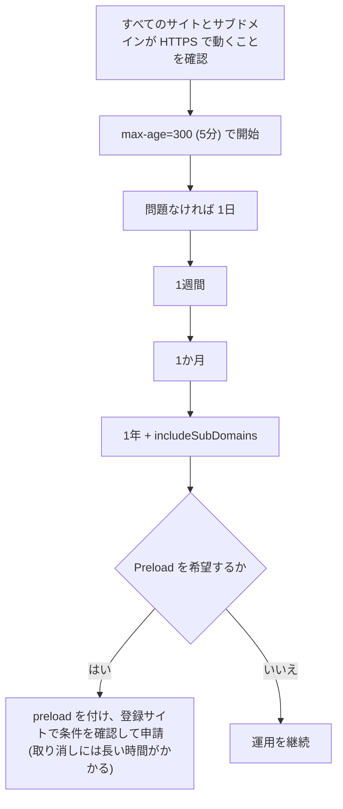

### 8.2 CSP（Content Security Policy）

CSP は、「**読み込んでよいリソースの出所**」を宣言するヘッダーで、XSS の被害軽減や Mixed Content の防止に使います。

| 目的 | 設定の例 |
|---|---|
| HTTP リソースを自動で HTTPS に | `Content-Security-Policy: upgrade-insecure-requests` |
| スクリプトの出所を制限 | `script-src 'self' https://cdn.example.com` |
| 改ざん検知 | **SRI（Subresource Integrity）** で外部スクリプトのハッシュを固定 |

### 8.3 Pinning（証明書のピン留め）

Pinning は、「このサイトの証明書は特定の鍵（または CA）に限る」と固定する発想です。**本書でも、PKI の攻撃面を縮める手法として扱われています**。

| 方式 | 現状 |
|---|---|
| HPKP（HTTP ヘッダーでのピン留め） | 運用事故のリスクが高く、ブラウザでは廃止された |
| モバイルアプリ内の Pinning | 慎重に使う。鍵や CA の更新計画がないと、アプリが接続できなくなる |
| 現在の主な代替策 | **Certificate Transparency + CAA + 短命証明書** |

短命証明書（第10章）の時代には、固定した鍵が数日〜数十日で変わるため、**Pinning はさらに運用が難しくなります**。

---

## 9. 【第11章】TLS 設定ガイド（実務で最重要）

書籍が「本全体の地図」と位置づける章です。**初学者はまずここを実践してください**。

### Step 1：全体の判断フロー

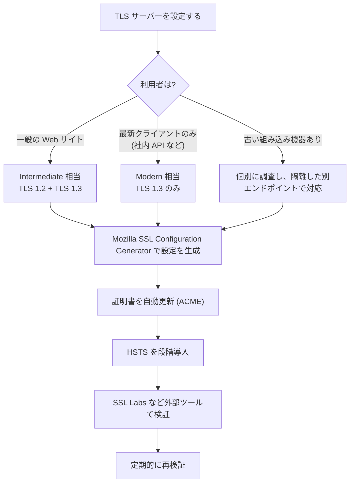

### Step 2：推奨する 8 つの設定

| # | 項目 | 推奨 |
|---|---|---|
| 1 | プロトコル | TLS 1.3、TLS 1.2 のみ（SSL 3、TLS 1.0、1.1 は無効化） |
| 2 | 鍵交換 | ECDHE のみ（X25519、P-256、P-384）。可能なら X25519MLKEM768 を優先 |
| 3 | 暗号 | AEAD のみ（AES-GCM、ChaCha20-Poly1305） |
| 4 | 証明書の鍵 | ECDSA P-256、または RSA 2048bit 以上 |
| 5 | 証明書チェーン | Leaf + 中間証明書（Root は送らない） |
| 6 | 証明書の更新 | ACME で自動化 |
| 7 | HSTS | 段階的に導入 |
| 8 | 圧縮・再ネゴシエーション | 無効化 |

### Step 3：Mozilla のガイドライン

Mozilla の **Server Side TLS** は、設定の事実上の標準リファレンスで、ジェネレーターも提供しています。

| プロファイル | プロトコル | 用途 |
|---|---|---|
| Modern | TLS 1.3 のみ | 後方互換性が不要なサービス |
| Intermediate（推奨） | TLS 1.2、TLS 1.3 | 汎用サーバー |
| Old | TLS 1.0 以降 | 古いクライアント向け。最新版のガイドラインでは削除された |

ガイドラインは更新が続いています。変更履歴には、Intermediate と Old から DHE 系の暗号を削除した版や、Old 構成の削除が見られます（実際に使う版は必ずジェネレーター上で確認してください）。

### Step 4：nginx の設定例（Intermediate 相当）

以下は **学習用の例** です。本番では必ず Mozilla のジェネレーターで最新版を生成し、環境（OpenSSL のバージョンなど）に合わせて検証してください。

```nginx
server {
    listen 443 ssl;
    listen [::]:443 ssl;
    http2 on;
    server_name www.example.com;

    ssl_certificate     /etc/ssl/example/fullchain.pem;  # Leaf + 中間証明書
    ssl_certificate_key /etc/ssl/example/privkey.pem;

    ssl_protocols TLSv1.2 TLSv1.3;

    # TLS 1.2 用: ECDHE + AEAD のみ
    ssl_ciphers ECDHE-ECDSA-AES128-GCM-SHA256:ECDHE-RSA-AES128-GCM-SHA256:ECDHE-ECDSA-AES256-GCM-SHA384:ECDHE-RSA-AES256-GCM-SHA384:ECDHE-ECDSA-CHACHA20-POLY1305:ECDHE-RSA-CHACHA20-POLY1305;
    ssl_prefer_server_ciphers off;

    # 鍵交換グループ: ハイブリッド PQC を優先 (OpenSSL 3.5 以降など、対応環境が必要)
    # 対応していない環境では X25519MLKEM768 を外す
    ssl_ecdh_curve X25519MLKEM768:X25519:prime256v1:secp384r1;

    ssl_session_timeout 1d;
    ssl_session_cache shared:SSL:10m;
    ssl_session_tickets off;   # ティケット鍵を安全に回転できない環境では無効が無難

    # HSTS は段階導入。最初は短い max-age から
    add_header Strict-Transport-Security "max-age=300" always;
}
```

> **注意**: HSTS の `max-age` を最初から1年にしないでください。誤設定の復旧に長い時間がかかります（第8.1節）。

### Step 5：HTTP から HTTPS へのリダイレクト

```nginx
server {
    listen 80;
    listen [::]:80;
    server_name www.example.com;
    return 301 https://$host$request_uri;
}
```

### Step 6：設定後の検証

| ツール | 用途 |
|---|---|
| SSL Labs Server Test | 外部から公開サーバーを総合評価（Ivan Ristić が作成） |
| testssl.sh | コマンドラインで脆弱性や設定を確認 |
| `openssl s_client` | 低レベルの動作確認（第11章） |
| Mozilla Observatory | HSTS や CSP などの HTTP ヘッダーを確認 |
| CT 監視サービス | 自社ドメインの証明書の発行を監視 |

### Step 7：チェックリスト

- [ ] TLS 1.0 / 1.1 / SSL 3 が無効
- [ ] TLS 1.2 は ECDHE + AEAD のみ
- [ ] TLS 1.3 が有効
- [ ] 証明書チェーンが正しく、期限が管理されている
- [ ] 証明書の更新が自動化されている
- [ ] SAN に必要な全ホスト名が含まれる
- [ ] HTTP → HTTPS のリダイレクトがある
- [ ] HSTS を段階導入している
- [ ] Mixed Content がない
- [ ] 外部ツールで評価した

---
## 10. 2026年版アップデート：書籍刊行後に変わったこと

書籍の最終更新は2022年1月です。ここでは、**2026年10月11日時点で Web 検索により確認できた情報** を整理します。出典の URL は第14章にまとめています。

> **確度の読み方**: 標準化団体・CA・ブラウザベンダーの一次情報を優先しました。解説記事など二次情報にしか見つからなかった点は「二次情報」と明記します。日付や細目が情報源で食い違う場合は、その旨を書き、最終的に一次情報で確認するよう案内しています。

### 10.1 証明書の有効期間が段階的に短縮（47日証明書）

CA/Browser Forum の **Ballot SC-081v3**（Apple が提案、2025年4月に可決）により、公的 TLS 証明書の最大有効期間が段階的に短くなります。

| 適用開始日 | 最大有効期間 | ドメイン検証結果の再利用期間 | 更新の目安（残り1/3で更新する場合） |
|---|---|---|---|
| 〜2026年3月14日 | 398日 | （従来の長い期間） | 年1回 |
| **2026年3月15日** | **200日** | 200日 | 約4か月ごと |
| **2027年3月15日** | **100日** | 100日 | 約2か月ごと |
| **2029年3月15日** | **47日** | 10日 | 約1か月ごと |

実際の CA は余裕を持たせて199日などで発行する例が報告されています（二次情報）。

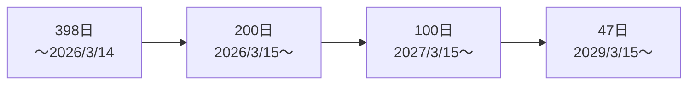

#### 何をすべきか

| 項目 | 行動 |
|---|---|
| 証明書の棚卸し | どこに何枚あるか把握する（人手の更新は破綻する） |
| 更新の自動化 | ACME（certbot、acme.sh、各種クラウドの証明書マネージャー）を導入 |
| 監視 | 期限切れの検知と、CT ログの監視 |
| 私設 CA | CA/B Forum の規則の対象外（任意の期間で発行できる）。ただし短くすることで同じリスク低減ができる |

短命化の狙いは、**失効の仕組みが機能しなくても、被害が自然に終わるようにする** ことです。

### 10.2 Let's Encrypt：OCSP の停止と、6日証明書・IP 証明書

| 項目 | 内容 |
|---|---|
| OCSP の停止 | 2025年8月6日に OCSP レスポンダーを停止。証明書には CRL の URL を載せ、失効情報は CRL のみで公開 |
| 停止の理由 | OCSP は、訪問者の IP アドレスと訪問先サイトが CA に伝わるプライバシー上のリスクがあるため。運用の単純化も理由 |
| OCSP Must Staple | 同時にサポートを終了 |
| 6日証明書 | 2026年に一般提供（GA）。有効期間は **160時間**（6日強）。ACME クライアントで `shortlived` プロファイルを選ぶ。**オプトイン** で、既定にする予定は当面ない |
| IP アドレス証明書 | 一般提供。IPv4 と IPv6 に対応。**短命証明書のみ**（IP は変わりやすいため）。dns-01 は使えない |
| 6日証明書の特徴 | OCSP や CRL の URL を含めない |

実務への影響:

- `ssl_stapling on;` は Let's Encrypt の証明書では意味がありません（OCSP の URL がない）。
- 非ブラウザ（VPN など）が OCSP に依存していないかを確認してください。
- 6日証明書を使うなら、**更新の失敗を数日以内に検知できる監視** が必須です。

### 10.3 serverAuth 専用の階層（clientAuth EKU の廃止）

Chrome Root Program の方針（Policy v1.6、更新版 v1.8）により、公的 CA の階層は **TLS サーバー認証専用** になっていきます。

| 時期 | 内容（二次情報の解説記事に基づく） |
|---|---|
| 2026年6月15日 | CCADB に新規開示される中間 CA 証明書は `serverAuth` のみ |
| 2027年3月15日 | 新規に発行される Leaf 証明書も `serverAuth` のみ |

> 日付や細目は解説記事によって表現が揺れています（「2026年6月15日から clientAuth を含む新規証明書を拒否」とする記事もあります）。**最終的な正確な内容は Chrome Root Program Policy の一次情報で確認してください。**

#### 影響を受けるケース

| ケース | 対応 |
|---|---|
| 公的証明書を **mTLS のクライアント証明書** として使っている | 私設 CA（または専用の PKI）に移行 |
| VPN、Wi-Fi（802.1X）、ワークロード ID | 同上 |
| 通常の Web サーバー証明書 | 影響なし |

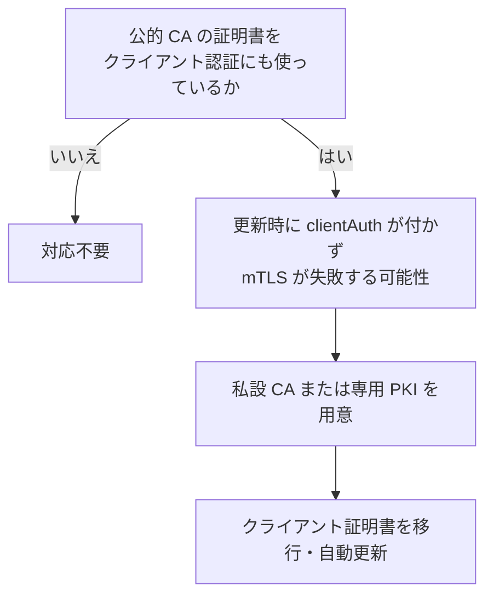

### 10.4 ポスト量子暗号：ハイブリッド鍵交換が標準に

量子コンピューターが実用化されると、現在の ECDHE や RSA は破られるおそれがあります。特に **Harvest Now, Decrypt Later**（今の通信を保存し、将来解読する）への備えが急務で、TLS の鍵交換から対策が進んでいます。

| 項目 | 内容 |
|---|---|
| 標準化 | **RFC 10024**（2026年8月、Proposed Standard）が `X25519MLKEM768`、`SecP256r1MLKEM768`、`SecP384r1MLKEM1024` の3つのハイブリッド方式を定義 |
| 枠組み | **RFC 9954**（2026年7月）が従来方式と次世代方式を組み合わせる一般的な枠組みを定義 |
| ハイブリッドの意味 | 2つの方式の出力を組み合わせ、**どちらか一方が安全なら全体が安全** |
| コードポイント | `X25519MLKEM768` は `0x11EC` |
| ブラウザ | Chrome、Edge、多くの Firefox で既定有効（二次情報） |
| 普及率 | Cloudflare は、2026年4月時点で人間のトラフィックの3分の2超がハイブリッド方式と報告（二次情報による引用）。2026年9月には、オリジンサーバーへの接続でも自動選択する機能を発表し、オリジン側の対応は **12%超** と報告 |
| まだ対応していない部分 | **証明書の署名（ML-DSA など）** は、標準・ブラウザ既定・ルート CA 基盤が揃っておらず、普及はこれから（二次情報） |

```mermaid
sequenceDiagram
    participant C as クライアント
    participant S as サーバー
    C->>S: ClientHello (key_share: X25519 の公開値 + ML-KEM-768 の公開鍵)
    S->>C: ServerHello (key_share: X25519 の公開値 + ML-KEM-768 の暗号文)
    Note over C,S: 2つの共有秘密を結合して1つの鍵素材にする
    Note over C,S: どちらかが安全なら、通信は安全
```

#### 運用上の注意

| 注意点 | 内容 |
|---|---|
| ClientHello が大きくなる | ML-KEM の鍵が加わり、約1.2KB 増える。一部のミドルボックスや古い機器が誤動作する可能性 |
| 設定は優先順位が重要 | ハイブリッドを先に、従来方式を後に並べる |
| 対応ライブラリが必要 | OpenSSL 3.5 以降や BoringSSL などの対応が必要。環境で確認すること |
| 切り替えの確認 | 実際にどのグループが選ばれたかを、ログや `openssl s_client` で確認する |

### 10.5 Encrypted Client Hello（ECH）：SNI の暗号化

TLS 1.3 でも、ClientHello の **SNI（接続先ホスト名）は平文** でした。**ECH** は ClientHello 全体を暗号化し、第三者から接続先を見えにくくします。

| 項目 | 内容 |
|---|---|
| 標準 | **RFC 9849**（著者に Eric Rescorla、Kazuho Oku、Nick Sullivan、Christopher Wood ら）。IETF datatracker 上は2026年3月付の Proposed Standard（RFC Editor の一部資料では2025年11月と表記され、情報源で日付が異なる） |
| 仕組み | サーバーの ECH 公開鍵を DNS の **HTTPS レコード** で配布し、クライアントが **HPKE** で ClientHello を暗号化する |
| 外側の ClientHello | CDN など「公開名（public_name）」を SNI に入れた見せかけの ClientHello を送る |
| 失敗時 | サーバーが新しい設定（retry_configs）を返し、再試行する |
| 対応状況 | Firefox は ECH に対応（Firefox 98 以降、OS の DNS リゾルバーでも利用可）。Chromium 系も対応。Cloudflare が早期に提供 |

```mermaid
flowchart LR
    A["クライアント"] -->|"1. DNS の HTTPS レコードから ECH 公開鍵を取得"| D["DNS"]
    A -->|"2. 本物の ClientHello を暗号化 (内側)<br/>外側の SNI は CDN の公開名"| S["CDN / クライアント向けサーバー"]
    S -->|"3. 復号して本来の宛先へ"| B["背後のサーバー"]
```

> ECH を効果的にするには、**DNS 自体も暗号化**（DoH、DoT など）されている必要があります。DNS が平文だと、問い合わせから接続先が分かるためです。

### 10.6 TLS 1.3 の仕様が RFC 9846 に

| 項目 | 内容 |
|---|---|
| RFC 9846 | 2026年7月。著者は Eric Rescorla |
| 置き換え対象 | RFC 8446（TLS 1.3）と RFC 5246（TLS 1.2）を obsolete。その他 RFC 5077、6961、7627、8422 も |
| 意味 | プロトコルの動作が変わったわけではなく、**仕様書の統合・整理** が中心。TLS 1.2 の実装に対する新しい要求も含まれる |

### 10.7 Certificate Transparency の新方式（Static CT API）

| 項目 | 内容 |
|---|---|
| 従来方式 | RFC 6962 の API。DB に依存し、運用コストが高い |
| 新方式 | **Static CT API**。ログをタイル状の静的ファイルとして配信し、オブジェクトストレージで配信しやすい |
| 実装 | **Sunlight**（Filippo Valsorda 設計、Let's Encrypt が開発支援）、**TesseraCT**（Google）、**Azul**（Cloudflare）など |
| ブラウザ | 主要ブラウザのログポリシーで許可されている |
| 開発者への影響 | CT 監視ツールは、従来ログと Static CT ログの **両方** に対応する必要がある |

### 10.8 書籍の助言のうち、見直すべき点

| 書籍の助言（2022年時点） | 2026年10月時点での補足 |
|---|---|
| 証明書は1年程度の有効期間 | 最大200日。2027年に100日、2029年に47日。**自動化が前提** |
| OCSP Stapling を有効にする | Let's Encrypt では OCSP が停止。CA の仕様を確認 |
| Pinning は慎重に | 短命証明書の時代には、ほぼ使えない。CT と CAA を優先 |
| 鍵交換は ECDHE（X25519 など） | **ハイブリッド PQC（X25519MLKEM768）を優先** |
| SNI は見える | ECH で隠せる環境が増えた（DNS の暗号化が前提） |
| TLS 1.3 は RFC 8446 | RFC 9846 に更新 |
| 公的証明書で mTLS も可 | clientAuth EKU の廃止で、私設 CA への移行が必要 |

---

## 11. 【第12〜13章】OpenSSL（Part IV）

OpenSSL は、TLS/PKI の作業で最も使われるコマンドラインツールです。「自動ツールの結果を信じる前に、**自分の目で確かめる**」ために使います。

### Step 1：バージョン確認

```bash
openssl version -a
```

古いバージョン（1.1.1 以前など）は、新しい機能（TLS 1.3 の一部、ハイブリッド PQC など）に対応しません。**OpenSSL 3.x 系** を使ってください。

### Step 2：秘密鍵を作る

```bash
# ECDSA (P-256) 推奨
openssl genpkey -algorithm EC -pkeyopt ec_paramgen_curve:P-256 -out server.key

# RSA 2048bit (互換性が必要な場合)
openssl genpkey -algorithm RSA -pkeyopt rsa_keygen_bits:2048 -out server-rsa.key

# 秘密鍵は他人に読ませない
chmod 600 server.key
```

| 注意点 | 内容 |
|---|---|
| 秘密鍵は絶対に共有しない | メール、チャット、Git に入れない |
| 鍵の再利用に注意 | 更新時に鍵も新しくするのが基本 |

### Step 3：CSR（証明書署名要求）を作る

```bash
openssl req -new -key server.key -out server.csr \
  -subj "/CN=www.example.com" \
  -addext "subjectAltName=DNS:www.example.com,DNS:example.com"

# 内容を確認
openssl req -in server.csr -noout -text
```

**SAN に必要なホスト名をすべて入れる** のが重要です（CN だけでは検証されません）。

### Step 4：証明書の内容を読む

```bash
openssl x509 -in cert.pem -noout -subject -issuer -dates -ext subjectAltName

# 全部見る
openssl x509 -in cert.pem -noout -text

# 期限が10日以内に切れるか (切れるなら終了コード 1)
openssl x509 -in cert.pem -noout -checkend 864000
```

### Step 5：チェーンを検証する

```bash
openssl verify -CAfile root.crt -untrusted intermediate.crt leaf.crt
```

| 結果 | 意味 |
|---|---|
| `leaf.crt: OK` | チェーンが検証できた |
| `unable to get local issuer certificate` | 中間証明書が足りない、または Root が未登録 |
| `certificate has expired` | 期限切れ |

### Step 6：私設 CA を作る（学習・社内用）

社内システムやテストで使う **ミニ私設 CA** の作り方です。学習用の手順であり、本番の CA には、鍵の保護（HSM、オフライン保管）、監査、失効、手順書が必要です。

```mermaid
flowchart TD
    A["Root CA の鍵と自己署名証明書を作る<br/>(オフラインで保管)"] --> B["Intermediate CA の鍵と CSR を作る"]
    B --> C["Root が Intermediate に署名"]
    C --> D["サーバーの鍵と CSR を作る"]
    D --> E["Intermediate が Leaf に署名"]
    E --> F["Leaf + Intermediate を連結して配備"]
    F --> G["クライアントに Root を信頼させる"]
```

```bash
# 1. Root CA
openssl genpkey -algorithm EC -pkeyopt ec_paramgen_curve:P-384 -out root.key
openssl req -x509 -new -key root.key -sha384 -days 3650 \
  -subj "/CN=Lab Root CA" \
  -addext "basicConstraints=critical,CA:TRUE" \
  -addext "keyUsage=critical,keyCertSign,cRLSign" \
  -out root.crt

# 2. Intermediate CA
openssl genpkey -algorithm EC -pkeyopt ec_paramgen_curve:P-384 -out int.key
openssl req -new -key int.key -subj "/CN=Lab Intermediate CA" -out int.csr
printf "basicConstraints=critical,CA:TRUE,pathlen:0\nkeyUsage=critical,keyCertSign,cRLSign\n" > int.ext
openssl x509 -req -in int.csr -CA root.crt -CAkey root.key -CAcreateserial \
  -days 1825 -sha384 -extfile int.ext -out int.crt

# 3. サーバー証明書 (Leaf)
openssl genpkey -algorithm EC -pkeyopt ec_paramgen_curve:P-256 -out leaf.key
openssl req -new -key leaf.key -subj "/CN=app.lab.test" -out leaf.csr
printf "subjectAltName=DNS:app.lab.test\nextendedKeyUsage=serverAuth\nkeyUsage=critical,digitalSignature\n" > leaf.ext
openssl x509 -req -in leaf.csr -CA int.crt -CAkey int.key -CAcreateserial \
  -days 90 -sha256 -extfile leaf.ext -out leaf.crt

# 4. サーバーに配備するチェーン (Leaf + Intermediate)
cat leaf.crt int.crt > fullchain.pem

# 5. 検証
openssl verify -CAfile root.crt -untrusted int.crt leaf.crt
```

| ポイント | 内容 |
|---|---|
| 有効期間 | Root は長く、Intermediate は中程度、Leaf は短く（ここでは90日） |
| `pathlen:0` | Intermediate がさらに下位の CA を作れないようにする |
| Root の秘密鍵 | 使い終わったらオフラインに保管 |
| クライアント | `root.crt` を OS やアプリの Trust Store に追加 |

### Step 7：サーバーを `s_client` でテストする

```bash
# 基本: TLS 1.3 で接続して証明書を確認
openssl s_client -connect example.com:443 -servername example.com -tls1_3 </dev/null

# 証明書チェーン全体を表示
openssl s_client -connect example.com:443 -servername example.com -showcerts </dev/null

# 古いプロトコルが拒否されることの確認 (接続できなければ OK)
openssl s_client -connect example.com:443 -servername example.com -tls1_1 </dev/null

# 鍵交換グループを指定して確認 (ハイブリッド PQC。OpenSSL 3.5 以降など対応環境のみ)
openssl s_client -connect example.com:443 -servername example.com -groups X25519MLKEM768 </dev/null
```

| 出力の見どころ | 意味 |
|---|---|
| `Protocol` | 実際に使われた TLS バージョン |
| `Cipher` | 実際に使われた暗号スイート |
| `Server Temp Key` または `Negotiated TLS1.3 group` | 鍵交換のグループ（ハイブリッドか） |
| `Verify return code: 0 (ok)` | 証明書の検証に成功 |
| `Certificate chain` | 送られてきた証明書チェーン |

**`-servername` を必ず付ける**（SNI を送る）のがコツです。付けないと、別の証明書が返ることがあります。

### Step 8：よく使う診断パターン

| 症状 | 確認するコマンド | 疑う原因 |
|---|---|---|
| ブラウザは OK だが curl で失敗 | `openssl s_client -showcerts` | 中間証明書が配信されていない |
| 突然 HTTPS が壊れた | `openssl x509 -checkend 0` | 証明書の期限切れ |
| 特定のクライアントだけ失敗 | `-tls1_2` / `-tls1_3` を切り替え | プロトコルや暗号の不一致 |
| ホスト名エラー | `openssl x509 -ext subjectAltName` | SAN にホスト名がない |

---
## 12. ハンズオン：Python で TLS の状態を確認する

標準ライブラリだけで、接続先の TLS バージョン・暗号スイート・証明書の期限を確認できます。

```python
import socket
import ssl
from datetime import datetime, timezone


def inspect_tls(host: str, port: int = 443) -> None:
    ctx = ssl.create_default_context()          # 証明書検証とホスト名検証が有効
    ctx.minimum_version = ssl.TLSVersion.TLSv1_2  # TLS 1.1 以下を拒否

    with socket.create_connection((host, port), timeout=5) as sock:
        with ctx.wrap_socket(sock, server_hostname=host) as tls:  # SNI を送る
            cert = tls.getpeercert()
            not_after = datetime.strptime(
                cert["notAfter"], "%b %d %H:%M:%S %Y %Z"
            ).replace(tzinfo=timezone.utc)
            days_left = (not_after - datetime.now(timezone.utc)).days
            san = [v for k, v in cert.get("subjectAltName", ()) if k == "DNS"]

            print(f"ホスト      : {host}")
            print(f"TLS バージョン: {tls.version()}")
            print(f"暗号スイート  : {tls.cipher()[0]}")
            print(f"発行者      : {dict(x[0] for x in cert['issuer']).get('organizationName')}")
            print(f"有効期限    : {not_after:%Y-%m-%d} (残り {days_left} 日)")
            print(f"SAN        : {', '.join(san[:5])}")


if __name__ == "__main__":
    inspect_tls("example.com")
```

### 演習

| # | 課題 | ヒント |
|---|---|---|
| 1 | `minimum_version` を `TLSv1_3` にして、TLS 1.2 のみのサーバーに接続するとどうなるか確認する | `ssl.SSLError` が出る |
| 2 | 残り日数が30日未満なら警告を出す関数に改造する | 監視の第一歩 |
| 3 | 自分のサーバーに対して、`check_hostname` の動作をわざと確かめる（別ホスト名の証明書を返す環境で） | 検証が有効だと失敗する |
| 4 | 第11章の私設 CA の `root.crt` を `ctx.load_verify_locations("root.crt")` で読み込み、`app.lab.test` に接続する | 検証を無効化せずにテストできる |

---

## 13. 学習ロードマップ・用語集・総合クイズ

### 13.1 4週間の学習計画

```mermaid
flowchart LR
    W1["第1週<br/>暗号の基礎<br/>TLS 1.3 のハンドシェイク"] --> W2["第2週<br/>PKI と証明書<br/>OpenSSL 実習"]
    W2 --> W3["第3週<br/>攻撃の歴史と<br/>設定ガイド"]
    W3 --> W4["第4週<br/>HSTS / ACME 自動化<br/>2026年の変更対応"]
```

| 週 | 学ぶこと | 実習 |
|---|---|---|
| 1 | 本ガイド第2〜4章 | `openssl s_client` で TLS 1.2 / 1.3 を切り替えて接続 |
| 2 | 第5章、第11章 | 私設 CA を作り、サーバー証明書を発行して検証 |
| 3 | 第6〜9章 | 検証用サーバーを Mozilla のジェネレーターで設定し、SSL Labs で評価 |
| 4 | 第8章、第10章 | ACME で証明書を自動更新し、HSTS を段階導入。ハイブリッド PQC の確認 |

### 13.2 用語集

| 用語 | 意味 |
|---|---|
| ACME | 証明書の発行・更新を自動化するプロトコル（RFC 8555） |
| AEAD | 暗号化と改ざん検知を同時に行う方式（AES-GCM など） |
| ALPN | TLS 内で使うアプリケーションプロトコル（h2、http/1.1 など）を決める拡張 |
| CA | Certificate Authority。証明書を発行する機関 |
| CAA | 発行できる CA を DNS で制限するレコード |
| CRL | 失効証明書の一覧 |
| CT | Certificate Transparency。発行された証明書を公開ログに記録する仕組み |
| ECDHE | 使い捨ての楕円曲線 Diffie-Hellman 鍵交換 |
| ECH | Encrypted Client Hello。ClientHello（SNI を含む）の暗号化 |
| EKU | Extended Key Usage。証明書の用途（serverAuth など） |
| HKDF | TLS 1.3 の鍵導出関数 |
| HSTS | 今後は HTTPS のみで接続せよとブラウザに伝えるヘッダー |
| ML-KEM | 格子暗号に基づく鍵カプセル化方式（NIST 標準） |
| mTLS | クライアントも証明書で認証する相互 TLS |
| OCSP | 証明書の失効状態を問い合わせるプロトコル |
| PKI | 公開鍵基盤。信頼の仕組み全体 |
| SAN | Subject Alternative Name。証明書が有効なドメイン名・IP の一覧 |
| SCT | Signed Certificate Timestamp。CT ログへの登録を示す証明 |
| SNI | 接続先ホスト名を ClientHello で伝える拡張 |
| Trust Store | OS やブラウザが信頼する Root CA の集合 |

### 13.3 総合クイズ

1. TLS 1.3 で、TLS 1.2 から廃止された代表的な機能を3つ挙げよ。
2. 2026年10月時点で、公的 TLS 証明書の最大有効期間は何日か。2029年3月には何日になるか。
3. Let's Encrypt の証明書で OCSP Stapling が使えないのはなぜか。
4. `X25519MLKEM768` の「ハイブリッド」とは何を組み合わせたものか。
5. HSTS を最初から `max-age=31536000` にしてはいけない理由は何か。
6. ECH が隠す情報は何か。また、その効果を高めるために必要な別の対策は何か。
7. 証明書を `openssl s_client` で確認するとき、`-servername` が重要な理由は何か。

<details>
<summary>答え</summary>

1. 静的 RSA 鍵交換、CBC / RC4 暗号、圧縮、再ネゴシエーションなど（3つ選べばよい）。
2. 200日（2026年3月15日から）。2029年3月15日に47日。
3. OCSP の停止に伴い、証明書に OCSP の URL が含まれないため。
4. 従来の X25519（楕円曲線 DH）とポスト量子の ML-KEM-768。どちらかが安全なら全体が安全。
5. 誤設定時の復旧に長い時間がかかるため。短い期間から段階的に延ばす。
6. ClientHello 全体（接続先ホスト名 SNI を含む）。DNS の暗号化（DoH / DoT など）。
7. SNI を送らないと、別のサイトの証明書が返ることがあるため。

</details>

---

## 14. 参考文献・出典 URL

### 14.1 凡例

| 区分 | 意味 |
|---|---|
| 一次 | 標準化団体、CA、ブラウザベンダー、著者本人などの公式情報 |
| 二次 | 解説記事、ニュース、ベンダーのブログによる引用。数字や日付は一次情報で再確認を推奨 |

### 14.2 書籍・著者

| 区分 | 内容 | URL |
|---|---|---|
| 一次 | Feisty Duck 公式の書籍ページ（目次・章紹介・技術レビュアー） | https://www.feistyduck.com/books/bulletproof-tls-and-pki/ |
| 一次 | 第2版の発売告知（Ivan Ristić のブログ） | https://blog.ivanristic.com/2022/02/bulletproof-tls-and-pki-is-out.html |
| 一次 | 第2版のプレビュー告知（Ivan Ristić のブログ） | https://blog.ivanristic.com/2020/11/bulletproof-ssl-and-tls-second-edition-preview.html |
| 一次 | Hardenize のブログ（第2版の紹介） | https://www.hardenize.com/blog/bulletproof-tls-and-pki-second-edition |
| 一次 | Google Books（初版 Bulletproof SSL and TLS として登録） | https://books.google.co.jp/books?id=fQOLBAAAQBAJ |
| 一次 | Feisty Duck: SSL/TLS and PKI History | https://www.feistyduck.com/ssl-tls-and-pki-history/ |
| 一次 | Feisty Duck: Bulletproof TLS Guide | https://www.feistyduck.com/library/bulletproof-tls-guide/ |
| 一次 | SSL Labs（Ivan Ristić 作成のサーバー評価ツール） | https://www.ssllabs.com |

### 14.3 標準（IETF RFC）

| 区分 | 内容 | URL |
|---|---|---|
| 一次 | RFC 9846: TLS 1.3（Eric Rescorla、2026年7月。RFC 8446 を置き換え） | https://www.rfc-editor.org/rfc/rfc9846.html |
| 一次 | RFC 10024: TLS 1.3 のポスト量子ハイブリッド鍵合意（2026年8月） | https://www.rfc-editor.org/rfc/rfc10024.html |
| 一次 | RFC 9849: TLS Encrypted Client Hello | https://www.rfc-editor.org/rfc/rfc9849 |
| 一次 | RFC 9849 の datatracker ページ | https://datatracker.ietf.org/doc/rfc9849/ |
| 一次 | RFC 10024 の datatracker ページ（draft-ietf-tls-ecdhe-mlkem が RFC 化） | https://datatracker.ietf.org/doc/html/rfc10024 |
| 二次 | RFC 10024 の解説（Stebila が共著した RFC 9954 との関係など） | https://postquantum.com/security-pqc/rfc-10024-hybrid-mlkem-tls/ |
| 二次 | RFC 10024 の解説（Stéphane Bortzmeyer） | https://www.bortzmeyer.org/10024.html |

### 14.4 ブラウザ・CA・コミュニティ（運用の最新動向）

| 区分 | 内容 | URL |
|---|---|---|
| 一次 | Let's Encrypt: OCSP サービスの終了（Josh Aas、2025年8月） | https://letsencrypt.org/2025/08/06/ocsp-service-has-reached-end-of-life |
| 一次 | Let's Encrypt: OCSP 終了のスケジュール | https://www.abetterinternet.org/post/ending-ocsp |
| 一次 | Let's Encrypt: 6日証明書と IP 証明書の一般提供（Matthew McPherrin） | https://letsencrypt.org/2026/01/15/6day-and-ip-general-availability |
| 一次 | Let's Encrypt: 6日証明書と IP 証明書の発表（2025年1月） | https://letsencrypt.org/2025/01/16/6-day-and-ip-certs |
| 一次 | ISRG による一般提供の告知 | https://isrg.org/post/ip-and-6day-general-availability/ |
| 一次 | Mozilla: Server Side TLS ガイドライン | https://wiki.mozilla.org/Security/Server%20Side%20TLS |
| 一次 | Mozilla: Encrypted Client Hello の実装状況 | https://wiki.mozilla.org/Security/Encrypted_Client_Hello |
| 一次 | Sunlight CT ログ（Filippo Valsorda） | https://sunlight.dev/ |
| 二次 | 47日証明書のスケジュール（SC-081v3）の解説 | https://www.appviewx.com/blogs/its-official-ca-b-forum-votes-yes-to-47-day-tls-certificates/ |
| 二次 | SC-081v3 の解説（日付の表） | https://postquantum.com/security-pqc/sc081v3-47day-certificate/ |
| 二次 | Chrome Root Program Policy v1.8 の解説（clientAuth EKU の廃止） | https://www.encryptionconsulting.com/chromes-root-program-policy-v1-8/ |
| 二次 | Chrome の clientAuth 廃止の報道 | https://www.thesslstore.com/blog/chrome-ssl-certificate-client-authentication-ends-june-2026/ |
| 二次 | ブラウザの PQC 対応状況（Cloudflare Blog の数字を引用） | https://www.encryptionconsulting.com/pqc-support-in-web-browsers/ |
| 二次 | Cloudflare の自動鍵交換（Automatic Key Exchange）の解説 | https://www.sdxcentral.com/news/cloudflare-45-billion-daily-connections-see-automated-post-quantum-key-exchange/ |
| 二次 | Certificate Transparency と Static CT API の解説 | https://www.encryptionconsulting.com/certificate-transparency-monitoring/ |
| 二次 | LWN: Linux の CRL 基盤の不足（OCSP 停止後の影響） | https://lwn.net/Articles/1033809 |

### 14.5 参照した著名な開発者・実務家

| 人物 | 所属・役割（出典に基づく） | 関連する話題 |
|---|---|---|
| Ivan Ristić | SSL Labs の作者、Hardenize 創業者、Red Sift の Chief Scientist | 本書の著者 |
| Eric Rescorla | RFC 9846（TLS 1.3）、RFC 9849（ECH）の著者 | TLS 1.3、ECH |
| Kazuho Oku、Nick Sullivan、Christopher Wood | RFC 9849 の共著者 | ECH |
| Filippo Valsorda | Sunlight（Static CT ログ）の設計者 | Certificate Transparency |
| Josh Aas、Matthew McPherrin | Let's Encrypt（ISRG） | OCSP 停止、短命証明書 |
| Emily Stark、Matt Caswell | 書籍の技術レビュアー | 書籍の品質保証 |

### 14.6 情報の限界について

- 第6章の CA 侵害事例の年と概要は、一般に広く知られている内容に基づいており、本ガイドの作成時に **個別の一次情報までは取得していません**。引用する際は書籍の第5章と、各ブラウザベンダー・Root Program の公式発表で確認してください。
- RFC 9849 の発行日、Chrome の clientAuth 廃止の細目、Cloudflare の普及率などは、**情報源によって日付や数字が異なります**。本文では、その旨を明記しました。
- 設定例（nginx、OpenSSL）は学習用です。**本番へ適用する前に、必ず対象環境のバージョンで検証** してください。

---

*本ガイドは 2026年10月11日時点の情報に基づきます。TLS/PKI は変化が速い分野です。月に一度は、第14章の一次情報を見直すことを推奨します。*
