# ISC2 CC（Certified in Cybersecurity）初学者向けステップバイステップ完全ガイド

> **対象読者**: サイバーセキュリティが初めての方、IT 実務経験が浅い方、ISC2 CC の合格を目指す方
> **ゴール**: 試験で問われる全項目を「何か → なぜ重要か → 詳細 → ベストプラクティス → 試験のポイント → 出典」の順に理解する
> **作成日**: 2026 年 10 月 16 日（ウェブ情報の確認日）
> **準拠する試験アウトライン**: ISC2 公式「Certified in Cybersecurity Certification Exam Outline」**2026 年 9 月 1 日発効版** [S2]

---

## 0. はじめに

### 0.1 ⚠ 最初に必ず読んでください（アウトライン改定について）

ISC2 は 2026 年 9 月 1 日に CC の試験アウトラインを改定しました。ドメイン数は 5 のままですが、**ドメイン名・配点・内容が大きく変わっています** [S2][S3]。

| 旧（〜2026/8/31） | 新（2026/9/1〜） | 何が変わったか |
|---|---|---|
| D2: BC・DR・インシデント対応 | **D2: Security Governance** | GRC・セキュリティ意識・効果測定が加わり、BC/DR は「冗長性」として吸収 |
| D3: Access Controls Concepts | **D3: IAM Concepts** | アイデンティティのライフサイクル管理が明示 |
| D4: Network Security | **D4: Networking and Cloud Security Concepts** | クラウド（特性・サービス/展開モデル・共有責任）が追加、ゼロトラストが明示 |
| D5: Security Operations | **D5: Security Operations and Incident Response** | インシデント対応を吸収、脅威インテリジェンス・セキュリティテスト・耐量子暗号が追加 |
| （各ドメイン） | **AI セキュリティの基礎概念が全ドメインに統合** | 第 7 章で整理 |

> 書籍・動画・ブログの多くは旧アウトラインで書かれています。**必ずこのガイドの章立て（新アウトライン）を基準に**、古い教材は補助として使ってください。

### 0.2 学習ロードマップ

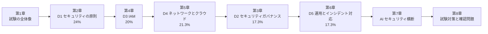

- 章番号はドメイン番号と対応しています（第 2 章 = Domain 1 のように **章 = ドメイン + 1**）。
- 初学者は **D1 → D3 → D4 → D2 → D5** の順が理解しやすいです（用語の土台 → 「誰が」 → 「どこで」 → 「組織として」 → 「実際の運用」）。

### 0.3 各節の読み方

| 見出し | 意味 |
|---|---|
| 何か | 用語の定義（やさしい言葉で） |
| なぜ重要か | 守らないとどうなるか |
| 詳細 | 仕組み・種類・比較（表と図で整理） |
| ベストプラクティス | 現場で推奨される実践（根拠 URL つき） |
| 試験のポイント | 出題されやすい観点・ひっかけ |
| 出典 | 第 10 章の `[S番号]` に対応 |

---

## 1. CC 試験の全体像

### 1.1 CC とは

**CC（Certified in Cybersecurity）** は、ISC2（CISSP を運営する世界最大級のサイバーセキュリティ専門家団体）が提供する**エントリーレベル認定**です。

| 特徴 | 内容 | 出典 |
|---|---|---|
| 受験要件 | **実務経験不要** | [S1] |
| 認定機関 | ANAB 認定（ISO/IEC 17024） | [S1] |
| 公的承認 | 米国国防総省 DoDM 8140.03 承認 | [S1] |
| 位置づけ | CC → SSCP / CCSP / CGRC / CISSP などへ進むための入口 | [S1] |
| 学習手段 | 公式オンラインセルフペース、オンライン講師主導、公式フラッシュカード・クイズ | [S1] |

### 1.2 試験形式・費用（第三者情報を含む）

> ⚠ **確認レベルの注意**: ISC2 公式ページで今回取得できたのは「パッケージ」「アウトライン」までです。下表の **試験時間・問題数・合格点・費用・維持条件は第三者サイトの記載** です。受験前に必ず [S6] 公式の試験登録ページと ISC2 ダッシュボードで最新条件を確認してください。

| 項目 | 内容 | 確度 |
|---|---|---|
| 形式 | CAT（Computerized Adaptive Testing、適応型） | 第三者複数 [S52] |
| 問題数 | 100〜125 問 | 第三者複数 [S52]（旧情報では 100 問表記もあり） |
| 試験時間 | 120 分 | 第三者複数 [S52] |
| 合格点 | 1000 点満点中 700 点（スケールドスコア） | 第三者複数 [S52] |
| 試験会場 | Pearson VUE | 第三者 [S52] |
| 受験料 | US$199（地域により異なる） | 第三者 [S52] |
| 言語 | 英語（日本語は公式で要確認） | 要確認 |
| 認定後の維持 | 年次維持費（AMF）US$50 ＋ 3 年で 45 CPE | 第三者 [S52] |
| 受験年齢・倫理 | 16 歳以上、ISC2 Code of Ethics への同意 | 第三者 [S52] |

**CAT 形式の注意点**: 受験者の解答に応じて難易度が変わり、一般に**一度回答した問題へ戻れません**。「迷って後回し」ができないため、練習段階から「その場で決める」訓練が必要です [S52]。

### 1.3 購入パッケージと有効期限（ISC2 公式）

[S1] に記載されている内容を整理します。

| 製品 | 研修アクセス | 試験受験期限 | 受験回数 |
|---|---|---|---|
| Exam Only | — | 購入から 365 日 | 1 |
| Exam Only + Peace of Mind Protection | — | 購入から 180 日 | 2 |
| Online Instructor-Led Training（ILT） | 初回セッションから 180 日 | — | — |
| ILT + Exam | 180 日 | 365 日 | 1 |
| ILT + Exam + Peace of Mind | 180 日 | 180 日 | 2 |
| Online Self-Paced（90 日） | 90 日 | — | — |
| Online Self-Paced（180 日） | 180 日 | — | — |
| Self-Paced 180 日 + Exam | 180 日 | 365 日 | 1 |
| Self-Paced 180 日 + Exam + Peace of Mind | 180 日 | 180 日 | 2 |
| Self-Paced 90 日 + Exam | 90 日 | 365 日 | 1 |
| Self-Paced 90 日 + Exam + Peace of Mind | 90 日 | 180 日 | 2 |
| Certificates / Courses / Express Courses（CPD 用） | 60 日 | — | — |

- **Peace of Mind Protection**: 2 回分の受験機会を、単発 2 回購入より安く提供。**購入から 180 日以内**に 2 回とも受験する必要があります（再受験ポリシーに従う）[S1]。
- 研修教材は、ILT の場合 **初回セッションの 1 週間前から**閲覧可能です [S1]。

### 1.4 ドメイン配点（2026/9/1 発効）

| ドメイン | 名称 | 配点 | 小項目数 |
|---|---|---|---|
| D1 | Security Principles | **24%** | 5（1.1〜1.5） |
| D2 | Security Governance | **17.3%** | 4（2.1〜2.4） |
| D3 | Identity and Access Management (IAM) Concepts | **20%** | 2（3.1〜3.2） |
| D4 | Networking and Cloud Security Concepts | **21.3%** | 3（4.1〜4.3） |
| D5 | Security Operations and Incident Response | **17.3%** | 5（5.1〜5.5） |
| 合計 | | 100% | 19 |

出典: [S2]。旧アウトライン（26/10/22/24/18%）との比較は [S3]。

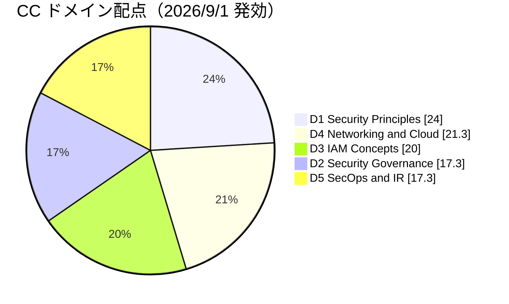

### 1.5 受験から認定までの流れ

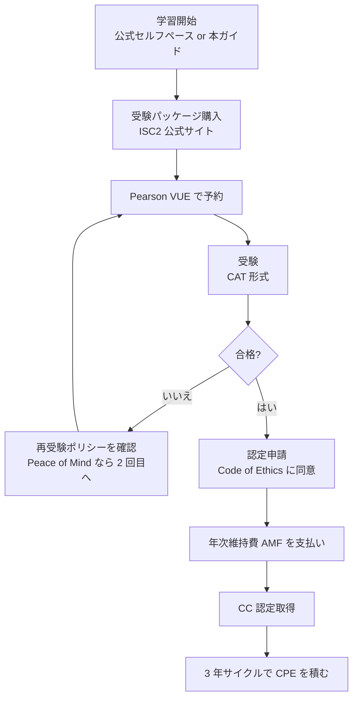

- 合格後は**期限内（第三者情報では 9 か月）に認定申請**を完了しないと再受験になります [S52]。必ず ISC2 の案内で期限を確認してください。

### 1.6 試験で問われる 19 項目の全体マップ

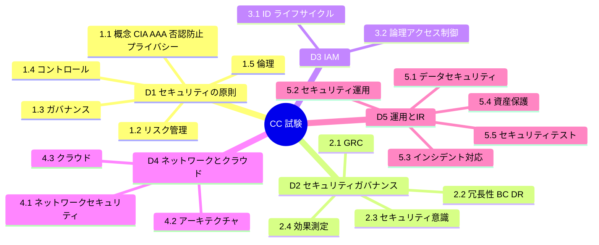

### 1.7 学習のコツ（初学者向け）

1. **「なぜ」を先に**: 用語暗記より「何を守るために存在するのか」を先に押さえると、選択肢の消去が楽になります。
2. **CC は"考え方"の試験**: 製品操作や詳細な設定値ではなく、**原則・概念・正しい優先順位**が問われます。
3. **答えが複数ありそうなときの判断軸**: ①人命・安全が最優先 → ②法令・方針の順守 → ③ 最小権限・多層防御・予防 → ④ 組織の目的に合うリスクベースの判断。
4. **英語用語を併記して覚える**（試験は英語のため）。


---

## 2. Domain 1: Security Principles（セキュリティの原則）— 配点 24%

> 最大配点のドメインです。ここが他の全ドメインの「共通言語」になります [S2]。

### 2.1 〔1.1〕サイバーセキュリティの基本概念

#### 2.1.1 CIA トライアド（機密性・完全性・可用性）

**何か**: 情報セキュリティの 3 大目的。すべてのセキュリティ対策は、この 3 つのどれを守るためかで説明できます。

| 要素 | 意味 | 破られる例 | 代表的な対策 |
|---|---|---|---|
| **Confidentiality**（機密性） | 認可された人だけが情報を見られる | 顧客情報の漏えい、通信の盗聴 | 暗号化、アクセス制御、データ分類 |
| **Integrity**（完全性） | 情報が正確で、無断で改ざんされない | 帳票の改ざん、マルウェアによるファイル書換え | ハッシュ、デジタル署名、変更管理、ログ |
| **Availability**（可用性） | 必要なときに使える | DDoS、ランサムウェア、障害 | 冗長化、バックアップ、DR、DDoS 対策 |

**ベストプラクティス**
- 守る対象ごとに「CIA のどれを最優先するか」を決める（例: 病院の投薬システムは可用性と完全性、社内の機密設計書は機密性）。
- 3 要素は**トレードオフ**になる（暗号化・厳格な認証は機密性を上げるが、運用性＝可用性を下げ得る）。リスクに応じて均衡させる。
- 出典: NIST SP 800-53 のコントロールは CIA に紐づく [S39]、NIST CSF 2.0 [S8]。

**AI との関係（2026 版アウトラインで追加）**: AI システムでは、学習データの**完全性**が崩れると**モデルポイズニング**（汚染データでモデルを歪める攻撃）につながり、学習データに個人情報が含まれる場合は**プライバシー**の保護が必要です [S2]。

**試験のポイント**
- 「ファイルが書き換えられた」→ 完全性、「サービスが止まった」→ 可用性、「盗み見られた」→ 機密性、と**事象から要素を特定**させる問題が頻出。

#### 2.1.2 AAA（認証・認可・アカウンティング）

| 要素 | 問い | 例 |
|---|---|---|
| **Authentication**（認証） | あなたは誰か？ | パスワード、MFA、生体認証 |
| **Authorization**（認可） | 何をしてよいか？ | 「経理フォルダは読み取りのみ」 |
| **Accounting**（記録・追跡） | 何をしたか？ | ログイン履歴、操作ログ、監査ログ |

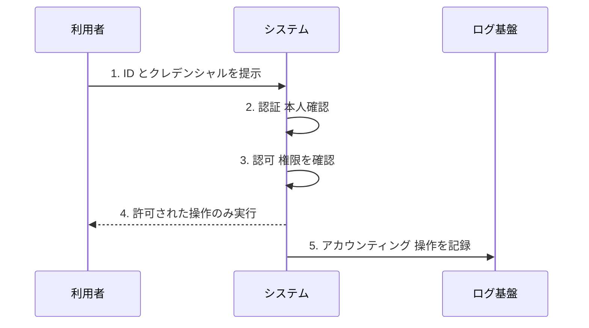

**認証の 3 要素（Authentication factors）**

| 種類 | 概要 | 例 |
|---|---|---|
| Something you **know**（知識） | 本人だけが知る情報 | パスワード、PIN |
| Something you **have**（所持） | 本人が持つ物 | IC カード、スマホ、FIDO2 セキュリティキー |
| Something you **are**（生体） | 本人の身体的特徴 | 指紋、顔、虹彩 |

- **MFA（多要素認証）** は、**異なる種類**の要素を 2 つ以上組み合わせること。「パスワード＋秘密の質問」は**どちらも知識**なので MFA ではありません。

**ベストプラクティス**
- パスワードのみの認証を避け、**MFA を標準化**する。特に管理者・リモートアクセス・クラウドから優先 [S12]。
- 最も強い区分は **FIDO2/WebAuthn（パスキー）** などの**フィッシング耐性のある認証器** [S12][S47]。
- NIST SP 800-63B-4（2025 年 8 月確定）は、パスワード単独利用時の**最小 15 文字**、**構成ルール（大文字・記号の強制）の禁止**、**定期変更の強制の禁止（漏えい時のみ変更）**、**漏えいパスワードのブロックリスト照合**を示しています [S12]（内容は二次情報でも確認、一次は [S12] を参照）。
- ログ（アカウンティング）は改ざん防止のため**集中管理**し、時刻同期（NTP）を行う [S25]。

**試験のポイント**
- 認証と認可の混同（「ログインできた＝何でもできる」ではない）。
- 「誰が・いつ・何をしたか」を追跡できる → アカウンタビリティ／アカウンティング。

#### 2.1.3 Non-repudiation（否認防止）

**何か**: 「やっていない」と**後から否定できなくする**性質。

- 実現手段: **デジタル署名**（秘密鍵で署名 → 公開鍵で検証）、改ざん困難な監査ログ、タイムスタンプ。
- 共有アカウント（複数人が同じ ID を使う）は否認防止を壊す → **個人ごとの ID** が原則。
- AI が生成・実行した操作も、**誰（どのエージェント/サービスアカウント）が実行したか追跡可能**にする [S2]。

#### 2.1.4 Privacy（プライバシー）

**何か**: 個人に関する情報を、**本人の期待・法令に沿って**収集・利用・保管・共有すること。セキュリティ（守る）とは別概念で、「**何を、なぜ、どこまで扱ってよいか**」の話です。

| 用語 | 意味 |
|---|---|
| PII（個人を特定できる情報） | 氏名、住所、マイナンバー、メール、IP アドレス（文脈による）等 |
| Data minimization（データ最小化） | 目的に必要な分だけ集める |
| Purpose limitation（目的限定） | 同意・告知した目的以外に使わない |
| Privacy by Design | 設計段階からプライバシーを組み込む |

**ベストプラクティス**
- 収集前に「本当に必要か」を問い、**不要なら集めない**。保管期間を決め、期限後は削除。
- AI 学習データに個人情報が含まれる場合は、**匿名化・マスキング**や利用目的の整理を行う [S2]。
- 法令の例: EU の GDPR [S35]、日本の個人情報保護法（個人情報保護委員会 [S36]）。
- フレームワーク: NIST Privacy Framework [S48]。

**試験のポイント**: セキュリティが高くてもプライバシーが守られるとは限らない（目的外利用など）。

---

### 2.2 〔1.2〕リスク管理の概念

#### 2.2.1 まず用語を押さえる

| 用語 | 意味 | 例 |
|---|---|---|
| Asset（資産） | 守る価値があるもの | 顧客 DB、サーバー、従業員、ブランド |
| Threat（脅威） | 害を与え得る原因 | ランサムウェア、内部不正、地震 |
| Vulnerability（脆弱性） | 脅威に付け込まれる弱点 | 未パッチの OS、弱いパスワード |
| Likelihood（発生可能性） | 起こりやすさ | 高・中・低 |
| Impact（影響） | 起きたときの被害 | 金銭、信用、法的責任 |
| **Risk（リスク）** | 脅威が脆弱性を突いて資産に損害を与える可能性 | 概念式: **Risk = Likelihood × Impact** |
| Risk appetite（リスク選好） | 組織が追って良いと考えるリスクの量 | 経営が決める |
| Risk tolerance（許容度） | 許容できるばらつき・上限 | 目標の逸脱幅 |
| Inherent risk（固有リスク） | 対策前のリスク | |
| Residual risk（残留リスク） | 対策後に残るリスク | 受容の判断対象 |

> 区別のコツ: **脅威は外から、脆弱性は内側の弱点**。脆弱性だけでも脅威だけでもリスクにならない（両方が揃って初めてリスク）。

#### 2.2.2 リスク管理ライフサイクル

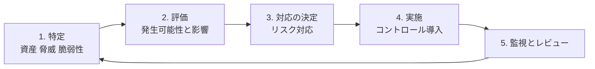

[S10]（NIST SP 800-30）はリスクアセスメントの手順、[S11]（NIST SP 800-37 RMF）は組織への適用プロセスを示します。

#### 2.2.3 リスク対応（Risk treatment）の 4 つの選択肢

| 対応 | 意味 | 例 |
|---|---|---|
| **Mitigate（低減）** | 対策で発生可能性か影響を下げる | パッチ適用、MFA 導入 |
| **Transfer（移転/共有）** | 第三者に負担を移す | サイバー保険、アウトソース契約 |
| **Avoid（回避）** | リスクのある活動をやめる | リスクの高いサービスを停止 |
| **Accept（受容）** | 対策せず受け入れる | 低影響で対策費が割に合わない場合 |

- **Transfer は責任そのものを消さない**（法的責任・評判リスクは残る）。
- **Accept は"放置"ではない**: 責任者が**文書化して承認**する。

#### 2.2.4 定性的評価と定量的評価

| 方式 | 特徴 | 例 |
|---|---|---|
| 定性的（Qualitative） | 高/中/低、5×5 マトリクス。素早い | リスクヒートマップ |
| 定量的（Quantitative） | 金額で計算。費用対効果が説明しやすい | SLE・ALE |

**定量式（暗記推奨）**

- **SLE（単一損失予測額）= AV（資産価値）× EF（被害率）**
- **ALE（年間損失予測額）= SLE × ARO（年間発生率）**

> 例: 資産 AV = 1,000 万円、EF = 30%、ARO = 0.2（5 年に 1 回）  
> SLE = 1,000 万 × 0.3 = **300 万円**、ALE = 300 万 × 0.2 = **60 万円/年**  
> → 年間 60 万円を大きく超える対策費は、経済合理性が低い（他の価値も合わせて判断）。

**ベストプラクティス**
- **リスク登録簿（Risk Register）** に、リスク・オーナー・対応策・期限・残留リスクを記録し、定期レビューする。
- 経営層が**リスク選好を定義**し、現場はそれに沿って判断する [S11]。
- 新技術（AI・クラウド）導入時は**導入前にリスク評価**を行う [S29]。

**試験のポイント**
- 「保険に入る」→ Transfer、「サービス停止」→ Avoid。
- 「対策費が資産価値より高い」→ 通常は Accept や別案を検討。

---

### 2.3 〔1.3〕ガバナンスの概念

#### 2.3.1 規制・法令（Regulations and laws）

**何か**: 組織が**守らなければならない**外部ルール。違反すると罰則・制裁があります。

| 例 | 概要 | 区分 |
|---|---|---|
| GDPR（EU） | 個人データ保護。侵害は監督当局へ**72 時間以内**に通知 | 法令 [S35] |
| 個人情報保護法（日本） | 個人情報の適正な取扱い。漏えい等は個人情報保護委員会への報告が必要な場合あり | 法令 [S36] |
| HIPAA（米） | 医療情報の保護 | 法令 |
| SOX 法（米） | 財務報告の内部統制 | 法令 |
| PCI DSS | カード会員データ保護の**業界標準**（法律ではなく契約・カードブランド規則） | 業界標準 |

> 日本の個人情報保護法における漏えい等報告の期限・要件（速報・確報）は改正されることがあるため、**最新は個人情報保護委員会の公式ページで確認**してください [S36]。

#### 2.3.2 フレームワークとガイドライン

| 名称 | 概要 | 特徴 |
|---|---|---|
| **NIST CSF 2.0** | 6 つの機能: **Govern**（統治）、Identify、Protect、Detect、Respond、Recover | 2.0 で Govern が新設 [S8] |
| **ISO/IEC 27001** | ISMS（情報セキュリティマネジメントシステム）の要求事項。**認証取得が可能** | 国際規格 [S34] |
| **CIS Controls** | 優先順位付きの具体的な防御策集 | 実装重視 [S19] |
| NIST SP 800-53 | 詳細なセキュリティ/プライバシー管理策のカタログ | [S39] |

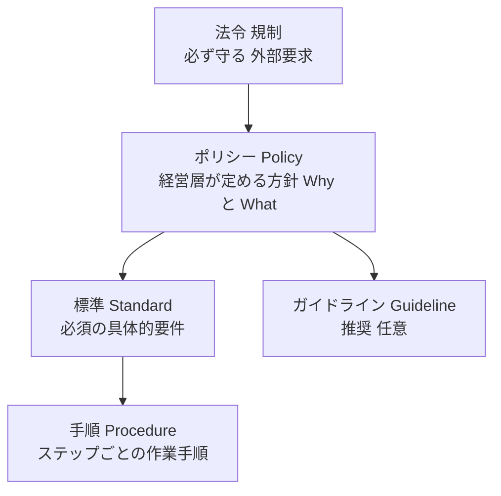

| 文書 | 拘束力 | 変更頻度 | 例 |
|---|---|---|---|
| Policy | 必須 | 低い | 「情報は分類して保護する」 |
| Standard | 必須 | 中 | 「機密データは AES-256 で暗号化」 |
| Procedure | 必須（作業時） | 高い | 「暗号化ボリュームの作成手順」 |
| Guideline | **推奨（任意）** | — | 「パスワードマネージャーの使い方のヒント」 |

**ベストプラクティス**
- ポリシーは**経営層の承認**を得て全社に周知。例外は**期限付き・承認付き**で管理する。
- 複数の法令・規格が重なる場合は、**管理策を一度作って複数要件へマッピング**する（二重作業を避ける）。
- AI ツールも、従来ソフトと**同じ組織ポリシー・法的要件の対象**にする [S2]。

**試験のポイント**: Policy（方針）と Procedure（手順）の違い、Guideline は任意、PCI DSS は法律ではない。

---

### 2.4 〔1.4〕サイバーセキュリティのコントロール

**何か**: リスクを下げるための対策（Controls）。**「何で実現するか」（種別）**と**「何をするか」（機能）**の 2 軸で整理すると理解しやすくなります。

#### 2.4.1 種別（Type）: 技術的・管理的・物理的

| 種別 | 実現手段 | 例 |
|---|---|---|
| **Technical**（技術的/論理的） | ソフトウェア・ハードウェア | ファイアウォール、暗号化、MFA、EDR |
| **Administrative**（管理的） | 人・プロセス・文書 | ポリシー、教育、職務分離、採用時審査 |
| **Physical**（物理的） | 物理的な障壁 | 施錠、入退室管理、防犯カメラ、ガード |

#### 2.4.2 機能（Function）

| 機能 | 目的 | 例 |
|---|---|---|
| **Preventive**（予防） | 起きないようにする | ファイアウォール、MFA、施錠 |
| **Detective**（検知） | 起きたことに気づく | IDS、SIEM、監視カメラ、ログ監査 |
| **Corrective**（是正） | 起きた被害を直す | パッチ、バックアップからの復旧、IR |
| **Deterrent**（抑止） | やる気を失わせる | 警告バナー、監視カメラの掲示 |
| **Compensating**（代替） | 主対策が使えないとき別手段で補う | EOL 機器をネットワーク隔離 |
| **Directive**（指示的） | 行動を方向づける | ポリシー、標準 |

#### 2.4.3 マトリクスで覚える

| | Preventive | Detective | Corrective |
|---|---|---|---|
| **Technical** | ファイアウォール、MFA | IDS、SIEM | パッチ適用、AV の隔離 |
| **Administrative** | 職務分離、教育 | ログレビュー、監査 | インシデント対応計画 |
| **Physical** | 施錠、フェンス | 監視カメラ | 消火設備、予備施設への切替 |

#### 2.4.4 多層防御（Defense in Depth）

**単一の対策が破られても、他の層で止める**考え方。**技術・管理・物理を組み合わせる**。詳細は 5.2 節。

**ベストプラクティス**
- **予防だけに頼らない**。必ず検知と是正（復旧）をセットで設計する（NIST CSF の Protect・Detect・Respond・Recover に対応）[S8]。
- 管理策の選定は NIST SP 800-53 や CIS Controls を**カタログ**として使う [S39][S19]。
- AI ツールも**技術・管理・物理の 3 種の管理策**が必要 [S2]。

**試験のポイント**
- 「防犯カメラ」は**Detective＋Deterrent**（物理）。「ポリシー」は管理的。
- 「主対策ができないので別手段」→ **Compensating**。

---

### 2.5 〔1.5〕専門家としての倫理・行動規範

#### 2.5.1 Due care と Due diligence

| 用語 | 意味 | 覚え方 | 例 |
|---|---|---|---|
| **Due diligence**（デューデリジェンス） | 事前に調べ、確認する | **Do detect / 調べる** | ベンダーのセキュリティ審査、リスク調査 |
| **Due care**（デューケア） | 合理的な人が取るべき対応を実際に行う | **Do correct / 実行する** | パッチ適用、教育実施 |

> 簡単に言うと、**diligence ＝ 調査・確認（考える・知る）**、**care ＝ 実行・対処（動く）**。両方そろって「合理的な注意を尽くした」と言える。

#### 2.5.2 ISC2 Code of Ethics

ISC2 会員（認定保持者・受験者）は倫理規約を順守する必要があります [S7]。4 つの**キャノン（原則）**は、**この順番で優先**されます。

| 順位 | キャノン（意訳） |
|---|---|
| 1 | **社会・公共の利益・必要な公共の信頼、および重要インフラを守る** |
| 2 | **誠実・公正・責任ある行動をとり、法令を順守する** |
| 3 | **依頼者（雇用主・顧客）に対し、誠実で有能なサービスを提供する** |
| 4 | **専門職を前進させ、保護する** |

**ベストプラクティス**
- 倫理的ジレンマ（雇用主の指示と法令・公共の安全が衝突）では、**上位のキャノンが下位に優先**。
- 機密情報の取扱い、利益相反の開示、**許可された範囲でのみ**テスト・調査を行う。
- 不正を知ったときは、**組織の報告ルート**へ。

**試験のポイント**
- 倫理の問題は**「社会・公共 > 法令 > 雇用主 > 専門職」**の優先順位で解く。
- 試験は**倫理を軽視しない**。キャノンの順序は暗記必須（出題は少数でも取りこぼしにくい得点源）[S52]。

---

### 2.6 第 2 章 のまとめ

| 小項目 | 必ず覚えること |
|---|---|
| 1.1 | CIA / AAA / 否認防止 / プライバシーの定義と対策、MFA は異種要素 |
| 1.2 | リスク = 可能性 × 影響、対応 4 種（低減・移転・回避・受容）、SLE/ALE |
| 1.3 | 法令・ポリシー・標準・手順・ガイドラインの違い、NIST CSF 2.0 の 6 機能 |
| 1.4 | 技術的/管理的/物理的 × 予防/検知/是正、多層防御 |
| 1.5 | Due care と Due diligence、ISC2 倫理 4 キャノンの順序 |


---

## 3. Domain 2: Security Governance（セキュリティガバナンス）— 配点 17.3%

> 旧アウトラインの「BC/DR/IR」ドメインが、**GRC・冗長性・意識向上・効果測定**を扱うガバナンスのドメインに再編されました。インシデント対応は第 6 章（D5）へ移っています [S2][S3]。

### 3.1 〔2.1〕GRC（Governance, Risk, Compliance）の計画

#### 3.1.1 目的と重要性

**何か**: GRC は 3 つの活動を**一体で**回す仕組みです。

| 要素 | 問い | 担当イメージ |
|---|---|---|
| **Governance**（統治） | 何を、誰の責任で、どの方向で守るか | 取締役会・経営層・CISO |
| **Risk**（リスク） | 何が目標達成を脅かすか、どこまで許容するか | リスク管理部門 |
| **Compliance**（コンプライアンス） | 法令・契約・ポリシーを守れているか | 法務・監査・コンプライアンス部門 |

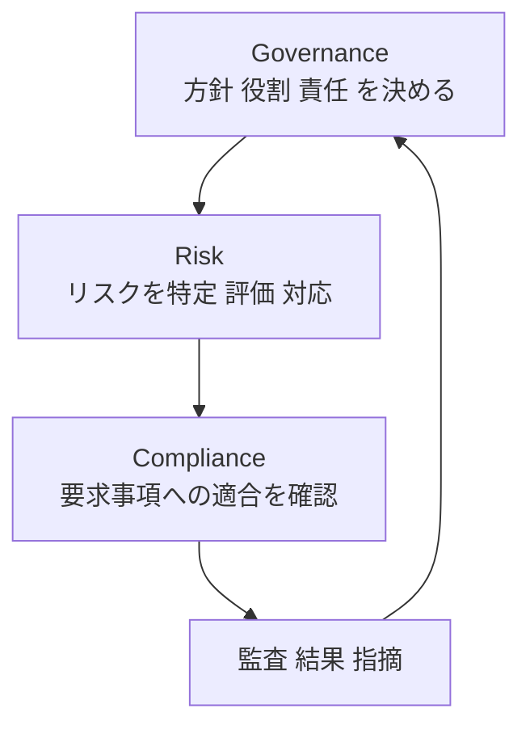

**なぜ重要か**
- 技術対策がバラバラでも、**経営の方針・責任・予算**が連動しないと継続しません。
- 規制違反は**罰金・信用失墜・事業停止**につながります。

#### 3.1.2 フレームワークとツール

| 区分 | 例 | 用途 |
|---|---|---|
| フレームワーク | NIST CSF 2.0 [S8]、ISO/IEC 27001 [S34]、CIS Controls [S19]、NIST SP 800-53 [S39] | 管理策の体系・評価基準 |
| AI の GRC | NIST AI RMF [S29] | AI 特有のリスク管理 |
| ツール（種類） | GRC プラットフォーム、リスク登録簿、資産台帳（CMDB）、証跡管理、ポリシー管理システム | 管理策のマッピング、証跡収集、監査対応 |

**ベストプラクティス**
1. **経営層のスポンサーシップ**を得る（予算・権限・優先順位）。
2. **責任の明確化**: 責任者（Owner）を管理策ごとに割り当てる。
3. **管理策をフレームワーク間でマッピング**して重複作業を減らす。
4. **継続的モニタリング**（年 1 回の監査頼みにしない）。
5. AI 利用は**承認済みツールのリスト化**・用途ルール・データ取扱いルールを定める [S2][S29]。

**試験のポイント**: 「ガバナンス＝方向づけ・監督（経営の責任）」「マネジメント＝実行」。ガバナンスは**経営層の責任**。

---

### 3.2 〔2.2〕冗長性の理解（BC と DR）

#### 3.2.1 BC・DR・BIA の関係

| 用語 | 意味 | ポイント |
|---|---|---|
| **BC（事業継続）/ BCP** | 障害時も**重要業務を継続**するための計画・活動 | **事業全体**が対象（人・拠点・手順を含む） |
| **DR（災害復旧）/ DRP** | 被害を受けた **IT システムを復旧**する計画・活動 | **IT・データ**の復旧が中心（BC の一部） |
| **BIA（事業影響度分析）** | 業務が止まったときの影響を分析 | **BCP/DRP の出発点**。優先順位・目標時間を決める |

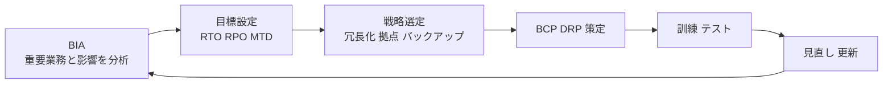

#### 3.2.2 重要指標: RTO / RPO / MTD

| 指標 | 意味 | 問い |
|---|---|---|
| **RTO**（目標復旧時間） | 復旧までに許される**時間** | いつまでに戻すか |
| **RPO**（目標復旧時点） | 失ってよい**データの時間幅** | どの時点のデータまで戻すか |
| **MTD / MTPD**（最大許容停止時間） | これを超えると事業が存続できない上限 | RTO は MTD より**短く**設定 |

> 例: 毎日 0:00 にバックアップ、14:00 に障害 → 最大 14 時間分のデータを失う。**RPO を 1 時間**にしたいなら、**1 時間以内の頻度**でバックアップ/レプリケーションが必要。

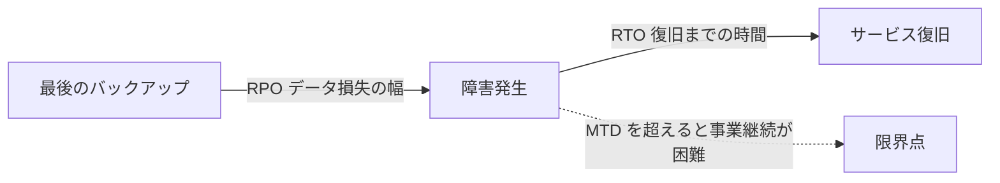

#### 3.2.3 冗長性（Redundancy）の実現手段

| 手段 | 説明 | 注意 |
|---|---|---|
| 単一障害点（SPOF）の排除 | 電源・回線・サーバー・拠点を二重化 | 洗い出しが最優先 |
| ロードバランサー/クラスタ | 複数台で処理を分散・引継ぎ | 設定ミスで同時停止も |
| **RAID** | ディスク故障への耐性 | **バックアップの代わりにはならない**（誤削除・ランサムも複製される） |
| 地理的冗長 | 別リージョン/別拠点で運用 | データ主権・コスト |
| バックアップ | 時点コピーを別に保管 | **復元テスト**が肝要 |

**代替拠点（Alternate site）**

| 種類 | 状態 | 復旧速度 | コスト |
|---|---|---|---|
| **Hot site** | 設備・データ最新で即稼働 | 最速（数分〜数時間） | 高 |
| **Warm site** | 設備あり、データ・設定は要準備 | 中 | 中 |
| **Cold site** | 場所と電源程度のみ | 遅い（数日〜） | 低 |

**バックアップ方式**

| 方式 | 内容 | バックアップ時間 | 復元時 |
|---|---|---|---|
| Full（完全） | すべて | 長い | 最も簡単（1 セット） |
| Incremental（増分） | 直前のバックアップ以降の差分 | 短い | Full ＋ **全**増分が必要 |
| Differential（差分） | **最後の Full** 以降の差分 | 中 | Full ＋ 最新の差分 |

**ベストプラクティス**
- **3-2-1 ルール**: データを**3 つ**のコピー、**2 種類**の媒体、**1 つ**は別拠点（オフサイト）。ランサムウェア対策として、さらに**変更不可（イミュータブル）**のコピーと、**エラー 0 の復元検証**を加えた 3-2-1-1-0 が広く紹介されています。
- **バックアップは復元して初めて価値**が分かる → 定期的に**復元テスト**。
- 計画は**テストで磨く**: ウォークスルー → テーブルトップ → シミュレーション → 完全切替の順に段階的に [S20][S38]。
- 参考: NIST SP 800-34（IT コンティンジェンシープランニング）[S20]。

**AI の観点（2026 版）** [S2]
- バックアップ対象は、通常のデータだけでなく、**AI サービスの設定・学習/推論データセット・モデル**まで拡張する。
- **Model Drift（モデルドリフト）**: 時間経過で AI の性能が低下し、重要業務に影響する。**BC/DR のリスク**として監視・再学習・ロールバック手順を持つ。

**試験のポイント**
- BC は事業全体、DR は IT 復旧。**BIA が最初**。
- RTO = 時間、RPO = データ。Hot > Warm > Cold の順に高速・高コスト。
- RAID はバックアップではない。

---

### 3.3 〔2.3〕セキュリティ意識（Security Awareness）

#### 3.3.1 組織文化とリーダーシップ

**何か**: 従業員が**日常行動でセキュリティを意識**できる状態をつくること。人は**攻撃の入口にも最後の防御（Human firewall）にも**なります [S2]。

- **セキュリティ文化**の鍵は、経営層・管理職が**率先して守る**こと（トップの姿勢）。
- 失敗を責める文化は**報告を遅らせる**。「**早く報告すれば評価される**」文化が被害を小さくします。

#### 3.3.2 ソーシャルエンジニアリングの種類

| 手口 | 内容 | 対策の要点 |
|---|---|---|
| **Phishing** | 偽メール・偽サイトで認証情報や金銭を詐取 | リンクを開く前に確認、報告ボタン |
| **Spear phishing** | 特定個人を狙った標的型 | 個別の社内事情を使うので要警戒 |
| **Whaling** | 経営層を狙う | 追加承認・電話での折返し確認 |
| **Vishing** | 電話によるなりすまし | 折り返しは**公式番号**で |
| **Smishing** | SMS によるフィッシング | 短縮 URL に注意 |
| **Pretexting** | もっともらしい口実で情報を聞き出す | 本人確認手順を省略しない |
| **Baiting** | USB・無料特典などでおびき寄せる | 拾った USB を使わない |
| **Tailgating / Piggybacking** | 認証済みの人に続いて不正に入室 | 一人ずつ認証、声かけ |
| **Quid pro quo** | 見返りを提示して情報を得る | 正規の依頼ルートか確認 |

> **AI で悪化**: 生成 AI により、自然な文面のフィッシング、**音声・動画のなりすまし（ディープフェイク）**が低コストで作れるようになりました。訓練内容も更新する必要があります [S2]。

#### 3.3.3 パスワード保護の実践

| すべきこと | 理由 |
|---|---|
| **パスワードマネージャー**を使う | 長く一意なパスワードを現実的に使える |
| **使い回さない** | 1 か所の漏えいが連鎖する（クレデンシャルスタッフィング） |
| **長いパスフレーズ**を使う | 長さが強度の主要因 [S12] |
| **MFA** を有効化 | パスワードが漏れても不正ログインを阻止 |
| 不要な定期変更はしない | 変更を強制すると予測しやすい形に変える（漏えい時は即変更）[S12] |

**ベストプラクティス（教育の設計）**
1. **短く・頻繁に**（年 1 回の長時間研修より、マイクロラーニング）。
2. **役割別**（経理・管理者・開発者で内容を変える）。
3. **模擬フィッシング訓練**＋**報告しやすい導線**（ワンクリックの報告ボタン）。
4. **罰ではなく学習**に。クリックした人を責めず、報告者を称賛。
5. **効果を測る**（クリック率、報告率、報告までの時間）。次節の指標と連動。
- 参考: IPA「情報セキュリティ 10 大脅威」で最新の脅威動向を教材化 [S37]。

**試験のポイント**: 「最も効果的な対策は教育と技術の組み合わせ」「報告しやすい文化」。

---

### 3.4 〔2.4〕サイバーセキュリティの有効性の測定

**何か**: 対策が**効いているかを数値で見える化**し、改善・経営判断につなげる活動。

#### 3.4.1 KPI・KRI・KGI

| 指標 | 意味 | 例 |
|---|---|---|
| **KPI**（Key Performance Indicator） | **活動の成果・効率** | パッチ適用率、MFA 適用率、MTTD/MTTR |
| **KRI**（Key Risk Indicator） | **リスクが高まる兆候**を早期に示す | 未パッチの重大脆弱性数、特権アカウント数の増加、フィッシングクリック率の上昇 |
| **KGI**（Key Goal Indicator） | 最終目標の達成度 | 重大インシデント 0 件 |

> **KPI は"どれだけやったか"、KRI は"どれだけ危ないか"**。KRI は**閾値（しきい値）**を決め、超えたら対応を発動します。

#### 3.4.2 ダッシュボード・スコアカード・レポート

| 形式 | 用途 | 想定読者 |
|---|---|---|
| **ダッシュボード** | リアルタイム/準リアルタイムの状況可視化 | SOC・運用担当 |
| **スコアカード** | 目標に対する達成度（信号色など） | 管理職 |
| **レポート** | 期間ごとの傾向・結論・推奨 | 経営層・監査 |

**代表的な指標例**

| 領域 | 指標 | 見方 |
|---|---|---|
| 検知・対応 | **MTTD**（平均検知時間）、**MTTR**（平均復旧/対応時間） | 小さいほど良い |
| 脆弱性 | 重大脆弱性の**平均修正日数**、期限超過数 | 期限超過は KRI |
| 認証 | **MFA 適用率**、特権アカウント数 | 高い/少ないほど良い |
| 教育 | フィッシング**クリック率**、**報告率** | クリック↓・報告↑が良い |
| AI | AI 関連の**データ漏えい試行数**、モデル性能の逸脱 | AI 専用 KRI [S2] |

**ベストプラクティス**
- **目的に直結する少数の指標**に絞る（SMART: 具体的・測定可能・達成可能・関連性・期限付き）。
- **読者別**に見せ方を変える（経営は"リスクと事業影響"、運用は"件数と時間"）。
- **傾向（トレンド）**で見る。単発の数字だけで判断しない。
- 指標の**定義と算出方法を固定**して比較可能に。
- 参考: NIST SP 800-55（情報セキュリティ測定）[S28]、NIST CSF 2.0 [S8]。

**試験のポイント**: 「リスクの高まりを早期に知る」→ **KRI**。「経営層には要約したレポート/スコアカード」。

---

### 3.5 第 3 章 のまとめ

| 小項目 | 必ず覚えること |
|---|---|
| 2.1 | GRC の 3 要素、ガバナンスは経営の責任、フレームワークの役割 |
| 2.2 | BIA → RTO/RPO/MTD → BCP/DRP、Hot/Warm/Cold、3-2-1、RAID≠バックアップ、AI の Model Drift |
| 2.3 | ソーシャルエンジニアリング 9 種、パスワード保護、報告しやすい文化 |
| 2.4 | KPI と KRI の違い、ダッシュボード/スコアカード/レポートの使い分け |


---

## 4. Domain 3: Identity and Access Management (IAM) Concepts — 配点 20%

> 「アクセス制御は最初の防衛線」。旧ドメインの物理アクセスの比重が下がり、**ID のライフサイクル管理**と**論理アクセス制御**が中心になりました [S2]。

### 4.1 〔3.1〕アイデンティティ・ライフサイクル管理

#### 4.1.1 何か・なぜ重要か

**何か**: 人（従業員・委託先）と**人以外（サービスアカウント、API キー、ボット、AI エージェント）**の ID を、**作成から削除まで**一貫して管理すること [S2]。

**なぜ重要か**
- 退職者のアカウントが残る（**孤立アカウント / Orphan account**）と、不正利用の温床になります。
- 異動のたびに権限が積み上がる（**権限の蓄積 / Privilege creep**）と、最小権限が崩れます。

#### 4.1.2 ライフサイクルの 4 ステップ

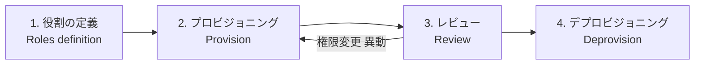

| ステップ | 内容 | 実務のポイント |
|---|---|---|
| **1. 役割の定義** | 職務ごとに必要な権限をまとめる（**ロール設計**） | 職務に必要な最小限。ロールは業務から逆算 |
| **2. プロビジョニング** | アカウント作成・権限付与 | **申請 → 承認 → 付与**のワークフロー。承認は上長＋リソース責任者 |
| **3. レビュー** | 定期的な権限の棚卸し（**アクセス再認定**） | 年 1〜数回、特権はより頻繁に。不要権限を削除 |
| **4. デプロビジョニング** | 退職・契約終了・不要時に**無効化/削除** | **即時**実施。HR システムと連動 |

> 人事イベントの呼び名: **Joiner（入社）・Mover（異動）・Leaver（退職）= JML**。Mover のとき**旧権限を外す**のが見落とされがちです。

#### 4.1.3 フレームワークとツール（サービス/機能の種類）

| 区分 | 例 | 役割 |
|---|---|---|
| ディレクトリ/IdP | Active Directory、Microsoft Entra ID、Google Workspace、Okta など | ID の一元管理・認証の提供 |
| **SSO**（シングルサインオン） | **SAML 2.0**、**OpenID Connect（OIDC）** | 一度の認証で複数サービスに入る。パスワード乱立を防ぐ |
| **認可の委譲** | **OAuth 2.0** | 「他アプリにあなたのデータへの限定アクセスを与える」。**認証ではなく認可** |
| **自動プロビジョニング** | **SCIM** | ID 情報を IdP → SaaS へ自動連携（作成・更新・削除） |
| **IGA**（Identity Governance & Administration） | 申請承認、再認定キャンペーン | ライフサイクルと棚卸しの自動化 |
| **PAM**（Privileged Access Management） | パスワード金庫、セッション録画、**JIT 昇格** | **特権アカウント**の保護 |
| **MFA / パスキー** | FIDO2/WebAuthn、認証アプリ | 認証の強化 [S47] |

> SAML・OIDC は**認証（SSO）**、OAuth 2.0 は**認可の委譲**。混同しない。

#### 4.1.4 人以外の ID（Non-human identity）と AI

- サービスアカウント、API キー、ボット、**AI エージェント**にも**所有者・用途・有効期限**を定め、ライフサイクルで管理する [S2]。
- 実務のポイント:
  - **ハードコード禁止**（ソースコードやスクリプトに秘密情報を埋め込まない）→ **シークレット管理サービス**で保管・ローテーション。
  - **用途別に分離**し、必要最小限の権限だけを付与。
  - **使われなくなったら削除**。
- AI を認証強化にも活用: **Impossible travel**（短時間で物理的にあり得ない場所からのログイン）や異常ログインの検出に使われる [S2]。

**ベストプラクティス**
1. **HR を信頼できる情報源（Source of truth）**にして、JML を自動連動。
2. **ロールベース**で付与し、**個別付与を例外化**。
3. **特権アカウントは通常アカウントと分離**し、**JIT（必要な時だけ昇格）**と**セッション記録**。
4. **緊急用（Break-glass）アカウント**を用意し、**使用時は即アラート**。
5. **定期棚卸し（再認定）**をスケジュール化し、完了を測定指標にする。
6. パスワード方針は **NIST SP 800-63B-4**（長さ重視・ブロックリスト・漏えい時のみ変更）[S12]。**フィッシング耐性 MFA** を優先。

**試験のポイント**
- 「退職時に最も重要」→ **即時のデプロビジョニング**。
- 「異動後も旧権限が残る」→ **Privilege creep**（定期レビューで是正）。
- 「棚卸し」＝ **Review**。

---

### 4.2 〔3.2〕論理アクセス制御

#### 4.2.1 基本原則

| 原則 | 意味 | 例 |
|---|---|---|
| **Principle of Least Privilege（PoLP）最小権限** | 職務に**必要な最小限**の権限だけ付与 | 経理担当は人事 DB に触れない |
| **Separation of Duties（SoD）職務分離** | 重要な作業を**複数人に分け**、一人で不正を完結できなくする | 「発注する人」と「支払承認する人」を分ける |
| **Need to know** | 業務上知る必要がある情報のみ | 機密案件の関係者だけ閲覧 |
| **Deny by default** | 明示的に許可しない限り拒否 | ファイアウォール、ACL の最後は deny |

関連の運用手法: **Job rotation（職務ローテーション）**、**強制休暇**（不正の発見に有効）、**Dual control（二人制御）**、**Split knowledge（知識分割）** など。

> **PoLP と SoD の違い**: PoLP は「**1 人あたりの権限量**を最小に」、SoD は「**1 つの重要プロセスを 1 人に任せない**」。

#### 4.2.2 アクセス制御モデル

| モデル | 誰が決めるか／何で決めるか | 特徴 | 例 |
|---|---|---|---|
| **DAC**（任意アクセス制御） | **所有者**が決める | 柔軟だが統制が弱い | ファイルの共有設定 |
| **MAC**（強制アクセス制御） | **システム/管理者**がラベルで強制 | 厳格。分類（機密度）と許可（クリアランス）で判定 | 軍事・政府の機密システム |
| **RBAC**（ロールベース） | **役割**で権限を付与 | 管理しやすい。最も一般的 | 「経理ロール」「管理者ロール」 |
| **ABAC**（属性ベース） | **属性**（部署・時間・場所・端末状態・データの機密度）の組合せ | 細かく動的。ゼロトラストと相性 | 「社内ネットワーク、管理端末、業務時間のみ」 [S40] |
| **Rule-based**（ルールベース） | 管理者が定義した**ルール**に従う | 全員に一律適用 | ファイアウォールのルール、時間帯制限 |

```mermaid
flowchart TD
    A["利用者がリソースにアクセス要求"] --> B{"認証できたか?"}
    B -- "いいえ" --> X["拒否 + ログ記録"]
    B -- "はい" --> C{"認可: ポリシーとモデルで許可か?<br/>RBAC ABAC など"}
    C -- "いいえ" --> X
    C -- "はい" --> D["許可 最小権限の範囲"]
    D --> E["操作をログに記録<br/>アカウンティング"]
```

#### 4.2.3 物理アクセスとの関係（補足）

- 新アウトラインの 3.2 は**論理アクセス制御**が中心ですが、物理的な入退室管理は **1.4 の物理的コントロール**（施錠・バッジ・監視カメラ・トラップ）として引き続き重要です [S2]。
- **論理と物理を連携**させる（退職時にバッジとアカウントを同時に無効化）。

**ベストプラクティス**
1. **デフォルト拒否**から始め、必要な権限だけ追加。
2. **ロールを基本、例外は ABAC や個別承認**で補う（ロール爆発を避ける）。
3. **特権は常時付与しない（JIT）**。管理者権限での日常業務を避ける。
4. **職務分離**を重要プロセス（支払い、特権付与、コード本番反映）に適用。
5. **定期的なレビュー**と**ログ監視**で逸脱を検知。
6. **自動化されたシステム（AI/サービス）も最小権限**で運用し、許可された範囲外の操作が起きないことを確認 [S2]。
- 参考: NIST SP 800-53 の AC（Access Control）ファミリー [S39]、NIST SP 800-162（ABAC）[S40]、CIS Controls（アカウント管理・アクセス制御管理）[S19]。

**試験のポイント**
- 「所有者が決める」→ DAC、「ラベルで強制」→ MAC、「役割」→ RBAC、「属性/状況」→ ABAC。
- 「購買担当者が承認も行える」→ **SoD 違反**。
- 「必要以上の権限」→ **PoLP 違反**。

---

### 4.3 第 4 章 のまとめ

| 小項目 | 必ず覚えること |
|---|---|
| 3.1 | 役割定義 → プロビジョン → レビュー → デプロビジョン、JML、孤立アカウント、非人間 ID、SAML/OIDC/OAuth/SCIM の違い |
| 3.2 | PoLP vs SoD、DAC/MAC/RBAC/ABAC、デフォルト拒否、JIT |


---

## 5. Domain 4: Networking and Cloud Security Concepts — 配点 21.3%

> 「Network Security」が拡張され、**クラウドセキュリティ**と**ゼロトラスト**が明示されました。最も技術的なドメインですが、CC で問われるのは**概念レベル**です [S2][S3]。

### 5.1 〔4.1〕ネットワークセキュリティ

#### 5.1.1 OSI 参照モデルと TCP/IP モデル

**何か**: 通信を**層（レイヤー）**に分けて整理した共通の物差し。「どの層の問題・攻撃・対策か」を言えることが重要です。

| 層 | OSI 名称 | PDU（データ単位） | 代表例 | 代表的な攻撃・対策 |
|---|---|---|---|---|
| 7 | Application（アプリケーション） | Data | HTTP、DNS、SMTP | SQL インジェクション、フィッシング／**WAF** |
| 6 | Presentation（プレゼンテーション） | Data | TLS（暗号化）、文字コード | 暗号の脆弱性／強い暗号設定 |
| 5 | Session（セッション） | Data | セッション管理 | セッションハイジャック／セッションの有効期限 |
| 4 | Transport（トランスポート） | Segment/Datagram | TCP、UDP | SYN フラッド、ポートスキャン／**ファイアウォール** |
| 3 | Network（ネットワーク） | Packet | IP、ICMP、ルーター | IP スプーフィング／ACL、IPsec |
| 2 | Data Link（データリンク） | Frame | Ethernet、MAC、スイッチ、VLAN | **ARP スプーフィング**、MAC フラッディング／ポートセキュリティ、802.1X |
| 1 | Physical（物理） | Bit | ケーブル、無線、ハブ | 盗聴・切断／物理的保護 |

**TCP/IP 4 層との対応**

| TCP/IP | 対応する OSI 層 |
|---|---|
| Application | 5〜7 |
| Transport | 4 |
| Internet | 3 |
| Network Access（Link） | 1〜2 |

> 覚え方（上から）: **A**ll **P**eople **S**eem **T**o **N**eed **D**ata **P**rocessing（Application, Presentation, Session, Transport, Network, Data link, Physical）

#### 5.1.2 TCP と UDP

| | TCP | UDP |
|---|---|---|
| 接続 | コネクション型（3 ウェイハンドシェイク） | コネクションレス |
| 信頼性 | 再送・順序保証あり | なし（高速・軽量） |
| 用途 | Web、メール、ファイル転送 | DNS 問い合わせ、動画・音声、VoIP |

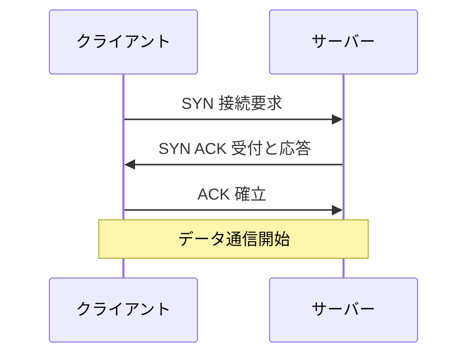

- **SYN フラッド攻撃**: ③の ACK を返さず半開きの接続を大量に作り、サーバーを枯渇させる（DoS）。

#### 5.1.3 IP アドレス: IPv4 と IPv6

| 項目 | IPv4 | IPv6 |
|---|---|---|
| アドレス長 | 32 bit（例: 192.168.1.10） | 128 bit（例: 2001:db8::1） |
| アドレス数 | 約 43 億（枯渇） | 事実上無尽蔵 |
| NAT | よく使う（アドレス節約） | 原則不要（End-to-End） |
| セキュリティ | 別途 IPsec を追加 | IPsec の利用が想定されるが**必須ではない**（暗号化は別途設計が必要）[S41] |
| 注意点 | — | **IPv6 を使っていなくても有効なままだと**、監視・FW が IPv4 だけで抜け道に |

**プライベート IP（RFC 1918）** [S33]: `10.0.0.0/8`、`172.16.0.0/12`、`192.168.0.0/16`（インターネットに直接ルーティングされない）。

> CIDR 表記: `/24` ＝ 先頭 24 ビットがネットワーク部（ホスト 254 台程度）。**数が小さいほど大きなネットワーク**。

#### 5.1.4 主なポート番号（安全でないものと代替）

| ポート | プロトコル | 用途 | 安全性・代替 |
|---|---|---|---|
| 20/21 | FTP | ファイル転送 | 平文 → **SFTP（22）/ FTPS** |
| 22 | SSH / SFTP | 安全なリモート操作 | 暗号化 ○ |
| 23 | Telnet | リモート操作 | **平文 → SSH に置換** |
| 25 | SMTP | メール送信（サーバー間） | 暗号化は STARTTLS 等 |
| 53 | DNS | 名前解決（UDP/TCP） | DNS ポイズニング対策に DNSSEC 等 |
| 67/68 | DHCP | IP の自動割当 | 偽 DHCP に注意 |
| 80 | HTTP | Web | 平文 → **HTTPS** |
| 110 / 143 | POP3 / IMAP | メール受信 | 平文 → **995 / 993（TLS）** |
| 123 | NTP | 時刻同期 | ログ相関に必須 |
| 161/162 | SNMP | 機器監視 | v1/v2c は弱い → **v3** |
| 389 / 636 | LDAP / LDAPS | ディレクトリ | 平文 → **LDAPS** |
| 443 | HTTPS | 暗号化 Web | ○ |
| 445 | SMB | ファイル共有 | インターネット公開は厳禁 |
| 514 | Syslog | ログ転送 | 暗号化付き転送を検討 |
| 3389 | RDP | リモートデスクトップ | **直接公開しない**（VPN/ゲートウェイ ＋ MFA） |

**ベストプラクティス**
- **平文プロトコルを暗号化版に置換**（Telnet→SSH、HTTP→HTTPS）。
- **不要なポート/サービスを閉じる**（デフォルト拒否）。
- 管理系（SSH/RDP）は**インターネットに直接公開せず**、VPN や踏み台（Bastion）経由＋ MFA。

#### 5.1.5 VPN（Virtual Private Network）

| 種類 | 用途 | 主な方式 |
|---|---|---|
| **Remote access VPN** | 在宅勤務者 → 社内 | TLS VPN、IPsec |
| **Site-to-site VPN** | 拠点間・クラウド接続 | IPsec |

- **Full tunnel**: すべての通信を VPN 経由（監視しやすい）。**Split tunnel**: 社内向けのみ VPN（負荷軽減だが統制が難しい）。
- **ベストプラクティス**: **MFA 必須**、強い暗号スイート、端末の健全性確認、最新パッチ、ログ監視。VPN 機器自体は攻撃の標的になりやすいので**迅速なパッチ**を [S41]。

#### 5.1.6 ファイアウォールと IDS/IPS

| 種類 | 判断する層 | 特徴 |
|---|---|---|
| **Packet filtering** | L3〜L4 | IP・ポートで許可/拒否。単純・高速 |
| **Stateful inspection** | L3〜L4 | 通信の**状態**（セッション）を追跡。現在の標準 |
| **Application/Proxy** | L7 | アプリの内容まで検査 |
| **NGFW**（次世代ファイアウォール） | L3〜L7 | アプリ識別、IPS、URL フィルタ等を統合 |
| **WAF** | L7（Web） | SQL インジェクション・XSS 等から Web アプリを保護 |

| | IDS（侵入検知） | IPS（侵入防御） |
|---|---|---|
| 動作 | **検知して通知** | **検知して遮断** |
| 配置 | 分岐（監視）が多い | **インライン**（経路上） |
| リスク | 気づいても止めない | 誤検知で**正常通信も遮断** |
| 種類 | **NIDS**（ネットワーク）/ **HIDS**（ホスト） | 同様 |
| 検知方式 | **シグネチャ**（既知）/ **異常検知**（ふるまい、AI/ML 活用） | 同様 |

**ベストプラクティス** [S21]
1. **デフォルト拒否**、必要な通信のみ許可（最小限のルール）。
2. ルールを**定期的に棚卸し**（不要・重複・期限切れの削除）。
3. **変更管理**（ルール変更は申請・承認・記録）。
4. **アウトバウンド（外向き）通信も制限**（マルウェアの C2 通信対策）。
5. ログを **SIEM に集約**。
6. AI 活用の FW/IDS は「署名一致」を超えて異常な振る舞いを検知できるが、**誤検知/見逃しは必ず人が確認**する [S2]。

#### 5.1.7 無線（Wi-Fi・Bluetooth）

| 規格 | 状況 |
|---|---|
| **WEP** | **破られており使用禁止** |
| **WPA（TKIP）** | 非推奨 |
| **WPA2（AES-CCMP）** | 広く利用。パスフレーズが弱いと危険 |
| **WPA3（SAE）** | **現在の推奨**。オフライン辞書攻撃への耐性が向上 |

**Bluetooth の脅威**: **Bluejacking**（迷惑メッセージ送信）、**Bluesnarfing**（情報窃取）、**Bluebugging**（遠隔操作）→ 対策: 使わない時は**オフ**、非検出モード、ペアリング管理、パッチ。

**ベストプラクティス**
- 企業向けは **WPA3-Enterprise / WPA2-Enterprise（802.1X）**＋ ID ごとの認証。
- **ゲスト用ネットワークを分離**。**WPS を無効**に。
- **不正アクセスポイント（Rogue AP）**の検知。
- 強固なパスフレーズ（家庭/小規模は WPA3-Personal）。
- AI の影響: 無線環境でも AI による通信パターンの異常検知が活用される [S2]。

#### 5.1.8 組込み・ICS・IoT

| 用語 | 意味 | 特徴・リスク |
|---|---|---|
| **Embedded system** | 専用機器に組み込まれたコンピュータ | 更新されにくい、長寿命 |
| **ICS/OT**（産業制御システム、SCADA、PLC） | 工場・電力・水道などを制御 | **可用性と安全**が最優先。レガシー機器が多く、パッチ困難 |
| **IoT** | ネット接続された機器（カメラ、センサー） | **初期パスワードのまま**、更新が提供されない |

**ベストプラクティス**
- **ネットワーク分離（IT と OT の境界を明確に）**、重要機器は専用セグメントへ [S22]。
- **初期パスワード変更**、不要機能の無効化、**資産の把握**（何が繋がっているか）[S23]。
- パッチ適用が難しい機器は**補完策（Compensating）**として隔離・監視を強化。
- 「エアギャップだから安全」は**過信しない**（USB・保守端末経由の侵入）。
- 参考: NIST SP 800-82 Rev.3（OT セキュリティ）[S22]、NIST IR 8259（IoT 機器のセキュリティ基本機能）[S23]。

#### 5.1.9 主なネットワーク攻撃

| 攻撃 | 概要 | 主な対策 |
|---|---|---|
| **DoS / DDoS** | 大量リクエストで可用性を奪う | CDN、レート制限、DDoS 対策サービス |
| **On-path（MITM）** | 通信経路で盗聴・改ざん | **TLS**、証明書検証、VPN |
| **ARP スプーフィング** | 偽の ARP で通信を乗っ取る | ポートセキュリティ、DAI（Dynamic ARP Inspection） |
| **DNS ポイズニング** | DNS の回答を偽装 | DNSSEC、信頼できるリゾルバ |
| **スニッフィング** | 通信を盗み見る | 暗号化、スイッチ型ネットワーク |
| **ポートスキャン** | 開いているポートの探索（偵察） | FW、IDS、不要ポート閉鎖 |
| **リプレイ攻撃** | 取得した通信を再送 | ノンス、タイムスタンプ |

---

### 5.2 〔4.2〕ネットワークセキュリティアーキテクチャ

#### 5.2.1 セグメンテーション（分割）

**何か**: ネットワークを**区画に分け、区画間の通信を制御**して被害の拡大（横展開）を防ぐ。

| 方式 | 内容 | 例 |
|---|---|---|
| **ファイアウォールゾーン** | 信頼度で区画分け | 内部（Trusted）/ **DMZ**（公開サーバー）/ 外部（Untrusted） |
| **VLAN** | スイッチ上で論理的に分割（L2） | 部署別、ゲスト、サーバー、OT |
| **マイクロセグメンテーション** | **ワークロード/アプリ単位**で細かく通信制御 | クラウド/仮想環境で、サーバー間通信を最小限に |

- **DMZ（非武装地帯/スクリーンドサブネット）**: インターネットに公開するサーバーを置く緩衝地帯。**侵害されても内部へ直行させない**。
- 例: **AI 開発環境**を本番データから**分離**し、機密データを学習環境へ無制限に流さない [S2]。

#### 5.2.2 多層防御（Defense in Depth）

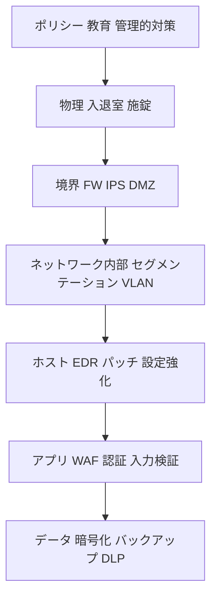

- 一つの層が破られても**他の層で止める**。**多様な対策**を重ねる（同じ種類の対策を重ねても同じ弱点で破られる）[S2]。

#### 5.2.3 ゼロトラスト（Zero Trust, ZT）

**何か**: 「**社内だから信頼する**」をやめ、**すべてのアクセス要求を毎回検証**する考え方。NIST SP 800-207 が基本文書です [S13]。

| 原則 | 意味 |
|---|---|
| **Never trust, always verify** | 場所（社内/社外）で信頼しない。毎回検証 |
| **Least privilege** | 必要最小限の権限だけ、必要な間だけ |
| **Assume breach** | すでに侵害されている前提で設計（影響を局所化） |
| **継続的な検証** | ID・端末状態・コンテキストをアクセス中も評価 |

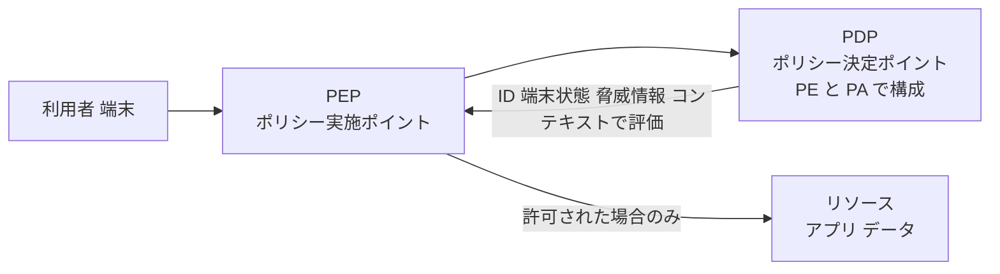

- **PEP**（Policy Enforcement Point）: 実際に通す/止める入口。**PDP**（Policy Decision Point）: 判断する頭脳（Policy Engine ＋ Policy Administrator）[S13]。

**CISA ゼロトラスト成熟度モデルの 5 つの柱**: **Identity / Devices / Networks / Applications & Workloads / Data**（横断で可視化・自動化・ガバナンス）[S14]。

**ベストプラクティス**
1. まず **ID を強化**（MFA、条件付きアクセス）。
2. **端末の健全性**（暗号化・パッチ・EDR）をアクセス条件に。
3. **マイクロセグメンテーション**で横展開を防止。
4. **データ中心**で保護（分類・暗号化・アクセス監査）。
5. **段階的に導入**（一気に全面刷新せず、重要資産から）。
6. 全アクセスを**ログ化・分析**。

**試験のポイント**
- ゼロトラスト ≠ 製品。**考え方・アーキテクチャ**。
- 「内部ネットワークだから信頼」は**誤り**。
- 多層防御 ＝ 複数の層。ゼロトラスト ＝ 暗黙の信頼を排除。**両立する**。

---

### 5.3 〔4.3〕クラウドセキュリティ

#### 5.3.1 クラウドの 5 つの特性（NIST SP 800-145）

| 特性 | 意味 |
|---|---|
| **On-demand self-service** | 利用者が必要なときにセルフで調達 |
| **Broad network access** | ネットワーク越しに様々な端末から利用 |
| **Resource pooling** | 資源を複数の利用者で**共有（マルチテナント）** |
| **Rapid elasticity** | 需要に応じて**素早く拡大/縮小** |
| **Measured service** | 使用量を計測し**従量課金** |

出典: [S15]。

#### 5.3.2 サービスモデルと展開モデル

**サービスモデル**

| モデル | 提供範囲 | 例（サービスの種類） |
|---|---|---|
| **IaaS** | 仮想サーバー・ストレージ・ネットワーク | AWS EC2、Azure Virtual Machines、Google Compute Engine |
| **PaaS** | アプリ実行基盤・DB・ミドルウェア | Azure App Service、Google App Engine、AWS Elastic Beanstalk |
| **SaaS** | **完成したアプリ** | Microsoft 365、Google Workspace、Salesforce |

**展開モデル**

| モデル | 内容 | 特徴 |
|---|---|---|
| **Public** | 一般に提供される共有基盤 | 低コスト・拡張性。共有基盤の責任分界に注意 |
| **Private** | 単一組織専用 | 統制しやすい。コスト・運用負荷 |
| **Community** | 共通要件を持つ複数組織で共有 | 例: 政府機関向け |
| **Hybrid** | 上記の組合せ（オンプレ＋クラウド等） | 柔軟だが**統制・可視化が複雑** |

#### 5.3.3 共有責任モデル（Shared Responsibility Model）

**何か**: クラウド事業者と利用者で、**セキュリティの責任範囲を分担**する考え方（アウトラインでは Shared security model）[S2]。

| 責任領域 | オンプレ | IaaS | PaaS | SaaS |
|---|---|---|---|---|
| データ・アカウント・アクセス管理 | 利用者 | **利用者** | **利用者** | **利用者** |
| アプリケーション | 利用者 | 利用者 | 利用者（一部共有） | 事業者（設定は利用者） |
| OS・ミドルウェア | 利用者 | **利用者** | 事業者 | 事業者 |
| 仮想化基盤 | 利用者 | 事業者 | 事業者 | 事業者 |
| 物理（施設・ハード・ネットワーク） | 利用者 | 事業者 | 事業者 | 事業者 |

> **どのモデルでも、利用者が必ず責任を持つのは「データ」と「ID/アクセス管理」**。事業者がデータセンターを守っていても、利用者の設定ミスや弱い認証が原因の事故は利用者側の責任です。
> 責任分界の詳細は事業者ごとに異なるため、各社の公式文書を確認: [S42][S43][S44]。

**ベストプラクティス**
1. **IAM 最小権限 ＋ MFA**（特にルート/管理者）。
2. **設定ミスを防ぐ**（公開ストレージ、広すぎるセキュリティグループ）→ **CSPM**（クラウド設定の自動点検）。
3. **データの暗号化**（保存時・通信時）、**鍵管理**（自社管理鍵の検討）[S45]。
4. **ログ・監査証跡を有効化**し集中管理。
5. **バックアップとリージョン設計**（可用性・データ所在地の法令）。
6. **SLA・契約・監査報告書**（SOC 2、ISO/IEC 27001 認証等）をベンダー選定時に確認（Due diligence）。
7. **シャドー IT**（無断利用のクラウド/AI サービス）を可視化。
8. AI ワークロードをクラウドで動かす際は、**責任分担の明確化**が必須 [S2]。

**試験のポイント**
- 「SaaS でもデータの責任は利用者」。
- IaaS ＝ 利用者の責任が最も広い、SaaS ＝ 最も狭い。
- 「リソースをプールして共有」＝ **Resource pooling**。

---

### 5.4 第 5 章 のまとめ

| 小項目 | 必ず覚えること |
|---|---|
| 4.1 | OSI 7 層、TCP/UDP、IPv4/IPv6、主要ポート、VPN、FW・IDS/IPS、WPA3、ICS/IoT、主な攻撃 |
| 4.2 | セグメンテーション（ゾーン/VLAN/マイクロ）、多層防御、ゼロトラスト（PEP/PDP、3 原則） |
| 4.3 | 5 特性、IaaS/PaaS/SaaS、4 展開モデル、共有責任（データと ID は常に利用者） |


---

## 6. Domain 5: Security Operations and Incident Response — 配点 17.3%

> 日々の運用（データ保護・監視・資産管理・テスト）と、インシデント対応までを扱います。**脅威インテリジェンス、セキュリティテスト、耐量子暗号**が新たに明記されました [S2][S3]。

### 6.1 〔5.1〕データセキュリティ

#### 6.1.1 データのライフサイクル

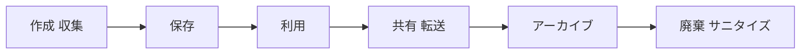

- 各段階で守り方が変わります（保存中は暗号化、転送中は TLS、廃棄時は復元不能に）。
- データの状態: **At rest**（保存中）/ **In transit**（転送中）/ **In use**（処理中）。

#### 6.1.2 データハンドリング: 分類・ラベル付け・マスキング・サニタイズ

| 活動 | 内容 | 例 |
|---|---|---|
| **Classification（分類）** | 機密度で区分し、扱いを定める | Public / Internal / Confidential / Restricted（名称は組織ごと） |
| **Labeling（ラベル付け）** | 分類を**目に見える/機械可読**にする | 文書ヘッダー、メタデータ、DLP ラベル |
| **Handling（取扱い）** | 分類ごとの保存・送付・廃棄ルール | 「Restricted は暗号化なしでメール送付禁止」 |
| **Masking（マスキング）** | 一部を隠して**本物の値を見せない** | カード番号の下 4 桁以外を `*` に |
| **Sanitization（サニタイズ）** | 廃棄・再利用前にデータを**復元不能に** | 消去、破壊 |

**マスキングの関連概念**

| 手法 | 内容 | 元に戻せるか |
|---|---|---|
| **Masking** | 値を伏せる/ダミーに置換 | 通常、戻せない |
| **Tokenization** | 値を**トークン**に置換し、対応表は別管理 | 対応表で戻せる |
| **Encryption** | 鍵で変換 | **鍵があれば戻せる** |

**メディアのサニタイズ（NIST SP 800-88）** [S16]

| レベル | 内容 | 例 |
|---|---|---|
| **Clear** | 通常のコマンドで上書き | 論理的な消去 |
| **Purge** | 高度な手法で**実験室レベルでも復元不能** | 暗号消去（Cryptographic erase）、ブロック消去 |
| **Destroy** | **物理的に破壊** | 破砕、焼却、消磁 |

> 「削除」「フォーマット」＝ **サニタイズではない**（データが残ることが多い）。

**ベストプラクティス**
1. **データ棚卸しと分類**を最優先（何がどこにあるかわからないものは守れない）。
2. **最小保持**: 保管期間を決め、期限後は廃棄。
3. **DLP**（データ漏えい防止）で境界を越える機密データを検知・遮断。
4. 廃棄は**サニタイズ手順＋証跡（廃棄証明）**。
5. 公開 AI サービスに**機密情報を入力しない**（**データ漏えい**のリスク）。承認済みツール、入力禁止データの明示、DLP、教育をセットに [S2]。

#### 6.1.3 暗号（Encryption）

**暗号の 3 種類**

| 種類 | 鍵 | 目的 | 例 | 特徴 |
|---|---|---|---|---|
| **共通鍵（Symmetric）** | **同じ 1 つの鍵**で暗号化・復号 | 機密性 | **AES**（128/192/256 bit） | **高速**。**鍵をどう安全に共有するか**が課題 |
| **公開鍵（Asymmetric）** | **鍵ペア**（公開鍵・秘密鍵） | 鍵交換、デジタル署名 | **RSA**、**ECC** | 低速。鍵配送の問題を解決 |
| **ハッシュ（Hashing）** | **鍵なし・一方向** | **完全性**の確認 | **SHA-256 / SHA-3** | 元に戻せない。入力が少し違えば出力が大きく変わる |

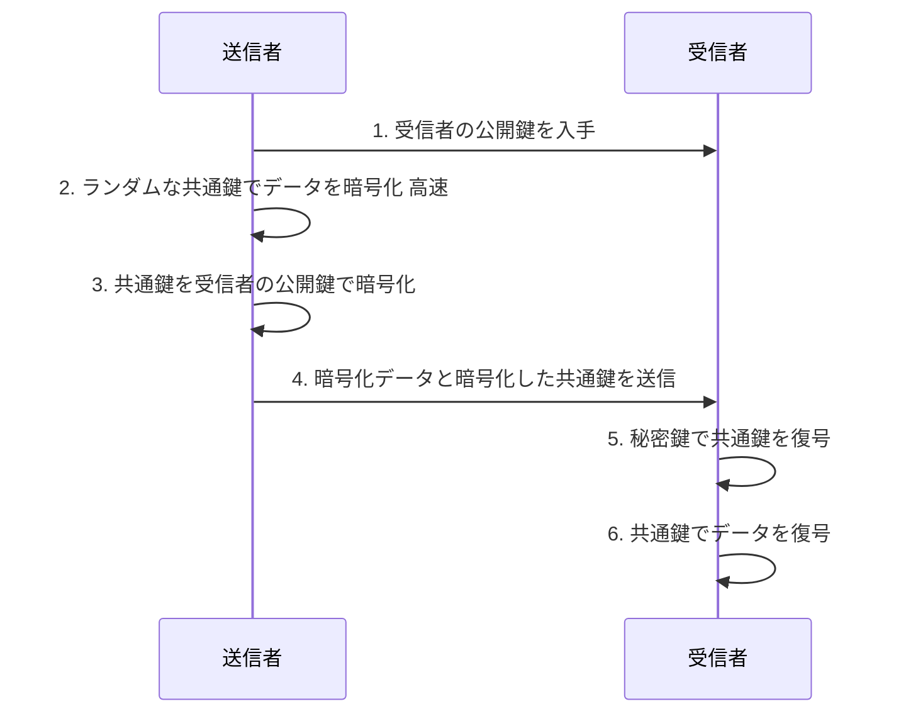

> これが **ハイブリッド暗号**。TLS（HTTPS）はこの考え方で、**公開鍵暗号で鍵を共有し、共通鍵暗号で高速通信**します。

**公開鍵暗号の使い分け（頻出）**

| 目的 | 暗号化する鍵 | 復号/検証する鍵 |
|---|---|---|
| **機密性**（秘密で送る） | 受信者の**公開鍵**で暗号化 | 受信者の**秘密鍵**で復号 |
| **デジタル署名**（本人性・完全性・否認防止） | 送信者の**秘密鍵**で署名 | 送信者の**公開鍵**で検証 |

**ハッシュ・署名・パスワード保存の注意**
- **MD5・SHA-1 は衝突耐性が破られており新規利用は避ける**。SHA-256 以上を使う。
- **パスワードの保存**: 通常のハッシュではなく、**ソルト付き**の**低速なパスワード専用ハッシュ**（bcrypt、scrypt、Argon2 など）を使う。
- **デジタル証明書／PKI**: 公開鍵が本物であることを **CA（認証局）** が署名で保証する仕組み。

**鍵管理（Key management）のベストプラクティス** [S45]
1. **鍵は暗号化対象データと別に保管**（HSM、KMS（鍵管理サービス）の活用）。
2. **ローテーション**（定期・侵害時）、**失効手順**、**バックアップ**。
3. **鍵へのアクセスは最小権限**、操作は記録。
4. **独自暗号を作らない**（標準・実績ある暗号ライブラリを使う）。

**量子耐性暗号（Quantum-resistant / Post-quantum cryptography）** [S2][S17]
- **背景**: 十分大きな量子コンピュータが実現すると、**Shor のアルゴリズム**により **RSA・ECC・DH などの公開鍵暗号が破られる**恐れがあります。**共通鍵暗号（AES-256）とハッシュ**は影響が比較的小さい（Grover のアルゴリズムで実効強度が約半分になる程度）ため、鍵長を十分に取れば当面対処可能とされています。
- **Harvest now, decrypt later**: 今は解読できない暗号文を今のうちに**収集しておき、将来解読**する脅威。**長期間守るべきデータ**は特に注意。
- **NIST の標準**: 2024 年 8 月に **FIPS 203（ML-KEM、鍵確立）**、**FIPS 204（ML-DSA、署名）**、**FIPS 205（SLH-DSA、署名）** を公表 [S17]。
- **対策**: **暗号の棚卸し**（どこで何を使っているか）、**Crypto agility（暗号の迅速な切替能力）**、移行計画の策定。

**試験のポイント**
- 「同じ鍵」→ 共通鍵、「鍵ペア」→ 公開鍵、「一方向・元に戻せない」→ ハッシュ。
- **署名は秘密鍵で行う**（検証は公開鍵）。
- マスキング ≠ 暗号化。サニタイズは「復元不能」。
- 量子で最も影響を受けるのは **RSA/ECC など公開鍵暗号**。

---

### 6.2 〔5.2〕セキュリティ運用

#### 6.2.1 ログとモニタリング

**何か**: システムの出来事を**記録（Logging）**し、**監視（Monitoring）**して異常を見つけること。

| ログの種類 | 例 |
|---|---|
| 認証ログ | ログイン成功/失敗、MFA、権限変更 |
| システム/OS ログ | 起動、サービス停止、設定変更 |
| ネットワークログ | FW、プロキシ、DNS、VPN |
| アプリログ | エラー、トランザクション、API 呼び出し |
| クラウド監査ログ | 管理操作（誰がどのリソースを変更したか） |

**SIEM（Security Information and Event Management）**: 各所のログを**集約・正規化・相関分析**し、アラートを出す基盤。**SOAR** は対応の**自動化・オーケストレーション**。AI を使った相関分析で**アラート疲れ（Alert fatigue）**を減らす取り組みも進んでいます [S2]。

**ベストプラクティス** [S25]
1. **何をログに取るか**を定義（認証・特権操作・重要データへのアクセス・設定変更）。
2. **集中管理**し、**改ざん防止**（書き込み専用・別アカウント）。
3. **NTP で時刻同期**（相関分析の前提）。
4. **保持期間**を法令・方針で定める。
5. **ログは見て初めて価値**。アラートの閾値・担当・SLA を決める。

#### 6.2.2 セキュリティイベントのトリアージ

| 用語 | 意味 |
|---|---|
| **Event（イベント）** | 観測可能な出来事（ログイン失敗 1 回など） |
| **Alert（アラート）** | 検知ルールにより注意を促す通知 |
| **Incident（インシデント）** | セキュリティ**に悪影響を与える**事象、または与えるおそれが強い事象 |
| True positive / False positive | 本物を検知 / **誤検知** |
| True negative / False negative | 正常を正常と判断 / **見逃し（最も危険）** |

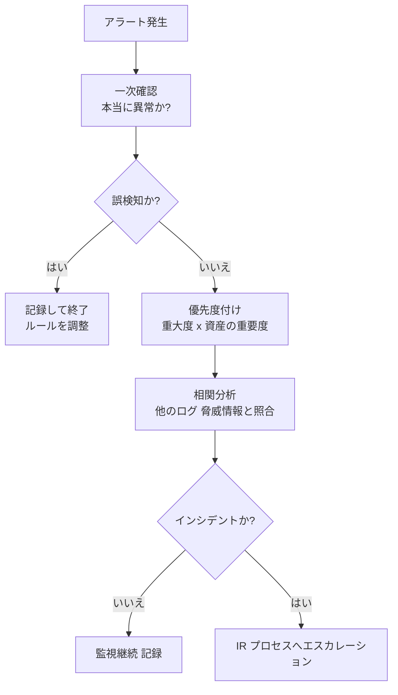

- **優先度付けの観点**: 影響を受ける**資産の重要度**、**脅威の深刻度**、拡大の可能性、**法令の報告義務**。
- **相関（Correlation）**: 単独では些細な複数イベント（深夜のログイン失敗 → 成功 → 大量ダウンロード）を**つなげて**脅威を見つける。
- **使用例（Use case）**: 「短時間に複数国からのログイン」「特権アカウントの深夜利用」等の検知ルール。

#### 6.2.3 脅威アクターと動機

| アクター | 動機 | 特徴 |
|---|---|---|
| **Script kiddie** | 好奇心・腕試し | 既製ツールを使う初心者 |
| **Hacktivist** | 主義主張 | DDoS、サイト改ざん |
| **Cybercriminal** | **金銭** | ランサムウェア、詐欺、情報売買 |
| **Insider（内部者）** | 不満・金銭／**過失** | **正規の権限**を持つため発見しにくい。悪意と過失の両方 |
| **Nation-state / APT** | 諜報・破壊・地政学的目的 | 高度・長期・組織的 |
| **Competitor（競合）** | 産業スパイ | 企業秘密の窃取 |
| **Terrorist** | 恐怖・破壊 | 重要インフラ狙い |

#### 6.2.4 サイバー脅威インテリジェンス（CTI）と脅威フレームワーク

**CTI**: 攻撃者・手口・兆候に関する**分析済みの情報**。目的は、**先回りして防ぐ・検知を高める・優先順位を決める**こと。

| レベル | 内容 | 利用者 |
|---|---|---|
| **Strategic（戦略）** | 動向・攻撃者の意図 | 経営層 |
| **Operational（運用）** | 攻撃キャンペーンの状況 | 管理職・SOC リーダー |
| **Tactical（戦術）** | **TTP**（戦術・技術・手順） | SOC・IR |
| **Technical（技術）** | **IoC**（侵害の痕跡: 悪性 IP、ドメイン、ハッシュ） | 検知ルール・ブロックリスト |

> **IoC** は「痕跡（変わりやすい）」、**TTP** は「やり方（変わりにくく、価値が高い）」。

**代表的な脅威フレームワーク**

| フレームワーク | 概要 |
|---|---|
| **MITRE ATT&CK** | 実際の攻撃者の**戦術・技術**を体系化した知識ベース。検知範囲の評価や脅威ハンティングに使う [S18] |
| **Cyber Kill Chain** | 攻撃を 7 段階で整理 [S50] |
| **Diamond Model** | 攻撃者・能力・インフラ・被害者の関係で分析 |

**Cyber Kill Chain の 7 段階**

| 段階 | 内容 | 防御の例 |
|---|---|---|
| 1. Reconnaissance（偵察） | 標的の情報収集 | 公開情報の制限 |
| 2. Weaponization（武器化） | マルウェア作成 | （防御側は見えにくい） |
| 3. Delivery（配送） | メール・Web・USB で届ける | メールフィルタ、教育 |
| 4. Exploitation（悪用） | 脆弱性を突く | パッチ、EDR |
| 5. Installation（設置） | マルウェア常駐 | アプリ制御 |
| 6. Command & Control（C2） | 外部から遠隔操作 | アウトバウンド制限、DNS 監視 |
| 7. Actions on Objectives（目的実行） | データ窃取・暗号化 | DLP、バックアップ、検知 |

**ベストプラクティス**
- 自組織に**関係のある脅威**を絞って取り込む（業界 ISAC、CISA、JPCERT/CC 等）。
- **IoC を検知/遮断ルールへ反映**し、**TTP を検知ルールの網羅性評価**に使う [S18]。
- CTI は**行動につなげる**（読むだけで終わらせない）。

**試験のポイント**
- 「内部者」＝ **悪意＋過失**の両方がある。
- **False negative（見逃し）が最も危険**。
- IoC と TTP の違い。ATT&CK は**攻撃者の行動の知識ベース**。

---

### 6.3 〔5.3〕インシデント対応（Incident Response, IR）

#### 6.3.1 インシデント対応計画（IRP）

**何か**: インシデント発生時に**誰が・何を・どの順で**行うかを定めた計画。**事前に作り、訓練し、更新**します。

**IRP に含める要素**: 目的と範囲、**役割と責任**（IR チーム、意思決定者、広報、法務、人事）、**インシデントの定義と重大度分類**、**連絡網/エスカレーション**、**対応手順（プレイブック）**、**証拠保全・データ取扱いルール**、**報告義務の判断**、**訓練・見直し**。

#### 6.3.2 データ取扱いポリシーと IRP の連携

IRP では、**インシデント中の情報の扱い**を事前に決めておきます [S2]。

| 観点 | ルール例 |
|---|---|
| **証拠の保全** | 証拠を変更しない、**チェーン・オブ・カストディ**（誰がいつ触れたか）を記録 |
| **情報の共有範囲** | **Need to know**。広く公開せず、定めた連絡手段（侵害された通信路は使わない） |
| **機密情報の取扱い** | ログ・メモリダンプも**機密として保護**（個人情報を含み得る） |
| **法令・契約上の通知** | 例: GDPR の監督当局通知は **72 時間以内** [S35]。日本では個人情報保護委員会への報告義務を確認 [S36] |
| **対外コミュニケーション** | 広報・法務が窓口。個人が独断で発信しない |

#### 6.3.3 インシデント対応のライフサイクル

NIST SP 800-61 **Rev.3**（2025 年 4 月）は、IR を**リスク管理の一部**として **CSF 2.0 の 6 機能**（Govern, Identify, Protect, Detect, Respond, Recover）に位置づけ直しました [S9]。従来の Rev.2 の 4 フェーズ（下図）は、基本の理解に今も有用です。

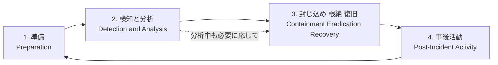

| フェーズ | 目的 | 主な活動 |
|---|---|---|
| **1. 準備** | 事前に備える | IRP・チーム・ツール・訓練・連絡網・バックアップ |
| **2. 検知と分析** | 本物か、範囲と影響を見極める | 監視、トリアージ、重大度判定、証拠保全 |
| **3. 封じ込め・根絶・復旧** | 被害拡大を止め、原因を除き、戻す | **隔離** → **根絶**（マルウェア除去・脆弱性修正）→ **復旧**（クリーンな状態から復元、監視強化） |
| **4. 事後活動** | 学びを次に生かす | **振り返り（Lessons learned）**、報告書、再発防止、計画更新 |

**初動の考え方（一般従業員の視点）**

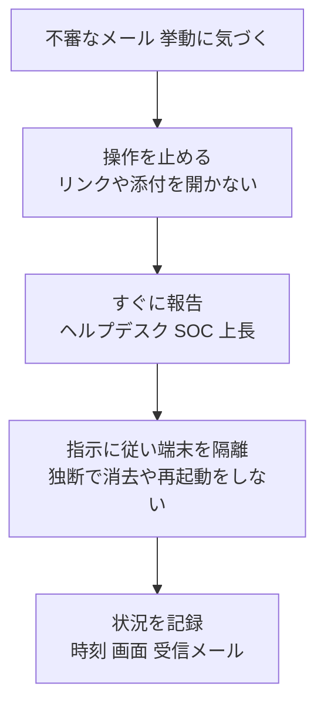

- **早期報告が最重要**。独断での削除・再インストールは**証拠を消す**ことがあるので避ける。

**ベストプラクティス**
1. **計画を作るだけでなく訓練する**（次項）。
2. **重大度の定義と判断基準**を明確に。判断を一人に押し付けない。
3. **役割を代理要員も含めて決める**（担当者不在でも回る）。
4. **事後レビューは責任追及ではなく学習**（Blameless）。
5. 参考: NIST SP 800-61r3 [S9]。

#### 6.3.4 IR 訓練（Exercises）

| 形式 | 内容 | 負荷 |
|---|---|---|
| **Checklist review** | 手順書を机上で確認 | 低 |
| **Walkthrough** | 関係者が手順を順に追って確認 | 低〜中 |
| **Tabletop（机上演習）** | **シナリオを会議室で議論**し、役割と判断を確認 | 中（最も一般的） |
| **Simulation / Functional** | 実際のツール・連絡網を使って模擬対応 | 高 |
| **Full-scale / Full interruption** | 本番に近い形で実施（業務影響あり得る） | 最高 |

- テーブルトップの題材は CISA 等が公開しています [S38]。
- **効果**: 計画の抜け・連絡網の古さ・判断の迷いが**事前に見つかる**。**終了後は必ず振り返り**、計画を更新。

**試験のポイント**
- 順序: 準備 → 検知・分析 → 封じ込め・根絶・復旧 → 事後活動。
- **封じ込め → 根絶 → 復旧** の順（根絶前に復旧しない）。
- 事後の**Lessons learned** は必須。
- 通信を止める前にも**証拠保全**を意識（組織の手順に従う）。

---

### 6.4 〔5.4〕資産保護

#### 6.4.1 資産ライフサイクル管理（EOL を含む）

```mermaid
flowchart LR
    A["調達 計画"] --> B["導入 構成"]
    B --> C["運用 保守<br/>パッチ 監視"]
    C --> D["廃止 EOL 対応"]
    D --> E["廃棄 サニタイズ"]
```

- **資産台帳（Asset inventory / CMDB）**: 「**把握していない資産は守れない**」。ハード・ソフト・クラウド・SaaS・**AI ツール**まで含める。
- **EOL / EOS（サポート終了）**: ベンダーがパッチを提供しなくなるため、**脆弱性が放置**される。

| EOL 対応の選択肢 | 内容 |
|---|---|
| 置換・アップグレード | **最優先** |
| 延長サポート | 有償の継続パッチ（期間限定） |
| **補完策（Compensating controls）** | ネットワーク隔離、アクセス制限、監視強化、**仮想パッチ**（IPS/WAF で攻撃を止める） |
| 廃止 | 不要なら停止・サニタイズ |

#### 6.4.2 構成管理（Configuration management）

- **ベースライン**: 承認された安全な構成の基準（**CIS Benchmarks** など）[S19][S26]。
- **ハードニング（堅牢化）**: 不要なサービス・ポート・アカウントの無効化、初期パスワード変更。
- **ドリフト検知**: 基準からのズレを自動検出。**IaC（Infrastructure as Code）** で構成をコード管理し、レビュー可能にする。

#### 6.4.3 変更管理（Change management）

```mermaid
flowchart TD
    A["変更要求 RFC"] --> B["影響とリスクの評価"]
    B --> C["承認 CAB など"]
    C --> D["テスト環境で検証"]
    D --> E["計画的に実施<br/>ロールバック手順を用意"]
    E --> F["実施後の確認"]
    F --> G["記録 文書更新"]
```

- **緊急変更**は迅速な承認ルートを用意し、**事後に正式記録**。
- **パッチ管理**: 重要度・悪用状況（例: **CISA KEV**＝実際に悪用が確認された脆弱性）で優先順位を付ける [S27][S32]。

**ベストプラクティス**
1. **資産台帳を自動更新**（手作業だと陳腐化）。
2. **ベースラインからの逸脱を検知**し、例外は承認と期限付きで管理。
3. **変更は必ず承認・テスト・ロールバック計画**とセットに。
4. **EOL を事前に把握**し、計画的に更新（直前の慌てた対応を避ける）。
5. **AI ツールと基盤機器も同様にライフサイクル管理** [S2]。

**試験のポイント**: 「構成管理＝望ましい状態を決めて維持」「変更管理＝変更を**統制**（承認・テスト・記録）」。EOL ＝ **パッチがない**ため高リスク。

---

### 6.5 〔5.5〕セキュリティテスト

#### 6.5.1 セキュリティ即応力テスト（Readiness testing）: レッド/ブルー/パープルチーム

| チーム | 役割 |
|---|---|
| **Red team（攻撃）** | 攻撃者になりきり、**防御を突破できるか**を検証（秘密裏に行うことも） |
| **Blue team（防御）** | 検知・対応・防御を行う |
| **Purple team（協調）** | 赤と青が**協力して**検知・対応の改善を素早く進める |
| White team（統制） | ルールと進行を管理（演習の審判） |

- **Rules of Engagement（交戦規則）**と**書面による許可**が必須（範囲・時間・禁止行為を明確化）。許可のないテストは**違法**。

#### 6.5.2 アプリケーションテスト

| 手法 | 内容 | 長所・短所 |
|---|---|---|
| **Vulnerability scanning（脆弱性スキャン）** | ツールで**既知の脆弱性を自動探索** | 網羅的・高速。**悪用までは行わない**／誤検知あり |
| **SAST（静的解析）** | **ソースコード**を実行せず解析 | 開発初期に発見。誤検知あり |
| **DAST（動的解析）** | **実行中のアプリ**に疑似攻撃 | 実際の挙動を検証。コードが見えない |
| **SCA** | 依存ライブラリの既知の脆弱性を検出 | OSS 依存の可視化 |
| **Penetration test（ペネトレーションテスト）** | 脆弱性を**実際に悪用**して到達できる影響を検証 | 現実的。人手・費用が必要 |
| **Threat modeling（脅威モデリング）** | **設計段階**で脅威を洗い出し対策を決める | 早期・低コスト [S31] |

> **スキャン＝見つける（悪用しない）、ペネトレーション＝突破して示す（悪用する）**。

**STRIDE（脅威モデリングの代表的分類）** [S31]

| 文字 | 脅威 | 侵害される性質 |
|---|---|---|
| S | Spoofing（なりすまし） | 認証 |
| T | Tampering（改ざん） | 完全性 |
| R | Repudiation（否認） | 否認防止 |
| I | Information disclosure（情報漏えい） | 機密性 |
| D | Denial of service（サービス拒否） | 可用性 |
| E | Elevation of privilege（権限昇格） | 認可 |

**脆弱性管理のサイクル**

```mermaid
flowchart LR
    A["資産の特定"] --> B["スキャン"]
    B --> C["評価 優先度付け<br/>CVSS 悪用状況 資産重要度"]
    C --> D["修正 緩和"]
    D --> E["再スキャンで確認"]
    E --> B
```

- **CVE**: 脆弱性の識別番号。**CVSS**: 深刻度の共通指標 [S49]。ただし **CVSS だけで優先順位を決めず**、悪用の有無（KEV）・資産の重要度・公開状況も加味 [S32]。

#### 6.5.3 物理的ペネトレーションテスト

| 手法 | 内容 | 対策 |
|---|---|---|
| **Phishing（模擬）** | 従業員に模擬フィッシング | 教育・報告導線 |
| **Tailgating** | 認証済みの人の後ろから侵入 | 声かけ、セキュリティゲート |
| **Impersonation（なりすまし）** | 業者・警備員・社員を装う | 来訪者確認、バッジ着用 |

→ 従業員は「**人間ファイアウォール（Human firewall）**」として、侵入を許さない最後の防御になり得ます [S2]。

**ベストプラクティス** [S24]
1. **範囲・許可・連絡先**を書面化。重要システムでは**影響の出ない時間帯**に。
2. **開発の早期から**（Shift left）: 脅威モデリング → SAST → DAST と段階的に自動化（CI/CD に組み込む）。
3. **結果を修正に結び、再テスト**まで行う。
4. 定期＋大きな変更の都度テスト。
5. **AI 組込みシステムも対象に**（防御が意図通り動くか検証）[S2][S30]。

**試験のポイント**
- 脆弱性スキャンとペネトレーションテストの違い。
- SAST（コード）と DAST（実行中）。
- Red / Blue / Purple の役割。
- **テストは必ず事前許可**。

---

### 6.6 第 6 章 のまとめ

| 小項目 | 必ず覚えること |
|---|---|
| 5.1 | ライフサイクル、分類/ラベル/マスキング/サニタイズ（Clear/Purge/Destroy）、共通鍵/公開鍵/ハッシュ、署名は秘密鍵、量子耐性暗号 |
| 5.2 | ログ・SIEM、トリアージ、脅威アクター、CTI（IoC と TTP）、ATT&CK、Kill Chain |
| 5.3 | IRP、データ取扱い、4 フェーズ、訓練（テーブルトップ等）、事後レビュー |
| 5.4 | 資産台帳、EOL、構成管理、変更管理、パッチ優先順位 |
| 5.5 | Red/Blue/Purple、スキャン vs ペンテスト、SAST/DAST、STRIDE、物理テスト |


---

## 7. AI セキュリティの横断整理（2026 年版アウトラインの新要素）

2026 年版アウトラインでは、**AI の基礎的なセキュリティ概念が 5 ドメインすべてに統合**されました [S2][S3]。CC では「AI の専門家」としてではなく、**既存の原則を AI にも当てはめる**エントリーレベルの理解が求められます。

| ドメイン | AI に関する観点（公式アウトラインの要旨） | 実務での合言葉 |
|---|---|---|
| **D1 原則** | CIA を AI に適用。**学習データの完全性＝モデルポイズニング防止**、学習データの**プライバシー**。AI の行動も AAA・否認防止で追跡可能に。AI も**技術・管理・物理**の管理策と組織ポリシー・法令の対象。**透明性・非バイアス**、Code of Ethics に沿う | 「AI も普通のシステムと同じ原則で守る」 |
| **D2 ガバナンス** | AI が**ソーシャルエンジニアリングを高度化**（教育の更新）。**AI 設定・データセットのバックアップ**、**Model Drift** を BC/DR リスクに。**AI 特有の KRI** | 「AI を使うほど、守る対象とリスク指標が増える」 |
| **D3 IAM** | **ボット・サービスアカウントも ID ライフサイクル管理**。最小権限・職務分離。AI による**行動分析（Impossible travel 等）**で認証強化 | 「人も AI も、ID を持つなら管理する」 |
| **D4 ネットワーク/クラウド** | AI 利用の FW/IDS は**シグネチャを超えた異常検知**。**AI 開発環境のセグメンテーション**。ゼロトラスト。クラウドでの**共有責任**の明確化 | 「AI のデータが流れる道とそれを置く場所を守る」 |
| **D5 運用/IR** | SIEM が AI で**アラート疲れ**を軽減。**公開 AI サービスへの機密データ入力＝漏えいリスク**。データ分類・マスキング・暗号（量子耐性）。構成/資産ライフサイクル。AI 統合防御の**継続的テスト** | 「便利さと引き換えに、データを出さない」 |

**AI 特有の脅威の例**（試験のアウトライン範囲を超える補足。実務の参考として）

| 脅威 | 概要 | 対策の方向 |
|---|---|---|
| **Model / Data poisoning** | 学習データの汚染 | データの出所確認・完全性検証 |
| **Prompt injection** | 入力でモデルの指示を乗っ取る | 入力検証、権限の最小化、出力の検証 |
| **Sensitive data leakage** | 入力データや学習データの漏えい | DLP、利用ルール、マスキング |
| **Shadow AI** | 無断の AI サービス利用 | 承認済みツール、教育、可視化 |

参考: NIST AI RMF [S29]、OWASP Top 10 for LLM Applications [S30]。

---

## 8. 試験対策

### 8.1 4 週間の学習計画（目安）

| 週 | 内容 | ゴール |
|---|---|---|
| **第 1 週** | 第 1 章（全体像）＋ 第 2 章（D1）＋ 第 4 章（D3） | CIA/AAA、リスク、ガバナンス、コントロール、倫理、IAM を説明できる |
| **第 2 週** | 第 5 章（D4）＋ 第 3 章（D2） | OSI・ポート・FW・ゼロトラスト・クラウド共有責任、BC/DR・RTO/RPO を説明できる |
| **第 3 週** | 第 6 章（D5）＋ 第 7 章（AI） | 暗号 3 種、トリアージ、IR フェーズ、変更/構成管理、テスト手法を説明できる |
| **第 4 週** | 8.2〜8.3 ＋ 公式クイズ/フラッシュカード [S1] ＋ 弱点復習 | 模擬問題で**安定して 80% 以上**、CAT 形式に慣れる |

- 毎日 **30〜60 分**を継続する方が、直前の詰め込みより定着します。
- 初学者の目安学習時間は**十数時間〜数十時間**（第三者情報、個人差大）[S52]。
- 学習したら**自分の言葉で説明**（人に説明する・書き出す）。

### 8.2 ひっかけポイント比較表（暗記より"違い"の理解）

| 比較 | 違い |
|---|---|
| 認証 vs 認可 | 認証＝**誰か**、認可＝**何をしてよいか** |
| PoLP vs SoD | PoLP＝**権限量を最小**に、SoD＝**重要作業を複数人で分担** |
| Due care vs Due diligence | care＝**実行**、diligence＝**調査・確認** |
| RTO vs RPO | RTO＝**復旧までの時間**、RPO＝**失ってよいデータの時間幅** |
| BC vs DR | BC＝**事業全体の継続**、DR＝**IT 復旧** |
| スキャン vs ペンテスト | スキャン＝**見つける**、ペンテスト＝**悪用して実証** |
| SAST vs DAST | SAST＝**コード（静的）**、DAST＝**実行中（動的）** |
| IDS vs IPS | IDS＝**検知・通知**、IPS＝**検知・遮断（インライン）** |
| 共通鍵 vs 公開鍵 | 共通鍵＝**同じ鍵・高速**、公開鍵＝**鍵ペア・鍵交換/署名** |
| 暗号化 vs ハッシュ | 暗号化＝**戻せる（鍵）**、ハッシュ＝**戻せない（完全性）** |
| マスキング vs 暗号化 | マスキング＝**値を隠す**、暗号化＝**鍵で復号可能** |
| イベント vs インシデント | イベント＝**出来事**、インシデント＝**悪影響のある事象** |
| 封じ込め vs 根絶 vs 復旧 | **止める → 取り除く → 戻す**（この順） |
| KPI vs KRI | KPI＝**成果**、KRI＝**リスクの兆候** |
| Transfer vs Avoid | Transfer＝**負担を移す（保険）**、Avoid＝**活動をやめる** |
| 脆弱性 vs 脅威 vs リスク | 脆弱性＝**弱点**、脅威＝**原因**、リスク＝**両者から生じる損害の可能性** |
| IaaS vs PaaS vs SaaS | **IaaS＝利用者の責任が最大、SaaS＝最小。ただしデータは常に利用者** |
| DAC vs MAC vs RBAC vs ABAC | 所有者／ラベルで強制／役割／属性 |

### 8.3 確認問題（本ガイドのオリジナル。公式の過去問ではありません）

**Q1.** ある従業員が、入社時のロールのまま異動を繰り返し、現在は複数部署のシステムにアクセスできる。この状態を表す用語として最も適切なのはどれか。
A. Orphan account　B. Privilege creep　C. Tailgating　D. Whaling

**Q2.** ランサムウェアにより、サーバー上のファイルが暗号化され、業務が停止した。主に損なわれた CIA の要素は？
A. 機密性のみ　B. 完全性のみ　C. 可用性（および完全性）　D. 否認防止

**Q3.** 毎日深夜 0 時にバックアップを取得している。午後 3 時にシステム障害が起きた。最大で失われるデータは約 15 時間分である。これに関連する指標はどれか。
A. RTO　B. RPO　C. MTD　D. ALE

**Q4.** 資産価値 2,000 万円、被害率 25%、年間発生率 0.2 の場合の ALE は？
A. 500 万円　B. 100 万円　C. 400 万円　D. 50 万円

**Q5.** 「購買担当者が発注と支払承認を両方行える」状態は、どの原則に違反するか。
A. Defense in depth　B. Separation of duties　C. Non-repudiation　D. Data minimization

**Q6.** 公開鍵暗号で、**デジタル署名**を作成するときに使う鍵はどれか。
A. 受信者の公開鍵　B. 受信者の秘密鍵　C. 送信者の秘密鍵　D. 送信者の公開鍵

**Q7.** SaaS（Microsoft 365 など）を利用する場合でも、**常に利用者側**が責任を負うものはどれか。
A. 物理データセンターの警備　B. 仮想化基盤の管理　C. データとアカウント/アクセス管理　D. ハードウェアの保守

**Q8.** 「社内ネットワークにいるから信頼する」を前提としない、**すべてのアクセスを毎回検証**する考え方は？
A. Defense in depth　B. Zero Trust　C. Air gap　D. DMZ

**Q9.** 自動で脆弱性を探索するが、**悪用までは行わない**手法はどれか。
A. Penetration test　B. Red team exercise　C. Vulnerability scan　D. Tabletop exercise

**Q10.** インシデント対応の正しい順序はどれか。
A. 検知 → 準備 → 復旧 → 根絶 → 封じ込め
B. 準備 → 検知と分析 → 封じ込め・根絶・復旧 → 事後活動
C. 封じ込め → 準備 → 事後活動 → 検知
D. 準備 → 復旧 → 検知 → 事後活動

**Q11.** 販売パートナー B 社への情報提供前に、B 社のセキュリティ体制を事前に調査・確認することを表す用語は？
A. Due care　B. Due diligence　C. Non-repudiation　D. Compensating control

**Q12.** ISC2 Code of Ethics の 4 つのキャノンで、**最も優先される**のはどれか。
A. 専門職を前進させ保護する　B. 依頼者に誠実で有能なサービスを提供する　C. 誠実・公正・責任ある行動をとり法令を順守する　D. 社会・公共の利益・公共の信頼・重要インフラを守る

**Q13.** サポート終了（EOL）のため、パッチ適用ができない産業用機器がある。置換までの間に講じる対策として最も適切なのは？
A. そのまま運用を続ける　B. ネットワーク分離とアクセス制限、監視強化（補完策）　C. 機器の電源を入れたままにする　D. 管理者パスワードを共有する

**Q14.** 将来、量子コンピュータにより最も大きな影響を受けると考えられている暗号はどれか。
A. AES-256　B. SHA-256　C. RSA　D. HMAC

**Q15.** 従業員が公開 AI サービスに顧客リストを貼り付けようとしている。最も適切な組織的対策は？
A. 一切気にしない　B. 承認済みツールの提供、入力禁止データの明示、DLP と教育　C. AI を全社員に開放する　D. 個人のスマホで使うよう推奨する

<details>
<summary>解答と解説（クリックして展開）</summary>

| 問 | 解答 | 解説 |
|---|---|---|
| Q1 | **B** | 異動で権限が積み上がるのは Privilege creep。Orphan account は退職後も残るアカウント |
| Q2 | **C** | 業務停止＝可用性。暗号化されたデータは使えず完全性も損なわれる |
| Q3 | **B** | 失われるデータの時間幅は RPO。RTO は復旧時間 |
| Q4 | **B** | SLE = 2,000万 × 0.25 = 500万、ALE = 500万 × 0.2 = **100 万円** |
| Q5 | **B** | 重要プロセスを 1 人に任せない → 職務分離（SoD） |
| Q6 | **C** | 署名は送信者の**秘密鍵**で作成し、公開鍵で検証 |
| Q7 | **C** | どのモデルでもデータと ID/アクセス管理は利用者責任 |
| Q8 | **B** | 暗黙の信頼を排除し、継続検証するのがゼロトラスト |
| Q9 | **C** | スキャンは発見が目的、ペンテストは悪用して実証 |
| Q10 | **B** | 準備 → 検知と分析 → 封じ込め・根絶・復旧 → 事後活動 |
| Q11 | **B** | 事前の調査・確認は Due diligence |
| Q12 | **D** | キャノンは順序通りに優先（社会・公共が最優先） |
| Q13 | **B** | 代替できないとき別手段で補う Compensating control |
| Q14 | **C** | Shor のアルゴリズムで RSA/ECC が脅かされる。AES-256 やハッシュの影響は比較的小さい |
| Q15 | **B** | 禁止だけでなく**代替手段（承認済みツール）＋技術（DLP）＋教育**の組合せ |

</details>

### 8.4 試験当日の戦術（CAT 形式）

1. **一度回答した問題には戻れない**前提で、**読む → 消去 → 決める**を習慣化する [S52]。
2. 選択肢が複数正しく見えるときは、**より包括的/根本的/予防的**なものを選ぶ。
3. 「**最初に**」「**最も適切**」「**最優先**」は**順序・優先度**を問われている。
4. **人命・安全 > 法令 > 組織方針 > 効率**の順で判断。
5. 時間配分は **1 問 1 分前後**（120 分で 100〜125 問）。
6. 試験規約・本人確認書類・会場/オンライン要件は [S6] で事前確認。

---

## 9. 用語集（Glossary）

| 用語 | 意味 |
|---|---|
| AAA | 認証・認可・アカウンティング |
| ABAC | 属性ベースのアクセス制御 |
| AES | 共通鍵暗号の標準（128/192/256 bit） |
| ALE / SLE / ARO | 年間損失予測額 / 単一損失予測額 / 年間発生率 |
| APT | 高度で持続的な標的型攻撃 |
| BCP / DRP / BIA | 事業継続計画 / 災害復旧計画 / 事業影響度分析 |
| CAT | 適応型コンピューターテスト |
| CIA | 機密性・完全性・可用性 |
| CPE | 継続的専門教育クレジット |
| CTI / IoC / TTP | 脅威インテリジェンス / 侵害の痕跡 / 攻撃者の戦術・技術・手順 |
| DAC / MAC / RBAC | 任意 / 強制 / ロールベースのアクセス制御 |
| DAST / SAST | 動的 / 静的アプリケーションテスト |
| DLP | データ漏えい防止 |
| DMZ | 公開サーバーを置く緩衝ネットワーク |
| EOL / EOS | 製品の販売終了 / サポート終了 |
| GRC | ガバナンス・リスク・コンプライアンス |
| IAM / IGA / PAM | ID・アクセス管理 / ID ガバナンス / 特権アクセス管理 |
| IDS / IPS | 侵入検知 / 侵入防御 |
| IRP | インシデント対応計画 |
| JML | 入社・異動・退職（Joiner/Mover/Leaver） |
| KPI / KRI | 主要業績指標 / 主要リスク指標 |
| MFA | 多要素認証 |
| MTTD / MTTR | 平均検知時間 / 平均対応（復旧）時間 |
| NGFW / WAF | 次世代ファイアウォール / Web アプリケーションファイアウォール |
| PEP / PDP | ポリシー実施ポイント / ポリシー決定ポイント |
| PII | 個人を特定できる情報 |
| PoLP / SoD | 最小権限 / 職務分離 |
| RTO / RPO / MTD | 目標復旧時間 / 目標復旧時点 / 最大許容停止時間 |
| SIEM / SOAR | ログ統合分析 / 対応の自動化 |
| STRIDE | 脅威分類（なりすまし・改ざん・否認・情報漏えい・DoS・権限昇格） |
| VLAN | 論理的に分割された LAN |
| VPN | 暗号化された仮想専用線 |
| ZT | ゼロトラスト |

---

## 10. 出典・参考 URL

### 10.1 確認状況の凡例

| 記号 | 意味 |
|---|---|
| ◎ | **2026-10-16 に本文を取得して内容を確認**（ISC2 公式ページ等） |
| ○ | 同日の検索結果で**タイトル・要旨を確認**（本文の全取得はできず） |
| △ | URL は公式資料として知られているが、**今回は直接取得していない**（アクセスして最新内容を確認してください） |

> **注意**: 試験の問題数・時間・費用・合格点などの**運用情報は第三者サイトに依存**します（S52）。受験前に必ず ISC2 公式（S1・S6）で最新を確認してください。

### 10.2 ISC2 公式

| ID | 名称 | URL | 確認 |
|---|---|---|---|
| S1 | ISC2 CC – Certified in Cybersecurity（起点ページ） | https://www.isc2.org/certifications/cc | ◎ |
| S2 | CC 試験アウトライン（2026/9/1 発効） | https://www.isc2.org/certifications/cc/cc-certification-exam-outline | ◎ |
| S3 | What's New for Entry-Level Cybersecurity（2026/8/6） | https://www.isc2.org/insights/2026/08/inside-the-updated-isc2-cc-exam | ○ |
| S4 | Prepare for CC with Official ISC2 Training（2026/10/12） | https://www.isc2.org/insights/2026/10/prepare-for-the-isc2-cc-certification | ○（本文は未取得） |
| S5 | ISC2 補足参考文献一覧 | https://www.isc2.org/certifications/references | ○（S2 内リンク） |
| S6 | ISC2 試験登録・ポリシー | https://www.isc2.org/register-for-exam | ○（S2 内リンク） |
| S7 | ISC2 Code of Ethics | https://www.isc2.org/ethics | △ |

### 10.3 標準・ガイドライン（NIST / CISA / 他）

| ID | 名称 | URL | 確認 |
|---|---|---|---|
| S8 | NIST Cybersecurity Framework (CSF) 2.0 | https://www.nist.gov/cyberframework | △ |
| S9 | NIST SP 800-61 Rev.3 インシデント対応（2025/4） | https://csrc.nist.gov/pubs/sp/800/61/r3/final | ○ |
| S10 | NIST SP 800-30 Rev.1 リスクアセスメント | https://csrc.nist.gov/pubs/sp/800/30/r1/final | △ |
| S11 | NIST SP 800-37 Rev.2 リスク管理フレームワーク | https://csrc.nist.gov/pubs/sp/800/37/r2/final | △ |
| S12 | NIST SP 800-63B-4 認証（2025/8 確定） | https://pages.nist.gov/800-63-4/sp800-63b.html | △（内容は二次情報で確認） |
| S13 | NIST SP 800-207 ゼロトラスト・アーキテクチャ | https://csrc.nist.gov/pubs/sp/800/207/final | △ |
| S14 | CISA Zero Trust Maturity Model | https://www.cisa.gov/zero-trust-maturity-model | △ |
| S15 | NIST SP 800-145 クラウドの定義 | https://csrc.nist.gov/pubs/sp/800/145/final | △ |
| S16 | NIST SP 800-88 Rev.1 メディアサニタイズ | https://csrc.nist.gov/pubs/sp/800/88/r1/final | △ |
| S17 | NIST ポスト量子暗号（FIPS 203/204/205） | https://csrc.nist.gov/projects/post-quantum-cryptography | △ |
| S18 | MITRE ATT&CK | https://attack.mitre.org/ | △ |
| S19 | CIS Controls | https://www.cisecurity.org/controls | △ |
| S20 | NIST SP 800-34 Rev.1 コンティンジェンシープランニング | https://csrc.nist.gov/pubs/sp/800/34/r1/upd1/final | △ |
| S21 | NIST SP 800-41 Rev.1 ファイアウォール | https://csrc.nist.gov/pubs/sp/800/41/r1/final | △ |
| S22 | NIST SP 800-82 Rev.3 OT セキュリティ | https://csrc.nist.gov/pubs/sp/800/82/r3/final | △ |
| S23 | NIST IR 8259 IoT 機器の基本機能 | https://csrc.nist.gov/pubs/ir/8259/final | △ |
| S24 | NIST SP 800-115 セキュリティテスト | https://csrc.nist.gov/pubs/sp/800/115/final | △ |
| S25 | NIST SP 800-92 ログ管理 | https://csrc.nist.gov/pubs/sp/800/92/final | △ |
| S26 | NIST SP 800-128 構成管理 | https://csrc.nist.gov/pubs/sp/800/128/final | △ |
| S27 | NIST SP 800-40 Rev.4 パッチ管理 | https://csrc.nist.gov/pubs/sp/800/40/r4/final | △ |
| S28 | NIST SP 800-55 セキュリティ測定 | https://csrc.nist.gov/pubs/sp/800/55/v1/final | △ |
| S29 | NIST AI Risk Management Framework | https://www.nist.gov/itl/ai-risk-management-framework | △ |
| S30 | OWASP Top 10 for LLM Applications | https://genai.owasp.org/llm-top-10/ | △ |
| S31 | OWASP Threat Modeling | https://owasp.org/www-community/Threat_Modeling | △ |
| S32 | CISA Known Exploited Vulnerabilities Catalog | https://www.cisa.gov/known-exploited-vulnerabilities-catalog | △ |
| S33 | RFC 1918（プライベートアドレス） | https://www.rfc-editor.org/rfc/rfc1918 | △ |
| S34 | ISO/IEC 27001 | https://www.iso.org/standard/27001 | △ |
| S35 | GDPR（EU 一般データ保護規則） | https://eur-lex.europa.eu/eli/reg/2016/679/oj | △ |
| S36 | 個人情報保護委員会（日本） | https://www.ppc.go.jp/ | △ |
| S37 | IPA 情報セキュリティ 10 大脅威 | https://www.ipa.go.jp/security/10threats/ | △ |
| S38 | CISA Tabletop Exercise Packages | https://www.cisa.gov/resources-tools/services/cisa-tabletop-exercise-packages | △ |
| S39 | NIST SP 800-53 Rev.5 管理策カタログ | https://csrc.nist.gov/pubs/sp/800/53/r5/upd1/final | △ |
| S40 | NIST SP 800-162 ABAC | https://csrc.nist.gov/pubs/sp/800/162/upd2/final | △ |
| S41 | NIST SP 800-77 Rev.1 IPsec VPN | https://csrc.nist.gov/pubs/sp/800/77/r1/final | △ |
| S42 | AWS 責任共有モデル | https://aws.amazon.com/compliance/shared-responsibility-model/ | △ |
| S43 | Microsoft Azure 責任共有 | https://learn.microsoft.com/azure/security/fundamentals/shared-responsibility | △ |
| S44 | Google Cloud 責任共有 | https://cloud.google.com/architecture/framework/security/shared-responsibility-shared-fate | △ |
| S45 | NIST SP 800-57 Part 1 鍵管理 | https://csrc.nist.gov/pubs/sp/800/57/pt1/r5/final | △ |
| S47 | FIDO Alliance（パスキー） | https://fidoalliance.org/passkeys/ | △ |
| S48 | NIST Privacy Framework | https://www.nist.gov/privacy-framework | △ |
| S49 | FIRST CVSS | https://www.first.org/cvss/ | △ |
| S50 | Lockheed Martin Cyber Kill Chain | https://www.lockheedmartin.com/en-us/capabilities/cyber/cyber-kill-chain.html | △ |

### 10.4 第三者情報（試験運用・価格・形式の確認に使用、公式で再確認のこと）

| ID | 名称 | URL | 確認 |
|---|---|---|---|
| S52-a | Training Camp: ISC2 CC Certification Guide 2026 | https://trainingcamp.com/articles/isc2-cc-certification-guide-2026-exam-domains-cost-and-what-its-worth/ | ○ |
| S52-b | CertCrush: How to Pass the ISC2 CC Exam in 2026 | https://www.certcrush.app/blog/how-to-pass-isc2-cc-2026-4-week-study-plan | ○ |
| S52-c | PrepForCerts: Can I Get ISC2 CC Without Experience | https://prepforcerts.org/can-i-get-cc-without-experience | ○ |
| S52-d | Computing for Geeks: Best ISC2 CC Books（アウトライン改定の整理） | https://computingforgeeks.com/best-isc2-cc-books/ | ○ |

> 本文中の **[S52]** は上表 S52-a〜d の総称です。S46・S51 は欠番です（本文中の参照はありません）。

### 10.5 本ガイドの更新・利用上の注意

- 本ガイドは **2026 年 10 月 16 日時点**の情報です。ISC2 は試験アウトラインを随時改定するため、受験前に [S2] の**発効日と内容を再確認**してください。
- 記載した NIST/CISA 等の文書は改訂される場合があります（例: 版数）。最新版は各公式ページで確認してください。
- 確認問題は**本ガイドのオリジナル**であり、公式の試験問題ではありません。
- 日本の法令（個人情報保護法など）の**報告期限・要件**は改正されることがあるため、個人情報保護委員会の公式情報を必ず確認してください。
