# CCSP (Certified Cloud Security Professional) 初学者向け完全ガイド

> **対象読者**: クラウドセキュリティを基礎から学び、ISC2 CCSP の合格を目指す初学者〜中級者
> **準拠する出題範囲**: ISC2 公式「CCSP Certification Exam Outline」(**2026年8月1日発効版**)
> **情報確認日**: 2026年10月17日(ISC2公式ページ・公式アウトラインPDFを直接取得して確認)
> **根拠表記**: 本文中の `[S1]` などは、末尾「参考ソース一覧」の番号に対応します。

---

## 目次

- [Step 0. このガイドの使い方](#step-0-このガイドの使い方)
- [Step 1. CCSP とは何か(試験概要)](#step-1-ccsp-とは何か試験概要)
- [Step 2. 学習ロードマップ](#step-2-学習ロードマップ)
- [Step 3. 最初に押さえる基礎用語と責任共有モデル](#step-3-最初に押さえる基礎用語と責任共有モデル)
- [Step 4. Domain 1 クラウドの概念・アーキテクチャ・設計 (17%)](#step-4-domain-1-クラウドの概念アーキテクチャ設計-17)
- [Step 5. Domain 2 クラウドデータセキュリティ (20%)](#step-5-domain-2-クラウドデータセキュリティ-20)
- [Step 6. Domain 3 クラウドプラットフォーム・インフラセキュリティ (17%)](#step-6-domain-3-クラウドプラットフォームインフラセキュリティ-17)
- [Step 7. Domain 4 クラウドアプリケーションセキュリティ (16%)](#step-7-domain-4-クラウドアプリケーションセキュリティ-16)
- [Step 8. Domain 5 クラウドセキュリティオペレーション (17%)](#step-8-domain-5-クラウドセキュリティオペレーション-17)
- [Step 9. Domain 6 法務・リスク・コンプライアンス (13%)](#step-9-domain-6-法務リスクコンプライアンス-13)
- [Step 10. 試験対策(CAT・解き方・学習計画・確認問題)](#step-10-試験対策cat解き方学習計画確認問題)
- [参考ソース一覧](#参考ソース一覧)

---

## Step 0. このガイドの使い方

### 0-1. 各項目の書き方

出題範囲(サブドメイン)ごとに、次の4点セットで解説します。

| 見出し | 内容 |
|---|---|
| **何を問われるか** | 公式アウトラインの項目名と学ぶ意味 |
| **詳細解説** | 初学者向けに用語・仕組みをステップごとに説明 |
| **ベストプラクティス** | 実務・試験の両方で通用する推奨事項 |
| **試験のポイント** | ひっかけ・頻出の考え方 |

### 0-2. 重要な前提(最初に読んでください)

1. **CCSP はベンダー中立の試験です。** AWS・Azure・Google Cloud のサービス名は「理解を助ける例」として載せますが、試験で特定製品の操作手順は問われません。
2. **試験は2026年8月1日から新アウトライン**に切り替わっています。古い教材(2025年10月版以前)を使う場合は、本ガイドのドメイン構成と見比べてください [S3]。
3. 公式アウトライン中のスペル誤り(例: HIPPA)は原文ママで、正しくは **HIPAA** です。
4. 法規・規格・製品仕様は変わります。受験直前に公式サイトで最新情報を確認してください [S1][S5][S6]。

---

## Step 1. CCSP とは何か(試験概要)

CCSP は ISC2 が提供する、クラウド環境でデータ・アプリケーション・インフラを**設計・管理・保護する**ための高度な知識とスキルを証明する認定資格です [S1]。ISC2 によれば、クラウドセキュリティの設計、実装、アーキテクチャ、運用、統制、規制フレームワークへの準拠に関する知識・スキル・能力を確認するために作られました [S3]。

### 1-1. 試験の基本情報(公式アウトラインより)

| 項目 | 内容 |
|---|---|
| 試験形式 | CAT(Computerized Adaptive Testing:適応型試験) |
| 試験時間 | 3時間 |
| 出題数 | 100〜150問 |
| 問題形式 | 多肢選択式と「アドバンスト」形式の問題 |
| 合格ライン | 1000点満点中 700点 |
| 試験言語 | 英語・中国語・ドイツ語・日本語 |
| 受験会場 | Pearson VUE テストセンター |

出典: [S3](公式アウトラインPDF)。CATの詳細は ISC2 の CAT 解説ページを参照 [S4]。

### 1-2. 受験資格(実務経験)

| 条件 | 内容 |
|---|---|
| 基本要件 | IT分野で累積**5年以上**のフルタイム経験 |
| 内訳 | うち**3年はサイバーセキュリティ**、**1年は**アウトラインの6ドメインのいずれか |
| 学位による免除 | コンピュータサイエンス・IT関連の学士/修士で**最大1年分** |
| CCSK による免除 | CSA の CCSK 認定で**1年分**(免除は最大1年のみ) |
| CISSP 保有 | 有効な CISSP があれば経験要件**全体**を代替可能 |
| 経験不足の場合 | 試験に合格すれば「ISC2 アソシエイト」になり、**6年以内**に経験を満たす |
| パート・インターン | 経験として算入可能 |

出典: [S3]。詳細は ISC2 の経験要件ページ [S7]。

### 1-3. 認定の位置づけ

- ANAB(ANSI National Accreditation Board)により ISO/IEC 17024 に準拠した認定 [S1][S3]
- 米国国防総省 DoDM 8140.03 で承認されたとされています [S1]

### 1-4. 6ドメインと出題比率

公式アウトラインが示す「平均比率」です。受験者ごとに出題の配分は変わり得ます [S3]。

| ドメイン | 名称 | 平均比率 |
|---|---|---|
| Domain 1 | クラウドの概念・アーキテクチャ・設計 | **17%** |
| Domain 2 | クラウドデータセキュリティ | **20%** |
| Domain 3 | クラウドプラットフォーム・インフラセキュリティ | **17%** |
| Domain 4 | クラウドアプリケーションセキュリティ | **16%** |
| Domain 5 | クラウドセキュリティオペレーション | **17%** |
| Domain 6 | 法務・リスク・コンプライアンス | **13%** |

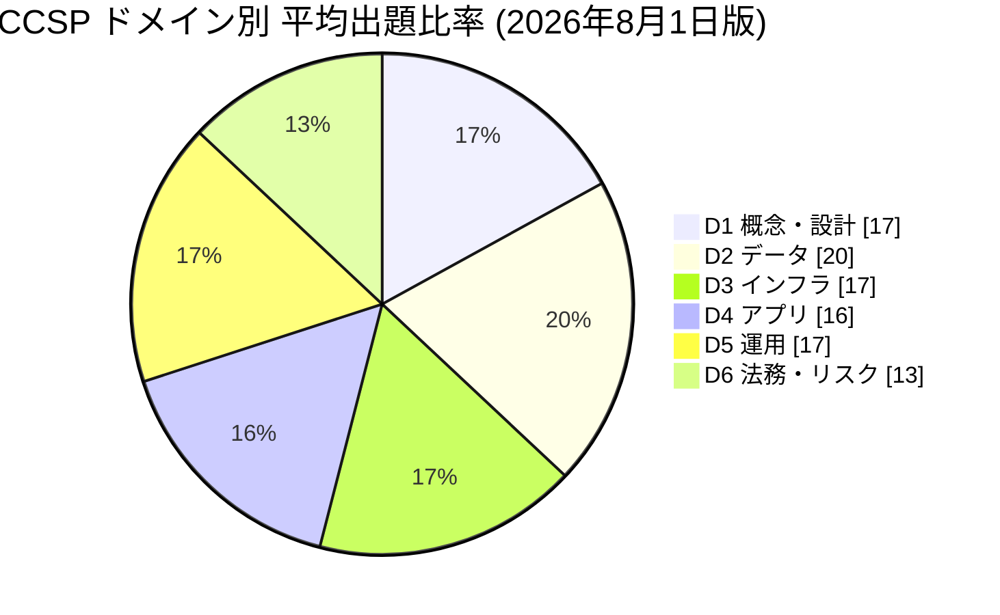

> **旧版との違い(参考)**: 第三者の解説では、旧アウトライン(2025年10月版)と比べて D4 と D5 の比率が 17%/16% → 16%/17% と小さく入れ替わった程度と報告されています [S13]。大きな違いは比率よりも、**AI/ML 関連の項目(1.6 と 2.9)が明示され、各ドメインに AI の観点が織り込まれた点**です [S2][S3]。

---

## Step 2. 学習ロードマップ

### 2-1. 全体の学習順序

初学者は、**基礎(D1)→ 守る対象(D2)→ 守る場所(D3)→ 作るもの(D4)→ 運用(D5)→ ルール(D6)** の順に進むと理解が積み上がります。

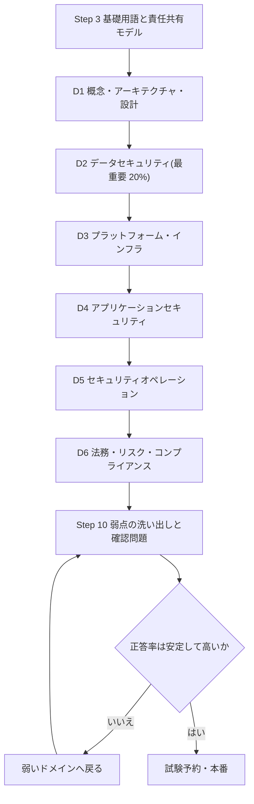

### 2-2. 4週間・8週間の目安

| 期間 | 1〜2週 | 3〜4週 | 5〜6週 | 7〜8週 |
|---|---|---|---|---|
| **8週間(実務経験が浅い人)** | D1 + 基礎 | D2(厚め) | D3・D4 | D5・D6 + 総復習 |
| **4週間(経験者)** | D1・D2 | D3・D4 | D5・D6 | 総復習・確認問題 |

---

## Step 3. 最初に押さえる基礎用語と責任共有モデル

### 3-1. 最初に覚える用語

| 用語 | やさしい説明 |
|---|---|
| CSP | Cloud Service Provider。クラウドを提供する事業者 |
| CSC | Cloud Service Customer。クラウドを利用する側(自社) |
| 責任共有モデル | 「CSPが守る部分」と「利用者が守る部分」を分ける考え方 |
| マルチテナンシー | 複数の利用者が同じ物理基盤を論理的に分離して共用すること |
| 管理プレーン | クラウドを操作する窓口(コンソール・API)。乗っ取られると影響が極大 |
| CIA | 機密性・完全性・可用性。セキュリティの3本柱 |
| 最小権限 | 業務に必要な最小限の権限だけを付与する原則 |
| 多層防御 | 単一の対策に頼らず、複数の層で守る考え方 |

### 3-2. 責任共有モデル(最重要)

サービスモデルが「上」(SaaS)に行くほど CSP の責任範囲が広がり、「下」(IaaS)ほど利用者の責任範囲が広がります。ただし、**どのモデルでも利用者に残る責任**があります。

| レイヤー | IaaS | PaaS | SaaS |
|---|---|---|---|
| データ(分類・保護の最終責任) | 利用者 | 利用者 | 利用者 |
| アイデンティティとアクセス管理(利用者側の設定) | 利用者 | 利用者 | 利用者 |
| アプリケーション | 利用者 | 利用者(自作部分) | CSP |
| ミドルウェア・ランタイム | 利用者 | CSP | CSP |
| ゲスト OS | 利用者 | CSP | CSP |
| 仮想化・ハイパーバイザー | CSP | CSP | CSP |
| 物理サーバー・ストレージ・ネットワーク | CSP | CSP | CSP |
| データセンター(施設・電源・空調) | CSP | CSP | CSP |

> **試験で最も狙われる考え方**: 「**データとアイデンティティは、どのサービスモデルでも最終的に利用者の責任**」。CSP が基盤を守っても、設定ミスや権限の付与ミスは利用者の責任です。

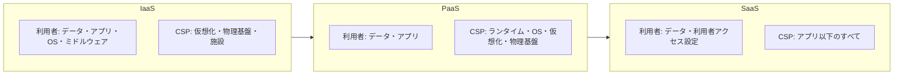

**ベストプラクティス**

1. 利用するすべてのサービスについて、責任分界を**文書化**する(RACI 表など)。
2. CSP の公式な責任共有モデルの説明を確認する(AWS [S14]・Azure [S15]・Google Cloud [S16] はそれぞれ公開しています)。
3. 責任が利用者側にある統制(IAM、暗号鍵、ログ、設定)を**自動で検証**する仕組みを作る。
4. 責任分界は契約(SLA・MSA)とも矛盾しないようにする(Step 9 参照)。

---

## Step 4. Domain 1 クラウドの概念・アーキテクチャ・設計 (17%)

> **ドメインの目的**: クラウドの「そもそも」を理解し、安全な設計の原則を身につける。公式ページは、AI導入が CSP の AI ワークロード対応力の評価から始まること、AIサービス(AIaaS)における責任共有、IaC による環境構築を強調しています [S2]。

### 4-1. 1.1 クラウドコンピューティングの概念を理解する

**何を問われるか**: 定義、役割と責任、本質的な特性、基盤技術 [S3]。

#### 詳細解説

**ステップ1: クラウドとは**

NIST SP 800-145 は、クラウドを「設定可能な共有コンピューティング資源のプールへ、どこからでも便利にオンデマンドでアクセスできるモデル」と定義し、5つの本質的特性・3つのサービスモデル・4つの展開モデルを示しています [S17]。CCSP の出題項目には、これに加えて「マルチテナンシー」が特性として挙げられています [S3]。

**ステップ2: 本質的特性**

| 特性 | 意味 | セキュリティ上の論点 |
|---|---|---|
| オンデマンド・セルフサービス | 利用者が自分で資源を即時に調達できる | 無秩序な資源作成(シャドーIT)、設定ミス |
| 広範なネットワークアクセス | ネットワーク経由でさまざまな端末から利用 | 公開面の拡大、端末の信頼性 |
| マルチテナンシー | 複数の利用者が基盤を共用 | テナント間の分離(隔離)の信頼性 |
| 迅速な伸縮性・拡張性 | 需要に応じて自動で拡大・縮小 | 一時的な資源のログ消失、コスト攻撃 |
| 資源プーリング | 資源を共有プールとして動的に割り当て | データ残留(残存データ)のリスク |
| 計測可能なサービス | 利用量を計測・課金 | 利用量の異常=侵害のシグナルになる |

**ステップ3: 役割**

| 役割 | 説明 |
|---|---|
| クラウドサービスカスタマー(CSC) | サービスを利用する組織 |
| クラウドサービスプロバイダー(CSP) | サービスを提供する事業者 |
| クラウドサービスパートナー | 導入支援・開発支援など、CSP/CSC を補助する事業者 |
| クラウドサービスブローカー | 複数のサービスを仲介・統合・調整する事業者 |
| 規制当局 | 法令順守を監督する機関 |

**ステップ4: 基盤技術**

仮想化、ストレージ、ネットワーク、データベース、オーケストレーション(コンテナ・インフラの自動管理)の5つが出題項目に挙がっています [S3]。

#### ベストプラクティス

- 「どの特性がどのリスクを生むか」を対にして理解する(例: 伸縮性 → 一時資源のログ保全が必要)。
- マルチテナント環境では、CSP の分離機構に頼りきらず、**暗号化と最小権限**で自衛する。
- 自社内でクラウド利用の申請・承認・棚卸しのルールを作り、シャドーITを抑える。

#### 試験のポイント

- 「資源プーリング」と「マルチテナンシー」を混同しない(前者は資源の共有の仕組み、後者は複数の利用者が共存する性質)。
- 「規制当局」「ブローカー」「パートナー」を役割として区別して答えられるようにする。

### 4-2. 1.2 クラウドリファレンスアーキテクチャを説明する

**何を問われるか**: クラウドの活動、サービス能力、サービス分類、展開モデル、共通の考慮事項、関連技術の影響 [S3]。

#### 詳細解説

**サービス分類(カテゴリ)**

| 分類 | 内容 | 代表例(概念) | 利用者の管理範囲 |
|---|---|---|---|
| IaaS | 仮想マシン・ストレージ・ネットワークを提供 | 仮想サーバー、仮想ネットワーク | OS 以上 |
| PaaS | アプリを動かす実行基盤を提供 | マネージドDB、アプリ実行環境 | アプリとデータ |
| SaaS | 完成したアプリをサービスとして提供 | メール、CRM、オフィススイート | データと利用者設定 |

**展開モデル**

| モデル | 説明 | 長所 | 短所 |
|---|---|---|---|
| パブリック | 一般向けに共有基盤で提供 | 低コスト・即時性 | 共有ゆえの懸念、統制範囲が限定的 |
| プライベート | 単一組織専用 | 統制しやすい | コスト・運用負荷 |
| ハイブリッド | パブリックとプライベートの組み合わせ | 柔軟性 | 接続部分の複雑性・設定ミス |
| コミュニティ | 共通目的を持つ複数組織で共有 | 規制要件を共有できる | 合意形成・責任分界 |
| マルチクラウド | 複数の CSP を併用 | ロックイン回避・冗長性 | スキル分散、統制の不統一 |

**共通の考慮事項(試験で頻出の用語)**

| 用語 | 意味 |
|---|---|
| 相互運用性 | 異なるシステムが連携して動く能力 |
| 移植性 | システムやデータを別環境へ移せる能力 |
| 可逆性(リバーシビリティ) | 利用をやめた際に、データと資産を取り戻して引き上げられる能力 |
| 回復力(レジリエンシー) | 障害や攻撃から立ち直る力 |
| 監査可能性 | 統制の有効性を第三者が検証できること |
| ベンダーロックイン | 特定事業者に依存して他へ移れなくなること |

**関連技術の影響**

データサイエンス、機械学習・AI、ブロックチェーン、IoT、コンテナ、量子コンピューティング、エッジコンピューティング、**コンフィデンシャルコンピューティング**が出題項目に挙がっています [S3]。

| 技術 | セキュリティ上の要点 |
|---|---|
| コンテナ | イメージの脆弱性、共有カーネルによる分離の弱さ。NIST SP 800-190 が参考になる [S18] |
| エッジ | 物理的に分散・無人環境が多く、物理的な改ざんや端末盗難に注意 |
| コンフィデンシャルコンピューティング | ハードウェアで保護された実行環境(TEE)により「使用中のデータ」を保護 |
| 量子コンピューティング | 将来、現行の公開鍵暗号が破られる恐れ。「今盗んで将来解読する」攻撃への備えとして耐量子暗号への移行計画が必要。NIST は2024年に耐量子暗号の標準(FIPS 203/204/205)を公表している [S19] |
| ブロックチェーン | 改ざん耐性は高いが、秘密鍵の管理失敗が致命的 |
| IoT | 端末のパッチ適用・認証が弱くなりがち |

#### ベストプラクティス

- 展開モデルの選択は、**規制・データの機微性・可用性要件**から逆算して決める。
- 「出口戦略」(退出計画)を契約・設計の両方で用意する(データのエクスポート形式、期間、費用)。
- コンテナは信頼できるレジストリからのみ取得し、イメージのスキャンと署名を行う。

#### 試験のポイント

- 「移植性」(移せるか)と「相互運用性」(つながるか)は別概念。
- 「可逆性」は**契約終了時にデータを取り戻し、残存データを消去してもらえること**と結びつけて覚える。

### 4-3. 1.3 クラウドに関連するセキュリティ概念を理解する

**何を問われるか**: 暗号と鍵管理、IAM、データ・メディアのサニタイズ、ネットワークセキュリティ、仮想化セキュリティ、一般的な脅威、セキュリティ衛生 [S3]。

#### 詳細解説

**(1) 暗号と鍵管理**

| 概念 | 説明 |
|---|---|
| 共通鍵暗号 | 暗号化と復号に同じ鍵。高速で大量データ向き(例: AES) |
| 公開鍵暗号 | 公開鍵と秘密鍵のペア。鍵配送・デジタル署名に使う |
| エンベロープ暗号化 | データを「データ鍵」で暗号化し、そのデータ鍵を「マスター鍵」で暗号化する方式。鍵の回転や管理が容易 |
| BYOK | 利用者が生成した鍵を CSP の鍵管理に持ち込む |
| HYOK | 鍵は利用者側に置き、CSP は鍵を保持しない |
| HSM | 耐タンパ性を持つ専用ハードウェアで鍵を生成・保管する |

鍵管理の指針としては NIST SP 800-57 Part 1 が広く参照されます [S20]。

**(2) アイデンティティとアクセス制御**

- 対象は「利用者」「特権」「サービス(ワークロード)」の3種類 [S3]。
- 方式: RBAC(役割)、ABAC(属性)、PAM(特権アクセス管理)。
- **サービスアカウントや API キーは人間より数が多く、漏えいすると最も危険**です。

**(3) データ・メディアのサニタイズ**

クラウドでは物理ディスクを利用者が破壊できません。そのため、出題項目に挙がっている「**上書き**」と「**暗号化消去(Cryptographic Erase)**」が重要です [S3]。暗号化消去は、データを暗号化しておき、**鍵を安全に破棄することでデータを復元不能にする**方法です。

NIST SP 800-88 Rev.2(2025年9月公開)は、Clear・Purge・Destroy の3方式を示し、暗号化消去を暗号化されたメディア全般で使われる手法として扱っています [S11]。

**(4) ネットワークセキュリティ**

ネットワークセキュリティグループ(NSG)、トラフィック検査、ジオフェンシング(地理的な制限)が項目に挙がっています [S3]。

**(5) 仮想化セキュリティ**

| 項目 | 要点 |
|---|---|
| ハイパーバイザー | Type 1(ベアメタル型)は基盤に直接動作し、一般にクラウドで採用される。Type 2 はホスト OS 上で動作 |
| VM エスケープ | 悪意ある VM がハイパーバイザーを突破してほかのテナントへ到達する攻撃 |
| コンテナ | カーネルを共有するため、VM より分離が弱い |
| エフェメラル(短命)コンピューティング | 使い捨て環境。ログとフォレンジック証拠が消えやすい |
| サーバーレス | 実行基盤は CSP 管理。関数のコードと権限設定は利用者の責任 |

**(6) 一般的な脅威**

設定ミス、不十分な IAM、安全でない API、データ漏えい、アカウント乗っ取り、内部不正、サプライチェーン攻撃、DoS などが代表例です。CSA の Security Guidance(v5)も、クラウドアーキテクチャ、IAM、ワークロード、データ、DevSecOps、ゼロトラストなどの観点から脅威への備えを体系的に扱っています [S8]。

**(7) セキュリティ衛生**

パッチ適用、ベースライン設定、イミュータブル(不変)アーキテクチャ、ハードニングが項目に挙がっています [S3]。

> **イミュータブルアーキテクチャ**: 稼働中のサーバーを直接修正せず、設定を変えたい場合は新しいイメージから**作り直して置き換える**考え方。構成のずれ(ドリフト)を防ぎます。

#### ベストプラクティス

| 領域 | 推奨事項 |
|---|---|
| 暗号 | 保存時・通信時・可能なら使用時も暗号化。鍵は用途ごとに分け、定期的に回転 |
| 鍵管理 | 鍵管理者とデータ管理者を分離(職務分掌)。HSM や CSP の KMS を利用 |
| IAM | 最小権限、MFA の強制、長期クレデンシャルを避け短期トークンを使う |
| サニタイズ | クラウドでは「暗号化 + 鍵破棄」を標準手順にする |
| ネットワーク | デフォルト拒否。セグメント化とマイクロセグメンテーション |
| 仮想化 | 分離を強化したい機密ワークロードは専有ホストやコンフィデンシャルコンピューティングを検討 |
| 衛生 | 自動パッチ、ベンチマーク(CIS Benchmarks など)に基づく標準構成 [S21] |

#### 試験のポイント

- クラウドでのデータ消去は「**暗号化消去**が現実的な標準」。物理破壊は利用者にはできない。
- 「鍵は誰が持つか」(CSP / 利用者 / 第三者)が責任と信頼の分かれ目。

### 4-4. 1.4 安全なクラウドコンピューティングの設計原則を理解する

**何を問われるか**: データライフサイクル、BC/DR、BIA、機能要件、サービスモデル別の責任、設計パターン、DevOps セキュリティ [S3]。

#### 詳細解説

**(1) クラウド安全なデータライフサイクル**

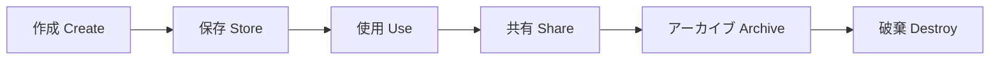

CSA が提唱する6段階が広く使われます。各段階で必要な統制が異なります(詳細は Step 5)。

**(2) BC / DR と BIA**

| 用語 | 意味 |
|---|---|
| BC(事業継続) | 重大な事象下でも重要業務を継続する取り組み |
| DR(災害復旧) | IT システムを復旧する取り組み |
| BIA(ビジネスインパクト分析) | 業務の重要度・停止時の影響・復旧優先度を分析する |
| CBA(費用便益分析) | 対策の費用と効果を比べる |
| ROI | 投資に対する収益 |

**(3) 機能面のセキュリティ要件**

移植性、相互運用性、ベンダーロックインへの対処が項目に挙がっています [S3]。

**(4) 設計パターン**

- **Well-Architected Framework**: 主要 CSP が公開する設計指針(セキュリティの柱を含む)[S22]
- **CSA エンタープライズアーキテクチャ**、**SANS のセキュリティ原則**、**セキュアバイデザイン** [S3]

**(5) DevOps セキュリティ(DevSecOps)**

開発・運用の自動化パイプラインにセキュリティを組み込み、「後付け」を避けます。IaC(Infrastructure as Code)のスキャン、シークレット管理、コンテナイメージの検証、継続的なコンプライアンスチェックが核になります。公式ページも、IaC を用いた回復力のある AI 環境の展開を強調しています [S2]。

#### ベストプラクティス

- **BIA を先に行い、RTO/RPO と対策の費用対効果を決める**(Domain 3 の 3.5 参照)。
- 設計段階から「脅威モデリング」を実施(Domain 4 参照)。
- IaC をレビュー・テスト・承認のフローに乗せ、手作業の変更を禁止する。
- 「コードとして守る」: ポリシー・アズ・コードで逸脱を自動検知する。

#### 試験のポイント

- **BIA の結果に基づいて BC/DR の要件が決まる**(順番が逆になる選択肢に注意)。
- IaaS / PaaS / SaaS ごとに「利用者が追加で行うべき統制」が変わる。

### 4-5. 1.5 クラウドサービスプロバイダー(CSP)を評価する

**何を問われるか**: 基準に照らした検証、システム/サブシステムの製品認証 [S3]。

#### 詳細解説

CSP の評価では「約束(契約)」「証拠(認証・監査報告)」「実態(自社の検証)」の3つを確認します。

| 確認対象 | 例 |
|---|---|
| 製品認証 | Common Criteria(ISO/IEC 15408)、FIPS 140(暗号モジュール)[S3] |
| マネジメント認証 | ISO/IEC 27001、ISO/IEC 27017(クラウド向け管理策)、ISO/IEC 27018(クラウド上の PII 保護)[S23] |
| 監査報告 | SOC 2 Type II、ISAE 3402(Step 9 参照) |
| 業界フレームワーク | CSA STAR / CCM(クラウド管理策のマトリクス)[S9][S24] |
| 政府・業界の認定 | FedRAMP(米国)、ISMAP(日本)[S25] など |

> **補足(FIPS 140)**: 公式アウトラインは例として FIPS 140-2 を挙げています [S3]。現在の暗号モジュール検証は FIPS 140-3 が主流で、CMVP の案内では FIPS 140-2 証明書は2026年9月に履歴扱いへ移行する計画とされていました。最新状況は CMVP で確認してください [S26]。

CSA CCM v4 は 17 ドメイン・197 管理策で構成され、クラウド責任共有モデルへの対応も強化された、クラウド向けの管理策フレームワークです [S9]。

#### ベストプラクティス

- 認証の**範囲(スコープ)・有効期限・対象リージョンやサービス**を必ず確認する。「認証あり」だけで安心しない。
- 評価結果を文書化し、**定期的に再評価**する(CSP 側の変更に追随)。
- 監査報告書の「補完的ユーザー組織統制(CUEC)」=利用者側で実施すべき統制を確認する。

#### 試験のポイント

- 「CSP が認証を取得している」=「**自社のシステムが準拠している**」ではない。
- 製品認証(CC/FIPS)は**製品単位**、マネジメント認証(ISO 27001)は**組織の仕組み**単位。

### 4-6. 1.6 AI/ML を理解する

**何を問われるか**: クラウドでの脅威検知・分析、データソースの検証、SOAR、倫理的懸念、規制要件 [S3]。

#### 詳細解説

| テーマ | 内容 |
|---|---|
| 脅威検知・分析 | ログや振る舞いを機械学習で分析し、異常を検出(UEBA など) |
| データソースの検証 | 学習データの出所・完全性を確認(データポイズニング対策) |
| SOAR | セキュリティ対応の編成・自動化・対応(Orchestration, Automation and Response) |
| 倫理的懸念 | 偏り(バイアス)、透明性、説明責任、プライバシー |
| 規制要件 | GDPR や EU AI Act などにおける説明可能性や自動処理の規制 [S2][S27] |

公式ページは、AI サービスにおける責任分界(CSP が担うモデル基盤の範囲と、利用者が担うモデル設定とデータの範囲)を理解する重要性を述べています [S2]。リスク管理の参考枠として NIST AI RMF [S28] なども活用されます。

#### ベストプラクティス

- AI の学習・推論データを**分類**し、機微データは入力前に除外またはマスキングする。
- AI の判断に**人間のレビュー**を入れる経路を設計する(高リスク用途ほど重要)。
- AI の自動対応(SOAR)は、**影響の小さいアクションから段階的に**自動化する。

#### 試験のポイント

- AI は「防御のツール」であると同時に「**新しい攻撃対象**」でもある(両面を理解する)。
- 規制に関する問いでは、**説明可能性・データの越境・同意**が鍵になりやすい。

---

## Step 5. Domain 2 クラウドデータセキュリティ (20%)

> **ドメインの目的**: 最も比率が高い(20%)ドメイン。データを「見つけ、分類し、守り、保持し、消す」までを一貫して設計・運用する力を問われます。公式ページは、AI 時代のデータ保護として、データレイクと学習データの保護、データ主権とリージョン越境のリスク、一時ストレージのデータ残留対策を挙げています [S2]。

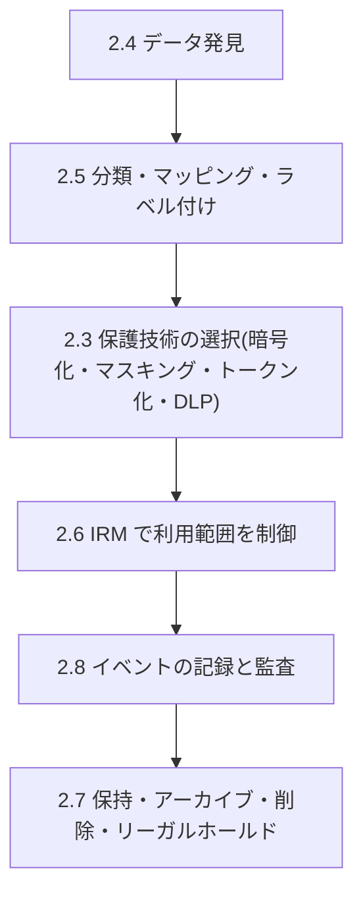

### 5-1. 2.1 クラウドデータの概念を説明する

**何を問われるか**: データライフサイクルの各段階、データの分散、データフロー [S3]。

#### 詳細解説

| 段階 | 内容 | 主な統制 |
|---|---|---|
| 作成 Create | データの新規作成・取り込み・変更 | 分類、ラベル付け、入力検証 |
| 保存 Store | データを保存する | 保存時の暗号化、アクセス制御、バックアップ |
| 使用 Use | データを処理・参照する | 最小権限、アクセスログ、必要に応じ使用中の保護 |
| 共有 Share | 他者・他システムへ提供 | DLP、IRM、通信の暗号化、契約 |
| アーカイブ Archive | 長期保管へ移す | 長期保存向けの暗号化、鍵の保管、媒体の劣化対策 |
| 破棄 Destroy | 復元不能にして消す | 暗号化消去、証跡の保持 |

**データの分散(Data dispersion)**: クラウドではデータが複数のリージョン・ゾーン・サービスへ**分散して保存**されます。冗長性という利点がある一方、「どこにデータがあるか」を把握しにくく、**データ主権・越境移転の規制**への対応が難しくなります。

**データフロー**: データがどこから来て、どこを通り、どこへ行くかを図示します。フロー図(DFD)は、リスク分析・脅威モデリング・プライバシー影響評価の出発点になります。

#### ベストプラクティス

- **データフロー図を最初に作る**。作らずに暗号化や DLP を導入しても、守る対象が見えない。
- データの保存先リージョンをポリシーで固定する(許可リージョン以外を禁止)。
- ライフサイクルの各段階に「担当者・統制・証跡」を定義する。

#### 試験のポイント

- ライフサイクルの各段階の**順序と、その段階で主に必要な統制**を結びつける。
- 「データ分散」の問いでは、**法的管轄・主権・可用性**の観点を答える。

### 5-2. 2.2 クラウドデータストレージのアーキテクチャを設計・実装する

**何を問われるか**: ストレージの種類と、種類ごとの脅威 [S3]。

#### 詳細解説

| ストレージ | 特徴 | 主な脅威 | 対策の要点 |
|---|---|---|---|
| オブジェクト | キーで識別、API でアクセス。大容量・安価 | 公開設定ミス、権限過剰、誤削除 | パブリックアクセスのブロック、バージョニング、ライフサイクル管理 |
| ボリューム(ブロック) | 仮想マシンに接続するディスク | スナップショットの共有ミス、暗号化漏れ | 既定で暗号化、スナップショットの公開禁止 |
| ファイル | 共有ファイルシステム | 共有範囲の広がり、横展開 | ネットワーク分離、ACL の最小化 |
| データベース(マネージド) | 構造化データ | SQL インジェクション、認証情報漏えい | ネットワーク制限、暗号化、監査ログ |
| エフェメラル(一時) | インスタンスと共に消える | データ残留、ログ消失 | 機微データを置かない、暗号化、消去の確認 |
| ロングターム(長期) | アーカイブ用 | 鍵紛失による復号不能、媒体劣化 | 鍵の長期保全、定期的な読み出しテスト |
| ロー(生)ストレージ | 仮想マシンが直接触れるブロックレベルのデータ | 直接アクセスによる露出 | 厳格なアクセス制御と暗号化 |

> **よくある事故**: ストレージの公開設定ミスによる情報漏えい。発生原因の多くは**技術的な欠陥ではなく設定ミス**です。

#### ベストプラクティス

1. 「**既定で非公開**」にする。組織レベルで公開を禁止するポリシーを適用。
2. すべてのストレージを**既定で暗号化**し、鍵は KMS で管理する。
3. バージョニングと削除保護(MFA 削除など)で誤削除・ランサムウェア被害を軽減。
4. 設定の継続的な監査(CSPM などによる自動検知)を行う。

#### 試験のポイント

- ストレージの種類ごとに**典型的な脅威が違う**ことを答えられるようにする。
- 「一時ストレージ」はデータ**残留**の観点を出題されやすい。

### 5-3. 2.3 データセキュリティの技術と戦略を設計・適用する

**何を問われるか**: 暗号化と鍵管理、ハッシュ、難読化、トークン化、DLP、鍵・シークレット・証明書の管理 [S3]。

#### (1) 暗号化と鍵管理

| 状態 | 守り方 | 例 |
|---|---|---|
| 保存時 | ストレージ・DB 暗号化 | ディスク暗号化、透過的データ暗号化 |
| 通信時 | TLS で保護 | TLS 1.2 以上、可能なら 1.3 |
| 使用時 | ハードウェアで保護された実行環境 | コンフィデンシャルコンピューティング |

**鍵管理のライフサイクル**

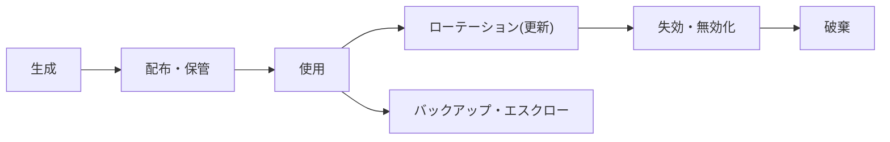

| ベストプラクティス | 理由 |
|---|---|
| 鍵とデータを**別の場所・別の管理者**で管理 | 一方が侵害されても被害を限定 |
| 鍵の用途を分離(暗号化用、署名用など) | 影響範囲の最小化 |
| 定期ローテーションと侵害時の即時失効 | 鍵の寿命を短くする |
| HSM / マネージド KMS を使う | 鍵の抽出を困難にする |
| 鍵の操作を監査ログに記録 | 誰がいつ使ったかを追跡 |

NIST SP 800-57 が鍵管理の標準的な参考資料です [S20]。

#### (2) ハッシュ

| 用途 | 説明 |
|---|---|
| 完全性の確認 | データが改ざんされていないことの検証 |
| 否認防止 | デジタル署名と組み合わせ「誰が作成したか」を否認できなくする |
| パスワード保存 | ソルト付きの低速ハッシュで保存(平文や単純ハッシュは不可) |

> **ハッシュは暗号化ではありません。** ハッシュは一方向で元に戻せません。暗号化は鍵があれば元に戻せます。

#### (3) データ難読化

| 手法 | 説明 | 元に戻せるか |
|---|---|---|
| マスキング | 一部を伏字や別の値に置き換える(静的/動的) | 通常は戻せない |
| 匿名化 | 個人を特定できないよう加工する | 戻せない(再識別が困難であること) |
| 仮名化 | 識別子を別の値に置換し、対応表を別管理 | 対応表があれば戻せる |

> **匿名化と仮名化の違い**: 仮名化は対応表があれば再識別できるため、GDPR などでも**個人データのまま**扱われます。

#### (4) トークン化

機微データ(例: クレジットカード番号)を、意味のない**トークン**に置き換え、元データは別の安全な保管庫(トークンボールト)に保管します。トークン自体は元データを導出できません。決済カード情報の保護範囲(スコープ)を縮小する用途で広く使われます。

| 比較 | 暗号化 | トークン化 |
|---|---|---|
| 元に戻す方法 | 鍵で復号 | ボールトへ照会 |
| データ形式の維持 | 変わりやすい(形式保持暗号を除く) | 同じ形式で作れる |
| 主な用途 | 汎用 | カード番号など特定項目 |

#### (5) DLP(データ損失防止)

| 種類 | 場所 | 例 |
|---|---|---|
| 保存データ(Data at rest) | ストレージ | 機微データの発見・隔離 |
| 通信データ(Data in motion) | ネットワーク・メール | 外部送信の検査・遮断 |
| 使用データ(Data in use) | 端末・アプリ | コピー、印刷、画面共有の制御 |

DLP は**分類(ラベル)が正確でないと機能しません**。分類が先、DLP は後です。

#### (6) 鍵・シークレット・証明書の管理

- コードや設定ファイルに**認証情報を書かない**。専用のシークレット管理サービスで管理する。
- 証明書は有効期限切れで障害になるため、**自動更新と期限監視**を行う。
- シークレットは短期で自動ローテーションする。

#### 主要クラウドの関連サービス例(理解を助ける例)

| 機能 | AWS | Azure | Google Cloud |
|---|---|---|---|
| 鍵管理 | AWS KMS | Azure Key Vault | Cloud KMS |
| HSM | AWS CloudHSM | Azure Dedicated/Managed HSM | Cloud HSM |
| シークレット管理 | AWS Secrets Manager | Azure Key Vault | Secret Manager |
| 機微データの発見 | Amazon Macie | Microsoft Purview | Sensitive Data Protection |

> サービス名は一例です。試験はベンダー中立で、概念の理解が問われます。

#### 試験のポイント

- **「暗号化は鍵管理とセット」**: 鍵が脆弱なら暗号化の価値はない。
- 匿名化・仮名化・マスキング・トークン化の**違い**を使い分けられるように。
- 否認防止にはハッシュ単体ではなく**デジタル署名**が必要。

### 5-4. 2.4 データ発見を実装する

**何を問われるか**: 構造化・非構造化・半構造化データ、データの所在 [S3]。

#### 詳細解説

| データの種類 | 例 | 発見の難しさ |
|---|---|---|
| 構造化 | リレーショナル DB のテーブル | 比較的容易(列名・スキーマ) |
| 半構造化 | JSON、XML、ログ | 中程度(構造は柔軟) |
| 非構造化 | 文書、画像、メール、音声 | 難しい(内容を解析する必要がある) |

発見の手段には、パターンマッチング(正規表現)、辞書、メタデータの分析、機械学習による分類などがあります。

#### ベストプラクティス

- 発見は**一度で終わらせず継続的に**行う(新しいデータは常に増える)。
- 発見結果は、次の「分類・ラベル付け」に自動連携する。
- 非構造化データは最もリスクが見落とされやすい。重点的に対象にする。

#### 試験のポイント

- 「データの所在(location)」は、規制対応(データ主権)の起点。

### 5-5. 2.5 データ分類を計画・実装する

**何を問われるか**: 分類ポリシー、データマッピング、ラベル付けとタグ付け [S3]。

#### 詳細解説

**ステップ1: 分類ポリシーを決める**

| 分類レベル(例) | 内容 | 取り扱い |
|---|---|---|
| 公開 | 公開しても問題ない | 制限なし |
| 社内限定 | 社内のみ | 認証必須 |
| 機密 | 漏えいで事業に影響 | 暗号化、アクセス制限 |
| 極秘 | 漏えいで重大な影響 | 強力な暗号化、厳格な承認、監査 |

**ステップ2: データマッピング**: どのデータが、どのシステム・場所に、誰の責任で存在するかを一覧化します。

**ステップ3: ラベル付け・タグ付け**: 分類結果をデータに付与し、**ポリシーの自動適用**(DLP、アクセス制御、保持期間)に利用します。クラウドではリソースタグを使い、タグに基づくアクセス制御(ABAC)を実装できます。

#### ベストプラクティス

- 分類は**データの所有者**が決める。セキュリティ部門が代わりに決めない。
- 分類レベルは**少なく**(3〜4段階)運用しやすくする。
- 分類に応じた**統制の対応表**を用意する。

#### 試験のポイント

- 分類は**保護の出発点**。分類なしの暗号化・DLP は効果が限定的。

### 5-6. 2.6 情報権利管理(IRM)を設計・実装する

**何を問われるか**: 目的(データの権利、プロビジョニング、アクセスモデル)、適切なツール(証明書の発行と失効など) [S3]。

#### 詳細解説

IRM(DRM とも呼ばれる)は、データに**保護を付随させ**、ファイルが組織外に出ても利用を制御する技術です。

| 制御できること | 例 |
|---|---|
| 閲覧・編集・印刷・コピー | 受信者ごとに許可・禁止 |
| 有効期限 | 期限後は開けない |
| 失効(リボケーション) | 送信後でもアクセスを取り消せる |
| 利用履歴 | 誰がいつ開いたか記録 |

**課題**: 異なる組織・端末・クラウドサービス間の互換性、鍵や証明書の管理の複雑さ、利用者の使い勝手。

#### ベストプラクティス

- 機密度の高い文書に限定して適用し、**全面適用による運用負荷**を避ける。
- 証明書・鍵の**失効手順**を事前に整備する。
- 退職者・取引終了時に権利を失効する手順を組み込む。

#### 試験のポイント

- IRM は**ファイルの保護が持ち出し後も続く**点が特徴(DLP は主に境界での制御)。

### 5-7. 2.7 データ保持・削除・アーカイブのポリシーを計画・実装する

**何を問われるか**: 保持ポリシー、削除手順と仕組み、アーカイブ手順と仕組み、リーガルホールド [S3]。

#### 詳細解説

| 項目 | 内容 | 注意点 |
|---|---|---|
| 保持ポリシー | 何を・どれだけ・どこに保存するか | 法令や契約が最低・最長期間を定める |
| 削除 | 不要になったデータを復元不能にする | クラウドでは**暗号化消去**が現実的 |
| アーカイブ | 長期保管へ移行 | 長期の鍵保管、形式の陳腐化への対処 |
| **リーガルホールド** | 訴訟・調査に備えた削除の**停止** | 通常の削除ルールより**優先**される |

> **重要**: リーガルホールドが発動したら、保持期間が過ぎたデータでも**削除してはいけません**(許可されたアクセスのみ、削除防止)[S3]。

NIST SP 800-88 Rev.2 は、サニタイズを組織の**プログラム**として整備すること、および検証の重要性を強調しています [S11]。

#### ベストプラクティス

- 保持期間は**法務・コンプライアンス部門**と決める(セキュリティ単独で決めない)。
- 削除の**証跡**(いつ・誰が・何を)を保存する。
- バックアップ・複製・ログにも削除ポリシーを**波及**させる(元データだけ消しても不十分)。

#### 試験のポイント

- 法的要件が競合したとき、**リーガルホールド > 通常の削除**。
- 「削除したつもりでも、バックアップやレプリカに残る」問題に注意。

### 5-8. 2.8 データイベントの監査可能性・追跡可能性・説明責任を設計・実装する

**何を問われるか**: イベントソースと属性の定義、ログの保存と分析、証拠保全の連鎖(チェーン・オブ・カストディ)と否認防止 [S3]。

#### 詳細解説

**イベント属性**: 少なくとも「**誰が**(ID)」「**どこから**(IP)」「**いつ**」「**何を**」「**結果**」「**場所(ジオロケーション)**」を記録します [S3]。

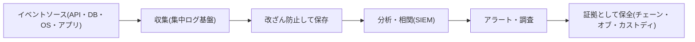

| 概念 | 意味 |
|---|---|
| 追跡可能性 | 活動を最初から最後まで追える |
| 説明責任 | 誰が行ったかを特定できる |
| 否認防止 | 行為者が後から「やっていない」と言えない |
| チェーン・オブ・カストディ | 証拠が誰の手を経てどう扱われたかの記録。途切れると証拠能力が下がる |

#### ベストプラクティス

- ログは**別アカウント・別の権限**に集約し、書き込み専用・改ざん防止にする。
- 時刻を**NTP で同期**する(時系列の分析に必須)。
- 管理プレーン(管理操作)のログは**必ず有効化**する(最優先)。
- ログの保持期間を、法令・調査の要件に合わせる。

#### 試験のポイント

- 否認防止は、**ログの完全性とデジタル署名**で支える。
- ログを攻撃者に消される前提で、**外部へ集約**する設計が正解になりやすい。

### 5-9. 2.9 AI/ML データの保護を理解する

**何を問われるか**: データセットとモデルのプライバシー、セキュリティ(検証・確認) [S3]。

#### 詳細解説

| リスク | 内容 | 対策 |
|---|---|---|
| データポイズニング | 学習データに悪意あるデータを混入 | データの出所検証、異常検知、完全性チェック |
| モデル反転 | モデルの出力から学習データを推測 | 差分プライバシー、出力の制限 |
| モデル抽出 | 問い合わせを繰り返しモデルを複製 | レート制限、認証、監視 |
| メンバーシップ推論 | 特定データが学習に使われたか推測 | 差分プライバシー、正則化 |
| 学習データの漏えい | 学習・推論の基盤からデータが流出 | アクセス制御、暗号化、隔離 |

公式ページは、推論段階の保護手段として**準同型暗号**や**差分プライバシー**に言及し、データレイクと学習データの保護、データ主権のリスク、一時ストレージの残留データの消去を挙げています [S2]。

#### ベストプラクティス

- 学習データの**出所(来歴)**と加工履歴を記録する。
- 学習・推論環境を本番環境から**分離**する。
- 機微データは学習前に匿名化・仮名化・マスキングする。
- モデルの成果物にも**署名と完全性検証**を適用する。

#### 試験のポイント

- AI データの保護は、従来のデータ保護の**延長線上**にある(分類・暗号化・アクセス制御は変わらず重要)。

---

## Step 6. Domain 3 クラウドプラットフォーム・インフラセキュリティ (17%)

> **ドメインの目的**: クラウドを支える物理・論理インフラを理解し、リスクを分析して統制を実装し、事業継続・災害復旧を計画する。公式ページは、仮想化・コンテナ層の保護、AI 学習クラスタのマイクロセグメンテーション、HSM による鍵の保護を挙げています [S2]。

### 6-1. 3.1 クラウドインフラの構成要素を理解する

**何を問われるか**: 物理環境、ネットワークと通信、コンピュート、仮想化、ストレージ、管理プレーン [S3]。

#### 詳細解説

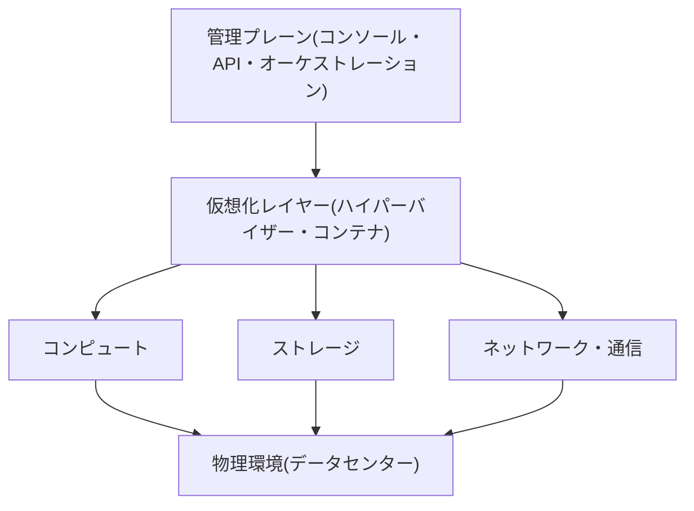

| 構成要素 | 要点 | 主なリスク |
|---|---|---|
| 物理環境 | 施設・電源・空調・入退室 | 物理侵入、災害、停電 |
| ネットワーク・通信 | 仮想ネットワーク、VPN、専用線 | 盗聴、不正経路、分離の失敗 |
| コンピュート | 仮想マシン、コンテナ、サーバーレス | ハイパーバイザー脆弱性、リソース枯渇 |
| 仮想化 | 資源の抽象化・分離 | VM エスケープ、VM スプロール |
| ストレージ | ブロック・オブジェクト・ファイル | 公開設定ミス、データ残留 |
| **管理プレーン** | クラウド全体の操作窓口 | **乗っ取りの影響が最大** |

#### ベストプラクティス

- **管理プレーンを最優先で保護**する: MFA、特権アクセスの時限付与、操作ログの常時監視、ルート/グローバル管理者アカウントの日常利用禁止。
- 管理 API への接続元を制限(特定ネットワークやデバイスのみ)。
- 利用者側では、組織単位のガードレール(組織ポリシー)で危険な操作を禁止する。

#### 試験のポイント

- 管理プレーンは「**クラウド特有の最重要の攻撃対象**」。

### 6-2. 3.2 安全なデータセンターを設計する

**何を問われるか**: 論理設計(テナント分離・アクセス制御)、物理設計(立地・自前か借りるか)、環境設計(空調・複数事業者の経路)、回復力の設計(電源・空調・接続) [S3]。

#### 詳細解説

| 設計領域 | 考慮事項 |
|---|---|
| 論理設計 | テナントの分割(パーティショニング)、アクセス制御、ネットワークの分離 |
| 物理設計 | 立地(自然災害・政情・地盤)、**自前構築か借用か(Buy or Build)**、境界の防護、入退室管理 |
| 環境設計 | **HVAC**(空調)、温度・湿度、消火設備、**複数事業者の経路接続**(単一障害点の回避) |
| 回復力 | 電源(UPS・発電機・二系統受電)、空調の冗長化、接続の冗長化 |

**データセンターの階層**: Uptime Institute のティア(Tier I〜IV)が冗長性の目安として広く使われます。ティアが高いほど冗長性・可用性が高くなります。

**物理セキュリティの多層構造**: 敷地外周 → 建物入口 → データホール → ラック → 機器、と層ごとに防護(フェンス、警備、生体認証、ラック施錠、監視カメラ)を重ねます。

#### ベストプラクティス

- 入退室の**二要素認証**とログ保持、**連れ込み防止(マントラップ)**。
- 電源・通信・空調のそれぞれで**単一障害点を排除**。
- 利用者側は、CSP の物理セキュリティを**監査報告や認証で確認**する(自前で確認できないため)。

#### 試験のポイント

- 「Buy or Build」の問いでは、**コスト・管理権限・時間・専門性**のトレードオフ。
- 「複数事業者の経路」=**通信の単一障害点の回避**。

### 6-3. 3.3 クラウドインフラ・プラットフォームのリスクを分析する

**何を問われるか**: リスクアセスメント(識別・分析)、脆弱性・脅威・攻撃、リスク対応戦略 [S3]。

#### 詳細解説

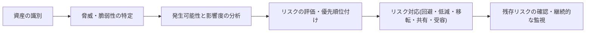

| リスク対応 | 説明 | クラウドの例 |
|---|---|---|
| 回避 | リスクのある活動をやめる | 機微データをクラウドに置かない |
| 低減(軽減) | 統制でリスクを下げる | 暗号化・MFA の導入 |
| 移転 | 他者へ負担を移す | サイバー保険、契約での責任分担 |
| 共有 | 責任やリスクを分担 | 責任共有モデル |
| 受容 | リスクを認めて受け入れる | 影響が小さいと判断し対策しない |

> **移転しても責任は消えない**: 保険や契約でコストを移せても、**法的な説明責任はデータの所有者に残る**ことが多いです。

**クラウドで特に重要な脆弱性・攻撃**: 設定ミス、不十分な IAM、API の悪用、ハイパーバイザー攻撃、サイドチャネル攻撃、DDoS、サプライチェーン攻撃。

#### ベストプラクティス

- リスク評価を**定期的**に・**環境の大きな変更時**に実施。
- リスク受容は**権限のある経営層が文書で承認**する。
- 脅威インテリジェンスを取り込み、評価に反映する。

#### 試験のポイント

- 5つの対応(回避・低減・移転・共有・受容)の**事例当てはめ**。
- 「残存リスク」=対策後に残るリスク。ゼロにはならない。

### 6-4. 3.4 セキュリティ統制を計画・実装する

**何を問われるか**: 物理・環境の保護、システム・ストレージ・通信の保護、クラウドでの識別・認証・認可、監査の仕組み [S3]。

#### 詳細解説

| 統制領域 | 内容 | 実装例 |
|---|---|---|
| 物理・環境の保護(オンプレミス側) | 自社側の設備の保護 | 施錠、入退室、環境監視 |
| システムの保護 | OS・ホストの堅牢化 | ベースライン、EDR、パッチ |
| ストレージの保護 | 保存データの保護 | 暗号化、アクセス制御、バックアップ |
| 通信の保護 | 通信経路の保護 | TLS、VPN、専用線、マイクロセグメンテーション |
| 識別・認証・認可 | 誰が何をできるか | SSO、MFA、最小権限、ジャストインタイム権限 |
| 監査メカニズム | 記録と検証 | ログ収集、相関分析、パケットキャプチャ |

**ゼロトラストの考え方**: 「ネットワークの内側だから安全」と見なさず、**常に検証**し、最小権限でアクセスを許可する考え方です。NIST SP 800-207 が参考になります [S29]。

**マイクロセグメンテーション**: ワークロード単位に細かくネットワークを分け、侵害後の**横展開(ラテラルムーブメント)**を防ぎます。

#### ベストプラクティス

| 領域 | 推奨事項 |
|---|---|
| ネットワーク | 既定拒否、セグメント分離、外部公開は必要最小限 |
| 認証 | フィッシング耐性のある MFA(FIDO2 等)を優先 |
| 認可 | 権限の定期レビュー、時限付き権限、未使用権限の削除 |
| 監査 | 管理プレーンと機微データへのアクセスを必ずログ化 |

#### 試験のポイント

- 「**境界防御だけでは不十分**」という考え方(ゼロトラスト・多層防御)が答えになりやすい。

### 6-5. 3.5 事業継続(BC)・災害復旧(DR)を計画する

**何を問われるか**: BC/DR の戦略、事業要件(RTO・RPO・復旧サービスレベル)、計画の作成・実装・テスト [S3]。

#### 詳細解説

**重要な指標**

| 指標 | 意味 | 決め方 |
|---|---|---|
| **RTO** | 目標復旧時間。停止してから**いつまでに復旧**させるか | BIA の結果 |
| **RPO** | 目標復旧時点。**どの時点までのデータ**を失ってよいか | BIA の結果 |
| 復旧サービスレベル | 復旧後に提供する機能の水準 | 業務要件 |

> **覚え方**: RTO は **T**ime(時間)、RPO は **P**oint(時点・データ損失量)。

**DR の戦略(コストと復旧速度のトレードオフ)**

| 戦略 | 内容 | 復旧速度 | コスト |
|---|---|---|---|
| バックアップと復元 | バックアップから復元 | 遅い | 低い |
| パイロットライト | 最小限のコア部分のみ常時稼働 | やや遅い | やや低い |
| ウォームスタンバイ | 縮小版を常時稼働 | 速い | 中 |
| アクティブ・アクティブ(マルチサイト) | 複数サイトで同時稼働 | 非常に速い | 高い |

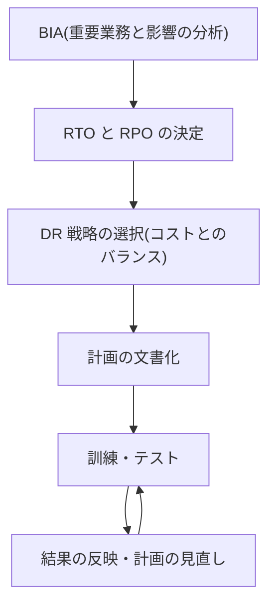

**テストの種類(負荷の軽い順の目安)**

| テスト | 内容 |
|---|---|
| 机上演習(テーブルトップ) | 関係者が集まりシナリオを議論 |
| ウォークスルー | 手順を一つずつ確認 |
| シミュレーション | 模擬の障害シナリオで対応 |
| 並行テスト | 代替環境を稼働して結果を確認(本番は止めない) |
| 完全中断テスト | 本番を実際に停止して切り替え(リスクが最も高い) |

**クラウドでの考慮点**: 複数のアベイラビリティゾーン・リージョンの活用、IaC による環境の再現、CSP 自体の障害を想定した**マルチクラウド**や別リージョン、バックアップの**別アカウント・別リージョン保管**。

#### ベストプラクティス

- **RTO/RPO は IT ではなく事業側が決める**(BIA に基づく)。
- バックアップは「取る」だけでなく、**実際に復元できるか**を定期テスト。
- バックアップは**本番とは別の権限・別の場所**に保管し、ランサムウェアの削除に備える(不変ストレージの活用)。
- 計画は変更のたびに更新する。古い計画は無いのと同じ。

#### 試験のポイント

- 「RTO/RPO を短くするほどコストが上がる」トレードオフ。
- **復元テストをしていないバックアップは信頼できない**。

---

## Step 7. Domain 4 クラウドアプリケーションセキュリティ (16%)

> **ドメインの目的**: クラウド向けアプリケーションを、設計から運用まで安全に作る。公式ページは、AI API 連携における入力検証・レート制限・プロンプトインジェクション対策、サードパーティ ML ライブラリや事前学習モデルを含むサプライチェーンの保護を強調しています [S2]。

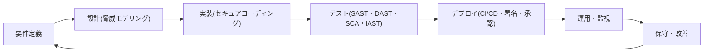

### 7-1. 4.1 アプリケーションセキュリティの教育・啓発を推進する

**何を問われるか**: クラウド開発の基礎、よくある落とし穴、一般的なクラウド脆弱性(OWASP Top 10、ASVS、API Top 10、LLM アプリ Top 10、SANS Top 25) [S3]。

#### 詳細解説

**OWASP Top 10:2025(最新版)** [S10]

| 順位 | カテゴリ | ひとことで言うと |
|---|---|---|
| A01 | アクセス制御の不備 | 権限のない操作・データ閲覧ができてしまう |
| A02 | セキュリティ設定の不備 | 既定設定・公開設定・不要機能の放置 |
| A03 | ソフトウェアサプライチェーンの不備 | 依存ライブラリやビルド経路の汚染(2025年版で新設) |
| A04 | 暗号化の不備 | 弱い暗号、鍵の扱いのミス |
| A05 | インジェクション | 入力がコマンド・クエリとして解釈される |
| A06 | 安全性を欠いた設計 | 設計段階の欠陥(後から直しにくい) |
| A07 | 認証の不備 | 弱い認証・セッション管理 |
| A08 | ソフトウェアまたはデータの完全性の不備 | 署名なし更新、改ざん |
| A09 | セキュリティログとアラートの不備 | 記録・検知ができない |
| A10 | 例外的な状況への不適切な対応 | エラー処理の不備(2025年版で新設) |

> 2025年版では、旧版の SSRF が A01(アクセス制御の不備)に統合され、新カテゴリとして「サプライチェーンの不備」と「例外的な状況への不適切な対応」が加わったと報告されています [S10][S30]。

**ほかの重要な一覧**

| 一覧 | 用途 |
|---|---|
| OWASP ASVS | アプリのセキュリティ検証基準(要件のチェックリスト)[S31] |
| OWASP API Security Top 10 | API 固有のリスク(オブジェクトレベルの認可不備など)[S32] |
| OWASP Top 10 for LLM Applications | 生成 AI アプリのリスク(プロンプトインジェクション等)[S33] |
| SANS/CWE Top 25 | 影響の大きいソフトウェア弱点の一覧 |

**クラウド開発でよくある落とし穴**: コードや公開リポジトリへの認証情報の埋め込み、過剰な権限のサービスアカウント、公開されたストレージ・API、ログへの機微情報の出力、既定設定のまま運用。

#### ベストプラクティス

- 開発者向けの教育は**役割別・実例ベース**で定期的に行う。
- 認証情報の埋め込みを防ぐため、**コミット前・CI でのシークレットスキャン**を必須化。
- Top 10 を「覚える」だけでなく、**自社アプリの脆弱性の分類**に使う。

#### 試験のポイント

- OWASP Top 10 の**各項目が何を意味するか**を、事例から当てられるようにする。
- LLM アプリでは**プロンプトインジェクション**が代表的な新しい脅威。

### 7-2. 4.2 セキュアなソフトウェア開発ライフサイクル(SDLC)プロセスを説明する

**何を問われるか**: ビジネス要件、フェーズと方法論(設計・コーディング・テスト・保守、ウォーターフォールとアジャイル) [S3]。

#### 詳細解説

| 方法論 | 特徴 | セキュリティの組み込み方 |
|---|---|---|
| ウォーターフォール | 工程を順に進める | 各フェーズの終わりにセキュリティレビューのゲート |
| アジャイル | 短い反復で継続的に開発 | 反復ごとにセキュリティのタスクとテストを組み込む(DevSecOps) |

どちらでも原則は同じで、**セキュリティを早い段階(左側)に寄せる(シフトレフト)**ことです。後工程で見つけた欠陥ほど修正コストが高くなります。

NIST の SSDF(SP 800-218)は、安全なソフトウェア開発の実践をまとめた参考枠です [S34]。

#### ベストプラクティス

- セキュリティ要件を、**機能要件と同じバックログ**で管理する。
- 各フェーズの**完了基準(ゲート)**にセキュリティ項目を含める。

#### 試験のポイント

- 「**早い段階で欠陥を見つけるほどコストが低い**」が根本原則。

### 7-3. 4.3 セキュアな SDLC を適用する

**何を問われるか**: クラウド固有のリスク、脅威モデリング、開発中の一般的な脆弱性の回避、セキュアコーディング、構成管理とバージョン管理 [S3]。

#### 詳細解説

**クラウド固有のリスク**: 共有技術に由来する問題、**CSP の内部者による脅威**、可視性と統制の不足、**法的・管轄の問題** [S3]。

**脅威モデリング手法**

| 手法 | 内容 |
|---|---|
| **STRIDE** | 6種類の脅威で分類: Spoofing(なりすまし)、Tampering(改ざん)、Repudiation(否認)、Information Disclosure(情報漏えい)、Denial of Service(サービス拒否)、Elevation of Privilege(権限昇格) |
| DREAD | リスクの点数化: Damage、Reproducibility、Exploitability、Affected Users、Discoverability |
| PASTA | 攻撃のシミュレーションと分析を、リスク中心で7段階で進めるプロセス |
| ATASM | Architecture、Threats、Attack Surfaces、Mitigations の順に考える |

STRIDE と、それを防ぐ対策の対応は頻出です。

| STRIDE | 破られる性質 | 主な対策 |
|---|---|---|
| なりすまし | 認証 | 強い認証、MFA |
| 改ざん | 完全性 | ハッシュ、署名、アクセス制御 |
| 否認 | 否認防止 | ログ、デジタル署名 |
| 情報漏えい | 機密性 | 暗号化、アクセス制御 |
| サービス拒否 | 可用性 | レート制限、冗長化、DDoS 対策 |
| 権限昇格 | 認可 | 最小権限、入力検証 |

**セキュアコーディング**: OWASP ASVS や SAFECode のガイダンスに沿い、入力検証、出力エンコード、パラメータ化クエリ、認証・セッション管理、エラー処理、暗号の正しい利用を徹底します [S3][S31]。

**構成管理とバージョン管理**: ソースコード、IaC、設定をバージョン管理し、変更履歴・承認・ロールバックを担保します。

#### ベストプラクティス

- 脅威モデリングは**設計の段階**で、アーキテクチャ変更時に再実施。
- 入力は**常に信頼せず**、サーバー側で検証する。
- IaC もアプリと同じレビュー・テストを通す。

#### 試験のポイント

- STRIDE の6文字と、それぞれに対応する**セキュリティ特性**。
- 脅威モデリングは**開発の早期**に行うもの。

### 7-4. 4.4 クラウドソフトウェアの保証と検証を適用する

**何を問われるか**: 機能・非機能テスト(CI/CD)、セキュリティテスト手法、品質保証(QA)、不正利用ケースのテスト [S3]。

#### 詳細解説

| 手法 | 何をするか | いつ使うか | 長所 | 短所 |
|---|---|---|---|---|
| **SAST** | ソースコードを**実行せず**静的に解析 | 開発の早期 | 早期に発見、行番号が分かる | 誤検知、実行時の問題は検出不可 |
| **DAST** | **動作中**のアプリに外から攻撃を試す | テスト・ステージング | 実際の挙動を検証 | 原因の特定が難しい |
| **IAST** | アプリ内部にエージェントを入れ**実行中に**解析 | テスト中 | 精度が高い | 導入の手間、性能影響 |
| **SCA** | 依存ライブラリの既知の脆弱性・ライセンスを確認 | ビルド時・継続的 | サプライチェーン対策 | 未知の脆弱性は不可 |
| ブラックボックス | 内部情報なしで検査 | 攻撃者視点 | 現実に近い | カバレッジが限定 |
| ホワイトボックス | 内部(ソース)を知った上で検査 | 詳細な検査 | 網羅的 | 時間・知識が必要 |

**不正利用ケース(Abuse case)テスト**: 「通常の使い方」ではなく「**悪意ある使い方**」を想定してテストします(例: 他人の ID を指定してデータを取得、回数制限の回避)。

**CI/CD に組み込む**: コミット → ビルド → SAST/SCA → テスト → DAST → 承認 → デプロイ、の各段階に自動チェックを入れます。

#### ベストプラクティス

- SAST・SCA は**CI で毎回自動実行**、結果が閾値を超えたらビルドを失敗にする。
- 脆弱性は**重大度と悪用可能性**で優先順位付けし、期限を決めて修正する。
- テスト環境に**本番の実データを使わない**(使う場合はマスキング)。

#### 試験のポイント

- SAST は**ソースを見る**、DAST は**動かして外から攻める**、IAST は**中から見る**、SCA は**部品表(依存関係)**。

### 7-5. 4.5 検証済みの安全なソフトウェアを使う

**何を問われるか**: API の保護、サプライチェーン管理、サードパーティソフトウェアの管理、検証済みオープンソース [S3]。

#### 詳細解説

**API のセキュリティ**: 認証・認可(**オブジェクト単位の認可**を含む)、入力検証、レート制限、TLS、不要なエンドポイントの削除、API ゲートウェイによる集中管理 [S32]。

**サプライチェーン管理**

| 対象 | 確認事項 |
|---|---|
| ベンダー評価 | セキュリティ体制、認証、インシデント対応実績 |
| 完全性・真正性 | 署名の検証、ハッシュの照合 |
| ライセンス | 利用条件・著作権の遵守 |
| オープンソース | 保守状況、脆弱性、信頼できる入手元 |

**実践的な仕組み**: SBOM(ソフトウェア部品表)の作成・管理、成果物の署名と検証(Sigstore 等)、ビルドの来歴保証(SLSA)[S35][S36]。

#### ベストプラクティス

- 依存ライブラリは**バージョンを固定**し、更新は検証後に反映する。
- ビルドの成果物は**署名**し、デプロイ時に署名を検証する。
- 事前学習済み AI モデルやライブラリも、**サプライチェーン管理の対象**に含める [S2]。

#### 試験のポイント

- 「サードパーティを信頼して使う」は誤り。**検証・継続的な監視**が前提。

### 7-6. 4.6 クラウドアプリケーションアーキテクチャの特性を理解・適用する

**何を問われるか**: 補完的なセキュリティコンポーネント、暗号、サンドボックス、アプリケーションの仮想化とオーケストレーション [S3]。

#### 詳細解説

| コンポーネント | 役割 |
|---|---|
| **WAF** | Web アプリへの攻撃(インジェクション、XSS 等)を検査・遮断 |
| **DAM** | データベースへのアクセスを監視・記録 |
| **XML ファイアウォール** | XML メッセージの検証・攻撃遮断 |
| **API ゲートウェイ** | API の認証・レート制限・ルーティングを集中管理 |
| ロードバランサー | 負荷分散と、TLS 終端、可用性の確保 |

**サンドボックス**: 不審なコードを**隔離された環境**で実行し、本番への影響を防ぎます。

**マイクロサービスとコンテナ**

| 項目 | 要点 |
|---|---|
| マイクロサービス | 小さなサービスの集合。サービス間通信の認証・暗号化が重要 |
| コンテナ(Docker) | 軽量な隔離環境。イメージの脆弱性と共有カーネルに注意 |
| Kubernetes | オーケストレーション。RBAC、ネットワークポリシー、Pod のセキュリティ設定、シークレット管理が要 |

コンテナの保護は NIST SP 800-190 が体系的な参考資料です [S18]。

#### ベストプラクティス

- コンテナは**非 root** で実行、読み取り専用のファイルシステム、不要な権限(特権)を付与しない。
- イメージは**最小構成**の信頼できるベースから作成し、レジストリでスキャン。
- Kubernetes では、既定で拒否するネットワークポリシーと最小権限の RBAC を設定する。
- サービス間通信は**相互 TLS(mTLS)**で保護する。

#### 試験のポイント

- WAF は**アプリ層(L7)**を守る。ネットワークのファイアウォールとは役割が違う。
- 「WAF があるから安全なコードでなくてよい」は誤り(**多層防御の一部**)。

### 7-7. 4.7 適切な ID・アクセス管理(IAM)ソリューションを設計する

**何を問われるか**: フェデレーテッド ID、IdP、SSO、MFA、CASB、シークレット・鍵・証明書の管理 [S3]。

#### 詳細解説

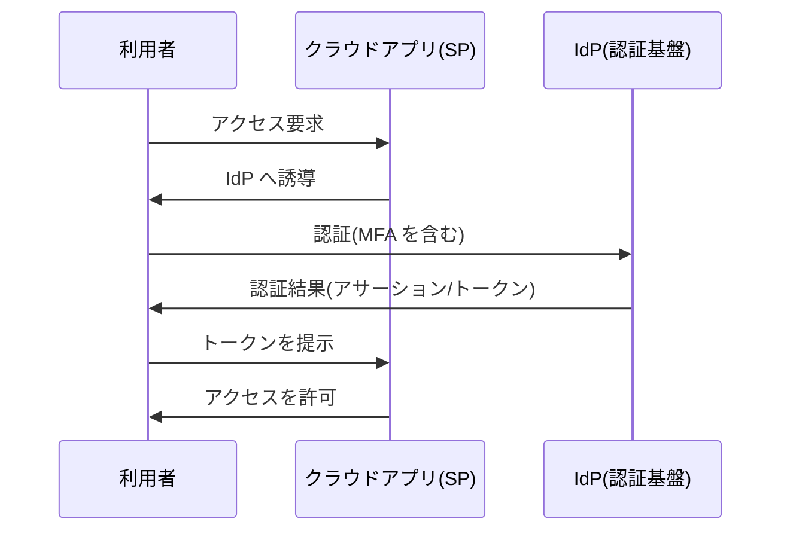

| 用語 | 説明 |
|---|---|
| フェデレーテッド ID | 組織をまたいで ID を信頼し合う仕組み |
| IdP(ID プロバイダー) | 利用者を認証し、結果を他のサービスに通知する |
| SP(サービスプロバイダー) | IdP の認証結果を信頼してサービスを提供 |
| SSO | 1回の認証で複数のサービスを利用 |
| MFA | 知識・所持・生体などの複数要素で認証 |
| CASB | 利用者とクラウドサービスの間に入り、可視化・DLP・脅威防御・コンプライアンスを提供 |

**主要なプロトコル**

| プロトコル | 用途 |
|---|---|
| SAML 2.0 | 企業向け SSO(XML ベース) |
| OpenID Connect(OIDC) | 認証(OAuth 2.0 の上に構築、JSON/JWT) |
| OAuth 2.0 | **認可**(アクセス委譲)。認証ではない |
| SCIM | アカウントの自動プロビジョニング |

> **OAuth は認可、OIDC は認証**。混同しやすい点です。

#### ベストプラクティス

- **集中管理された IdP** に統合し、SSO + MFA を既定にする。
- 特権アカウントは**ジャストインタイム**で時限付与し、セッションを記録する。
- 退職・異動に連動した**自動のプロビジョニング/デプロビジョニング**(SCIM)。
- サービスアカウントは**短期トークン・ワークロード ID** を使い、長期キーを避ける。
- CASB でシャドー IT を発見し、未承認のクラウド利用を可視化する。

#### 試験のポイント

- SAML=企業 SSO、OIDC=認証、OAuth=認可、の**役割の違い**。
- MFA の「要素」とは**種類**(知識・所持・生体)。同じ種類を2つ組み合わせても多要素ではない。

---

## Step 8. Domain 5 クラウドセキュリティオペレーション (17%)

> **ドメインの目的**: クラウド環境を**構築し、運用し、監視し、インシデントに対応する**日々の実務。公式ページは、AI/ML を用いた脅威ハンティング、クラウドネイティブの SIEM/SOAR による自動対応、AI モデルの「ドリフト」の継続的な監視を挙げています [S2]。

### 8-1. 5.1 クラウド環境の物理・論理インフラを構築・実装する

**何を問われるか**: ハードウェア固有のセキュリティ設定(HSM・TPM)、セキュア・バイ・デフォルト、管理プレーンツール、仮想ハードウェアの設定、ゲスト OS 向けツール [S3]。

#### 詳細解説

| 項目 | 内容 |
|---|---|
| **HSM** | 鍵の生成・保管・暗号処理を、耐タンパ性のある専用機器で行う |
| **TPM** | 機器に組み込まれたチップ。起動の完全性の検証、鍵の保護(測定付きブート) |
| セキュア・バイ・デフォルト | 出荷時・初期状態で安全な設定にする(不要なサービスを無効化) |
| 管理プレーンツール | オーケストレーション・構成管理ツールの導入と堅牢化 |
| 仮想ハードウェア | 仮想のネットワーク・ストレージ・メモリ・CPU の設定とセキュリティ |
| **ハイパーバイザー Type 1 / 2** | Type 1: ハードウェア上で直接動作(ベアメタル、クラウド基盤で一般的)。Type 2: ホスト OS の上で動作(開発用途など) |
| ゲスト OS ツール | 仮想マシン内に入れる統合ツール(性能・管理向け)。これ自体も攻撃対象になり得る |

#### ベストプラクティス

- **既定で安全**: 初期状態で最小機能・最小権限・暗号化有効。
- 管理ツールは**専用の管理ネットワーク**から**MFA 付き**で操作。
- 仮想マシンのテンプレート(ゴールデンイメージ)を堅牢化し、検証済みのものから展開する。

#### 試験のポイント

- HSM は**鍵の保管**、TPM は**機器の完全性・端末単位の鍵保護**。
- Type 1 は性能・分離面で**クラウドの標準**。

### 8-2. 5.2 クラウド環境の物理・論理インフラを運用・保守する

**何を問われるか**: ローカル/リモートアクセス制御、安全なネットワーク構成、ネットワークセキュリティ統制、OS のハードニング、パッチ管理、クラスタホストの可用性、ゲスト OS の可用性、性能・容量監視、ハードウェア監視、バックアップ・復元、管理プレーン [S3]。

#### 詳細解説

**アクセス制御**

| 手段 | 要点 |
|---|---|
| RDP / SSH | リモート管理。インターネットへ直接公開しない |
| 踏み台(ジャンプボックス・バスチオンホスト) | 管理アクセスの**唯一の入口**として集中管理・記録 |
| コンソールアクセス | 緊急時用。厳格に制限・記録 |
| SSO | 管理者の認証を一元化 |

**安全なネットワーク構成**

| 技術 | 役割 |
|---|---|
| VLAN | 論理的にネットワークを分離 |
| TLS | 通信の暗号化(旧バージョンの SSL・TLS 1.0/1.1 は使わない) |
| DHCP | アドレス自動割り当て(不正な DHCP サーバーの対策が必要) |
| DNSSEC | DNS 応答の**真正性・完全性**を保証(暗号化ではない) |
| VPN | 拠点・端末と安全に接続 |

**ネットワークセキュリティ統制**

| 統制 | 役割 |
|---|---|
| ファイアウォール / NSG | 通信の許可・拒否 |
| **IDS** | 侵入を**検知**して通知 |
| **IPS** | 侵入を検知して**遮断** |
| ハニーポット | おとりのシステムで攻撃者の手口を観察 |
| 脆弱性評価 | 弱点を洗い出す |
| セグメンテーション | 領域を分けて被害を限定 |

**OS のハードニング、パッチ管理**

- ベースライン(CIS Benchmarks など)に沿って構成し、逸脱を**継続的に監視・修復**する [S21]。
- パッチは**検証 → 段階展開 → 確認 → ロールバック手順**で適用する。緊急の脆弱性は例外手順を事前に定義。

**可用性と監視**

| 項目 | 内容 |
|---|---|
| クラスタホストの可用性 | 分散リソーススケジューリング、動的最適化、ストレージクラスタ、メンテナンスモード、HA(高可用性) |
| ゲスト OS の可用性 | 仮想マシンの自動再起動・移動 |
| 性能・容量監視 | ネットワーク・CPU・ストレージ・応答時間の監視 |
| ハードウェア監視 | ディスク、CPU、ファン、温度 |
| バックアップ・復元 | ホスト・ゲスト OS のバックアップ設定と復元の検証 |
| 管理プレーン | スケジューリング、オーケストレーション、メンテナンス |

#### ベストプラクティス

- **管理アクセスは踏み台経由・MFA・セッション記録**の3点セット。
- 公開が不要なポートは閉じ、**RDP/SSH をインターネットに直接公開しない**。
- パッチは**重大度とエクスポージャー**で優先順位を決め、期限(SLA)を設定する。
- 容量を監視し、リソース枯渇を事前に防ぐ。

#### 試験のポイント

- **IDS=検知、IPS=防御(遮断)**。
- **DNSSEC は真正性の保証**で、通信の機密性は守らない。
- メンテナンスモードは、**ホストを安全に整備するため**にワークロードを移動して停止する状態。

### 8-3. 5.3 運用統制と標準を実装する

**何を問われるか**: NIST、ISO、HIPAA、COBIT、CIS Controls、COSO、ITIL、ISO/IEC 20000-1 などの標準に基づく運用管理プロセス [S3]。

#### 詳細解説

アウトラインに挙がっている運用管理プロセスは、ITIL/ISO 20000 に由来するものが中心です。

| プロセス | 目的 | 要点 |
|---|---|---|
| 変更管理 | 変更を計画・承認・実施・検証 | 無承認の変更が障害・事故の大きな原因 |
| 継続性管理 | 事業継続の確保 | BC/DR と連携 |
| 情報セキュリティ管理 | 機密性・完全性・可用性の管理 | ISO 27001 と連携 |
| 継続的サービス改善 | 運用の継続的な改善 | レビューと改善のサイクル |
| インシデント管理 | **サービスを早く復旧** | 原因追究より復旧を優先 |
| 問題管理 | **根本原因を特定して再発防止** | インシデント管理と区別 |
| リリース管理 | 変更を本番に展開する計画と管理 | |
| デプロイ管理 | 展開作業の実施・検証 | |
| 構成管理 | 構成要素(CI)の情報を管理 | 変更管理の土台。CMDB |
| サービスレベル管理 | SLA の合意・監視 | |
| 可用性管理 | 稼働の要件を満たす | |
| 容量管理 | 需要に対する資源の確保 | |

> **インシデント管理と問題管理の違い**は頻出です。インシデント=**今の障害を復旧**、問題=**根本原因を取り除く**。

**参照する主な標準**

| 標準・フレームワーク | 用途 |
|---|---|
| NIST SP 800-53 | 管理策のカタログ(米国)[S37] |
| ISO/IEC 27001 / 27002 | 情報セキュリティ管理システム(ISMS) |
| COBIT | ITガバナンス |
| CIS Controls | 優先順位付きの実践的な対策集 |
| COSO | 内部統制・ERM |
| ITIL / ISO/IEC 20000-1 | ITサービス管理 |

#### ベストプラクティス

- すべての変更を**変更管理を通す**(緊急変更も事後の承認・記録を必須に)。
- 構成情報(CMDB)を**最新に保つ**。古い構成情報は誤った判断を招く。
- 標準を**複数使う場合は、管理策の対応表**(マッピング)で重複を整理する。

#### 試験のポイント

- 変更管理の最優先は**承認と記録**、緊急対応でも省略しない。
- 標準の名称と**用途のひも付け**(COBIT=ガバナンス、ITIL=サービス管理、ISO 27001=ISMS)。

### 8-4. 5.4 デジタルフォレンジックを支援する

**何を問われるか**: フォレンジックデータの収集手法、証拠管理、デジタル証拠の収集・取得・保全 [S3]。

#### 詳細解説

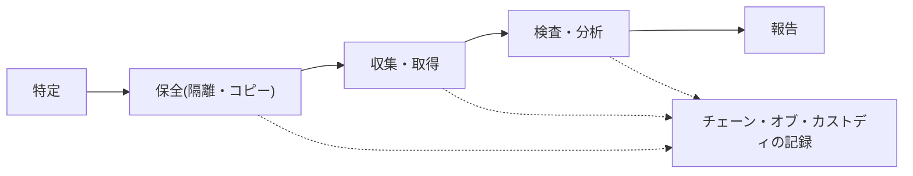

**揮発性の高い順に収集する**(揮発性の順序): メモリ・実行中のプロセス → ネットワーク接続 → ディスク → ログ・バックアップ。

**クラウド特有の課題**

| 課題 | 内容 |
|---|---|
| 物理アクセスができない | ディスクを直接取り出せない。スナップショットの取得で代替 |
| マルチテナント | ほかの利用者のデータを巻き込まないよう注意 |
| データの分散・管轄 | 証拠が複数の国にあり、法的な取得手続が複雑 |
| 短命な環境 | コンテナやサーバーレスは消えると証拠が失われる |
| CSP の協力が必要 | 契約で事前にフォレンジック協力の取り決めを |

関連する国際規格として、ISO/IEC 27037(デジタル証拠の特定・収集・取得・保全)、27041、27042、27043 が出題項目に挙がっています [S3]。

#### ベストプラクティス

- **証拠の保全を最優先**。調査用のコピーで作業し、原本は変更しない。
- ハッシュ値で収集時点の**完全性**を証明する。
- 契約で、CSP のフォレンジック支援・ログ提供の範囲と手順を決めておく。
- 短命な環境は、ログとスナップショットを**自動で外部保管**する。

#### 試験のポイント

- 「証拠を守る」ための最初の行動は、**ハッシュと記録を伴う保全**。
- チェーン・オブ・カストディが切れると、**法廷での証拠能力が下がる**。

### 8-5. 5.5 関係者とのコミュニケーションを管理する

**何を問われるか**: ベンダー、顧客、パートナー、規制当局、その他の関係者 [S3]。

#### 詳細解説

| 相手 | 主な内容 | 注意点 |
|---|---|---|
| ベンダー(CSP を含む) | 障害・変更・インシデントの連絡 | 契約の連絡手順・SLA |
| 顧客 | 影響の通知、再発防止策の説明 | 正確・迅速・一貫した情報 |
| パートナー | 連携先への共有 | 秘密保持契約 |
| **規制当局** | **侵害の届け出**(期限が法令で決まる) | 期限遅れは罰則につながる |
| 他の関係者 | 経営層、広報、法務、保険会社など | 窓口を一本化 |

#### ベストプラクティス

- **連絡先・エスカレーション経路・責任者**をあらかじめ文書化し、定期的に訓練する。
- 外部への発信は**法務・広報の確認を通す**(窓口を一本化)。
- 規制上の通知期限(例: GDPR の72時間)を、インシデント対応計画に組み込む [S27]。

#### 試験のポイント

- 外部への公表は、**事実の確認と法務確認**を経てから。憶測で発信しない。

### 8-6. 5.6 セキュリティオペレーションを管理する

**何を問われるか**: SOC、セキュリティ統制の知的な監視、ログ収集と分析(SIEM 等)、インシデント対応、脆弱性評価、ペネトレーションテスト [S3]。

#### 詳細解説

**SOC / SIEM / SOAR の関係**

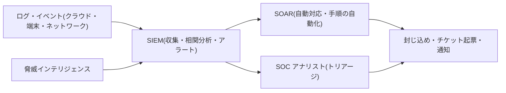

| 要素 | 役割 |
|---|---|
| SOC | 監視・検知・対応を担う組織・機能 |
| SIEM | ログの収集・正規化・相関分析・アラート |
| SOAR | 対応手順の自動化・編成 |
| 脅威インテリジェンス | 攻撃者の手口や侵害指標(IoC)の情報 |

**インシデント対応(IR)**

NIST SP 800-61 Rev.3(2025年4月)は、インシデント対応をリスク管理の一部と位置づけ、NIST CSF 2.0 の6つの機能(統治・識別・防御・検知・対応・復旧)に沿って整理しています [S12]。従来のよく知られた4段階(準備 → 検知・分析 → 封じ込め・根絶・復旧 → 事後活動)の考え方は、現在も基本として役立ちます。

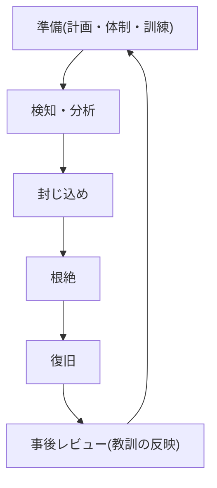

> **注意**: 試験の設問は、どの段階で何をするか(例: 証拠保全と封じ込めの順序)を聞くことがあります。問題文の指示する枠組みに合わせて答えてください。

**脆弱性評価とペネトレーションテスト**

| 項目 | 脆弱性評価 | ペネトレーションテスト |
|---|---|---|
| 目的 | 弱点を**洗い出す** | 弱点を**実際に突いて**侵入できるか確認 |
| 範囲 | 広く浅く | 狭く深く |
| 頻度 | 継続的・定期的 | 定期的・大きな変更後 |

**クラウドでの重要な注意**: ペネトレーションテストは、**CSP の利用規約・事前通知のルール**を確認した上で、**書面による承認(交戦規則=RoE)**を得て実施します。許可なく CSP の基盤や他のテナントに影響を与える行為は禁止されています。

#### ベストプラクティス

- **全アカウント・全リージョンのログ**を集約し、アラートを優先度付けする。
- ユースケースごとの**プレイブック**を整備し、定型対応は SOAR で自動化する。
- インシデント後は**責任追及ではなく原因と改善**にフォーカスしたレビューを行う。
- 定期的な脆弱性評価と、リスクに応じたペネトレーションテストを実施する。

#### 試験のポイント

- 脆弱性評価=洗い出し、ペネトレーションテスト=**悪用して検証**。
- ペネトレーションテストは**事前の許可・範囲の合意(RoE)**が大前提。
- IDS/IPS/SIEM の**役割の違い**(検知・遮断・相関分析)。

#### 主要クラウドの関連サービス例(理解を助ける例)

| 機能 | AWS | Azure | Google Cloud |
|---|---|---|---|
| 管理操作の監査ログ | AWS CloudTrail | Azure Activity Log | Cloud Audit Logs |
| 構成の評価・準拠確認 | AWS Config | Azure Policy | Organization Policy / Security Command Center |
| 脅威検知 | Amazon GuardDuty | Microsoft Defender for Cloud | Security Command Center |
| SIEM | (外部連携含む) | Microsoft Sentinel | Google SecOps |
| ID・アクセス管理 | AWS IAM | Microsoft Entra ID | Cloud IAM |

---

## Step 9. Domain 6 法務・リスク・コンプライアンス (13%)

> **ドメインの目的**: クラウドの法的リスク、プライバシー、監査、リスク管理、契約を理解する。公式ページは、AI に関する自動処理の法的含意、GDPR や EU AI Act における説明可能性、AI サービス提供者のベンダーリスク、AI が関わる場面での eDiscovery とフォレンジックを挙げています [S2]。

> **注意**: 法規制は国・地域・業種によって異なり、頻繁に改正されます。本ガイドは試験対策のための概要であり、**法的助言ではありません**。実務では法務部門や弁護士に確認してください。

### 9-1. 6.1 クラウド環境の法的要件と固有のリスクを説明する

**何を問われるか**: 国際的な法の抵触、クラウド固有の法的リスクの評価、法的枠組みとガイドライン、eDiscovery、フォレンジック要件 [S3]。

#### 詳細解説

**クラウド固有の法的リスク**

| リスク | 内容 |
|---|---|
| 管轄の抵触 | データの保存国・CSP の本社国・利用者の国の法律が衝突する |
| データ主権・越境移転 | 特定国のデータを国外へ出せない、または追加の保護措置が必要 |
| 政府によるアクセス | CSP の所在国の法律により、当局がデータの開示を求め得る |
| 契約外の第三者(サブプロセッサー) | CSP が再委託した先でのデータの取り扱い |
| 責任の所在 | 事故時に誰が法的責任を負うか(利用者が負う場面が多い) |

**eDiscovery(電子的証拠開示)**: 訴訟などで、電子データを**特定・保全・収集・処理・レビュー・提出**する手続きです。クラウドでは、データが分散し、CSP の協力が必要になるため、**契約で事前に取り決める**ことが重要です。関連規格として ISO/IEC 27050 や CSA のガイダンスが出題項目に挙がっています [S3]。

#### ベストプラクティス

- データの保存場所(リージョン)を**契約とポリシーの両方で**固定し、変更を通知させる。
- CSP の**サブプロセッサー一覧と変更通知**を契約で確認する。
- eDiscovery・フォレンジック対応について、CSP の**協力範囲・手順・費用**を契約に入れる。

#### 試験のポイント

- 法律が衝突したら、まず**法務部門・外部の専門家**に確認する、が基本姿勢。
- 「CSP に任せたから責任も移った」は誤り。**データの責任は利用者に残る**。

### 9-2. 6.2 プライバシーの要件を理解する

**何を問われるか**: 契約上のプライベートデータと規制対象のデータの違い、各国の個人データ関連法、管轄ごとの差異、標準的なプライバシー要件、プライバシー影響評価(PIA) [S3]。

#### 詳細解説

**データの種類**

| 種類 | 説明 | 例 |
|---|---|---|
| PII(個人を特定できる情報) | 個人を識別できる情報 | 氏名、住所、識別番号 |
| PHI(保護対象の医療情報) | 医療に関する個人情報 | 診療記録、保険情報 |
| 契約上のプライベートデータ | 法律ではなく**契約**で保護義務が生じる情報 | 取引先との秘密保持契約の対象 |
| 規制対象のデータ | **法令**で保護義務が定められた情報 | GDPR の個人データ、HIPAA の PHI |

**出題項目に挙がっている各国の法令(例)** [S3]

| 法令 | 地域・分野 | 要点 |
|---|---|---|
| GDPR | EU | 個人データの保護、越境移転の制限、侵害通知(原則72時間)、高額な制裁金 [S27] |
| HIPAA / HITECH | 米国・医療 | PHI の保護、侵害通知 |
| FERPA | 米国・教育 | 学生の教育記録の保護 |
| PIPEDA | カナダ | 民間の個人情報保護 |
| Digital Personal Data Protection Act | インド | 個人データ保護 |

> **日本の読者向けの補足(アウトライン外)**: 日本では個人情報保護法(APPI)が基本法です。個人情報保護委員会が情報を公開しています [S38]。試験は国際的な内容ですが、実務の理解として役立ちます。

**標準的なプライバシー要件**: ISO/IEC 27018(パブリッククラウド上の PII 保護の実践規範)、GAPP(一般に認められたプライバシー原則)、GDPR [S3][S23]。

**PIA(プライバシー影響評価)**: 新しいシステムや変更が個人のプライバシーに与える影響を**事前に**評価する手続きです。GDPR の DPIA に相当する考え方です。

#### ベストプラクティス

- **データ最小化**(必要な項目だけ収集)、**目的の限定**、保持期間の明確化。
- 新規システムは**設計段階で PIA を実施**する(プライバシー・バイ・デザイン)。
- 越境移転は、**法的な移転根拠**(契約条項、十分性認定など)を確認する。
- データ主体の権利(開示・訂正・削除等)に対応できる**運用プロセス**を整える。

#### 試験のポイント

- 「契約で定めたデータ」と「法律で定められたデータ」を**区別**する。
- PIA は**事前**に行う(事後では意味が薄い)。
- 侵害通知の**期限**(GDPR は原則72時間)。

### 9-3. 6.3 クラウド環境における監査プロセス・方法論・必要な調整を理解する

**何を問われるか**: 内部・外部の監査統制、監査要件の影響、仮想化とクラウドの保証上の課題、監査報告書の種類、監査範囲の制限、ギャップ分析、監査計画、内部 ISMS、ポリシー、関係者、規制の厳しい業種の要件、分散した IT モデルの影響 [S3]。

#### 詳細解説

**クラウドでの監査の難しさ**

| 課題 | 内容 |
|---|---|
| 物理アクセスの制限 | 利用者が CSP のデータセンターを直接検査できない |
| マルチテナント | 他の利用者のデータが同居しており、検査範囲が制限される |
| 動的な環境 | リソースが頻繁に変わり、一時点の監査は陳腐化しやすい |
| 責任の分担 | どこまでが CSP の統制で、どこからが自社の統制か |

そのため、**CSP が第三者の監査報告書を提供し、利用者がそれに依拠する**形が一般的です。

**監査報告書の種類(頻出)**

| 報告書 | 対象 | 配布範囲 | 要点 |
|---|---|---|---|
| **SOC 1** | **財務報告**に関する内部統制 | 制限あり | SSAE 18 / ISAE 3402 に基づく |
| **SOC 2** | セキュリティ・可用性・処理の完全性・機密性・プライバシー(信頼サービス基準) | **制限あり**(NDA 下で提供されることが多い) | クラウド評価で最も重視されることが多い |
| **SOC 3** | SOC 2 の要約版 | **一般公開可能** | 詳細は載らない |

| 区分 | 意味 |
|---|---|
| **Type I** | **ある一時点**で統制が適切に**設計**されているか |
| **Type II** | **一定期間**にわたり統制が**有効に運用**されたか(より信頼性が高い) |

SSAE は米国、ISAE は国際的な保証業務の基準です [S3]。

**監査範囲の制限(スコープの制約)**: 報告書は**対象のサービス・拠点・期間**に限られます。「認証あり」と聞いても、自社が使うサービスが範囲内かを確認します。

**ギャップ分析**: 現状の統制と、あるべき姿(基準・規制)との**差**を洗い出す手法(管理策の分析、ベースライン、リスク・統制の自己評価=RCSA)。

**規制の厳しい業種の要件(例)** [S3]: NERC CIP(北米の電力)、HIPAA / HITECH(医療)、PCI(決済カード)。

#### ベストプラクティス

- CSP の **SOC 2 Type II** を取得し、**対象範囲・期間・例外事項・CUEC(利用者側で実施すべき統制)**を読む。
- 監査は**年間の計画**を立て、重大な変更時にも実施する。
- 内部の ISMS(ISO/IEC 27001)の運用を整え、継続的な改善を回す。
- 利用者側の統制(IAM・暗号鍵・ログ)の**証跡を自動で収集**する。

#### 試験のポイント

- SOC 1=**財務**、SOC 2=**セキュリティ等の信頼サービス**、SOC 3=**公開用の要約**。
- Type I=**設計**の一時点、Type II=**運用の有効性**の期間。
- 「CSP の報告書があれば、自社の監査は不要」は誤り(**利用者側の統制**は別途必要)。

### 9-4. 6.4 クラウドが企業のリスク管理に与える影響を理解する

**何を問われるか**: プロバイダーのリスク管理プログラムの評価、データの役割の違い、規制上の透明性要件、リスク対応、リスクフレームワーク、リスク指標、リスク環境の評価 [S3]。

#### 詳細解説

**データに関する役割**

| 役割 | 責務 | 例 |
|---|---|---|
| データ所有者(オーナー) | データの**分類と保護要件を決める**、最終的な責任 | 業務部門の責任者 |
| データコントローラー | **目的と手段を決める**(GDPR) | データを利用する事業者 |
| データプロセッサー | コントローラーの**指示に従って処理** | クラウドサービス提供者(多くの場合) |
| データカストディアン | データを**技術的に保管・保護**する | IT 部門・CSP |
| データスチュワード | データの品質・利用ルールを管理 | データ管理担当 |

> **よくある混同**: クラウドに預けた個人データでは、利用者が「コントローラー」、CSP が「プロセッサー」となるのが典型です。

**規制上の透明性要件**: 侵害通知(GDPR など)、SOX(上場企業の財務報告の内部統制)などが挙がっています [S3]。

**リスク対応**: 回避・低減(軽減)・移転・共有・受容(Step 6-3 参照)。

**リスクフレームワーク(例)**: ISO 31000(リスク管理)、NIST リスクマネジメントフレームワーク(RMF)、NIST サイバーセキュリティフレームワーク(CSF 2.0)など。

**リスク指標**: KRI(重要リスク指標)や KPI で、リスクの水準を**継続的に測る**。

#### ベストプラクティス

- クラウド導入前に、**CSP のリスク管理プログラム**(統制・方法論・ポリシー・リスクプロファイル・リスク選好)を評価する。
- 自社の**リスク選好度(許容度)**を経営層が定め、それに合わせて判断する。
- リスクは**サービス・ベンダー・インフラ・事業**の観点で評価する。

#### 試験のポイント

- **データの最終責任は所有者・コントローラー**にあり、プロセッサー(CSP)に移転されない。
- リスク受容は**権限を持つ者(経営層)が行う**。

### 9-5. 6.5 アウトソーシングとクラウド契約の設計を理解する

**何を問われるか**: 事業要件(SLA・MSA・SOW)、ベンダー管理、契約管理、サプライチェーン管理(ISO/IEC 27036) [S3]。

#### 詳細解説

| 契約文書 | 内容 |
|---|---|
| **MSA**(基本サービス契約) | 取引全体の基本条件(責任、補償、秘密保持など) |
| **SLA**(サービスレベル合意) | 可用性・性能・サポート応答などの**測定可能な水準**と未達時の補償 |
| **SOW**(作業範囲記述書) | 個別の作業内容・成果物・期間 |

**ベンダー管理**: ベンダー評価、ロックインのリスク、**ベンダーの存続性(経営の安定性)**、**エスクロー**(ソースコードや重要資産を第三者に預託し、倒産時などに利用者が使えるようにする仕組み)。

**契約管理で確認する事項(出題項目より)** [S3]

| 項目 | 確認内容 |
|---|---|
| **監査権(Right to audit)** | 利用者や監査人が CSP を監査できるか |
| 指標 | SLA で何を・どう測るか |
| 定義 | 用語・責任範囲の定義 |
| **終了(Termination)** | 契約終了時の**データの返却・消去**の手順と期間 |
| 訴訟 | 紛争時の管轄・準拠法 |
| 保証・コンプライアンス | 認証・監査報告書の提供 |
| データやクラウドへのアクセス | 法的要請があった場合の通知 |
| サイバー保険 | 損害の補填 |
| **データの所有権** | データは利用者のものであることの明記 |
| セキュリティ要件 | 暗号化・ログ・インシデント通知など |

**サプライチェーン**: ISO/IEC 27036 は、供給者関係における情報セキュリティの規格です [S3]。CSP の**サブプロセッサー(再委託先)**まで把握します。

#### ベストプラクティス

- **データの所有権、返却・消去、侵害通知の期限、監査権**を契約に必ず明記。
- SLA の補償は、**実際の損害より小さい**ことが多い。重要な業務は SLA 以外の対策(冗長化)も併用。
- 出口戦略(データの形式・期間・費用・支援)を**契約時に**決めておく。

#### 試験のポイント

- 契約で最重要なのは「**データの所有権・監査権・終了時のデータ返却と消去・侵害通知**」。
- SLA は**測定可能**でなければ意味がない。補償は損害の全額を保証しない。

---

## Step 10. 試験対策(CAT・解き方・学習計画・確認問題)

### 10-1. CAT(適応型試験)の特徴

CAT は、**あなたの回答に応じて次の問題の難易度が変わる**方式です。出題数は100〜150問で、試験時間は3時間です [S3][S4]。

| 特徴 | 対策 |
|---|---|
| 前の問題に**戻れない** | 一問ずつ決断して進む。迷って時間を使いすぎない |
| 難易度が適応する | 難しい問題が続いても落ち込まない(できている証拠のことも多い) |
| 出題数が受験者ごとに異なる | 問題数を気にせず、目の前の問題に集中 |
| 高度な問題形式も出る | 選択肢が複数の形式、並べ替え等にも慣れる |

> 合格点は700/1000点です [S3]。CAT の採点は単純な正答率ではないため、**得点を自分で見積もろうとしない**ことが大切です。

### 10-2. 問題の解き方(思考法)

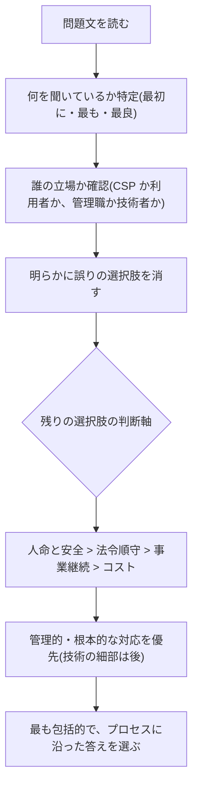

| 原則 | 説明 |
|---|---|
| **管理者の視点** | 技術の細部より、**リスク・プロセス・ポリシー・責任**から考える |
| **人命・安全が最優先** | 事業やコストよりも先に来る |
| **法令順守を優先** | 法的要件が絡むときは法務へ相談・法令を優先 |
| **根本的・予防的な対応** | 場当たり的な対処より、**仕組みで防ぐ** |
| **責任共有モデルで考える** | 「その責任はCSPか利用者か」を常に確認 |
| **「最初に」を見逃さない** | 行動の**順序**を問う問題が多い(例: 保全 → 封じ込め) |

### 10-3. 混同しやすい用語の整理(試験直前チェック)

| 組み合わせ | 違い |
|---|---|
| RTO と RPO | RTO=**復旧までの時間**、RPO=**失ってよいデータの時点** |
| 匿名化と仮名化 | 匿名化=**再識別不可**、仮名化=**対応表があれば再識別可** |
| 暗号化とハッシュ | 暗号化=**戻せる**、ハッシュ=**戻せない一方向** |
| トークン化とマスキング | トークン化=**ボールトで元に戻せる代用値**、マスキング=**多くは戻せない伏字化** |
| IDS と IPS | IDS=**検知**、IPS=**検知して遮断** |
| 脆弱性評価と PT | 評価=**洗い出し**、PT=**実際に侵入を試みる** |
| SAST・DAST・IAST・SCA | **ソース静的**・**動かして外から**・**中から**・**依存部品** |
| OAuth と OIDC | OAuth=**認可**、OIDC=**認証** |
| SOC 1・2・3 | **財務**・**セキュリティ等(制限配布)**・**要約(公開可)** |
| Type I と Type II | **一時点の設計**・**期間の運用有効性** |
| インシデント管理と問題管理 | **早く復旧**・**根本原因を除去** |
| 可逆性と移植性 | 可逆性=**退出時にデータを取り戻せる**、移植性=**他環境へ移せる** |
| コントローラーとプロセッサー | **目的と手段を決める**・**指示に従い処理** |
| BYOK と HYOK | **鍵を持ち込む**・**鍵は利用者側に置き CSP は持たない** |

### 10-4. ドメイン別・重点チェックリスト

| ドメイン | 重点 |
|---|---|
| D1 (17%) | 責任共有モデル、サービス/展開モデル、特性とリスクの対応、CSP 評価の見方、AI/ML の基礎 |
| **D2 (20%)** | **データライフサイクル、暗号化と鍵管理、トークン化・マスキング・DLP、分類、保持・削除・リーガルホールド、ログと証拠** |
| D3 (17%) | 管理プレーン、データセンター設計、リスク対応5種、**RTO/RPO と DR 戦略**、ゼロトラスト |
| D4 (16%) | OWASP Top 10、**STRIDE**、SAST/DAST/IAST/SCA、サプライチェーン、WAF/API ゲートウェイ、**SAML/OIDC/OAuth**、MFA |
| D5 (17%) | ハードニング・パッチ、踏み台、IDS/IPS、**ITIL 系プロセス**、フォレンジック、SIEM/SOAR、インシデント対応、PT の許可 |
| D6 (13%) | 越境移転・主権、GDPR 等、**SOC 1/2/3 と Type I/II**、データの役割、リスク対応、**契約(SLA・監査権・終了・所有権)** |

### 10-5. 確認問題(10問)

**Q1.** IaaS を利用している企業で、データの最終的な保護責任はだれにあるか。
- A. CSP  B. 利用者  C. 規制当局  D. クラウドブローカー

答えと解説

**B**。データとアイデンティティの責任は、どのサービスモデルでも利用者に残ります(責任共有モデル)。

**Q2.** クラウド上のデータを、物理ディスクを破壊せずに復元不能にする現実的な方法はどれか。
- A. ファイルの削除  B. 暗号化消去(鍵の破棄)  C. ディスクの初期化のみ  D. 再起動

答えと解説

**B**。データを暗号化しておき、鍵を安全に破棄することで復元不能にします。NIST SP 800-88 Rev.2 も暗号化消去を扱っています [S11]。

**Q3.** 訴訟の通知を受けた。保持期間を過ぎたデータがある。どうすべきか。
- A. 通常どおり削除する  B. リーガルホールドにより削除を停止する  C. 暗号化して削除する  D. CSP に任せる

答えと解説

**B**。リーガルホールドは通常の削除ルールに**優先**します [S3]。

**Q4.** 「どの時点までのデータ損失を許容するか」を表す指標はどれか。
- A. RTO  B. RPO  C. SLA  D. MTBF

答えと解説

**B**。RPO(目標復旧時点)です。RTO は復旧までの**時間**です。

**Q5.** 実行していないソースコードを解析して脆弱性を見つける手法はどれか。
- A. DAST  B. IAST  C. SAST  D. ペネトレーションテスト

答えと解説

**C**。SAST は静的解析です。DAST は動作中のアプリを外部から検査します。

**Q6.** SaaS の SSO で、ユーザーの**認証**に使われる、OAuth 2.0 の上に構築されたプロトコルはどれか。
- A. SAML のみ  B. OpenID Connect  C. SCIM  D. Kerberos のみ

答えと解説

**B**。OIDC は認証、OAuth 2.0 は認可です。SAML も SSO に使えますが、設問は OAuth 2.0 上に構築されたものを問うています。

**Q7.** CSP の統制の有効性を、一定期間にわたって独立した監査人が評価した報告書はどれか。
- A. SOC 2 Type I  B. SOC 2 Type II  C. SOC 3 のみ  D. 自己評価

答えと解説

**B**。Type II は**一定期間の運用の有効性**を評価します。Type I は一時点の設計です。

**Q8.** クラウドでのペネトレーションテスト実施前に、最も重要なことはどれか。
- A. 事前通知なしの実施  B. CSP の規約確認と書面による承認・範囲の合意  C. 本番データの全複製  D. 他テナントへの影響確認のみ

答えと解説

**B**。CSP のポリシーを確認し、**書面での承認と範囲の合意(RoE)**を得て実施します。

**Q9.** 契約終了時に、利用者がデータを取り戻し、残存データを消去してもらえる性質を指す用語はどれか。
- A. 相互運用性  B. 可逆性  C. 弾力性  D. 回復力

答えと解説

**B**。可逆性(リバーシビリティ)です。移植性は別の環境へ移せる性質です。

**Q10.** 事故後の対応で、デジタル証拠の取り扱いにおいて最初に重視すべきことはどれか。
- A. すぐにサーバーを再構築する  B. 証拠の保全とチェーン・オブ・カストディの記録  C. ログを削除して容量を確保する  D. 担当者の判断で自由に分析する

答えと解説

**B**。証拠の完全性を保ち、取り扱いの経緯を記録することが法的な有効性の前提です。

### 10-6. 試験当日までのチェックリスト

- [ ] 公式アウトライン(2026年8月1日版)の全サブドメインを読み、**説明できない項目がない**
- [ ] 責任共有モデルの表を**何も見ずに**書ける
- [ ] 10-3 の混同しやすい用語を**口頭で説明**できる
- [ ] D2(20%)を中心に確認問題の正答率が安定している
- [ ] 受験資格(経験年数)と受験の申し込み手続き・ID 要件を確認した [S6][S7]
- [ ] 試験会場(Pearson VUE)、日時、持ち物を確認した

---

## 参考ソース一覧

> **凡例**
> - ✅ **今回取得・確認済み**: 本ガイド作成時(2026年10月17日)に、内容を実際に取得して確認した資料です。
> - 📎 **標準的な公式ページ(今回は未取得)**: 広く知られた公式の所在を示します。**URL と最新の内容は受験前・実務利用前にご自身でご確認ください。**

### A. ISC2 公式(最優先の根拠)

| 番号 | 資料 | URL | 状態 |
|---|---|---|---|
| S1 | ISC2 CCSP 認定ページ(ドメイン、必要実務経験、ANAB、DoDM 8140.03) | https://www.isc2.org/certifications/ccsp | ✅ |
| S2 | ISC2 CCSP Exam Outline ページ(2026年8月1日、各ドメインへの AI の織り込みの説明) | https://www.isc2.org/certifications/ccsp/ccsp-certification-exam-outline | ✅ |
| S3 | CCSP Certification Exam Outline(PDF、2026年8月1日発効。試験情報・比率・全サブドメイン) | https://edge.sitecorecloud.io/internationf173-xmc4e73-prodbc0f-9660/media/Project/ISC2/Main/Media/documents/exam-outlines/EXAMS-CCSP-Exam-Outline-English-01-2026-V2.pdf | ✅ |
| S4 | ISC2 CAT(適応型試験)の説明(S3 内に記載の URL) | https://www.isc2.org/certifications/computerized-adaptive-testing | 📎 |
| S5 | ISC2 補足参考文献の一覧(S2・S3 内に記載の URL) | https://www.isc2.org/certifications/references | 📎 |
| S6 | ISC2 試験の登録・ポリシー(S2・S3 内に記載の URL) | https://www.isc2.org/register-for-exam | 📎 |
| S7 | CCSP 経験要件の詳細(S3 内に記載の URL) | https://www.isc2.org/Certifications/CCSP/experience-requirements | 📎 |

### B. 標準・フレームワーク・業界団体

| 番号 | 資料 | URL | 状態 |
|---|---|---|---|
| S8 | CSA Security Guidance v5(クラウドアーキテクチャ、IAM、ワークロード、データ、DevSecOps、ゼロトラスト、生成 AI 等) | https://cloudsecurityalliance.org/guidance.html | ✅ |
| S9 | CSA Cloud Controls Matrix v4(17ドメイン・197管理策)公式発表 | https://cloudsecurityalliance.org/articles/cloud-security-alliance-s-new-cloud-controls-matrix-v4-adds-new-log-and-monitoring-domain-and-more-than-60-new-cloud-security-controls | ✅ |
| S10 | OWASP Top 10:2025 | https://owasp.org/Top10/2025/ (日本語: https://owasp.org/Top10/2025/ja/) | ✅ |
| S11 | NIST SP 800-88 Rev.2 メディアサニタイズのガイドライン(2025年9月) | https://csrc.nist.gov/pubs/sp/800/88/r2/final | ✅ |
| S12 | NIST SP 800-61 Rev.3 インシデント対応(2025年4月、CSF 2.0 コミュニティプロファイル) | https://nist.gov/news-events/news/2025/04/nist-revises-sp-800-61-incident-response-recommendations-and-considerations | ✅ |
| S13 | 第三者による新旧アウトライン比較(比率の変更点。公式の比率は S3 を優先) | https://certmage.com/?p=20715 | ✅(第三者) |
| S14 | AWS 責任共有モデル | https://aws.amazon.com/compliance/shared-responsibility-model/ | 📎 |
| S15 | Microsoft Azure 責任共有 | https://learn.microsoft.com/en-us/azure/security/fundamentals/shared-responsibility | 📎 |
| S16 | Google Cloud 責任共有・共同運命 | https://cloud.google.com/architecture/framework/security/shared-responsibility-shared-fate | 📎 |
| S17 | NIST SP 800-145 クラウドコンピューティングの定義 | https://csrc.nist.gov/pubs/sp/800/145/final | 📎 |
| S18 | NIST SP 800-190 アプリケーションコンテナのセキュリティガイド | https://csrc.nist.gov/pubs/sp/800/190/final | 📎 |
| S19 | NIST 耐量子暗号(FIPS 203/204/205) | https://csrc.nist.gov/projects/post-quantum-cryptography | 📎 |
| S20 | NIST SP 800-57 Part 1 Rev.5 鍵管理 | https://csrc.nist.gov/pubs/sp/800/57/pt1/r5/final | 📎 |
| S21 | CIS Benchmarks | https://www.cisecurity.org/cis-benchmarks | 📎 |
| S22 | AWS Well-Architected(セキュリティの柱)※他 CSP にも同様の枠組みあり | https://docs.aws.amazon.com/wellarchitected/latest/security-pillar/welcome.html | 📎 |
| S23 | ISO/IEC 27001・27017・27018 | https://www.iso.org/standard/27001 / https://www.iso.org/standard/43757.html / https://www.iso.org/standard/76559.html | 📎 |
| S24 | CSA CCM・STAR | https://cloudsecurityalliance.org/research/cloud-controls-matrix / https://cloudsecurityalliance.org/star | 📎 |
| S25 | ISMAP(日本政府のクラウドサービス評価制度)/ FedRAMP | https://www.ismap.go.jp/ / https://www.fedramp.gov/ | 📎 |
| S26 | NIST CMVP(暗号モジュール検証プログラム。FIPS 140-2/140-3 の最新状況) | https://csrc.nist.gov/projects/cryptographic-module-validation-program | 📎 |
| S27 | GDPR(EU 一般データ保護規則)/ EU AI Act | https://eur-lex.europa.eu/eli/reg/2016/679/oj / https://eur-lex.europa.eu/eli/reg/2024/1689/oj | 📎 |
| S28 | NIST AI リスクマネジメントフレームワーク | https://www.nist.gov/itl/ai-risk-management-framework | 📎 |
| S29 | NIST SP 800-207 ゼロトラストアーキテクチャ | https://csrc.nist.gov/pubs/sp/800/207/final | 📎 |
| S30 | OWASP Top 10:2025 の変更点の解説(第三者) | https://www.fastly.com/blog/new-2025-owasp-top-10-list-what-changed-what-you-need-to-know | ✅(第三者) |
| S31 | OWASP ASVS | https://owasp.org/www-project-application-security-verification-standard/ | 📎 |
| S32 | OWASP API Security Top 10(2023) | https://owasp.org/API-Security/editions/2023/en/0x11-t10/ | 📎 |
| S33 | OWASP Top 10 for LLM Applications | https://genai.owasp.org/llm-top-10/ | 📎 |
| S34 | NIST SP 800-218 SSDF(セキュアソフトウェア開発フレームワーク) | https://csrc.nist.gov/pubs/sp/800/218/final | 📎 |
| S35 | SLSA(ソフトウェア成果物のサプライチェーン保証) | https://slsa.dev/ | 📎 |
| S36 | Sigstore(成果物の署名・検証) | https://www.sigstore.dev/ | 📎 |
| S37 | NIST SP 800-53 Rev.5 セキュリティ・プライバシー管理策 | https://csrc.nist.gov/pubs/sp/800/53/r5/upd1/final | 📎 |
| S38 | 個人情報保護委員会(日本の個人情報保護法 APPI) | https://www.ppc.go.jp/ | 📎 |

### C. 本ガイドの根拠の扱いについて

1. **試験範囲・比率・試験形式・受験要件**は、すべて ISC2 公式アウトライン(S1〜S3)に基づきます。第三者サイトの情報(S13、S30)は補助的な参考で、公式と食い違う場合は公式を優先してください。
2. 各ドメインの「詳細解説」「ベストプラクティス」は、公式アウトラインの項目を軸に、上記の公開標準(NIST・OWASP・CSA・ISO 等)の一般的な考え方に基づいて構成した**学習用の解説**です。
3. 主要クラウド(AWS・Azure・Google Cloud)のサービス名は**理解を助ける例**で、機能・名称は変更され得ます。CCSP 試験はベンダー中立です。
4. 公式ページの AI 関連の記述(各ドメインの冒頭の補足)は、ISC2 の Exam Outline ページの説明に基づきます [S2]。
5. 法規制は変更されるため、実務での判断には必ず最新の原典と専門家の助言を使ってください。

---

*作成日: 2026年10月17日 / 準拠: ISC2 CCSP Exam Outline(2026年8月1日発効版)*
