# CGRC（Certified in Governance, Risk and Compliance）初学者向けステップバイステップ完全ガイド

> **対象読者**: GRC（ガバナンス・リスク管理・コンプライアンス）を初めて学ぶ方、情報システムのセキュリティ認可（ATO）業務に関わる方、CGRC 試験の受験を考えている方
> **情報時点**: 2026年10月17日（Web 情報は同日までに確認したもの）
> **出題範囲の根拠**: ISC2 公式「CGRC Certification Exam Outline」（2024年6月15日発効、PDF 版表記 v9/2025）
> **公式ページ**: https://www.isc2.org/certifications/cgrc
> **図解ルール**: フローチャートは Mermaid、表は Markdown 表を使用（ASCII アート図解は使用しません）

---

## このガイドの読み方

| 記号・要素 | 意味 |
|---|---|
| 💡 | 各章の冒頭にある「この章で何をするか」の 1 文 |
| 🧭 なぜ | 説明の前に置く「理由・背景」。暗記ではなく理解のための足場 |
| 🏠 例え話 | 難しい概念を日常の出来事に置き換えた説明 |
| ✅ ベストプラクティス | 実務で推奨される進め方と、その根拠 |
| ⚠️ 注意 | 試験で間違えやすい点、または 2026 年時点で変化している点 |
| 📖 用語集 | 各節の末尾に置く、その節で登場した用語のまとめ |
| 🔗 出典 | 説明の根拠となる URL（最終章に一覧もあります） |

## 目次

- 第0章 試験の全体像と学習の進め方
- 第1章 Domain 1: セキュリティ／プライバシーのガバナンス・リスク管理・コンプライアンスプログラム（16%）
- 第2章 Domain 2: システムのスコープ（10%）
- 第3章 Domain 3: フレームワーク・セキュリティ・プライバシー管理策の選定と承認（14%）
- 第4章 Domain 4: セキュリティ／プライバシー管理策の実装（17%）
- 第5章 Domain 5: 管理策のアセスメント／監査（16%）
- 第6章 Domain 6: システムコンプライアンス（14%）
- 第7章 Domain 7: コンプライアンスの維持（13%）
- 第8章 試験対策（考え方・落とし穴・確認問題）
- 第9章 出典 URL 一覧

---

## 第0章 試験の全体像と学習の進め方

💡 この章では、CGRC がどんな資格で、試験がどう作られているかを説明します。全体像を先に押さえておくと、第1章以降の細かい知識がどこに収まるのかが分かりやすくなります。

### 0.1 CGRC とは何か

🧭 **なぜ最初にこれを学ぶのか**: CGRC は「暗記する用語の集まり」というより「システムを安全に動かしてよいと決めるまでの手順」を問う資格です。手順の全体像を知らないまま用語だけ覚えると、設問で「次に何をするか」を聞かれたときに迷います。

🏠 **例え話（建築確認と定期点検）**: 新しいビルを建てるとき、まず用途と規模を決め（スコープ）、建築基準に沿って設計し（管理策の選定）、施工し（実装）、検査機関が検査し（アセスメント）、行政が「使ってよい」と許可を出します（認可）。入居後も消防点検や改修時の届け出が続きます（維持）。CGRC はこの流れを情報システムに当てはめたものです。

CGRC は ISC2 が運営する資格で、ISC2 は「ガバナンス、パフォーマンス管理、リスク管理、規制コンプライアンスを組織内で統合するための知識とスキル」を示す資格と説明しています。フレームワークを使ってセキュリティとプライバシーを組織目標に結び付け、関係者がデータセキュリティやコンプライアンス、サプライチェーンリスク管理について情報に基づいて判断できるようにする役割です。

#### 試験の基本情報

| 項目 | 内容 |
|---|---|
| 試験時間 | 3 時間 |
| 問題数 | 125 問 |
| 形式 | 多肢選択式と、アドバンスト形式の問題 |
| 合格点 | 1000 点満点中 700 点 |
| 言語 | 英語 |
| 会場 | Pearson VUE テストセンター |
| 実務経験要件 | 7 ドメインのうち 1 つ以上で、通算 2 年以上の実務経験 |
| 経験が足りない場合 | 試験に合格すると「Associate of ISC2」になり、3 年以内に 2 年の経験を満たす |
| 認定 | ANAB（ANSI 認定機関）による ISO/IEC 17024 準拠 |
| 米国国防総省との関係 | ISC2 のページで DoDM 8140.03 の承認対象として掲載 |
| 試験アウトライン発効日 | 2024年6月15日 |
| 旧名称 | CAP（Certified Authorization Professional）。2023年2月に CGRC へ改称（ISC2 は改称時にドメインへの影響はないと説明したと、二次情報が伝えています） |

🔗 出典: https://www.isc2.org/certifications/cgrc / https://edge.sitecorecloud.io/internationf173-xmc4e73-prodbc0f-9660/media/Project/ISC2/Main/Media/documents/exam-outlines/CGRC-Exam_Outline-English.pdf

#### 受験商品の種類（ISC2 公式ページより）

| 商品 | 受験期限 | 受験回数 |
|---|---|---|
| Exam Only（試験のみ） | 購入から 365 日 | 1 回 |
| Exam Only with Peace of Mind Protection | 購入から 180 日 | 2 回 |
| 研修 + 試験 | 試験は購入から 365 日 | 1 回 |
| 研修 + 試験 with Peace of Mind Protection | 購入から 180 日 | 2 回 |

研修には、オンライン自習型（90 日または 180 日アクセス）とオンライン講師型（初回セッションから 180 日アクセス）があります。

⚠️ **注意**: 試験料金（米国で 599 ドルと伝える二次情報あり）は地域によって異なります。申し込み前に ISC2 の Register for Exam ページで確認してください。

🔗 出典: https://www.isc2.org/certifications/cgrc / https://www.isc2.org/register-for-exam

📖 **この節で登場した用語**
- GRC：Governance（統治）・Risk（リスク）・Compliance（順守）の頭文字。「組織の方針を決め、危険を見積もり、ルールを守る」活動をまとめた呼び方
- ATO：Authorization to Operate。システムを運用してよいという正式な許可
- Associate of ISC2：試験に合格したが実務経験が未達の人に与えられる暫定的な立場
- ANAB / ISO/IEC 17024：資格制度が国際基準に沿って運営されていることを認める認定の仕組み
- Peace of Mind Protection：2 回分の受験機会がセットになった商品

---

### 0.2 取得後の維持（CPE と年会費）

🧭 **なぜ知るのか**: 資格は取って終わりではなく、継続学習の証明が必要です。費用と手間を先に知っておくと、取得後に慌てません。

| 項目 | 内容 |
|---|---|
| CPE（継続的専門教育）クレジット | 3 年サイクルで 60 クレジット。年間の推奨は 20 クレジット（義務ではなく目安） |
| 年会費（AMF） | 年 135 米ドル。複数の ISC2 資格を持っていても 1 つの AMF で済む |
| Associate の場合 | 1 年サイクル。Group B の CPE は獲得できない |

⚠️ **注意**: 二次情報の中には CGRC の CPE を 120 とするものがありますが、ISC2 の「Certification Maintenance Handbook」では CGRC の 3 年合計は 60 と記載されています。迷ったら ISC2 の最新ハンドブックを優先してください。

🔗 出典: https://edge.sitecorecloud.io/internationf173-xmc4e73-prodbc0f-9660/media/Project/ISC2/Main/Media/documents/members/MEM-Certification-Maintenance-Handbook-Digital.pdf

📖 **この節で登場した用語**
- CPE：Continuing Professional Education。資格保有者が継続的に学んでいることを示す単位
- AMF：Annual Maintenance Fee。資格を維持するための年会費

---

### 0.3 7 つのドメインと配点

🧭 **なぜ配点を見るのか**: 配点は「問題数の配分の目安」です。学習時間を配分するときの地図になります。ただし、どのドメインからでも出題されるため、配点の低いドメインを飛ばす戦略は危険です。

この図は 7 ドメインの配点を円グラフで表しています。

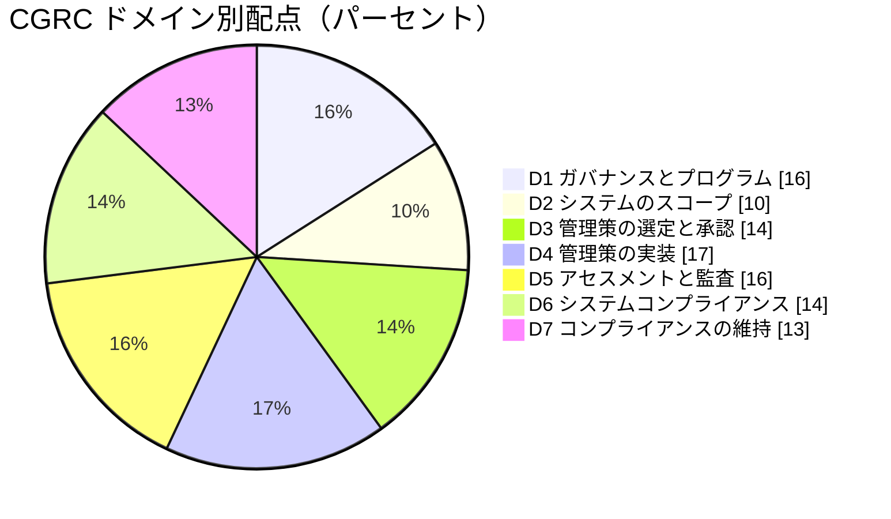

各スライスの意味：
- D4（17%）が最大で、実装と文書化が最も多く出題されます
- D1（16%）と D5（16%）が続きます。基礎概念と評価手順です
- D2（10%）は最小ですが、分類（カテゴライズ）の考え方は D3 以降の土台になります

| ドメイン | 名称（公式） | 配点 | 一言で言うと |
|---|---|---|---|
| 1 | Security and Privacy Governance, Risk Management, and Compliance Program | 16% | 土台となる考え方・枠組み・役割 |
| 2 | Scope of the System | 10% | 何を守るのか、どれくらい重要かを決める |
| 3 | Selection and Approval of Framework, Security, and Privacy Controls | 14% | どの対策を採用するかを選び、合意する |
| 4 | Implementation of Security and Privacy Controls | 17% | 対策を実際に入れて、記録する |
| 5 | Assessment/Audit of Security and Privacy Controls | 16% | 対策が効いているかを検証する |
| 6 | System Compliance | 14% | 残ったリスクを経営判断で受け入れ、許可を出す |
| 7 | Compliance Maintenance | 13% | 変更管理・継続監視・監査・廃止 |

🔗 出典: https://edge.sitecorecloud.io/internationf173-xmc4e73-prodbc0f-9660/media/Project/ISC2/Main/Media/documents/exam-outlines/CGRC-Exam_Outline-English.pdf

📖 **この節で登場した用語**
- ドメイン：試験範囲を分けた大きな区分。CGRC には 7 つある
- カテゴライズ：システムが扱う情報の重要度に応じて、システムの重要度区分を決めること

---

### 0.4 7 ドメインは「ひと続きの流れ」でできている

🧭 **なぜ流れで学ぶのか**: 7 つのドメインは、NIST のリスクマネジメントフレームワーク（RMF、NIST SP 800-37 Rev.2）の 7 ステップ（Prepare、Categorize、Select、Implement、Assess、Authorize、Monitor）と順番がほぼ対応しています。独立した話題の寄せ集めではなく、前のドメインの成果物が次のドメインの入力になります。

この図は、7 ドメインの対応関係と、維持フェーズから前の工程へ戻るループを表しています。左から右へ読み進めてください。

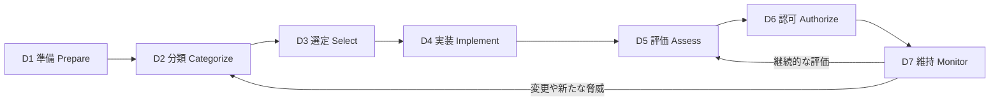

各ノードの意味：
- 「D1 準備」：組織としての方針、役割、リスク許容度を整える。システム単位の準備もここに含まれる
- 「D2 分類」：システムの範囲と、扱う情報の重要度（影響度）を決める
- 「D3 選定」：重要度に見合った対策の基準（ベースライン）を選び、調整する
- 「D4 実装」：選んだ対策を導入し、どう実装したかを文書にする
- 「D5 評価」：対策が正しく動き、狙った効果を出しているかを検証する
- 「D6 認可」：評価結果を踏まえ、責任者が「残るリスクを受け入れて運用してよい」と判断する
- 「D7 維持」：変更管理や継続的な監視を行い、必要なら分類や評価に戻る

⚠️ **注意**: この対応表は学習の補助線です。ISC2 の公式アウトラインは RMF の用語そのものではなく、ISO/IEC、FedRAMP、PCI DSS、GDPR など国際的な枠組みも並べて出題範囲を示しています（2024 年 6 月の改定で国際色が強まったと説明されています）。「RMF の用語しか知らない」状態にならないよう、第1章で他のフレームワークも押さえます。

| 公式ドメイン | RMF ステップの対応（学習用） | 主な成果物 |
|---|---|---|
| D1 | Prepare | リスク管理戦略、役割割り当て、共通管理策の特定 |
| D2 | Categorize | システム記述、分類結果、情報タイプ一覧 |
| D3 | Select | 選定した管理策、調整内容、継続監視戦略 |
| D4 | Implement | 実装記述を含む SSP、POA&M、各種ポリシーと手順書 |
| D5 | Assess | アセスメント計画（SAP）、アセスメント報告書（SAR） |
| D6 | Authorize | 認可パッケージ、認可決定通知 |
| D7 | Monitor | 変更記録、継続監視報告、更新された認可パッケージ、廃止記録 |

🔗 出典: https://csrc.nist.gov/pubs/sp/800/37/r2/final / https://csrc.nist.gov/projects/risk-management

📖 **この節で登場した用語**
- RMF：Risk Management Framework。NIST が定める、システムのリスクを管理する 7 ステップの手順
- NIST：米国国立標準技術研究所。セキュリティの標準文書（SP 800 シリーズ）を公開している
- SSP：System Security Plan。システムの概要と、各管理策をどう実装したかを書いた中心文書
- POA&M：Plan of Action and Milestones。未解決の弱点と、その解消計画・期限をまとめた表
- SAP / SAR：Security Assessment Plan（評価計画）/ Security Assessment Report（評価報告書）

---

### 0.5 学習ロードマップ

🧭 **なぜ順番を決めるのか**: ドメインの順番が処理の順番と対応しているため、D1 から D7 の順に学ぶ方が理解しやすくなります。

| 週 | 内容 | 目標 |
|---|---|---|
| 1 週目 | 第0章、第1章 | GRC の基礎概念、主要フレームワーク、役割を説明できる |
| 2 週目 | 第2章、第3章 | 情報タイプから分類を決め、ベースラインを選んで調整できる |
| 3 週目 | 第4章 | SSP、POA&M、ポリシー階層の役割を区別できる |
| 4 週目 | 第5章 | アセスメントの 3 手法と、リスク対応の 5 択を説明できる |
| 5 週目 | 第6章、第7章 | 認可決定の種類と、変更管理・継続監視の流れを説明できる |
| 6 週目 | 第8章、確認問題 | 弱点ドメインを特定し、復習する |

✅ **ベストプラクティス**
- 各ドメインを学んだら、「入力は何か、出力は何か、誰が責任を持つか」の 3 点で自分の言葉でまとめる。試験の設問は「誰が」「次に何を」を聞くことが多いためです
- 第9章の一次資料（NIST SP 800-37、800-53、800-53A、800-60、FIPS 199 など）は、全文を読むのではなく、該当タスクの章だけを該当ドメインの学習中に開く
- 自分の職場の実システムを 1 つ選び、各章の内容を当てはめて小さな SSP を書いてみる

📖 **この節で登場した用語**
- ベースライン：システムの重要度に応じて最低限導入する管理策の標準セット

---

## 第1章 Domain 1: セキュリティ／プライバシーのガバナンス・リスク管理・コンプライアンスプログラム（16%）

💡 この章では、GRC の基本概念、代表的なフレームワークと法規制、システム開発ライフサイクル、情報ライフサイクル、役割分担を説明します。第2章以降のすべての作業は、この章の考え方の上に成り立っています。

公式アウトラインの構成は次の 3 つの小項目です。

| 小項目 | 内容 | このガイドでの節 |
|---|---|---|
| 1.1 | GRC プログラムに関する知識（原則、フレームワーク、SDLC、情報ライフサイクル、CIA、資産と境界、管理策、役割） | 1.1〜1.8 |
| 1.2 | GRC プログラムのプロセス（該当フレームワーク向けのコンプライアンスプログラムの確立） | 1.9 |
| 1.3 | コンプライアンスフレームワーク、法規制、プライバシーとセキュリティ要件 | 1.10 |

---

### 1.1 ガバナンス・リスク管理・コンプライアンスの原則

🧭 **なぜ 3 つをセットで学ぶのか**: 3 つは別々の部署の仕事に見えますが、目的は共通です。「組織が目標を達成し、不確実性に対処し、誠実に行動する」ことです。バラバラに運用すると、同じ内容を何度も調べ、何度も文書を書くことになります。

🏠 **例え話（船の航海）**: 会社を 1 隻の船に例えます。
- **ガバナンス**は「どの港へ向かうか、どんな航路規則で進むか」を決める船主・取締役会の仕事です
- **リスク管理**は「嵐・暗礁・燃料切れ」を見積もり、対策を決める航海士の仕事です
- **コンプライアンス**は「国際海事規則を守っているか」を港の検査官に示す仕事です

#### 3 つの違い

| 項目 | ガバナンス | リスク管理 | コンプライアンス |
|---|---|---|---|
| 問い | 何を目指し、誰が決めるか | 何がうまくいかない可能性があるか | 決められたルールを守れているか |
| 主な成果物 | 方針、意思決定の仕組み、役割定義 | リスク登録簿、リスク対応計画 | 評価報告書、認可・認証の記録 |
| 主な担い手 | 取締役会、経営層 | リスクオーナー、CRO、システムオーナー | コンプライアンス担当、監査担当、評価者 |

#### リスクの基本用語

| 用語 | 意味 | 例 |
|---|---|---|
| 資産 | 守る価値のあるもの | 顧客データベース、基幹システム、従業員 |
| 脅威 | 資産に害を与える可能性のある事象や主体 | ランサムウェア攻撃者、地震、内部不正 |
| 脆弱性 | 脅威に付け込まれる弱点 | 未適用の修正プログラム、弱い認証 |
| 発生可能性 | 脅威が実際に脆弱性を突く確からしさ | 高、中、低 |
| 影響 | 起きたときの被害の大きさ | 業務停止、法的罰則、信用の失墜 |
| リスク | 発生可能性と影響の組み合わせ | 「未修正の VPN 装置から侵入され、顧客情報が流出する」 |
| 残存リスク | 対策を講じた後に残るリスク | 多要素認証導入後も残るフィッシングの可能性 |
| リスク許容度 | 組織が受け入れてよいと決めたリスクの範囲 | 「個人情報の漏えいは許容しない」 |

#### リスク対応の選択肢

公式アウトラインは、アセスメント結果に対するリスク対応として「回避、受容、共有、軽減、移転」を挙げています。

この図は、見つかったリスクにどの対応を選ぶかの考え方を表しています。上から下へ読み進めてください。

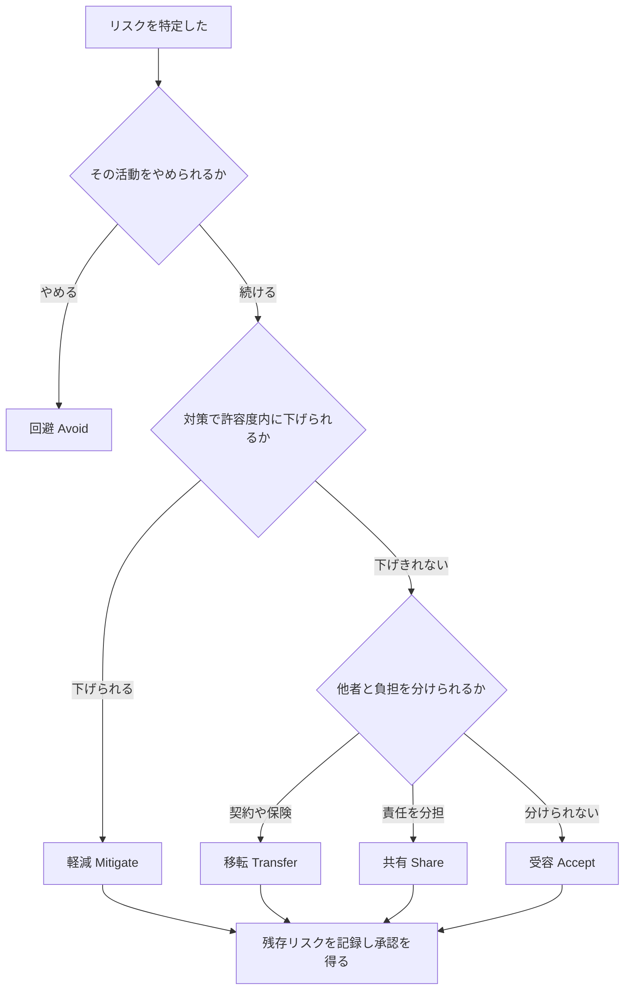

各ノードの意味：
- 「回避」：リスクの原因となる活動そのものをやめる（例：不要になった旧サービスを停止）
- 「軽減」：対策を追加して発生可能性や影響を下げる（例：多要素認証の導入）
- 「移転」：損失の負担を第三者に移す（例：サイバー保険の加入）
- 「共有」：責任や負担を複数の主体で分け合う（例：クラウド事業者との責任共有モデル）
- 「受容」：リスクを理解した上で、そのまま受け入れる。必ず権限のある人が記録して承認する
- 「残存リスクを記録し承認を得る」：どの選択肢でも、最後に残るリスクを文書にして責任者が承認する

⚠️ **注意**: 「移転」は責任そのものを移すわけではありません。保険に入っても、個人情報を預かる組織としての法的責任は残ります。試験では「責任（accountability）は移転できない」という考え方が問われやすい点です。

✅ **ベストプラクティス**
- リスク受容は「誰が・いつ・どの条件で」承認したかを必ず記録する（根拠：受容の判断は組織のリスク許容度に照らして行う必要があり、後から説明できる記録が監査で求められるため）
- リスク評価の手順は NIST SP 800-30 Rev.1（準備、実施、伝達、維持）、組織の 3 階層（組織、ミッション・業務プロセス、システム）は NIST SP 800-39 に沿って整理する

🔗 出典: https://csrc.nist.gov/pubs/sp/800/30/r1/final / https://csrc.nist.gov/pubs/sp/800/39/final

📖 **この節で登場した用語**
- ガバナンス：組織の方針と意思決定の仕組みを定め、経営が責任を持つこと
- リスク許容度：組織がどの程度のリスクなら受け入れてよいかの基準
- 残存リスク：対策を講じた後にもなお残るリスク
- リスクオーナー：特定のリスクについて、対応を決める権限と責任を持つ人
- 移転・共有：損失の負担を第三者に移す、または分け合うこと

---

### 1.2 主なフレームワークと標準

🧭 **なぜ複数を知るのか**: 組織によって採用する枠組みが異なります。米国連邦政府なら NIST RMF、国際企業なら ISO/IEC 27001 と ISO/IEC 27005、ITガバナンスなら COBIT、というように使い分けます。試験は「どの場面でどの枠組みか」を区別できるかを問います。

🏠 **例え話**: 料理の「レシピ集」が複数ある状態です。目的（ダイエット食、行事食、離乳食）によって開くレシピ集が違いますが、「材料を選び、調理し、味見する」という基本の流れは共通です。

#### 公式アウトラインが挙げる枠組み（例示）

| 枠組み | 運営・発行元 | 性格 | 認証・認可の有無 |
|---|---|---|---|
| NIST RMF（SP 800-37 Rev.2） | NIST（米国） | システム単位のリスク管理の 7 ステップ | 組織内の認可（ATO）。認証制度ではない |
| NIST SP 800-53 Rev.5 | NIST | セキュリティとプライバシーの管理策カタログ（20 ファミリ） | 制度ではなく、他制度が参照する |
| NIST CSF 2.0 | NIST | 組織のサイバーセキュリティの成果を整理するフレームワーク（Govern、Identify、Protect、Detect、Respond、Recover の 6 機能） | 認証なし。自己評価や共通言語として使う |
| COBIT 2019 | ISACA | IT ガバナンスとマネジメントのフレームワーク | 認証制度ではない |
| ISO/IEC 27001:2022 | ISO/IEC | 情報セキュリティマネジメントシステム（ISMS）の要求事項 | 第三者認証あり |
| ISO/IEC 27002:2022 | ISO/IEC | 管理策の実践規範（27001 の附属書 A の解説） | 認証対象は 27001 |
| ISO/IEC 27005 | ISO/IEC | 情報セキュリティリスクマネジメントの指針 | 認証なし |
| ISO 31000 | ISO | 組織全体のリスクマネジメントの原則と指針 | 認証なし |

⚠️ **2026 年時点の注意**
- NIST SP 800-53 は 2025 年 8 月 27 日に Release 5.2.0 が公開されました。ソフトウェア更新とパッチの信頼性（EO 14306 への対応）に関する管理策が追加され、ベースライン（SP 800-53B）に変更はありません。リビジョン番号は Rev.5 のままです
- NIST CSF 2.0 は 2024 年 2 月に公開され、「Govern（統治）」が新しい機能として加わりました
- ISO/IEC 27001:2022 は、附属書 A が 4 つのテーマ（組織的、人的、物理的、技術的）で 93 の管理策に整理されています

#### NIST RMF の位置づけ（CSF との違い）

| 比較軸 | NIST RMF | NIST CSF 2.0 |
|---|---|---|
| 単位 | 個別のシステム | 組織全体 |
| 目的 | 運用許可（認可）を得るまでの手順を定める | 組織のサイバーセキュリティ状態を整理し、改善の優先順位を付ける |
| 管理策の出所 | SP 800-53 とベースライン（800-53B） | 各機能・カテゴリに対応する参考情報（SP 800-53 を含む） |
| CGRC での扱い | 試験の骨格 | 組織レベルの枠組みとして出題範囲に含まれる |

✅ **ベストプラクティス**
- 複数のフレームワークを同時に求められる場合は、共通の管理策マッピング表を 1 つ作り、証拠を使い回す（根拠：同じ管理策を別々に評価・文書化すると工数が増え、証拠の食い違いも生じやすいため）
- 自組織が準拠すべき枠組みは、契約・法令・顧客要求の 3 方向から洗い出す

🔗 出典: https://www.nist.gov/cyberframework / https://csrc.nist.gov/pubs/sp/800/53/r5/upd1/final / https://www.iso.org/standard/27001 / https://www.isaca.org/resources/cobit / https://www.iso.org/iso-31000-risk-management.html

📖 **この節で登場した用語**
- ISMS：情報セキュリティマネジメントシステム。情報セキュリティを継続的に運用・改善する組織の仕組み
- COBIT：IT ガバナンスのための枠組み。ISACA が発行
- CSF：Cybersecurity Framework。NIST が公開しているサイバーセキュリティの枠組み
- 附属書 A：ISO/IEC 27001 に付属する管理策の一覧

---

### 1.3 システム開発ライフサイクル（SDLC）とセキュリティ

🧭 **なぜ SDLC を学ぶのか**: 後から対策を足すより、設計段階から組み込む方が費用も手間も小さくなります。RMF の各ステップは SDLC の各段階に重ねて実施します。

🏠 **例え話（家づくり）**: 家が完成してから「非常口が足りない」と気づくと大工事になります。設計図の段階で非常口を入れておけば、追加の費用はほとんどかかりません。

公式アウトラインが示す SDLC の段階は「要件定義、設計、開発、テスト、運用・保守・廃棄」です。

この図は、各 SDLC 段階で行うセキュリティ活動を表しています。左から右へ読み進めてください。

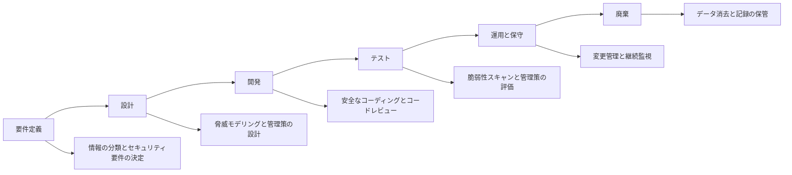

各ノードの意味：
- 横に並ぶノード（要件定義から廃棄まで）：開発の時間的な流れ
- 各段階から枝分かれするノード（A1 から F1）：その段階で実施するセキュリティ活動
- 「情報の分類とセキュリティ要件の決定」：第2章のカテゴライズに相当する
- 「データ消去と記録の保管」：第7章の廃止（デコミッション）に相当する

| SDLC 段階 | RMF の主な対応 | 実務での確認事項 |
|---|---|---|
| 要件定義 | Prepare、Categorize | 取り扱う情報、法令要件、リスク許容度が文書化されているか |
| 設計 | Select | 管理策の割り当てとアーキテクチャの整合 |
| 開発 | Implement | 構成ベースライン、安全なコーディング規約 |
| テスト | Assess | テスト結果が評価の証拠になるか |
| 運用・保守 | Authorize、Monitor | 変更の影響分析、継続監視の実施 |
| 廃棄 | Monitor（システム廃止） | 媒体の消去、記録の保管 |

✅ **ベストプラクティス**
- 開発者向けのセキュアな開発手順は NIST SP 800-218（SSDF）を参照し、RMF の Implement と Assess の証拠として使う（根拠：開発成果物の安全性を示す共通の語彙が、評価者との認識合わせを助けるため）
- アジャイル開発でも、スプリントごとにセキュリティ要件の確認項目を入れる

🔗 出典: https://csrc.nist.gov/pubs/sp/800/218/final / https://csrc.nist.gov/pubs/sp/800/37/r2/final

📖 **この節で登場した用語**
- SDLC：System Development Life Cycle。システムを企画してから廃棄するまでの全工程
- 脅威モデリング：設計段階で「誰がどう攻撃するか」を洗い出す作業
- SSDF：Secure Software Development Framework。NIST SP 800-218 が示す安全なソフトウェア開発の実践集
- デコミッション：システムを運用から外して廃止すること

---

### 1.4 情報ライフサイクルとデータの取り扱い

🧭 **なぜ情報の一生を追うのか**: 守る対象はシステムではなく情報です。情報は作られてから消されるまで、保存・利用・共有・保管と状態を変えます。段階ごとに適した守り方が違うため、一生を追って漏れを防ぎます。

公式アウトラインは、「各データタイプについて、保持、廃棄・破棄、データフロー、マーキング」を扱うことを求めています。

この図は、情報が生まれてから消えるまでの流れを表しています。左から右へ読み進めてください。

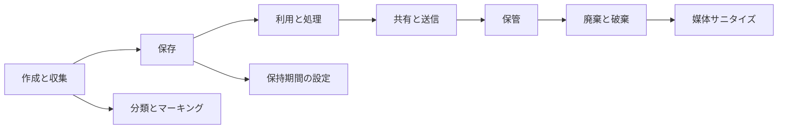

各ノードの意味：
- 「作成と収集」：情報が生まれる、または外部から受け取る段階。ここで分類とマーキング（機密区分の表示）を行う
- 「保存」「利用と処理」「共有と送信」：情報が動く段階。暗号化、アクセス制御、ログ取得が中心
- 「保管」：すぐには使わないが保持が必要な段階。保持期間を決める
- 「廃棄と破棄」：不要になった情報を復元できない状態にする。媒体サニタイズ（媒体の消去・破壊）を行う

| 用語 | 意味 | 具体例 |
|---|---|---|
| データフロー | 情報がどこからどこへ流れるか | 顧客入力画面 → API → データベース → バックアップ |
| マーキング | 情報の機密区分を表示すること | 「CUI」「社外秘」「極秘」のラベル |
| 保持 | 法令・契約・業務の要請で一定期間残すこと | 会計記録を 7 年保管 |
| 廃棄・破棄 | 期間を過ぎた情報を復元できないよう処分すること | 暗号鍵の破棄、ディスクの物理破壊 |

媒体サニタイズの代表的な 3 水準（NIST SP 800-88）：

| 水準 | 内容 | 例 |
|---|---|---|
| Clear（消去） | 通常の操作で復元できない状態にする | 論理的な上書き |
| Purge（除去） | 高度な手段でも復元できない状態にする | 暗号化消去、ファームウェアの安全消去 |
| Destroy（破壊） | 媒体そのものを使えなくする | 粉砕、焼却 |

⚠️ **注意**: SP 800-88 には後継の改訂版が出ている可能性があります。実務で採用する前に、NIST のサイトで最新版を確認してください。

✅ **ベストプラクティス**
- 情報タイプごとに、データフロー図と保持・廃棄ルールをセットで作る（根拠：流れが分かって初めて、どの地点で守るかを決められるため）
- クラウドでは、データの所在国・バックアップ・削除の証明方法を契約で確認する
- 廃棄の実施記録（日時、方法、実施者）を残す

🔗 出典: https://csrc.nist.gov/pubs/sp/800/88/r1/final / https://www.archives.gov/cui

📖 **この節で登場した用語**
- 情報ライフサイクル：情報が作られてから廃棄されるまでの一連の段階
- CUI：Controlled Unclassified Information。米国政府が保護を求める非機密の重要情報
- サニタイズ：媒体から情報を復元できないようにする処理
- 暗号化消去：暗号鍵を破棄して、保存データを読めなくする方法

---

### 1.5 機密性・完全性・可用性・否認防止・プライバシー

🧭 **なぜ基礎の 5 概念か**: 管理策の目的は、突き詰めるとこの 5 つのどれかを守ることです。設問では「この対策はどれを守るためか」を判断する場面がよく出ます。

| 概念 | 意味 | 守れなかった例 | 代表的な対策 |
|---|---|---|---|
| 機密性（Confidentiality） | 許可された人だけが情報にアクセスできる | 顧客名簿の漏えい | 暗号化、アクセス制御 |
| 完全性（Integrity） | 情報が不正に変更されていない | 取引金額の改ざん | ハッシュ、デジタル署名、変更管理 |
| 可用性（Availability） | 必要なときに使える | サービス停止 | 冗長化、バックアップ、DR |
| 否認防止（Non-repudiation） | 行為をした事実を後から否定できない | 「その注文はしていない」と主張される | デジタル署名、監査ログ |
| プライバシー | 個人情報が適切に収集・利用・保護される | 目的外利用、本人の同意なき共有 | 収集の最小化、同意管理、PIA／DPIA |

🏠 **例え話（銀行の貸金庫）**: 鍵を持つ人だけが開けられる（機密性）、中身がすり替えられない（完全性）、営業時間内に開けられる（可用性）、出し入れした記録が残る（否認防止）、預けた物が目的外に使われない（プライバシー）。

#### プライバシーの原則（GDPR 第 5 条の例）

| 原則 | 内容 |
|---|---|
| 適法性・公正性・透明性 | 法的根拠があり、本人に分かる形で処理する |
| 目的の限定 | 収集した目的の範囲でのみ使う |
| データの最小化 | 必要な範囲だけ収集する |
| 正確性 | 正確で最新に保つ |
| 保存の制限 | 必要な期間を超えて保持しない |
| 完全性と機密性 | 適切な安全管理を行う |
| アカウンタビリティ | 順守を実証できるようにする |

⚠️ **注意**: セキュリティが高くてもプライバシーが守られているとは限りません。たとえば、厳重に保護されたデータベースに、必要以上の個人情報を集めて保存していれば、データ最小化の原則に反します。

🔗 出典: https://eur-lex.europa.eu/eli/reg/2016/679/oj

📖 **この節で登場した用語**
- CIA：Confidentiality、Integrity、Availability の頭文字。セキュリティの三大目標
- 否認防止：行為者が後から「やっていない」と言えないようにすること
- PIA／DPIA：プライバシー影響評価／データ保護影響評価。個人情報の取り扱いが本人に与える影響を事前に評価する手続き
- アカウンタビリティ：説明責任。順守していることを自ら証明できる状態

---

### 1.6 システム資産と境界

🧭 **なぜ境界を定めるのか**: 「どこまでを守るか」が決まらないと、管理策の割り当ても評価の範囲も決まりません。境界が曖昧だと、評価の漏れや過剰な評価につながります。

🏠 **例え話（家の敷地）**: 門と塀で敷地を区切るから、鍵をかける場所や防犯カメラの位置を決められます。隣家との共有の塀（インターフェース）は、どちらが管理するかを取り決めます。

| 用語 | 意味 | 例 |
|---|---|---|
| 認可境界（Authorization Boundary） | 認可の判断対象となる範囲 | 本番環境の Web サーバ、DB、管理端末 |
| 資産 | 境界の内側にあるハードウェア、ソフトウェア、データ、人、施設 | サーバ、アプリ、顧客データ、運用担当者 |
| インターフェース／相互接続 | 境界の外とつながる接点 | 外部決済サービスとの API 連携 |
| 継承（インヘリタンス） | 境界の外側（共通管理策の提供者）が実施した管理策を借りること | クラウド事業者のデータセンター物理セキュリティ |

✅ **ベストプラクティス**
- 境界は、アーキテクチャ図・データフロー図・資産台帳の 3 点で説明できる状態にする（根拠：評価者が範囲を一意に理解でき、評価の抜け漏れが減るため）
- 相互接続は、接続先との合意文書（ISA、MOU など）で責任と条件を明記する
- 境界変更は変更管理の対象にして、SSP に反映する

📖 **この節で登場した用語**
- 認可境界：認可の判断が及ぶ、システムの範囲
- ISA：Interconnection Security Agreement。システム間接続のセキュリティ条件を決めた合意書
- MOU：Memorandum of Understanding。関係者間の覚書
- 継承：他者が提供する管理策を、自分のシステムの管理策として利用すること

---

### 1.7 セキュリティ・プライバシー管理策と要件

🧭 **なぜ管理策を整理するのか**: 管理策は数百あります。ファミリ（分類）と種類（誰が実施するか）を知っておくと、見たことのない管理策でも役割を推測できます。

#### NIST SP 800-53 Rev.5 の 20 ファミリ

| 略称 | ファミリ名 | 内容の例 |
|---|---|---|
| AC | アクセス制御 | 最小権限、アカウント管理 |
| AT | 意識向上と訓練 | セキュリティ教育 |
| AU | 監査とアカウンタビリティ | ログ取得・保護 |
| CA | アセスメント、認可、監視 | 評価、POA&M、継続監視 |
| CM | 構成管理 | ベースライン構成、変更管理 |
| CP | 緊急時対応計画 | バックアップ、事業継続 |
| IA | 識別と認証 | 多要素認証 |
| IR | インシデント対応 | 検知、封じ込め、報告 |
| MA | 保守 | 保守作業の管理 |
| MP | 媒体保護 | 媒体の保管・消去 |
| PE | 物理・環境保護 | 入退室管理 |
| PL | 計画 | SSP の作成、行動規範 |
| PM | プログラム管理 | 組織全体のプログラム |
| PS | 人的セキュリティ | 採用、異動、退職の管理 |
| PT | PII の処理と透明性 | 個人情報の処理目的・同意 |
| RA | リスクアセスメント | 脆弱性スキャン、リスク評価 |
| SA | システムとサービスの取得 | 開発ライフサイクル、サプライヤ管理 |
| SC | システムと通信の保護 | 暗号化、境界保護 |
| SI | システムと情報の完全性 | マルウェア対策、パッチ |
| SR | サプライチェーンリスク管理 | 調達先の管理 |

SR（サプライチェーンリスク管理）は Rev.5 で独立したファミリになりました。PT（PII の処理と透明性）も Rev.5 で新設され、プライバシーの管理策が同じカタログに統合されています。

#### 管理策の種類（公式アウトラインが挙げる例）

| 種類 | 意味 | 例 |
|---|---|---|
| 共通（Common）管理策 | 組織内の複数システムが共有する管理策 | 組織の物理セキュリティ、セキュリティ教育 |
| ハイブリッド管理策 | 一部は共通、一部はシステム固有 | 組織共通のパスワード方針と、個別システムの設定 |
| システム固有管理策 | そのシステムだけで実施する | アプリ個別のアクセス制御設定 |
| 管理的（Management）管理策 | 方針・手続・計画に関するもの | リスク評価方針 |
| 運用的（Operational）管理策 | 人が実施する日々の活動 | 入退室管理、教育 |
| 技術的（Technical）管理策 | システムの機能として実装されるもの | 暗号化、多要素認証 |

管理策の「働き方」による分類（多くの解説で使われる）：

| 働き | 意味 | 例 |
|---|---|---|
| 予防（Preventive） | 発生を防ぐ | アクセス制御、暗号化 |
| 検知（Detective） | 発生を見つける | ログ監視、IDS |
| 是正（Corrective） | 発生後に直す | パッチ適用、復旧手順 |
| 補完（Compensating） | 本来の管理策が使えないときの代替 | 古い機器でパッチが当てられないときのネットワーク分離 |

⚠️ **注意**: 管理策の「種類（誰が・どの性質）」と「働き（予防・検知・是正）」は別の切り口です。1 つの管理策が、種類としては技術的、働きとしては検知、ということがあります。

🔗 出典: https://csrc.nist.gov/pubs/sp/800/53/r5/upd1/final / https://csrc.nist.gov/pubs/sp/800/53/b/final

📖 **この節で登場した用語**
- ファミリ：SP 800-53 で、似た目的の管理策をまとめた分類
- 共通管理策：複数のシステムが共同で利用する管理策
- 補完管理策：本来の管理策を実施できないときに、同等の効果を狙って代わりに実施する管理策
- IDS：Intrusion Detection System。侵入を検知する仕組み

---

### 1.8 役割と責任

🧭 **なぜ役割を覚えるのか**: 設問では「誰が決めるか」「誰が実施するか」が頻繁に問われます。役割と責任の取り違えは、現場でも責任の空白を生みます。

🏠 **例え話（病院）**: 病院長が経営方針を決め（上級幹部）、診療科長が科の運営を担い（システムオーナー）、検査技師が検査を実施し（評価者）、最終的に退院許可を出すのは主治医（認可権限者）です。

#### RMF の主な役割

| 役割 | 略称 | 責任 |
|---|---|---|
| 認可権限者 | AO | システム運用に伴うリスクを受け入れるかを決め、認可を出す。リスクについて責任を負う |
| 認可権限者代理 | AODR | AO の委任を受けて、認可プロセスの一部を実施する（認可決定そのものは通常 AO が行う） |
| 組織全体のリスク管理の最高責任者 | SAORM | 組織全体のリスク管理について責任を持つ上級幹部 |
| リスクエグゼクティブ機能 | — | 組織全体でリスクを一貫して見る機能（委員会など） |
| 最高情報セキュリティ責任者 | CISO | 組織の情報セキュリティプログラムを統括する |
| システムオーナー | SO | システムの調達・開発・運用・保守に責任を持つ |
| 情報オーナー／スチュワード | — | 情報の分類や取扱い規則を決める（オーナー）、日々の管理を担う（スチュワード） |
| 共通管理策提供者 | CCP | 共通管理策を開発・実装・評価・監視する |
| セキュリティ／プライバシー責任者 | SISO、SAOP など | システムのセキュリティ・プライバシー要件の実施を担う（呼称は組織により異なる） |
| 管理策評価者 | — | 管理策の実装と有効性を独立した立場で評価する |

#### 外部の評価・認証にかかわる役割（例）

| 役割 | 内容 |
|---|---|
| 3PAO | Third Party Assessment Organization。FedRAMP で第三者として評価を行う評価機関 |
| C3PAO | CMMC の第三者評価機関 |
| 認証機関 | ISO/IEC 27001 の認証審査を行う機関 |
| QSA | PCI DSS で評価を行う適格セキュリティ評価者 |
| DPO | GDPR で、データ保護の助言・監督を行うデータ保護責任者 |

⚠️ **注意**: AO の責任は「リスクを受け入れること」であり、セキュリティ対策を実施することではありません。対策の実施はシステムオーナーとその配下の担当者の責任です。

✅ **ベストプラクティス**
- RACI（実行責任・説明責任・協議・報告）の表を作り、SSP に添付する（根拠：責任の空白と重複を避け、評価者が担当を確認できるため）
- 評価者は、評価対象のシステムの開発・運用から独立させる（根拠：自分の仕事を自分で評価すると、客観性を保てないため）

🔗 出典: https://csrc.nist.gov/pubs/sp/800/37/r2/final

📖 **この節で登場した用語**
- AO：Authorizing Official。システムの運用に伴うリスクを受け入れるかを決める責任者
- RACI：Responsible、Accountable、Consulted、Informed の頭文字。役割分担の整理表
- 3PAO：FedRAMP の第三者評価機関
- QSA：Qualified Security Assessor。PCI DSS の評価を行う資格を持つ評価者

---

### 1.9 コンプライアンスプログラムの確立（公式 1.2）

🧭 **なぜ「プログラム」として作るのか**: コンプライアンスは単発の作業ではなく、継続する活動です。担当者が変わっても動き続ける仕組みにするため、方針・役割・手順・記録をまとめて整えます。

RMF の Prepare ステップは、組織レベルとシステムレベルの準備に分かれ、全部で 18 のタスクがあります。

| 区分 | タスク | 内容 |
|---|---|---|
| 組織 | P-1 | リスク管理の役割の割り当て |
| 組織 | P-2 | リスク管理戦略の策定（リスク許容度を含む） |
| 組織 | P-3 | 組織レベルのリスクアセスメント |
| 組織 | P-4 | 組織で調整した管理策ベースラインと CSF プロファイル（任意） |
| 組織 | P-5 | 共通管理策の特定 |
| 組織 | P-6 | 影響度に基づく優先順位付け（任意） |
| 組織 | P-7 | 継続的監視戦略（組織レベル） |
| システム | P-8 | ミッション・業務の焦点の明確化 |
| システム | P-9 | システムの関係者の特定 |
| システム | P-10 | 資産の特定 |
| システム | P-11 | 認可境界の決定 |
| システム | P-12 | 情報タイプの特定 |
| システム | P-13 | 情報ライフサイクルの把握 |
| システム | P-14 | システムレベルのリスクアセスメント |
| システム | P-15 | 要件の定義 |
| システム | P-16 | エンタープライズアーキテクチャへの位置づけ |
| システム | P-17 | 要件の割り当て |
| システム | P-18 | システムの登録 |

この図は、新しいフレームワークに対応するコンプライアンスプログラムを立ち上げる流れを表しています。上から下へ読み進めてください。

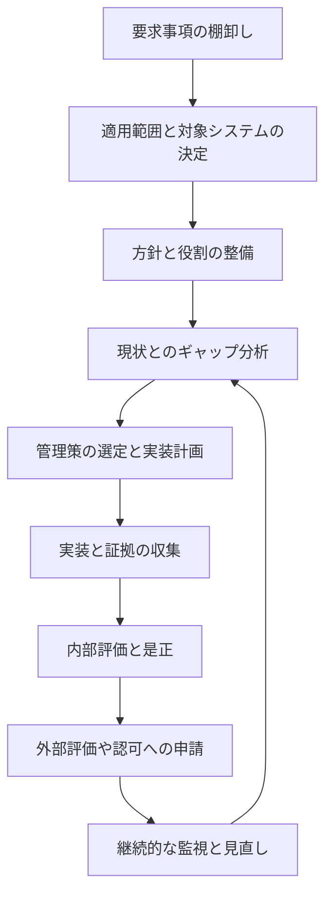

各ノードの意味：
- 「要求事項の棚卸し」：法令、契約、顧客、社内規程から、守るべきルールを洗い出す
- 「適用範囲と対象システムの決定」：どのシステム・拠点・組織がプログラムの対象かを決める
- 「方針と役割の整備」：責任者、承認フロー、報告ラインを決める
- 「現状とのギャップ分析」：要求事項と現状を比べ、足りない部分を見つける
- 「管理策の選定と実装計画」：足りない部分を埋める管理策と、期限・予算を決める
- 「内部評価と是正」：外部に出す前に、自分たちで評価して直す
- 「継続的な監視と見直し」：運用を続けながら変更に対応し、ギャップ分析に戻る

✅ **ベストプラクティス**
- 最初に経営層のスポンサー（資源と権限を保証する人）を決める（根拠：プログラムは部門横断の調整と予算を必要とするため）
- 共通管理策を先に整備し、システム側が継承できる状態にする（根拠：共通化すると、各システムの工数と評価対象が減るため）
- 内部評価を、外部評価の予行演習として運用する

🔗 出典: https://csrc.nist.gov/pubs/sp/800/37/r2/final

📖 **この節で登場した用語**
- Prepare：RMF の最初のステップ。分類や選定の前に、組織とシステムの前提を整える
- ギャップ分析：要求される状態と現状の差を洗い出す作業
- スポンサー：プログラムの目標を支持し、資源と権限を提供する経営層

---

### 1.10 コンプライアンスフレームワーク、法規制（公式 1.3）

🧭 **なぜ法規制を知るのか**: 同じ「セキュリティ対策」でも、適用される法令や契約で求められる証拠や手続が異なります。公式アウトラインは、FedRAMP、PCI DSS、CMMC、FISMA、HIPAA、GDPR、大統領令などを例として挙げています。

| 枠組み・法令 | 主な対象 | 概要 | 評価・認可の形 |
|---|---|---|---|
| FISMA（連邦情報セキュリティ近代化法） | 米国連邦機関のシステム | 連邦機関に情報セキュリティプログラムを義務づける法律。NIST の標準・ガイドラインに従う | 機関内の認可（ATO） |
| FedRAMP | 連邦機関が使うクラウドサービス | クラウドのセキュリティ評価と認可を標準化 | 第三者評価機関（3PAO）の評価と認証 |
| CMMC | 米国国防総省の契約業者 | 契約業者のサイバーセキュリティ成熟度を検証（Level 1〜3） | 自己評価、または第三者・政府による評価 |
| PCI DSS | カード情報を扱う事業者 | カード情報の保護基準（12 の要求事項） | 自己評価または QSA による評価 |
| HIPAA | 米国の医療機関・関連事業者 | 医療情報の保護（プライバシー規則、セキュリティ規則、違反通知規則） | 認証制度はなく、監督当局が執行 |
| GDPR | EU 域内の個人データを扱う組織 | 個人データ保護の包括的な規則 | 監督機関が執行。認証は任意の仕組み |
| ISO/IEC 27001 | あらゆる組織 | ISMS の国際規格 | 認証機関による第三者認証 |
| 大統領令（EO） | 米国政府 | 連邦のサイバーセキュリティ政策の方向づけ | 各機関の対応として反映 |

#### 2026 年時点で押さえておく最新動向

⚠️ **CMMC（国防総省）**: CMMC プログラムは 2025 年 11 月 10 日に Phase 1 が始まりました。ところが、国防総省は 2026 年 7 月 13 日に、2026 年 11 月 10 日に始まる予定だった Phase 2（Level 2 の第三者評価の必須化）を「追って通知があるまで」停止すると発表し、改革の検討チームを設置しました。Phase 1 の自己評価、DFARS 252.204-7012、NIST SP 800-171 の要求は引き続き有効と報じられています。複数の報道が、契約への反映は DFARS のクラス逸脱（2026-O0025、2026 年 9 月 3 日に改訂）で扱われていると伝えています。状況は変わり得るため、CMMC を扱う場面では国防総省 CIO の CMMC ページで最新状況を確認してください。

⚠️ **FedRAMP**: FedRAMP は 2026 年 6 月 25 日に「Consolidated Rules for 2026（CR26）」を最終化したと報じられています。FedRAMP 20x は、従来の Rev5 とは別の新しい認証の仕組みで、Class A（パイロット）、Class B（Low）、Class C（Moderate）の区分があります。FedRAMP 公式のマーケットプレイスは、Rev5 の認証は将来的に廃止される方向だと説明しています。

⚠️ **PCI DSS**: 現行は v4.0.1 です。v4.0 から追加された「将来日付」要求事項は、2025 年 3 月 31 日から必須になっています。

⚠️ **GDPR**: 個人データ侵害は、リスクが生じる場合に、把握から 72 時間以内に監督機関へ通知する義務があります（第 33 条）。高リスクの処理には DPIA（第 35 条）が必要です。

⚠️ **CGRC 試験との関係**: 試験は実務の細かい最新ニュースではなく、「各枠組みが何を目的とし、誰がどう評価するか」を問います。上の動向は実務の前提として理解しておけば十分です。

#### 日本の読者向けの補足（試験範囲外、実務の参考）

| 日本の制度 | 概要 | 本章の枠組みとの対応 |
|---|---|---|
| ISMS 認証（JIS Q 27001） | ISO/IEC 27001 の日本産業規格版。JIPDEC などが制度を運営 | ISO/IEC 27001 と同じ考え方 |
| ISMAP | 政府情報システム向けのクラウドサービスの登録制度 | FedRAMP に近い位置づけ |
| 個人情報保護法 | 個人情報取扱事業者の義務を定める法律 | GDPR に近い位置づけ（プライバシー） |
| 政府機関等のサイバーセキュリティ対策のための統一基準群 | 政府機関が守る共通の基準 | FISMA と NIST の関係に近い位置づけ |

✅ **ベストプラクティス**
- 適用される法令・規格は一覧にし、条文・要求事項ごとに管理策へマッピングする（根拠：どの対策がどの要求に対応するかを示せると、監査時の説明が一度で済むため）
- 規制の改正は定期的に確認し、変更があれば管理策と文書を更新する担当者を決める
- 公式情報と二次情報（ブログ、ベンダー記事）を区別し、重要な判断は公式の原文で確認する

🔗 出典:
- FedRAMP: https://www.fedramp.gov/ / https://www.fedramp.gov/docs/20x/
- CMMC: https://dodcio.defense.gov/CMMC/ / https://federalnewsnetwork.com/cybersecurity/2026/07/pentagon-suspends-cmmc-phase-two-requirements-launches-review-of-program/ / https://www.wiley.law/alert-DOD-Pauses-CMMC-2-0-Implementation-A-Big-Deal-with-Little-Immediate-Impact
- PCI DSS: https://www.pcisecuritystandards.org/
- HIPAA: https://www.hhs.gov/hipaa/index.html
- GDPR: https://eur-lex.europa.eu/eli/reg/2016/679/oj
- FISMA と NIST: https://csrc.nist.gov/projects/risk-management
- 日本（ISMS）: https://isms.jp/ / （ISMAP）https://www.ismap.go.jp/ / （個人情報保護委員会）https://www.ppc.go.jp/

📖 **この節で登場した用語**
- FISMA：米国連邦機関に情報セキュリティの確保を求める法律
- FedRAMP：連邦機関が使うクラウドサービスの共通の評価・認可制度
- CMMC：国防総省の契約業者向けサイバーセキュリティ成熟度認証
- DFARS：国防調達規則補足。国防総省の調達ルール
- PCI DSS：クレジットカード情報を守るための業界基準
- HIPAA：米国の医療情報保護法
- GDPR：EU の一般データ保護規則
- 第三者評価：評価対象と利害関係のない外部機関が行う評価

---

### 1.11 第1章のまとめと確認ポイント

| 確認項目 | 自分の言葉で説明できるか |
|---|---|
| ガバナンス・リスク管理・コンプライアンスの違い | □ |
| リスク対応 5 択（回避・受容・共有・軽減・移転）の使い分け | □ |
| RMF と CSF の違い（システム単位か、組織単位か） | □ |
| SDLC の各段階で行うセキュリティ活動 | □ |
| 情報ライフサイクルと媒体サニタイズの 3 水準 | □ |
| CIA に否認防止とプライバシーを加えた 5 概念 | □ |
| 認可境界とインヘリタンス | □ |
| 共通・ハイブリッド・システム固有管理策 | □ |
| AO・システムオーナー・評価者の責任の違い | □ |
| FedRAMP・CMMC・PCI DSS・HIPAA・GDPR の対象と評価の形 | □ |

---

## 第2章 Domain 2: システムのスコープ（10%）

💡 この章では、守る対象のシステムを正確に記述し、扱う情報の重要度から「どの水準で守るか」を決める手順を説明します。ここで決めた重要度が、第3章の管理策の選定を直接左右します。

公式アウトラインの構成は次の 2 つの小項目です。

| 小項目 | 内容 | このガイドでの節 |
|---|---|---|
| 2.1 | システムを記述する（名称・範囲、目的・機能） | 2.1 |
| 2.2 | 必要なセキュリティコンプライアンスを判断する（情報タイプ、セキュリティ目標、影響度の水準） | 2.2〜2.4 |

---

### 2.1 システムを記述する

🧭 **なぜ最初にシステムを記述するのか**: 評価者・認可権限者・開発者・運用者が同じシステムを思い浮かべられなければ、その後の選定も評価も食い違います。システム記述は、全員の共通の地図です。

🏠 **例え話（引っ越しの見積もり依頼）**: 引っ越し業者に見積もりを頼むとき、部屋数・荷物の量・エレベーターの有無を伝えます。伝え方が曖昧だと、当日に追加料金が発生します。システム記述も、後で手戻りしないための事前申告です。

公式アウトラインが求める 2 点：
- システムの名称と範囲が文書化されている
- システムの目的と機能が明確になっている

#### システム記述に含める項目（SSP の冒頭部分）

| 項目 | 内容 | 例 |
|---|---|---|
| システム名・識別子 | 一意の名称と登録番号 | 「勤怠給与システム（HR-PAY）」 |
| システムの目的 | 何のために使うか | 従業員の勤怠集計と給与計算 |
| 機能と主な利用者 | 主要機能と利用者の種類 | 従業員、人事担当者、経理担当者 |
| システムの種類 | 汎用基盤か、個別の業務アプリケーションか | 業務アプリケーション |
| 稼働環境 | オンプレミス、クラウド、ハイブリッド | クラウド（IaaS 上に構築） |
| アーキテクチャ | 構成図、データフロー図 | Web 層、アプリ層、DB 層 |
| 認可境界 | 認可の対象範囲 | 本番環境一式。開発環境は対象外 |
| 相互接続 | 外部システムとの接続 | 銀行の振込サービスとの API 連携 |
| 責任者・関係者 | システムオーナー、情報オーナーなど | 人事部長（情報オーナー）、IT 部長（システムオーナー） |
| 準拠すべき要件 | 適用される法令・契約・規格 | 個人情報保護法、社内規程 |

#### 記述の質を確認する観点

| 観点 | 確認する問い |
|---|---|
| 一意性 | 他のシステムと取り違えない名称か |
| 完全性 | 構成要素と接続先が漏れなく書かれているか |
| 一貫性 | 構成図・資産台帳・SSP の記載が一致しているか |
| 最新性 | 変更があったとき更新される運用か |

✅ **ベストプラクティス**
- システム記述は 1 ページで読める概要と、詳細な添付資料の二層構成にする（根拠：経営層と評価者では必要な粒度が違うため）
- 構成図は「論理構成図」「ネットワーク構成図」「データフロー図」の 3 種類を揃える（根拠：境界、通信経路、情報の流れはそれぞれ別の図でないと見落としやすいため）
- システム登録（組織の台帳への登録）を早めに行う。登録されていないシステムは、継続監視や共通管理策の対象から漏れる（根拠：RMF の Prepare ステップのタスク P-18 がシステム登録を求めているため）

🔗 出典: https://csrc.nist.gov/pubs/sp/800/18/r1/final / https://csrc.nist.gov/pubs/sp/800/37/r2/final

📖 **この節で登場した用語**
- スコープ：検討や評価の対象となる範囲
- データフロー図：情報がどのシステム・部品の間を流れるかを示した図
- システム登録：組織の台帳に、システムとその責任者を登録すること
- IaaS：クラウド事業者から、サーバやネットワークなどの基盤だけを借りる形態

---

### 2.2 情報タイプの特定

🧭 **なぜ情報から考えるのか**: 守るべき重要度は、システムの値段や大きさではなく、そのシステムが扱う情報で決まります。情報の種類を分けて考えると、「このデータが漏れたら何が起きるか」を具体的に議論できます。

🏠 **例え話（引き出しの仕分け）**: 机の引き出しに、鍵のかかる引き出し（実印・通帳）、普通の引き出し（文房具）を分けて入れます。引き出し全体に一律の鍵をかけるのではなく、中身の重要度で分けるのと同じ発想です。

公式アウトラインは「システムが処理・保存・送信する情報タイプ」を特定することを求めています。

| 情報タイプの例 | 内容 |
|---|---|
| 給与情報 | 給与額、控除、口座情報 |
| 勤怠記録 | 出退勤時刻、休暇 |
| 従業員の本人確認情報 | 氏名、住所、個人番号 |
| システムの運用ログ | アクセスログ、操作記録 |
| 一般向けの公開情報 | 会社案内、採用情報 |

米国政府の標準では、情報タイプの分類例と、各タイプの仮の影響度（プロビジョナル・インパクト）を NIST SP 800-60 が提供しています。民間組織でも、このような標準のカタログを参考に情報タイプを洗い出す方法が使えます。

✅ **ベストプラクティス**
- 情報タイプは、情報オーナー（データを所有する業務部門）と一緒に洗い出す（根拠：どの情報が重要かを最もよく知るのは、システム担当者より業務の責任者であるため）
- 個人情報、決済情報、医療情報など、法令が個別に守るべき対象を別枠で印を付ける
- 「処理」「保存」「送信」の 3 状態ごとに、どの情報がどこにあるかを一覧にする

🔗 出典: https://csrc.nist.gov/pubs/sp/800/60/v1/r1/final

📖 **この節で登場した用語**
- 情報タイプ：システムが扱う情報を、目的や性質で分類したもの
- 情報オーナー：特定の情報の分類や取扱い規則を決める責任者
- プロビジョナル・インパクト：標準のカタログが示す、情報タイプ別の仮の影響度

---

### 2.3 セキュリティ目標と影響度の水準

🧭 **なぜ影響度を決めるのか**: すべてを最高水準で守ると費用が膨らみ、すべてを最低水準にすると事故が起きます。影響度は、「どこにお金と手間をかけるか」を合意するための共通の物差しです。

米国連邦政府の標準 FIPS 199 は、情報タイプごとに 3 つのセキュリティ目標（機密性、完全性、可用性）それぞれの影響度を、低（Low）、中（Moderate）、高（High）で決めます。

| 影響度 | 目標が損なわれたときの影響（FIPS 199 の考え方） | 例 |
|---|---|---|
| 低（Low） | 組織の運営、資産、個人に対する限定的な悪影響 | 公開情報の誤表示 |
| 中（Moderate） | 重大な悪影響 | 給与情報の流出、業務の数日の停止 |
| 高（High） | 深刻または壊滅的な悪影響 | 大量の本人確認情報の流出、基幹業務の長期停止 |

この図は、情報タイプからシステムの影響度を決める流れを表しています。上から下へ読み進めてください。

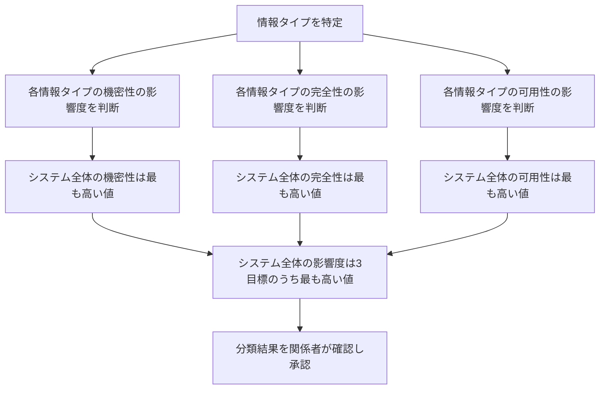

各ノードの意味：
- 「各情報タイプの○○の影響度を判断」：1 つの情報タイプについて、機密性・完全性・可用性を別々に評価する
- 「システム全体の○○は最も高い値」：複数の情報タイプのうち、最も高い影響度を採用する。これを「ハイウォーターマーク」と呼ぶ
- 「システム全体の影響度は 3 目標のうち最も高い値」：さらに 3 目標の中で最も高い値を、システムの全体水準とする
- 「分類結果を関係者が確認し承認」：システムオーナーや情報オーナーなどで確認し、承認を得る

#### 動作トレース（勤怠給与システム）

第2.1 節の「勤怠給与システム」で、実際に値を追ってみます。

| 情報タイプ | 機密性 | 完全性 | 可用性 | 判断の理由 |
|---|---|---|---|---|
| 給与情報 | 中 | 中 | 低 | 流出や改ざんは重大だが、給与計算は数日遅れても致命的でない |
| 勤怠記録 | 低 | 中 | 低 | 勤怠の漏えい影響は限定的だが、改ざんは給与に直結する |
| 従業員の本人確認情報（個人番号を含む） | 高 | 中 | 低 | 漏えい時の本人への被害が深刻 |
| **システム全体（最も高い値）** | **高** | **中** | **低** | 各列の最大値 |

システム全体の分類は「機密性：高、完全性：中、可用性：低」になります。管理策のベースラインを 1 つ選ぶ場合は、この 3 つの中で最も高い「高」を、システム全体の影響度として使います（FIPS 200 と SP 800-53B の考え方）。

⚠️ **注意**
- 「システム全体の影響度」と「目標ごとの影響度」を混同しない。分類の記録は 3 つの目標それぞれを残すこと
- 情報タイプの影響度を、実際の機器の数や、システムの利用者数だけで決めない。影響度は「損なわれたときの被害」で決める
- 最も高い値を採用するのは、複数の情報タイプが同じシステムに混在する場合です。混在によって、低い情報も高い水準で守る必要が生じるため、システムを分けて境界を小さくする設計がコスト面で有利になる場合があります

✅ **ベストプラクティス**
- 影響度の判断根拠を、1 つ 1 つ文章で残す（根拠：後から評価者や認可権限者が判断を検証できるため）
- 調整（引き上げ、引き下げ）を行った場合は、その理由を明記する
- プライバシー影響評価（PIA）を、個人情報を扱うシステムの分類と同時に実施する（根拠：個人情報の機密性だけでなく、収集の正当性や目的外利用のリスクも評価する必要があるため）

🔗 出典: https://csrc.nist.gov/pubs/fips/199/final / https://csrc.nist.gov/pubs/fips/200/final / https://csrc.nist.gov/pubs/sp/800/60/v1/r1/final

📖 **この節で登場した用語**
- FIPS 199：米国連邦政府の標準。情報と情報システムを、機密性・完全性・可用性の影響度で分類する
- ハイウォーターマーク：複数の値のうち、最も高い値を採用する方式
- 影響度：セキュリティ目標が損なわれたときの被害の大きさ（低、中、高）

---

### 2.4 フレームワークごとの「重要度」の決め方（国際的な視点）

🧭 **なぜ他の枠組みも見るのか**: 公式アウトラインは、FIPS だけでなく ISO/IEC、データ保護影響評価（DPIA）なども例に挙げています。「選んだフレームワークに基づいてリスク影響度を決める」という書き方のためです。

| 枠組み | 重要度・範囲の決め方 |
|---|---|
| NIST（FIPS 199、SP 800-60） | 情報タイプごとに C・I・A を低・中・高で分類し、最大値を採用 |
| FedRAMP | 低・中・高のいずれかのベースラインを、FIPS 199 の分類に基づいて選ぶ |
| ISO/IEC 27001 | リスクアセスメントの結果から、適用する管理策を選ぶ。附属書 A は選択肢の一覧であり、必要な管理策は組織が決める |
| PCI DSS | カード会員データ環境（CDE）の範囲を特定し、その範囲に要求事項を適用する |
| GDPR | 個人データの処理が高リスクと見込まれる場合に DPIA を実施する（第 35 条） |
| HIPAA | 電子的な保護対象保健情報（ePHI）を特定し、リスク分析を行う |

⚠️ **注意**: 「低・中・高」のラベルは NIST／FedRAMP の言葉です。ISO/IEC 27001 では、リスク評価の基準を組織が自ら決めるため、同じラベルがそのまま使われるとは限りません。

📖 **この節で登場した用語**
- CDE：Cardholder Data Environment。PCI DSS で、カード会員データを保存・処理・伝送する環境
- ePHI：電子的な保護対象保健情報。HIPAA で保護される医療情報
- DPIA：データ保護影響評価。GDPR で、高リスクの処理の前に求められる評価

---

### 2.5 第2章のまとめと確認ポイント

| 確認項目 | 自分の言葉で説明できるか |
|---|---|
| システム記述に必要な項目 | □ |
| 認可境界を決める理由 | □ |
| 情報タイプを洗い出すときに誰と相談するか | □ |
| FIPS 199 の低・中・高の意味 | □ |
| ハイウォーターマークの計算（情報タイプ → システム全体） | □ |
| 個人情報を扱うときに追加で必要なこと（PIA、DPIA） | □ |

---

## 第3章 Domain 3: フレームワーク・セキュリティ・プライバシー管理策の選定と承認（14%）

💡 この章では、第2章で決めた重要度に合った管理策のベースラインを選び、自分のシステムに合わせて調整し、関係者と合意する手順を説明します。

公式アウトラインの構成は次の 2 つの小項目です。

| 小項目 | 内容 | このガイドでの節 |
|---|---|---|
| 3.1 | ベースライン管理策と継承管理策を特定し、文書化する | 3.1 |
| 3.2 | 管理策を選定し、調整する（テイラリング） | 3.2〜3.4 |

---

### 3.1 ベースラインと継承管理策の特定

🧭 **なぜベースラインから始めるのか**: 数百ある管理策をゼロから選ぶと、選び漏れも選びすぎも起きます。重要度ごとの「標準セット」から始めれば、最低限の水準が保証され、議論は「何を足すか、何を外すか」に絞れます。

🏠 **例え話（定食と単品）**: 定食（ベースライン）を注文してから、苦手なものを外し（調整）、好みのものを足す（追加）ほうが、メニューを一から組み立てるより速く、栄養も偏りません。

#### ベースラインの出所

| 資料 | 内容 |
|---|---|
| NIST SP 800-53B | 低・中・高の 3 つのセキュリティベースラインと、プライバシーベースライン |
| FedRAMP ベースライン | クラウドサービス向けに調整された低・中・高（SP 800-53 を基にする） |
| ISO/IEC 27001 附属書 A | 選択肢の一覧（固定のベースラインではない）。適用宣言書（SoA）で採否を示す |
| PCI DSS の要求事項 | 範囲内の環境に一律に適用 |

⚠️ **注意**: SP 800-53 は Release 5.2.0 で更新されましたが、SP 800-53B のベースラインには変更がないと NIST は説明しています。

#### 継承管理策の考え方

継承とは、共通管理策の提供者（親組織、クラウド事業者など）が実施した管理策を、自分のシステムの管理策として利用することです。

| 種類 | 実施する人 | 例 |
|---|---|---|
| 共通管理策（継承） | 提供者がすべて実施 | データセンターの入退室管理（クラウド事業者） |
| ハイブリッド管理策 | 提供者と自分が分担 | 組織のパスワード方針（提供者）と個別システムの設定（自分） |
| システム固有管理策 | 自分がすべて実施 | アプリのアクセス権限の設定 |

⚠️ **注意（クラウドの責任共有）**: クラウドを使うと「全部任せられる」と誤解されがちです。実際には、事業者が担当する範囲と利用者が担当する範囲が分かれており、境界は契約形態（IaaS、PaaS、SaaS）で変わります。分担の表（顧客責任マトリクス、CRM）を必ず確認します。

✅ **ベストプラクティス**
- 継承を主張するときは、提供者の評価結果（認可書、FedRAMP の認証、第三者の監査報告書）を証拠として入手し、継承の範囲を明示する（根拠：提供者の対策が実際に実施されているかを、自分で確認できないため）
- 継承管理策も、自システムの SSP に「どの管理策を、誰から、どの範囲で継承するか」を書く
- 提供者の評価の有効期限や変更通知を、契約に盛り込む

🔗 出典: https://csrc.nist.gov/pubs/sp/800/53/b/final / https://csrc.nist.gov/pubs/sp/800/37/r2/final / https://www.fedramp.gov/

📖 **この節で登場した用語**
- セキュリティベースライン：影響度ごとに用意された、最低限導入する管理策の標準セット
- 継承管理策：他者が実施する管理策を、自分のシステムの管理策として利用するもの
- CRM：Customer Responsibility Matrix。クラウド事業者と利用者の責任分担表
- SoA：Statement of Applicability。ISO/IEC 27001 で、管理策の採否と理由を示す文書
- PaaS / SaaS：開発基盤を借りる形態 / 完成したアプリを使う形態

---

### 3.2 管理策の選定と調整（テイラリング）

🧭 **なぜ調整するのか**: 標準のベースラインは「平均的なシステム」を想定しています。自分のシステムに存在しない機能（たとえば無線 LAN）の管理策は不要ですし、特別なリスク（個人情報の大量取扱い）には追加の管理策が必要です。

公式アウトラインは、選定と調整について次の項目を挙げています。

| 項目 | 内容 |
|---|---|
| 適用されるベースラインまたは継承管理策の判断 | 3.1 で選んだものを確定する |
| 適切な管理策強化策の判断 | セキュリティ実践、オーバーレイ、緩和管理策など |
| 特定のデータ取扱い・マーキング要件の特定 | CUI など、取扱い規則がある情報への対応 |
| 管理策選定の文書化 | SSP への記録 |
| 継続的コンプライアンス戦略 | 継続的監視、脆弱性管理など |
| 管理策の割り当てと関係者の合意 | 誰がどの管理策を実施するかの合意 |

#### 調整の代表的な操作（SP 800-53 の考え方）

| 操作 | 内容 | 例 |
|---|---|---|
| 適用範囲の限定（スコーピング） | ベースラインの管理策のうち、該当しないものを除外する | 無線 LAN を使わないシステムで、無線関連の管理策を除外 |
| パラメータの設定 | 管理策の中の「組織が決める値」を決める | パスワードの最短文字数、ログの保管期間 |
| 補完管理策の導入 | 本来の管理策を実施できないとき、代わりの対策を採用する | 古い機器にパッチを当てられないため、ネットワークを分離 |
| 追加（補強）・オーバーレイ | 追加の管理策、または特定の領域向けの調整セットを重ねる | 個人情報を多く扱うシステムに、プライバシー管理策を追加 |

⚠️ **注意**: 管理策を「外す」ことは、リスクを受け入れることでもあります。外す理由と、そのリスクを誰が受け入れたかを記録します。

この図は、管理策の選定から合意までの流れを表しています。上から下へ読み進めてください。

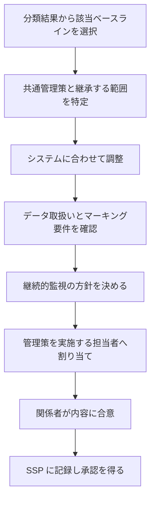

各ノードの意味：
- 「分類結果から該当ベースラインを選択」：第2章の影響度に応じた低・中・高のセットを選ぶ
- 「共通管理策と継承する範囲を特定」：自分で実施しなくてよい管理策を明確にする
- 「システムに合わせて調整」：除外、パラメータ設定、補完、追加を行う
- 「データ取扱いとマーキング要件を確認」：CUI など、特別な取扱い規則がある情報への対応を確認する
- 「継続的監視の方針を決める」：どの管理策を、どの頻度・方法で監視するかを決める
- 「管理策を実施する担当者へ割り当て」：すべての管理策に責任者を付ける
- 「関係者が内容に合意」：システムオーナー、情報オーナー、共通管理策提供者などが合意する
- 「SSP に記録し承認を得る」：選定の結果を文書にし、承認を得る

#### 継続的コンプライアンス戦略

選定のこの段階で、運用後にどう確認し続けるかも決めておきます。公式アウトラインは「継続的監視、脆弱性管理」を例に挙げています。

| 管理策の性質 | 監視の例 | 頻度の決め方 |
|---|---|---|
| 変化が速い（脆弱性、構成） | 自動スキャン、構成の逸脱検知 | 継続的、または毎日 |
| 比較的安定（ポリシー、教育） | 文書レビュー、教育の完了率 | 年次 |
| 影響が大きい（特権アクセス） | アクセス権の棚卸し | 四半期など短い間隔 |

#### 動作トレース（勤怠給与システムの続き）

第2.3 節で「高」のベースラインが選ばれた勤怠給与システムを、調整します。

| 判断 | 内容 | 理由 |
|---|---|---|
| 継承 | 物理的な入退室管理は、クラウド事業者の管理策を継承 | データセンターはクラウド事業者が管理している |
| パラメータ | 監査ログの保管期間を、社内規程に合わせて設定 | 管理策が「組織が定める期間」を求めている |
| 補完 | 古い給与計算モジュールで多要素認証が使えないため、管理端末経由のみ接続を許可 | 本来の認証強化を実装できない代替の対策 |
| 追加 | 個人番号を扱う部分に、暗号化とアクセス記録の強化を追加 | 本人確認情報の機密性が「高」であるため |
| 割り当て | 各管理策を、システムオーナー、クラウド事業者、人事部に割り当て | 担当者が決まっていない管理策をなくすため |

✅ **ベストプラクティス**
- 調整の記録は、「どの管理策を」「なぜ」「誰の承認で」変更したかの 3 点を必ず残す（根拠：監査や評価の際に、調整の妥当性を説明できる必要があるため）
- 補完管理策は、元の管理策と同等以上の効果があることを評価者に示せるようにする
- 選定の結果は、認可権限者（またはその代理）がレビューできるよう、要約を添付する（根拠：RMF の Select ステップに、計画のレビューと承認が含まれているため）
- 継続的監視の方針は、選定の段階で決め、システムの運用開始前に監視の仕組みを用意する

🔗 出典: https://csrc.nist.gov/pubs/sp/800/53/r5/upd1/final / https://csrc.nist.gov/pubs/sp/800/53/b/final / https://csrc.nist.gov/pubs/sp/800/137/final

📖 **この節で登場した用語**
- テイラリング：標準のベースラインを、自分のシステムに合わせて調整すること
- オーバーレイ：特定の領域（医療、機密情報など）向けに用意された、管理策の追加・調整のセット
- 補完管理策：本来の管理策を実施できないときの代替策
- 継続的監視（ISCM）：システムのセキュリティ状態を、運用中に継続して把握する活動
- マーキング：情報に機密区分などを表示すること

---

### 3.3 SSP に管理策をどう書くか

🧭 **なぜ書き方を学ぶのか**: 選定した管理策は、SSP に書かれて初めて評価の対象になります。書き方が曖昧だと、評価者は実装状況を確認できません。

| 悪い書き方 | 良い書き方 |
|---|---|
| 「アクセス制御を実施している」 | 「利用者は ID 管理基盤で認証され、役割ごとに必要最小限の権限が付与される。権限は四半期ごとにシステムオーナーが棚卸しする」 |
| 「ログを取得している」 | 「アプリケーション、OS、DB の認証・権限変更・データ参照のログを集中管理基盤に転送し、1 年間保管する。ログ管理者のみが閲覧できる」 |

良い書き方の要素：
- 誰が（責任者）
- 何を（具体的な手段）
- どこで（対象の範囲）
- どの頻度で
- 証拠として何が残るか

✅ **ベストプラクティス**
- 各管理策の記述に、実装状況（実装済み、一部実装、計画中、適用外、継承）を明記する（根拠：評価者が確認すべき対象を、あらかじめ絞り込めるため）
- 継承の場合は、継承元と、継承した範囲を書く
- 管理策の記述は、アーキテクチャ図の名称と一致させる

🔗 出典: https://csrc.nist.gov/pubs/sp/800/18/r1/final

⚠️ **補足**: NIST SP 800-18 の改訂版（Rev.2）は、サプライチェーンリスク管理計画を含む内容で、2025 年 6 月に初期公開ドラフトが公開されています。最終版が出たかは、NIST のサイトで確認してください。

📖 **この節で登場した用語**
- 実装状況：管理策が、実装済みか、計画中か、適用外かの区分

---

### 3.4 第3章のまとめと確認ポイント

| 確認項目 | 自分の言葉で説明できるか |
|---|---|
| ベースラインを選ぶ根拠 | □ |
| 共通・ハイブリッド・システム固有管理策の違い | □ |
| クラウドの責任共有と CRM の役割 | □ |
| テイラリングの 4 つの操作（除外、パラメータ、補完、追加） | □ |
| 管理策を外す場合に必要な記録 | □ |
| 継続的コンプライアンス戦略を選定の段階で決める理由 | □ |
| 管理策の割り当てと関係者の合意 | □ |

---

## 第4章 Domain 4: セキュリティ／プライバシー管理策の実装（17%）

💡 この章では、選んだ管理策を実際にシステムへ導入する計画の立て方、導入時の考え方、そして導入内容を文書に残す方法を説明します。配点が最も大きいドメインなので、手順と成果物の両方を押さえてください。

公式アウトラインの構成は次の 3 つの小項目です。

| 小項目 | 内容 | このガイドでの節 |
|---|---|---|
| 4.1 | 実装戦略の策定（資源、予算、スケジュール、有効性） | 4.1 |
| 4.2 | 選定した管理策の実装 | 4.2 |
| 4.3 | 管理策の実装の文書化 | 4.3〜4.5 |

---

### 4.1 実装戦略を立てる

🧭 **なぜ戦略が必要なのか**: 管理策は数が多く、すべてを同時に実装することはできません。人員、予算、期限は限られているため、順番と担当を決めずに着手すると、重要な対策が後回しになります。

🏠 **例え話（家の防災対策）**: 家具の固定、非常食の備蓄、避難経路の確認、ブレーカーの点検をすべて一度にはできません。被害が大きくなる順、費用が小さい順、すぐ着手できる順を考えて、順番を決めます。

公式アウトラインが挙げる項目：

| 項目 | 内容 |
|---|---|
| 組織の期待・国内外の要件との整合 | 実装が、組織の方針と、法令・規格の要件に沿っている |
| 管理策の種類の特定 | 管理的、技術的、共通、運用的など |
| 文書レビューと教育の頻度の設定 | ポリシーの見直しや、教育の実施の周期 |
| 資源・予算・期間・有効性 | 人、お金、時間、効果の見込み |

この図は、実装戦略を決める流れを表しています。上から下へ読み進めてください。

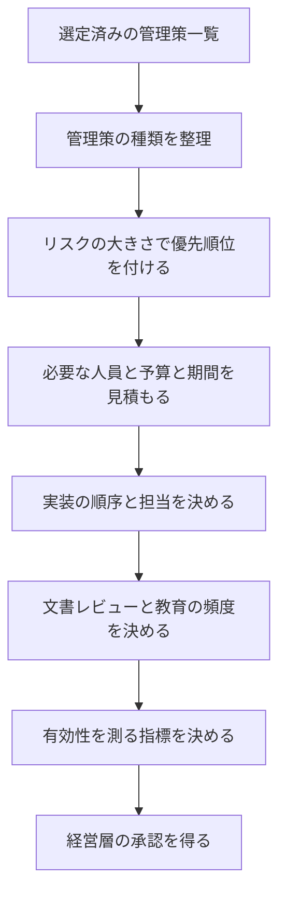

各ノードの意味：
- 「管理策の種類を整理」：管理的（方針）、運用的（人の活動）、技術的（システムの機能）、共通（組織で共有）に分ける
- 「リスクの大きさで優先順位を付ける」：被害が大きく発生しやすいリスクに対応する管理策から着手する
- 「必要な人員と予算と期間を見積もる」：担当者の工数、購入する製品、導入期間を見積もる
- 「実装の順序と担当を決める」：依存関係（先に必要なもの）を考え、責任者を割り当てる
- 「文書レビューと教育の頻度を決める」：年に何回、方針を見直し、教育を実施するかを決める
- 「有効性を測る指標を決める」：対策が効いているかを後から確認できる測り方を用意する
- 「経営層の承認を得る」：予算と資源の裏付けを得る

#### 優先順位付けの目安

| 優先 | 条件の例 | 理由 |
|---|---|---|
| 最優先 | 影響が大きく、発生可能性も高いリスクに対応する管理策 | 被害を最も減らせる |
| 早期に実施 | 費用が小さく、効果が大きい管理策（多要素認証、パッチ適用の自動化など） | 短期間で水準を上げられる |
| 計画的に実施 | 費用が大きい、または導入に時間がかかる管理策（ネットワーク再設計など） | 予算とスケジュールの調整が必要 |
| 継承で対応 | 共通管理策の提供者が実施する管理策 | 自分で実施する必要がない |

✅ **ベストプラクティス**
- 実装計画に、管理策ごとの担当者、開始日、完了日、必要な証拠を入れる（根拠：評価の段階で証拠を集めやすくなり、完了の基準も明確になるため）
- 文書のレビュー周期と教育の頻度は、法令や規格が定める最低頻度を確認した上で決める（根拠：PCI DSS や HIPAA など、枠組みによって教育の頻度が明示されている場合があるため）
- 有効性の指標（例：パッチ適用までの日数、フィッシング訓練の報告率）を最初から決める

🔗 出典: https://csrc.nist.gov/pubs/sp/800/37/r2/final / https://csrc.nist.gov/pubs/sp/800/53/r5/upd1/final

📖 **この節で登場した用語**
- 実装戦略：管理策をいつ、誰が、どの順番で、どれだけの資源で導入するかの計画
- 管理的管理策：方針や規程など、文書で定める管理策
- 運用的管理策：人が日々の業務で実施する管理策
- 技術的管理策：システムの機能として実装される管理策
- 有効性指標：対策が実際に効いているかを測るための数値

---

### 4.2 管理策を実装する

🧭 **なぜ実装の考え方を学ぶのか**: 管理策は「入れれば終わり」ではありません。要件どおりに動くか、他の機能と矛盾しないか、運用で維持できるかまで考えて実装します。

公式アウトラインが挙げる項目：
- コンプライアンス要件と整合した実装
- 補完管理策、または代替管理策の実装

#### 管理策ファミリごとの実装例

| ファミリ | 実装の例 | 確認の観点 |
|---|---|---|
| AC（アクセス制御） | 最小権限の役割設計、特権アカウントの分離 | 退職・異動時に権限が確実に削除されるか |
| IA（識別と認証） | 多要素認証、パスワード管理基盤 | 管理者アカウントを含めて適用されているか |
| AU（監査とアカウンタビリティ） | ログの集中管理、時刻同期、改ざん防止 | 誰が何をしたか、後から追えるか |
| CM（構成管理） | 構成ベースラインの定義、変更管理の自動化 | 承認なしの変更を検知できるか |
| SC（システムと通信の保護） | 通信と保存データの暗号化、境界の分離 | 暗号鍵の管理が運用されているか |
| SI（システムと情報の完全性） | 修正プログラムの適用、マルウェア対策 | 適用までの期限が決まっているか |
| CP（緊急時対応計画） | バックアップ、復旧手順、訓練 | 復旧を実際に試したことがあるか |
| IR（インシデント対応） | 対応手順、連絡体制、訓練 | 夜間・休日の連絡先が最新か |
| PS（人的セキュリティ） | 入社時の確認、退職時の手続 | 手続の完了が記録されているか |

#### 構成ベースラインの考え方

構成ベースラインとは、「承認された標準の設定」です。製品の既定値のまま運用すると、不要な機能が有効なまま残ることがあるため、承認済みの設定を基準にします。

| 参考にできる資料 | 内容 |
|---|---|
| CIS Benchmarks | 製品ごとの推奨設定集（民間団体 CIS が公開） |
| DISA STIG | 米国国防総省向けの製品別の設定基準 |
| ベンダーのセキュリティガイド | 各製品の提供元が示す推奨設定 |

#### 補完管理策を使うときの条件

| 条件 | 内容 |
|---|---|
| 理由 | 技術的、運用的な制約で、本来の管理策を実施できない |
| 同等性 | 元の管理策と同等かそれ以上の効果を目指す |
| 承認 | 責任者が承認し、評価者が確認できる形で記録する |
| 期限 | 恒久的か一時的かを明記する。一時的なら解消の期限を置く |

⚠️ **注意**: 補完管理策は「手間を省く抜け道」ではありません。本来の管理策が目指す目的（たとえば「不正なアクセスを防ぐ」）を、別の手段で満たすことを示す必要があります。

✅ **ベストプラクティス**
- 実装する前に、テスト環境で動作と副作用を確認する（根拠：本番環境で設定を誤ると、業務停止やセキュリティの穴につながるため）
- 構成管理ツールで設定をコード化し、人手による変更を減らす（根拠：同じ設定を再現でき、変更履歴も残るため）
- 実装の証拠（設定画面、構成ファイル、ログ、ポリシー）を、実装と同時に保存する
- 構成管理の手順は NIST SP 800-128 を参照する

🔗 出典: https://csrc.nist.gov/pubs/sp/800/128/final / https://www.cisecurity.org/cis-benchmarks / https://public.cyber.mil/stigs/

📖 **この節で登場した用語**
- 最小権限：業務に必要な最小限の権限だけを与える原則
- 多要素認証：パスワードに加え、別の種類の確認（スマートフォン、生体など）を組み合わせる認証
- 構成ベースライン：承認された標準の設定
- CIS Benchmarks：製品ごとの推奨設定を集めた、民間団体 CIS の資料
- STIG：米国国防総省の製品別セキュリティ設定基準

---

### 4.3 実装の文書化

🧭 **なぜ文書にするのか**: 実装した内容が文書に残っていなければ、評価者は確認できず、運用担当者が交代すると意味が失われます。「やったこと」と「まだ残っていること」の両方を記録します。

公式アウトラインが挙げる項目：

| 項目 | 内容 |
|---|---|
| 残存リスクや計画中の実装の文書化 | POA&M、リスク登録簿など |
| 組織の目的、範囲、リスクの状況に沿った管理策の文書化 | ポリシー、手順書、計画書など |

#### 文書の階層

🏠 **例え話（学校のルール）**: 校則（ポリシー：何を守るか）、生活指導の細則（標準：守る水準）、当番表（手順：誰がどう動くか）、心得集（ガイドライン：参考となる助言）。上位ほど変更が少なく、下位ほど頻繁に更新されます。

| 階層 | 目的 | 変更頻度 | 例 |
|---|---|---|---|
| ポリシー（方針） | 何を達成するか、経営の意思 | 低（年次など） | 情報セキュリティ基本方針 |
| 標準（基準） | 守るべき最低水準 | 中 | パスワード基準、暗号化基準 |
| 手順 | 具体的な実施方法 | 高 | ユーザーアカウント作成手順 |
| ガイドライン | 推奨や助言（強制ではない） | 随時 | セキュアコーディングの推奨集 |

この図は、文書の階層と、証拠・記録との関係を表しています。上から下へ読み進めてください。

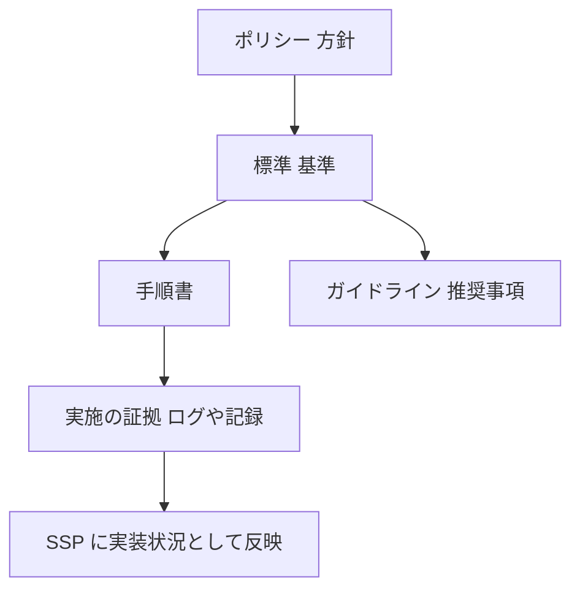

各ノードの意味：
- 「ポリシー 方針」：経営が決める最上位の方針
- 「標準 基準」：方針を満たすための具体的な水準
- 「手順書」：標準を実際に実施するための手順
- 「実施の証拠 ログや記録」：手順を実施した結果として残る記録（承認記録、ログなど）
- 「ガイドライン 推奨事項」：強制ではない助言
- 「SSP に実装状況として反映」：すべてを SSP に集約し、評価者が参照できるようにする

---

### 4.4 POA&M とリスク登録簿

🧭 **なぜ 2 種類の記録があるのか**: POA&M は「今ある弱点を、いつまでに、誰が直すか」の実行管理表です。リスク登録簿は「組織が把握しているリスク全体の台帳」です。目的と範囲が違います。

| 比較軸 | POA&M | リスク登録簿 |
|---|---|---|
| 主な目的 | 管理策の不備や脆弱性の是正計画の管理 | リスク全体の把握、評価、対応の管理 |
| 範囲 | 特定システムの未解決の弱点 | 組織全体、またはプログラム全体のリスク |
| 主な利用者 | システムオーナー、評価者、認可権限者 | 経営層、リスク管理部門 |
| 更新のきっかけ | 評価で見つかった弱点、新たな脆弱性、是正の完了 | リスクの変化、新たな脅威、対応の進捗 |

#### POA&M に最低限書く項目

| 項目 | 内容 | 例 |
|---|---|---|
| 弱点の識別子と内容 | 何が問題か | 「管理者アカウントの多要素認証が未導入」 |
| 関連する管理策 | どの管理策の不備か | IA ファミリ（識別と認証） |
| リスクの評価 | 重大度 | 高 |
| 責任者 | 是正を担当する人 | システムオーナー |
| 必要な資源 | 予算、人員 | 認証基盤のライセンス費用 |
| 計画した是正の内容とマイルストーン | 何をいつまでに | 設計：11 月末、導入：1 月末 |
| 予定完了日 | 最終期限 | 2027 年 1 月 31 日 |
| 状況 | 未着手、進行中、完了、期限超過 | 進行中 |
| 暫定対応（あれば） | 是正までのつなぎの対策 | 管理端末のアクセス元を限定 |

#### リスク登録簿に最低限書く項目

| 項目 | 内容 |
|---|---|
| リスクの識別子と説明 | 何が、どうなる可能性があるか |
| リスクオーナー | 対応の権限と責任を持つ人 |
| 発生可能性・影響・総合評価 | 評価の根拠 |
| リスク対応方針 | 回避、軽減、移転、共有、受容のいずれか |
| 対応状況・残存リスク | 実施状況と、対応後に残るリスク |
| 見直しの期限 | 次に再評価する時期 |

✅ **ベストプラクティス**
- POA&M の期限が過ぎた項目は、延長の理由と承認者を記録する（根拠：期限超過のまま放置されると、リスクが管理下にないと見なされるため）
- 重大度が高い項目には、是正が完了するまでの暫定対応を併記する
- POA&M とリスク登録簿は相互に参照できるようにして、同じ問題を二重管理しない

🔗 出典: https://csrc.nist.gov/pubs/sp/800/37/r2/final / https://www.fedramp.gov/

📖 **この節で登場した用語**
- POA&M：未解決の弱点と、その是正計画・期限をまとめた表
- リスク登録簿：識別されたリスクと、その評価・対応状況を記録した台帳
- 暫定対応：根本的な是正が終わるまでの、つなぎの対策
- マイルストーン：計画の途中経過を確認する節目

---

### 4.5 第4章のまとめと確認ポイント

| 成果物 | 内容 | 作る時期 |
|---|---|---|
| 実装計画 | 管理策の優先順位、担当、予算、期間 | 実装の前 |
| SSP | システムの概要と、管理策の実装状況 | 実装中に更新 |
| ポリシー、標準、手順、ガイドライン | 管理策の根拠となる文書の階層 | 実装前〜実装中 |
| POA&M | 未解決の弱点の是正計画 | 実装中、評価後に更新 |
| リスク登録簿 | リスクの台帳 | 常時更新 |

| 確認項目 | 自分の言葉で説明できるか |
|---|---|
| 実装の優先順位の付け方 | □ |
| 補完管理策を認めてよい条件 | □ |
| ポリシー・標準・手順・ガイドラインの違い | □ |
| POA&M とリスク登録簿の違い | □ |
| 文書レビューと教育の頻度を戦略に含める理由 | □ |

---

## 第5章 Domain 5: 管理策のアセスメント／監査（16%）

💡 この章では、実装した管理策が正しく動き、狙った効果を出しているかを検証する流れを説明します。準備、実施、報告、リスク対応の計画まで、6 つの小項目を順に見ていきます。

公式アウトラインの構成は次の 6 つの小項目です。

| 小項目 | 内容 | このガイドでの節 |
|---|---|---|
| 5.1 | アセスメント／監査の準備 | 5.1 |
| 5.2 | アセスメント／監査の実施 | 5.2 |
| 5.3 | 初回の報告書の作成 | 5.3 |
| 5.4 | 初回報告書のレビューとリスク対応の計画 | 5.4 |
| 5.5 | 最終報告書の作成 | 5.5 |
| 5.6 | リスク対応計画の作成 | 5.6 |

この図は、5 つのステップの全体の流れを表しています。上から下へ読み進めてください。

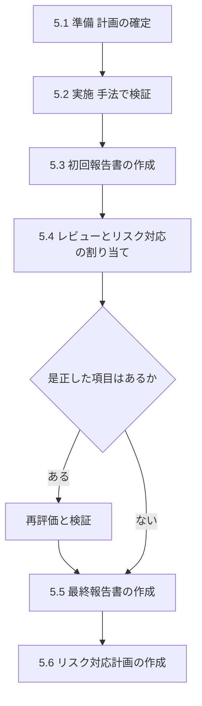

各ノードの意味：
- 「5.1 準備 計画の確定」：評価の目的、範囲、役割、日程を決め、評価計画を確定する
- 「5.2 実施 手法で検証」：インタビュー、確認（文書・設定）、テストで、管理策を検証する
- 「5.3 初回報告書の作成」：見つかったリスクと、暫定の所見をまとめる
- 「5.4 レビューとリスク対応の割り当て」：関係者と内容を確認し、各リスクの対応方針を決める
- 「是正した項目はあるか」（ひし形）：評価の期間中に是正が行われたかを確認する
- 「再評価と検証」：是正された項目を、もう一度評価して、直ったことを確認する
- 「5.5 最終報告書の作成」：最終的な適合・不適合の判定を文書にする
- 「5.6 リスク対応計画の作成」：残ったリスクの優先順位と、必要な資源を整理する

---

### 5.1 アセスメント／監査の準備

🧭 **なぜ準備に時間をかけるのか**: 準備が不十分だと、評価の途中で範囲の食い違い、担当者の不在、証拠の不足が発生します。評価の質は、準備でほぼ決まります。

🏠 **例え話（車検の予約）**: 車検では、受ける車、日程、検査項目、必要書類（車検証、整備記録）を事前に確認します。当日に書類がないと、検査が進みません。

公式アウトラインが挙げる項目：

| 項目 | 内容 |
|---|---|
| 関係者の役割と責任の確立 | 評価者、システムオーナー、窓口、承認者を決める |
| 目的、範囲、資源、日程、成果物、ロジスティクスの整理 | 何を、いつ、誰が、どこで、何を出すか |
| 資産、手法、工数の見積もり | どの資産を、どの手法で、どれくらいの工数で評価するか |
| 遵守の証拠の確認 | 過去の評価・監査結果、システム文書、ポリシーなど |
| 評価／監査計画の確定 | 計画書を合意して承認する |

#### アセスメントと監査の違い

| 比較軸 | アセスメント（評価） | 監査（Audit） |
|---|---|---|
| 主な目的 | 管理策の有効性を確認し、改善に役立てる | 基準への適合を、独立した立場で確認・証明する |
| 立場 | 内部・外部のいずれもあり得る | 独立性が重視される（内部監査、外部監査） |
| 成果 | 所見と改善の推奨 | 適合・不適合の判定と、証拠に基づく報告 |

⚠️ **注意**: 公式アウトラインは「Assessment/Audit」と併記しています。試験では、この 2 つを厳密に区別するよりも、「計画、証拠、手法、報告」の共通の流れを理解しているかが問われます。

#### 評価者の選定

| 観点 | 確認する内容 |
|---|---|
| 独立性 | 評価対象の開発・運用から独立しているか（利害の衝突がないか） |
| 専門性 | 対象の技術と枠組み（NIST、ISO、PCI など）を理解しているか |
| 権限 | 必要な情報とシステムへアクセスできる権限が与えられているか |

✅ **ベストプラクティス**
- 評価計画に、範囲の除外項目と、その理由を明記する（根拠：後から「なぜ評価していないのか」と問われたときに説明できるため）
- 評価に必要な証拠のリスト（依頼リスト）を事前に配布する
- 評価の実施中に連絡を取る窓口を、双方で決めておく

🔗 出典: https://csrc.nist.gov/pubs/sp/800/53/a/r5/final / https://csrc.nist.gov/pubs/sp/800/37/r2/final

📖 **この節で登場した用語**
- アセスメント：管理策が正しく実装され、狙いどおりに働いているかの評価
- 監査：基準への適合を、独立した立場で確認すること
- 依頼リスト：評価者が事前に求める、文書や証拠の一覧
- 独立性：評価対象に利害関係がなく、客観的に判断できる状態

---

### 5.2 アセスメント／監査の実施

🧭 **なぜ 3 つの手法を使い分けるのか**: 文書を読むだけでは「書いてあるだけ」の可能性があり、実際の設定を見るだけでは「運用の実態」が分かりません。複数の手法を組み合わせると、実態を多面的に確認できます。

SP 800-53A が示す評価の 3 手法（公式アウトラインも「インタビュー、確認、テスト」を挙げています）：

| 手法 | 内容 | 対象の例 | 確認できること |
|---|---|---|---|
| 確認（Examine） | 文書、設定、記録を調べる | ポリシー、SSP、構成ファイル、ログ、承認記録 | 方針や設計が文書として存在するか、記録が残っているか |
| インタビュー（Interview） | 担当者に質問する | システム管理者、人事担当、開発者 | 担当者が手順を理解し、実際に行っているか |
| テスト（Test） | 実際に動かして確認する | 脆弱性スキャン、ペネトレーションテスト、設定のテスト | 管理策が期待どおりに働くか |

🏠 **例え話（レストランの衛生検査）**: 衛生管理マニュアルを読み（確認）、調理スタッフに手洗いの手順を聞き（インタビュー）、実際に調理場で手洗いと温度管理を観察する（テスト）。3 つが一致して初めて「衛生管理ができている」と判断できます。

#### 評価対象となる 4 種類（SP 800-53A）

| 対象 | 内容 |
|---|---|
| 仕様（Specifications） | ポリシー、計画書、設計書など |
| 仕組み（Mechanisms） | ハードウェア、ソフトウェア、ファームウェアの機能 |
| 活動（Activities） | 人が行う手順（バックアップ、ログのレビューなど） |
| 個人（Individuals） | 役割を担う人 |

#### 証拠の検証

公式アウトラインは「証拠が検証され、妥当性が確認される」ことを求めています。

| 確認の観点 | 問い |
|---|---|
| 真正性 | その証拠は本物か。誰がいつ作成したか |
| 最新性 | 評価の対象期間に作られたものか |
| 十分性 | 結論を支えるのに十分な量と範囲か |
| 関連性 | 評価している管理策と関係があるか |

#### 動作トレース（評価の実施例）

第3章の勤怠給与システムで、管理策 IA（識別と認証）の「管理者の多要素認証」を評価します。

| 手順 | 手法 | 内容 | 結果 |
|---|---|---|---|
| 1 | 確認 | 認証ポリシーと構成を確認 | 「管理者には多要素認証を必須とする」と記載あり |
| 2 | インタビュー | システム管理者に運用を聞く | 「古い給与計算モジュールは例外的に管理端末のみで接続」と説明 |
| 3 | テスト | 管理者アカウントでのログインを試行 | 新しい基盤は多要素認証が必須。古いモジュールは管理端末からのみ接続でき、補完管理策が機能している |
| 4 | 判定 | 補完管理策の承認記録を確認 | 承認記録あり。判定：適合（補完管理策による）。所見として期限付きの是正を推奨 |

⚠️ **注意**: 評価者は、評価の過程で見つけた事実を、そのまま記録します。判定を甘くしたり、現場の都合に合わせて変更したりしてはいけません。

✅ **ベストプラクティス**
- 評価の際は、スクリーンショット、構成ファイル、ログなどを、取得日時と取得者とあわせて保存する（根拠：後から証拠の真正性を示せるため）
- 脆弱性スキャンやペネトレーションテストは、事前に範囲と日時を合意して実施する（根拠：本番環境への影響や、意図しない業務停止を避けるため）
- 1 つの管理策に複数の手法を組み合わせる

🔗 出典: https://csrc.nist.gov/pubs/sp/800/53/a/r5/final

📖 **この節で登場した用語**
- Examine / Interview / Test：確認、インタビュー、テスト。SP 800-53A の 3 つの評価手法
- ペネトレーションテスト：許可を得て、実際の攻撃手法を使って弱点を探すテスト
- 脆弱性スキャン：ツールで、既知の弱点が残っていないかを自動で調べる作業
- 証拠：評価の判断を裏づける文書、設定、記録、観察結果

---

### 5.3 初回のアセスメント／監査報告書

🧭 **なぜ「初回」と「最終」に分けるのか**: 初回の報告書で関係者に内容を確認してもらい、事実の誤りや、評価中に是正された項目を反映してから、最終版を確定します。いきなり最終版にすると、誤解や事実誤認が確定してしまいます。

公式アウトラインが挙げる項目：

| 項目 | 内容 |
|---|---|
| 評価中に特定したリスクの提示 | 見つかった弱点とそのリスク |
| リスク緩和の概要 | どう下げられるかの概要 |
| 暫定の所見の記録 | まだ確定ではない評価結果 |

#### 所見の書き方

| 要素 | 内容 | 例 |
|---|---|---|
| 該当する管理策 | どの管理策についての所見か | IA ファミリの管理者認証 |
| 判定 | 適合／不適合／適用外 | 不適合 |
| 事実 | 何を確認し、何が分かったか | 管理者 3 名のうち 1 名が多要素認証を未設定 |
| 原因 | なぜそうなったか | 設定を強制していなかった |
| リスク | どんな影響が起きうるか | 管理者アカウントが乗っ取られる可能性 |
| 重大度 | 高・中・低 | 高 |
| 推奨 | 是正案 | 設定の強制、未設定者の解消 |

---

### 5.4 初回報告書のレビューとリスク対応の計画

🧭 **なぜ関係者でレビューするのか**: リスクへの対応は、評価者ではなく、システムオーナーやリスクオーナーが責任を持って決めます。評価者は事実と推奨を示し、対応方針は組織が決めます。

公式アウトラインが挙げる項目：

| 項目 | 内容 |
|---|---|
| 識別された脆弱性・不備に基づき、リスク対応を割り当てる | 回避、受容、共有、軽減、移転のいずれか |
| 関係者と協議し、リスク対応を決める | 当事者の合意 |
| 是正した不適合項目の再評価・検証 | 直したことを確認する |

この図は、報告書のレビューから再評価までの流れを表しています。上から下へ読み進めてください。

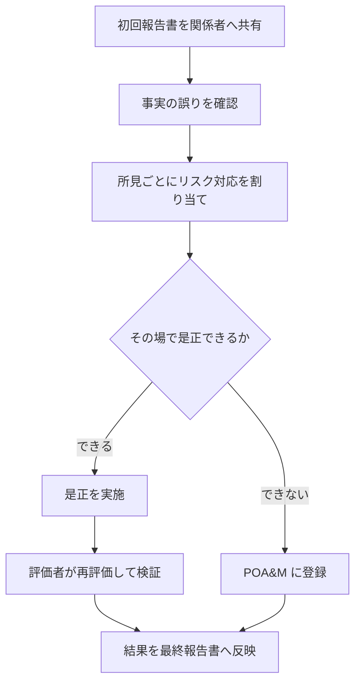

各ノードの意味：
- 「事実の誤りを確認」：評価者の理解に誤りがないか、システムオーナーが確認する
- 「所見ごとにリスク対応を割り当て」：各所見に、回避・受容・共有・軽減・移転のいずれかを決める
- 「その場で是正できるか」（ひし形）：評価の期間中に修正できる内容かを判断する
- 「評価者が再評価して検証」：修正が正しく行われたかを、評価者が独立して確認する
- 「POA&M に登録」：すぐに直せないものは、期限付きの是正計画として管理する

⚠️ **注意**: 「是正した」という担当者の申告だけでは、不適合を「適合」に変えてはいけません。評価者が再評価し、検証した結果を記録します。

---

### 5.5 最終のアセスメント／監査報告書

🧭 **なぜ最終報告書が重要なのか**: 最終報告書は、第6章の認可権限者が判断する際の中心資料（SAR）になります。ここでの判定が曖昧だと、認可の判断も曖昧になります。

公式アウトラインが挙げる項目：

| 項目 | 内容 |
|---|---|
| 最終的な適合状況の文書化 | 適合（compliant）、不適合（non-compliant）、適用外（not applicable） |
| 推奨事項の文書化（適切な場合） | 是正や改善の推奨 |
| 報告書の確定 | 最終版の承認と発行 |

| 判定 | 意味 | 例 |
|---|---|---|
| 適合 | 管理策の要求を満たしている | 全ユーザーに多要素認証が適用されている |
| 不適合 | 要求を満たしていない | 一部のユーザーが多要素認証を未設定 |
| 適用外 | システムの特性上、その管理策が該当しない | 無線 LAN を使わないシステムの無線 LAN 管理策 |

✅ **ベストプラクティス**
- 適用外とした管理策は、その理由と、SSP との整合を確認する（根拠：SSP で「適用」と書かれているのに評価で「適用外」とすると、整合が取れなくなるため）
- 報告書には、評価範囲、手法、期間、評価者の氏名と役割を明記する
- 経営層向けの要約と、技術者向けの詳細を分けて書く

---

### 5.6 リスク対応計画の作成

🧭 **なぜ計画にまとめるのか**: 見つかったリスクをすべて同時に直すことはできません。優先順位、必要な資源、期間を整理して、実行可能な計画にします。

公式アウトラインが挙げる項目：

| 項目 | 内容 |
|---|---|
| 残存リスクと不備の特定 | 対応後も残るリスクと、未解決の不備 |
| リスクの優先順位付け | 影響と発生可能性で並べる |
| 必要な資源の特定 | 予算、人員、技術と、緩和に必要な期間 |

| リスク | 重大度 | 対応 | 担当 | 必要資源 | 期限 |
|---|---|---|---|---|---|
| 管理者の多要素認証の未設定 | 高 | 軽減（設定の強制） | システムオーナー | 作業工数のみ | 2 週間 |
| 旧給与モジュールの認証強化不可 | 中 | 軽減（置き換え計画） | IT 部長 | 開発予算 | 6 か月 |
| ログの保管期間が方針より短い | 低 | 軽減（容量の追加） | 運用チーム | ストレージ費用 | 1 か月 |

✅ **ベストプラクティス**
- リスク対応計画は、POA&M と整合させる（根拠：同じ弱点が別の表に別の期限で書かれていると、実行管理が崩れるため）
- 高リスクで即時に直せないものには、暫定対応を併記する
- 受容するリスクは、権限のある人（認可権限者など）が承認する

🔗 出典: https://csrc.nist.gov/pubs/sp/800/53/a/r5/final / https://csrc.nist.gov/pubs/sp/800/37/r2/final

📖 **この節で登場した用語**
- SAR：Security Assessment Report。評価の結果をまとめた報告書
- 適合／不適合／適用外：評価の判定の 3 区分
- 再評価：是正された項目を、評価者がもう一度確認すること
- リスク対応計画：残ったリスクを、優先順位・資源・期限とあわせて整理した計画

---

### 5.7 第5章のまとめと確認ポイント

| 確認項目 | 自分の言葉で説明できるか |
|---|---|
| アセスメントの準備で決めること | □ |
| 確認・インタビュー・テストの違いと使い分け | □ |
| 証拠の検証で見る 4 つの観点 | □ |
| 初回報告書と最終報告書を分ける理由 | □ |
| リスク対応 5 択を割り当てる人 | □ |
| 是正した不適合項目を再評価する理由 | □ |
| 適合・不適合・適用外の区別 | □ |

---

## 第6章 Domain 6: システムコンプライアンス（14%）

💡 この章では、評価の結果と残ったリスクを踏まえて、責任者が「システムを運用してよい」と判断し、その結果を関係者へ正式に通知するまでの流れを説明します。

公式アウトラインの構成は次の 3 つの小項目です。

| 小項目 | 内容 | このガイドでの節 |
|---|---|---|
| 6.1 | セキュリティ／プライバシー文書のレビューと提出 | 6.1 |
| 6.2 | システムのリスク状況の判断 | 6.2 |
| 6.3 | システムコンプライアンスの文書化 | 6.3 |

この図は、第6章の全体の流れを表しています。上から下へ読み進めてください。

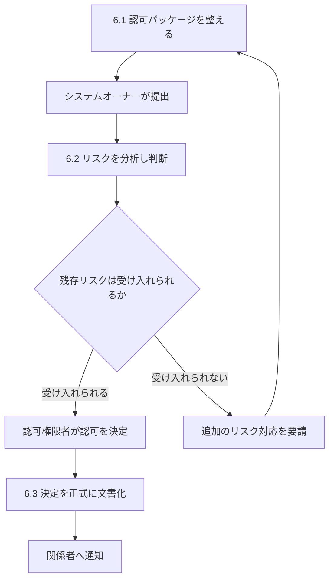

各ノードの意味：
- 「認可パッケージを整える」：SSP、評価報告書、POA&M などを揃えて、内容を確認する
- 「システムオーナーが提出」：パッケージを、認可権限者などの決定者へ提出する
- 「リスクを分析し判断」：残存リスクが、組織のリスク許容度の範囲内かを検討する
- 「残存リスクは受け入れられるか」（ひし形）：許容できるかを判断する分岐
- 「追加のリスク対応を要請」：受け入れられない場合は、是正を求めて第4・5章に戻る
- 「認可権限者が認可を決定」：リスクを受け入れて運用を許可する、または許可しない
- 「決定を正式に文書化」「関係者へ通知」：決定内容と条件を記録し、関係者へ共有する

---

### 6.1 セキュリティ／プライバシー文書のレビューと提出

🧭 **なぜパッケージを整えるのか**: 認可権限者は技術の専門家とは限りません。判断に必要な情報を、漏れなく、読みやすくまとめた「判断材料のセット」を渡さなければ、適切な判断ができません。

🏠 **例え話（融資の審査）**: 銀行に融資を申し込むとき、事業計画書、決算書、返済計画をまとめて提出します。書類が欠けていたり、数字が食い違ったりすると、審査は進みません。

公式アウトラインは、「決定権者（認可権限者、第三者評価機関、規制当局など）が決定を下すために必要なセキュリティ・プライバシー文書を、収集し、レビューし、提出する」ことを求めています。

#### 認可パッケージの中身（RMF の場合）

| 文書 | 内容 | 主な作成者 |
|---|---|---|
| SSP | システムの概要と、管理策の実装状況 | システムオーナー、セキュリティ担当 |
| SAR（評価報告書） | 評価の結果と所見 | 管理策評価者 |
| POA&M | 未解決の弱点と是正計画 | システムオーナー |
| 実行要約（エグゼクティブサマリー） | 認可権限者向けの、リスクの要点の要約 | セキュリティ担当 |

#### 枠組みごとの「判断材料」の例

| 枠組み | 提出する材料の例 | 判断する主体 |
|---|---|---|
| NIST RMF | SSP、SAR、POA&M | 認可権限者 |
| FedRAMP | 評価機関（3PAO）の評価を含むセキュリティパッケージ | 機関、FedRAMP のプログラム |
| ISO/IEC 27001 | 適用宣言書、リスク評価の記録、内部監査の結果 | 認証機関 |
| PCI DSS | 評価結果（コンプライアンスの報告書、自己評価の質問書など） | 評価を求める取引先・ブランド |
| CMMC | 評価結果の登録、年次の確認の提出 | 国防総省、評価機関 |

⚠️ **注意**: 枠組みにより、「誰が最終判断をするか」が違います。RMF では組織内の認可権限者が決めますが、ISO/IEC 27001 では独立した認証機関が決めます。試験では、判断主体の取り違えに注意してください。

✅ **ベストプラクティス**
- パッケージの提出前に、文書間の整合（SSP、SAR、POA&M の内容が一致しているか）を確認する（根拠：食い違いがあると、認可権限者の信頼を損ない、手戻りが発生するため）
- 認可権限者向けに、1〜2 ページの要約を付ける
- 提出日、版数、承認者を記録する

🔗 出典: https://csrc.nist.gov/pubs/sp/800/37/r2/final / https://www.fedramp.gov/ / https://www.iso.org/standard/27001

📖 **この節で登場した用語**
- 認可パッケージ：認可の判断に必要な文書一式（SSP、SAR、POA&M など）
- 実行要約：決定者が短時間で全体を把握できるようにまとめた要約
- 認証機関：ISO/IEC 27001 などで、組織が基準に適合しているかを審査・認証する独立した機関

---

### 6.2 システムのリスク状況を判断する

🧭 **なぜ「ゼロリスク」を目指さないのか**: 現実のシステムには、必ず残存リスクがあります。ゼロにするには無限の費用がかかるため、「許容できる範囲か」を、責任者が判断します。

公式アウトラインが挙げる項目：

| 項目 | 内容 |
|---|---|
| システムのリスク受容基準 | どこまでなら受け入れてよいかの基準 |
| 残存リスクの判定 | 対策後に残るリスクの大きさ |
| リスク処理の選択肢への関係者の合意 | 受容、軽減などについての合意 |
| 残存リスクの正式な文書化 | 決定の根拠を記録する |

#### 認可決定の種類（SP 800-37 Rev.2）

| 種類 | 意味 |
|---|---|
| 運用許可（Authorization to Operate） | 残存リスクが許容できると判断し、運用を許可する。実施すべき条件（期限付きの是正など）を付けられる |
| 使用許可（Authorization to Use） | 他機関が認可したシステムやサービスを、自分の組織が使うことを許可する |
| 共通管理策の認可 | 共通管理策を、他のシステムが継承することを認める |
| 認可拒否（Denial of Authorization） | リスクが許容できないとして、運用を認めない |

⚠️ **注意**: 認可権限者の責任は、評価者の指摘をすべて直させることではありません。残るリスクを理解した上で、組織を代表して受け入れるかどうかを決めることです。

#### 動作トレース（勤怠給与システムの認可）

| 手順 | 内容 |
|---|---|
| 1 | システムオーナーが、SSP、SAR、POA&M を認可権限者へ提出する |
| 2 | 認可権限者は、SAR の「不適合 3 件」と、POA&M の是正計画を確認する |
| 3 | 重大度「高」の 1 件（管理者の多要素認証の未設定）は、2 週間の期限と暫定対応（アクセス元の限定）が示されている |
| 4 | 認可権限者は、組織のリスク許容度に照らして、残存リスクを受け入れられると判断する |
| 5 | 決定：「運用許可。ただし、高リスク 1 件は 2 週間以内に是正し、完了を報告すること」という条件を付ける |

✅ **ベストプラクティス**
- 認可の決定は、リスク許容度と照らして判断した根拠を、文書に書く（根拠：後から説明責任を果たせるため）
- 条件付きの運用許可には、期限と報告の方法を具体的に書く
- システムオーナー、情報オーナー、リスクオーナーなどの関係者に、決定の前に、残存リスクの説明を行う

🔗 出典: https://csrc.nist.gov/pubs/sp/800/37/r2/final / https://csrc.nist.gov/pubs/sp/800/39/final

📖 **この節で登場した用語**
- リスク受容基準：どのリスクなら受け入れてよいかの判断基準
- 残存リスク判定：対策を講じた後に、リスクがどれだけ残るかの見積もり
- 運用許可（ATO）：システムを運用してよいという、認可権限者の正式な許可
- 使用許可（ATU）：他者が認可したシステムを、自分の組織が使うことの許可
- 認可拒否：リスクが許容できず、運用を認めない決定

---

### 6.3 システムコンプライアンスの文書化

🧭 **なぜ正式に通知するのか**: 決定が口頭やメールで曖昧に共有されると、運用担当者は「認可されたのか、条件付きなのか」を判断できません。正式な通知は、運用の根拠となります。

公式アウトラインが挙げる項目：

| 項目 | 内容 |
|---|---|
| コンプライアンス決定の正式な通知 | 決定を文書にして発行する |
| 関係者への通知の共有 | システムオーナー、情報オーナー、共通管理策提供者などへ共有する |

#### 認可決定文書に入れる要素

| 要素 | 内容 |
|---|---|
| 決定の種類 | 運用許可、使用許可、共通管理策の認可、認可拒否 |
| 条件（ある場合） | 期限付きの是正、運用上の制約 |
| 有効期間 | 認可の終了日、または継続的な認可への移行 |
| 決定者・日付 | 認可権限者の署名・日付 |
| 根拠の概要 | リスク受容の判断理由 |
| 配布先 | 通知する関係者 |

継続的な認可（Ongoing Authorization）は、有効期限を固定せず、継続的監視の結果に基づいて、認可の状態を維持・見直す方式です。第7章の継続的監視とつながります。

✅ **ベストプラクティス**
- 認可の決定文書は、SSP などの文書とあわせて、改ざんを防げる形で保管する
- 条件付きの認可は、期限を管理表に載せ、期限前に確認する
- 認可の状況を、組織の台帳（システム登録）に反映する

🔗 出典: https://csrc.nist.gov/pubs/sp/800/37/r2/final / https://csrc.nist.gov/pubs/sp/800/137/final

📖 **この節で登場した用語**
- 継続的な認可：有効期限を固定せず、継続的監視の結果に基づいて認可の状態を維持する方式
- 認可決定文書：認可の種類、条件、有効期間を記載した正式な文書

---

### 6.4 第6章のまとめと確認ポイント

| 確認項目 | 自分の言葉で説明できるか |
|---|---|
| 認可パッケージの 3 つの中心文書 | □ |
| 認可権限者が負う責任（リスクの受容）と、負わない責任（対策の実施） | □ |
| 運用許可、使用許可、認可拒否の違い | □ |
| 残存リスクを許容できるかを判断する基準 | □ |
| 正式な通知に含める要素 | □ |
| 枠組みごとの最終判断主体の違い（RMF、ISO、PCI など） | □ |

---

## 第7章 Domain 7: コンプライアンスの維持（13%）

💡 この章では、認可を得た後に、システムの変更を管理し、継続的にリスクを監視し、監査に対応し、最後にシステムを安全に廃止するまでの流れを説明します。

公式アウトラインの構成は次の 4 つの小項目です。

| 小項目 | 内容 | このガイドでの節 |
|---|---|---|
| 7.1 | システムの変更管理 | 7.1 |
| 7.2 | 要件に基づく継続的なコンプライアンス活動 | 7.2〜7.3 |
| 7.3 | 監査活動への対応 | 7.4 |
| 7.4 | システムの廃止（該当する場合） | 7.5 |

---

### 7.1 システムの変更管理

🧭 **なぜ変更を管理するのか**: 認可は「ある時点のシステムの状態」に対する判断です。システムが変わると、前提が崩れます。小さな変更でも、リスクや要件への影響を見ないまま行うと、認可の根拠が失われます。

🏠 **例え話（家の増改築）**: 建築確認を受けた家で、壁を壊して部屋を広げれば、構造の安全性が変わります。届け出と再確認をせずに工事すると、安全が保証されません。

公式アウトラインが挙げる項目：

| 項目 | 内容 |
|---|---|
| 組織のリスク、運用、コンプライアンス要件への影響を検討 | ベースラインの改訂など |
| 変更の文書化と、権限のある担当者による承認 | 変更管理委員会（CCB）、技術レビュー委員会など |
| ロールバック計画を伴う環境への展開 | テスト、開発、本番など |
| 変更の追跡とコンプライアンスの確保 | 実施状況を記録し、要件との整合を維持する |

この図は、変更要求から展開、記録までの流れを表しています。上から下へ読み進めてください。

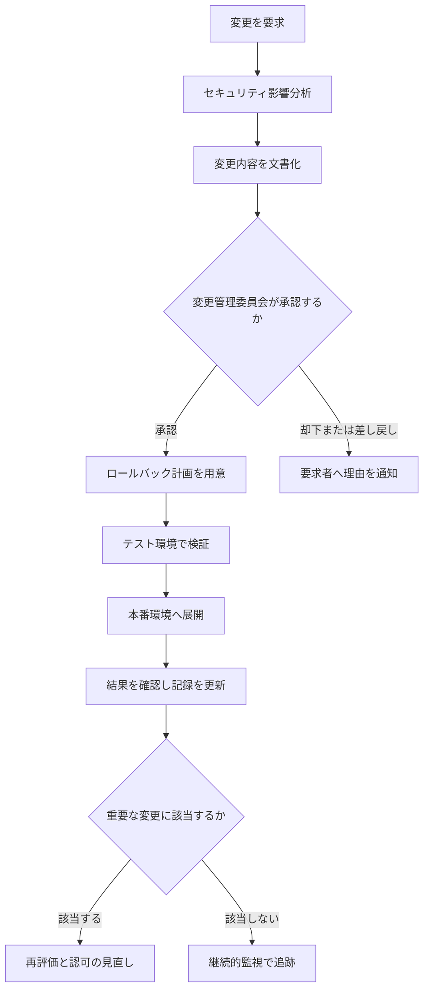

各ノードの意味：
- 「セキュリティ影響分析」：変更が、セキュリティやプライバシーのリスクに与える影響を分析する
- 「変更管理委員会が承認するか」（ひし形）：変更管理委員会（CCB）が、承認するかを判断する
- 「ロールバック計画を用意」：問題が起きたときに、元の状態へ戻す手順を事前に用意する
- 「テスト環境で検証」：本番に出す前に、動作と副作用を確認する
- 「結果を確認し記録を更新」：展開後の動作を確認し、SSP、構成記録を更新する
- 「重要な変更に該当するか」（ひし形）：組織の基準で、認可に影響する大きな変更かを判断する
- 「再評価と認可の見直し」：大きな変更の場合は、該当する範囲を再評価し、認可権限者が見直す

#### 重要な変更（再認可を検討する変更）の例

| 変更の例 | 理由 |
|---|---|
| 新しいクラウドサービスへの移行 | 責任分担や境界が変わる |
| 認証方式の変更 | アクセス制御の中核が変わる |
| 新しい外部システムとの接続 | 認可境界と相互接続が変わる |
| 取り扱う情報の種類の追加 | 第2章の分類の前提が変わる |

何を重要な変更とするかの基準は、組織が事前に決めて、文書化しておきます。

✅ **ベストプラクティス**
- すべての変更に、セキュリティ影響分析の記録を残す（根拠：軽微に見える変更が、後から問題の原因と分かる例が多いため）
- 緊急変更の手順（事後の承認を含む）も、あらかじめ定める
- 変更の記録と、構成管理のデータベースを連動させる

🔗 出典: https://csrc.nist.gov/pubs/sp/800/128/final / https://csrc.nist.gov/pubs/sp/800/37/r2/final

📖 **この節で登場した用語**
- 変更管理：システムの変更を、影響の分析、承認、記録を通じて管理する活動
- CCB：Change Control Board。変更を承認する委員会
- セキュリティ影響分析：変更がセキュリティに与える影響の事前分析
- ロールバック：変更を元の状態に戻すこと
- 重要な変更：認可に影響し、再評価や認可の見直しを検討する大きな変更

---

### 7.2 継続的なコンプライアンス活動

🧭 **なぜ継続が必要なのか**: 脅威、脆弱性、人員、取引先、法令はつねに変わります。認可を取った日のリスク状況が、1 年後も同じとは限りません。

🏠 **例え話（健康診断と日々の体調管理）**: 年に 1 回の健康診断（定期評価）だけでなく、体重・血圧の毎日の記録（継続的監視）があれば、異変に早く気づけます。

公式アウトラインが挙げる活動：

| 活動 | 内容 |
|---|---|
| 確認頻度の設定 | 関係者と、継続活動のレビュー頻度を決める |
| システムと資産の監視 | 物理・論理の資産、人員、変更管理を監視する |
| インシデント対応と緊急時対応 | 手順に基づいて実施する |
| セキュリティ更新とリスクの是正・追跡 | 修正プログラムの適用、リスクの管理 |
| 証拠収集、テスト、文書更新、関係者への提出 | SLA、第三者契約、ポリシー、手順なども更新する |
| 意識向上と訓練 | 実施し、記録し、保管する |
| 監視戦略の見直し | 法令、規制、サプライヤ、セキュリティ、プライバシーの要件の変化に応じる |

この図は、継続的監視の 1 サイクルを表しています。上から下へ読み進めてください。

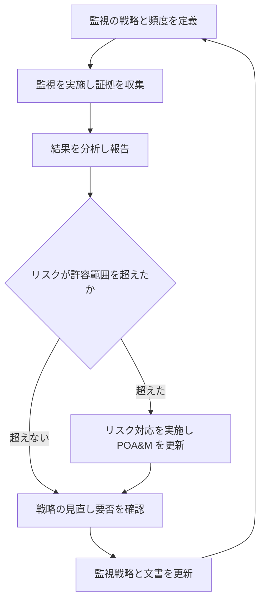

各ノードの意味：
- 「監視の戦略と頻度を定義」：何を、どの頻度・方法で監視するかを決める（第3章で決めた戦略）
- 「監視を実施し証拠を収集」：スキャン、ログ、設定確認などで証拠を集める
- 「結果を分析し報告」：結果を分析して、経営層や認可権限者へ報告する
- 「リスクが許容範囲を超えたか」（ひし形）：許容範囲を超えるリスクが見つかったかを判断する
- 「リスク対応を実施し POA&M を更新」：是正し、計画と記録を更新する
- 「戦略の見直し要否を確認」「監視戦略と文書を更新」：法令や取引先の変化に合わせて、監視の戦略自体を見直す

#### 継続的監視の対象と頻度の例

| 対象 | 例 | 頻度の例 |
|---|---|---|
| 脆弱性 | スキャン、修正プログラムの適用状況 | 継続的、または週次〜月次 |
| 構成 | ベースラインからの逸脱の検知 | 継続的 |
| アクセス権 | 特権アカウントの棚卸し | 四半期 |
| ログ | 異常なアクセスの検知 | 継続的 |
| 人員 | 入社・異動・退職の手続の確認 | 都度、年次で点検 |
| 外部委託先 | SLA の達成状況、第三者監査報告書の確認 | 年次 |
| 教育 | 受講の完了率、記録の保管 | 年次 |

---

### 7.3 インシデント対応と緊急時対応

🧭 **なぜ事前に備えるのか**: 事故が起きてから手順を考えると、判断が遅れ、被害が広がります。事前に手順と連絡網を決め、訓練しておくことが、被害を小さくする最善の方法です。

#### インシデント対応

NIST SP 800-61 は、インシデント対応の標準的な指針です。2025 年に公開された Rev.3 は、NIST CSF 2.0 の機能（Govern、Identify、Protect、Detect、Respond、Recover）に沿った構成とされています。旧来の説明では「準備、検知と分析、封じ込め・根絶・復旧、事後対応」の 4 段階が使われるため、試験の設問でもこの考え方が出る場合があります。最新版の構成は、NIST のサイトで確認してください。

| 段階（旧来の整理） | 内容 | 例 |
|---|---|---|
| 準備 | 体制、手順、ツール、訓練を整える | 連絡網、対応手順書、訓練 |
| 検知と分析 | 異常を見つけ、重大度を判断する | ログ監視、アラートの分析 |
| 封じ込め・根絶・復旧 | 被害の拡大を止め、原因を取り除き、元に戻す | 感染端末の隔離、復旧 |
| 事後対応 | 教訓を整理し、再発を防ぐ | 事後レビュー、手順の改訂 |

#### 緊急時対応（事業継続・復旧）

NIST SP 800-34 は、情報システムの緊急時対応計画の指針です。

| 用語 | 意味 | 例 |
|---|---|---|
| BIA | 業務への影響度分析。業務停止の影響を、時間軸で評価する | 給与計算が 3 日止まると何が起きるか |
| MTD | 許容される最大停止時間 | 5 日 |
| RTO | システムを復旧させる目標時間 | 2 日 |
| RPO | どの時点のデータまで戻せればよいかの目標 | 前日のバックアップ時点 |

計画の確認方法（テストの種類）：

| 種類 | 内容 |
|---|---|
| 机上演習 | 関係者が集まり、シナリオに沿って手順を口頭で確認する |
| 機能テスト | 一部の機能（バックアップからの復元など）を実際に試す |
| 全体演習 | 切り替えを含め、実際の運用に近い形で通しで行う |

⚠️ **注意**: RTO は MTD より短く設定します（MTD を超えると、業務への影響が許容を超えるため）。試験では「どの値がどの値より小さいか」が問われることがあります。

✅ **ベストプラクティス**
- インシデント対応と緊急時対応の訓練は、実施の記録（日時、参加者、結果、改善点）を残す（根拠：公式アウトラインが、教育・訓練の実施、記録、保管を求めているため）
- 訓練で見つかった課題は、POA&M や改善計画に登録する
- 外部の取引先との連絡先と、連絡の責任者も、手順に含める

🔗 出典: https://csrc.nist.gov/pubs/sp/800/61/r3/final / https://csrc.nist.gov/pubs/sp/800/34/r1/upd1/final

📖 **この節で登場した用語**
- インシデント：セキュリティ上の事故や、その疑いのある事象
- BIA：Business Impact Analysis。業務停止の影響を分析する手法
- MTD：Maximum Tolerable Downtime。許容される最大停止時間
- RTO：Recovery Time Objective。復旧の目標時間
- RPO：Recovery Point Objective。データをどの時点まで戻せればよいかの目標
- 机上演習：集まって、シナリオに沿って手順を確認する演習

---

### 7.4 監査活動への対応（公式 7.3）

🧭 **なぜ監査に備えるのか**: 監査は、年に 1 回の特別な行事ではなく、日々の運用の記録が正しいかを確認される場です。日常の記録が整っていれば、監査は確認の場にとどまります。

公式アウトラインが挙げる項目：

| 項目 | 内容 |
|---|---|
| 必要なテストと脆弱性スキャンの実施 | 監査要件に基づくテスト |
| 担当者へのインタビュー | 手順の理解と実施の確認 |
| 文書のレビューと更新 | 監査で見つかった差異を反映する |

#### 監査への備え

| 項目 | 内容 |
|---|---|
| 証拠の整備 | ログ、承認記録、設定、訓練の記録を、すぐ出せる状態にする |
| 担当者の準備 | インタビューを受ける担当者が、自分の担当手順を説明できる |
| 窓口の設定 | 監査人との連絡窓口を決める |
| 指摘への対応 | 所見を POA&M に登録し、是正を追跡する |

✅ **ベストプラクティス**
- 証拠は、監査のときにかき集めるのではなく、日常の運用で自動的に集まる仕組み（ログの保管、チケット管理）にする（根拠：直前に集めると、漏れや不整合が増えるため）
- 監査後に、指摘事項と是正の進捗を、経営層へ定期的に報告する

📖 **この節で登場した用語**
- 監査人：基準に照らして、組織の活動や記録を確認する人
- 所見：評価や監査で見つかった事実と、その評価
- チケット管理：作業の依頼と進捗を、記録として残す仕組み

---

### 7.5 システムの廃止（デコミッション）

🧭 **なぜ廃止にも手順があるのか**: システムを止めても、中のデータや認証情報、外部との接続が残ると、情報漏えいや不正アクセスの原因になります。安全に終わらせることも、ライフサイクルの一部です。

🏠 **例え話（賃貸の退去）**: 荷物を運び出して終わりではありません。私物のデータを消し、鍵を返し、公共料金を止め、原状回復の確認を受けます。

公式アウトラインが挙げる項目：

| 項目 | 内容 |
|---|---|
| 廃止の要件を関係者と確認 | データの保管、移行、法令の要件 |
| システムを運用から外し、廃止 | 停止、接続の切断、削除 |
| 廃止したシステムの文書を保管し、関係者へ共有 | 記録の保存 |

この図は、システムを廃止する手順を表しています。上から下へ読み進めてください。

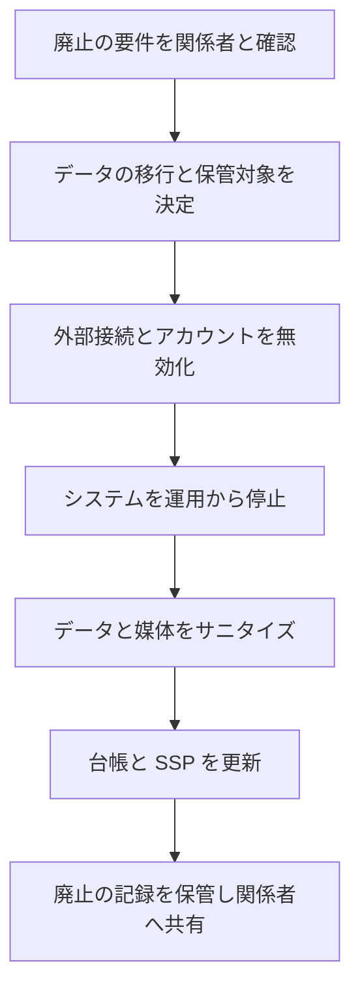

各ノードの意味：
- 「廃止の要件を関係者と確認」：保管期間、法令、他システムへの影響などを確認する
- 「データの移行と保管対象を決定」：残すデータ、移すデータ、消すデータを分ける
- 「外部接続とアカウントを無効化」：相互接続を切り、すべてのアカウントと鍵を無効にする
- 「システムを運用から停止」：本番環境から外す
- 「データと媒体をサニタイズ」：復元できない状態にする（第1章 1.4 節）
- 「台帳と SSP を更新」：システム登録を「廃止」に更新し、依存する他のシステムの文書にも反映する
- 「廃止の記録を保管し関係者へ共有」：廃止した日、方法、実施者、サニタイズの証拠を残す

✅ **ベストプラクティス**
- 廃止の前に、このシステムを継承している共通管理策や、接続している他システムを洗い出す（根拠：依存関係を見落とすと、他のシステムの管理策が突然失われるため）
- サニタイズの記録は、廃止後も法令・契約で定められた期間、保管する
- クラウドでは、事業者によるデータ削除の証明を契約で確認する

🔗 出典: https://csrc.nist.gov/pubs/sp/800/37/r2/final / https://csrc.nist.gov/pubs/sp/800/88/r1/final

📖 **この節で登場した用語**
- デコミッション：システムを運用から外して、安全に廃止すること
- 依存関係：あるシステムが、別のシステムの機能や管理策に頼っている関係

---

### 7.6 第7章のまとめと確認ポイント

| 確認項目 | 自分の言葉で説明できるか |
|---|---|
| 変更管理の流れ（影響分析、承認、ロールバック、記録） | □ |
| 重要な変更と、再認可を検討する理由 | □ |
| 継続的監視の 1 サイクル | □ |
| インシデント対応の 4 段階（旧来の整理） | □ |
| BIA、MTD、RTO、RPO の関係 | □ |
| 監査に備える日常の運用 | □ |
| システム廃止時にやること（データ、接続、記録） | □ |

---

## 第8章 試験対策（考え方・落とし穴・確認問題）

💡 この章では、ここまでの知識を試験の設問に結び付ける考え方と、間違えやすい点、確認問題を用意しました。知識の確認だけでなく、「設問をどう読むか」の練習として使ってください。

---

### 8.1 設問の読み方（ISC2 の問題でよく使われる視点）

🧭 **なぜ読み方を学ぶのか**: CGRC の設問は、用語の定義を問うだけでなく、状況を示して「最初にすること」「最も適切な対応」を問う形が多くなります。知識が同じでも、読み方で正答率が変わります。

| 視点 | 内容 |
|---|---|
| 管理者の視点で考える | 技術的な設定を自分で行う立場ではなく、リスクを判断し、方針に沿って進める立場で答える |
| リスクベースで考える | 「すべて直す」ではなく、リスクの大きさと組織の許容度に基づいて判断する |
| 手順の順番を意識する | 「最初に」「次に」と問われたら、第0章 0.4 節の流れ（準備→分類→選定→実装→評価→認可→維持）のどこにいるかを確認する |
| 責任の所在を意識する | 「誰が決めるか」（認可権限者）と「誰が実施するか」（システムオーナー、担当者）を区別する |
| 文書化と承認を重視する | 判断や変更は、記録と権限のある人の承認があって初めて有効になる |
| 独立性を重視する | 評価は、評価対象から独立した立場の人が行う |

#### 設問を解くときの手順

この図は、状況設問を解く思考の手順を表しています。上から下へ読み進めてください。

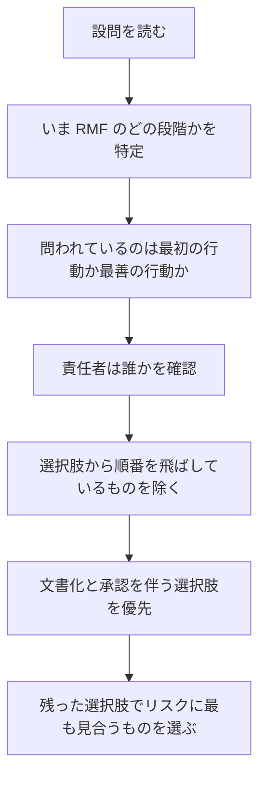

各ノードの意味：
- 「いま RMF のどの段階かを特定」：設問の状況が、準備、分類、選定、実装、評価、認可、維持のどれかを見極める
- 「問われているのは最初の行動か最善の行動か」：「first」「best」「most」といった語に注意する
- 「責任者は誰かを確認」：認可権限者、システムオーナー、評価者など、判断する主体を意識する
- 「選択肢から順番を飛ばしているものを除く」：たとえば、分類をしていないのに実装に進む選択肢は誤りになりやすい
- 「文書化と承認を伴う選択肢を優先」：記録と承認がある選択肢の方が、プロセスとして適切になる

---

### 8.2 間違えやすいポイント

| よくある思い違い | 正しい理解 |
|---|---|
| リスクは保険や外部委託で責任ごと移せる | 損失の負担は移せても、組織の説明責任は残る |
| 認可権限者はセキュリティ対策を実施する人 | 認可権限者はリスクを受け入れるかを決める人。実施はシステムオーナーなどが担う |
| ベースラインは変更できない | システムに合わせて調整（テイラリング）してよい。ただし、理由と承認を記録する |
| 継承した管理策は評価しなくてよい | 継承元の評価結果を確認し、継承の範囲を文書化する。自システムの責任がなくなるわけではない |
| 評価で見つかった不備を担当者が直したと言えば適合になる | 評価者が再評価して検証してから、判定を変える |
| 認可を取ればそれで終わり | 変更管理と継続的監視で状態を維持する。重要な変更では認可を見直す |
| FIPS 199 の影響度は、システムの規模で決まる | 情報が損なわれたときの被害の大きさで決まる |
| ISO/IEC 27001 の附属書 A は必ず全部実施する | リスク評価に基づいて選び、適用宣言書で採否と理由を示す |
| RTO は MTD より長くてよい | RTO は MTD より短く設定する |
| 補完管理策があれば、本来の管理策の目的は問われない | 補完管理策も、本来の管理策の目的を満たす必要がある |

---

### 8.3 キーワードの対応表（短時間の復習用）

| 場面 | キーワード |
|---|---|
| 重要度を決める | FIPS 199、情報タイプ、ハイウォーターマーク |
| 管理策を選ぶ | SP 800-53B、ベースライン、テイラリング、継承、オーバーレイ |
| 実装を記録する | SSP、POA&M、リスク登録簿、構成ベースライン |
| 評価する | SP 800-53A、確認・インタビュー・テスト、SAP、SAR |
| 認可する | 認可権限者、認可パッケージ、運用許可、条件付き |
| 維持する | 変更管理委員会、セキュリティ影響分析、継続的監視、BIA、RTO、RPO |
| 廃止する | サニタイズ、台帳更新、記録保管 |

---

### 8.4 確認問題（10 問）

学んだ内容の確認用です。まず選択肢を隠して考え、あとで解答と解説を確認してください。

**問 1.** システムを新しく運用開始する計画があります。管理策のベースラインを選ぶ前に、最初に行うべきことはどれですか。

- A. 脆弱性スキャンの実施
- B. 扱う情報の種類を特定し、システムの影響度を決める
- C. 認可権限者への認可パッケージの提出
- D. 管理策の実装

**問 2.** ある情報システムが、機密性が「低」の情報、完全性が「中」の情報、可用性が「高」の情報を扱います。ハイウォーターマークの考え方に基づく、システム全体の影響度はどれですか。

- A. 低
- B. 中
- C. 高
- D. 平均して「中」

**問 3.** 認可権限者の役割として、最も適切なものはどれですか。

- A. すべての管理策を自ら実装する
- B. 残存リスクを理解した上で、運用に伴うリスクを受け入れるかを決める
- C. 評価者として、管理策をテストする
- D. 変更管理委員会に代わって、日々の変更を承認する

**問 4.** 評価者は、管理策の実装を確認するために、設定ファイルの確認、担当者への質問、実際のテストを組み合わせています。この 3 つの手法の名称の組み合わせとして正しいものはどれですか。

- A. 計画、実施、報告
- B. 確認（Examine）、インタビュー（Interview）、テスト（Test）
- C. 予防、検知、是正
- D. 回避、軽減、移転

**問 5.** 評価の途中で、システムオーナーが「指摘された不備はすでに修正した」と報告しました。評価者が取るべき対応として、最も適切なものはどれですか。

- A. 報告を信頼して、判定を「適合」に変更する
- B. 修正した項目を再評価し、直ったことを検証してから判定を更新する
- C. 不備のまま、最終報告書に記載する
- D. 評価をやり直さず、POA&M から削除する

**問 6.** クラウド事業者が提供するデータセンターの物理的な入退室管理について、自社システムの SSP に書く方法として、最も適切なものはどれですか。

- A. 自社が実施していると書く
- B. 書かない
- C. クラウド事業者から継承している管理策として、継承元と範囲、確認した証拠を書く
- D. 評価の対象外なので、記載は不要

**問 7.** システムで重要な変更（新しい外部システムとの接続）を行う予定です。最も適切な手順の順序はどれですか。

- A. 本番へ展開 → 影響分析 → 承認
- B. セキュリティ影響分析 → 文書化 → 変更管理委員会による承認 → ロールバック計画 → テスト → 本番展開 → 記録の更新
- C. 承認 → 本番展開 → 影響分析
- D. テスト → 本番展開 → 承認

**問 8.** 業務継続の目標として、許容される最大停止時間（MTD）が 5 日と定められています。復旧時間の目標（RTO）の設定として、最も適切なものはどれですか。

- A. 7 日
- B. 5 日を超える任意の値
- C. 2 日
- D. RTO と MTD は無関係

**問 9.** ある組織が、リスク評価の結果、特定の古い機能のリスクが高いと判断し、その機能の提供を停止することにしました。この対応は、リスク対応のどれに当たりますか。

- A. 受容
- B. 回避
- C. 移転
- D. 共有

**問 10.** システムを廃止する際、最も適切な行動の組み合わせはどれですか。

- A. 電源を切って、機器を廃棄する
- B. 保管・移行の要件を関係者と確認し、接続とアカウントを無効化し、データをサニタイズし、台帳と文書を更新して記録を保管する
- C. データはそのまま残して、サーバのみ撤去する
- D. 担当者にのみ口頭で伝える

---

### 8.5 解答と解説

| 問 | 解答 | 解説 |
|---|---|---|
| 1 | B | 影響度は、ベースラインを選ぶ前提です。第2章の流れ（システム記述 → 情報タイプ → 影響度）を先に行います |
| 2 | C | 3 つの目標のうち最も高い値（可用性の「高」）を、システム全体の影響度とします（FIPS 199 と FIPS 200 の考え方） |
| 3 | B | 認可権限者は、リスクを受け入れるかを判断します。実装はシステムオーナー、テストは評価者、日々の変更は変更管理の担当が行います |
| 4 | B | SP 800-53A の評価の 3 手法です。C は管理策の働き、D はリスク対応の選択肢です |
| 5 | B | 是正の申告だけでは判定を変えません。評価者による再評価と検証が必要です |
| 6 | C | 継承する管理策は、継承元、範囲、確認した証拠を SSP に書きます。責任の所在を明確にするためです |
| 7 | B | 影響分析 → 文書化 → 承認 → ロールバック計画 → テスト → 展開 → 記録、の順です。承認前の展開は誤りです |
| 8 | C | RTO は MTD より短く設定します。2 日は 5 日より短いので適切です |
| 9 | B | 原因となる活動をやめることは「回避」です |
| 10 | B | 廃止には、要件の確認、接続とアカウントの無効化、サニタイズ、台帳と文書の更新、記録保管が必要です |

---

### 8.6 直前チェックリスト

- [ ] 7 ドメインの名称と配点（16、10、14、17、16、14、13）を言える
- [ ] 7 ドメインと RMF の 7 ステップの対応を、図を見ずに説明できる
- [ ] リスク対応 5 択（回避、受容、共有、軽減、移転）の例を 1 つずつ挙げられる
- [ ] FIPS 199 の低・中・高と、ハイウォーターマークの計算ができる
- [ ] 共通・ハイブリッド・システム固有管理策の違いを説明できる
- [ ] テイラリングの操作（スコーピング、パラメータ、補完、追加）を説明できる
- [ ] SSP、SAR、POA&M の役割と作成者を言える
- [ ] 確認・インタビュー・テストの使い分けを説明できる
- [ ] 認可決定の種類（運用許可、使用許可、共通管理策の認可、認可拒否）を言える
- [ ] 変更管理の流れと、重要な変更で再評価が必要な理由を説明できる
- [ ] BIA、MTD、RTO、RPO の関係を説明できる
- [ ] システム廃止の手順を説明できる

---

## 第9章 出典 URL 一覧

🧭 **この章の位置づけ**: 説明の根拠となる資料です。2026 年 10 月 17 日の作成時に、内容を取得して確認したものと、公式サイトの標準的な URL を示したものとを区別して記載します。

### 9.1 確認の区分

| 区分 | 意味 |
|---|---|
| ◎ 取得確認 | この資料の作成時に、ページまたは PDF の内容を取得して確認した |
| ○ 検索で確認 | 検索結果で、公式ページの該当記述（日付や変更内容）を確認した |
| △ 公式 URL（要最新確認） | 公式サイトの標準的な配置に基づく URL。改訂や再編で変わる場合があるため、リンク切れ時は公式サイトから検索する |
| ▲ 二次情報 | 法律事務所、ベンダー、解説サイトなどの記事。動向の把握に使い、重要な判断は一次情報で確認する |

### 9.2 ISC2（試験・資格）

| 資料 | URL | 区分 |
|---|---|---|
| CGRC 公式ページ（受験商品、実務経験、認定） | https://www.isc2.org/certifications/cgrc | ◎ |
| CGRC 試験アウトライン（PDF、2024 年 6 月 15 日発効、7 ドメインの配点と詳細項目） | https://edge.sitecorecloud.io/internationf173-xmc4e73-prodbc0f-9660/media/Project/ISC2/Main/Media/documents/exam-outlines/CGRC-Exam_Outline-English.pdf | ◎ |
| CGRC 試験アウトラインのページ | https://www.isc2.org/certifications/cgrc/cgrc-certification-exam-outline | ○ |
| ISC2 認定維持ハンドブック（CPE、AMF） | https://edge.sitecorecloud.io/internationf173-xmc4e73-prodbc0f-9660/media/Project/ISC2/Main/Media/documents/members/MEM-Certification-Maintenance-Handbook-Digital.pdf | ○ |
| 試験の申し込み | https://www.isc2.org/register-for-exam | △ |
| 実務経験要件 | https://www.isc2.org/Certifications/CGRC/experience-requirements | △ |

### 9.3 NIST（米国国立標準技術研究所）

| 資料 | URL | 区分 |
|---|---|---|
| SP 800-37 Rev.2（RMF） | https://csrc.nist.gov/pubs/sp/800/37/r2/final | △ |
| RMF プロジェクトのページ（SP 800-53 Release 5.2.0 の告知を含む） | https://csrc.nist.gov/projects/risk-management | ○ |
| SP 800-53 Rev.5（Release 5.2.0 の注記を含む） | https://csrc.nist.gov/pubs/sp/800/53/r5/upd1/final | ○ |
| SP 800-53A Rev.5（評価手順） | https://csrc.nist.gov/pubs/sp/800/53/a/r5/final | △ |
| SP 800-53B（ベースライン） | https://csrc.nist.gov/pubs/sp/800/53/b/final | △ |
| SP 800-30 Rev.1（リスクアセスメント） | https://csrc.nist.gov/pubs/sp/800/30/r1/final | △ |
| SP 800-39（リスク管理の統合的な枠組み） | https://csrc.nist.gov/pubs/sp/800/39/final | △ |
| SP 800-60 Vol.1 Rev.1（情報タイプと分類） | https://csrc.nist.gov/pubs/sp/800/60/v1/r1/final | △ |
| FIPS 199（分類） | https://csrc.nist.gov/pubs/fips/199/final | △ |
| FIPS 200（最小セキュリティ要件） | https://csrc.nist.gov/pubs/fips/200/final | △ |
| SP 800-18 Rev.1（SSP の作成） | https://csrc.nist.gov/pubs/sp/800/18/r1/final | △ |
| SP 800-137（継続的監視） | https://csrc.nist.gov/pubs/sp/800/137/final | △ |
| SP 800-128（構成管理） | https://csrc.nist.gov/pubs/sp/800/128/final | △ |
| SP 800-34 Rev.1（緊急時対応計画） | https://csrc.nist.gov/pubs/sp/800/34/r1/upd1/final | △ |
| SP 800-61 Rev.3（インシデント対応） | https://csrc.nist.gov/pubs/sp/800/61/r3/final | △ |
| SP 800-88 Rev.1（媒体のサニタイズ。後継版の有無は要確認） | https://csrc.nist.gov/pubs/sp/800/88/r1/final | △ |
| SP 800-218（SSDF） | https://csrc.nist.gov/pubs/sp/800/218/final | △ |
| Cybersecurity Framework（CSF 2.0） | https://www.nist.gov/cyberframework | △ |

### 9.4 国際標準・業界標準

| 資料 | URL | 区分 |
|---|---|---|
| ISO/IEC 27001 | https://www.iso.org/standard/27001 | △ |
| ISO 31000（リスクマネジメント） | https://www.iso.org/iso-31000-risk-management.html | △ |
| COBIT（ISACA） | https://www.isaca.org/resources/cobit | △ |
| PCI Security Standards Council | https://www.pcisecuritystandards.org/ | △ |
| CIS Benchmarks | https://www.cisecurity.org/cis-benchmarks | △ |
| DISA STIG | https://public.cyber.mil/stigs/ | △ |

### 9.5 法令・制度

| 資料 | URL | 区分 |
|---|---|---|
| GDPR（EU 官報） | https://eur-lex.europa.eu/eli/reg/2016/679/oj | △ |
| HIPAA（米国保健福祉省） | https://www.hhs.gov/hipaa/index.html | △ |
| FedRAMP | https://www.fedramp.gov/ | ○ |
| FedRAMP 20x | https://www.fedramp.gov/docs/20x/ | ○ |
| CMMC（国防総省 CIO） | https://dodcio.defense.gov/CMMC/ | △ |
| CUI（米国国立公文書館） | https://www.archives.gov/cui | △ |

### 9.6 日本の制度（試験範囲外、実務の参考）

| 資料 | URL | 区分 |
|---|---|---|
| ISMS 適合性評価制度（JIPDEC） | https://isms.jp/ | △ |
| ISMAP（政府情報システムのためのセキュリティ評価制度） | https://www.ismap.go.jp/ | △ |
| 個人情報保護委員会 | https://www.ppc.go.jp/ | △ |

### 9.7 動向の確認に使った二次情報（2026 年 10 月時点）

| 内容 | URL | 区分 |
|---|---|---|
| CMMC Phase 2 の停止（2026 年 7 月 13 日） | https://federalnewsnetwork.com/cybersecurity/2026/07/pentagon-suspends-cmmc-phase-two-requirements-launches-review-of-program/ | ▲ |
| CMMC Phase 2 停止の法的な解説 | https://www.wiley.law/alert-DOD-Pauses-CMMC-2-0-Implementation-A-Big-Deal-with-Little-Immediate-Impact | ▲ |
| CMMC Phase 2 停止と DFARS クラス逸脱の解説 | https://facettech.com/cmmc-phase-2-update | ▲ |
| FedRAMP の 2026 年の変更（CR26、20x） | https://knoxsystems.com/resources/fedramp-news-2026 | ▲ |
| CGRC の概要（試験形式、旧名称 CAP からの改称） | https://trainingcamp.com/what-is-cgrc/ | ▲ |

⚠️ **ご利用にあたって**
- このガイドは学習用の解説です。実際の試験内容は、受験時点で ISC2 が公開している最新の試験アウトラインが優先されます
- 法令・制度（CMMC、FedRAMP、PCI DSS など）は更新が続いています。実務に使う前に、必ず公式サイトで最新の内容を確認してください
- ▲ の二次情報は、動向をつかむための補助です。数値や日付を引用する場合は、一次情報で確認してください

---

*作成日: 2026年10月17日 ／ 対象: ISC2 CGRC 試験アウトライン（2024年6月15日発効）*