# CISSP 完全ガイド（初学者向け）

> **対象**: ISC2 **CISSP**（Certified Information Systems Security Professional）
> **想定読者**: セキュリティ初学者〜中級者（ソフトウェア／QA／AIエンジニアの方も含む）
> **作成日**: 2026年10月16日（ウェブ情報の確認時点）
> **準拠する試験アウトライン**: ISC2 CISSP Certification Exam Outline（**2024年4月15日発効**）
> **起点URL**: <https://www.isc2.org/certifications/cissp>

---

## 0. このガイドの使い方

### 0.1 このガイドで身につくこと

1. CISSP が **何を証明する資格か**、どんな試験・手続きがあるかを理解する
2. 8つのドメイン（出題分野）を **サブドメイン（1.1〜8.5）単位** で、やさしい言葉で理解する
3. 各項目の **ベストプラクティス**（実務での良い設計・運用のしかた）を押さえる
4. 試験特有の **「マネージャー思考」** で問題を解けるようになる

### 0.2 読み進め方（ステップバイステップ）

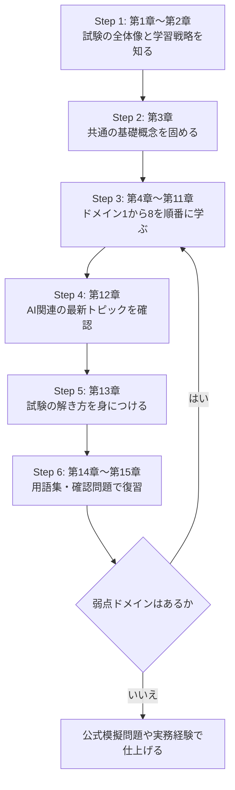

### 0.3 各項目の書き方

| 見出し | 意味 |
|---|---|
| **まず一言で** | その項目の超ざっくり説明 |
| **やさしい解説** | 初学者向けの詳しい説明 |
| **ベストプラクティス** | 実務で推奨される良いやり方 |
| **試験の着眼点** | 出題されやすいポイント・引っかけ |

### 0.4 情報の鮮度に関する注意

- 試験の **ドメイン構成・重み・サブドメイン** は ISC2 公式アウトライン（2024-04-15 発効）に基づきます。
- 受験料・年間維持費（AMF）・再受験ルールなどは **地域・時期で変わります**。申込前に必ず公式ページで確認してください（第16章の出典参照）。
- 他資格（CCSP、CC など）は 2026 年に新アウトラインへ更新された事例があります。**CISSP も将来更新される可能性**があるため、受験前に公式アウトラインの有効日を再確認してください。

---

## 1. CISSP とは

### 1.1 まず一言で

**「セキュリティを設計し、実装し、管理できる人」** であることを証明する、世界的に認知された上級資格です。

### 1.2 やさしい解説

ISC2 の公式ページでは、CISSP を取得すると「ベストインクラスのサイバーセキュリティプログラムを効果的に **設計・実装・管理** できる」ことを示せると説明されています。つまり、特定の製品の操作スキルではなく、**技術と管理（マネジメント）の両面を広くカバーする知識と経験** を問う資格です。

| 項目 | 内容 |
|---|---|
| 主催 | ISC2（International Information System Security Certification Consortium） |
| 必要な実務経験 | **5年**（8ドメインのうち **2つ以上** の分野で累積・フルタイム） |
| 規格 | ISO/IEC 17024（ANAB 認定） |
| 米国 DoD | DoDM 8140.03 で承認 |
| 試験形式 | **CAT（コンピュータ適応型テスト）** |
| 試験時間 | **最大3時間** |
| 出題数 | **100〜150問**（ISC2 の最新案内。アウトライン PDF には 125〜150 と記載された版もあるため、公式で再確認） |
| 問題形式 | 選択式＋アドバンスト・イノベーティブ問題 |
| 合格点 | **1000点満点中700点** |
| 受験言語 | 英語、中国語、ドイツ語、日本語、スペイン語（CAT） |
| 会場 | Pearson VUE テストセンター（ISC2 認定 PPC／PVTC Select） |

> **補足**: 出題数が「100〜150」と「125〜150」の2種類の記載が見つかります。ISC2 の 2025 年の CAT 案内（Insights 記事）と試験案内ページは **100〜150** と記載しており、2024 年版アウトライン PDF は **125〜150** と記載しています。CAT は「合否が95%の統計的信頼度で判定できた時点で終了」するため、人によって問題数が変わります。

### 1.3 経験が足りなくても受験できる？

アウトラインによると、必要な経験が足りない場合でも **試験に合格すれば「Associate of ISC2」** になれます。Associate は **6年以内** に5年分の経験を満たせば CISSP になれます。

また、次の条件で経験要件が最大1年分満たされる場合があります（ISC2 のアウトライン記載）。

| 条件 | 経験年数の免除 |
|---|---|
| 情報工学・IT 関連分野の学士／修士 | 最大 **1年** |
| ISC2 承認リストの追加資格 | 最大 **1年** |
| パートタイム・インターン | 経験として算入できる場合あり |

### 1.4 取得までの流れ

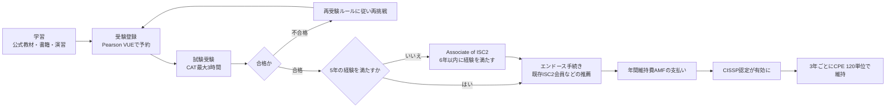

### 1.5 エンドースと維持（ここは要注意）

| 項目 | 内容（要点） |
|---|---|
| エンドース期限 | 試験日から **9か月以内**（過ぎると再受験が必要とされる） |
| 認定の有効期間 | **3年**（更新しながら維持） |
| CPE（継続学習単位） | **3年で120単位**（年40単位が目安・推奨） |
| AMF（年間維持費） | 毎年支払い（金額は時期で変動。情報源により 125 ドル／135 ドルの記載があるため公式で要確認） |
| 倫理規定 | ISC2 倫理規定の遵守が必須 |

> **ベストプラクティス**: 合格前から **エンドース先（推薦してくれるISC2認定保持者）** を探しておくと、9か月の期限に余裕を持てます。

### 1.6 試験の着眼点（この章）

- CISSP は **「技術者の資格」ではなく「セキュリティ管理者・設計者の資格」** です。
- 5年の経験は **「8ドメインのうち2つ以上」** という点が頻出の確認ポイントです。
- 合格後すぐ CISSP を名乗れるとは限りません（**エンドースが必要**）。

---

## 2. 学習戦略とロードマップ

### 2.1 ドメインの重み（2024年4月15日発効アウトライン）

| # | ドメイン | 重み |
|---|---|---|
| 1 | Security and Risk Management（セキュリティとリスクマネジメント） | **16%** |
| 2 | Asset Security（資産のセキュリティ） | 10% |
| 3 | Security Architecture and Engineering（セキュリティアーキテクチャとエンジニアリング） | 13% |
| 4 | Communication and Network Security（通信とネットワークセキュリティ） | 13% |
| 5 | Identity and Access Management（IAM） | 13% |
| 6 | Security Assessment and Testing（セキュリティ評価とテスト） | 12% |
| 7 | Security Operations（セキュリティ運用） | 13% |
| 8 | Software Development Security（ソフトウェア開発セキュリティ） | 10% |
| | **合計** | **100%** |

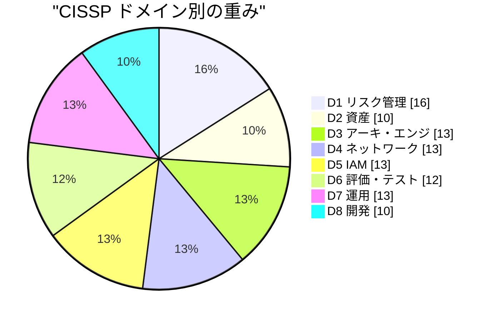

> **読み方のコツ**: どのドメインも **8〜16%** と差が小さいのが CISSP の特徴です。**得意分野だけでは合格できない** 設計になっています。

### 2.2 学習の進め方（目安：8〜12週間）

| 週 | 内容 | 目標 |
|---|---|---|
| 1〜2 | 第3章（基礎）＋ドメイン1 | 管理者視点・リスク・法規・倫理に慣れる |
| 3 | ドメイン2 | データ分類・ライフサイクルを理解 |
| 4〜5 | ドメイン3 | 設計原則・暗号・セキュリティモデル |
| 6 | ドメイン4 | OSI/TCP-IP・ネットワーク防御 |
| 7 | ドメイン5 | 認証・認可・フェデレーション |
| 8 | ドメイン6 | テスト・監査の種類と使い分け |
| 9 | ドメイン7 | 運用・インシデント対応・DR/BC |
| 10 | ドメイン8 | SDLC・DevSecOps・安全なコーディング |
| 11〜12 | 総復習・演習問題 | 弱点ドメインを重点復習 |

> 実務経験の量により必要時間は大きく変わります。**自分の弱いドメインに時間を厚く配分** してください。

### 2.3 CISSP 特有の考え方「マネージャー思考」

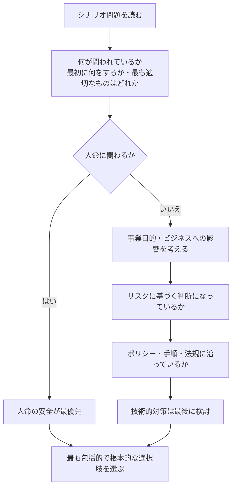

| 原則 | 意味 |
|---|---|
| 人命第一 | 安全（Safety）は他のあらゆる目的に優先する |
| ビジネス目的に整合 | セキュリティは事業を支える手段であり目的ではない |
| リスクベース | 守る資産の価値と脅威に見合った対策を選ぶ |
| 「まず確認・評価」 | いきなり対策実施より、まず状況把握・承認・文書化 |
| 予防が望ましい | 検知・是正より、可能なら予防的統制を優先 |
| 上位層の関与 | 最終責任は経営層。技術者個人の判断で完結させない |

### 2.4 CAT（適応型）試験のための心構え

| ポイント | 解説 |
|---|---|
| 戻れない | **見直し（レビュー）不可**。1問ずつ確実に答える |
| 問題数は人それぞれ | 少ない問題数＝不合格、とは限らない |
| 難易度は動的 | 難しく感じるのは「能力に合った問題が出ている」可能性 |
| 休憩 | 休憩時間も **3時間の中に含まれる** |
| 時間配分 | 150問まで出る可能性を想定し、1問あたりの時間を意識する |

---

## 3. 基礎概念（全ドメイン共通）

### 3.1 CIA トライアドと「5つの柱」

公式アウトライン 1.2 では、**機密性・完全性・可用性・真正性・否認防止** を **「情報セキュリティの5つの柱」** と記載しています。

| 柱 | 英語 | 意味 | 主な対策例 |
|---|---|---|---|
| 機密性 | Confidentiality | 許可された人だけが見られる | 暗号化、アクセス制御 |
| 完全性 | Integrity | 改ざんされていない | ハッシュ、デジタル署名、変更管理 |
| 可用性 | Availability | 必要な時に使える | 冗長化、バックアップ、DR |
| 真正性 | Authenticity | 本物であると確認できる | 認証、証明書 |
| 否認防止 | Nonrepudiation | 「やっていない」と言わせない | デジタル署名、ログ、監査証跡 |

### 3.2 AAA とその他の基本用語

| 用語 | 意味 | 例 |
|---|---|---|
| Identification（識別） | 「私は誰か」を名乗る | ユーザーID |
| Authentication（認証） | 本人であることを確かめる | パスワード、生体、MFA |
| Authorization（認可） | 何をしてよいか決める | ロール、権限 |
| Accounting（説明責任） | 行動を記録・追跡する | ログ、監査 |

### 3.3 脅威・脆弱性・リスクの関係

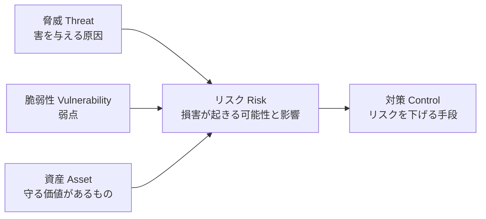

| 用語 | 一言説明 |
|---|---|
| 資産 | 守る価値があるもの（データ、システム、人、評判など） |
| 脅威 | 資産に害を与えうるもの（攻撃者、災害、内部者） |
| 脆弱性 | 脅威に悪用される弱点 |
| リスク | 脅威が脆弱性を突いて損害が出る **可能性 × 影響** |
| 対策（統制） | リスクを下げる仕組み |

### 3.4 統制（コントロール）の分類

**種類（機能）による分類**

| 種類 | 目的 | 例 |
|---|---|---|
| 抑止（Deterrent） | やる気を失わせる | 警告表示、監視カメラの存在 |
| 予防（Preventive） | 起きる前に防ぐ | ファイアウォール、MFA |
| 検知（Detective） | 起きたことに気づく | IDS、ログ監視 |
| 是正（Corrective） | 起きた後に直す | パッチ適用、バックアップからの復旧 |
| 復旧（Recovery） | 通常状態に戻す | DR サイト切替 |
| 補完（Compensating） | 本来の対策の代わりを務める | 代替の監視・承認プロセス |
| 指示（Directive） | 行動を指示する | ポリシー、手順書 |

**実装形態による分類**

| 形態 | 例 |
|---|---|
| 管理的（Administrative） | ポリシー、教育、職務分離 |
| 技術的（Technical／Logical） | 暗号化、ACL、IPS |
| 物理的（Physical） | 鍵、フェンス、入退室管理 |

### 3.5 ベストプラクティス（全体共通）

1. **多層防御（Defense in Depth）**: 1つの対策に頼らない
2. **最小権限**: 必要最小限の権限だけを与える
3. **職務分離**: 重要な操作を1人に集中させない
4. **失敗時は安全側へ（Fail Securely）**
5. **文書化と承認**: 決定事項は文書化し、責任者の承認を得る

---
## 4. ドメイン1: Security and Risk Management（重み 16%）

### 4.0 このドメインの全体像

**一言で**: 「組織としてセキュリティをどう統治（ガバナンス）し、リスクをどう管理するか」を学ぶ、**最大配点** のドメインです。

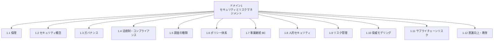

### 4.1 〔1.1〕プロフェッショナル倫理

**まず一言で**: 迷ったら「社会・公共の利益」を最優先にする、という行動規範です。

**やさしい解説**: ISC2 倫理規定には4つの原則（キャノン）があり、**上に書かれたものほど優先** されます。

| 優先順 | 原則（要旨） |
|---|---|
| 1 | 社会、公共の利益、必要な社会的信頼、インフラを守る |
| 2 | 誠実・公正・責任ある・合法的に行動する |
| 3 | 依頼者（プリンシパル）に対し、勤勉かつ有能なサービスを提供する |
| 4 | 専門職を前進させ、守る |

**ベストプラクティス**
- 倫理規定と **組織の倫理規定** の両方に従う。矛盾したら **ISC2 倫理規定（特に公益）が優先** される方向で考える
- 不正を見つけたら、**定められた報告ルート**（上長・コンプライアンス窓口）で報告する

**試験の着眼点**: 「雇用主の指示」と「公共の安全」が対立する場面では、**公共の利益が先**。

### 4.2 〔1.2〕セキュリティ概念

第3章の **5つの柱（機密性・完全性・可用性・真正性・否認防止）** が中心です。

**ベストプラクティス**: 要件定義時に「どの柱が最も重要か」をビジネス側と合意し、対策の優先順位に反映します（例: 医療機器は可用性、機密文書は機密性）。

### 4.3 〔1.3〕セキュリティガバナンス

**まず一言で**: 「セキュリティを事業目標に合わせて、誰が・どう決めて・どう動かすか」の仕組みです。

**やさしい解説**

| 論点 | 説明 |
|---|---|
| 戦略との整合 | セキュリティ目標は **事業戦略・使命・目標に従う** |
| 組織プロセス | M&A（買収・分割）やガバナンス委員会でのセキュリティ確認 |
| 役割と責任 | 経営層、CISO、データオーナー、カストディアン、利用者などの責任分担 |
| 統制フレームワーク | ISO、NIST、COBIT、SABSA、PCI、FedRAMP などの活用 |
| デューケア／デューデリジェンス | 下表参照 |

| 用語 | 意味 | 覚え方 |
|---|---|---|
| **デューデリジェンス**（Due Diligence） | 事前に調べ、リスクを理解する | 「調べる」 |
| **デューケア**（Due Care） | 調べた結果に基づき、**実際に適切な対策を実行** する | 「実行する」 |

**主要フレームワーク早見表**

| フレームワーク | 特徴 |
|---|---|
| ISO/IEC 27001 / 27002 | ISMS（情報セキュリティマネジメントシステム）の要求事項と管理策。認証の対象になる |
| NIST CSF | 2024年の 2.0 で **Govern・Identify・Protect・Detect・Respond・Recover** の6機能 |
| NIST SP 800-53 | 米国政府向けを中心とした詳細な管理策カタログ |
| COBIT | ITガバナンス・マネジメントのフレームワーク |
| SABSA | ビジネス要求から導くセキュリティアーキテクチャ手法 |
| PCI DSS | カード情報を扱う組織向けの業界標準 |
| FedRAMP | 米国政府のクラウドサービス認可プログラム |

**ベストプラクティス**
- 経営層がスポンサーとなる（**トップダウン** が最も効果的）
- 戦略・ポリシー・標準・手順・技術を **一貫させる**
- 役割と責任を **文書化**（RACI など）

### 4.4 〔1.4〕法規制・コンプライアンス

**まず一言で**: 「どの国のどの法律に従うか」を把握し、違反リスクを管理することです。

| 論点 | 説明 |
|---|---|
| サイバー犯罪・データ侵害 | 各国の法律（例: ブダペスト条約など国際的枠組み）や侵害通知義務 |
| ライセンス・知的財産 | 特許、著作権、商標、営業秘密 |
| 輸出入規制 | 暗号技術など一部技術は輸出管理の対象 |
| 越境データ移転 | データを国外に移すときの法的要件 |
| プライバシー | GDPR（EU）、CCPA（米カリフォルニア）、PIPL（中国）、POPIA（南アフリカ）、日本の個人情報保護法 など |
| 契約・業界標準 | 契約上の義務、PCI DSS などの標準 |

**知的財産の4分類**

| 種類 | 保護対象 |
|---|---|
| 特許 | 発明（新規性のある技術） |
| 著作権 | 表現（ソースコード含む） |
| 商標 | ブランド名・ロゴ |
| 営業秘密 | 秘密として管理される情報（秘密管理が条件） |

**ベストプラクティス**
- データの **所在地・移転経路** を把握（データマップ）
- 法務・コンプライアンス部門と **早期に連携**
- 個人情報の **最小化・目的限定** を設計時点で組み込む

**試験の着眼点**: CISSP は **「法律の専門家になる」のではなく「法務部門に相談すべき場面を見極める」** 姿勢が問われます。

### 4.5 〔1.5〕調査の種類

| 種類 | 目的 | 立証の水準（目安） |
|---|---|---|
| 管理的（Administrative） | 社内規程違反の調査 | 組織の基準 |
| 刑事（Criminal） | 犯罪の立証 | **合理的な疑いを超える** |
| 民事（Civil） | 損害賠償などの争い | **証拠の優越** |
| 規制（Regulatory） | 規制当局による調査 | 規制による |
| 業界標準 | PCI DSS 等の違反調査 | 標準による |

**ベストプラクティス**: 調査開始前に **法務に相談** し、証拠保全（第10章 7.1）の手順を守ります。

### 4.6 〔1.6〕ポリシー・標準・手順・ガイドライン

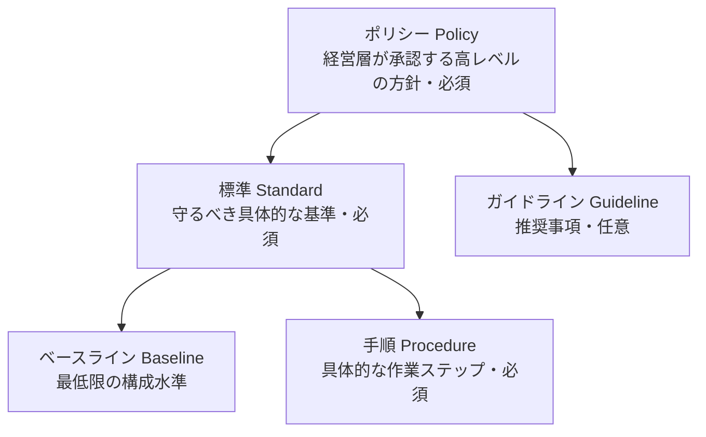

| 階層 | 強制力 | 抽象度 | 例 |
|---|---|---|---|
| ポリシー | 必須 | 高 | 情報セキュリティ基本方針 |
| 標準 | 必須 | 中 | パスワードは12文字以上 |
| 手順 | 必須 | 低（具体的） | アカウント作成の手順書 |
| ガイドライン | **推奨（任意）** | 中 | 安全なパスフレーズの作り方 |

**ベストプラクティス**: ポリシーは **簡潔・技術非依存** に、変化しやすい内容は標準・手順に書き、**定期レビュー** と承認フローを設けます。

### 4.7 〔1.7〕事業継続（BC）要件の特定

**まず一言で**: 「止まったら困る業務を洗い出し、いつまでに戻すかを決める」活動です。

**やさしい解説**: 中心は **BIA（事業影響度分析）** です。

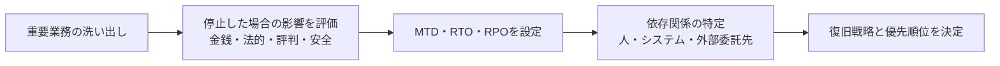

| 指標 | 意味 |
|---|---|
| **MTD/MAO**（最大許容停止時間） | これ以上止まると事業が存続できない限界 |
| **RTO**（目標復旧時間） | システム／業務を復旧させる目標時間（MTD より短い） |
| **RPO**（目標復旧時点） | どの時点までのデータを復元するか（許容データ損失量） |
| **WRT**（作業復旧時間） | 復旧後に検証・再開に必要な時間 |

関係式: **MTD ≧ RTO ＋ WRT**

**ベストプラクティス**
- BIA は **業務部門を巻き込み** 、IT 部門だけで決めない
- 外部依存（クラウド、委託先、電力、通信）を必ず洗い出す
- 経営層が **復旧優先順位を承認**

### 4.8 〔1.8〕人的セキュリティ

| フェーズ | 実施事項 |
|---|---|
| 採用前 | 候補者のスクリーニング（身元確認・経歴確認。法令の範囲内で） |
| 契約時 | 雇用契約、NDA、ポリシー同意 |
| 在職中 | 教育、職務分離、ジョブローテーション、強制休暇、権限見直し |
| 異動 | 旧権限の剥奪と新権限の付与 |
| 退職 | **アカウント即時停止**、資産返却、退職時面談、秘密保持の再確認 |
| 外部者 | ベンダー・コンサル・委託先との契約と統制 |

**ベストプラクティス**: 退職・異動時の **権限剥奪を自動化**（人事システムと ID 管理の連携）。

### 4.9 〔1.9〕リスクマネジメントの概念

**まず一言で**: 「リスクを見つけ、評価し、対応を決め、監視し続ける」サイクルです。

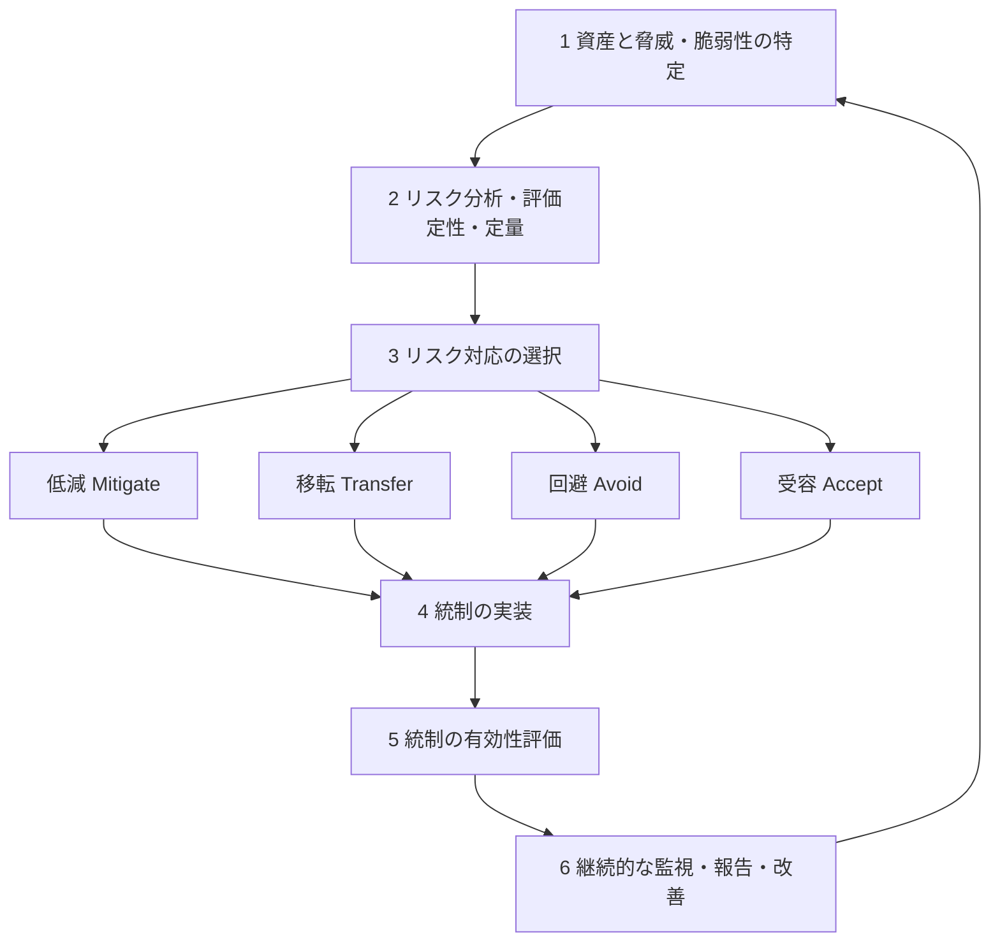

**リスク対応の4つ**

| 対応 | 意味 | 例 |
|---|---|---|
| 低減（Mitigate） | 対策でリスクを下げる | パッチ適用、MFA導入 |
| 移転（Transfer） | 他者に負担を移す | サイバー保険、アウトソース |
| 回避（Avoid） | リスクの原因をやめる | 危険なサービスを停止 |
| 受容（Accept） | 許容して受け入れる | 影響が小さく対策費が高い場合 |

**定量的リスク分析の公式**

| 用語 | 計算 | 意味 |
|---|---|---|
| AV | 資産価値 | 資産の金銭的価値 |
| EF | 被害率 | 事故で失われる割合（0〜1） |
| **SLE** | AV × EF | 1回の事故での損失額 |
| **ARO** | 年間発生率 | 1年に何回起きるか |
| **ALE** | SLE × ARO | 年間の予想損失額 |

**例**: 資産価値 1,000万円、EF 0.3、ARO 0.5 → SLE = 300万円、ALE = 150万円。
**対策費が ALE の削減額より安ければ導入を検討** します。

**定性 vs 定量**

| 項目 | 定性 | 定量 |
|---|---|---|
| 指標 | 高・中・低 | 金額・確率 |
| 長所 | 早い・分かりやすい | 費用対効果を示せる |
| 短所 | 主観が入る | データ収集が大変 |

**残存リスク（Residual Risk）**: 対策後も残るリスク。**受容できるかどうかは経営層が決める**。

**ベストプラクティス**
- リスク許容度（Risk Appetite）を **経営層が定義**
- **リスク登録簿（Risk Register）** で一元管理し、所有者を割り当てる
- 対策コストは **資産価値を超えない**
- **継続的監視**（KRI／KPI）と定期的な再評価

**試験の着眼点**: 「最初にすべきことは？」→ 多くの場合 **資産の特定とリスク評価**。リスクを **ゼロにする** ことは目標ではない。

### 4.10 〔1.10〕脅威モデリング

**まず一言で**: 「設計段階で、攻撃者の視点から弱点を洗い出す」手法です。

| 手法 | 概要 |
|---|---|
| **STRIDE** | なりすまし・改ざん・否認・情報漏えい・サービス拒否・権限昇格の6分類で脅威を整理 |
| DREAD | 脅威の深刻度の採点（現在は使用が減少） |
| PASTA | 攻撃シミュレーション中心のリスク志向の7段階手法 |
| アタックツリー | 攻撃の目的から枝分かれで手段を分解 |
| LINDDUN | プライバシー脅威に特化 |
| MITRE ATT&CK | 実際の攻撃者の戦術・技術のナレッジベース |

**STRIDE の対応表**

| 頭文字 | 脅威 | 破られる性質 |
|---|---|---|
| S | Spoofing（なりすまし） | 真正性 |
| T | Tampering（改ざん） | 完全性 |
| R | Repudiation（否認） | 否認防止 |
| I | Information Disclosure（情報漏えい） | 機密性 |
| D | Denial of Service（サービス拒否） | 可用性 |
| E | Elevation of Privilege（権限昇格） | 認可 |

**進め方**

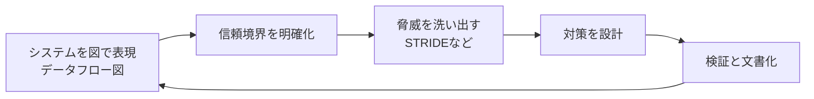

**ベストプラクティス**: **設計の早い段階（Shift Left）** で実施し、アーキテクチャ変更のたびに見直す。

### 4.11 〔1.11〕サプライチェーンリスク管理（SCRM）

**まず一言で**: 「購入する製品・サービス・ソフトウェアに潜むリスク」を管理することです。

| リスク | 例 |
|---|---|
| 改ざん・偽造品 | 不正なチップの混入、偽物のハードウェア |
| ソフトウェアの汚染 | 依存ライブラリへの悪意あるコード混入 |
| 委託先の侵害 | クラウド・MSP からの二次被害 |

| 軽減策 | 説明 |
|---|---|
| 第三者評価・継続モニタリング | 取引開始時と契約中の両方で確認 |
| 最小セキュリティ要件 | 契約に必須条件を明記 |
| SLA／サービスレベル要件 | 障害・侵害時の対応時間を定める |
| **SBOM**（ソフトウェア部品表） | 含まれる部品を一覧化し脆弱性追跡を可能に |
| Silicon Root of Trust・PUF | チップ単位の信頼性確保（ハードウェアの信頼の起点） |

**ベストプラクティス**: 調達時に **セキュリティ要件・監査権・インシデント通知義務** を契約へ明記する。

### 4.12 〔1.12〕意識向上・教育・訓練

| 論点 | 説明 |
|---|---|
| 手法 | フィッシング訓練、ソーシャルエンジニアリング対策、セキュリティチャンピオン、ゲーミフィケーション |
| 内容の見直し | 新技術（暗号資産、**AI**、ブロックチェーン）を定期的に反映 |
| 効果測定 | クリック率・報告率・インシデント件数などで評価 |

| 区分 | 目的 |
|---|---|
| 意識向上（Awareness） | 全員に気づきを与える |
| 教育（Education） | 専門知識を深く学ぶ |
| 訓練（Training） | 具体的な手順・スキルを習得する |

**ベストプラクティス**: **役割別**（開発者・経営層・一般職員）に内容を変え、年1回で終わらせず継続する。

---

## 5. ドメイン2: Asset Security（重み 10%）

### 5.0 このドメインの全体像

**一言で**: 「守るべき情報と資産を分類し、生まれてから消えるまで適切に扱う」ドメインです。

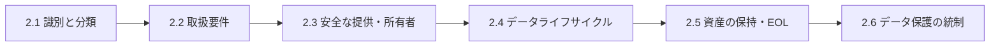

### 5.1 〔2.1〕情報と資産の識別・分類

**まず一言で**: 「何が大切かを決めてラベルを付ける」作業です。

| 分類例（民間） | 説明 |
|---|---|
| 機密（Confidential） | 漏えいで重大な損害 |
| 社外秘（Internal） | 社内のみ |
| 公開（Public） | 公開可能 |

**分類の進め方**

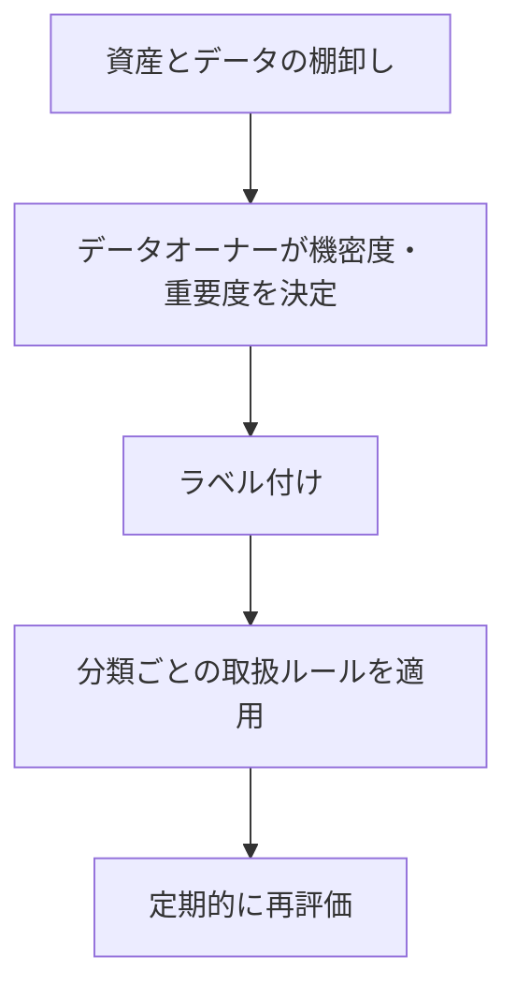

**ベストプラクティス**
- 分類は **データオーナーの責任**
- 分類レベルは **3〜4段階程度** にして運用しやすく
- 分類が下がる・上がるタイミング（期限切れ等）も定義

### 5.2 〔2.2〕取扱要件

分類に応じて、**保管・転送・共有・廃棄** のルールを定めます。

| 分類 | 例: 保管 | 例: 転送 | 例: 廃棄 |
|---|---|---|---|
| 機密 | 暗号化必須 | 暗号化通信のみ | 認定された破壊 |
| 社外秘 | アクセス制限 | 社内ネットワーク優先 | 安全な消去 |
| 公開 | 制限なし | 制限なし | 通常廃棄 |

**ベストプラクティス**: ラベル（メタデータ）を **DLP 等の技術的統制と連動** させる。

### 5.3 〔2.3〕資産の安全な提供と所有

| 論点 | 説明 |
|---|---|
| 所有者 | 情報・資産の説明責任を負う人（通常は事業部門の管理者） |
| 資産インベントリ | 有形（PC、サーバ）と無形（データ、ソフトウェア、ライセンス）の台帳 |
| 資産管理 | 調達〜廃棄まで追跡し、**最新状態を維持** |

**ベストプラクティス**: **CMDB・資産台帳** を自動検出ツールで更新し、**未管理資産（シャドーIT）** を減らす。

### 5.4 〔2.4〕データライフサイクル管理

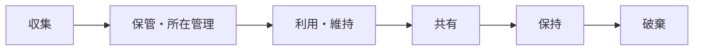

**データの役割（Data Roles）**

| 役割 | 説明 |
|---|---|
| オーナー（Owner） | 分類を決め、最終責任を持つ |
| コントローラー（Controller） | 個人データの **目的と手段を決める** 主体（GDPR の用語） |
| プロセッサー（Processor） | コントローラーの代わりに **処理する** 主体 |
| カストディアン（Custodian） | 日々の保護作業（バックアップ・権限設定）を担う |
| ユーザー／データ主体（Subject） | データを使う人／データの本人 |

**データ残留（Remanence）と破棄**

| 手法 | 説明 | 備考 |
|---|---|---|
| 論理削除・ファイル削除 | 領域を再利用可能にするだけ | **データは残る**ので不十分 |
| 上書き（Clear） | 通常の読み取りでは復元できない | 再利用可能な媒体向け |
| **Purge** | 高度な手法でも復元困難にする | 暗号消去、消磁など |
| 物理破壊（Destroy） | 粉砕・焼却・溶解 | 最も確実 |
| **暗号消去**（Crypto Erase） | 暗号鍵を破棄してデータを読めなくする | クラウド・SSD で有効 |

> 媒体のサニタイズは NIST SP 800-88 が定める **Clear／Purge／Destroy** の考え方が基本です（最新改訂版は公式で確認してください）。

**ベストプラクティス**
- **保持期間と破棄期限** を法令・契約に基づき定め、期限後は確実に破棄
- 破棄の **証明書や記録** を残す
- 不要データは持たない（**データ最小化**）

### 5.5 〔2.5〕資産の保持（EOL・サポート終了）

| 論点 | 説明 |
|---|---|
| EOL | 製品の販売終了 |
| End of Support | セキュリティ更新が出なくなる |
| リスク | サポート終了製品は **新しい脆弱性が修正されない** |

**ベストプラクティス**: EOL **前** にリプレース計画を立て、延命する場合は **補完的統制**（隔離・追加監視）を設ける。

### 5.6 〔2.6〕データセキュリティ統制とコンプライアンス要件

**データの3つの状態**

| 状態 | 意味 | 主な保護策 |
|---|---|---|
| 保存中（At Rest） | ディスク・DB・バックアップ上 | ディスク／DB暗号化、アクセス制御 |
| 転送中（In Transit） | ネットワーク上 | TLS、IPsec、VPN |
| 使用中（In Use） | メモリ・CPU 上で処理中 | 機密コンピューティング、メモリ保護 |

**スコーピングとテーラリング**

| 用語 | 意味 |
|---|---|
| スコーピング | 標準の中から **自組織に適用する範囲** を決める |
| テーラリング | 適用する統制を **自組織の状況に合わせて調整** する |

**データ保護手法**

| 手法 | 説明 |
|---|---|
| **DRM** | 利用権限を技術的に制御（コピー・印刷の制限など） |
| **DLP** | 機密データの外部流出を検知・ブロック |
| **CASB** | クラウドサービス利用の可視化と制御 |
| トークナイゼーション | 実データを代替値に置き換え |
| マスキング／匿名化 | 表示や分析用に個人を特定できないようにする |

**ベストプラクティス**
- **「分類→保護策」の対応表** を作り、例外は承認制に
- 暗号化は **鍵管理（第6章 3.6）** とセットで設計

---
## 6. ドメイン3: Security Architecture and Engineering（重み 13%）

### 6.0 このドメインの全体像

**一言で**: 「最初から安全に作る」ための設計原則・モデル・暗号・物理施設を学びます。

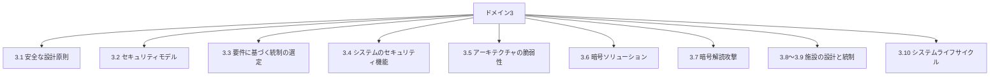

### 6.1 〔3.1〕安全な設計原則

公式アウトラインに挙げられた原則を、やさしく整理します。

| 原則 | 意味 | 具体例 |
|---|---|---|
| 脅威モデリング | 設計時に脅威を洗い出す | STRIDE |
| **最小権限** | 必要最小限だけ許可 | 一般ユーザーに管理者権限を与えない |
| **多層防御** | 複数の対策を重ねる | FW＋IPS＋EDR＋MFA |
| **セキュアデフォルト** | 初期状態が安全 | 初期設定で不要ポートを閉じる |
| **フェイルセキュア** | 故障時に安全側へ | 認証システム障害時は「拒否」 |
| **職務分離（SoD）** | 重要な権限を分割 | 承認者と実行者を分ける |
| **シンプルに保つ** | 複雑さはリスク | 不要機能を削る |
| **ゼロトラスト／信頼しつつ検証** | 暗黙の信頼を置かない | 毎回検証・最小権限・継続監視 |
| **プライバシー・バイ・デザイン** | 設計時点でプライバシーを組み込む | データ最小化、目的限定 |
| **責任共有** | クラウド事業者と利用者で責任を分担 | 下表参照 |
| **SASE** | ネットワークとセキュリティ機能をクラウドで統合提供 | SWG・CASB・ZTNA・SD-WAN |

**クラウドの責任共有モデル（目安）**

| 層 | IaaS | PaaS | SaaS |
|---|---|---|---|
| データ・アカウント・アクセス管理 | 利用者 | 利用者 | 利用者 |
| アプリケーション | 利用者 | 利用者（コード） | 事業者 |
| OS・ミドルウェア | 利用者 | 事業者 | 事業者 |
| 仮想化・ネットワーク・物理 | 事業者 | 事業者 | 事業者 |

> **どのモデルでも「データとアクセス管理の責任は利用者に残る」** ことが重要です。

**ゼロトラストの基本**

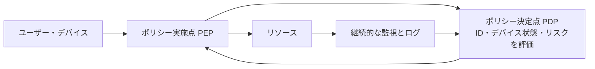

**ベストプラクティス**: 認証後も **継続的に評価**、**ネットワーク位置だけで信頼しない**、**マイクロセグメンテーション** で横展開を防ぐ。

### 6.2 〔3.2〕セキュリティモデルの基礎

**まず一言で**: 「アクセス制御ルールを数学的・論理的にきちんと定義した理論」です。

| モデル | 守る性質 | ルール（要点） | 覚え方 |
|---|---|---|---|
| **Bell-LaPadula** | 機密性 | **上位の読み取り禁止（No Read Up）**、**下位への書き込み禁止（No Write Down）** | 機密を上から下へ漏らさない |
| **Biba** | 完全性 | **下位の読み取り禁止（No Read Down）**、**上位への書き込み禁止（No Write Up）** | 汚れたデータを上へ混ぜない |
| **Clark-Wilson** | 完全性 | ユーザーは **許可されたプログラム（TP）経由** でのみデータを操作、職務分離、監査 | 業務アプリ向け |
| **Brewer-Nash（中国の壁）** | 利益相反の防止 | 過去のアクセスに応じて動的にアクセス制限 | コンサル・金融向け |
| Take-Grant | 権限の移転 | 権限の付与・譲渡を形式化 | 理論寄り |

> アウトラインの「Star Model」は、Bell-LaPadula や Biba の **スター（\*）プロパティ**（書き込み側のルール）を指す文脈で出てきます。

**Bell-LaPadula と Biba の違い（超重要）**

| 比較 | Bell-LaPadula | Biba |
|---|---|---|
| 目的 | 機密性 | 完全性 |
| 単純ルール | 上を読まない | 下を読まない |
| スター（\*）ルール | 下に書かない | 上に書かない |

### 6.3 〔3.3〕システムのセキュリティ要件に基づく統制の選定

| 手順 | 内容 |
|---|---|
| 1 | 要件（機密性・可用性・法規制）を明確化 |
| 2 | 統制フレームワーク（NIST SP 800-53、ISO 27002 など）から候補を選択 |
| 3 | 費用対効果とリスクで選ぶ |
| 4 | 実装後に **検証・保証（Assurance）** を行う |

**評価基準**: **Common Criteria（ISO/IEC 15408）** は製品のセキュリティ機能を評価する国際基準で、**EAL1〜EAL7** の保証レベルがあります（数字が大きいほど厳密に評価）。

**ベストプラクティス**: 製品を選ぶときは **第三者評価・認証（Common Criteria など）** の有無も判断材料にする。

### 6.4 〔3.4〕情報システムのセキュリティ機能

| 機能 | 説明 |
|---|---|
| メモリ保護 | プロセス間のメモリを分離。DEP・ASLR などで攻撃を困難に |
| **TPM** | マザーボード上のチップ。鍵の保管、**起動時の完全性測定** |
| **HSM** | 鍵を安全に保管・演算する専用ハードウェア |
| セキュアブート | 署名された正規ソフトだけを起動 |
| TEE／エンクレーブ | CPU 内に隔離された安全な実行領域（使用中データの保護） |
| 暗号化・復号 | 機密性確保の基本 |
| 仮想化の分離 | ハイパーバイザによるVM間の分離 |

| 用語 | 補足 |
|---|---|
| TCB（Trusted Computing Base） | セキュリティポリシーを実施する **信頼の中核** の集合 |
| リファレンスモニタ | すべてのアクセスを仲介する概念 |
| セキュリティカーネル | リファレンスモニタの実装 |

### 6.5 〔3.5〕アーキテクチャ・設計・ソリューションの脆弱性の評価と軽減

| 対象 | 主な脆弱性 | 軽減策（ベストプラクティス） |
|---|---|---|
| クライアント | マルウェア、パッチ未適用、ローカル権限昇格 | EDR、自動パッチ、最小権限、フルディスク暗号化 |
| サーバー | 不要サービス、設定不備 | ハードニング、ベースライン、構成管理 |
| データベース | SQLインジェクション、推論・集約攻撃 | パラメータ化クエリ、最小権限、暗号化、監査 |
| 暗号システム | 弱いアルゴリズム、鍵管理不備 | 推奨アルゴリズム採用、鍵のライフサイクル管理 |
| **ICS／SCADA** | 古いOS、認証の欠如、可用性が最優先 | ネットワーク分離、受動的監視、慎重なパッチ |
| クラウド | 設定ミス、過剰な権限 | CSPM、IAM の最小権限、責任共有の理解 |
| 分散システム | 通信の改ざん、整合性 | 相互認証、署名、冪等性 |
| **IoT** | 初期パスワード、更新困難 | 初期設定変更、セグメント分離、ファーム更新計画 |
| マイクロサービス／API | 認可不備、過剰なデータ公開 | API ゲートウェイ、OAuth、レート制限 |
| コンテナ | 脆弱なイメージ、過剰な特権 | イメージスキャン、非 root 実行、シークレット管理 |
| サーバーレス | 過剰な関数権限、入力検証不足 | 関数単位の最小権限、依存関係管理 |
| 組込み | ファームウェア更新困難、物理攻撃 | セキュアブート、署名付き更新 |
| HPC | 共有環境での隔離不足 | ジョブ分離、アクセス制御 |
| エッジ | 物理的な持ち出し、管理が分散 | 暗号化、リモート管理、証明書による認証 |
| 仮想化 | VMエスケープ、VMスプロール | ハイパーバイザ更新、VM管理の厳格化 |

**ICS では、一般 IT と優先順位が異なる**

| 優先 | 一般 IT | ICS |
|---|---|---|
| 1 | 機密性 | **可用性・安全** |
| 2 | 完全性 | 完全性 |
| 3 | 可用性 | 機密性 |

### 6.6 〔3.6〕暗号ソリューションの選定

#### 6.6.1 暗号の基本

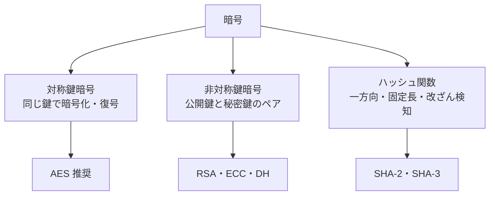

| 種類 | 特徴 | 長所 | 短所 | 用途 |
|---|---|---|---|---|
| 対称 | 暗号化と復号で同じ鍵 | 高速 | **鍵配送問題**、鍵の数が増える | データ本体の暗号化 |
| 非対称 | 公開鍵で暗号化、秘密鍵で復号（署名は逆） | 鍵配送が容易 | 低速 | 鍵交換、署名、認証 |
| ハッシュ | 同じ入力→同じ出力、逆算不可 | 完全性確認 | 鍵なしでは認証にならない | 改ざん検知、パスワード保存 |

**ハイブリッド方式**（TLS など）: 非対称で **セッション鍵を安全に共有**、以降は対称で高速に通信。

**アルゴリズムの目安**

| 分類 | 現在推奨される例 | 避けるべき例 |
|---|---|---|
| 対称 | **AES**（128/192/256 ビット） | DES、3DES、RC4 |
| 非対称 | RSA（十分な鍵長）、**ECC**、DH/ECDH | 短い鍵長の RSA |
| ハッシュ | **SHA-2、SHA-3** | **MD5、SHA-1**（衝突攻撃が実証済み） |
| パスワード保存 | **bcrypt、scrypt、Argon2、PBKDF2**（ソルト付き） | 単純なハッシュのみ |

**暗号化の使い分け（誰の鍵を使うか）**

| 目的 | 使う鍵 |
|---|---|
| 送信者が **相手だけに読ませたい**（機密性） | **受信者の公開鍵** で暗号化 |
| 送信者が **自分が送ったと証明したい**（署名） | **自分の秘密鍵** で署名 |
| 署名を検証する | **送信者の公開鍵** |

#### 6.6.2 暗号のライフサイクルと鍵管理

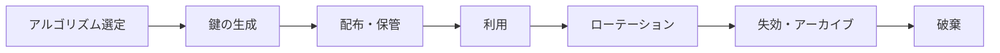

**ベストプラクティス（鍵管理）**
- 鍵は **HSM／KMS** で保管し、**平文で保存しない**
- 鍵の **定期ローテーション** と **失効手順** を用意
- **鍵と暗号化データを別の場所** に保管
- 鍵の **職務分離**（分割管理・M of N）
- 独自アルゴリズムは作らず、**標準化・検証済みのもの** を使う

#### 6.6.3 デジタル署名・証明書・PKI


| PKI の構成要素 | 役割 |
|---|---|
| CA（認証局） | 証明書を発行・署名する |
| RA（登録局） | 申請者の本人確認を行う |
| 証明書 | 公開鍵と持ち主を結び付けた署名付きデータ（X.509） |
| CRL／OCSP | 失効した証明書を確認する仕組み |
| ルート CA／中間 CA | 信頼の連鎖（チェーン）を構成 |

**ベストプラクティス**: ルート CA は **オフライン保管**、**中間 CA で日常発行**、証明書の **有効期限と自動更新** を管理。

#### 6.6.4 量子コンピュータへの備え

| 論点 | 説明 |
|---|---|
| 脅威 | 将来の量子コンピュータは RSA／ECC などの **公開鍵暗号を危殆化** する可能性 |
| 対策 | **耐量子暗号（PQC）** への移行計画。NIST は2024年に FIPS 203（ML-KEM）、FIPS 204（ML-DSA）、FIPS 205（SLH-DSA）を公開 |
| 「今盗んで後で解読」 | 長期保管が必要なデータは今から対策を検討 |
| 量子鍵配送（QKD） | 量子力学の原理で鍵を共有する技術（PKI とは別の概念） |

**ベストプラクティス**: 暗号の **棚卸し（どこで何を使っているか）** を行い、**暗号アジリティ**（アルゴリズムを入れ替えやすい設計）を確保。

### 6.7 〔3.7〕暗号解読攻撃の方法

| 攻撃 | 概要 | 対策 |
|---|---|---|
| 総当たり（Brute Force） | 全ての鍵を試す | 十分な鍵長 |
| 暗号文単独（Ciphertext Only） | 暗号文だけから推測 | 強い暗号 |
| 既知平文（Known Plaintext） | 平文と暗号文の組を使う | 現代暗号は耐性あり |
| 頻度分析 | 文字の出現頻度から古典暗号を解読 | 現代暗号では無効 |
| 選択暗号文 | 好きな暗号文を復号させて解析 | パディング検証・認証付き暗号 |
| 実装攻撃 | 実装の欠陥を突く | 検証済みライブラリ |
| **サイドチャネル** | 消費電力・電磁波・時間などの漏えいを解析 | 定時間実装、遮蔽 |
| フォールトインジェクション | 意図的にエラーを起こす | 耐タンパ設計 |
| タイミング攻撃 | 処理時間の差から鍵を推測 | 定数時間演算 |
| **MITM（中間者）** | 通信に割り込む | 相互認証、証明書検証 |
| Pass the Hash | 窃取したハッシュで認証を突破 | 資格情報保護、MFA、特権管理 |
| Kerberos 悪用 | チケットの窃取・偽造など | 強い暗号化、監視、特権アカウント保護 |
| ランサムウェア | データを暗号化して身代金要求 | バックアップ（オフライン）、EDR、パッチ、分離 |

### 6.8 〔3.8〕〔3.9〕施設・サイトの設計とセキュリティ統制

**まず一言で**: 「建物・部屋・設備」そのものの安全設計です。

**設計の考え方: CPTED（環境設計による犯罪予防）**

| 要素 | 内容 |
|---|---|
| 自然監視 | 見通しを良くする |
| 自然なアクセス制御 | 出入口を絞る |
| 領域性の強化 | 敷地の境界を明確にする |
| 維持管理 | 清潔に保ち、荒廃を避ける |

**施設の各エリアと統制**

| エリア | 主な統制 |
|---|---|
| 配線室／IDF | 施錠、アクセスログ、ケーブルの保護 |
| サーバー室／DC | 多層の入退室管理、**マントラップ**、監視、環境監視 |
| 媒体保管 | 施錠庫、持出し管理 |
| 証拠保管 | 厳格な保管と **管理の連鎖（Chain of Custody）** |
| 制限エリア | 生体認証、同行者管理 |

**環境・ユーティリティ**

| 項目 | ポイント |
|---|---|
| HVAC | 温度・湿度の管理（過熱・静電気・結露の防止） |
| 電力 | **UPS＋発電機** で冗長化。停電（Blackout）、電圧低下（Brownout）、サージ対策 |
| 火災 | 検知（煙・熱）、抑制（ガス系消火剤、プレアクション式スプリンクラー） |
| 自然災害・人為災害 | 立地選定、洪水・地震対策 |

**火災の分類（目安）**

| クラス | 燃焼物 | 例 |
|---|---|---|
| A | 一般可燃物 | 紙、木材 |
| B | 可燃性液体 | 油、ガソリン |
| C | 電気火災 | 通電中の機器 |
| D | 可燃性金属 | マグネシウム |
| K | 調理油 | 厨房 |

> データセンターでは水による消火が機器を損傷するため、**ガス系消火剤やプレアクション式** が選ばれます。**人命の安全（避難）が最優先** です。

**ベストプラクティス**: 境界から機器まで **同心円状に多層化**、**入退室ログを定期的にレビュー**、**環境センサーで遠隔監視**。

### 6.9 〔3.10〕情報システムのライフサイクル管理


| 用語 | 違い |
|---|---|
| **検証（Verification）** | 仕様どおりに作れているか（Are we building it right?） |
| **妥当性確認（Validation）** | 本来の要求を満たしているか（Are we building the right thing?） |

**ベストプラクティス**: **要件定義の段階からセキュリティ要件を入れる**（後付けはコストが高い）、**廃止時のデータ消去まで計画する**。

---

## 7. ドメイン4: Communication and Network Security（重み 13%）

### 7.0 このドメインの全体像

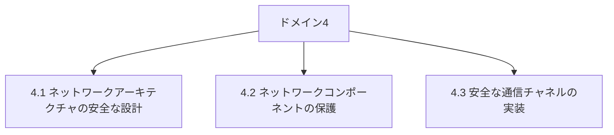

### 7.1 〔4.1〕ネットワークアーキテクチャへの安全な設計原則の適用

#### 7.1.1 OSI 参照モデルと TCP/IP

| 層 | OSI | 主なデータ単位 | 主なプロトコル／機器 | 主な攻撃・対策 |
|---|---|---|---|---|
| 7 | アプリケーション | データ | HTTP、DNS、SMTP | WAF、入力検証 |
| 6 | プレゼンテーション | データ | TLS（暗号化・符号化） | 暗号スイートの管理 |
| 5 | セッション | データ | セッション管理 | セッションハイジャック対策 |
| 4 | トランスポート | セグメント | TCP、UDP | SYN フラッド対策、ステートフルFW |
| 3 | ネットワーク | パケット | IP、ICMP、ルーター | IPスプーフィング対策、IPsec |
| 2 | データリンク | フレーム | Ethernet、スイッチ、MAC | ARPスプーフィング、VLAN、802.1X |
| 1 | 物理 | ビット | ケーブル、ハブ | 盗聴・断線、物理保護 |

**TCP/IP 4層との対応**

| TCP/IP | 対応する OSI 層 |
|---|---|
| アプリケーション | 5〜7 |
| トランスポート | 4 |
| インターネット | 3 |
| ネットワークアクセス | 1〜2 |

**覚え方**: 上から「**ア**プリ・**プ**レゼン・**セ**ッション・**ト**ランスポート・**ネ**ットワーク・**デ**ータリンク・**物**理」

#### 7.1.2 IPv4／IPv6 と通信方式

| 方式 | 説明 |
|---|---|
| ユニキャスト | 1対1 |
| ブロードキャスト | 同一ネットワークの全員（IPv4。IPv6 にはない） |
| マルチキャスト | 特定グループ |
| エニーキャスト | 最も近い1台（DNS の冗長化などで使用） |

#### 7.1.3 安全なプロトコル

| 用途 | 安全なプロトコル | 避ける（旧）プロトコル |
|---|---|---|
| Web | **HTTPS（TLS 1.2 以上、望ましくは 1.3）** | HTTP、SSL、TLS 1.0/1.1 |
| リモート操作 | **SSH** | Telnet |
| ファイル転送 | SFTP、FTPS | FTP |
| VPN | **IPsec**、TLS VPN | PPTP |
| メール | SMTP over TLS、S/MIME、**SPF／DKIM／DMARC** | 平文SMTP |
| DNS | **DNSSEC**（応答の真正性）、DoT／DoH | 検証なしのDNS |
| 無線LAN | **WPA3**（または WPA2-AES） | WEP、WPA（TKIP） |

**IPsec の基本**

| 要素 | 説明 |
|---|---|
| AH | 認証と完全性（暗号化なし） |
| ESP | 暗号化＋認証＋完全性（一般に使われる） |
| トランスポートモード | ペイロードのみ保護（ホスト間） |
| トンネルモード | パケット全体を包む（拠点間 VPN） |
| IKE | 鍵交換と SA（セキュリティ関連付け）の確立 |

**TLS ハンドシェイクの流れ**

```mermaid
sequenceDiagram
    participant C as クライアント
    participant S as サーバー
    C->>S: ClientHello 対応バージョンと暗号スイート
    S->>C: ServerHello と証明書
    C->>C: 証明書チェーンと有効性を検証
    C->>S: 鍵交換情報
    S->>C: 鍵交換情報と完了通知
    Note over C,S: 共通のセッション鍵を導出
    C->>S: 以降は対称暗号で暗号化通信
```

#### 7.1.4 多層プロトコル・コンバージドプロトコル

| 用語 | 説明 | セキュリティ上の論点 |
|---|---|---|
| 多層プロトコル | 上位プロトコルを下位で包む（例: Modbus over TCP/IP） | 元の想定外の経路で攻撃を受ける |
| コンバージド | 音声・ストレージ等をIPに統合（iSCSI、VoIP、InfiniBand over Ethernet、CXL） | 通常のIPネットワークの脅威に晒される |

**ベストプラクティス**: ストレージ（iSCSI）や音声（VoIP）は **専用VLANで分離**、認証・暗号化（SRTP など）を適用。

#### 7.1.5 トポロジ・性能・トラフィック

| 論点 | 内容 |
|---|---|
| 転送方式 | カットスルー（高速・エラー検査なし）／ストアアンドフォワード（検査あり・遅い） |
| 3つのプレーン | データ／制御／管理プレーン（管理プレーンは特に厳重に保護） |
| 性能指標 | 帯域幅、遅延（レイテンシ）、ジッタ、スループット、SN比 |
| 東西 vs 南北 | **南北**=外部と内部の通信、**東西**=内部サーバー間の通信（横展開の経路） |

#### 7.1.6 セグメンテーション

```mermaid
flowchart TD
    A["セグメンテーション"] --> B["物理分離"]
    A --> C["論理分離"]
    A --> D["マイクロセグメンテーション"]
    B --> B1["帯域内・帯域外管理"]
    B --> B2["エアギャップ"]
    C --> C1["VLAN"]
    C --> C2["VPN・VRF"]
    D --> D1["ワークロード単位のポリシー"]
    D --> D2["分散ファイアウォール・ゼロトラスト"]
```

| 種類 | 説明 | 強さ |
|---|---|---|
| エアギャップ | 物理的に切り離す（ICS・機密環境） | 最強。ただしUSB経由の侵入に注意 |
| VLAN | L2 を論理的に分割 | 中。VLANホッピング対策が必要 |
| マイクロセグメンテーション | ワークロード単位で通信を制御 | 横展開の防止に有効 |

**ベストプラクティス**: **管理ネットワークを分離**（帯域外管理）、**デフォルト拒否** のポリシー、**東西トラフィックも検査**。

#### 7.1.7 その他のネットワーク形態

| 形態 | セキュリティの要点 |
|---|---|
| エッジネットワーク | ingress/egress の両方向を制御 |
| 無線（Bluetooth、Wi-Fi、Zigbee、衛星） | 強い暗号化、認証、不正AP検出 |
| セルラー（4G、5G） | SIM・ネットワークスライスの保護、端末管理 |
| CDN | DDoS 緩和、オリジンの保護、キャッシュ設定 |
| **SDN** | 制御プレーンの集中管理（API・コントローラの保護が最重要） |
| VPC | クラウド内の仮想ネットワーク。セキュリティグループ・ACL で制御 |
| 監視と管理 | ネットワーク可観測性、フロー分析、容量管理、障害検知 |

**Wi-Fi 認証の使い分け**

| 方式 | 用途 |
|---|---|
| WPA3-Personal | 家庭・小規模（事前共有鍵） |
| WPA3-Enterprise／802.1X（EAP） | 企業。個人別認証＋RADIUS |

### 7.2 〔4.2〕ネットワークコンポーネントの保護

| 論点 | 説明・ベストプラクティス |
|---|---|
| インフラの運用 | 電源の冗長化、保守契約（ワランティ・サポート） |
| 伝送媒体 | ケーブルの物理保護、信号品質、盗聴対策（光ファイバーは盗聴しにくいが皆無ではない） |
| **NAC** | 接続する端末の状態を検査し、**準拠していなければ隔離**（802.1X） |
| エンドポイントセキュリティ | EDR／アンチマルウェア、ホスト型FW、ディスク暗号化、構成管理 |

**主要なネットワーク機器・セキュリティ製品**

| 製品 | 役割 | 補足 |
|---|---|---|
| ファイアウォール（パケットフィルタ） | IP・ポートで制御 | 第3〜4層 |
| ステートフル FW | 接続状態を追跡 | 現在の標準 |
| **NGFW** | アプリ識別、IPS、TLS検査 | 第7層まで |
| **WAF** | Web アプリ攻撃（SQLi・XSS）を防ぐ | HTTP/HTTPS 専用 |
| IDS | **検知のみ** | 通知 |
| IPS | **検知＋遮断** | インライン配置 |
| プロキシ | 通信の仲介・フィルタ | 順方向／逆方向 |
| ロードバランサー | 負荷分散・可用性 | |
| VPN ゲートウェイ | 暗号化トンネル | |
| スイッチ／ルーター | 転送制御 | ポートセキュリティ、ACL |

**ベストプラクティス**
- **デフォルト拒否（Default Deny）** のルール設計
- ルールの **定期的な棚卸し**（不要ルールの削除）
- 機器の **管理プレーンを保護**（MFA、管理専用ネットワーク）
- 機器の **ファームウェア更新**

### 7.3 〔4.3〕安全な通信チャネルの実装

| 通信 | 主なリスク | ベストプラクティス |
|---|---|---|
| 音声・ビデオ・コラボ（会議） | 盗聴、会議乗っ取り、不正参加 | 会議パスコード、待機室、エンドツーエンド暗号化の検討、SRTP |
| リモートアクセス | 認証情報の窃取、端末の汚染 | **MFA**、端末状態確認、最小権限、管理操作は踏み台＋記録 |
| データ通信（バックホール、衛星） | 傍受 | 区間をまたぐ **エンドツーエンド暗号化** |
| 第三者接続（通信事業者、保守） | 委託先経由の侵入 | 契約での要件明記、接続の分離、監視 |

**リモートアクセスの設計比較**

| 方式 | 特徴 |
|---|---|
| フルトンネル VPN | すべての通信を社内経由。検査しやすいが負荷が大きい |
| スプリットトンネル VPN | 業務通信のみ社内経由。軽いが端末の保護が重要 |
| **ZTNA** | アプリ単位で都度検証。ゼロトラストに適合 |
| VDI／踏み台 | データを端末に残さない |

**ベストプラクティス**: 「社内だから安全」とは考えず、**すべての通信を暗号化・認証・記録** する。

---
## 8. ドメイン5: Identity and Access Management（IAM）（重み 13%）

### 8.0 このドメインの全体像

**一言で**: 「誰が」「何に」「どこまで」アクセスできるかを決め、その一生（入社〜退職）を管理するドメインです。

```mermaid
flowchart TD
    D5["ドメイン5 IAM"] --> A["5.1 物理・論理アクセス制御"]
    D5 --> B["5.2 識別と認証の戦略"]
    D5 --> C["5.3 サードパーティとのフェデレーション"]
    D5 --> D["5.4 認可メカニズム"]
    D5 --> E["5.5 プロビジョニングのライフサイクル"]
    D5 --> F["5.6 認証システムの実装"]
```

### 8.1 〔5.1〕物理・論理アクセスの制御

| 対象 | 物理的制御の例 | 論理的制御の例 |
|---|---|---|
| 情報 | 施錠キャビネット | 暗号化、ACL |
| システム | サーバー室の入退室管理 | OS のアクセス制御、MFA |
| デバイス | 機器の施錠、ケーブルロック | MDM、デバイス認証 |
| 施設 | 入退室ゲート、警備 | 入退室ログと ID システムの連携 |
| アプリケーション | ― | SSO、ロールベース制御 |
| サービス | ― | API キー、OAuth、サービスアカウント |

**ベストプラクティス**: 物理と論理の ID を **連携** させる（物理入館記録がない人のリモートログインを検知する等）。

### 8.2 〔5.2〕識別と認証の戦略（人・デバイス・サービス）

#### 8.2.1 認証の3要素

| 要素 | 意味 | 例 | 弱点 |
|---|---|---|---|
| 知識 | 知っているもの | パスワード、PIN | 漏えい・推測・使い回し |
| 所持 | 持っているもの | ICカード、トークン、スマホ、FIDO2キー | 紛失・盗難 |
| 生体（固有） | 身体的特徴 | 指紋、顔、虹彩 | 変更不可、なりすまし（偽造） |

**MFA（多要素認証）は異なる要素を2つ以上組み合わせる**こと。パスワード＋秘密の質問は **どちらも「知識」なので MFA ではない**（単一要素の重ね掛け）。

**認証強度の目安**

| 方式 | 強さ | 備考 |
|---|---|---|
| SMS コード | 弱め | SIM スワップ・傍受のリスク |
| TOTP アプリ | 中 | フィッシングには弱い |
| プッシュ通知 | 中 | **MFA 疲労攻撃** に注意（番号照合で対策） |
| **FIDO2／パスキー** | **強** | フィッシング耐性あり。パスワードレスの本命 |
| 証明書／スマートカード | 強 | PKI の運用が必要 |

**生体認証の評価指標**

| 指標 | 意味 |
|---|---|
| FRR（本人拒否率） | 本人を誤って拒否する割合（利便性の低下） |
| FAR（他人受入率） | 他人を誤って受け入れる割合（**セキュリティ上より深刻**） |
| **CER／EER** | FAR と FRR が **等しくなる点**。この値が低いほど高精度 |

```mermaid
flowchart LR
    A["感度を上げる"] --> B["FAR 低下<br/>他人を通しにくい"]
    A --> C["FRR 上昇<br/>本人も拒否されやすい"]
```

#### 8.2.2 AAA とセッション管理

| 要素 | 説明 | 技術例 |
|---|---|---|
| 認証 | 本人確認 | パスワード、MFA |
| 認可 | 権限の決定 | RBAC、ABAC |
| アカウンティング | 記録・追跡 | ログ、RADIUS アカウンティング |

| AAA プロトコル | 特徴 |
|---|---|
| RADIUS | UDP。認証・認可・アカウンティング。Wi-Fi（802.1X）やVPNで多用。パスワードのみ暗号化 |
| **TACACS+** | TCP。パケット全体を暗号化。認証・認可を分離でき、ネットワーク機器管理で優位 |
| Diameter | RADIUS の後継（主に通信事業者） |

**セッション管理のベストプラクティス**
- **タイムアウト** を設定（アイドル・絶対）
- ログイン後は **セッション ID を再発行**
- **ログアウト時に確実に無効化**
- Cookie に **Secure／HttpOnly／SameSite** 属性を付与

#### 8.2.3 本人確認（Registration／Proofing）

| 段階 | 内容 |
|---|---|
| 登録 | 氏名・属性を登録 |
| 本人確認（Proofing） | 公的書類・対面などで **実在と同一性** を確認 |
| 発行 | 認証情報を発行 |

**ベストプラクティス**: 本人確認の厳格さは **保護対象の重要度に比例** させる。

#### 8.2.4 認証情報管理・SSO・JIT

| 技術 | 説明 |
|---|---|
| パスワード管理ツール（パスワードボールト） | 強力でユニークなパスワードを安全に保管・共有 |
| **SSO** | 1回の認証で複数サービスにアクセス |
| **JIT（Just-In-Time）** | 必要な時だけ権限を付与し、終われば自動で剥奪（特権の常時付与を避ける） |

**SSO のメリット・リスク**

| メリット | リスク |
|---|---|
| パスワード疲れの軽減、一元管理、監査が容易 | **IdP が単一障害点・攻撃の的** になる → MFA・冗長化が必須 |

**パスワードポリシーの近年の考え方**（NIST SP 800-63B など）
- **長さを重視**（複雑性の強制より）
- **定期変更の強制は不要**（漏えいの疑い時に変更）
- 漏えいパスワードリストとの **照合**
- レート制限・ロックアウト対策

### 8.3 〔5.3〕サードパーティサービスとのフェデレーション

**まず一言で**: 「別の組織が発行した ID を信頼して、自社サービスにログインさせる」仕組みです。

```mermaid
sequenceDiagram
    participant U as ユーザー
    participant SP as サービス提供側 SP
    participant IdP as ID提供側 IdP
    U->>SP: サービスへアクセス
    SP->>U: IdPへリダイレクト
    U->>IdP: 認証 MFAなど
    IdP->>U: アサーションまたはトークンを発行
    U->>SP: アサーションまたはトークンを提示
    SP->>SP: 署名と有効期限を検証
    SP->>U: アクセスを許可
```

| 技術 | 用途 | 形式 |
|---|---|---|
| **SAML 2.0** | 企業の SSO（Web ブラウザ） | XML アサーション |
| **OAuth 2.0** | **認可**（他アプリへの限定的アクセス委譲） | アクセストークン |
| **OpenID Connect（OIDC）** | **認証**（OAuth 2.0 の上に構築） | ID トークン（JWT） |
| **Kerberos** | 社内ドメインの SSO | チケット（KDC が発行） |
| LDAP | ディレクトリへの問い合わせ | ― |

**OAuth と OIDC の違い（頻出）**

| 比較 | OAuth 2.0 | OIDC |
|---|---|---|
| 目的 | 認可 | 認証（誰か） |
| 渡すもの | アクセストークン | ID トークン＋アクセストークン |
| 例 | 「カレンダーの読み取りを許可」 | 「Google でログイン」 |

**デプロイ形態**

| 形態 | 説明 |
|---|---|
| オンプレミス | AD FS など自社運用の IdP |
| クラウド | Entra ID、Okta などの IDaaS |
| ハイブリッド | 両者を連携 |

**ベストプラクティス**
- **署名検証・受信者（audience）・有効期限** を必ず確認
- トークンは **短寿命**、更新トークンは厳重に保護
- **最小限のスコープ** のみ要求
- 取引先との **信頼関係と責任範囲を契約で明確化**

### 8.4 〔5.4〕認可メカニズムの実装と管理

#### 8.4.1 アクセス制御モデルの比較

| モデル | 誰が決める | 判断の基準 | 特徴・用途 |
|---|---|---|---|
| **DAC**（任意） | **データの所有者** | 所有者の判断（ACL） | 柔軟だが統制が甘くなりがち（一般的な OS ファイル） |
| **MAC**（強制） | **システム（管理者）** | ラベル（機密レベル）と許可 | 厳格。政府・軍事など |
| **RBAC**（ロール） | 管理者 | **役割** | 企業で標準的。管理しやすい |
| **ルールベース** | システム | 固定ルール（時間帯・IP など） | ファイアウォールの ACL |
| **ABAC**（属性） | ポリシー | ユーザー・リソース・環境の **属性** | 細かく動的。クラウド向き |
| **リスクベース** | ポリシーエンジン | 場所・端末・行動などの **リスクスコア** | 適応型認証 |

```mermaid
flowchart TD
    Q["アクセス制御を選ぶ"] --> A{"非常に厳格な機密保護が必要か"}
    A -- "はい" --> MAC["MAC"]
    A -- "いいえ" --> B{"職務・役割で整理できるか"}
    B -- "はい" --> RBAC["RBAC"]
    B -- "いいえ" --> C{"属性や状況で細かく制御したいか"}
    C -- "はい" --> ABAC["ABAC・リスクベース"]
    C -- "いいえ" --> DAC["DAC"]
```

**RBAC のベストプラクティス**
- ロールは **職務に基づいて設計**（個人に直接付与しない）
- **ロールエクスプロージョン**（ロールの乱立）を避ける
- **定期的なロールの見直し**

#### 8.4.2 ポリシー実施の構成

| 構成要素 | 役割 |
|---|---|
| **PEP**（ポリシー実施点） | アクセスを **実際に許可・拒否** する関門 |
| **PDP**（ポリシー決定点） | ポリシーに照らして **許可か拒否かを判断** する頭脳 |
| PIP | 判断に使う属性情報を提供 |
| PAP | ポリシーを管理・配布 |

### 8.5 〔5.5〕ID とアクセスのプロビジョニング・ライフサイクル管理

```mermaid
flowchart LR
    A["入社 Joiner<br/>アカウント作成・権限付与"] --> B["在職<br/>定期的なアクセスレビュー"]
    B --> C["異動 Mover<br/>旧権限の剥奪・新権限の付与"]
    C --> B
    B --> D["退職 Leaver<br/>即時にアカウント停止・削除"]
```

| 論点 | 説明・ベストプラクティス |
|---|---|
| **アクセスレビュー** | ユーザー・システム・サービスアカウントの権限を **定期的に再認定**（上長／所有者が確認） |
| プロビジョニング／デプロビジョニング | 入社・退職・異動に合わせて **自動化**（人事システム連携） |
| ロール定義・遷移 | 異動時に **権限が積み上がる（権限クリープ）** のを防ぐ |
| 権限昇格 | sudo などの利用を **承認制＋監査ログ** で管理 |
| サービスアカウント | **所有者の明確化**、パスワードの定期更新・シークレット管理基盤での保管、対話ログイン禁止 |

**特権アクセス管理（PAM）の要点**
- 管理者アカウントを **通常アカウントと分離**
- **JIT／期限付き** 付与とセッションの記録
- 共有の管理者パスワードを **ボールトで払い出し・自動ローテーション**

### 8.6 〔5.6〕認証システムの実装

| 方式 | 補足 |
|---|---|
| パスワード＋MFA | 最も一般的。MFA 必須化が推奨 |
| スマートカード／証明書 | PKI を使った強い認証 |
| **FIDO2／WebAuthn（パスキー）** | 公開鍵暗号でフィッシングに強い |
| 生体認証 | 多くは他の要素と組み合わせる |
| Kerberos | チケットベース。**時刻同期が必須**（通常5分以内） |

**Kerberos の流れ**

```mermaid
sequenceDiagram
    participant C as クライアント
    participant AS as 認証サーバー AS
    participant TGS as チケット発行サーバー TGS
    participant S as サービス
    C->>AS: 認証要求
    AS->>C: TGT を発行
    C->>TGS: TGT を提示してサービスチケットを要求
    TGS->>C: サービスチケットを発行
    C->>S: サービスチケットを提示
    S->>C: アクセスを許可
```

**ベストプラクティス**: **全ての外部公開サービスと特権アカウントに MFA**、**フィッシング耐性のある方式を優先**、**ログイン試行の監視とレート制限**。

---

## 9. ドメイン6: Security Assessment and Testing（重み 12%）

### 9.0 このドメインの全体像

**一言で**: 「対策が本当に効いているか」を、**テスト・データ収集・監査** で確かめるドメインです。

```mermaid
flowchart LR
    A["6.1 戦略の設計と検証"] --> B["6.2 統制のテスト"]
    B --> C["6.3 セキュリティプロセスのデータ収集"]
    C --> D["6.4 結果の分析と報告"]
    D --> E["6.5 監査の実施・支援"]
    E --> A
```

### 9.1 〔6.1〕〔6.5〕評価・テスト・監査の戦略

| 区分 | 実施者 | 特徴 | 使いどころ |
|---|---|---|---|
| 内部 | 自組織 | 迅速・低コスト。独立性が低い | 日常的な点検 |
| 外部 | 組織外（顧客・規制当局など） | 独立性が高い | 規制対応・取引要件 |
| サードパーティ | 独立した第三者 | **最も客観性が高い** | 認証取得・重要な保証 |

| 実施場所 | 注意点 |
|---|---|
| オンプレミス | 影響範囲の調整 |
| クラウド | **事業者の利用規約・事前承認**（許可なくテストしない） |
| ハイブリッド | 両方の管理境界を明確化 |

**SOC レポート（第三者監査報告）**

| 種類 | 内容 | 閲覧者 |
|---|---|---|
| SOC 1 | **財務報告** に関わる内部統制 | 顧客企業と監査人 |
| SOC 2 | セキュリティ・可用性・処理の完全性・機密性・プライバシー | 限定（NDAのもと共有） |
| SOC 3 | SOC 2 の **一般公開版** | 誰でも |
| Type I | ある時点での **設計の適切性** | |
| Type II | 一定期間の **運用の有効性** | **より信頼できる** |

**ベストプラクティス**
- **年間の評価計画** を立て、リスクの高い領域を優先
- テスト範囲・ルール（Rules of Engagement）を **書面で合意**
- 監査人の **独立性** を確保

### 9.2 〔6.2〕セキュリティ統制のテスト

| 手法 | 概要 | ポイント |
|---|---|---|
| **脆弱性評価** | ツールで脆弱性を **洗い出す** | 網羅的。悪用はしない |
| **ペネトレーションテスト** | 実際に **侵入を試みて悪用可能性を検証** | 許可と範囲が必須 |
| ログレビュー | ログから異常・不正を確認 | SIEM で自動化 |
| 合成トランザクション／ベンチマーク | 疑似的な操作を定期実行し、可用性・性能を継続確認 | 能動的監視 |
| コードレビュー・テスト | 静的・動的解析、ピアレビュー | 開発の早い段階で |
| 誤用ケーステスト | 悪用シナリオを想定したテスト | ユースケースの裏返し |
| カバレッジ分析 | テストが **どれだけ網羅しているか** を測る | |
| インターフェーステスト | UI・ネットワーク・API の境界を検証 | |
| **BAS**（侵害・攻撃シミュレーション） | 攻撃手法を自動で再現し検知力を測定 | 継続的 |
| コンプライアンスチェック | 基準への適合確認 | |

**脆弱性評価 vs ペネトレーションテスト**

| 比較 | 脆弱性評価 | ペネトレーションテスト |
|---|---|---|
| 目的 | 弱点の **網羅的な発見** | 弱点が **実際に悪用できるか** の検証 |
| 方法 | 主に自動スキャン | 手動中心＋ツール |
| 深さ | 浅く広く | 狭く深く |
| リスク | 低 | 高め（許可・調整が必須） |

**ペネトレーションテストの知識レベル**

| 種類 | テスターの情報 |
|---|---|
| ブラックボックス | ほぼなし（外部攻撃者に近い） |
| グレーボックス | 一部（一般ユーザーの権限など） |
| ホワイトボックス | 詳細（ソースコード・構成） |

**チームの色**

| チーム | 役割 |
|---|---|
| レッド | 攻撃側 |
| ブルー | 防御側 |
| パープル | 両者が協力し、検知・防御の改善を加速 |

**ペネトレーションテストの流れ**

```mermaid
flowchart LR
    A["計画・範囲合意"] --> B["情報収集"]
    B --> C["脆弱性の発見"]
    C --> D["悪用の試行"]
    D --> E["報告"]
    E --> F["是正と再テスト"]
```

**ソフトウェアのテスト手法**

| 手法 | 実行状態 | 特徴 |
|---|---|---|
| **SAST**（静的） | ソースコードを実行せず解析 | 早期発見。誤検知が出やすい |
| **DAST**（動的） | 動作中のアプリに疑似攻撃 | 実行時の問題を発見 |
| **IAST** | 実行中に内部から観測 | 精度が高い |
| **SCA** | 依存ライブラリの既知脆弱性・ライセンス | OSS管理 |
| ファジング | 異常な入力を大量に与える | 未知のバグの発見 |

**ベストプラクティス**
- テストは **必ず書面の許可を得て** 実施（無許可は違法となり得る）
- **本番影響** を考慮し、時間帯や手順を調整
- 結果は **リスクに基づき優先順位付け**（CVSS＋資産の重要度）

### 9.3 〔6.3〕セキュリティプロセスのデータ収集

| 収集項目 | 目的 |
|---|---|
| アカウント管理 | 退職者アカウントの残存・休眠アカウントの検出 |
| 経営層のレビューと承認 | ガバナンスが機能している証拠 |
| **KPI／KRI** | KPI（業務の成果）、KRI（リスクの兆候）の傾向把握 |
| バックアップ検証データ | **実際に復元できるか** の確認 |
| 教育・意識向上 | 受講率・訓練結果 |
| DR・BC | 訓練結果・改善事項 |

| 指標例 | 区分 |
|---|---|
| 重大な脆弱性の平均修正日数 | KPI |
| パッチ未適用の重要システム数 | KRI |
| フィッシング報告率 | KPI |
| 特権アカウントの増加率 | KRI |

**ベストプラクティス**: **バックアップは「取れている」ではなく「戻せる」ことを定期的に検証**。

### 9.4 〔6.4〕テスト結果の分析と報告

| 論点 | 説明 |
|---|---|
| 是正（Remediation） | 優先順位をつけて修正し、**再テストで確認** |
| 例外処理 | 修正できない場合は **リスク受容を正式に承認**、補完的統制と期限を設定 |
| **倫理的開示** | 発見した脆弱性を **責任ある方法で** ベンダーや関係者に連絡し、修正の猶予を与える |

**報告書の構成**

| 読者 | 内容 |
|---|---|
| 経営層 | ビジネスリスク、結論、必要な意思決定 |
| 管理者 | リスクの優先順位、対応計画、期限 |
| 技術者 | 再現手順、証跡、具体的な修正方法 |

**ベストプラクティス**: 指摘事項は **担当者・期限・ステータス** を付けて追跡し、**経営層へ定期報告**。

---
## 10. ドメイン7: Security Operations（重み 13%）

### 10.0 このドメインの全体像

**一言で**: 「日々の運用で、守る・見つける・対応する・戻す」を回し続けるドメインです。15のサブドメインがあり、**最も項目数が多い** ドメインです。

```mermaid
flowchart TD
    D7["ドメイン7 セキュリティ運用"] --> A["調査: 7.1"]
    D7 --> B["監視・構成: 7.2 7.3"]
    D7 --> C["基本概念・資源保護: 7.4 7.5"]
    D7 --> D["インシデント・防御: 7.6 7.7"]
    D7 --> E["パッチ・変更: 7.8 7.9"]
    D7 --> F["復旧・DR・BC: 7.10 から 7.13"]
    D7 --> G["物理・人の安全: 7.14 7.15"]
```

### 10.1 〔7.1〕調査の理解と遵守

**まず一言で**: 「証拠を壊さず、法廷でも通用する形で集める」ことです。

#### 10.1.1 調査の流れ

```mermaid
flowchart LR
    A["準備・法務へ相談"] --> B["特定"]
    B --> C["保全 Preservation"]
    C --> D["収集 Collection"]
    D --> E["検査・分析"]
    E --> F["報告・文書化"]
```

#### 10.1.2 証拠の取扱い

| 原則 | 説明 |
|---|---|
| **揮発性の高い順に収集** | レジスタ・キャッシュ → メモリ → ネットワーク状態 → プロセス → ディスク → ログ・バックアップ |
| **管理の連鎖（Chain of Custody）** | 「誰が・いつ・どこで・何をしたか」を途切れなく記録 |
| 完全性の確保 | **ハッシュ値を取得**し、コピーで分析（原本は改変しない） |
| 書込み防止 | ライトブロッカーを使用 |
| 適格性 | 証拠は **関連性・信頼性・合法的取得** が必要 |

**証拠の種類**

| 種類 | 説明 |
|---|---|
| 実質証拠 | 物理的・有形（機器、記録媒体） |
| 文書証拠 | 記録・ログ・契約書 |
| 口頭証拠 | 証言 |
| 直接証拠 | 事実を直接示す |
| 状況証拠 | 間接的に推測させる |
| 伝聞証拠 | 他人から聞いた話（原則制限される） |

**ベストプラクティス**
- **調査の開始前に法務・人事へ連絡**し、権限と範囲を確認
- **電源を不用意に切らない**（揮発性データが消える）。方針は状況判断で
- **原本のイメージ（ビット単位）を取得** し、分析はコピーで行う
- **誘引（Enticement）は許容される場合があるが、罠にはめる（Entrapment）は不可**

**デジタルフォレンジックの対象（Artifacts）**: データ、コンピュータ、ネットワーク、モバイルデバイスなど。

### 10.2 〔7.2〕ログ記録と監視

| 技術 | 役割 | 補足 |
|---|---|---|
| ログ管理 | 収集・保管・保護・保持 | **改ざん防止**、時刻同期（NTP）、集中管理 |
| **SIEM** | ログの収集・相関分析・アラート | 運用チューニングが成否を決める |
| IDPS | 侵入の検知・防止 | |
| 継続的な監視とチューニング | 誤検知を減らし検知を磨く | |
| **エグレス（出口）監視** | 外部への不正な通信・データ流出を検知 | DLP と併用 |
| **脅威インテリジェンス** | 脅威フィード、脅威ハンティング | 外部知見を検知に反映 |
| **UEBA** | ユーザー・機器の **通常と異なる行動** を検知 | 内部不正に有効 |

**ベストプラクティス**
- **ログの保護**（書き込み専用の転送先、アクセス制限）
- **何を記録するかを事前に定義**（認証、特権操作、設定変更、ネットワーク境界）
- **ベースライン（通常状態）** を把握して異常を判断
- **アラートの優先順位付け**（アラート疲れの防止）

**IDS／IPS の検知方式**

| 方式 | 特徴 |
|---|---|
| シグネチャベース | 既知の攻撃に強い・未知には弱い |
| 異常ベース（振る舞い） | 未知に強い・誤検知が多め |
| ヒューリスティック／ML | パターン学習。チューニングが必要 |

### 10.3 〔7.3〕構成管理（CM）

| 要素 | 説明 |
|---|---|
| プロビジョニング | 標準手順で環境を構築 |
| **ベースライン** | 承認された **標準構成**。逸脱を検知 |
| 自動化 | **IaC（Infrastructure as Code）** で再現性を確保 |
| 構成の逸脱検知 | ドリフト検知、変更の追跡 |

**ベストプラクティス**
- **ゴールデンイメージ／標準テンプレート** から作る
- 構成は **バージョン管理** し、変更はレビューと承認を経る
- **ハードニング**（不要なサービス・ポート・アカウントの削除）

### 10.4 〔7.4〕運用セキュリティの基礎概念

| 概念 | 意味 |
|---|---|
| **Need-to-know** | 業務上知る必要がある情報だけ |
| **最小権限** | 業務に必要な最小限の権限だけ |
| **職務分離（SoD）** | 重要業務を複数人で分担し、1人で完結させない |
| 特権アカウント管理 | 管理者権限の厳格な管理と記録 |
| **ジョブローテーション** | 担当を入れ替えて不正を発見しやすくする |
| 強制休暇 | 不在中に不正が発覚する効果 |
| **SLA** | サービスの品質・対応時間を契約で合意 |

| 用語 | 違い |
|---|---|
| 職務分離 | **1つの業務を複数人に分ける**（共謀しない限り不正困難） |
| 二重管理（Dual Control） | **2人が同時に操作** しないと実行できない |
| 知識の分割（Split Knowledge） | **鍵やパスワードを分割** して1人が全体を知らない |

### 10.5 〔7.5〕資源の保護

| 対象 | 対策 |
|---|---|
| 媒体管理 | ラベル付け、保管場所の管理、持出し記録 |
| 媒体保護 | 暗号化、施錠保管、**適切な消去・廃棄**（第5章 5.4） |
| 保存データ・転送データ | 暗号化（保存時／TLS 等） |

**ベストプラクティス**: **リムーバブルメディアの利用制限**（ポリシー＋技術的制御）、バックアップ媒体も **暗号化**。

### 10.6 〔7.6〕インシデント管理

**まず一言で**: 「セキュリティ事故が起きたとき、被害を最小にして元に戻し、再発を防ぐ」活動です。

```mermaid
flowchart TD
    P["準備 Preparation<br/>体制・手順・訓練"] --> D["検知 Detection<br/>トリアージ・分類"]
    D --> R["対応 Response<br/>調査・封じ込め"]
    R --> M["軽減 Mitigation<br/>被害拡大を止める"]
    M --> RP["報告 Reporting<br/>社内・規制当局・顧客"]
    RP --> RC["復旧 Recovery<br/>正常な運用へ復帰"]
    RC --> RM["是正 Remediation<br/>根本原因の対処"]
    RM --> L["教訓 Lessons Learned<br/>振り返りと改善"]
    L --> P
```

| フェーズ | 実施内容 | ベストプラクティス |
|---|---|---|
| 準備 | CSIRT 設置、連絡網、手順書、訓練 | 机上演習を定期実施 |
| 検知 | アラート・通報の受付、**事象かインシデントかの判断** | 分類基準（重大度）を事前に定義 |
| 対応 | 影響範囲の特定、**封じ込め**、証拠保全 | **証拠保全と封じ込めのバランス** |
| 軽減 | 被害拡大の抑止（隔離、アカウント停止） | 業務影響を考慮 |
| 報告 | 経営層・法務・規制当局・顧客への連絡 | **法的な通知期限**（例: 個人データ侵害の通知義務）を確認 |
| 復旧 | クリーンな状態から復元し、監視強化 | **再感染しない確認** を行ってから復帰 |
| 是正 | 根本原因を除去し再発防止策を実施 | |
| 教訓 | 事後レビュー（非難しない文化） | 手順・検知ルールへ反映 |

| 用語 | 意味 |
|---|---|
| イベント | 観測可能な事象 |
| インシデント | **ポリシー違反や被害をもたらす** イベント |
| 封じ込め | 被害の拡大を止める |
| 根絶 | 原因（マルウェア等）を取り除く |

**試験の着眼点**: 「最初にすべきこと」は **検知後に、まず事象の確認（インシデントか判断）→ 報告・エスカレーション → 封じ込め**。**証拠を壊すような即時の復旧は避ける**。

### 10.7 〔7.7〕検知・予防の仕組みの運用と保守

| 技術 | 説明 | ポイント |
|---|---|---|
| ファイアウォール（NGFW、WAF、ネットワークFW） | 通信制御 | ルールの棚卸し |
| IDS／IPS | 検知／遮断 | シグネチャ更新とチューニング |
| ホワイトリスト／ブラックリスト | **許可のみ（推奨）** ／ **拒否のみ** | **許可リスト方式のほうが強固**（未知をブロック） |
| 第三者提供のセキュリティサービス | MDR、MSSP、クラウド型 | **責任範囲と SLA を明確化** |
| サンドボックス | 隔離環境で不審ファイルを実行・分析 | |
| ハニーポット／ハニーネット | **おとり** のシステムで攻撃手法を観察 | 本番と分離。法的配慮 |
| アンチマルウェア／EDR | 端末の検知・対応 | |
| **ML／AI ベースのツール** | 異常検知・相関分析の自動化 | **誤検知、バイアス、説明性、敵対的攻撃** に注意 |

**ベストプラクティス**: **自動化できるところは自動化**し、**人は判断に集中**。AI 判定の結果は **人が検証できる仕組み** を残す。

### 10.8 〔7.8〕パッチ・脆弱性管理

```mermaid
flowchart LR
    A["資産の把握"] --> B["脆弱性の特定<br/>スキャン・情報収集"]
    B --> C["リスク評価と優先順位<br/>CVSS・悪用状況・資産の重要度"]
    C --> D["テスト環境で検証"]
    D --> E["承認・展開<br/>変更管理に従う"]
    E --> F["適用確認・検証"]
    F --> G["継続的な監視"]
    G --> A
```

| 論点 | 説明 |
|---|---|
| CVSS | 脆弱性の **深刻度の共通スコア**（0.0〜10.0） |
| 優先順位 | **悪用が確認されているか、資産の重要度、外部公開か** を考慮 |
| ゼロデイ | 修正がない脆弱性 → **仮想パッチ、緩和策、隔離** で対応 |
| 例外 | 適用できない場合は **補完的統制と承認** |

**ベストプラクティス**
- **パッチは必ずテストしてから本番へ**（緊急時も最低限の検証）
- 緊急パッチは **緊急変更手順** で承認
- **適用状況の定期レポート** と未適用資産のエスカレーション

### 10.9 〔7.9〕変更管理

```mermaid
flowchart LR
    A["変更要求"] --> B["影響・リスク評価"]
    B --> C["承認 CAB"]
    C --> D["テスト"]
    D --> E["実施計画・ロールバック計画"]
    E --> F["実施"]
    F --> G["検証・文書化"]
```

| 要素 | 説明 |
|---|---|
| **CAB**（変更諮問委員会） | 変更の承認を行う会議体 |
| ロールバック計画 | **失敗時に元に戻す手順** を事前に用意 |
| 緊急変更 | 簡略化しても **事後レビュー** を必ず行う |
| 文書化 | 誰が・何を・いつ・なぜ変更したかを記録 |

**ベストプラクティス**: **すべての変更を記録・承認・テスト**、**セキュリティ部門が影響評価に関与**。

### 10.10 〔7.10〕復旧戦略の実装

#### 10.10.1 バックアップ

| 方式 | 内容 | バックアップ時間 | 復元 |
|---|---|---|---|
| フル | 全データ | 長い | **最も簡単**（1つで済む） |
| 差分 | フル以降の **変更分すべて** | 中 | フル＋最新の差分 |
| 増分 | **前回のバックアップ以降** の変更分 | **最短** | フル＋すべての増分（時間がかかる） |

**3-2-1 ルール（推奨）**: **3つ** のコピー、**2種類** の媒体、**1つ** はオフサイト（可能ならオフライン／不変）。

**ベストプラクティス**: **ランサムウェア対策として不変（イミュータブル）バックアップ** を採用し、**定期的に復元テスト**。

#### 10.10.2 復旧サイト

| サイト | 設備 | 切替時間 | コスト |
|---|---|---|---|
| ホット | 設備・データがほぼ同期済み | **数分〜数時間** | 高 |
| ウォーム | 設備はあるがデータは最新でない | 数時間〜数日 | 中 |
| コールド | 場所と電源のみ | 数日〜数週間 | 低 |
| モバイル | トレーラー型の移動拠点 | 状況による | |
| 相互協定／リソース容量協定 | 他組織と提携 | 不確実 | 低（ただし保証が弱い） |

**選定は BIA の RTO で決める**:

```mermaid
flowchart TD
    A["RTOはどれくらいか"] --> B{"数分から数時間"}
    B -- "はい" --> C["ホットサイト・マルチサイト運用"]
    B -- "いいえ" --> D{"数時間から数日"}
    D -- "はい" --> E["ウォームサイト"]
    D -- "いいえ" --> F["コールドサイト"]
```

#### 10.10.3 耐障害性・高可用性

| 技術 | 説明 |
|---|---|
| **RAID** | ディスクの冗長化（RAID 0 は冗長性なし、1 はミラー、5 はパリティ、10 はミラー＋ストライプ） |
| クラスタリング・フェイルオーバー | 障害時に自動で切替 |
| ロードバランシング | 負荷分散＋可用性 |
| QoS | 重要通信の品質を確保 |
| 複数処理サイト | 地理的に分散 |
| **フォールトトレランス** | 障害が起きても **サービスを止めない** |
| **高可用性（HA）** | **停止時間を最小化** |

### 10.11 〔7.11〕災害復旧（DR）プロセス

**まず一言で**: 「災害時に **IT システムを復旧** させる」計画です（BC は **事業全体** の継続）。

| 用語 | 範囲 |
|---|---|
| **BCP** | 事業全体の継続（人・場所・業務・IT） |
| **DRP** | IT システムの復旧（BCP の一部） |

**DR プランの構成**: 対応、**人員（役割・連絡網・代行者）**、**コミュニケーション手段**、被害アセスメント、**復旧（優先順位順）**、教育と意識向上、教訓。

**復旧の優先順位の考え方**

| 順 | 内容 |
|---|---|
| 1 | **人命の安全** |
| 2 | 重要業務の復旧（RTO の短い順） |
| 3 | 支援システム・その他 |

**ベストプラクティス**: **連絡手段が止まる前提** で代替手段（衛星電話、社外メッセージング）を用意し、**連絡網を最新に保つ**。**元のサイトへ戻す（復帰）計画** も用意（最も重要でないシステムから戻す）。

### 10.12 〔7.12〕DR 計画のテスト

| テスト | 内容 | 業務影響 | 負荷 |
|---|---|---|---|
| **読み合わせ／机上演習** | 関係者が計画書を読み、議論 | なし | 最小 |
| **ウォークスルー** | 担当者が手順を **順に確認** | なし | 小 |
| **シミュレーション** | 想定シナリオで **役割を演じる** | ほぼなし | 中 |
| **パラレル** | 代替サイトを **本番と並行稼働**（本番は継続） | 小 | 大 |
| **フルインタラプション** | **本番を止めて** 代替サイトへ切替 | **最大のリスク** | 最大 |

```mermaid
flowchart LR
    A["読み合わせ"] --> B["ウォークスルー"]
    B --> C["シミュレーション"]
    C --> D["パラレル"]
    D --> E["フルインタラプション"]
    A -. "リスク・コスト 小" .-> A
    E -. "リスク・コスト 大" .-> E
```

**ベストプラクティス**: **軽いテストから段階的に重く**、結果を **経営層へ報告**、**関係者・規制当局への連絡も訓練** に含める。

### 10.13 〔7.13〕事業継続（BC）の計画と演習

**BCP の策定ステップ（概要）**

```mermaid
flowchart LR
    A["1 プロジェクト範囲と計画"] --> B["2 BIA"]
    B --> C["3 継続戦略の策定"]
    C --> D["4 計画の策定と実装"]
    D --> E["5 訓練・意識向上"]
    E --> F["6 維持・見直し"]
    F --> B
```

**ベストプラクティス**: **経営層のコミットメント**、**業務部門の参加**、**年1回以上の演習**、**組織変更・システム変更時に見直し**。

### 10.14 〔7.14〕物理セキュリティの実装と管理

| 層 | 制御例 |
|---|---|
| 周辺（外周） | フェンス、ボラード、照明、監視カメラ、警備員 |
| 建物 | 入退室ゲート、受付、来訪者管理 |
| 内部 | ICカード＋生体、**マントラップ**、共連れ防止、エリア分割 |
| 機器 | ラック施錠、ケーブルロック |

**ベストプラクティス**
- **多層（Defense in Depth）** で、**境界から機器まで**
- **来訪者は同行・記録・バッジ着用**
- **人命の安全（避難経路の確保）と物理セキュリティの両立**（非常時は安全側に開く＝**フェイルセーフ**）

> 用語: **フェイルセーフ（Fail Safe）** は **人命の安全を優先** して開く側へ、**フェイルセキュア（Fail Secure）** は **資産保護を優先** して閉じる側へ倒れる設計です。

### 10.15 〔7.15〕人員の安全とセキュリティ

| 論点 | 説明・対策 |
|---|---|
| 出張 | 渡航先のリスク確認、**使い捨て端末**、公衆Wi-Fi回避、画面の覗き見防止 |
| 意識向上 | インサイダー脅威、SNSでの情報漏えい、**MFA 疲労（2FA fatigue）** 攻撃 |
| 緊急事態管理 | 避難計画、連絡手段、訓練 |
| **強要（Duress）** | 脅迫されて操作する場合の **隠しの警報コード（デュレスコード）** など |

**ベストプラクティス**: **人命第一**。出張者に **事前ブリーフィング** と **緊急連絡先** を提供。

---

## 11. ドメイン8: Software Development Security（重み 10%）

### 11.0 このドメインの全体像

**一言で**: 「ソフトウェアを作る過程（SDLC）と、作るために使う道具・部品のすべてを安全にする」ドメインです。

```mermaid
flowchart TD
    D8["ドメイン8"] --> A["8.1 SDLC へのセキュリティ統合"]
    D8 --> B["8.2 開発環境のセキュリティ統制"]
    D8 --> C["8.3 ソフトウェアセキュリティの有効性評価"]
    D8 --> D["8.4 調達ソフトウェアの影響評価"]
    D8 --> E["8.5 セキュアコーディング"]
```

### 11.1 〔8.1〕SDLC へのセキュリティの理解と統合

#### 11.1.1 開発手法の比較

| 手法 | 特徴 | セキュリティの取り込み方 |
|---|---|---|
| **ウォーターフォール** | 段階的・後戻りしにくい | 各フェーズで要件・設計レビュー |
| **アジャイル** | 短い反復（スプリント） | **セキュリティ要件をバックログへ**、受入基準に含める |
| **DevOps** | 開発と運用の連携・自動化 | 自動化されたテスト・デプロイ |
| **DevSecOps** | DevOps にセキュリティを組み込む | **パイプライン内で自動セキュリティテスト** |
| SAFe | 大規模アジャイルの枠組み | 複数チームで統一の要件 |

**Shift Left（左へ寄せる）**: セキュリティ活動を **開発の早い段階（左）** へ移す考え方。**早く見つけるほど修正コストが安い**。

```mermaid
flowchart LR
    A["計画・要件<br/>セキュリティ要件・脅威モデリング"] --> B["設計<br/>セキュア設計レビュー"]
    B --> C["実装<br/>セキュアコーディング・SAST"]
    C --> D["テスト<br/>DAST・IAST・ペネトレーションテスト"]
    D --> E["展開<br/>構成・署名・承認"]
    E --> F["運用保守<br/>監視・パッチ・脆弱性対応"]
    F --> A
```

#### 11.1.2 成熟度モデル

| モデル | 概要 |
|---|---|
| **CMM／CMMI** | プロセスの成熟度（初期→管理→定義→定量管理→最適化）を段階評価 |
| **SAMM**（OWASP） | ソフトウェアセキュリティ活動の成熟度を測り、改善計画を立てる |
| BSIMM | 他社の実際の取り組みを観察して作られた比較モデル |

**CMM の5段階**

| レベル | 名称 | 特徴 |
|---|---|---|
| 1 | 初期 | 場当たり的 |
| 2 | 管理された（再現可能） | 基本的な管理 |
| 3 | 定義された | 標準化 |
| 4 | 定量的に管理された | 測定に基づく管理 |
| 5 | 最適化 | 継続的改善 |

#### 11.1.3 運用・保守・変更管理・IPT

| 項目 | 説明 |
|---|---|
| 運用・保守 | リリース後の脆弱性対応・パッチ・監視 |
| 変更管理 | コード変更もレビュー・承認・テスト・記録（第10章 7.9） |
| IPT（統合製品チーム） | 開発・運用・セキュリティ・品質などが **早期から一体で** 製品開発 |

### 11.2 〔8.2〕開発エコシステムにおけるセキュリティ統制

| 領域 | リスク | ベストプラクティス |
|---|---|---|
| プログラミング言語 | メモリ安全性の問題（C/C++ の BOF 等） | **メモリ安全な言語の採用** を検討 |
| ライブラリ | 脆弱・悪意のある依存 | **SCA**、**SBOM**、バージョン固定 |
| ツールセット／IDE | 拡張機能やツール経由の侵害 | 承認済みツールのみ、更新管理 |
| ランタイム | 実行環境の脆弱性・設定 | ハードニング、最小権限 |
| **CI/CD** | パイプラインの乗っ取り、シークレット漏えい | 後述 |
| ソース構成管理 | 不正なコミット | ブランチ保護、レビュー必須、署名付きコミット |
| コードリポジトリ | シークレットの誤コミット | **シークレットスキャン**、アクセス制御、MFA |
| **アプリケーションセキュリティテスト** | 脆弱性の作り込み | SAST・DAST・SCA・IAST（第9章） |

**CI/CD パイプラインのセキュリティ**

```mermaid
flowchart LR
    A["コードコミット<br/>署名・レビュー必須"] --> B["ビルド<br/>隔離された実行環境"]
    B --> C["SAST・SCA・シークレットスキャン"]
    C --> D["成果物の署名とSBOM生成"]
    D --> E["テスト環境でDAST"]
    E --> F["承認ゲート"]
    F --> G["本番デプロイ"]
    G --> H["監視・脆弱性フィードバック"]
```

**CI/CD のベストプラクティス**
- **シークレットはコードに書かない**（シークレット管理基盤を利用）
- **ビルド環境の分離と最小権限**
- **成果物に署名**、改ざんを検知
- **本番デプロイは承認制**、職務分離（作る人と本番に出す人を分ける）
- **IaC もスキャン**（設定ミスの検出）

### 11.3 〔8.3〕ソフトウェアセキュリティの有効性評価

| 項目 | 説明 |
|---|---|
| 変更の監査とログ | **誰が・いつ・何を変更したか** を記録し、追跡可能に |
| リスク分析と軽減 | 変更ごとにリスクを評価し、対策を実施 |
| 評価手法 | コードレビュー、テスト結果、脆弱性の傾向、**成熟度評価（SAMM 等）** |

**ベストプラクティス**: **脆弱性の傾向（種類・修正日数）を測定** し、**開発者教育や標準へフィードバック**。

### 11.4 〔8.4〕調達したソフトウェアのセキュリティへの影響評価

| 調達形態 | 主なリスク | 評価・対策 |
|---|---|---|
| **COTS**（市販） | ベンダーの脆弱性対応力、ブラックボックス | ベンダー評価、第三者認証、SLA |
| **オープンソース** | 保守停止、ライセンス、悪意あるコード混入 | SCA、**SBOM**、コミュニティ活動の確認、ライセンスレビュー |
| サードパーティ開発（受託） | 品質のばらつき | セキュリティ要件を契約化、**コードレビュー・受入テスト** |
| マネージドサービス | データの扱い・責任範囲 | 契約、監査権、インシデント通知 |
| **クラウド（SaaS／IaaS／PaaS）** | 責任共有の誤解 | 責任範囲の明確化、設定管理（第6章 3.1） |

**ベストプラクティス**
- **導入前の評価**（セキュリティ要件・認証・過去の事故）
- **契約**: 監査権、**インシデント通知期限**、データ返却・消去
- **ソースコード預託（エスクロー）** の検討（ベンダー倒産リスク）
- 導入後も **継続的に脆弱性情報を監視**

### 11.5 〔8.5〕セキュアコーディングのガイドラインと標準

#### 11.5.1 ソースコードレベルの脆弱性

| 脆弱性 | 概要 | 主な対策 |
|---|---|---|
| **インジェクション**（SQL、OS コマンド等） | 入力が命令として解釈される | **パラメータ化クエリ（プリペアドステートメント）**、入力検証、最小権限 |
| **XSS** | 悪意のあるスクリプトを他人のブラウザで実行 | **出力のエスケープ**、CSP |
| **CSRF** | ログイン中のユーザーに意図しない操作をさせる | CSRF トークン、SameSite Cookie |
| 認証・セッション管理の不備 | 認証の回避、セッション固定 | 標準ライブラリ、セッション再発行 |
| アクセス制御の不備 | 他人のデータが見える（IDOR など） | **サーバー側で毎回認可チェック** |
| **バッファオーバーフロー** | メモリ領域を超えて書き込む | 境界チェック、メモリ安全な言語、ASLR/DEP |
| 安全でないデシリアライゼーション | 悪意あるオブジェクトの復元 | 信頼できない入力を復元しない |
| SSRF | サーバーに内部リソースへ接続させる | 許可リスト、ネットワーク分離 |
| 競合状態（TOCTOU 含む） | 確認から利用までの隙を突く | アトミック処理 |
| 機密情報のハードコード | ソースやイメージに秘密情報 | シークレット管理基盤 |
| ログへの機密情報出力 | ログから漏えい | マスキング |

> Web アプリの代表的リスク一覧として **OWASP Top 10**、API については **OWASP API Security Top 10** があります。最新版は OWASP の公式サイトで確認してください。

#### 11.5.2 セキュアコーディング原則

| 原則 | 説明 |
|---|---|
| **入力は信頼しない** | すべての入力を検証（許可リスト方式） |
| **出力はエンコード** | 出力先に応じたエスケープ |
| 最小権限 | 実行権限を最小に |
| フェイルセキュア | エラー時は拒否側へ。**エラーメッセージで内部情報を漏らさない** |
| 暗号の正しい利用 | 検証済みライブラリ、独自実装をしない |
| 依存関係の管理 | 最新・信頼できるもの |
| 認証・認可の分離と一元化 | 各所にバラバラに実装しない |

#### 11.5.3 API のセキュリティ

| 論点 | ベストプラクティス |
|---|---|
| 認証・認可 | OAuth 2.0／OIDC、**オブジェクト単位の認可** |
| 入力検証 | スキーマ検証、サイズ制限 |
| レート制限 | 乱用・DoS・総当たりの抑制 |
| 過剰なデータ公開 | 必要な項目だけ返す |
| インベントリ | **未管理（シャドー）API** を発見・管理 |
| 通信 | TLS 必須 |

#### 11.5.4 ソフトウェア定義セキュリティ

**ポリシーとセキュリティ制御を「コード（ソフトウェア）」で定義し、自動で適用・更新する** 考え方です。

| 例 | 説明 |
|---|---|
| Policy as Code | ポリシーをコード化し、パイプラインで自動検証 |
| IaC スキャン | インフラ定義の設定ミスを事前検出 |
| 自動修復 | 逸脱を検知して自動で戻す |

**ベストプラクティス**: **コーディング標準の文書化**、**開発者への継続教育**、**セキュリティチャンピオン** の配置、**コードレビューのチェックリスト化**。

---
## 12. ドメイン横断: AI と CISSP

ISC2 公式のアウトライン解説ページ（2026年時点）には、**各ドメインに AI をどう統合して学ぶか** が記載されています。アウトライン本体の項目（1.12 の教育内容に AI を含める、7.7 の ML／AI ベースのツールなど）に加え、次の観点が **公式に強調** されています。

### 12.1 ドメイン別の AI 観点（公式解説の要約）

| ドメイン | AI に関する観点 | ベストプラクティス |
|---|---|---|
| 1 リスク管理 | ML モデルや LLM をリスク管理フレームワークへ統合。**AI 倫理のガバナンス、アルゴリズムのバイアス緩和**、法規制・プライバシーとの整合。AI サプライチェーンの評価 | AI 利用ポリシーの策定、AI ベンダーの透明性（学習データの出所など）の評価 |
| 2 資産 | **学習データ・事前学習モデル・モデル重み** を資産として分類。データのポイズニング防止、PII 処理（差分プライバシー、マスキング） | モデルを **知的財産** として保護し、収集から廃棄まで管理 |
| 3 アーキ・エンジ | AI 実行基盤の設計（セキュアエンクレーブ）、**プロンプトインジェクション・敵対的攻撃への入力検証**、**説明可能 AI（XAI）** をセキュリティ要件に | クラウド AI の責任共有の理解、出力の監査可能性 |
| 4 ネットワーク | AI 学習環境の **マイクロセグメンテーション／ゼロトラスト**、AI 型 NDR による異常検知、エッジ推論の通信保護 | 学習環境を社内網から隔離し、横展開を防止 |
| 5 IAM | **AI エージェントや自動化サービスアカウントの ID 管理**、最小権限、行動分析・適応型認証 | 非人間 ID にも **所有者・期限・最小権限** を設定 |
| 6 評価・テスト | **AI システムのレッドチーミング**、回避攻撃・抽出攻撃への耐性、AI による脆弱性管理の自動化 | 継続的評価（ポイントインタイムで終わらせない） |
| 7 運用 | SOAR への AI 統合、**アラート疲れ** の軽減、**モデルドリフト** の監視、敵対的攻撃への対応 | AI 判定は人が検証できる運用に |
| 8 開発 | **AI コーディング支援のリスク**（脆弱なコードの混入、存在しない API の提案など）、CI/CD での自動テスト、ML ライブラリのサプライチェーン、モデルハイジャック・推論攻撃 | AI 生成コードも **レビュー・SAST・SCA の対象** にする |

### 12.2 AI に特有の脅威（試験・実務の共通語彙）

| 脅威 | 概要 | 主な対策 |
|---|---|---|
| データポイズニング | 学習データに悪意あるデータを混入 | データ出所の検証、完全性管理 |
| プロンプトインジェクション | 入力で LLM の指示を乗っ取る | 入力・出力の検証、権限分離、ツール実行の承認制 |
| 回避攻撃（Evasion） | 入力を細工して誤判定させる | 敵対的訓練、入力検査 |
| モデル抽出・推論攻撃 | 問い合わせからモデルや学習データを推測 | レート制限、出力の制限、差分プライバシー |
| モデルドリフト | 性能が時間とともに劣化 | 継続的な性能監視・再学習 |
| 過剰な自律（Excessive Agency） | AI に与えた権限が大きすぎる | **最小権限**、人による承認、操作ログ |

**基本姿勢**: AI も **「新しい資産・新しい攻撃面・新しい ID」** として、**既存のリスクマネジメントの枠組み（第4章）で管理** します。新しい用語が出ても、**CIA、最小権限、多層防御、ガバナンス** の原則に立ち戻れば判断できます。

---

## 13. 試験の解き方（実戦編）

### 13.1 設問の読み方のフロー

```mermaid
flowchart TD
    A["設問を読む"] --> B["キーワードを確認<br/>最初・最も・最良・主な"]
    B --> C["どのドメインの話か特定"]
    C --> D["選択肢から明らかに誤りを除外"]
    D --> E{"残りが複数か"}
    E -- "はい" --> F["より包括的で根本的か<br/>予防的か<br/>リスクとビジネスに整合か"]
    E -- "いいえ" --> G["解答"]
    F --> G
```

### 13.2 キーワード別の考え方

| 設問の型 | 考え方 |
|---|---|
| **「最初に行うべきことは」** | 多くの場合 **状況の把握・評価・確認・承認の取得** が先。いきなり技術対策を実行しない |
| **「最も適切な」** | 複数が正しく見えても **根本原因に最も近い／最も包括的** なもの |
| **「最も重要」** | **人命 → 法令遵守 → 事業目的** の順を意識 |
| **「次に行うべきこと」** | プロセスの **直後のステップ**（フェーズの順番を確認） |
| 「主な目的は」 | 技術の目的ではなく **ビジネスや統治の目的** |
| 「最も費用対効果が高い」 | **リスクに見合った対策**（保護対象の価値を超えない） |

### 13.3 よくある「引っかけ」整理

| 混同しやすい組 | 違い |
|---|---|
| デューケア／デューデリジェンス | 実行する／調べる |
| ポリシー／ガイドライン | 必須／推奨 |
| BCP／DRP | 事業全体／ IT 復旧 |
| RTO／RPO | 復旧時間／データ損失許容量 |
| 脆弱性評価／ペネトレーションテスト | 洗い出す／悪用を検証する |
| IDS／IPS | 検知／検知＋遮断 |
| 検証／妥当性確認 | 仕様どおり／要求どおり |
| Bell-LaPadula／Biba | 機密性／完全性 |
| DAC／MAC | 所有者が決める／システムが決める |
| OAuth／OIDC | 認可／認証 |
| SAML／OIDC | XML／JSON(JWT) |
| フェイルセーフ／フェイルセキュア | 人命優先で開く／資産保護で閉じる |
| 職務分離／二重管理／知識の分割 | 分担／同時2人／分割して知る |
| SOC 2 Type I／Type II | 設計／運用の有効性 |
| 差分／増分バックアップ | 変更分すべて／前回以降のみ |
| 脅威／脆弱性／リスク | 原因／弱点／可能性×影響 |

### 13.4 当日の心構え

| 項目 | ポイント |
|---|---|
| 睡眠・食事 | 3時間の集中が必要 |
| 持ち物・ID | 受験案内で指定された身分証を事前確認 |
| 時間配分 | 迷う問題に固執しない（戻れないため、**今の最善を選んで次へ**） |
| メンタル | **難しく感じても動揺しない**（適応型は自分に合わせて難しくなる） |

---

## 14. 用語集・ミニ比較表

### 14.1 主な略語

| 略語 | 正式名称 | 意味 |
|---|---|---|
| ABAC | Attribute-Based Access Control | 属性ベースのアクセス制御 |
| ALE | Annualized Loss Expectancy | 年間予想損失額 |
| BCP | Business Continuity Plan | 事業継続計画 |
| BIA | Business Impact Analysis | 事業影響度分析 |
| CAB | Change Advisory Board | 変更諮問委員会 |
| CASB | Cloud Access Security Broker | クラウド利用の可視化・制御 |
| CSIRT | Computer Security Incident Response Team | インシデント対応チーム |
| DAC / MAC / RBAC | | 任意／強制／ロールベースのアクセス制御 |
| DLP | Data Loss Prevention | データ漏えい防止 |
| DRP | Disaster Recovery Plan | 災害復旧計画 |
| EDR | Endpoint Detection and Response | 端末の検知と対応 |
| HSM | Hardware Security Module | 鍵保管用専用ハードウェア |
| IaC | Infrastructure as Code | インフラのコード化 |
| IAM | Identity and Access Management | ID・アクセス管理 |
| KRI / KPI | Key Risk / Performance Indicator | 主要リスク／業績指標 |
| MFA | Multi-Factor Authentication | 多要素認証 |
| MTD / RTO / RPO | | 最大許容停止時間／目標復旧時間／目標復旧時点 |
| NAC | Network Access Control | ネットワークアクセス制御 |
| PAM | Privileged Access Management | 特権アクセス管理 |
| PDP / PEP | Policy Decision / Enforcement Point | ポリシー決定点／実施点 |
| PKI | Public Key Infrastructure | 公開鍵基盤 |
| SAST / DAST / IAST / SCA | | 静的／動的／対話型／構成分析テスト |
| SBOM | Software Bill of Materials | ソフトウェア部品表 |
| SIEM / SOAR | | ログ相関分析／オーケストレーションと自動対応 |
| SLE / ARO | Single Loss Expectancy / Annual Rate of Occurrence | 1回の損失額／年間発生率 |
| SoD | Separation of Duties | 職務分離 |
| TPM | Trusted Platform Module | 信頼されたプラットフォームモジュール |
| UEBA | User and Entity Behavior Analytics | ユーザー・機器の行動分析 |
| ZTNA | Zero Trust Network Access | ゼロトラストネットワークアクセス |

### 14.2 暗号・アクセス制御・テストの早見表

| 目的 | 使うもの |
|---|---|
| 大量データの暗号化 | 対称鍵（AES） |
| 鍵の安全な共有 | 非対称鍵（DH/ECDH、RSA） |
| 改ざん検知 | ハッシュ（SHA-2/SHA-3）、署名 |
| 否認防止 | デジタル署名（秘密鍵で署名） |
| メッセージ認証 | HMAC、署名 |
| パスワード保存 | ソルト付き＋低速ハッシュ（Argon2 等） |
| Web 通信の保護 | TLS 1.2 以上（1.3 推奨） |
| 拠点間 VPN | IPsec ESP トンネルモード |

### 14.3 ドメイン別「最重要ポイント」チェックリスト

| ドメイン | これだけは言えるようにする |
|---|---|
| 1 | 倫理4原則の優先順／ ALE の計算／リスク対応4種／ BIA と MTD・RTO・RPO ／ポリシー階層 |
| 2 | 分類は所有者が決める／データ役割／データ残留と破棄／保存・転送・使用中の保護 |
| 3 | 設計原則（最小権限・多層防御・フェイルセキュア等）／ BLP と Biba ／暗号の使い分け／ PKI ／環境・消火 |
| 4 | OSI 7層／安全なプロトコル／セグメンテーション／ NGFW・WAF・IDS/IPS ／ゼロトラスト |
| 5 | 認証3要素・MFA の定義／ DAC・MAC・RBAC・ABAC ／ SAML・OAuth・OIDC・Kerberos ／ JML とレビュー |
| 6 | 脆弱性評価 vs ペンテスト／ SAST・DAST ／ SOC 1/2/3・Type I/II ／倫理的開示 |
| 7 | 証拠の取扱い／インシデント対応の段階／バックアップ方式／復旧サイト／ DR テスト5段階 |
| 8 | DevSecOps・Shift Left ／ CI/CD の保護／ SBOM・SCA ／インジェクション・XSS 対策 |

---

## 15. 確認問題（理解度チェック）

> 答えは各問題の下に折りたたんでいます。まず自分で考えてから確認してください。

**Q1.** 資産価値 2,000万円、1回の事故で資産の25%を失い、年に0.4回発生すると予想される場合の ALE は？

<details><summary>答えと解説</summary>

**200万円**。SLE = 2,000万円 × 0.25 = 500万円、ALE = 500万円 × 0.4 = 200万円。対策費が、削減できる損失額（ALE の低下分）より安ければ導入を検討します。
</details>

**Q2.** 雇用主の指示が公共の安全を脅かす恐れがある場合、ISC2 倫理規定に基づく最優先の行動は？

<details><summary>答えと解説</summary>

**社会・公共の利益を守る**ことが最優先（第1原則）。ただし、定められた報告経路で適切に対応します。
</details>

**Q3.** MTD が8時間、RTO が6時間のとき、WRT として許容できる最大時間は？

<details><summary>答えと解説</summary>

**2時間**。MTD ≧ RTO ＋ WRT より、8 − 6 = 2。
</details>

**Q4.** Bell-LaPadula モデルで禁止される操作は？

<details><summary>答えと解説</summary>

**上位レベルの読み取り（No Read Up）** と **下位レベルへの書き込み（No Write Down）**。機密性を守るモデルです。
</details>

**Q5.** 「パスワード」と「秘密の質問」の組み合わせは MFA か？

<details><summary>答えと解説</summary>

**MFA ではない**。どちらも「知識」要素であり、異なる要素の組み合わせになっていません。
</details>

**Q6.** 送信者が「自分が送った」ことを証明するために使う鍵は？

<details><summary>答えと解説</summary>

**送信者の秘密鍵で署名**し、受信者は送信者の公開鍵で検証します（否認防止）。
</details>

**Q7.** 脆弱性評価とペネトレーションテストの最大の違いは？

<details><summary>答えと解説</summary>

脆弱性評価は弱点を **網羅的に洗い出す** もの、ペネトレーションテストは弱点が **実際に悪用できるかを検証する** もの。後者は書面での許可と範囲合意が必須です。
</details>

**Q8.** 復旧までの目標時間が数分〜数時間の重要システムに適した復旧サイトは？

<details><summary>答えと解説</summary>

**ホットサイト**（またはマルチサイト運用）。RTO が短いほど高コストな方式が必要です。
</details>

**Q9.** デジタル証拠の収集で、最初に収集すべきデータは？

<details><summary>答えと解説</summary>

**最も揮発性の高いデータ**（レジスタ・キャッシュ、メモリなど）。ディスクやバックアップは後です。
</details>

**Q10.** DR テストのうち、本番業務を止めて代替サイトへ実際に切り替えるものは？

<details><summary>答えと解説</summary>

**フルインタラプション**。最も現実に近い反面、業務影響のリスクが最大です。
</details>

**Q11.** OAuth 2.0 と OpenID Connect の違いは？

<details><summary>答えと解説</summary>

OAuth 2.0 は **認可（アクセス委譲）**、OIDC は OAuth 2.0 の上に作られた **認証（ユーザーが誰か）** の仕組みです。
</details>

**Q12.** 開発の早い段階でセキュリティを組み込むべき理由は？

<details><summary>答えと解説</summary>

**早期に見つけるほど修正コストが小さく、設計の根本から安全にできる**ため（Shift Left）。
</details>

**Q13.** データセンターの消火設備に **水ではなくガス系消火剤やプレアクション式** が選ばれる主な理由は？

<details><summary>答えと解説</summary>

水による機器損傷を避けるため。ただし **人命の安全（避難）が最優先** で、ガス消火は人の退避が前提です。
</details>

**Q14.** セキュリティ対策の費用が、守る資産の価値を超えている場合の判断は？

<details><summary>答えと解説</summary>

**費用対効果が合わない**ため、その対策は見直す（別の低減策、移転、受容の検討）。リスクの目的はゼロにすることではなく、**許容範囲に収めること**です。
</details>

**Q15.** AI エージェントにサービスアカウントを付与する際の最重要原則は？

<details><summary>答えと解説</summary>

**最小権限**。加えて所有者の明確化、期限、操作ログ、重要操作の人による承認を設定します（過剰な自律の防止）。
</details>

---

## 16. 出典・参考URL

### 16.1 本ガイド作成時（2026年10月16日）に内容を確認した一次情報（ISC2 公式）

| 内容 | URL |
|---|---|
| CISSP 公式ページ（概要・経験年数・規格） | <https://www.isc2.org/certifications/cissp> |
| CISSP 試験アウトライン（サブドメイン 1.1〜8.5、AI 観点の解説） | <https://www.isc2.org/certifications/cissp/cissp-certification-exam-outline> |
| CISSP 試験アウトライン PDF（2024年4月15日発効版。経験要件、合格点700/1000、ドメイン重み、言語） | <https://assets.ctfassets.net/82ripq7fjls2/2D57uYE9A4MhPVAV3SBJLk/8389a0d0386c5c2814b52df9ab1603a8/CISSP-Exam-Outline-April-2024-English.pdf> |
| CAT（適応型）形式の更新案内（CISSP は 100〜150 問・3時間） | <https://www.isc2.org/insights/2025/05/computerized-adaptive-testing-examination-format-updates> |
| CISSP CAT FAQ（最大3時間、見直し不可 など） | <https://www.isc2.org/Certifications/CISSP/CISSP-CAT> |
| 試験前の案内（出題数・言語の一覧） | <https://www.isc2.org/Notice/New-Cert/Exam-Outline> |
| CISSP の CAT 化（全言語）の発表 | <https://www.isc2.org/Insights/2024/02/Computerized-Adaptive-Testing-CISSP-Examinations-All-Languages> |
| 試験後の手続き・再受験ポリシー（動的表示のため公式ページで直接確認） | <https://www.isc2.org/exams/after-your-exam> |

### 16.2 補足情報として参照した二次情報（参考。重要事項は ISC2 公式で再確認）

| 内容 | URL |
|---|---|
| エンドース（9か月）・CPE（3年120単位）・Associate の解説 | <https://resources.infosecinstitute.com/certification/renewal-requirements-for-the-cissp/> |
| エンドース手順の解説 | <https://destcert.com/resources/the-cissp-endorsement-process/> |
| CISSP 維持（CPE・AMF）の解説 | <https://destcert.com/resources/cissp-cpe-maintenance-guide/> |
| 2024年4月の改定内容（ドメイン重みの変更） | <https://certificationacademy.com/cissp-exam-changes/> |

> AMF（年間維持費）や受験料は、情報源により金額が異なります（例: 125 ドルと 135 ドルの記載）。**申込前に必ず ISC2 公式で現在の金額を確認** してください。

### 16.3 技術内容の補足として参照を推奨する公的・標準文書（各自で最新版を確認）

> 以下は、本ガイドで触れた技術概念の原典です。**今回の作成時にページ本文を取得して確認したものではなく**、一般に広く知られた公式の入口として掲載しています。改訂が行われている可能性があるため、アクセス時に最新版を確認してください。

| トピック | 参照先 |
|---|---|
| NIST サイバーセキュリティフレームワーク（CSF 2.0） | <https://www.nist.gov/cyberframework> |
| NIST SP 800-53（管理策カタログ） | <https://csrc.nist.gov/publications/sp800> |
| NIST SP 800-63（デジタルアイデンティティ、パスワード指針） | <https://pages.nist.gov/800-63-4/> |
| NIST SP 800-61（インシデント対応） | <https://csrc.nist.gov/publications/sp800> |
| NIST SP 800-88（媒体サニタイズ） | <https://csrc.nist.gov/publications/sp800> |
| NIST SP 800-207（ゼロトラストアーキテクチャ） | <https://csrc.nist.gov/pubs/sp/800/207/final> |
| NIST 耐量子暗号（PQC）プロジェクト | <https://csrc.nist.gov/projects/post-quantum-cryptography> |
| OWASP Top 10 | <https://owasp.org/www-project-top-ten/> |
| OWASP SAMM | <https://owaspsamm.org/> |
| ISC2 倫理規定 | <https://www.isc2.org/about/ethics> |
| ISC2 試験の参考資料一覧（Supplementary References） | <https://www.isc2.org/certifications/references> |
| 個人情報保護委員会（日本の個人情報保護法） | <https://www.ppc.go.jp/> |
| ISC2 Japan | <https://japan.isc2.org/> |

---

## 付録: 学習チェックリスト

- [ ] 1章: 試験形式（CAT、最大3時間、合格700/1000）と経験要件（5年・2ドメイン以上）を説明できる
- [ ] 4章: 倫理4原則、ALE、リスク対応4種、BIA の指標を説明できる
- [ ] 5章: データ分類・役割・破棄方法を説明できる
- [ ] 6章: 設計原則、BLP/Biba、暗号とPKI、環境対策を説明できる
- [ ] 7章: OSI、安全なプロトコル、セグメンテーション、境界防御を説明できる
- [ ] 8章: 認証要素、認可モデル、フェデレーション、JML を説明できる
- [ ] 9章: テスト・監査の種類と SOC レポートを説明できる
- [ ] 10章: 証拠の取扱い、インシデント対応、DR/BC、物理セキュリティを説明できる
- [ ] 11章: DevSecOps、CI/CD の保護、SBOM、セキュアコーディングを説明できる
- [ ] 12章: AI 特有の脅威と、既存の枠組みでの管理方法を説明できる
- [ ] 15章: 確認問題を80%以上正答できる

---

*本ガイドは学習補助を目的とした解説です。試験の最新情報（アウトラインの有効日、出題数、費用、規約）は、受験前に必ず ISC2 公式サイトで確認してください。*
