# CSSLP（Certified Secure Software Lifecycle Professional）初学者向け完全ガイド

> **対象読者**: 開発者・QA・セキュリティ初学者／ISC2 CSSLP の受験を検討している方
> **情報時点**: 2026年10月15日（ISC2 公式ページおよび各種一次情報をウェブで確認）
> **形式**: ドメイン（Domain 1〜8）ごとに「何か → なぜ重要か → ベストプラクティス → 試験で狙われる点」の順で解説
> **図表ルール**: フローチャートは Mermaid、表は Markdown（ASCII アートは不使用）

---

## 0. このガイドの使い方

| 項目 | 内容 |
|---|---|
| 構成 | 公式エグザムアウトラインの **8ドメイン／項番（1.1, 1.2 …）** にそのまま対応。項番で公式資料と突き合わせ可能 |
| 読む順番 | 初学者は **Domain 1 → 8 の順（ライフサイクル順）** が理解しやすい。2周目は配点の高い Domain 4・5・6 を深掘り |
| ベストプラクティス | 各項目に「✅ ベストプラクティス」を付記。実務でもそのまま使える形で記載 |
| 試験ポイント | 「🎯 試験ポイント」は出題の観点・混同しやすい用語の整理 |
| 情報の鮮度 | 配点・受験料・フレームワークの版数は改定されます。**最終確認は必ず ISC2 公式（第15章のURL）で** |
| 注意 | 本ガイドの練習問題は学習用の**オリジナル問題**であり、実際の試験問題ではありません |

> ⚠️ **確認できた事実と未確認事項の区別**
> 公式ページ（isc2.org）で直接確認できた内容と、第三者サイト経由の情報（配点・問題数・受験料など）は第15章で分けて記載しています。

---

## 1. CSSLP とは

### 1.1 一言でいうと

**「ソフトウェア開発ライフサイクル（SDLC）の“全フェーズ”にセキュリティを組み込む専門性」を証明する ISC2 の認定資格**です。

ISC2 の公式ページでは、CSSLP は SDLC 全体にわたる **認証（Authentication）・認可（Authorization）・監査（Auditing）** のベストプラクティスを適用する高度な技術力と知識を示すもの、と説明されています。

| 公式ページに記載のポイント | 内容 |
|---|---|
| 必要な実務経験 | **4年**（累積・フルタイム、8ドメインのうち1つ以上） |
| 規格適合 | ANAB 認定（ISO/IEC 17024） |
| 米国防総省 | DoDM 8140.03 で承認 |
| 経験が足りない場合 | 試験に合格すると **Associate of ISC2** になれる |

### 1.2 どんな人に向いているか

| 職種の例 | CSSLP で得られるもの |
|---|---|
| アプリケーションセキュリティエンジニア | 設計〜運用まで一貫したセキュリティ知識の体系化 |
| DevSecOps エンジニア | CI/CD・サプライチェーン・運用監視の共通言語 |
| ソフトウェアアーキテクト | 脅威モデリング・セキュア設計原則 |
| QA／テストエンジニア | セキュリティテスト戦略（SAST/DAST/ファジング等） |
| プロダクトオーナー／PM | セキュリティ要件・リスク受容の判断基準 |

### 1.3 試験の概要

| 項目 | 内容 | 確認元 |
|---|---|---|
| 試験時間 | 3時間 | ISC2 公式エグザムアウトライン |
| 問題数 | 125問（多肢選択） | 第三者サイト（Infosec Institute 等） |
| 合格点 | 1000点満点中 700点 | 第三者サイト |
| 会場 | Pearson VUE のテストセンター | 第三者サイト |
| 受験料 | 599 USD（地域により異なる場合あり） | 第三者サイト |
| 試験有効期間 | 試験のみ購入で購入後365日以内に受験 | ISC2 公式ページ |
| Peace of Mind Protection | 2回分の受験権（購入後180日以内に2回） | ISC2 公式ページ |

### 1.4 取得後の維持

| 項目 | 内容 |
|---|---|
| CPE（継続教育） | 3年サイクルで **90 CPE**（年30が目安） |
| 年間維持費（AMF） | あり（金額は改定されるため ISC2 で確認） |
| 再受験 | 不要（CPE と AMF を満たせば更新） |

### 1.5 ドメイン配分（出題比率の目安）

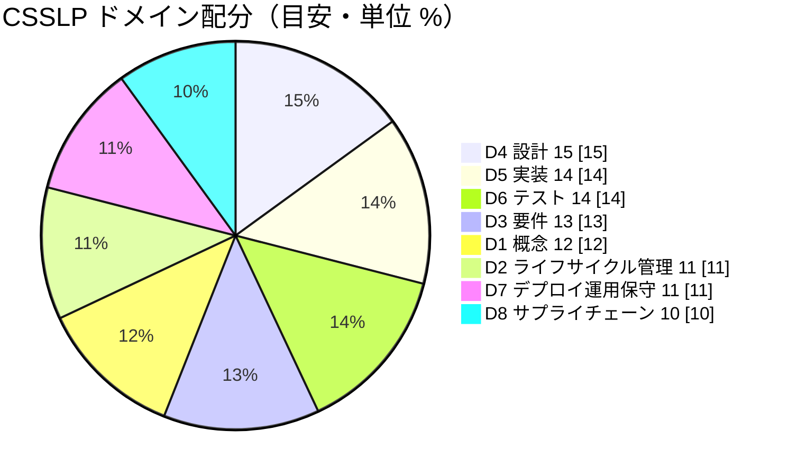

| Domain | 名称 | 配点目安 | 想定問題数（125問換算） |
|---|---|---|---|
| 1 | Secure Software Concepts | 12% | 約15問 |
| 2 | Secure Software Lifecycle Management | 11% | 約14問 |
| 3 | Secure Software Requirements | 13% | 約16問 |
| 4 | Secure Software Architecture and Design | 15% | 約19問 |
| 5 | Secure Software Implementation | 14% | 約18問 |
| 6 | Secure Software Testing | 14% | 約18問 |
| 7 | Secure Software Deployment, Operations, Maintenance | 11% | 約14問 |
| 8 | Secure Software Supply Chain | 10% | 約13問 |

> ⚠️ **配点は情報源によって数値が異なります**（例: Domain 7 を 12% とする資料もあり）。上表は ExamCert の解説（2026年8月更新）に基づく目安です。**ISC2 公式 PDF のエグザムアウトラインが正**なので、学習計画を立てる前に必ず確認してください。

---

## 2. 全体像：SDLC に「セキュリティ」を織り込む

### 2.1 ライフサイクルとドメインの対応

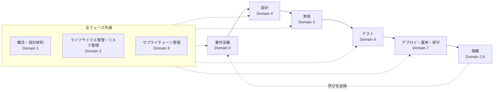

### 2.2 「シフトレフト」という考え方

**シフトレフト**とは、セキュリティ作業をライフサイクルの**できるだけ早い段階（左側）**に移すことです。修正コストは、後工程ほど大きくなります。

| 発見フェーズ | 修正コストの傾向 | 例 |
|---|---|---|
| 要件・設計 | 小さい | 設計レビューで認可欠落を発見 → 図面修正のみ |
| 実装 | 中 | SAST で SQL インジェクションを発見 → コード修正 |
| テスト | やや大 | DAST で発見 → 修正・再テスト |
| 本番運用 | 大 | 脆弱性悪用後の対応 → インシデント対応・通知・信用毀損 |

### 2.3 学習ロードマップ（初学者向け）

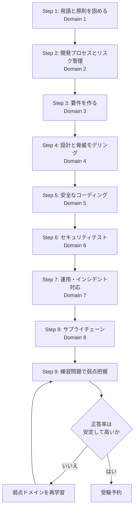

---

## 3. Domain 1: Secure Software Concepts（セキュアソフトウェアの概念）

> **このドメインの役割**: 以降すべてのドメインの「共通言語」。用語の定義が正確に言えれば得点しやすい“取りやすいドメイン”です。

### 3.1 【1.1】コアコンセプトを理解する

#### Step 1: CIA トライアド＋αを押さえる

| 概念 | 一言で | 実装例（公式アウトライン例示） | ✅ ベストプラクティス |
|---|---|---|---|
| **Confidentiality（機密性）** | 見てはいけない人に見せない | 暗号化 | 通信は TLS、保管データは強力な共通鍵暗号。**独自暗号は作らず**、検証済みライブラリを使う。鍵管理を設計に含める |
| **Integrity（完全性）** | 勝手に改ざんされない | ハッシュ、デジタル署名、コード署名 | 改ざん検知には **HMAC／デジタル署名**。単なるハッシュは「改ざんした人が再計算できる」点に注意 |
| **Availability（可用性）** | 必要なときに使える | 冗長化、レプリケーション、クラスタリング、スケーラビリティ、レジリエンス | 単一障害点を排除。レート制限・リソース上限で DoS 耐性を持たせる |
| **Authentication（認証）** | 本人であることの確認 | MFA、IAM、SSO、フェデレーション、生体認証 | **MFA を標準**に。認証基盤は自作せず IdP（OIDC/SAML）を活用。パスワードレス（パスキー）も検討 |
| **Authorization（認可）** | 何をしてよいかの制御 | アクセス制御、権限、エンタイトルメント | **デフォルト拒否**。認可チェックは**必ずサーバー側**で実施。リソース単位で検証 |
| **Accountability（説明責任）** | 誰が何をしたか追える | 監査、ログ | 改ざん困難なログ保管、時刻同期、ユーザー ID の紐づけ |
| **Nonrepudiation（否認防止）** | 「やっていない」と言わせない | デジタル署名、ブロックチェーン | **認証＋完全性＋タイムスタンプ**の組み合わせで成立 |
| **GRC** | ガバナンス・リスク・コンプライアンス | 規制当局、法律、業界標準 | 規制要件を**要件定義の段階**で洗い出す |

#### Step 2: AAA の流れを図で理解する

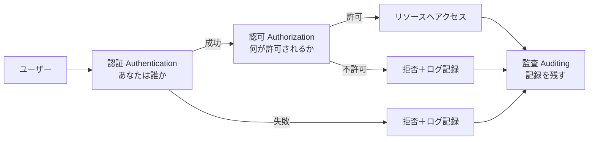

#### Step 3: 混同しやすい用語を整理する

| 比較 | 違い | 覚え方 |
|---|---|---|
| 認証 vs 認可 | 認証＝「誰か」、認可＝「何ができるか」 | 空港の**パスポート確認**と**搭乗ゲートの権限** |
| 暗号化 vs ハッシュ | 暗号化は**元に戻せる**、ハッシュは**一方向** | 金庫（開けられる）と指紋（戻せない） |
| ハッシュ vs 署名 | 署名は**誰が作ったか**まで保証 | ハッシュ＋秘密鍵 |
| エンコード vs 暗号化 | エンコードは**形式変換**で秘匿性なし（Base64 等） | 暗号ではない |
| 完全性 vs 否認防止 | 否認防止は**行為者の特定**まで必要 | 改ざんされていない＋誰がやったか |

> 🎯 **試験ポイント**: 「パスワードを DB に保存する」シナリオでは、**暗号化ではなくソルト付きの遅い一方向ハッシュ（bcrypt/scrypt/Argon2 等）**が正解になりやすい。

### 3.2 【1.2】セキュア設計原則を理解する

> **公式が列挙する10原則**。Saltzer と Schroeder の古典的な原則が土台です。**「原則名 → 具体例」の対応**が頻出です。

| # | 原則 | 平易な説明 | アウトライン例示 | ✅ ベストプラクティス |
|---|---|---|---|---|
| 1 | **Least privilege（最小権限）** | 必要最小限の権限だけ与える | アクセス制御、need-to-know、実行時権限、Zero Trust | サービスアカウントは専用・最小権限。管理者権限での常時稼働を避ける。**期限付き権限（JIT）** |
| 2 | **Segregation of Duties（職務分離）** | 1人に全権を持たせない | 多者統制、秘密分散、知識分割 | 「コードを書く人」と「本番へ承認する人」を分ける。重要鍵は**分割管理** |
| 3 | **Defense in depth（多層防御）** | 防御を何層も重ねる | 階層化された制御、地理的・技術的多様性 | 入力検証＋WAF＋権限制御＋監視など、**1層が破られても止まる**設計 |
| 4 | **Resiliency（回復力）** | 障害時も安全・継続 | fail safe、fail secure、単一障害点排除、フェイルオーバー | 障害時の振る舞い（開く／閉じる）を**設計時に明示** |
| 5 | **Economy of mechanism（機構の経済性）** | 仕組みは**シンプル**に | SSO、パスワード保管庫、リソース効率 | 複雑さ＝バグの温床。機能と実装を最小化 |
| 6 | **Complete mediation（完全な仲介）** | **毎回**アクセス権を確認 | Cookie 管理、セッション管理、資格情報のキャッシュ | 認可結果を長時間キャッシュしない。**リクエストごと**に検証 |
| 7 | **Open design（オープン設計）** | 秘密は鍵だけ、設計は公開前提 | ケルクホフスの原則、ピアレビュー、OSS | 「設計の秘匿」に依存しない（Security through obscurity を避ける） |
| 8 | **Least common mechanism（共通機構の最小化）** | ユーザー間で共有する仕組みを減らす | 区画化／隔離、許可リスト | テナント分離、コンテナ・サンドボックスで隔離 |
| 9 | **Psychological acceptability（心理的受容性）** | **使いにくい対策は回避される** | パスワード複雑性、パスワードレス、画面設計、CAPTCHA | セキュリティと**ユーザビリティの両立**。過剰な定期変更強制は逆効果 |
| 10 | **Component reuse（コンポーネント再利用）** | 実績ある部品を使い回す | 共通コントロール、ライブラリ | 認証・暗号は**検証済み共通部品**を使う。ただし再利用部品の**脆弱性管理**も必須（→ Domain 8） |

#### fail safe と fail secure の違い（最頻出の引っかけ）

| 用語 | 重視するもの | 例 |
|---|---|---|
| **fail safe** | **人命・安全** | 火災時に電子ロックの扉が**開く** |
| **fail secure** | **資産・機密保護** | 停電時に金庫室の扉が**閉まったまま** |

> 🎯 **試験ポイント**:
> - 「**毎回**確認する」→ Complete mediation
> - 「**鍵以外は公開してよい**」→ Open design
> - 「**共有を減らす／隔離**」→ Least common mechanism
> - 「**使いにくいと回避される**」→ Psychological acceptability
> - 「**複数人の承認が必要**」→ Segregation of Duties

### 3.3 AI 時代の補足（公式ページの記載より）

ISC2 の公式アウトラインページには、各ドメインについて **AI／LLM の統合による影響**が追記されています。Domain 1 では次のような観点です。

| 観点 | 内容 |
|---|---|
| 非決定的な出力 | 生成 AI の確率的出力に対しても設計原則を適用する |
| データ起因のリスク | データポイズニング、モデルインバージョン、学習データの記憶による PII／ソースコード漏えい |
| 基本原則の再解釈 | CIA 等の基本概念を ML 特有の脆弱性に合わせて見直す |

---

## 4. Domain 2: Secure Software Lifecycle Management（ライフサイクル管理）

> **このドメインの役割**: 「セキュリティを**組織の仕組み**として回す」ためのガバナンス領域。プロセス・標準・指標・リスク管理が中心です。

### 4.1 【2.1】開発方法論の中でセキュリティを管理する（Agile／Waterfall）

| 方法論 | 特徴 | セキュリティ活動の入れ方 | ✅ ベストプラクティス |
|---|---|---|---|
| **Waterfall** | 工程が順番に進む | 各フェーズの**ゲート**でセキュリティレビュー | 要件・設計フェーズでの脅威モデリングを必須化 |
| **Agile／Scrum** | 短いスプリントで反復 | **セキュリティ・ユーザーストーリー**、Definition of Done に組み込む | 「セキュリティ受入基準」を DoD に。**セキュリティ・スパイク**（調査タスク）をバックログへ |
| **DevOps／DevSecOps** | 開発と運用の連携・自動化 | CI/CD に**自動セキュリティテスト** | パイプラインにSAST・SCA・シークレット検知・IaCスキャンを組み込む |

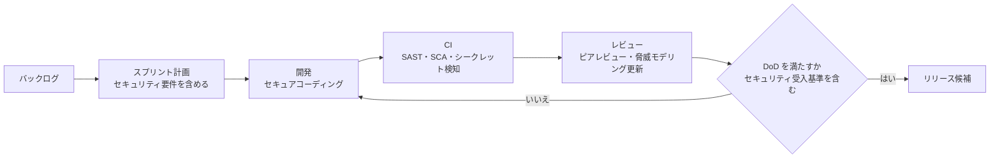

### 4.2 【2.2】セキュリティ標準を特定・採用する

| 標準／フレームワーク | 種別 | 何をするものか |
|---|---|---|
| **ISO**（27001／27034 等） | 国際規格 | 情報セキュリティマネジメント、アプリケーションセキュリティ |
| **PCI DSS** | 業界標準 | カード情報を扱うシステムの要件 |
| **NIST**（SSDF／RMF 等） | 政府系ガイダンス | セキュア開発の実践、リスク管理の枠組み |
| **OWASP**（Top 10／ASVS／SAMM） | コミュニティ | 脆弱性の認知、検証基準、成熟度モデル |
| **SAFECode** | 業界団体 | セキュアな開発実践のガイダンス |
| **SAMM** | 成熟度モデル | 自組織の現状を測り、改善ロードマップを描く |
| **BSIMM** | 成熟度モデル | 他社の実際の活動を観測データとして比較 |

> **SAMM と BSIMM の違い**: SAMM は「**どうあるべきか**」を示す規範的モデル、BSIMM は「**他社が実際にやっていること**」を記述する観測的モデル、と整理すると混同しにくくなります。

✅ **ベストプラクティス**: 標準は「全部採用」ではなく、**自社の規制・リスクに合うものを選び、ギャップ分析→ロードマップ化**する。**セキュリティ意識向上（awareness）の教育**もセットで計画する。

### 4.3 【2.3】戦略とロードマップを策定する

| 概念 | 説明 | ✅ ベストプラクティス |
|---|---|---|
| セキュリティマイルストーン | 各フェーズの到達目標 | 設計完了時に脅威モデル承認、実装完了時に SAST 結果ゼロ重大…のように明文化 |
| チェックポイント／**コントロールゲート** | 次工程に進む条件を確認する関所 | ゲート基準を**事前合意**し、例外承認のプロセスも定義 |
| **ブレイク／ビルド基準（break/build criteria）** | 基準未達ならビルド（リリース）を止める条件 | 例: 「重大度 Critical の未修正脆弱性があればリリース不可」。**誤検知の扱いも運用ルール化** |

### 4.4 【2.4】セキュリティ文書を定義・作成する

| 文書 | 目的 |
|---|---|
| セキュリティポリシー／標準／ガイドライン | 守るべきルールの明文化 |
| 脅威モデル文書、アーキテクチャ図 | 設計時のリスク根拠 |
| セキュア構成ガイド、運用手順書 | デプロイ・運用での実施事項 |
| インシデント対応計画 | 発生時の動き方 |

✅ **ベストプラクティス**: 文書は**バージョン管理**し、**責任者と更新サイクル**を定める。「書いて終わり」にしない。

### 4.5 【2.5】セキュリティ指標（メトリクス）を定義する

| 指標の種類 | 例（アウトライン例示を含む） | 見方 |
|---|---|---|
| 重要度（criticality） | Critical／High／Medium／Low の件数 | 重大な未解決が減っているか |
| **平均修正時間（MTTR 等）** | 脆弱性の発見から修正までの平均日数 | 対応スピード |
| 複雑度 | サイクロマティック複雑度 | 複雑なコードは不具合・脆弱性が潜みやすい |
| **KPI** | 脆弱性の再発率、テストカバレッジ | 日々の運用指標 |
| **OKR** | 目標（Objective）と成果指標（Key Results） | 組織目標との接続 |

✅ **ベストプラクティス**:
- **意思決定に使える指標**だけ追う（虚栄指標を避ける）
- 件数だけでなく**傾向（トレンド）と滞留期間**を見る
- 指標は**チーム間で比較して責めるためでなく改善のため**に使う

### 4.6 【2.6】アプリケーションを廃止（デコミッション）する

| 項目 | 実施内容 |
|---|---|
| **EOL ポリシー** | 資格情報の削除、設定の削除、ライセンス解約、アーカイブ、SLA の終了処理 |
| **データ処分（Data disposition）** | 保持期間の確認、破棄方法、他システムとの**依存関係**の確認 |

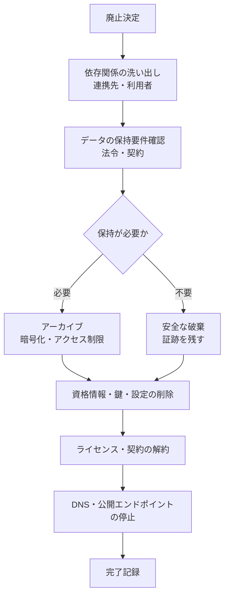

✅ **ベストプラクティス**: 「止めたつもりで**認証情報や公開エンドポイントが残る**」のが典型的な事故。廃止チェックリストを標準化する。

### 4.7 【2.7】セキュリティレポーティングの仕組みを作る

| 仕組み | 目的 |
|---|---|
| レポート | 経営層・ステークホルダーへの定期報告 |
| ダッシュボード | リアルタイムの可視化 |
| **フィードバックループ** | テスト・運用で得た知見を要件・設計へ戻す |

### 4.8 【2.8】統合リスクマネジメントを取り入れる

#### リスクの基本式

| 用語 | 意味 |
|---|---|
| リスク | 脅威が脆弱性を突き、資産に影響を与える可能性 |
| 定性的評価 | 高・中・低などで評価 |
| 定量的評価 | 金額で評価（下式） |
| SLE | 1回の損失額（Single Loss Expectancy） |
| ARO | 年間発生率（Annualized Rate of Occurrence） |
| **ALE** | **ALE ＝ SLE × ARO**（年間予想損失額） |

#### リスク対応の選択肢

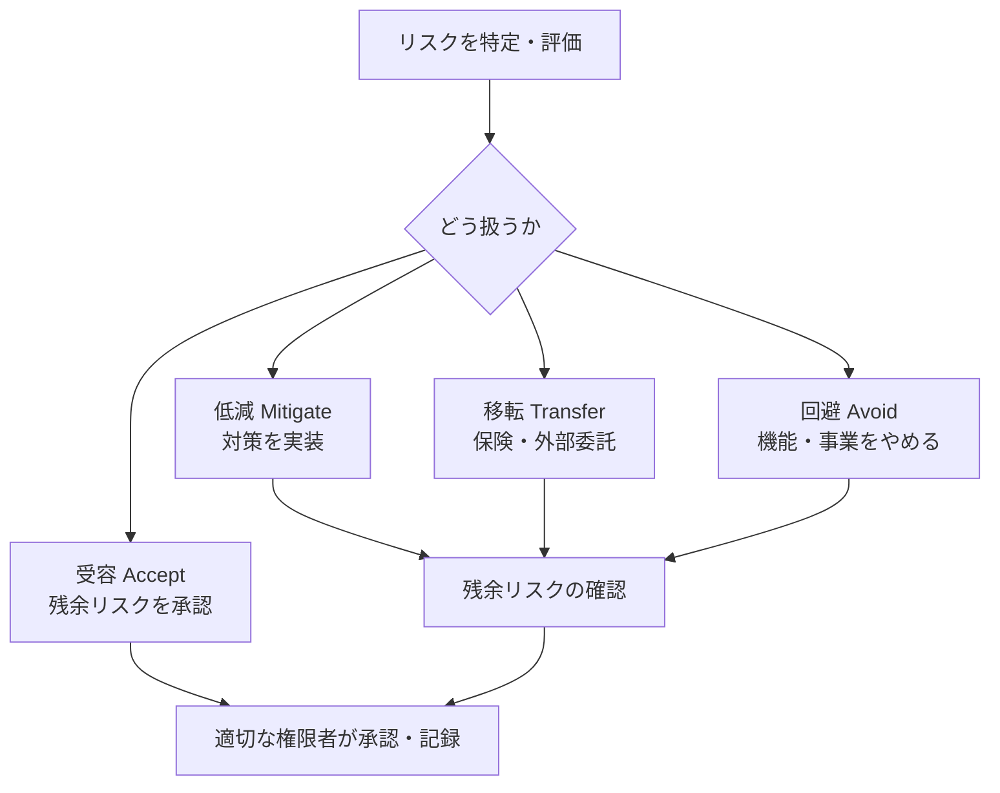

| 観点（アウトライン例示） | ポイント |
|---|---|
| 規制・標準・ガイドライン | ISO、PCI、NIST、OWASP、SAFECode、SAMM、BSIMM |
| **法的観点** | 知的財産、**漏えい通知義務** |
| **技術リスク vs ビジネスリスク** | 技術リスク（脆弱性の深刻度）を、**事業への影響**に翻訳して意思決定者へ伝える |

> 🎯 **試験ポイント**: **リスク受容は「適切な権限を持つ人」が文書で承認**する。開発者が独断で受容するのは不適切。

### 4.9 【2.9】セキュアな運用プラクティスを実装する

| 項目 | 内容 | ✅ ベストプラクティス |
|---|---|---|
| **変更管理（Change management）** | 変更を計画・承認・記録・検証する | 緊急変更でも事後レビューを必須に。ロールバック手順を事前に用意 |
| **インシデント対応計画** | 検知から事後レビューまでの手順 | 役割分担・連絡網・演習（机上訓練）を定期実施 |
| **検証と妥当性確認（V&V）** | Verification: 仕様どおりか／Validation: 要求を満たすか | 独立した立場での確認を組み込む |
| **A&A（評価と認可）** | システムを評価し、運用許可（ATO）を出す | リスクと残余リスクの明文化、認可権者の署名 |

> **Verification と Validation の違い**: Verification は「**正しく作っているか**」（仕様との整合）、Validation は「**正しいものを作ったか**」（ユーザーニーズとの整合）。

### 4.10 AI 時代の補足（公式ページの記載より）

| 観点 | 内容 |
|---|---|
| DevSecOps → **MLSecOps** | モデルの継続的な再学習ループをスプリントに統合 |
| 生成 AI コーディング支援 | 「ハルシネーション」による脆弱性やゲート回避を防ぐ運用 |
| 新しいフレームワーク | OWASP Top 10 for LLMs などを従来標準と併用 |
| ビルド停止基準 | モデルのバイアス・ハルシネーション率が閾値超過なら CI/CD を止める |

---

## 5. Domain 3: Secure Software Requirements（セキュアソフトウェア要件）

> **このドメインの役割**: 「何を守るか・何を満たすか」を**テスト可能な形**で定義する。要件の抜けは後工程で高くつきます。

### 5.1 【3.1】ソフトウェアのセキュリティ要件を定義する

| 種別 | 内容（アウトライン例示） | セキュリティ要件の例 |
|---|---|---|
| **機能要件** | ビジネス要件、ユースケース、ストーリー | 「ユーザーは自分の注文履歴のみ閲覧できる」「パスワードリセットはメールのワンタイムリンクで行う」 |
| **非機能要件** | セキュリティ、運用、継続性、デプロイ | 「通信は TLS で暗号化」「管理操作は全て監査ログに残す」「障害時の RTO は〇時間」 |

#### 良い要件・悪い要件

| 悪い例 | 良い例（テスト可能） |
|---|---|
| 「安全であること」 | 「全ての API は認証必須で、未認証は 401 を返す」 |
| 「個人情報を保護する」 | 「個人情報は保存時に暗号化し、閲覧は監査ログに記録する」 |
| 「高速に動くこと」 | 「ログインは通常負荷で 95% が 1 秒以内、ブルートフォース対策として連続失敗 N 回でロック」 |

✅ **ベストプラクティス**: 要件は **曖昧語を避け、検証方法（どうテストするか）をセットで書く**。OWASP ASVS（Application Security Verification Standard）の要件項目を**要件テンプレート**として流用すると漏れを減らせる。

### 5.2 【3.2】コンプライアンス要件を特定する

| 区分 | 例 |
|---|---|
| 規制当局 | 個人情報保護委員会（日本）、各国のデータ保護当局 |
| 法律 | 個人情報保護法（APPI）、GDPR 等 |
| **業界固有** | 防衛、医療、商用、金融、**PCI DSS** |
| **社内** | 開発ツール、標準、フレームワーク、プロトコルの社内規定 |

✅ **ベストプラクティス**:
- 対象となる規制を**早期に棚卸し**し、要件へ**トレーサブルに**落とす（→ 5.7）
- 規制は**配信地域・利用者の所在地**で決まることがある（海外ユーザーがいれば海外法も対象になり得る）

### 5.3 【3.3】データ分類要件を特定する

| 観点 | 内容（アウトライン例示） |
|---|---|
| データ所有 | データ辞書、**データオーナー**（責任者）、**データカストディアン**（保管・運用担当） |
| ラベリング | 機密度、影響度 |
| データ種別 | 構造化、非構造化 |
| ライフサイクル | 生成 → 保管 → 保持 → 廃棄 |
| 取り扱い | PII（個人を特定できる情報）、公開情報 |

#### 分類レベルの例

| レベル | 例 | 代表的な取り扱い |
|---|---|---|
| 公開 | プレスリリース | 制限なし |
| 社内限定 | 社内手順書 | 社内ネットワーク／認証必須 |
| 機密 | 顧客リスト、設計書 | 暗号化、アクセスログ、最小権限 |
| 極秘 | 認証情報、決済情報 | 強い暗号化、承認制アクセス、持ち出し禁止 |

> **オーナーとカストディアンの違い**: オーナー＝「**分類と利用を決める責任者**」、カストディアン＝「**決められたとおり保管・保護する担当**」。

### 5.4 【3.4】プライバシー要件を特定する

| 観点 | 内容 | ✅ ベストプラクティス |
|---|---|---|
| 収集範囲 | 何を・なぜ集めるか | **必要最小限**だけ収集（データ最小化） |
| 匿名化 | 仮名化（再識別可能）／完全匿名 | 仮名化は**個人データのまま**扱われる場合がある点に注意。再識別リスクを評価 |
| ユーザーの権利 | 削除・忘れられる権利、マーケティング設定、第三者提供の同意、利用規約 | 削除要求に応える**技術的な手段**（バックアップ含む）を設計 |
| 保持 | 期間・場所・対象 | 保持期限を定義し、**自動削除**を実装 |
| **国境をまたぐ要件** | データレジデンシー、管轄、多国籍処理 | データ保管リージョンと転送経路を設計段階で確定 |

> 🎯 **試験ポイント**: 「**仮名化（pseudonymization）**」は鍵や対応表があれば**元に戻せる**。「完全匿名（anonymization）」は元に戻せない。

### 5.5 【3.5】データアクセスのプロビジョニングを定義する

| 項目 | 内容 | ✅ ベストプラクティス |
|---|---|---|
| ユーザープロビジョニング | 入社・異動・退職（Joiner-Mover-Leaver）に応じた権限付与・変更・削除 | 退職時の**即時剥奪**を自動化 |
| **サービスアカウント** | 人でなくシステムが使うアカウント | 専用・最小権限・**鍵のローテーション**・対話ログイン禁止 |
| **再承認プロセス** | 権限の定期棚卸し（アクセスレビュー） | 四半期など**周期的に再承認**し、不要権限を削除 |

### 5.6 【3.6】ミスユース／アビューズケースを作る

**ミスユースケース**は、悪意ある（または誤った）利用者の視点で「どう悪用できるか」を書いたユースケースです。通常のユースケースの**裏返し**を考えます。

| ユースケース（正常） | ミスユース／アビューズケース | 緩和策（Mitigating control） |
|---|---|---|
| ユーザーがログインする | 攻撃者がパスワードを総当たりする | レート制限、アカウントロック、MFA |
| ユーザーが注文履歴を見る | 他人の注文 ID を指定して閲覧する | オブジェクト単位の認可チェック |
| ユーザーがファイルをアップロード | 悪意あるスクリプトをアップロード | 拡張子・内容の許可リスト、隔離保存 |
| チャットボットに質問 | プロンプトインジェクションで制約を回避 | 入出力検証、権限分離、ガードレール |


### 5.7 【3.7】セキュリティ要件トレーサビリティマトリクス（RTM）を作る

要件が**設計・実装・テストまで漏れなく**つながっているかを追跡する表です。

| 要件 ID | 要件 | 設計要素 | 実装 | テストケース | 状態 |
|---|---|---|---|---|---|
| SR-001 | 全 API は認証必須 | 認証ゲートウェイ | AuthMiddleware | TC-101 | 検証済 |
| SR-002 | 個人情報は保存時暗号化 | KMS 連携設計 | EncryptField | TC-120 | 実装中 |
| SR-003 | 管理操作は監査ログ | ログ設計 | AuditLogger | TC-140 | 未着手 |

✅ **ベストプラクティス**: RTM は**課題管理ツールで要件とテストを相互リンク**し、**要件が変わったらテストも見直す**運用にする。

### 5.8 【3.8】サードパーティベンダーのセキュリティ要件を定義する

| 要求項目の例 | 内容 |
|---|---|
| セキュア開発の実践 | ベンダーの SDLC に脅威モデリング・SAST 等があるか |
| 脆弱性の通知 | 発見時の通知期限・窓口 |
| 監査権 | 必要時に監査できる権利（Right to audit） |
| データ取扱い | 保管場所、再委託、廃棄 |
| 認証・第三者評価 | ISO 27001、SOC 2 等の保有 |

> → **契約・調達の観点は Domain 8（サプライチェーン）で詳しく扱います。**

### 5.9 AI 時代の補足（公式ページの記載より）

| 観点 | 内容 |
|---|---|
| 機能要件 | AI モデルに**許可されない自律動作をさせない**要件、利用範囲の明確化（機能のスコープ膨張を防ぐ） |
| 非機能要件 | **ハルシネーション率・バイアスの許容水準**を定義 |
| アビューズケース | 埋め込みチャットボットへのジェイルブレイク・操作の試み |

---

## 6. Domain 4: Secure Software Architecture and Design（アーキテクチャと設計）

> **配点が最も高いドメイン**。**脅威モデリング**が最重要です。設計で防げば実装・運用の手間が大幅に減ります。

### 6.1 【4.1】セキュリティアーキテクチャを定義する

#### アーキテクチャ領域ごとの主要論点

| 領域（アウトライン） | 主な脅威・論点 | ✅ ベストプラクティス |
|---|---|---|
| **セキュアなアーキテクチャ／設計パターン** | SABSA、責任連鎖、**フェデレーテッド ID** | 業務要件から**トレーサブルにセキュリティ要件を導出**（SABSA の考え方） |
| 分散コンピューティング | クライアントサーバー、P2P、メッセージキュー、N 層 | **層ごとに信頼境界**を設け、層間通信を認証・暗号化 |
| **SOA／マイクロサービス** | サービス間の信頼、ESB、Web サービス | **サービス間認証（mTLS 等）**、API ゲートウェイ、サービス単位の認可 |
| リッチインターネットアプリ | クライアント側の悪用、リモートコード実行、常時接続 | **クライアントは信頼しない**。検証は必ずサーバー側 |
| ユビキタス／IoT | IoT、無線、位置情報、RFID、NFC、センサーネット、メッシュ | 機器ごとの識別、最小機能、更新手段を設計 |
| **組込みソフトウェア** | セキュアブート、セキュアメモリ、セキュアアップデート | **署名検証付き更新**、ハードウェアルートオブトラスト |
| **クラウド** | SaaS／PaaS／IaaS | **責任共有モデル**を理解し、自社責任範囲を明確化 |
| モバイル | 暗黙的なデータ収集（プライバシー） | 権限は必要最小限、端末内保存データの保護 |
| ハードウェア | **サイドチャネル緩和、投機的実行緩和**、セキュアエレメント、ファームウェア、ドライバー | 既知の CPU 脆弱性への緩和パッチ適用・設計配慮 |
| 認知コンピューティング | AI、VR、AR | モデル・データの分離、入出力の検証 |
| **産業用 IoT（IIoT）** | 設備、自動車、ロボット、医療機器、ソフトウェア定義の生産 | **安全性（Safety）とセキュリティの両立**、パッチ適用の制約を考慮 |

#### クラウドの責任共有モデル（概念）

| サービスモデル | プロバイダー責任（概略） | 利用者責任（概略） |
|---|---|---|
| IaaS | 物理・ハイパーバイザー | OS 以上（OS・ミドルウェア・アプリ・データ） |
| PaaS | OS・ランタイムまで | アプリ・データ・設定 |
| SaaS | アプリまで | データ・アクセス管理・設定 |

> どのモデルでも、**データとアクセス管理は利用者の責任**が残る点が重要です。

✅ **セキュリティコントロールの識別と優先順位付け**: 脅威とリスクの大きい順に、**コントロールを割り当てる**（全てに同じ強度の対策をかけない）。

### 6.2 【4.2】セキュアなインタフェース設計を行う

| 項目 | 内容 | ✅ ベストプラクティス |
|---|---|---|
| セキュリティ管理インタフェース／**帯域外（OOB）管理**／ログインタフェース | 管理系は攻撃者の最重要標的 | 管理画面は**通常利用と別ネットワーク・別認証**。MFA 必須 |
| 上流／下流の依存関係 | アプリ間の鍵・データ共有 | 共有する鍵・データの**範囲と期限**を最小化 |
| プロトコル設計（API 等） | API の弱点、状態管理、モデル | 認証・認可・レート制限・入力スキーマ検証を**API 仕様に組み込む** |

### 6.3 【4.3】再利用可能な技術を評価・選択する

| 技術領域（アウトライン） | 概要 | ✅ ベストプラクティス |
|---|---|---|
| **資格情報管理** | X.509 証明書、SSO | 証明書の**有効期限監視と自動更新** |
| フロー制御 | プロキシ、ファイアウォール、プロトコル、キュー | 許可リスト方式、通信経路の最小化 |
| **DLP（データ損失防止）** | 機密データの流出検知・防止 | 分類ラベルと連動して制御 |
| **仮想化** | IaC、ハイパーバイザー、コンテナ | IaC もコードとして**レビュー・スキャン**。コンテナは最小権限・最小イメージ |
| **トラステッドコンピューティング** | TPM、TCB | **TCB（信頼できる計算基盤）を小さく**保つ |
| データベースセキュリティ | 暗号化、トリガー、ビュー、権限管理、安全な接続 | **ビューで公開範囲を限定**、アプリ用 DB ユーザーは最小権限 |
| プログラミング言語環境 | CLR、JVM、Python、PowerShell | ランタイムのセキュリティ機能・サンドボックスを活用、サポート期限の管理 |
| OS の制御・サービス | OS のアクセス制御・機能 | ハードニング済みベースラインを利用 |
| **バックアップ・復元計画** | 安全なバックアップと復元 | **バックアップも暗号化**。復元テストを定期実施 |
| データの保持・取得・破棄 | 安全な保持・廃棄 | 保持期限・廃棄方式を設計 |

### 6.4 【4.4】脅威モデリングを行う（最重要）

#### 脅威モデリングとは

**「作る前（または作りながら）に、攻撃者の視点でシステムの弱点を洗い出し、対策を決める活動」**です。

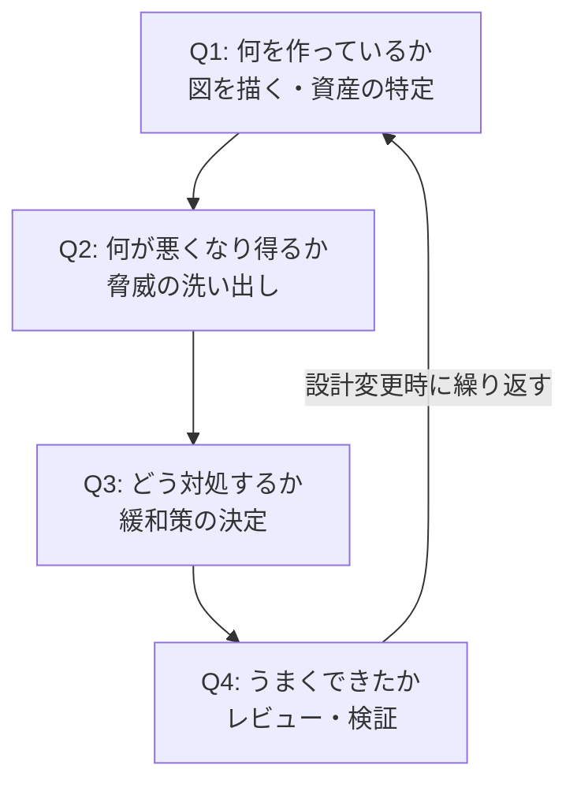

> ※ この「4つの問い」は脅威モデリングの代表的な整理（Adam Shostack 氏の枠組み）です。今回の検索では原典を直接取得していないため、詳細は書籍・公式資料で確認してください。

#### STRIDE（アウトライン記載の手法）

| 頭文字 | 脅威 | 侵害される性質 | 緩和策の例 |
|---|---|---|---|
| **S** | Spoofing（なりすまし） | 認証 | 強い認証、MFA、証明書 |
| **T** | Tampering（改ざん） | 完全性 | 署名、HMAC、入力検証、権限制御 |
| **R** | Repudiation（否認） | 否認防止 | 監査ログ、署名、タイムスタンプ |
| **I** | Information Disclosure（情報漏えい） | 機密性 | 暗号化、アクセス制御、エラーメッセージの抑制 |
| **D** | Denial of Service（サービス拒否） | 可用性 | レート制限、冗長化、リソース制限 |
| **E** | Elevation of Privilege（権限昇格） | 認可 | 最小権限、認可チェック、入力検証 |

> 🎯 **試験ポイント**: 「**STRIDE の各文字 → どのセキュリティ特性の侵害か**」の対応が頻出。例えば「改ざん＝完全性」「否認＝否認防止」。

#### その他の手法（アウトライン記載）

| 手法 | 特徴 |
|---|---|
| **PASTA** | **7段階**のリスク中心の攻撃シミュレーション手法。ビジネス目標から攻撃分析まで一貫 |
| **ハイブリッド脅威モデリング手法** | 複数手法の長所を組み合わせる |
| **CVSS** | 脅威モデリング手法ではなく**脆弱性の深刻度評価**（→ 8.6） |

#### データフロー図（DFD）と信頼境界

脅威モデリングでは**データフロー図**に**信頼境界（Trust boundary）**を描き、**境界を越える箇所**を重点的に分析します。

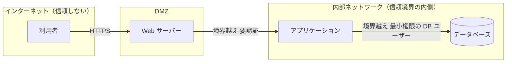

#### 脅威モデリングの構成要素（アウトライン記載）

| 要素 | 内容 |
|---|---|
| **一般的な脅威** | APT（持続的標的型攻撃）、内部脅威、一般的なマルウェア、第三者サプライヤー |
| **攻撃対象領域（Attack surface）の評価** | 外部から到達できる入口の洗い出し。**減らす**ことが基本 |
| 脅威分析 | 脅威の発生可能性と影響の分析 |
| **脅威インテリジェンス** | 自社に関係の深い現実的な脅威の特定・予測 |

✅ **ベストプラクティス**:
- **設計フェーズ**で実施し、**設計変更・新機能ごとに更新**する
- 開発者・アーキテクト・QA・セキュリティが**一緒に**実施する（一人で完結させない）
- 出力は「**脅威一覧 → 対策 → 担当者・期限 → 検証方法**」まで落とし込み、**バックログのチケットにする**

### 6.5 【4.5】アーキテクチャのリスク評価と設計レビューを行う

| 活動 | 内容 | ✅ ベストプラクティス |
|---|---|---|
| アーキテクチャリスク評価 | 設計上の弱点がもたらす事業リスクの評価 | 影響の大きい資産・経路から優先 |
| 設計レビュー | セキュリティ設計原則（Domain 1.2）との照合 | **チェックリスト化**（認証・認可・入力・暗号・ログ・障害時動作） |

### 6.6 【4.6】（非機能）セキュリティ特性と制約をモデル化する

セキュリティは**性能・可用性・使いやすさとトレードオフ**になります。たとえば、暗号処理は性能に影響し、強い認証は使い勝手に影響します。

| 非機能特性 | セキュリティとの関係 |
|---|---|
| 性能 | 暗号化・検証の処理コスト |
| スケーラビリティ | レート制限・状態管理 |
| 可用性 | フェイルオーバー時の鍵・セッション引き継ぎ |
| 使いやすさ | 認証の強度とのバランス（Psychological acceptability） |

✅ **ベストプラクティス**: 制約を**数値で定義**（例: 認証応答時間、鍵ローテーション間隔）し、設計の判断根拠を残す。

### 6.7 【4.7】セキュアな運用アーキテクチャを定義する

| 項目 | 内容（アウトライン例示） | ✅ ベストプラクティス |
|---|---|---|
| デプロイトポロジー | 環境分離・ネットワーク分割 | 開発・検証・本番を**分離**し、本番データを開発に持ち込まない |
| 運用インタフェース | 運用ツールのアクセス経路 | 踏み台・ジャストインタイムアクセス・操作ログ |
| **CI/CD** | 継続的インテグレーション／デリバリー | パイプライン自体を**保護対象**とする（認証情報・権限・署名） |

### 6.8 AI 時代の補足（公式ページの記載より）

| 観点 | 内容 |
|---|---|
| コアロジックと AI 推論エンジンの分離 | AI の不確実な出力が全体を侵害しないよう**疎結合に** |
| ゼロトラスト境界 | ベクトルデータベースや AI 処理クラスターを**境界で保護** |
| フレームワークの適応 | SABSA 等を機械学習の確率的性質・サプライチェーンに合わせて調整 |

---

## 7. Domain 5: Secure Software Implementation（セキュアな実装）

> **このドメインの役割**: 設計を**安全なコード**に落とし込む。「どの脆弱性にどの対策か」の対応が中心です。

### 7.1 【5.1】関連するセキュアコーディングプラクティスに従う

#### 実践項目と対策の一覧

| 項目（アウトライン） | 狙われる弱点 | ✅ ベストプラクティス |
|---|---|---|
| **宣言的 vs 命令的（プログラム的）セキュリティ** | 設定と実装の不整合 | 宣言的（アノテーション・設定）は**一貫した適用**に強く、命令的（コード内判定）は**細かい条件**に強い。**併用**し、デフォルト拒否 |
| **並行性** | 競合状態（Race condition）、TOCTOU | スレッドセーフな実装、DB のトランザクション・排他制御 |
| **入力検証とサニタイズ** | インジェクション全般 | **許可リスト（allow list）方式**で型・長さ・形式・範囲を検証。検証は**サーバー側** |
| **エラー・例外処理** | 情報漏えい、不正な状態遷移 | 利用者には**汎用メッセージ**、詳細はログへ。**例外時は安全側（fail secure）** |
| **出力のサニタイズ** | XSS | 出力先（HTML／属性／JS／URL）**に応じたエンコード** |
| **セキュアなログと監査** | ログへの機密情報混入、改ざん | パスワード・トークン・個人情報を**ログに出さない**。改ざん耐性のある保管 |
| **セッション管理** | セッション固定化、ハイジャック | ログイン時に**セッション ID を再生成**、Cookie に Secure／HttpOnly／SameSite、適切なタイムアウト |
| 信頼／非信頼の API・ライブラリ | 悪意ある・脆弱な部品 | 信頼境界を明確化し、非信頼な入力は**常に検証** |
| **リソース管理** | メモリ破壊、リソース枯渇 | メモリ安全な言語の活用、境界チェック、**リソース上限・タイムアウト** |
| **セキュアな構成管理** | 既定パスワード、ハードコードされた秘密 | **ベースライン構成**を定義し、**資格情報をコードに埋め込まない** |
| **トークナイゼーション** | 機密データの露出 | 機密値（カード番号等）を**意味のないトークンに置換** |
| **分離（Isolation）** | 侵害の波及 | サンドボックス、仮想化、コンテナ、分離カーネル |
| **暗号** | 弱い暗号、鍵管理不備 | 下表参照 |
| **アクセス制御** | 認可の不備 | **RBAC／DAC／MAC** の理解と使い分け（下表） |
| プロセッサのマイクロアーキテクチャのセキュリティ拡張 | CPU 由来の攻撃 | ハードウェアが提供する保護機能の活用 |

#### 暗号の実装ガイド

| 観点（アウトライン例示） | ✅ ベストプラクティス |
|---|---|
| ペイロード／**フィールドレベル**／転送時／保管時 | 機密項目は**フィールド単位で暗号化**、通信は TLS、保管は暗号化 |
| **暗号アジリティ** | アルゴリズムを**将来差し替えられる**設計（ハードコードしない） |
| アルゴリズム選択 | **標準化・検証済み**のアルゴリズム（認証付き暗号など）を使用。**独自暗号は禁止** |
| パスワード保管 | **ソルト付きの低速ハッシュ**（bcrypt／scrypt／Argon2 等） |
| 鍵管理 | 鍵とデータの**別保管**、KMS／HSM、ローテーション |

#### アクセス制御モデルの比較

| モデル | 決めるのは誰か | 特徴 | 例 |
|---|---|---|---|
| **DAC**（任意アクセス制御） | **データの所有者** | 柔軟だが管理が散らばる | ファイルのオーナーが共有設定 |
| **MAC**（強制アクセス制御） | **システム／ポリシー** | 厳格（ラベルに基づく） | 機密区分のラベルによる制御 |
| **RBAC**（ロールベース） | **役割**に権限を紐づけ | 管理しやすく一般的 | 「経理担当」ロール |

#### コード例 1: SQL インジェクションの対策（パラメータ化クエリ）

```python
# ❌ 危険: 入力を文字列連結して SQL を組み立てる
query = f"SELECT * FROM users WHERE email = '{email}'"
cursor.execute(query)

# ✅ 安全: プレースホルダ（パラメータ化クエリ）を使う
query = "SELECT * FROM users WHERE email = %s"
cursor.execute(query, (email,))
```

**なぜ安全か**: 入力値が**SQL の構文ではなく「データ」として扱われる**ため、攻撃文字列がクエリの構造を変えられません。

#### コード例 2: 出力エンコーディング（XSS 対策）

```python
import html

user_input = '<script>alert(1)</script>'

# ❌ 危険: そのまま HTML に埋め込む
page = f"<p>{user_input}</p>"

# ✅ 安全: HTML コンテキスト用にエスケープして出力
page = f"<p>{html.escape(user_input)}</p>"
```

> 重要: エンコードは**出力先（HTML 本文／属性／JavaScript／URL）ごとに方法が異なる**ため、テンプレートエンジンの自動エスケープ機能を既定で有効にするのが基本です。

#### コード例 3: 安全なエラー処理（情報を出しすぎない）

```python
import logging

logger = logging.getLogger(__name__)

def handle_request():
    try:
        process()
    except Exception:
        # 詳細（スタックトレース等）はログへ。ただし機密値は含めない
        logger.exception("request processing failed")
        # 利用者には汎用メッセージのみ返す（fail secure）
        return {"error": "処理に失敗しました"}, 500
```

### 7.2 【5.2】コードのセキュリティリスクを分析する

#### 脆弱性リスト・データベース（アウトライン記載）

| 名称 | 内容 |
|---|---|
| **OWASP Top 10** | Web アプリの重大リスクの認知リスト。**2025 年版が公開済み** |
| **CWE（Common Weakness Enumeration）** | 脆弱性の**種類（弱点）の分類**体系 |
| **SANS Top 25** | 最も危険なソフトウェアエラーの上位リスト |

> **CWE と CVE の違い**: CWE は「**弱点の種類**」の分類（例: バッファオーバーフロー）、CVE は「**個別の脆弱性**」の識別番号（特定製品の特定バグ）。

#### OWASP Top 10:2025（公式サイトの一覧）

| 順位 | カテゴリ | 平易な説明 | 主な対策 |
|---|---|---|---|
| A01 | **Broken Access Control**（アクセス制御の不備） | 見せてはいけない情報・操作ができてしまう | サーバー側の認可、デフォルト拒否、オブジェクト単位の検証 |
| A02 | **Security Misconfiguration**（セキュリティ設定ミス） | 既定設定・不要機能・誤設定 | ハードニング、設定の自動検証、最小構成 |
| A03 | **Software Supply Chain Failures**（サプライチェーンの失敗） | 依存部品・ビルド・配布経路の侵害 | SBOM、署名検証、依存関係管理（→ Domain 8） |
| A04 | **Cryptographic Failures**（暗号の失敗） | 暗号化不備・弱いアルゴリズム・鍵管理不備 | 標準アルゴリズム、TLS、鍵管理の徹底 |
| A05 | **Injection**（インジェクション） | 入力が命令として解釈される | パラメータ化、入力検証、エスケープ |
| A06 | **Insecure Design**（安全でない設計） | 設計段階の欠陥 | 脅威モデリング、セキュア設計パターン |
| A07 | **Authentication Failures**（認証の失敗） | 認証・セッションの弱さ | MFA、安全なセッション管理、総当たり対策 |
| A08 | **Software or Data Integrity Failures**（完全性の失敗） | 未検証の更新・データの改ざん | 署名検証、安全なデシリアライズ |
| A09 | **Security Logging and Alerting Failures**（ログ・警告の失敗） | 攻撃に気づけない | 重要イベントのログ、アラート、監視 |
| A10 | **Mishandling of Exceptional Conditions**（例外状態の不適切な処理） | エラー時に不正な動作・情報漏えい | 例外の網羅的処理、fail secure |

> ⚠️ **2021年版からの主な変化**: **A03（サプライチェーン）** と **A10（例外状態の処理）** が新カテゴリとして登場。2021年版の SSRF は **A01（アクセス制御の不備）** に統合されたと報告されています。試験の出題範囲は ISC2 のアウトライン（「OWASP Top 10」と記載）に従うため、**版を問う出題より概念の理解**が重要です。

#### コード分析の手法

| 手法 | 内容 | メリット | 限界 |
|---|---|---|---|
| **SAST（静的解析）** | 実行せずソースを解析（カバレッジ自動化・リンティング） | 早期（コミット時）に発見、全コードを網羅しやすい | 誤検知、実行時の問題は見えない |
| **手動コードレビュー（ピアレビュー）** | 人が読む | **ロジックの欠陥**に強い | 時間がかかる、属人的 |
| **悪意あるコードの検査** | バックドア、**ロジックボム**、高エントロピー（難読化）の検査 | 内部脅威・混入部品への対処 | 検知が難しい |
| **安全なコード再利用** | 実績あるコードの再利用 | 実装ミスの低減 | 再利用元の脆弱性管理が必要 |

> **ロジックボム**: 特定の条件（日付・イベント）で発動する悪意ある仕掛け。

### 7.3 【5.3】セキュリティコントロールを実装する

| コントロール | 役割 |
|---|---|
| **ウォッチドッグ** | プロセスの死活・異常を監視し、復旧・警告 |
| **ファイル整合性監視（FIM）** | 重要ファイルの改ざん検知 |
| **アンチマルウェア** | マルウェアの検知・隔離 |

✅ **ベストプラクティス**: 予防（Preventive）だけでなく、**検知（Detective）・回復（Corrective）**のコントロールを組み合わせる。

### 7.4 【5.4】特定されたセキュリティリスクに対処する

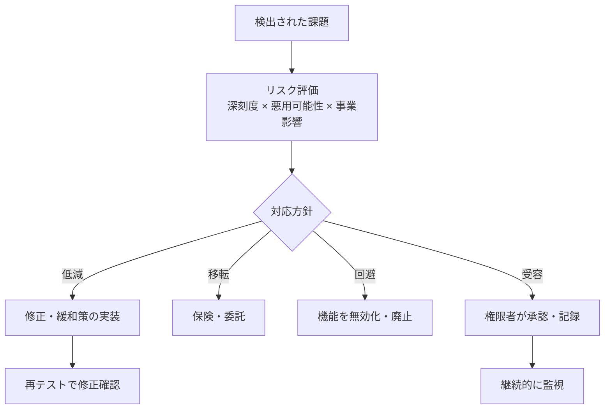

### 7.5 【5.5】コンポーネントを評価・統合する

| 項目 | 内容 | ✅ ベストプラクティス |
|---|---|---|
| **システム・オブ・システムズ統合** | 複数システム連携（信頼契約、セキュリティテスト、分析） | 連携先との**信頼境界・責任**を契約と技術で明確化 |
| **サードパーティ／OSS の安全な利用** | **ソフトウェア構成分析（SCA）** | SCA で依存関係の**既知脆弱性・ライセンス**を継続検査。**不要な依存を減らす** |

### 7.6 【5.6】ビルドプロセスにセキュリティを適用する

| 項目 | 内容 | ✅ ベストプラクティス |
|---|---|---|
| **改ざん対策** | コード署名、難読化 | 成果物に**署名**し、配布前後で検証 |
| **コンパイラスイッチ** | スタック保護、ASLR 対応（PIE）、DEP/NX 等の保護機能を有効化 | セキュリティ関連フラグを**標準ビルド設定**に |
| **コンパイラ警告への対処** | 警告はバグの兆候 | 警告を**エラー扱い**にして放置しない |

### 7.7 AI 時代の補足（公式ページの記載より）

| 観点 | 内容 |
|---|---|
| AI 支援コーディング | **プロンプトインジェクション**対策、**AI 生成コードの出所（プロベナンス）確認** |
| LLM への入力 | 入力の厳格なサニタイズ、意味解析による検証 |
| 宣言的ポリシー | 宣言的ポリシーで AI エージェントの**自律的動作を制限** |

---

## 8. Domain 6: Secure Software Testing（セキュアなテスト）

> **このドメインの役割**: 「どのテストが、どの種類の欠陥を見つけるか」を使い分ける。**テスト手法の対応表**が最重要です。

### 8.1 【6.1】セキュリティテスト戦略と計画を策定する

| 観点（アウトライン） | 内容 | ✅ ベストプラクティス |
|---|---|---|
| 標準 | ISO、OSSTMM（Open Source Security Testing Methodology Manual）、SEI | 公開された方法論を**計画の根拠**にする |
| **機能セキュリティテスト** | ロジック（認証・認可の振る舞い）の検証 | 要件（RTM）から**テストケースを導出** |
| **非機能セキュリティテスト** | 信頼性・性能・スケーラビリティ | 負荷・耐障害性を**攻撃シナリオ**でも検証 |
| **テスト手法** | **既知環境テスト／未知環境テスト**、機能テスト、受入テスト | 下表参照 |
| テスト環境 | 相互運用性、テストハーネス | 本番に近い構成で、**本番データは使わない** |
| **セキュリティ研究者との連携** | バグバウンティ等 | 脆弱性報告窓口（VDP）を設け、受付・対応・公開方針を整備 |

#### 既知環境／未知環境テスト（旧 ホワイトボックス／ブラックボックス）

| 呼称 | 旧称の目安 | 内容 |
|---|---|---|
| **既知環境テスト（known environment）** | ホワイトボックス（／グレーボックス） | 内部構造・ソースなどの情報を**知った上で**テスト。網羅性が高い |
| **未知環境テスト（unknown environment）** | ブラックボックス | 内部情報を**知らず**外部の攻撃者視点でテスト。実際の攻撃に近い |

### 8.2 【6.2】セキュリティテストケースを作成する

#### テスト手法の使い分け（最重要の対応表）

| 手法 | 何をするか | いつ | 見つけやすい欠陥 | 苦手なこと |
|---|---|---|---|---|
| **SAST**（静的） | ソースを**実行せず**解析 | コミット／ビルド時 | インジェクションの兆候、危険な API、ハードコードされた秘密 | 実行時・環境依存の問題 |
| **DAST**（動的） | **動いているアプリ**に外部から攻撃 | テスト環境 | 設定ミス、認証・セッションの問題、実行時の脆弱性 | ソース上の位置の特定、到達できない機能 |
| **IAST**（対話型） | 実行中のアプリ内部に**センサー**を入れ、テスト中に観測 | QA／統合テスト中 | 精度の高い検出、位置特定 | 導入・言語対応 |
| **SCA** | 依存ライブラリの**既知脆弱性・ライセンス** | ビルド時、継続的 | 既知の脆弱性（CVE） | 未知の脆弱性・自作コードの欠陥 |
| **ファジング** | 異常・ランダムな入力を大量投入 | テスト環境 | クラッシュ、メモリ破壊、パーサーの欠陥 | 業務ロジックの欠陥 |
| **ペネトレーションテスト** | 攻撃者の手法で実際に侵入を試みる | リリース前・定期 | 複合的な攻撃経路、設計欠陥 | 網羅性（人手・期間に依存） |

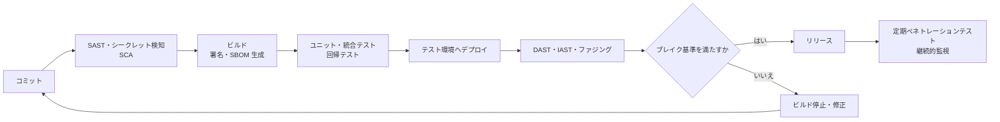

#### アウトラインのテスト項目とポイント

| 項目 | 内容 | ✅ ベストプラクティス |
|---|---|---|
| 攻撃対象領域の検証 | 公開された入口が想定どおりか | 不要な入口（デバッグ、未使用 API）を**閉じる** |
| **ペネトレーションテスト** | セキュリティコントロール、既知脆弱性、既知マルウェアの確認 | **範囲・ルール・連絡体制**を事前合意（Rules of Engagement） |
| **ファジング** | 生成型（ゼロから）／変異型（既存入力を変形） | プロトコル・ファイルパーサーなど**外部入力境界**に重点 |
| **シミュレーション** | 本番相当環境・データでの模擬、合成トランザクション | 本番データは**匿名化**して利用 |
| **障害テスト** | フォールトインジェクション、ストレス、ブレーク | 障害時に**安全側へ倒れる**ことを確認 |
| **暗号検証** | 疑似乱数生成器、エントロピー | **安全な乱数源**の使用確認 |
| ユニットテスト・カバレッジ | 部品単位の検証 | 認証・認可・入力検証の**単体テストを必須化** |
| 回帰テスト | 修正で別の問題が出ていないか | **セキュリティ修正の再発防止テスト**を追加 |
| 統合テスト／継続的テスト | 結合時・常時の検証 | パイプラインに組み込む |
| **ミスユース／アビューズのテスト** | 5.6 で作った悪用シナリオの検証 | **要件→テスト**まで追跡 |

### 8.3 【6.3】ドキュメントを検証・妥当性確認する

| 対象 | 確認ポイント |
|---|---|
| インストール／セットアップ手順 | 手順どおりで**安全な既定構成**になるか |
| エラーメッセージ | 内部情報を漏らしていないか |
| ユーザーガイド | 安全な使い方が明記されているか |
| リリースノート | 修正した脆弱性・既知の制限の記載 |

### 8.4 【6.4】文書化されていない機能を特定する

| 例 | リスク |
|---|---|
| デバッグ用エンドポイント／隠しコマンド | 本番に残ると不正アクセス経路になる |
| バックドア | 悪意または開発者の便宜で残された裏口 |
| イースターエッグ | 意図しない機能・混入コードの温床 |

✅ **ベストプラクティス**: **仕様との差分**を見つけるレビュー、**SAST／マルウェア検査**、未使用ルートの棚卸しを実施。

### 8.5 【6.5】テスト結果のセキュリティ上の含意を分析する

- テスト結果は**プロダクトマネジメントへの判断材料**（優先順位、リリース可否）
- **ブレイク／ビルド基準**（4.3）に照らして、**リリースを止めるか**を決める
- 重大な欠陥は**根本原因**を分析し、同種の欠陥を他にも探す

### 8.6 【6.6】セキュリティエラーを分類・追跡する

| 項目 | 内容 |
|---|---|
| バグ追跡 | 不具合・エラー・脆弱性を**課題管理ツール**で一元管理 |
| **リスクスコアリング** | **CVSS**（Common Vulnerability Scoring System）で深刻度を標準化 |

#### CVSS v4.0 の構成

| メトリクスグループ | 内容 | スコアへの影響 |
|---|---|---|
| **Base** | 脆弱性の**本質的な特性**（時間や環境で変わらない） | 影響する |
| **Threat** | 悪用状況など**時間で変わる**要素（旧 Temporal に相当） | 影響する |
| **Environmental** | **自社環境固有**の事情（資産の重要度、補完的対策） | 影響する |
| **Supplemental** | 追加情報（自動化可能性、復旧性、安全性など） | **スコアは変えない**（情報提供） |

| 表記 | 意味 |
|---|---|
| CVSS-B | Base のみ |
| CVSS-BT | Base ＋ Threat |
| CVSS-BE | Base ＋ Environmental |
| CVSS-BTE | Base ＋ Threat ＋ Environmental |

> 🎯 **試験ポイント**: **CVSS は「深刻度（severity）」であって「リスク」そのものではない**。実際のリスクは、**悪用状況（Threat）と自社の資産重要度（Environmental）**を加味して判断する。

### 8.7 【6.7】テストデータを保護する

| 観点 | 内容 | ✅ ベストプラクティス |
|---|---|---|
| テストデータの生成 | 参照整合性、統計的な質、本番代表性 | **合成データ**を優先的に作る |
| **本番データの再利用** | 難読化、サニタイズ、**匿名化、トークナイゼーション、集約** | 再利用する場合は**必ず匿名化**し、アクセスを制限。**集約による再識別（aggregation）**にも注意 |

### 8.8 【6.8】検証・妥当性確認（V&V）テストを実施する

| 区分 | 問い | 例 |
|---|---|---|
| **Verification** | **正しく作っているか** | 設計・要件との整合確認、レビュー |
| **Validation** | **正しいものを作ったか** | ユーザー受入テスト |
| 独立 V&V | 開発チームと**別の立場**の確認 | 第三者による検証 |

### 8.9 AI 時代の補足（公式ページの記載より）

| 観点 | 内容 |
|---|---|
| 確率的テスト | バイアス・ドリフト・毒性・**敵対的回避**への耐性評価 |
| AI エージェントの検証 | 許可範囲外のコマンドを実行できないことを確認 |
| フレームワーク | NIST AI RMF などに照らした評価 |

---

## 9. Domain 7: Secure Software Deployment, Operations, Maintenance（デプロイ・運用・保守）

> **このドメインの役割**: 「リリースして終わり」ではなく、**稼働中のソフトウェアを守り続ける**領域。13項目と数が多いため、**グルーピングで覚える**のがコツです。

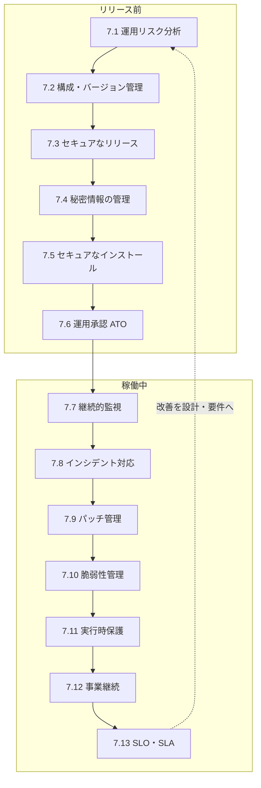

### 9.1 【7.1】運用リスク分析を行う

| 観点（アウトライン） | 内容 | ✅ ベストプラクティス |
|---|---|---|
| デプロイ環境 | ステージング、本番、QA | 環境間の**データ・権限・ネットワークを分離** |
| **人材の訓練** | 管理者とユーザーでは必要な訓練が異なる | 役割別の教育計画 |
| **法令遵守** | ガイドライン、規制、プライバシー法、著作権 | リリース前に**コンプライアンス確認** |
| システム統合 | 連携先との接続 | 連携の**認証・暗号化・権限**を確認 |

### 9.2 【7.2】セキュアな構成管理・バージョン管理

| 項目 | 内容 | ✅ ベストプラクティス |
|---|---|---|
| ハードウェア | 管理対象機器の把握 | 資産台帳の維持 |
| **ベースライン構成** | 承認済みの安全な標準構成 | **ベースラインからの逸脱を検知**（構成ドリフト管理） |
| **バージョン管理／パッチ** | 変更履歴・適用状況の管理 | **全ての変更をトレース可能**に（誰が・いつ・なぜ） |
| ドキュメント実践 | 構成・手順の文書化 | 文書の更新を変更管理に**連動** |

### 9.3 【7.3】ソフトウェアを安全にリリースする

| 項目 | 内容 | ✅ ベストプラクティス |
|---|---|---|
| **セキュア CI/CD パイプライン（DevSecOps）** | パイプラインに自動セキュリティ検査 | パイプラインの**権限・認証情報・実行環境を保護**（それ自体が攻撃対象） |
| アプリセキュリティ ツールチェーン | SAST／DAST／SCA／シークレット検知 等 | ツールの出力を**ブレイク基準**に連動 |
| **ビルド成果物の検証** | コード署名、ハッシュ | 配布物に**署名・ハッシュ**を付け、受け手が**検証**できるように |

### 9.4 【7.4】セキュリティデータを保存・管理する

| 対象（アウトライン） | ✅ ベストプラクティス |
|---|---|
| 資格情報（Credentials） | **ソースコード・イメージ・ログに含めない** |
| **シークレット** | **シークレット管理サービス（Vault 等）**で集中管理し、**動的生成・短命化** |
| 鍵／証明書 | **KMS／HSM**、**ローテーション**、有効期限監視 |
| 構成情報 | 機密設定は暗号化して分離、変更履歴を保持 |

> 🎯 **試験ポイント**: 「ハードコードされた認証情報」「Git 履歴に残ったシークレット」→ **シークレット管理基盤への移行と、漏れた認証情報の失効（ローテーション）**が正解。

### 9.5 【7.5】セキュアなインストールを確保する

| 項目 | 内容（アウトライン例示） | ✅ ベストプラクティス |
|---|---|---|
| セキュアブート | 鍵の生成・管理 | 署名検証された起動チェーン |
| 最小権限 | 必要最小限の権限で稼働 | root／管理者で常時稼働させない |
| **環境のハードニング** | 構成の強化、安全な更新、ファイアウォール | 不要なサービス・ポート・アカウントを**無効化** |
| **セキュアなプロビジョニング** | 資格情報、構成、ライセンス、**IaC** | **IaC でコード化**し、レビュー・スキャンを経て反映 |
| セキュリティポリシーの実装 | 組織ポリシーの適用 | 自動適用・準拠チェック |

### 9.6 【7.6】運用承認（Approval to Operate）を得る

| 項目 | 内容 |
|---|---|
| **リスク受容／サインオフ** | **適切なレベルの権限者**が残余リスクを理解し、承認する |
| 記録 | 承認内容・条件・期限を**文書化** |

> ✅ **ベストプラクティス**: 承認は**口頭ではなく記録に残す**。条件付き承認の場合は**期限付きの是正計画**を添える。

### 9.7 【7.7】情報セキュリティの継続的モニタリング（ISCM）

| 観点（アウトライン） | 内容 | ✅ ベストプラクティス |
|---|---|---|
| **観測可能データ** | ログ、イベント、テレメトリ、トレース、メトリクス | 重要なイベントの**ログ設計を設計段階から**組み込む |
| 脅威インテリジェンス | 最新の攻撃情報の活用 | 自社に関係する情報を絞って活用 |
| 侵入検知・対応 | 異常の検知と対処 | アラートの**優先順位付けと対応手順** |
| 規制・プライバシー変更 | 法令改正の継続把握 | 変更を要件・設計へ反映 |
| **統合分析（SIEM）** | ログの相関分析 | 複数ソースを集約し、**ユースケース（検知ルール）を継続改善** |

### 9.8 【7.8】インシデント対応計画を実行する

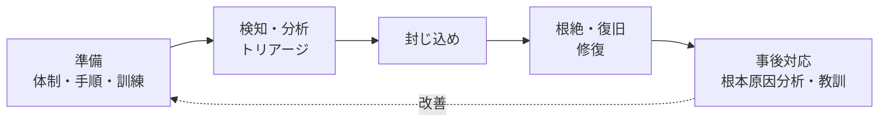

| 項目（アウトライン） | 内容 |
|---|---|
| **トリアージ** | 影響度・緊急度で優先順位付け |
| **フォレンジック** | **証拠の保全**（改変しない）、調査 |
| **修復（Remediation）** | 影響除去と再発防止 |
| **根本原因分析（RCA）** | 表面的対処で終わらせず原因を特定 |

✅ **ベストプラクティス**: **証拠保全を封じ込めより前／同時に**考える（電源断や再起動で消える情報に注意）。**事後レビューは責任追及でなく改善**のために実施。

### 9.9 【7.9】パッチ管理を実施する

| 段階 | 内容 | ✅ ベストプラクティス |
|---|---|---|
| 入手・評価 | パッチの影響と緊急度の評価 | **脆弱性の重大度と悪用状況**で優先付け |
| **テスト** | 検証環境での確認 | 本番と同等の環境で**互換性と回帰**を確認 |
| 適用 | 計画的な展開 | **ロールバック手順**を準備、段階的展開（カナリア等） |
| 記録 | 適用状況の管理 | 変更管理とトレーサビリティ |

### 9.10 【7.10】脆弱性管理を実施する

| 項目 | 内容 |
|---|---|
| **CVE** | 個別の脆弱性に付与される識別子（Common Vulnerabilities and Exposures） |
| 追跡 | 資産と脆弱性を結びつけて管理 |
| トリアージ | 深刻度（CVSS）＋悪用状況＋資産重要度で優先順位付け |

✅ **ベストプラクティス**: **深刻度別の対応期限（SLA）を社内で定義**し、期限超過を指標化する。**SBOM と連動**し、新規 CVE が出たとき**影響範囲を即座に特定**できるようにする。

### 9.11 【7.11】実行時保護を組み込む

| 技術（アウトライン） | 概要 | 位置づけ |
|---|---|---|
| **RASP** | アプリ内部で攻撃を検知・遮断 | アプリ内保護 |
| **WAF** | HTTP 通信の外側でフィルタリング | 境界保護（**根本修正の代替ではない**） |
| **ASLR** | メモリ配置をランダム化 | 攻撃の成功率を下げる |
| **DEP／実行防止** | データ領域でのコード実行を禁止 | コード注入への対策 |

> 🎯 **試験ポイント**: **WAF や RASP は「暫定的な緩和策（バーチャルパッチ）」**であり、コードの**根本修正**を置き換えるものではない。

### 9.12 【7.12】運用継続性を支援する

| 項目 | 内容 | ✅ ベストプラクティス |
|---|---|---|
| バックアップ・アーカイブ・保持 | データの保護・保持 | **バックアップの暗号化と復元テスト**（3-2-1 ルールなど） |
| **DRP（災害復旧計画）** | 災害後の IT 復旧手順 | **RTO／RPO** を定義して復旧手順を演習 |
| **レジリエンシー** | 冗長化、消失訂正符号、生存性、DoS 耐性 | 単一障害点の排除 |
| **BCP（事業継続計画）** | 事業全体の継続手順 | 業務影響分析（BIA）に基づき策定 |

| 用語 | 意味 |
|---|---|
| **RTO**（Recovery Time Objective） | 復旧までに許容される**時間** |
| **RPO**（Recovery Point Objective） | 許容できるデータ**損失の時点** |

### 9.13 【7.13】SLO／SLA を統合する

| 用語 | 意味 |
|---|---|
| **SLO**（目標） | 内部で目指すサービス水準 |
| **SLA**（合意） | 顧客と合意する水準（違反時の措置を含む） |

アウトライン例示: メンテナンス、性能、可用性、**有資格人員**。

### 9.14 AI 時代の補足（公式ページの記載より）

| 観点 | 内容 |
|---|---|
| 運用リスク | 非決定的な AI モデルを決定的なソフトウェア環境へデプロイするリスク |
| 保守 | **アルゴリズムのドリフト**や敵対的 AI 攻撃の兆候を管理者が見抜く訓練 |
| 検証環境 | モデル重みの更新前に**隔離されたステージング**で挙動確認 |
| 法務 | AI 生成コードの著作権リスクや **EU AI Act** 等への対応 |

---

## 10. Domain 8: Secure Software Supply Chain（ソフトウェアサプライチェーン）

> **このドメインの役割**: 「自分のコード」だけでなく、**取り込む部品・ビルド・配布経路・調達先**まで守る領域。近年**最も注目度が上がった**分野です（OWASP Top 10:2025 でも独立カテゴリ化）。

### 10.1 サプライチェーンの全体像

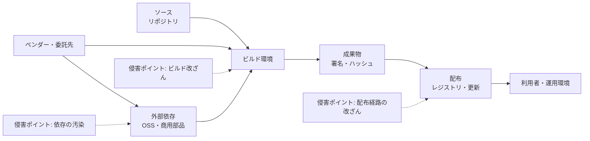

### 10.2 【8.1】サプライチェーンリスクマネジメントを実装する

| 項目（アウトライン） | 内容 | ✅ ベストプラクティス |
|---|---|---|
| コンポーネントの**識別と選定** | どの部品を使うか | 採用基準（保守状況、脆弱性履歴、ライセンス）を事前に定義 |
| コンポーネントの**リスク評価** | 低減／受容を判断 | 重要部品は**代替案**も検討 |
| **サードパーティ部品リストの維持** | **SBOM** | **リリースごとに自動生成**し、保管 |
| 変更・脆弱性の**継続監視** | 新規 CVE、メンテナ交代、ライセンス変更 | 自動アラートと対応フロー |

#### SBOM（ソフトウェア部品表）とは

**ソフトウェアに含まれる全部品の一覧表**です。食品の**原材料表示**に例えられます。「あの脆弱性、うちの製品に入っている？」に**即答**できるようになります。

| 項目 | 内容 |
|---|---|
| 代表的な形式 | **SPDX**、**CycloneDX** |
| CISA 2025 年版（草案） | 2021年の NTIA 最小要素を土台に更新。**コンポーネントハッシュ、ライセンス、ツール名、生成コンテキスト**などの要素追加が示されている |
| 活用 | 脆弱性の影響範囲特定、ライセンス管理、調達時の要求 |

> ⚠️ CISA の 2025 年版は公開時点で**パブリックコメント募集中の草案**でした。確定状況は CISA の公式ページで確認してください。

### 10.3 【8.2】サードパーティソフトウェアのセキュリティを分析する

| 項目（アウトライン） | 内容 | ✅ ベストプラクティス |
|---|---|---|
| **認証・認定** | ベンダーの保有認証 | ISO 27001、SOC 2 等を確認（**スコープと有効期限**まで） |
| **評価レポート** | 例: Cloud Controls Matrix | 第三者評価の**対象範囲と除外事項**を読む |
| **出所とサポート** | 誰が作り、いつまで保守されるか | **サポート終了（EOL）の部品を避ける** |

### 10.4 【8.3】系譜（Pedigree）と来歴（Provenance）を検証する

| 項目（アウトライン） | 内容 | ✅ ベストプラクティス |
|---|---|---|
| 安全な転送 | **チェーン・オブ・カストディ**、真正性、完全性 | 配布経路を暗号化し、署名・ハッシュを検証 |
| システム間共有・相互接続 | 連携先との接続 | 連携の範囲を最小化 |
| **コードリポジトリのセキュリティ** | ブランチ保護、コミット署名、アクセス制御 | **必須レビュー**、**MFA**、強制プッシュ禁止 |
| **ビルド環境のセキュリティ** | ビルドの隔離・再現性 | **使い捨て（エフェメラル）ビルド環境**、権限の最小化 |
| **ハッシュ・署名付きコンポーネント** | 改ざん検知 | 依存取得時に**ハッシュ固定（ロックファイル）と署名検証** |
| **監査権（Right to audit）** | 契約上の監査権利 | 重要ベンダーとは**契約に明記** |

#### SLSA（Supply-chain Levels for Software Artifacts）

SLSA は、サプライチェーンのセキュリティを**段階的に高める**ための仕様です。**ビルドトラック**は次のレベルで整理されています。

| レベル | 要点 | 主に防ぐもの |
|---|---|---|
| Build L1 | ビルド方法を示す**来歴（プロベナンス）が存在** | ミス、記録不足 |
| Build L2 | **署名付き**の来歴を**ホスト型ビルド基盤**が生成 | ビルド後の改ざん |
| Build L3 | **ハードニングされたビルド基盤** | ビルド中の改ざん |

> SLSA の公式サイトでは、検索時点で **v1.2 が現行版**と案内されています（本表は v1.1 のビルドトラックの説明）。

#### 来歴（Provenance）とは

**「その成果物が、いつ・どこで・どうやって作られたか」を検証可能な形で記録した情報**です。成果物を作成元まで**遡って確認**できます。

### 10.5 【8.4】調達時にサプライヤーのセキュリティ要件を確認する

| 項目（アウトライン） | ✅ ベストプラクティス |
|---|---|
| **セキュリティポリシー準拠の監査**（セキュア開発の実践） | ベンダーの SDLC を評価（脅威モデリング、SAST 等） |
| **脆弱性・インシデントの通知／対応／調整／報告** | 通知期限・窓口・協力体制を契約に明記 |
| **保守・サポート体制** | コミュニティ vs 商用、ライセンス。重要部品は**商用サポートの有無**も検討 |
| **セキュリティ実績** | 過去のインシデントと対応 |
| **テストの範囲** | **責任共有モデル**に基づく範囲の明確化 |
| **SIEM へのログ統合** | 自社の監視にログを取り込める形か |

### 10.6 【8.5】契約上の要件を支援する

| 項目（アウトライン） | 内容 |
|---|---|
| **知的財産の所有権** | 成果物の権利の帰属 |
| **コードエスクロー** | ソースコードを第三者に預け、ベンダー破綻時などに利用可能にする |
| 責任・保証 | 損害賠償の範囲、保証 |
| **EULA** | 利用許諾条件 |
| **SLA** | サービス水準と違反時の措置 |

### 10.7 AI 時代の補足（公式ページの記載より）

| 観点 | 内容 |
|---|---|
| **AI-BOM** | SBOM を拡張し、**モデルの重み・学習データ・ML ライブラリ**を追跡 |
| モデル選定 | OSS の AI モデルを選ぶ際の**セキュリティ基準**（バックドア・バイアス） |
| 上流リスク | **モデルポイズニング**など、学習データ起因の汚染 |

---

## 11. 横断まとめ：主要フレームワーク・標準の一覧

| フレームワーク／標準 | 目的 | 関連ドメイン | 版・状況（情報時点） |
|---|---|---|---|
| **OWASP Top 10** | Web アプリの重大リスクの認知 | D5（5.2）、全般 | **2025 年版が公開済み**（A01〜A10） |
| **OWASP ASVS** | セキュリティ要件・検証の基準 | D3（要件）、D6（テスト） | **5.0.0**（2025年5月）、17 章、**L1／L2／L3** の3レベル |
| **NIST SSDF（SP 800-218）** | セキュア開発の中核実践集 | D2、全般 | **v1.1**（2022年2月、確定）。**v1.2**（SP 800-218r1）は 2025年12月に**初期公開草案**。確定状況は要確認 |
| **NIST SP 800-218A** | 生成 AI・基盤モデル向け SSDF プロファイル | D2、AI 関連 | 2024年7月、確定 |
| **CVSS** | 脆弱性の深刻度評価 | D6（6.6）、D7（7.10） | **v4.0**（Base／Threat／Environmental／Supplemental） |
| **SLSA** | ビルド・来歴のセキュリティ水準 | D7（7.3）、D8（8.3） | v1.1 のビルドトラック L1〜L3（現行版は v1.2 と案内） |
| **SBOM（SPDX／CycloneDX）** | 部品の可視化 | D8（8.1） | CISA 2025 最小要素（草案時点で公開コメント募集） |
| **SAMM／BSIMM** | AppSec プログラムの成熟度評価 | D2（2.2、2.8） | アウトラインに明記（版は公式サイトで確認） |
| **STRIDE／PASTA** | 脅威モデリング | D4（4.4） | アウトラインに明記 |
| **OWASP Top 10 for LLM／NIST AI RMF** | AI/LLM 固有のリスク | 各ドメインの AI 補足 | 公式ページの AI 補足に記載 |

---

## 12. 試験対策

### 12.1 学習計画の例（8〜10週間）

| 週 | 学習内容 | ゴール |
|---|---|---|
| 1 | Domain 1（概念・設計原則） | 10原則を**事例で説明**できる |
| 2 | Domain 2（ライフサイクル管理・リスク） | リスク対応4種、V&V の違いを説明できる |
| 3 | Domain 3（要件） | ミスユースケースと RTM を**自分で書ける** |
| 4–5 | Domain 4（設計・脅威モデリング） | **STRIDE で簡単な DFD を分析**できる |
| 6 | Domain 5（実装） | OWASP Top 10 各項目の**対策**を言える |
| 7 | Domain 6（テスト） | **SAST／DAST／IAST／SCA／ファジング**の使い分け |
| 8 | Domain 7（運用） | IR フロー、パッチ・脆弱性管理、RTO/RPO |
| 9 | Domain 8（サプライチェーン） | SBOM・SLSA・来歴の説明 |
| 10 | 模擬試験・弱点補強 | 安定して高得点が取れる状態 |

### 12.2 問題の読み方（定番の戦略）

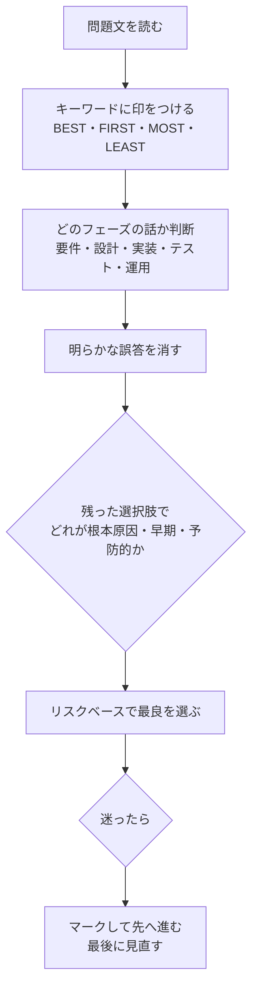

| 選び方の原則 | 内容 |
|---|---|
| **早い段階で対処**を優先 | 設計・要件での対処が、後工程の修正より優先されやすい |
| **根本原因**への対処 | 症状を隠す対策（WAF のみ等）より、根本修正が優先 |
| **予防 > 検知 > 回復** | 通常は予防的コントロールが最良（ただし問題文の状況に従う） |
| **リスクベース** | 影響・可能性に応じ、過剰でも不足でもない対策 |
| **管理者視点** | 技術的に可能でも、**承認・文書化・プロセス**を踏むのが適切な場合が多い |
| **自作より標準** | 認証・暗号は**検証済みの標準・部品**を使う |

### 12.3 混同しやすい用語の最終チェック

| 組 | 違い |
|---|---|
| fail safe vs fail secure | **人命**重視 vs **資産保護**重視 |
| Verification vs Validation | **正しく作る** vs **正しいものを作る** |
| 仮名化 vs 匿名化 | **再識別可能** vs **不可能** |
| CWE vs CVE | **弱点の種類** vs **個別の脆弱性** |
| CVSS の深刻度 vs リスク | **本質的な深刻度** vs **環境・悪用状況込みの事業リスク** |
| SAST vs DAST | **ソース解析（実行しない）** vs **実行中に外から攻撃** |
| SLO vs SLA | **内部目標** vs **顧客との合意** |
| RTO vs RPO | **復旧時間** vs **データ損失許容点** |
| オーナー vs カストディアン | **決める責任者** vs **保管する担当** |
| SBOM vs 来歴 | **何が入っているか** vs **どう作られたか** |

---

## 13. 練習問題（学習用オリジナル）

> ⚠️ 以下は本ガイド独自の学習用問題です。**実際の試験問題ではありません。**

**Q1.** 設計レビューで「認可の結果をセッション開始時に一度だけ確認し、以降は確認しない」実装が見つかった。違反している設計原則はどれか。
A. Least privilege　B. Complete mediation　C. Open design　D. Economy of mechanism

**Q2.** 停電時に、データセンターの電子ロックが**施錠されたまま**になる設計方針を何と呼ぶか。
A. Fail safe　B. Fail secure　C. Fail open　D. Fail soft

**Q3.** STRIDE の「Tampering」が主に侵害するセキュリティ特性はどれか。
A. 機密性　B. 完全性　C. 可用性　D. 否認防止

**Q4.** ソースコードを**実行せずに**解析して、危険な API の使用やハードコードされた秘密を検出する手法はどれか。
A. DAST　B. IAST　C. SAST　D. ファジング

**Q5.** 新たに公開された CVE が自社製品に影響するかを**迅速に**判断するために最も有効な成果物はどれか。
A. 脅威モデル　B. SBOM　C. ミスユースケース　D. RTM

**Q6.** パスワードをデータベースに保存する際の最も適切な方法はどれか。
A. 可逆暗号で保存　B. Base64 エンコードで保存　C. ソルト付き低速ハッシュで保存　D. MD5 で保存

**Q7.** WAF を導入したが、アプリの脆弱なコードは修正していない。この対応の位置づけとして最も適切なものはどれか。
A. 根本対策　B. 暫定的な緩和策　C. 受容の代わりになる最終対策　D. 不要な対策

**Q8.** リスクを受容する判断を承認すべき人として最も適切なのはどれか。
A. 担当開発者　B. 適切な権限を持つ責任者　C. 外部ペンテスター　D. 新人 QA

**Q9.** 「**目標復旧時点**（どこまでのデータ損失を許容するか）」を表す用語はどれか。
A. RTO　B. RPO　C. SLA　D. BIA

**Q10.** ビルド基盤が**署名付きの来歴**を生成し、ビルド後の改ざんを防ぐ水準に相当する SLSA のビルドレベルはどれか。
A. L0　B. L1　C. L2　D. L3

<details>
<summary>解答と解説（クリックで展開）</summary>

| 問 | 正解 | 解説 |
|---|---|---|
| Q1 | **B** | 毎回アクセス権を確認する **Complete mediation** の違反 |
| Q2 | **B** | 資産保護を優先して閉じる **Fail secure** |
| Q3 | **B** | Tampering（改ざん）は **完全性** の侵害 |
| Q4 | **C** | **SAST** は実行せずソースを解析する |
| Q5 | **B** | **SBOM** が含有部品を示すため影響範囲を特定しやすい |
| Q6 | **C** | ソルト付き低速ハッシュ（bcrypt／scrypt／Argon2 等） |
| Q7 | **B** | WAF は **暫定的な緩和策**。根本修正の代替ではない |
| Q8 | **B** | リスク受容は **適切な権限者**が文書で承認する |
| Q9 | **B** | **RPO** はデータ損失の許容時点。RTO は復旧時間 |
| Q10 | **C** | **Build L2**（署名付き来歴をホスト型基盤が生成）。L3 は基盤のハードニング |

</details>

---

## 14. 用語集

| 用語 | 意味 |
|---|---|
| A&A | Assessment and Authorization。システムを評価し運用を認可する |
| ALE | 年間予想損失額（SLE × ARO） |
| APT | 持続的標的型攻撃 |
| ASLR | アドレス空間配置のランダム化 |
| ASVS | OWASP のアプリセキュリティ検証標準 |
| ATO | Authority to Operate（運用承認） |
| BCP／DRP | 事業継続計画／災害復旧計画 |
| BSIMM／SAMM | AppSec の成熟度モデル（観測型／規範型） |
| CVE／CWE／CVSS | 個別脆弱性の ID／弱点の分類／深刻度評価 |
| DAST／SAST／IAST／SCA | 動的／静的／対話型解析／構成分析 |
| DFD | データフロー図 |
| DLP | データ損失防止 |
| FIM | ファイル整合性監視 |
| IaC | Infrastructure as Code |
| ISCM | 情報セキュリティの継続的モニタリング |
| KMS／HSM | 鍵管理サービス／ハードウェアセキュリティモジュール |
| PASTA | 7段階の脅威モデリング手法 |
| PII | 個人を特定できる情報 |
| RASP／WAF | 実行時アプリ自己防御／Web アプリケーションファイアウォール |
| RBAC／DAC／MAC | ロール／任意／強制のアクセス制御 |
| RTM | 要件トレーサビリティマトリクス |
| SBOM／AI-BOM | ソフトウェア／AI 部品表 |
| SIEM | セキュリティ情報イベント管理 |
| SLA／SLO | サービス水準合意／目標 |
| SLSA | サプライチェーンのビルド保証水準 |
| STRIDE | 脅威分類（なりすまし・改ざん・否認・情報漏えい・DoS・権限昇格） |
| TCB／TPM | 信頼できる計算基盤／トラステッドプラットフォームモジュール |
| TOCTOU | 確認時と使用時の差を突く競合状態 |

---

## 15. 参考ソース（URL）

> 情報時点: 2026年10月15日。**公式一次情報を優先**し、第三者サイトは補足として明記しています。

### 15.1 ISC2 公式（一次情報）

| 内容 | URL |
|---|---|
| CSSLP 認定ページ（概要、実務経験4年、ANAB／ISO 17024、DoDM 8140.03、受験オプション） | https://www.isc2.org/certifications/csslp |
| **CSSLP エグザムアウトライン（8ドメイン／各項目、AI 補足、試験時間 3 時間）** | https://www.isc2.org/certifications/csslp/csslp-certification-exam-outline |
| 補足参考文献リスト | https://www.isc2.org/certifications/references |
| 受験登録・ポリシー | https://www.isc2.org/register-for-exam |

### 15.2 標準・フレームワークの一次情報

| 内容 | URL |
|---|---|
| OWASP Top 10:2025（A01〜A10 の一覧） | https://owasp.org/Top10/2025/ |
| NIST SSDF 関連公開文書（SP 800-218 v1.1、218r1 草案、218A） | https://csrc.nist.gov/Projects/ssdf/publications |
| NIST SSDF v1.2 草案のお知らせ（2025年12月17日） | https://csrc.nist.gov/News/2025/draft-ssdf-version-1-2 |
| SLSA 仕様 v1.1（ビルドレベル） | https://slsa.dev/spec/v1.1/levels |
| CISA 2025 SBOM 最小要素（草案） | https://www.cisa.gov/resources-tools/resources/2025-minimum-elements-software-bill-materials-sbom |
| FIRST CVSS | https://www.first.org/cvss/ |

### 15.3 第三者の解説（補足・数値は公式で再確認すること）

| 内容 | URL | 用途 |
|---|---|---|
| ExamCert: CSSLP のドメイン配分・問題数・合格点・料金 | https://www.examcert.app/blog/csslp-exam-objectives/ | 配点の目安 |
| Infosec Institute: CSSLP 試験の形式・再受験ポリシー | https://www.infosecinstitute.com/resources/csslp/isc2-csslp-exam-details-and-process | 試験形式（125問・700点・Pearson VUE） |
| OWASP ASVS 5.0 の概要（arc42 Quality Model） | https://quality.arc42.org/standards/owasp-asvs | ASVS の構成 |
| ASVS 5.0 の変更点（SoftwareMill） | https://softwaremill.com/whats-new-in-asvs-5-0/ | ASVS の変更点 |
| OWASP Top 10:2025 の変更点（Parasoft） | https://parasoft.com/blog/owasp-top-10/ | 2021→2025 の比較 |
| CVSS v4.0 の解説（BleepingComputer） | https://www.bleepingcomputer.com/news/security/new-cvss-40-vulnerability-severity-rating-standard-released/ | CVSS v4.0 の変更点 |

### 15.4 確認できなかった事項（要・公式確認）

| 事項 | 状況 |
|---|---|
| 各ドメインの**正式な配点** | 公式ページでは配点表が動的表示で取得できず、第三者資料の値を採用（資料間で差あり） |
| **試験問題数・合格点・受験料・AMF 金額** | 第三者資料ベース。受験登録前に ISC2 で確認 |
| ISC2 アウトラインの**発効日** | ページ上は「Effective Date: September 15, 2023」と表記。最新の改訂有無は ISC2 で確認 |
| **NIST SSDF v1.2 の確定状況** | 検索時点では初期公開草案。確定版の有無は NIST で確認 |
| **CISA 2025 SBOM 最小要素の確定状況** | 検索時点では草案（パブリックコメント募集）。確定版の有無は CISA で確認 |
| STRIDE／4つの問い、SAMM、BSIMM の原典 | 今回は原典を直接取得していません。書籍・各公式サイトで確認してください |

---

*本ガイドは学習補助を目的としており、ISC2 とは無関係の独自教材です。最新の試験内容は必ず ISC2 公式のエグザムアウトラインで確認してください。*
