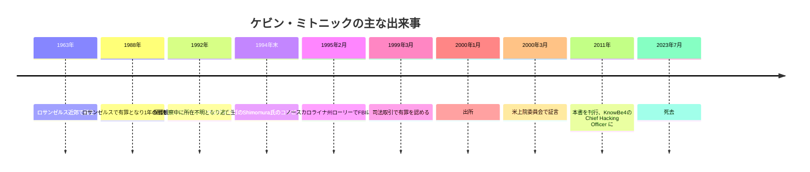
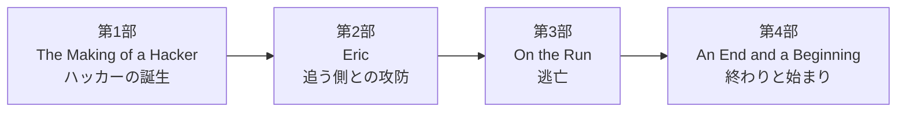
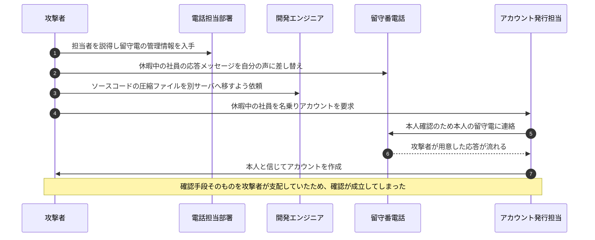
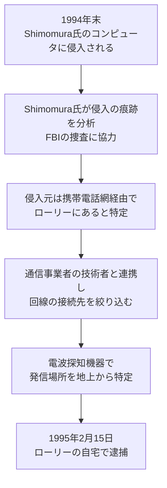
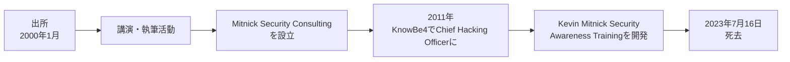
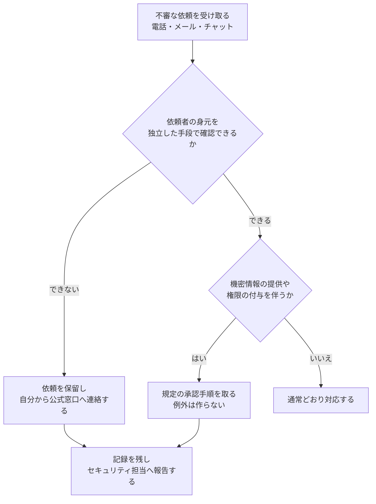
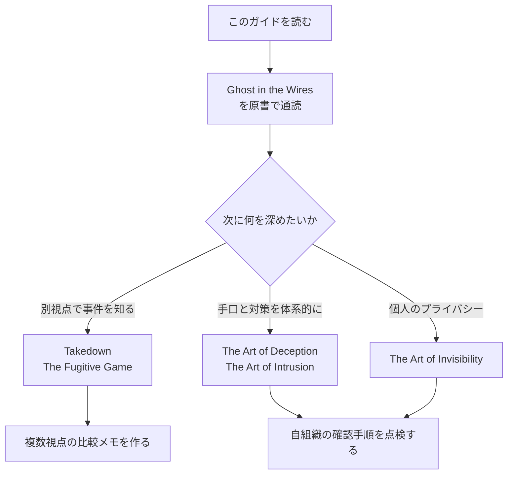

# Ghost in the Wires 初学者向け完全ガイド

> ケビン・ミトニック著『Ghost in the Wires: My Adventures as the World's Most Wanted Hacker』を、ステップバイステップで読み解く入門ガイド

| 項目 | 内容 |
|---|---|
| 作成日・情報基準日 | 2026年10月15日(ウェブ情報はこの日までに確認できたもの) |
| 対象読者 | セキュリティ初学者、エンジニア、本書をこれから読む人 |
| 前提知識 | 不要(専門用語は Step 3 で解説) |
| 形式 | Markdown(図は Mermaid、表は Markdown。ASCII 図解は不使用) |
| 出典表記 | 本文中の `【S1】` などは、末尾「Step 15 出典一覧」の番号に対応 |

---

## 目次

1. [Step 0 このガイドの読み方と注意](#step-0-このガイドの読み方と注意)
2. [Step 1 本書を一言でいうと](#step-1-本書を一言でいうと)
3. [Step 2 著者ケビン・ミトニックとは](#step-2-著者ケビンミトニックとは)
4. [Step 3 まず押さえる用語集](#step-3-まず押さえる用語集)
5. [Step 4 本書の全体構成](#step-4-本書の全体構成)
6. [Step 5 部ごとの読み解き](#step-5-部ごとの読み解き)
7. [Step 6 ソーシャルエンジニアリング徹底解説](#step-6-ソーシャルエンジニアリング徹底解説)
8. [Step 7 追跡と逮捕を技術面から見る](#step-7-追跡と逮捕を技術面から見る)
9. [Step 8 裁判・量刑と論争点](#step-8-裁判量刑と論争点)
10. [Step 9 神話と現実](#step-9-神話と現実)
11. [Step 10 出所後の歩みと、その後](#step-10-出所後の歩みとその後)
12. [Step 11 現代の防御に活かす](#step-11-現代の防御に活かす)
13. [Step 12 批判的に読む](#step-12-批判的に読む)
14. [Step 13 学習ロードマップ](#step-13-学習ロードマップ)
15. [Step 14 理解度チェック](#step-14-理解度チェック)
16. [Step 15 出典一覧](#step-15-出典一覧)
17. [Step 16 このガイドの限界](#step-16-このガイドの限界)

---

## Step 0 このガイドの読み方と注意

### 0-1. このガイドの目的

『Ghost in the Wires』は、1990年代に「世界で最も追われたハッカー」と呼ばれた人物の回想録です。本ガイドは次の3つを目標にしています。

1. 本書のあらすじと構成を、予備知識なしで理解できるようにする
2. 本書に登場する「人をだます技術(ソーシャルエンジニアリング)」を、**防御の視点**で学べるようにする
3. 事件に関する賛否・誇張・神話を切り分け、批判的に読む力をつける

### 0-2. 取り扱い方針

| 方針 | 内容 |
|---|---|
| 防御視点 | 攻撃手順の再現ではなく、「なぜ成功したか」「どう防ぐか」を中心に解説します |
| 引用の最小化 | 書籍・記事の文章は、短い言い換えにとどめています |
| 出典の明示 | 事実には `【S番号】` を付け、URL を末尾にまとめています |
| 立場の併記 | 本書は本人の回想録です。検察側・支持者側・書評家の見解を併記します |

### 0-3. 法律と倫理についての一言

日本では、他人の ID・パスワードを無断で使うなどしてアクセス制御を破る「不正アクセス行為」が不正アクセス禁止法第3条で禁止され、違反は第11条により3年以下の拘禁刑又は100万円以下の罰金の対象です 【S35】。米国では、Computer Fraud and Abuse Act(18 U.S.C. § 1030)の(a)(2)が、権限なく(または権限を超えて)コンピュータにアクセスして情報を得る行為を処罰します。ただし一律ではなく、金融機関の財務記録などの情報、米国政府の省庁の情報、「保護されたコンピュータ」(州際・国際の通商や通信に使われるものなど)の情報といった、同項が定める区分に当たる場合に限られます 【S36】。それ以外の国の法制度は本ガイドでは確認していません。具体的な法的判断は専門家に確認してください。本書の登場人物が受けた結果(逮捕・長期の勾留・保護観察中の厳しい制限)は、その重さを示しています。

---

## Step 1 本書を一言でいうと

**「好奇心から電話網と企業ネットワークに入り込んだ青年が、FBIに追われて逃亡し、やがて逮捕されるまでを本人が語った実話」**です。動機を好奇心とする説明は本人の証言 【S14】、電話網・企業ネットワークへの侵入は 【S13】【S14】、FBIの追跡と逮捕は 【S1】【S6】、「実話」という位置づけは出版社の紹介 【S1】 によります。

### 1-1. 書誌情報

| 項目 | 内容 |
|---|---|
| 原題 | Ghost in the Wires: My Adventures as the World's Most Wanted Hacker 【S1】 |
| 著者 | Kevin Mitnick（ケビン・ミトニック）【S1】 |
| 共著者 | William L. Simon 【S24】 |
| 序文 | Steve Wozniak（スティーブ・ウォズニアック）【S1】【S24】 |
| 出版社・刊行 | Little, Brown、2011年8月15日 【S1】 |
| ページ数 | 432ページ(Google ブックス掲載版)。版により 400 ページ台後半〜 500 ページ台と記載が異なります 【S1】【S31】 |
| ISBN | 0316134473 / 9780316134477 【S1】 |
| ペーパーバック | Back Bay Books から 2012 年に刊行 【S31】 |
| ジャンル | ノンフィクションの回想録 |
| 邦訳 | 本調査では確認できませんでした(Step 16 を参照) |

> 補足:Google ブックスの紹介文には、推薦コメントとして「novel」という語が出てきますが、出版社の紹介では「true story(実話)」と説明されています 【S1】。本書は小説ではなく、本人の回想録です。

### 1-2. 3行で要約

1. 少年期の「好奇心」が、電話網への侵入や企業のソースコード取得につながっていく 【S13】【S14】。
2. 保護観察中に姿を消し、偽名で各地を転々とする逃亡生活に入る 【S1】【S8】。
3. 1995年にFBIに逮捕され、長い勾留と司法取引を経て、2000年に出所する 【S6】【S8】【S12】。

### 1-3. 本書の売りは「技術」より「人間」

書評では、本書の核心はコードそのものよりも、相手を説得して情報を引き出す**ソーシャルエンジニアリング**にあると繰り返し指摘されています 【S3】【S21】。技術的な記述は、あえて非専門家にも読める水準に抑えられていると評する書評もあります 【S3】。

---

## Step 2 著者ケビン・ミトニックとは

### 2-1. プロフィール

| 項目 | 内容 |
|---|---|
| 生年月日 | 1963年8月6日、ロサンゼルス近郊(ヴァンナイズ)生まれ 【S18】 |
| 没年月日 | 2023年7月16日、59歳。膵臓がんの闘病後に死去 【S12】【S13】 |
| 逮捕前の活動 | 電話網・企業ネットワークへの侵入、ソースコードの取得 【S13】【S14】 |
| 出所後 | 講演者・著者・セキュリティコンサルタント。Mitnick Security Consulting を設立 【S12】 |
| 企業での役職 | 2011年にKnowBe4の Chief Hacking Officer に就任 【S18】【S20】 |

### 2-2. 人生の年表

根拠:1988年の有罪と1年の刑は米司法省の発表 【S6】、保護観察中の失踪と1994年末の侵入、逮捕、司法取引は 【S8】、出所は 【S12】【S14】、上院証言は 【S4】、2011年の役職は 【S18】 です。

### 2-3. 「Free Kevin」運動

1990年代の中頃から後半にかけて、長期勾留を重すぎると考える支持者による「Free Kevin」運動が世界的に広がりました 【S12】。この運動の存在は、ミトニックが単なる犯罪者ではなく、**ハッカー文化の象徴**として見られていたことを示します。

---

## Step 3 まず押さえる用語集

初学者が本書でつまずきやすい言葉をまとめます。

| 用語 | 意味 | 本書との関係 |
|---|---|---|
| ハッカー | 本来は技術に精通し探究する人。報道では「不正侵入者」の意味で使われることも多い | ミトニックは、この語が報道で歪められたと証言しています 【S4】 |
| フリーカー(phreaker) | 電話網を探求・悪用する人 | 書評は、本書を「ハッカーとフリーカーの回想録」と紹介しています 【S28】 |
| ソーシャルエンジニアリング | 技術ではなく、人を信用させて情報や操作を引き出す手法 | 本書の中心テーマ 【S3】【S4】 |
| なりすまし | 社員や関係者を装うこと | 多くの事例の出発点 |
| ソースコード | プログラムの設計図にあたる文章 | ミトニックが好んで狙った対象 【S4】【S11】 |
| 保護観察 | 刑の一部を社会内で、条件付きで過ごす制度 | 彼はこの期間中に姿を消した 【S8】 |
| 司法取引 | 罪を認める代わりに量刑などで合意する手続き | 1999年に成立 【S8】【S13】 |
| 白帽ハッカー | 許可を得て、防御のために侵入を試みる専門家 | 出所後の彼の立場 【S13】 |
| ペネトレーションテスト | 依頼を受けて行う、疑似的な侵入テスト | Mitnick Security Consulting の主な事業 【S27】 |
| 盗聴(ワイヤタップ) | 通信を傍受すること | 本書の第2部の章題に頻出 【S2】 |

---

## Step 4 本書の全体構成

本書は4部構成です。章題は図書館目録の目次情報によります 【S2】。

### 4-1. 各部の概要

| 部 | 原題 | 目次から読み取れる内容 | 代表的な章題 |
|---|---|---|---|
| 第1部 | The Making of a Hacker | 少年期から、第2部「Eric」が始まる直前まで | Rough Start、Original Sin、Escape Artist、Lex Luthor |
| 第2部 | Eric | 盗聴・通信分析・摘発・失踪へ向かう緊迫した流れ | The Wiretapper、Traffic Analysis、Reverse Sting、Vanishing Act |
| 第3部 | On the Run | 偽名での逃亡生活 | Harry Houdini、Private Investigator、Trophy Hunter |
| 第4部 | An End and a Beginning | 逮捕、裁判、出所後 | Hacking the Samurai、An FBI Valentine、Aftermath |

> 注意:上表の「読み取れる内容」は、目次の章題と、公式紹介文・書評で確認できる範囲での説明です。各章の詳細な筋書きは、原書で確認してください。

---

## Step 5 部ごとの読み解き

### 5-1. 第1部「ハッカーの誕生」

**押さえる点**

1. **少年期の「ルールの穴探し」**
   バスの乗車券システムの仕組みを覚え、無料で一日中バスに乗れるようにしたという逸話があります。運転手がのちに裁判で人柄を証言したとも伝えられています 【S22】。
2. **興味の広がり**
   書評によれば、マジック、アマチュア無線、ピッキングなど、「仕組みを解き明かす」遊びを好みました 【S28】。
3. **電話会社への潜入**
   書評では、電話会社の社員を装って建物に入り、技術マニュアルを持ち出した話が紹介されています 【S28】。
4. **最初の大きな事件**
   1988年、DEC(Digital Equipment Corporation)のソフトウェアを盗んだ件で有罪となり、1年の刑を受けました 【S6】【S13】。損害額は、報道では約100万ドル 【S13】、書評ではDEC側の主張として約400万ドル 【S28】 と、資料により異なります。
5. **友人との関係**
   DEC侵入では友人の Lenny DiCicco も関わったと報じられています 【S25】。

**初学者向けの学び**

- 「ルールの穴」は、技術的な欠陥だけでなく、**手続きや運用の隙**にもあります。
- 未成年期の軽い遊びが、成人後の重大な犯罪に連続している点は、本書全体の重いテーマです。

### 5-2. 第2部「Eric」

**押さえる点**

1. **盗聴をめぐる攻防**
   書評によれば、ミトニックは、保護観察官が自分を盗聴していないかを電話会社を通じて調べ、盗聴を止めさせようとしたとされます 【S28】。章題にも "You Tap Me, I Tap You" などが並びます 【S2】。
2. **追跡される側の視点**
   "Traffic Analysis"(通信の分析)、"Reverse Sting"(逆おとり捜査)といった章題は、追う側と追われる側が互いの手の内を読み合う展開を示唆しています 【S2】。
3. **失踪**
   1992年、保護観察中に所在不明となり、約2年半の逃亡が始まります 【S8】【S30】。

**初学者向けの学び**

- 通信の「中身」を読まれなくても、**誰と・いつ・どれだけ通信したか**というパターンだけで、行動は推測されます(トラフィック分析の考え方)。

### 5-3. 第3部「On the Run(逃亡)」

**押さえる点**

1. **偽名と各地の移動**
   公式紹介文によれば、偽の身元と複数の都市を使い分けながらFBIとの追跡劇を続けました 【S1】。
2. **Motorolaの事例(1992年)**
   デンバーに偽名で暮らしていた時期、携帯電話 MicroTAC Ultralite のソースコードを狙いました。動機は、自分の位置を追跡されないようにするためだったと説明されています。のちに本人は、この判断を後悔していると語っています 【S10】。
   本人の上院証言によれば、仕事帰りの 15〜20分ほどの間に、電話一本でファームウェアのソースコードを自分が使うサーバに送らせたとのことです 【S4】。
3. **盗んだコードの保管場所**
   書評は、大学や企業のサーバにある**使われていないアカウントの空き容量**を保管場所に使った点に触れています 【S21】。
4. **Novell の事例**
   Novell 社の元社員 Shawn Nunley は、のちにミトニックの弁護団に協力し、友人になったと、遺族の訃報に記されています 【S12】。詳細は Step 6 で扱います。

**初学者向けの学び**

- 大企業の機密が、**電話一本の信頼**で動いてしまう現実が、本書の最大の警告です。
- 使われていないアカウントは、攻撃者に利用される温床になります(Step 11 の対策に反映)。

### 5-4. 第4部「An End and a Beginning」

**押さえる点**

1. **Shimomura 氏との対決**
   章題 "Hacking the Samurai" は、事件の経緯から、Tsutomu Shimomura 氏への侵入を指すと読むのが自然です(筆者の推測)。1994年のクリスマスに、サンディエゴにある同氏のコンピュータへ侵入したことが、逮捕への流れを生みました 【S9】。
2. **逮捕**
   1995年2月15日午前1時30分、ノースカロライナ州ローリーの自宅でFBIに逮捕されました 【S6】。
3. **本人の視点での総括**
   章題 "Winning the Scapegoat Sweepstakes" は、ミトニック本人が「自分は見せしめにされた」と捉えていることを示唆します(あくまで本人側の見解として読む必要があります)。
4. **出所後**
   終章 "Aftermath" で、出所後の再出発が語られます 【S2】。

---

## Step 6 ソーシャルエンジニアリング徹底解説

### 6-1. 定義

**ソーシャルエンジニアリング**とは、システムの欠陥ではなく、**人の判断・善意・思い込み**を突く攻撃手法です。ミトニック自身が上院の証言で、「ほとんど技術的な攻撃をする必要がなかった」ほど成功率が高かったと述べています 【S4】【S5】。

### 6-2. 人が動かされる心理

| 心理的な傾向 | 説明 | 防ぐ考え方 |
|---|---|---|
| 権威への服従 | 上司・管理部門を名乗る相手に従う | 肩書きではなく、手続きで確認する |
| 親切心 | 困っている相手を助けたくなる | 助ける前に、本人確認の手順を挟む |
| 緊急性 | 急かされると確認を省く | 急ぎの依頼ほど、一度立ち止まる |
| 親近感 | 同じ組織・同じ話題だと警戒が下がる | 内部用語を知っていても本人証明にならない |

> 注:この表は、社会心理学で一般に知られる傾向を整理した筆者の補足であり、本書や出典の記述そのものではありません。

### 6-3. ケーススタディ:Novell の本人確認が破られた構図

米ロイター通信の記事は、ミトニックと Nunley 氏の再会を取り上げ、1992年のNovell への侵入の構図を説明しています 【S11】。ここでは、**「何が確認の仕組みの弱点だったか」**に絞って整理します。

**この事例の教訓**

| 弱点 | 解説 | 対策 |
|---|---|---|
| 確認手段が攻撃者の影響下にあった | 留守電の内容を攻撃者が書き換えられた | 本人確認は、**攻撃者が触れない別経路**(人事台帳の番号、直接対面など)で行う |
| 複数部署が別々に「善意」で協力した | 各担当者は自分の範囲では不自然さに気づかなかった | 部署間で依頼内容を突き合わせる運用にする |
| 管理情報を電話で教えた | 管理用の情報が口頭で渡った | 管理情報は、問い合わせだけでは開示しない |

Nunley 氏は、被害を受けた側として正義を求め、のちに弁護側へ連絡するという経緯をたどったと報じられています 【S11】【S12】。

### 6-4. ケーススタディ:Motorola の事例

| 項目 | 内容 |
|---|---|
| 時期・場所 | 1992年、デンバー 【S10】 |
| 目的 | 追跡を避けるため、携帯電話の識別情報を操作できないかと考えた 【S10】 |
| 手段 | 電話での説得（ソーシャルエンジニアリング）【S4】【S10】 |
| 結果 | 短時間でファームウェアのソースコードを入手 【S4】 |
| 後日談 | 本人は「愚かで悔やまれる判断」だったと語る 【S10】 |

**教訓:** 「内部の人間らしい話し方」と「それらしい依頼」だけで、機密が移動する組織は、現在も少なくありません。

### 6-5. 現代でも通用する実例

書評は、2012年8月に起きた、ジャーナリスト Mat Honan 氏のアカウント乗っ取り事例を挙げています。カスタマーサポート担当者を説得され、AmazonとAppleのアカウントが乗っ取られ、そこからデジタル生活全体が崩れたというものです 【S21】。ミトニックの時代の手法は、形を変えて今も有効です。

---

## Step 7 追跡と逮捕を技術面から見る

### 7-1. 追跡の流れ

根拠:侵入の発端は 【S9】、Shimomura 氏が侵入者を絞り込みローリーの携帯電話網に行き着いたことは 【S30】、携帯電話の探知機器による位置特定は 【S25】【S29】、逮捕日時と「2週間の電子的追跡」は米司法省の発表 【S6】 によります。

### 7-2. 追う側の人物:Tsutomu Shimomura

| 項目 | 内容 |
|---|---|
| 立場 | サンディエゴ・スーパーコンピュータ・センター(SDSC)の上級研究員 【S7】 |
| 国籍・出自 | 日本国籍、米国ニュージャージー州プリンストンで育った 【S9】 |
| 事件での役割 | 追跡の分析と、FBIの捜査支援 【S6】【S7】 |
| 著書 | John Markoff との共著『Takedown』（Hyperion）【S7】【S9】 |

日本の読者にとっては、追跡側の中心人物が日本国籍だったという点も興味深い事実です。

### 7-3. 同じ事件を「別の視点」で描いた本

| 書籍 | 立場 | 内容の傾向 |
|---|---|---|
| 『Takedown』(Shimomura / Markoff)| 追跡側 | 追跡と逮捕の過程を詳細に描く 【S7】 |
| 『The Fugitive Game』(Jonathan Littman)| ミトニックに同情的 | ミトニックは社会の脅威ではなく「無害な変わり者」だと論じる 【S7】【S14】 |
| 『Ghost in the Wires』(Mitnick / Simon)| 本人 | 本人の視点で全体を語る 【S1】 |

同じ事件でも、**誰が語るか**で描かれ方が大きく変わります。複数の本を読み比べることが、最良の学び方です。

---

## Step 8 裁判・量刑と論争点

### 8-1. 事実関係の整理

| 時期 | 出来事 | 出典 |
|---|---|---|
| 1988年 | ロサンゼルスで、コンピュータプログラムの窃盗と企業ネットワークへの侵入で有罪。1年の刑 | 【S6】 |
| 1995年2月 | ローリーで逮捕。ノースカロライナで23件の不正アクセス装置関連の罪で起訴 | 【S6】【S8】 |
| 1999年3月16日 | 司法取引の合意書に署名(takedown.com はこの日を有罪答弁日とするが、同月18日の報道は「合意書に署名し、裁判官の承認待ち」と伝える)| 【S8】【S39】 |
| 1999年3月26日 | 法廷で有罪を認める(ノースカロライナの5件と、カリフォルニア北部地区の2件)| 【S8】【S38】 |
| 勾留期間 | 約4年を勾留として算入。報道では「ほぼ5年の収監」とも | 【S5】【S14】 |
| 2000年1月 | 出所 | 【S12】【S14】 |
| 出所後の制限 | 裁判所命令で、コンピュータや携帯電話などの利用を禁じられた(2000年3月時点)| 【S5】 |

### 8-2. 論点を整理する

| 論点 | 厳罰を支持する側の見方 | 刑が重すぎたとする側の見方 |
|---|---|---|
| 被害の大きさ | 企業は数百万ドル規模の損害を主張（例:DEC）【S28】 | 報道では約100万ドルの被害額との記載もあり、資料により幅がある 【S13】 |
| 動機 | 不正侵入は、動機に関係なく犯罪 | 検察側証人も、金銭を取ろうとしたことはないと述べたと、訃報に記載 【S15】 |
| 量刑 | 再犯・逃亡があった以上、重い処分は妥当 | 司法側の過剰な熱意だったと見る人が多いと、AP通信は伝える 【S14】 |
| 影響 | 抑止効果を重視 | 重大な犯罪と、若者のいたずら的行為を区別する契機になったと、AP通信は評価 【S14】 |

> 重要:ここでは**どちらかが正しいと断定しません**。事実(有罪・量刑・期間)と、評価(重い・妥当)を分けて読むことが、情報リテラシーの基本です。

---

## Step 9 神話と現実

ミトニックには、事実以上に誇張された物語がつきまといました。AP通信も、誇張された話が広まり、時に過剰な恐怖を生んだと伝えています 【S14】。

| よくある誤解 | 確認できる事実 |
|---|---|
| 国家機密のシステムを自在に操れる超人 | 本人の証言によれば、侵入の多くは電話を使った説得(ソーシャルエンジニアリング)が中心で、技術的な攻撃はほとんど不要だった 【S4】【S5】 |
| 金銭目的の犯罪者 | 訃報によれば、裁判の連邦検察官が「被害者から金銭を一切取ろうとしなかった」と証言したとされる 【S15】。これは証言として伝えられた内容であり、本ガイドでは確定事実としては扱わない |
| 無害な少年のいたずら | 企業側は損害を主張し、有罪を認めている。重大な不正アクセスであったことも事実 【S8】【S13】 |
| 出所後も犯罪者のまま | 出所後は、許可を得て行う侵入テストや、啓発活動に従事した 【S12】【S18】 |

ミトニック本人も、「ハッカー」という言葉が報道で歪められたと、上院で述べています 【S4】。**「伝説」ではなく「一次情報」で語る**ことが重要です。

---

## Step 10 出所後の歩みと、その後

### 10-1. 上院での証言(2000年3月2日)

| 項目 | 内容 |
|---|---|
| 場の性格 | 米上院の政府問題委員会が、連邦政府の情報システムの安全性について開いた公聴会 【S4】 |
| ミトニックの主張 | 技術的対策に巨額を投じても、電話一本で人を動かされれば無駄になる 【S5】【S33】 |
| 提案 | 連邦職員や企業の従業員に、ソーシャルエンジニアリングを見抜く訓練を行うべき 【S5】 |
| 動機について | 好奇心、知的挑戦、現実逃避だったと説明 【S14】 |

### 10-2. 実業家・啓発者として

- KnowBe4 では、30年以上の実体験を、従業員向けのオンライン研修教材に落とし込みました 【S20】。
- 彼の死後も、Mitnick Security Consulting は、技術的手法とソーシャルエンジニアリングを組み合わせる「Global Ghost Team」を擁すると紹介されています 【S27】。
- 追悼記事は、彼が許可を得て組織に侵入する技能を、一般の人々や企業を教育する実演に活かしたと記しています 【S19】。

### 10-3. 死去

2023年7月16日、膵臓がんとの1年以上の闘病の末に59歳で亡くなりました 【S12】【S13】。

---

## Step 11 現代の防御に活かす

本書の最大の価値は、**「攻撃者の視点を借りて、防御を設計する」**ことにあります。以下は、本書の事例を踏まえた筆者の整理です(出典の記述そのものではありません)。

### 11-1. 組織向けチェックリスト

| 対策 | 具体例 | 本書の事例との対応 |
|---|---|---|
| 本人確認を別経路で行う | 折り返しは台帳に登録済みの番号へ。相手が提示した番号は使わない | Novell:確認手段を攻撃者が支配していた |
| 例外対応を作らない | 急ぎ・役職者の依頼でも、承認手順を省かない | Motorola:内部者らしい依頼で機密が動いた |
| ソースコード・設計情報の持ち出し制御 | 依頼ベースの転送に承認と記録を必須にする | Motorola、Novell |
| 休眠アカウントの棚卸し | 使われていないアカウントを定期的に無効化 | 空きアカウントが保管場所に使われた 【S21】 |
| 管理情報を口頭で開示しない | パスワード・留守電管理情報などを電話で伝えない | Novell:管理情報の入手 |
| 継続的な訓練 | ミトニック自身が提案した、従業員教育を実施 【S5】 | 上院証言 |
| 通報しやすい文化 | 「怪しいと思った」で報告して責められない | 全般 |

### 11-2. 個人向けチェックリスト

| 対策 | 具体例 |
|---|---|
| 急かされたら止まる | 「今すぐ」「アカウントが止まる」は典型的な圧力 |
| 連絡先は自分で調べる | 受信した番号やリンクではなく、公式サイトや契約書の連絡先を使う |
| 多要素認証を有効にする | パスワードが漏れても被害を抑える |
| サポート窓口の本人確認を強化する | 可能なサービスでは、追加の認証設定を使う |
| 情報を小出しにしない | 一見無害な情報も、組み合わせで本人確認に使われる |

### 11-3. 不審な依頼への判断フロー

### 11-4. 生成AI時代への接続(筆者の見解)

米連邦捜査局(FBI)は2024年12月3日の注意喚起で、犯罪者が生成AIで作った音声を使い、近親者や公人になりすまして送金を求めたり、口座名義人を装って銀行口座へアクセスしたりしていると警告しています。対策として、家族間で合言葉を決めることや、いったん電話を切って既知の番号へかけ直すことを勧めています 【S37】。これは、本書が示した「声だけで相手を信用してしまう」リスクと同じ構図です。したがって、**「声や文面が本物らしい」ことを本人確認の根拠にしない**という原則が、一層重要になると筆者は考えます(この結論は筆者の見解です。被害件数などの統計は本ガイドでは確認していません)。

---

## Step 12 批判的に読む

### 12-1. 評価の分かれ方

| 評者・情報源 | 立場 | 内容 |
|---|---|---|
| Richard Bejtlich(Mandiant 最高セキュリティ責任者、TaoSecurity ブログ主宰)| 高評価 | 過去2冊(2002年、2005年)を4つ星としたが、本書は5つ星とし、細部の詳しさを評価 【S16】【S26】 |
| J.D. Biersdorfer(New York Times Book Review)| 好意的 | 技術系のスリラーのように読め、悪意や金銭目的が強まる前の時代への郷愁を誘うと評価 【S3】 |
| 『Booklist』| 好意的 | 人間味ある出来事が物語を動かし、ソーシャルエンジニアリングが中核だと評価 【S3】 |
| The Hacker News | 好意的 | 技術力とソーシャルエンジニアリングを称賛 【S17】 |
| Kevin Mitnick Security に掲載された書評 | 批判的な論点を含む | 反省の欠如を感じるという批判や、100ページほどで主な手口が出尽くすという感想 【S23】 |
| 一般読者のレビュー | 賛否 | 「本人に有利な語り口かもしれないが驚くべき実話」という声もある 【S32】 |
| CSO Online の記事 | 論争の紹介 | 本書の発売時、ハッカーコミュニティの印象を良くする機会を逃したのではないかという議論を紹介 【S16】 |

> 補足:Bejtlich の書評は、元のブログページを直接取得できなかったため、CSO Online と書評集約サイトの引用を通じて確認しています(Step 16)。

### 12-2. 読むときの5つの注意点

1. **本人の語りである** ―― 自分に有利な省略や強調があり得ます 【S32】。
2. **時代背景** ―― 1980〜90年代の電話網と企業ネットワークは、現在とは構造が異なります。
3. **事実と評価を分ける** ―― 「有罪になった」は事実、「重すぎた」は評価です。
4. **他の視点と比べる** ―― 『Takedown』『The Fugitive Game』などと読み比べます(Step 7)。
5. **手口の再現を目的にしない** ―― 学ぶのは「防ぐ設計」です。

---

## Step 13 学習ロードマップ

### 13-1. 読む順番の例

### 13-2. 関連書籍

| 書名 | 著者 | 位置づけ |
|---|---|---|
| The Art of Deception | Kevin Mitnick, William L. Simon | ソーシャルエンジニアリングの解説書（Bejtlich の過去の書評対象）【S26】 |
| The Art of Intrusion | Kevin Mitnick, William L. Simon | 実際の侵入事例の紹介（同上）【S26】 |
| The Art of Invisibility | Kevin Mitnick, Robert Vamosi | 一般向けのプライバシー防衛策（著者紹介に記載）【S1】【S34】 |
| Takedown | Tsutomu Shimomura, John Markoff | 追跡側から見た逮捕劇 【S7】 |
| The Fugitive Game | Jonathan Littman | ミトニックに同情的な視点 【S7】【S14】 |
| The Cuckoo's Egg | Clifford Stoll | Takedown が「現代版」と位置づけられた先行作 【S7】 |

---

## Step 14 理解度チェック

Q1. 本書の核心となる手法は何ですか

ソーシャルエンジニアリングです。技術的な攻撃よりも、人を説得して情報や操作を引き出す手法が中心に語られます 【S3】【S4】。

Q2. ミトニックが逮捕されたのはいつ、どこですか

1995年2月15日、ノースカロライナ州ローリーです 【S6】。

Q3. 追跡に協力した日本国籍のセキュリティ専門家は誰ですか

Tsutomu Shimomura 氏です。SDSC の上級研究員でした 【S7】【S9】。

Q4. Novell の事例で、本人確認が成立してしまった理由は何ですか

確認に使った留守番電話の応答を、攻撃者があらかじめ書き換えていたため、確認手段そのものが攻撃者の支配下にありました 【S11】。

Q5. 上院でミトニックが提案した対策は何ですか

職員・従業員に、ソーシャルエンジニアリングを見抜く訓練を行うことです 【S5】。

Q6. 1999年の司法取引で、ミトニックは何件の罪を認めましたか

ノースカロライナの5件と、カリフォルニア北部地区の2件で、合計7件です 【S8】。

Q7. 出所後、ミトニックが就いた企業での役職は何ですか

KnowBe4 の Chief Hacking Officer です（2011年から）【S18】【S20】。

Q8. 本書を読むときの最大の注意点を1つ挙げてください

本書は本人の回想録であり、自分に有利な語りになっている可能性があるため、他の視点の資料と読み比べる必要があります 【S32】。

---

## Step 15 出典一覧

> 取得日:2026年10月15日。URLは検索・取得時点のものです。

### 15-1. 書誌・公式情報

| No. | 種別 | 内容 | URL |
|---|---|---|---|
| S1 | Google ブックス | 書誌情報、出版社紹介文、著者紹介 | https://books.google.co.jp/books/about/Ghost_in_the_Wires.html?id=p-nRxITKc34C&redir_esc=y |
| S2 | 米国大学図書館目録(UNT)| 4部構成と章題の目次 | https://discover.library.unt.edu/catalog/b7745289 |
| S3 | Mitnick Security 公式 | 公式紹介文と書評の抜粋 | https://mitnicksecurity.com/ghost-in-the-wires |
| S31 | WorldCat | Back Bay Books 版の書誌 | https://search.worldcat.org/title/773175688 |
| S24 | Monoskop | 共著者(William L. Simon)、序文(Wozniak)、NYT書評への参照 | https://monoskop.org/log/?p=3096 |
| S34 | Hachette Book Group(出版社)| 『The Art of Invisibility』の書誌(Kevin Mitnick、With Robert Vamosi。Hachette Audio、2017年2月14日。2026年10月15日取得)| https://www.hachettebookgroup.com/titles/kevin-mitnick/the-art-of-invisibility/9781478985846/ |

### 15-2. 事件・裁判に関する公的資料・当事者資料・報道

| No. | 種別 | 内容 | URL |
|---|---|---|---|
| S4 | PBS Frontline | 2000年3月2日の上院証言(本人の発言記録)| https://www.pbs.org/wgbh/pages/frontline/shows/hackers/whoare/testimony.html |
| S5 | Computerworld NZ | 上院公聴会の報道、司法取引、出所後の制限 | https://www2.computerworld.co.nz/article/95502/mitnick_schools_feds_hacking_101/ |
| S6 | 米司法省 | 1995年2月15日の逮捕に関する発表 | https://www.justice.gov/opa/pr/Pre_96/February95/89.txt.html |
| S7 | SDSC(サンディエゴ・スーパーコンピュータ・センター)| Shimomura 氏と『Takedown』に関する発表 | https://www.sdsc.edu/news/1996/PR0115962.html |
| S8 | takedown.com | 事件の概要(侵入、逮捕、司法取引)| https://www.takedown.com/ |
| S9 | takedown.com(経歴ページ)| Shimomura 氏とミトニックの経歴 | https://www.takedown.com/bio/index.html |
| S30 | CuD アーカイブ(NYT 記事の転載)| 追跡の経緯 | https://wiretapped.mirrorservice.org/info/textfiles/CuD/cud713 |
| S33 | PLUG メーリングリスト(豪州紙記事の転載)| 上院公聴会での、技術対策よりも人への対策が重要という趣旨の発言 | https://lists.plug.org.au/pipermail/plug/2000-March/011463.html |
| S38 | CNN | 1999年3月26日の有罪答弁の報道 | https://us.cnn.com/US/9903/26/mitnick.plea/index.html |
| S39 | NPR | 1999年3月18日の報道(司法取引の合意書への署名、裁判官の承認待ち)| https://www.npr.org/1999/03/18/1047114/hacker-deal |
| S29 | Living Internet | 逮捕時の携帯電話追跡機器の使用、勾留期間 | https://livinginternet.com/i/ia_hackers_mitnick.htm |

### 15-2a. 法令・公的機関の注意喚起

| No. | 種別 | 内容 | URL |
|---|---|---|---|
| S35 | e-Gov 法令検索(デジタル庁)| 不正アクセス行為の禁止等に関する法律(平成11年法律第128号)第3条・第11条 | https://laws.e-gov.go.jp/law/411AC0000000128 |
| S36 | Cornell Law School LII | 18 U.S.C. § 1030(Computer Fraud and Abuse Act)の条文 | https://www.law.cornell.edu/uscode/text/18/1030 |
| S37 | FBI IC3 | 2024年12月3日の注意喚起(I-120324-PSA)。生成AIによる音声なりすましと対策 | https://www.ic3.gov/PSA/2024/PSA241203 |

### 15-3. 事例・報道・インタビュー

| No. | 種別 | 内容 | URL |
|---|---|---|---|
| S10 | VICE Motherboard | Motorola のソースコード入手の経緯 | https://www.vice.com/en/article/kevin-mitnick-hack-motorola-source-code |
| S11 | ロイター(InfoSec News 転載)| Novell の事例と Nunley 氏との再会 | https://seclists.org/isn/2002/Feb/112 |
| S12 | 訃報(Dignity Memorial)| 死去の事実、出所時期、Nunley 氏のエピソード | https://www.dignitymemorial.com/obituaries/las-vegas-nv/kevin-mitnick-11371668 |
| S13 | CNN(KEYT 転載)| 訃報、1988年のDEC事件、1999年の司法取引 | https://keyt.com/news/2023/07/20/legendary-computer-hacker-kevin-mitnick-dies-at-59/ |
| S14 | AP通信(ClickOnDetroit 掲載)| 訃報、誇張された逸話、量刑への評価 | https://www.clickondetroit.com/tech/2023/07/20/pioneering-hacker-kevin-mitnick-fbi-wanted-felon-turned-security-guru-dead-at-59/ |
| S15 | Fortune | 訃報、検察側証人の証言への言及 | https://fortune.com/2023/07/20/kevin-mitnick-dead-at-59-worlds-most-wanted-famous-hacker-cybersecurity |
| S18 | The New Stack | 生年月日、2011年の KnowBe4 での役職 | https://thenewstack.io/?p=22713781 |
| S19 | Boing Boing | Mitnick Security による追悼文の紹介 | https://boingboing.net/2023/07/19/kevin-mitnick-1963-2023.html |
| S20 | KnowBe4 公式 | Kevin Mitnick Security Awareness Training の説明 | https://knowbe4.com/products/who-is-kevin-mitnick |
| S22 | mjtsai.com | 訃報の抜粋(バスの逸話など)| https://mjtsai.com/blog/2023/07/24/kevin-mitnick-rip |
| S25 | FrenchWeb | DEC事件の友人、携帯電話追跡の概要 | https://www.frenchweb.fr/kevin-mitnick-le-pirate-le-plus-recherche-du-monde-est-decede/444341 |
| S27 | Mitnick Security 公式ブログ | 追悼記事、Global Ghost Team の紹介 | https://www.mitnicksecurity.com/blog/remembering-the-worlds-greatest-hacker-kevin-mitnick |

### 15-4. 書評・専門家の見解

| No. | 種別 | 内容 | URL |
|---|---|---|---|
| S16 | CSO Online | Bejtlich の書評の引用と、発売時の論争の紹介 | https://www.csoonline.com/article/541224/data-protection-did-kevin-mitnick-do-a-disservice-to-the-security-community.html |
| S26 | Shortform | Bejtlich の書評(5つ星評価)の抜粋 | https://shortform.com/best-books/book/ghost-in-the-wires-book-reviews-kevin-mitnick-steve-wozniak-william-l-simon |
| S17 | The Hacker News | 2011年の書評 | https://thehackernews.com/2011/07/thn-review-ghost-in-wires-kevin-mitnick.html |
| S21 | Kara Reviews | 書評(休眠アカウントの利用、近年の実例への言及)| https://kara.reviews/ghost-in-the-wires/ |
| S23 | Mitnick Security(掲載の書評)| 批判的な論点を含む書評 | https://mitnicksecurity.com/in-the-news/review-ghost-in-the-wires |
| S28 | New York Journal of Books | 書評(電話会社への潜入、保護観察官の盗聴確認、DEC)| https://nyjournalofbooks.com/book-review/ghost-wires-my-adventures-worlds-most-wanted-hacker |
| S32 | Bookrastinating | 一般読者のレビュー | https://bookrastinating.com/book/60485 |

> 注:S1 の Google ブックスの人物紹介によれば、Wozniak は寄与者、Frank W. Abagnale は推薦コメントの提供者として記載されています。

---

## Step 16 このガイドの限界

| 項目 | 内容 |
|---|---|
| 本文の通読 | 書籍の全文は読んでいません。構成は図書館目録の目次(S2)と、出版社紹介・書評・報道で確認できる範囲です |
| 章ごとの詳細 | 各章の筋書きの詳細は、原書で確認してください |
| Bejtlich の書評 | 元のブログページは直接取得できず、CSO Online と書評集約サイト経由で確認しました |
| 邦訳の有無 | 検索では確認できませんでした。出版社や書店の最新情報を直接ご確認ください |
| 損害額・刑期 | 資料により数値や表現が異なります(Step 5、Step 8 に併記)|
| 二次資料 | 一部は報道や書評、個人サイトに基づきます。重要な判断には一次資料を確認してください |
| 筆者の補足 | Step 6-2、Step 11 は筆者の整理・見解で、出典の記述そのものではありません(11-4 の FBI 注意喚起の内容は S37 に基づきます) |
| 法律 | 日本(S35)と米国(S36)の条文のみ確認しました。その他の国の法制度や改正の動向は扱っていません |
| 検索で確認した矛盾する情報 | 死因について「自然死」とする未確認の記述を見つけましたが、遺族による訃報(S12)と大手報道(S13、S14、S15)は膵臓がんと一致しているため、後者を採用しました |

---

*本ガイドは学習目的で作成されたものです。攻撃手順の再現を目的とせず、防御と批判的読解を目的としています。*
