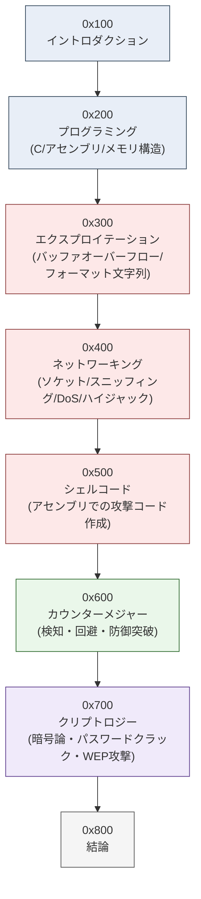
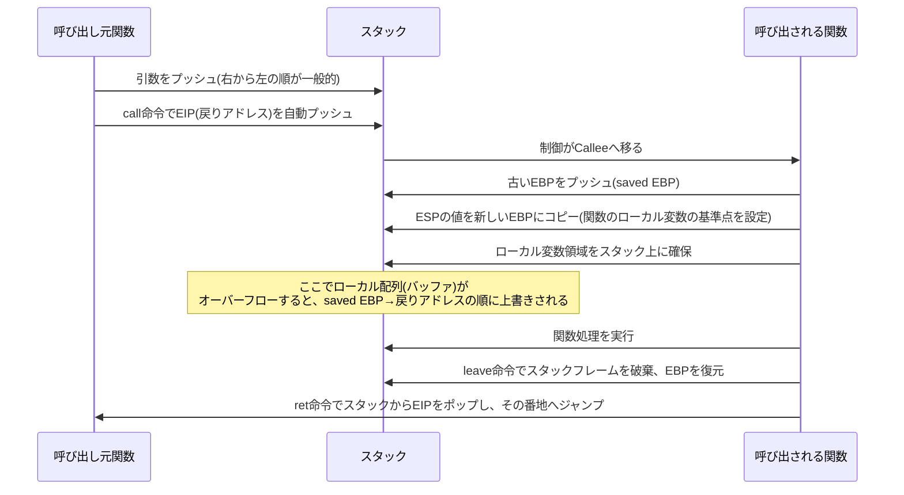
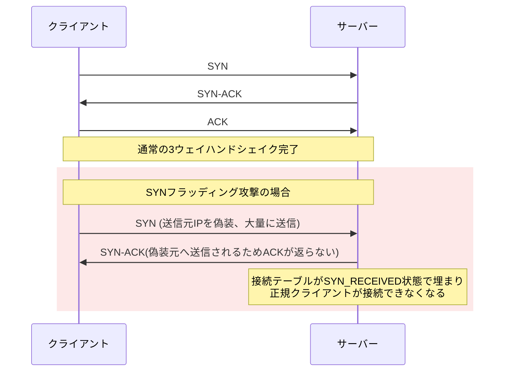
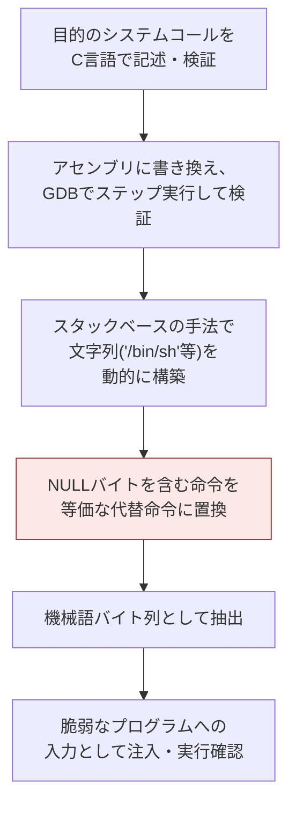
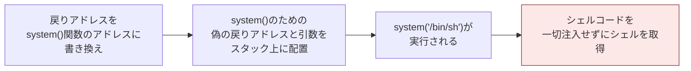
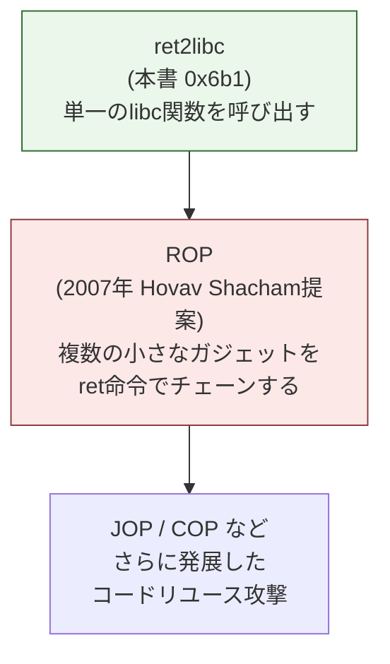
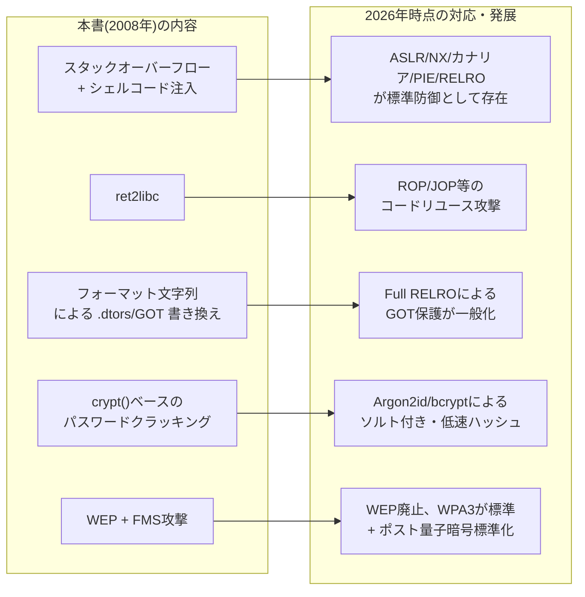

# Hacking: The Art of Exploitation, 2nd Edition 徹底解説ガイド

― 初学者のためのステップバイステップ学習ノート ―

> 本ガイドは、Jon Erickson 著『Hacking: The Art of Exploitation, 2nd Edition』(No Starch Press, 2008年1月刊, ISBN 9781593271442, 480ページ)を題材に、世界トップクラスのソフトウェアエンジニア兼セキュリティエンジニアの視点から、初学者でも体系的に理解できるよう再構成した学習ガイドです。
> 原著の構成(0x100〜0x800の章立て)に沿って解説しつつ、2026年10月11日時点での最新のセキュリティ動向(メモリ安全言語への移行、ASLR/PIE/RELROの現状、WEPの非推奨化、ポスト量子暗号の標準化など)を補足し、「名著だが刊行から約18年が経過している」という点を踏まえた**現代的な読み方**を提示します。
>
> 書籍情報源: [O'Reilly Online Learning 掲載ページ](https://www.oreilly.com/library/view/hacking-the-art/9781593271442/)

---

## 目次

1. [本書の位置づけと読み方](#1-本書の位置づけと読み方)
2. [0x100 イントロダクション ― ハッカーとは何か](#2-0x100-イントロダクション--ハッカーとは何か)
3. [0x200 プログラミング](#3-0x200-プログラミング)
4. [0x300 エクスプロイテーション](#4-0x300-エクスプロイテーション)
5. [0x400 ネットワーキング](#5-0x400-ネットワーキング)
6. [0x500 シェルコード](#6-0x500-シェルコード)
7. [0x600 カウンターメジャー(防御機構)](#7-0x600-カウンターメジャー防御機構)
8. [0x700 クリプトロジー(暗号論)](#8-0x700-クリプトロジー暗号論)
9. [0x800 結論](#9-0x800-結論)
10. [2026年時点で本書をどう読むか ― 現代的補足](#10-2026年時点で本書をどう読むか--現代的補足)
11. [学習ロードマップと推奨環境](#11-学習ロードマップと推奨環境)
12. [参考文献・ソースURL一覧](#12-参考文献ソースurl一覧)

---

## 1. 本書の位置づけと読み方

### 1.1 書誌情報

| 項目 | 内容 |
|---|---|
| 原題 | Hacking: The Art of Exploitation, 2nd Edition |
| 著者 | Jon Erickson |
| 出版社 | No Starch Press |
| 初版刊行 | 2003年(1st Edition) |
| 第2版刊行 | 2008年1月(488ページ版の表記もあり) |
| ISBN | 9781593271442 |
| 想定レベル | Beginner to intermediate |
| 付属教材 | Ubuntu LinuxベースのブータブルLiveCD(x86環境、本書のサンプルコードを収録) |

O'Reillyの書誌ページでは、本書が<cite index="2-1">プログラミング、デバッグ、ネットワークトラフィックの操作、暗号解読のために事前設定されたLinuxベースのハッキング環境を提供するブータブルLiveCDを含み、本書で使用されたすべてのソースコードを収録し、すべての実例がこのLiveCD環境で行われたこと</cite>が説明されています。

出版社(No Starch Press)のプレスリリースによれば、本書は<cite index="9-1">特定のセキュリティ上の欠陥について学ぶだけでなく、なぜほとんどのソフトウェアが安全でないのかという理由も読者に伝えることを狙いとしており、コンピュータの複雑で低レベルな仕組みについての新しい序章を含む点で初版のほぼ2倍の分量</cite>になっています。

### 1.2 なぜ今でも読む価値があるのか

本書は2008年刊行であり、examplesの多くは32ビットx86・Ubuntu環境(当時のLiveCD)を前提としています。しかし、以下の理由から**「エクスプロイトの原理を理解する」ための教材として今なお高く評価**され続けています。

- 既存のエクスプロイトツールを「使う」だけでなく「仕組みを説明する」姿勢(中古品レビューでも<cite index="106-1">早い段階のハッキング理論を知りたいならこの本がうってつけだという評価</cite>が継続的に見られます)
- スタック、ヒープ、フォーマット文字列、シェルコード、ネットワークプロトコル、暗号という「攻撃技術の基礎体力」を一冊で網羅している点
- CTF(Capture The Flag)やバイナリエクスプロイト教育の現場(後述する pwn.college など)でも、本書で扱われる概念(スタックフレーム、カナリア、ASLR、ROPの前段となる ret2libc など)が前提知識として扱われ続けている点

ただし、本書刊行後にx86-64が主流化し、スタック保護機構(カナリア、NX、ASLR、PIE、RELRO)がデフォルト有効化されるなど防御側の状況は大きく進化しました。本ガイドの第10章で、2026年時点の防御状況とのギャップを整理します。

### 1.3 本書全体の構成マップ



本書は「プログラミングの基礎 → 攻撃の原理 → ネットワークへの応用 → シェルコード作成 → 防御突破 → 暗号攻撃」という段階的な構成になっており、**前の章の理解が次の章の前提**になっています。特に0x200(プログラミング)を飛ばして0x300(エクスプロイテーション)に進むと挫折しやすいため、本ガイドでも同じ順序で解説します。

---

## 2. 0x100 イントロダクション ― ハッカーとは何か

### 2.1 本書における「ハッキング」の定義

著者は「ハッキング」を単なる不正アクセス技術ではなく、**独創的な問題解決(creative problem solving)**として定義しています。O'Reillyの紹介文でも<cite index="7-1">ハッキングとは創造的な問題解決の技術であり、それは困難な問題に対する型破りな解決策を見つけることであれ、ずさんなプログラミングの穴を突くことであれ同じだ</cite>と説明されています。

この定義は重要です。本書は「ツールを叩いて脆弱性を突く」チュートリアルではなく、「**なぜそのコードが脆弱で、なぜその攻撃が成立するのか**」を一から説明する方針を貫いています。

### 2.2 学習の心構え(初学者向け)

- **C言語とアセンブリの基礎を飛ばさない**: 0x200章は退屈に感じるかもしれませんが、0x300以降の攻撃コードを読むための必須知識です。
- **実際に手を動かす**: 原著はLiveCD環境での実践を前提としています。現代では後述する仮想環境・CTF学習プラットフォームで代替できます。
- **「動いた」で終わらせない**: なぜそのpayloadが動くのか、メモリレイアウトのどこに何が書き込まれているのかを毎回確認する習慣が、後の防御機構突破(0x600)の理解に直結します。

---

## 3. 0x200 プログラミング

### 3.1 章の構成

| 原著セクション番号 | タイトル |
|---|---|
| 0x210 | What Is Programming?(プログラミングとは何か) |
| 0x220 | Pseudo-code(疑似コード) |
| 0x230 | Control Structures(制御構造: if-then-else, while/until, for) |
| 0x240 | More Fundamental Programming Concepts(変数、演算子、関数) |
| 0x250 | Getting Your Hands Dirty(x86プロセッサとアセンブリ言語への導入) |
| 0x260 | Back to Basics(文字列、符号付き/符号なし、ポインタ、フォーマット文字列、型変換、コマンドライン引数、変数スコープ) |
| 0x270 | Memory Segmentation(メモリセグメンテーション、スタック、ヒープ) |
| 0x280 | Building on Basics(ファイルアクセス、ファイル権限、UID、構造体、関数ポインタ、疑似乱数) |

### 3.2 ステップ1: 制御構造とC言語の基礎

本書はいきなりアセンブリに入るのではなく、疑似コードからCの制御構造(if-then-else、while/until、forループ)へと段階を踏みます。初学者はここで「プログラムは上から下に実行されるだけでなく、条件分岐とループによって制御フローが変化する」という感覚を掴むことが重要です。この制御フローの概念は、後の章でバッファオーバーフローによって「意図しない制御フロー」を作り出す攻撃を理解する土台になります。

### 3.3 ステップ2: x86プロセッサとアセンブリ言語への導入

0x250節では、Cプログラム(`firstprog.c`)をコンパイルしながら、x86プロセッサのレジスタ構成とアセンブリ命令の基礎を学びます。ここで押さえるべき最重要レジスタは以下の4つです。

| レジスタ | 役割 |
|---|---|
| EIP (Instruction Pointer) | 次に実行する命令のアドレスを保持。バッファオーバーフロー攻撃の最終目標はこの値の書き換え |
| ESP (Stack Pointer) | スタックの最上位(現在使用中の先頭)アドレスを指す |
| EBP (Base Pointer / Frame Pointer) | 現在の関数呼び出しのスタックフレームの基準点 |
| EAX, EBX, ECX, EDX など | 汎用レジスタ。計算結果や引数の受け渡しに使用 |

> 補足(2026年視点): 本書はx86(32ビット)を前提としていますが、現代の環境は主にx86-64(64ビット)です。64ビットでは呼び出し規約が異なり(LinuxのSystem V AMD64 ABIでは、整数・ポインタ引数は先頭から順にRDI, RSI, RDX, RCX, R8, R9レジスタで渡され、それを超える分はスタックで渡されます)、レジスタ名もE→Rプレフィックスに変わります(EIP→RIP、ESP→RSP、EBP→RBPなど)。原理は同じですが、実際の環境で手を動かす際はこの違いを意識してください。

### 3.4 ステップ3: メモリセグメンテーションの理解

0x270節は本書全体の中でも特に重要です。プロセスのメモリ空間が「テキスト領域(コード)」「データ領域(初期化済み/未初期化グローバル変数)」「ヒープ領域」「スタック領域」に分割されていることを学びます。

#### プロセスメモリのレイアウト(概念表)

アドレスの低い方から高い方へ、典型的な32ビットLinuxプロセスのメモリ配置を表で示します(実際のアドレス値は環境・ASLR設定により変動します)。

| 領域(アドレス低 → 高) | 内容 | 成長方向 |
|---|---|---|
| Text セグメント | 実行可能な機械語コード(読み取り専用) | 固定 |
| Data / BSS セグメント | 初期化済み・未初期化のグローバル/静的変数 | 固定(静的サイズ) |
| Heap セグメント | `malloc()` などで動的確保されるメモリ | 低アドレス→高アドレスへ成長 |
| (未使用領域) | — | — |
| Stack セグメント | ローカル変数、関数引数、戻りアドレス、保存されたベースポインタ | 高アドレス→低アドレスへ成長(スタックは「下に伸びる」) |

スタックが高アドレスから低アドレスへ伸びる(down-growing)という特性こそが、「バッファに大きなデータを書き込むと、スタック上の後続データ(戻りアドレスを含む)を上書きしてしまう」というバッファオーバーフローの原理そのものです。

### 3.5 ステップ4: 関数呼び出しとスタックフレーム

関数が呼び出されるとき、以下の手順でスタックフレームが構築されます。



この「ローカル変数 → saved EBP → 戻りアドレス(saved EIP)」という並び順と、スタックが低アドレス方向に伸びることの組み合わせが、0x300章で解説されるスタックベースのバッファオーバーフローの核心です。

### 3.6 ステップ5: ポインタ、フォーマット文字列、型変換

0x260節では、文字列操作(`char_array.c`)、符号付き/符号なし整数、ポインタ、`printf`系関数のフォーマット文字列指定子(`%s`, `%d`, `%x`, `%n`など)、型変換を扱います。特に**フォーマット文字列指定子の挙動**は、0x350節のフォーマット文字列脆弱性を理解するための必須知識です。`%n`指定子が「それまでに出力した文字数を、対応する引数が指すアドレスに書き込む」という特殊な挙動を持つことを、この段階でしっかり押さえておきましょう。

### 3.7 ステップ6: ファイル操作とUID(権限管理)

0x280節では、ファイルアクセス、ファイル権限(パーミッションビット)、UID(ユーザーID)と実効UID(EUID)の違いを扱います。setuidビットが付与されたプログラム(`notesearch.c`などの例)が、実行者の権限によらず所有者の権限で動作する仕組みを学ぶことで、後の0x320節「権限昇格を狙ったスタックオーバーフロー攻撃」の意味が理解できるようになります。

---

## 4. 0x300 エクスプロイテーション

いよいよ本書の核心である「エクスプロイト」の章です。原著セクション構成は以下の通りです。

| 原著セクション番号 | タイトル |
|---|---|
| 0x310 | Generalized Exploit Techniques(汎用的なエクスプロイト技術の概観) |
| 0x320 | Buffer Overflows(バッファオーバーフロー) |
| 0x321 | Stack-Based Buffer Overflow Vulnerabilities |
| 0x330 | Experimenting with BASH(環境変数を利用した攻撃) |
| 0x340 | Overflows in Other Segments(ヒープ、関数ポインタのオーバーフロー) |
| 0x350 | Format Strings(フォーマット文字列脆弱性) |

### 4.1 スタックベースバッファオーバーフローの原理

スタックベースバッファオーバーフローとは、**固定長のバッファに想定以上のサイズのデータを書き込み、スタック上の隣接するメモリ(saved EBP・戻りアドレスなど)を意図的に上書きする**攻撃です。

典型的な脆弱なコードパターン(概念):

```c
void vulnerable_function(char *input) {
    char buffer[64];
    strcpy(buffer, input);  // inputの長さをチェックしていない
}
```

`strcpy()` は書き込み先のバッファサイズを検査せず、終端のNULバイト(`\0`)もコピーします。そのため、`input` が64バイトちょうどの文字列でも終端NULが `buffer[64]` に書き込まれ、すでに配列外書き込み(off-by-one)になります。ただし、配列外書き込みが起きることと、制御データ(saved EBP・戻りアドレス)を書き換えられることは別です。`buffer` と saved EBP の間にはアラインメント用のパディングや他のローカル変数、カナリアが入ることがあり、saved EBP や戻りアドレスを上書きするには、それらの位置まで届く長さの入力が必要です。

#### 攻撃の流れ


### 4.2 戻りアドレスの特定(オフセット計算)

実際の攻撃では、バッファの先頭から戻りアドレスの位置までの正確なバイト数(オフセット)を特定する必要があります。本書では、NOPスレッド(`\x90`のような何もしない命令の列)とパターン文字列を使ってこのオフセットを特定する手法を解説しています。

> 補足(2026年視点): 現代のエクスプロイト開発では、オフセット特定に手作業のパターン文字列ではなく、`pwntools` の `cyclic()` / `cyclic_find()` 機能や GDB拡張の `pattern create` / `pattern offset` コマンド(GEF・pwndbgに搭載)を使うのが一般的です。考え方自体は本書の手法と同じです。

### 4.3 環境変数を利用した攻撃(0x330)

0x330節では、BASHの環境変数にシェルコードを格納し、環境変数のメモリアドレスを戻りアドレスとして利用する手法(`exploit_notesearch_env.c`)を扱います。環境変数はスタックの最上位付近に配置されるため、比較的予測しやすいアドレスにシェルコードを置ける利点がありました。

### 4.4 ヒープベース・関数ポインタのオーバーフロー(0x340)

スタックだけでなく、ヒープ領域に確保されたバッファのオーバーフロー(`notetaker.c`の例)や、関数ポインタを狙ったオーバーフロー(`game_of_chance.c`の例)も扱われます。関数ポインタオーバーフローは、戻りアドレスを直接狙わずとも、プログラムが呼び出す関数のアドレス自体を書き換えることで制御フローを奪取する手法です。

### 4.5 フォーマット文字列脆弱性(0x350)

次のようなコードは典型的な脆弱性パターンです。

```c
// 脆弱: ユーザー入力をフォーマット文字列として直接渡している
printf(user_input);

// 安全: フォーマット文字列を固定し、ユーザー入力は引数として渡す
printf("%s", user_input);
```

`printf(user_input)` のように、ユーザーが制御可能な文字列をフォーマット文字列として直接渡してしまうと、存在しない引数の代わりにスタック上の値が参照されます。`%x` は対応する整数引数を16進数で出力するため、連ねるとスタック上の値が漏洩します。`%s` は対応するポインタが指す文字列を読み取り、`%n` はそれまでに出力したバイト数を対応するポインタへ書き込みます。そのため、対応する引数(ポインタ)の位置に攻撃者が用意したアドレスを置け、かつ出力バイト数を制御できる条件が揃うと、任意アドレスの読み取り(`%s`)や書き込み(`%n`)に発展します。本書では以下のステップで解説が進みます。

| ステップ | 内容 |
|---|---|
| 0x351 Format Parameters | フォーマットパラメータの基礎 |
| 0x352 The Format String Vulnerability | 脆弱性の成立条件 |
| 0x353 Reading from Arbitrary Memory Addresses | `%x`で引数位置を特定し、そこに置いたアドレスを`%s`で参照して読み取る |
| 0x354 Writing to Arbitrary Memory Addresses | 対応する引数に置いたアドレスへ、出力バイト数を調整した`%n`で書き込む |
| 0x355 Direct Parameter Access | `%N$x`形式による直接パラメータ指定 |
| 0x356 Using Short Writes | `%hn`による部分書き込みで精度を上げる手法 |
| 0x357 Detours with .dtors | ELFの`.dtors`セクション(デストラクタテーブル)を書き換える手法 |
| 0x358 Another notesearch Vulnerability | — |
| 0x359 Overwriting the Global Offset Table | GOT(Global Offset Table)書き換えによる制御奪取 |

> 補足(2026年視点): `.dtors` を利用した手法は、現代のツールチェーン(GCC・binutilsの更新、RELROの標準化)では既にほぼ通用しません。一方でGOT(Global Offset Table)書き換えの発想自体は、Full RELROが有効でない環境や、他の書き込みプリミティブと組み合わせた高度な攻撃で今も概念として生き続けています。

---

## 5. 0x400 ネットワーキング

### 5.1 章の構成

| 原著セクション番号 | タイトル |
|---|---|
| 0x410 | OSI Model(OSI参照モデル) |
| 0x420 | Sockets(ソケットプログラミング) |
| 0x430 | Peeling Back the Lower Layers(データリンク層・ネットワーク層・トランスポート層) |
| 0x440 | Network Sniffing(ネットワークスニッフィング) |
| 0x450 | Denial of Service(サービス拒否攻撃) |
| 0x460 | TCP/IP Hijacking(TCP/IPハイジャック) |
| 0x470 | Port Scanning(ポートスキャン) |
| 0x480 | Reach Out and Hack Someone(リモートサーバーへの実践的攻撃) |

### 5.2 OSI参照モデルとソケットプログラミング

本章はOSI参照モデル(物理層〜アプリケーション層の7層)の復習から始まり、Cでのソケットプログラミング(`socket()`, `bind()`, `listen()`, `accept()`, `connect()`)に進みます。簡易Webサーバー(`tinyweb.c`)を作りながら学ぶ構成です。

### 5.3 ネットワークスニッフィングの2種類の実装

| 手法 | 原著の実装例 | 特徴 |
|---|---|---|
| RAWソケット方式 | `raw_tcpsniff.c` | OSに依存する低レベルAPIを直接利用、移植性が低い |
| libpcap方式 | `pcap_sniff.c` | `libpcap`ライブラリ(Wiresharkやtcpdumpの基盤)を利用、移植性が高い |

さらに「アクティブスニッフィング」として、ARPスプーフィング(`arpspoof.c`)を用いてスイッチ化ネットワークでも通信を傍受する手法が解説されます。

### 5.4 DoS攻撃の分類

本書で扱われるDoS攻撃の種類を整理します。

| 攻撃名 | 原理 | 現在の状況 |
|---|---|---|
| SYNフラッディング | TCP 3ウェイハンドシェイクの未完了接続(SYN_RECEIVED状態)を大量に生成し、接続テーブルを枯渇させる | 現代でもDDoS攻撃の一形態として存在するが、SYN Cookie等の対策が標準実装されている |
| Ping of Death | 不正なサイズのICMPパケットでOSのバッファをオーバーフローさせる | 現代のOS・ネットワーク機器ではほぼ対策済み |
| Teardrop | フラグメント化されたIPパケットの再構築処理の欠陥を突く | 現代のOSではほぼ対策済み |
| Pingフラッディング | 大量のICMP Echoリクエストで帯域/処理能力を圧迫 | 現在も帯域消費型DDoSの基本形として存在 |
| 増幅攻撃(Amplification) | 第三者サーバーへの小さなリクエストで大きなレスポンスを被害者に送りつける | DNS/NTP/memcachedなどを悪用する形で現在も主要なDDoS手法の一つ |
| 分散DoSフラッディング | 複数ホストから協調して行うDoS攻撃(ボットネットの原型) | 現代のDDoS攻撃の主流形態そのもの |

SYNフラッディングについては、IETFが2007年に発行した<cite index="91-1">RFC 4987がSYNフラッディング攻撃と、TCP実装者・管理者のための一般的な防御技術について説明する文書</cite>として公開されており、SYN Cookieをはじめとする防御手法の標準的な参照資料になっています。

### 5.5 TCP/IPハイジャックとポートスキャン

RSTハイジャック(`rst_hijack.c`)によるセッション乗っ取りと、ステルスSYNスキャン・FIN/Xmas/Nullスキャン・デコイスプーフィング・アイドルスキャンといった各種ポートスキャン技術が解説されます。本書は攻撃側の技術だけでなく、`shroud.c`という「プロアクティブ防御」ツールの実装例も示しており、攻防両面から学べる構成になっています。



---

## 6. 0x500 シェルコード

### 6.1 章の構成

| 原著セクション番号 | タイトル |
|---|---|
| 0x510 | Assembly vs. C |
| 0x511 | Linux System Calls in Assembly |
| 0x520 | The Path to Shellcode |
| 0x521〜0x523 | スタックを使ったアセンブリ命令、GDBでの調査、NULLバイト除去 |
| 0x530 | Shell-Spawning Shellcode(シェル起動シェルコード) |
| 0x531 | A Matter of Privilege(権限の扱い、`drop_privs.c`) |
| 0x532 | And Smaller Still(シェルコードの縮小化) |
| 0x540 | Port-Binding Shellcode(ポートバインド型シェルコード) |
| 0x541〜0x542 | 標準ファイルディスクリプタの複製、分岐制御構造 |
| 0x550 | Connect-Back Shellcode(コネクトバック型シェルコード) |

### 6.2 シェルコードとは何か

シェルコードとは、脆弱性を突いて制御フローを奪取した後に**実際に実行させる機械語コード**のことです。多くの場合、シェルを起動する(`/bin/sh`を実行する)ことを目的とするため「シェルコード」と呼ばれます。

本書では、Cで書いたシステムコール呼び出し(`exec_shell.c`)から出発し、それをアセンブリ(`exec_shell.s` → `tiny_shell.s`)へ変換し、最終的にNULLバイト(`\x00`)を一切含まない、実用上送信可能なバイト列へと最適化していく過程を丁寧に解説します。

### 6.3 シェルコード開発の典型的なワークフロー



NULLバイト除去が重要な理由は、多くの脆弱な文字列コピー関数(`strcpy`など)がNULLバイトを「文字列の終端」とみなすため、シェルコード中にNULLバイトが含まれると、そこでコピーが止まってしまい攻撃が成立しなくなるためです。

### 6.4 ポートバインド型・コネクトバック型シェルコード

| 種類 | 動作 | 攻撃者にとっての利点・欠点 |
|---|---|---|
| ポートバインド型(Port-Binding) | 被害ホスト上で新しいポートをlistenし、シェルを待ち受ける | ファイアウォールのインバウンドルールで容易にブロックされやすい |
| コネクトバック型(Connect-Back) | 被害ホストから攻撃者のマシンへ能動的に接続し、シェルを送り返す | インバウンドではなくアウトバウンド通信のため、単純なインバウンドフィルタを回避しやすい |

---

## 7. 0x600 カウンターメジャー(防御機構)

本章は「防御側の検知手法」と「攻撃側の回避手法」を対比的に解説する、本書の中でも特にユニークな章です。

### 7.1 章の構成

| 原著セクション番号 | タイトル |
|---|---|
| 0x610 | Countermeasures That Detect(検知による防御) |
| 0x620 | System Daemons(`tinywebd.c`を使ったデーモン実装) |
| 0x630 | Tools of the Trade(攻撃ツールの実装) |
| 0x640 | Log Files(ログファイルの分析) |
| 0x650 | Overlooking the Obvious(見落とされがちな防御の穴) |
| 0x660 | Advanced Camouflage(IPアドレス偽装によるログ隠蔽) |
| 0x670 | The Whole Infrastructure(ソケット再利用) |
| 0x680 | Payload Smuggling(ペイロードの難読化) |
| 0x690 | Buffer Restrictions(印字可能文字のみで構成するシェルコード) |
| 0x6a0 | Hardening Countermeasures(ハードニング技術の概観) |
| 0x6b0 | Nonexecutable Stack(非実行スタック、ret2libc) |
| 0x6c0 | Randomized Stack Space(ASLR) |

### 7.2 防御技術の進化マップ(本書刊行当時〜現在)

本書0x6a0〜0x6c0節で扱われる防御機構は、現代のLinuxディストリビューションでは標準で有効化されています。以下の表で、本書が解説する防御機構と2026年時点での一般的な状況を対比します(第10章でさらに詳しく解説します)。

| 防御機構 | 本書での説明 | 2026年時点の一般的な状況 |
|---|---|---|
| 非実行スタック(NX/DEP) | スタック領域を実行不可に設定し、注入したシェルコードを直接実行できなくする | 現代のCPU・OSでハードウェアNXビットとして標準有効 |
| ret2libc | 非実行スタックを回避するため、スタック上のコードではなく既存のlibc関数(`system()`など)へ戻りアドレスを向ける手法 | 概念は現在のROP(Return-Oriented Programming)攻撃の直接の前身 |
| ASLR(Address Space Layout Randomization) | スタック・ヒープ・共有ライブラリのロードアドレスを実行ごとにランダム化し、アドレス予測を困難にする | 現代のLinuxでは `/proc/sys/kernel/randomize_va_space` で制御され標準有効 |
| スタックカナリア | 関数プロローグでスタック上に乱数値(カナリア)を置き、関数リターン時に値が変化していないか検査する | GCCの `-fstack-protector` / `-fstack-protector-strong` はビルド時に指定して適用する保護。多くのディストリビューションはパッケージ用ビルド設定で有効化しているが、GCC自体の既定値はビルド構成により異なり、任意のGCCビルドで常に有効とは限らない |

### 7.3 ret2libcの原理

非実行スタックが導入されると、攻撃者はスタック上に注入したシェルコードを直接実行できなくなります。そこで考案されたのが **ret2libc(return-to-libc)** です。戻りアドレスを、攻撃者の注入したコードではなく、プログラムに既にリンクされているlibc内の関数(典型的には`system()`)のアドレスに書き換え、その関数に都合の良い引数(例:`"/bin/sh"`という文字列へのポインタ)を偽装したスタックフレームとともに渡すことで、シェルコードを注入せずにシェルを起動する手法です。



> 補足(2026年視点): ret2libcは「単一の関数呼び出し」で完結する手法ですが、現代ではこれをさらに発展させた**ROP(Return-Oriented Programming)**が主流です。ROPは、libcや実行ファイル中に散在する小さな命令列の断片(「ガジェット」と呼ばれ、`ret`命令で終わる)を多数つなぎ合わせ、チューリング完全な計算を実行させる手法です。詳しくは第10章で解説します。

---

## 8. 0x700 クリプトロジー(暗号論)

### 8.1 章の構成

| 原著セクション番号 | タイトル |
|---|---|
| 0x710 | Information Theory(情報理論、無条件安全性、ワンタイムパッド、量子鍵配送、計算量的安全性) |
| 0x720 | Algorithmic Run Time(漸近記法) |
| 0x730 | Symmetric Encryption(対称暗号) |
| 0x740 | Asymmetric Encryption(非対称暗号、RSA) |
| 0x750 | Hybrid Ciphers(ハイブリッド暗号、中間者攻撃) |
| 0x760 | Password Cracking(パスワードクラッキング) |
| 0x770 | Wireless 802.11b Encryption(WEP) |
| 0x780 | WEP Attacks(WEP攻撃、FMS攻撃) |

### 8.2 パスワードクラッキングの分類

| 手法 | 原理 | 本書での実装例 |
|---|---|---|
| 辞書攻撃(Dictionary Attack) | 辞書リストの単語を順にハッシュ化し、照合する | `crypt_crack.c` |
| 徹底的ブルートフォース攻撃 | すべての文字の組み合わせを試行する | — |
| ハッシュルックアップテーブル | 事前計算したハッシュ値のテーブルを参照する(レインボーテーブルの前身的発想) | — |
| パスワード確率行列(Password Probability Matrix) | 文字の出現頻度を考慮し、確率の高い候補から優先的に試行する | `ppm_gen.c`, `ppm_crack.c` |

> 補足(2026年視点): 本書のパスワードクラッキング例は `crypt()` (DESベースの古典的なUNIXパスワードハッシュ)を前提としています。現代の安全なパスワード保存方式については第10章で詳しく補足します。

### 8.3 WEP(Wired Equivalent Privacy)とFMS攻撃

本書0x770〜0x780節では、当時主流だった無線LAN暗号方式WEPの仕組みと、その脆弱性を突く**FMS攻撃(Fluhrer, Mantin, Shamir attack)**が詳しく解説されます。WEPはRC4ストリーム暗号を使用しますが、初期化ベクトル(IV)の運用方法に欠陥があり、十分な数のパケットを収集することで鍵を復元できることが示されました。

> 補足(2026年視点): WEPは現在、無線LAN業界で**完全に非推奨・破棄された規格**です。Wikipediaの解説によれば、<cite index="64-1">2001年にアルゴリズムの重大な設計上の欠陥が明らかにされた後、WEPは安全な無線接続方式とはみなされなくなった</cite>とされ、<cite index="64-2">Wi-Fi AllianceはWEPとWEP2がWi-Fi Protected Access(WPA)に取って代わられたことを発表し</cite>、<cite index="64-3">IEEEはWEP-40・WEP-104の両方を非推奨とした</cite>経緯があります。本書で解説されるFMS攻撃の暗号解析的な考え方(ストリーム暗号の鍵スケジューリングにおける統計的バイアスの悪用)自体は、暗号解析を学ぶ上で今でも教育的価値があります。詳細は第10章で解説します。

---

## 9. 0x800 結論

本書は最終章で、参考文献リスト(0x810 References)と情報源一覧(0x820 Sources)を掲載して締めくくられます。著者のメッセージは一貫して「既存のエクスプロイトを実行するだけでなく、その仕組みを理解し、自分自身の創造性で新しい発見をしてほしい」というものです。O'Reillyの紹介文の結びにも<cite index="7-1">ハッカーは常に限界を押し広げ、未知を探求し、その技術を進化させ続けている</cite>という姿勢が強調されています。

---

## 10. 2026年時点で本書をどう読むか ― 現代的補足

本章は、本書の「原理」を保ちながら、2026年10月時点の実際のセキュリティ環境とのギャップを埋めるための補足です。

### 10.1 メモリ安全性問題の現在地

本書全体のテーマである「メモリ破壊(バッファオーバーフロー、フォーマット文字列など)」は、18年経った今も**ソフトウェア脆弱性の最大要因**であり続けています。Chromiumプロジェクトの分析では、<cite index="56-1">高・重大深刻度のセキュリティバグのおよそ70%がメモリ安全性の問題(C/C++のポインタに関するミス)であり、そのうち半数はuse-after-freeバグである</cite>ことが示されています。Microsoftのエンジニアも<cite index="46-1">2019年のセキュリティカンファレンスで、過去12年間、Microsoft製品のセキュリティ更新のおよそ70%がメモリ安全性の脆弱性に対処するものだった</cite>と報告しています。

このような状況を受け、米国のCISA(サイバーセキュリティ・インフラセキュリティ庁)やNSAは、<cite index="47-1">メモリ安全でないC、C++などの言語から離れ、Rust、C#、Go、Javaなど最新のコーディングプラットフォームへ迅速に移行するよう呼びかける</cite>共同文書「The Case for Memory Safe Roadmaps」を公表しました。つまり、**本書が扱う攻撃クラス(バッファオーバーフロー、use-after-free等)は、今なお業界全体の最重要課題**なのです。本書を読む意義は、むしろこの文脈で増していると言えます。

### 10.2 本書刊行当時と現在の防御機構の違い

本書0x6a0〜0x6c0節で扱われる防御機構は、本書刊行当時はオプトイン的な存在でしたが、現在は以下のように主要ディストリビューションの既定のビルド設定で広く有効化されています(独自ビルドの環境では設定次第で無効の場合もあります)。

| 防御機構 | 本書刊行当時(2008年頃) | 現在(Ubuntu等の主要ディストリビューション、2026年時点) |
|---|---|---|
| スタックカナリア | 一部の環境でオプトイン | Ubuntu等はパッケージ用ビルド設定やディストリビューション版GCCの既定で `-fstack-protector-strong` を有効化(ビルド時に適用する保護であり、任意のGCCビルドやビルド設定で常に有効とは限らない)。有効時は<cite index="24-3">スタックスマッシングを検知し、制御フロー乗っ取りを阻止する</cite> |
| 非実行スタック(NX) | ハードウェアNXビット対応が普及し始めた時期 | ほぼ全てのCPU・OSで標準有効 |
| ASLR | 部分的に導入開始 | `randomize_va_space=2`(フルASLR)が標準、<cite index="23-1">ASLR=2ではスタック・ヒープ・ライブラリのアドレスが実行のたびに異なる</cite> |
| PIE(Position Independent Executable) | 限定的 | <cite index="24-1">Ubuntuでは17.10以降、全アーキテクチャでPIEがデフォルト有効化された</cite> |
| RELRO(Relocation Read-Only) | 限定的 | Full RELROが広く採用され、<cite index="24-2">動的シンボルを起動時に一括解決し(immediate binding)、GOTを完全に読み取り専用にできる</cite> |

これらの防御機構が重なり合うことで、本書で解説される「単純な戻りアドレス上書き+シェルコード注入」という素朴な攻撃は、現代のデフォルト設定の環境ではまず成立しません。これを理解した上で学習用環境(実行環境側でASLRを無効化し、スタックカナリアを無効化してコンパイルした練習用バイナリ)を使うことが、挫折しないための重要なポイントです。

### 10.3 ret2libcからROP(Return-Oriented Programming)へ

本書0x6b1節で紹介されるret2libcは、非実行スタックへの対抗策の第一歩でした。その後、2007年にHovav Shachamが提案した**ROP(Return-Oriented Programming)**が、現代のバイナリエクスプロイトの標準技法となっています。ROPは、既存のコード中に散在する「ret命令で終わる短い命令列(ガジェット)」を多数つなぎ合わせることで、新たにコードを注入することなく任意の計算を実行させる手法です。



現代のツール `pwntools` にはROPチェーン構築を支援する `pwnlib.rop` モジュールが用意されており、<cite index="122-1">Return Oriented Programmingのためのサブモジュールとしてrop.ropやrop.srop(Sigreturn Oriented Programming)</cite>が提供されています。ASLR下でのROP攻撃では、ガジェットや関数のアドレスを知るために、メモリリーク脆弱性等でベースアドレスを特定する手法が一般的に使われます。そのため、本書で学ぶ「情報漏洩(フォーマット文字列での任意アドレス読み取り等)」の技術は、現代のROP攻撃でもそのまま活きてきます。ただしリークは必須条件ではなく、ランダム化のエントロピーが低い環境(32ビット環境など)での総当たりや、クラッシュの有無を手がかりにガジェットを探すBROP(Blind ROP)など、リークに頼らない手法も存在します。

### 10.4 現代的な学習環境・ツールチェーン

本書のLiveCD環境は入手・再現が難しくなっているため、現代では以下のような代替環境・ツールが広く使われています。

| 本書での位置づけ | 現代の代表的な代替 | 補足 |
|---|---|---|
| GDB(素のデバッガ) | GEF, pwndbg, PEDA(いずれもGDBの拡張プラグイン) | <cite index="110-1">pwndbgはGDBでのデバッグをより快適にするGDBプラグインで、低レベルソフトウェア開発者、ハードウェアハッカー、リバースエンジニア、エクスプロイト開発者に必要な機能に焦点を当てている</cite> |
| 手作業でのシェルコード/オフセット作成 | pwntools(Pythonのエクスプロイト開発フレームワーク) | <cite index="117-1">pwntoolsはCTFフレームワーク兼エクスプロイト開発ライブラリであり、Pythonで書かれ、迅速なプロトタイピングと開発のために設計され、エクスプロイト作成をできる限り簡単にすることを意図している</cite> |
| LiveCDでの演習バイナリ | CTF学習プラットフォーム(後述のpwn.collegeなど)、`exploit-exercises`のProtostar等の演習用VM | 現代のCPUでも意図的に防御機構を無効化してビルドされた演習用バイナリが利用できる |

特に、Arizona State University (ASU) の Yan Shoshitaishvili 教授(DEF CON CTFの運営やShellphishチームでの活動で知られる著名なセキュリティ研究者)が開発した **pwn.college** は、本書と同系統のメモリ破壊・シェルコード技術を体系的に学べる無償の実践プラットフォームとして広く知られています。<cite index="27-1">Shoshitaishvili教授は自動プログラム解析と脆弱性検出技術を研究テーマとし、Shellphishチームを率いてDARPA Cyber Grand Challengeで3位の完全自律型ハッキングシステムを実現した</cite>実績を持ち、<cite index="31-1">pwn.collegeの「Program Security」モジュールではシェルコーディングとメモリ破壊の技術を、本書と同様にシェルコード注入からメモリエラー、スタックスマッシング、スタックカナリア、ASLRまで段階的に学べる構成</cite>になっています。

### 10.5 パスワード保存のベストプラクティス(現在)

本書0x760節のパスワードクラッキングは古典的な `crypt()` ハッシュを対象としていますが、現代の安全なパスワード保存の標準は大きく異なります。OWASP(Open Worldwide Application Security Project)の Password Storage Cheat Sheet では、<cite index="83-1">Argon2id、bcrypt、PBKDF2といった最新のパスワードハッシュ関数はソルトの付与を呼び出し側に要求する</cite>とされ、Argon2idが第一推奨アルゴリズムとして位置づけられています。レガシーシステムでbcryptを使う場合は、<cite index="83-2">ワークファクター10以上、パスワード長制限72バイトでの利用</cite>が推奨されています。

| 方式 | 現在の推奨度 | 特徴 |
|---|---|---|
| 平文保存 / 単純ハッシュ(MD5, SHA-1単体) | 非推奨(本書が解説する攻撃がそのまま有効) | ソルトなし、高速計算ゆえブルートフォースに弱い |
| `crypt()`(DESベース、本書の対象) | 非推奨(歴史的方式) | 鍵長制限が厳しく現代の計算力では容易に破られる |
| bcrypt | 許容(レガシー向け) | ワークファクターで調整可能、72バイト制限に注意 |
| Argon2id | 推奨(第一選択) | メモリハードで並列ハードウェア攻撃への耐性が高い |

### 10.6 WEPからWPA3までの変遷

本書0x780節のFMS攻撃解説を現在の文脈で補足します。

| 規格 | 制定年 | 暗号方式 | 現在のステータス |
|---|---|---|---|
| WEP | 1997年 | RC4 + 24ビットIV | 完全に破られており使用不可。業界では<cite index="65-1">2026年時点でも一部のネットワークで稼働しているケースがあるとされるが、Wi-Fi Allianceは2004年に正式に廃止した</cite> |
| WPA(TKIP) | 2003年 | RC4 + TKIP | 非推奨(移行期の暫定措置だった) |
| WPA2 | 2004年 | AES-CCMP | 現役だが、WPA3への移行が進む |
| WPA3 | 2018年 | AES + SAE(Simultaneous Authentication of Equals) | 現在の推奨標準。<cite index="65-2">WPA3は前方秘匿性(forward secrecy)も導入しており、セッション鍵が漏洩しても過去のセッションが暴露されない</cite> |

本書で学ぶFMS攻撃(RC4の鍵スケジューリングアルゴリズムにおける統計的バイアスの悪用)自体は、ストリーム暗号の暗号解析の基礎教材として今なお教育的価値がありますが、**実運用では必ずWPA2(AES-CCMP)以上、可能であればWPA3を使用する**ことが前提になります。

### 10.7 暗号分野全体の進化: ポスト量子暗号

本書0x700章(クリプトロジー)は対称暗号・非対称暗号(RSA)の基礎を扱っていますが、2024年以降、暗号分野は大きな転換点を迎えています。NIST(米国立標準技術研究所)は、<cite index="75-1">2024年8月13日にFIPS 203(鍵確立のためのML-KEM)、FIPS 204(汎用デジタル署名のためのML-DSA)、FIPS 205(保守的なハッシュベース署名のフォールバックとしてのSLH-DSA)という3つのポスト量子暗号標準を最終化した</cite>と発表しています。これは<cite index="75-2">RSAやDiffie-Hellman鍵交換、ECDHの耐量子版としてのML-KEM、RSAやECDSA署名の耐量子版としてのML-DSA</cite>という位置づけです。

さらに、NISTは2025年3月にHQCを、ML-KEMとは異なる数学的アプローチに基づくバックアップの鍵カプセル化方式として選定しました。HQCの草案標準は作成中で標準化作業が進行中であり、草案の公開時期や最終化の時期は確定していません。最新状況はNISTの公式ページで確認してください。本書のRSA解説(0x741節)は非対称暗号の原理を理解する上で今も有効ですが、長期的な鍵管理や将来の量子コンピュータの脅威を見据える場合は、これらのポスト量子暗号標準の存在を知っておくことが重要です。

### 10.8 本書の内容と現代の対応関係まとめ



---

## 11. 学習ロードマップと推奨環境

### 11.1 推奨学習順序(初学者向け)

| 段階 | 目標 | 推奨アクション |
|---|---|---|
| 第1段階 | C言語・アセンブリ・メモリレイアウトの理解 | 本書0x200章を精読し、簡単なCプログラムをGDBでステップ実行しながらスタックフレームの変化を観察する |
| 第2段階 | 基本的なバッファオーバーフローの実践 | 実行環境でASLRを無効化し、スタックカナリアを無効化してコンパイルした練習用バイナリで、本書0x300章の手法を再現する(ASLRはOS側の設定、カナリアはコンパイル時の設定) |
| 第3段階 | ネットワーク・シェルコードの理解 | 0x400〜0x500章を読みつつ、ソケットプログラミングとシェルコード生成を実践する(`pwntools`の`shellcraft`モジュールなどが参考になる) |
| 第4段階 | 現代の防御機構との対峙 | 0x600章を読んだ後、ASLR・NX・カナリアを有効化した状態でのROP攻撃に挑戦し、本書の防御突破の発想がどう発展したかを体感する |
| 第5段階 | 暗号論とパスワード攻撃の理解 | 0x700章を読みつつ、現代の安全なパスワードハッシュ(Argon2id等)との違いを比較する |
| 継続学習 | CTF・実践プラットフォームでの演習 | pwn.collegeなどの体系化された無償プラットフォームで継続的に演習する |

### 11.2 環境構築の選択肢

| 選択肢 | 特徴 |
|---|---|
| 仮想マシン(VirtualBox/VMware等) | 古いUbuntu環境や意図的に脆弱にした環境を安全に隔離して構築できる |
| Docker/コンテナ | 軽量に演習用バイナリ環境を再現可能、ASLR等の設定もコンテナ内で制御しやすい |
| CTF学習プラットフォーム(pwn.collegeなど) | 環境構築不要でブラウザ/SSH経由で演習可能、体系化されたカリキュラムあり |

### 11.3 学習の注意点(倫理・法令遵守)

本書で学ぶ技術は、自分が所有または明示的に許可を得たシステム・演習環境でのみ実践してください。許可のない第三者のシステムへの攻撃は、多くの国・地域で違法行為に該当します。本書も含め、エクスプロイト技術の学習は「防御側として脆弱性を理解し対策するため」「許可された環境でのセキュリティ研究のため」という倫理的な目的のもとで行うべきものです。

---

## 12. 参考文献・ソースURL一覧

本ガイドの作成にあたり、2026年10月11日時点で以下の情報源をウェブ検索により参照しました。

### 書籍情報・出版社情報
- O'Reilly Online Learning 書誌ページ: https://www.oreilly.com/library/view/hacking-the-art/9781593271442/
- No Starch Press プレスリリース(第2版発売時): https://nostarch.com/releases/hacking2e_release.html
- No Starch Press LiveCD配布ページ: https://nostarch.com/hackingCD.htm
- Help Net Security 書籍紹介記事: https://www.helpnetsecurity.com/2008/01/17/new-book-hacking-the-art-of-exploitation-second-edition/

### バッファオーバーフロー・スタックの古典文献
- Aleph One (Elias Levy), "Smashing the Stack for Fun and Profit", Phrack Magazine Issue 49 (1996): https://insecure.org/stf/smashstack.txt

### 現代の防御機構(ASLR/NX/PIE/RELRO/カナリア)
- Ubuntu Security Features (Wiki): https://wiki.ubuntu.com/Security/Features
- Ubuntu Documentation: Default compiler and linker flags: https://documentation.ubuntu.com/security/security-features/process-memory/compiler-flags

### メモリ安全性と業界動向(CISA/NSA/Chromium/Microsoft)
- Chromium Project, "Memory safety": https://www.chromium.org/Home/chromium-security/memory-safety
- TechSpot, "US cyber defense, Five Eyes agencies promote transition to memory safe programming languages": https://static.techspot.com/news/101102-us-cyber-defense-five-eyes-agencies-promote-transition.html
- InfoWorld, "White House urges developers to dump C and C++": https://infoworld.com/article/3713203/white-house-urges-developers-to-dump-c-and-c.html

### ROP・現代のエクスプロイト開発ツール
- pwntools 公式ドキュメント(ROPモジュール): https://docs.pwntools.com/en/dev/rop.html
- pwntools README (GitHub/PyPI経由): https://cdn.jsdelivr.net/gh/Gallopsled/pwntools@dev/README.md
- pwndbg (GDBプラグイン) README: https://github.com/anthraxx/pwndbg

### pwn.college / Yan Shoshitaishvili (ASU)
- ASU Faculty Mentor Profile, Yan Shoshitaishvili: https://forge.engineering.asu.edu/faculty_mentor/yan-shoshitaishvili/
- pwn.college, "Program Security" モジュール: https://future.pwn.college/dojo/program-security/module/program-security

### TCP SYNフラッディング
- IETF RFC 4987, "TCP SYN Flooding Attacks and Common Mitigations" (2007年8月): https://www.rfc-editor.org/rfc/rfc4987

### パスワードハッシュのベストプラクティス
- OWASP Cheat Sheet Series, "Password Storage Cheat Sheet": https://cheatsheetseries.owasp.org/cheatsheets/Password_Storage_Cheat_Sheet.html

### WEP/WPAの現状
- Wikipedia, "Wired Equivalent Privacy": https://en.wikipedia.org/wiki/Wired_Equivalent_Privacy
- SecureW2, "What Is Wired Equivalent Privacy (WEP)? Wi-Fi Security Guide": https://securew2.com/blog/what-is-wep-security

### ポスト量子暗号(NIST標準化動向)
- EncryptionConsulting, "What FIPS 203, 204, and 205 Actually Standardize": https://www.encryptionconsulting.com/nist-pqc-standards-fips-203-204-205/
- CISO2CISO (SecurityWeek転載), "NIST Announces HQC as Fifth Standardized Post Quantum Algorithm": https://ciso2ciso.com/?p=164453

---

*本ガイドは原著『Hacking: The Art of Exploitation, 2nd Edition』(Jon Erickson著, No Starch Press)の内容を教育目的で要約・解説したものであり、原著の文章を逐語的に引用するものではありません。正確な技術的詳細、サンプルコードの全文、演習問題については原著をご参照ください。*
