# ISO/IEC 15408-1:2026 初学者向けステップバイステップ解説ガイド

**正式名称**: Information security, cybersecurity and privacy protection — Evaluation criteria for IT security — Part 1: Introduction and general model
**通称**: コモンクライテリア(Common Criteria、CC)Part 1 ／ 「概要と一般モデル」
**情報の基準日**: 2026年10月15日
**対象読者**: セキュリティ評価・認証をはじめて学ぶソフトウェアエンジニア、QAエンジニア、プロダクトセキュリティ担当者

---

## 0. このガイドの使い方と、先に伝えておく注意点

### 0.1 3行でわかる ISO/IEC 15408-1

1. **ITセキュリティ評価の「共通言語と地図」**を定めた規格で、「何を、どんな枠組みで評価するのか」の土台を説明している。
2. 評価対象を **TOE(評価対象)** と呼び、「**セキュリティ課題 → 対策目標 → 要件 → 評価**」という一本の論理でつなぐ。
3. シリーズ全体(Part 1〜5)の入口であり、**用語の定義**と**PP / ST などの部品**の説明が中心になっている。

### 0.2 このガイドの根拠と限界(重要)

| 項目 | 内容 |
|---|---|
| 2026年版の本文 | ISO の有償規格であり、**本文全文は参照していない**。ISO公式ページの公開情報(概要・版情報・ライフサイクル)と、公開されている序文(Foreword)の変更点要約を根拠にしている |
| 概念・構造の解説 | 2026年版の直前版にあたる **CC:2022 Revision 1 Part 1**(CCRAが無償公開、著作権者が再利用を許諾している文書)に基づく。第5版は技術的改訂版だが、序文の変更点を見る限り**骨格は2022年版を引き継いでいる** |
| 条文番号 | 本文中の「箇条」番号は CC:2022 R1 のもの。2026年版で番号がずれている可能性があるため、**引用・監査で使う場合は必ず2026年版の本文で確認**すること |
| 個人ブログ | 2026年版を扱った著名な開発者個人の投稿は今回の検索では見つからなかった。代わりに、国際的に知られた評価機関(atsec)、CCRA公式、各国の認証機関、ENISAなどの**一次・準一次情報**を優先した |
| 規格の転載 | 著作権に配慮し、定義や規定は**自分の言葉で言い換えて**説明している |

### 0.3 学習の進め方

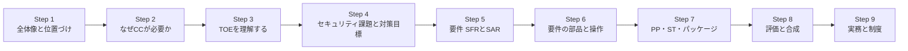

---

## 1. Step 1: 規格の基本情報と位置づけ

### 1.1 基本情報(ISO公式ページより)

| 項目 | 内容 |
|---|---|
| 規格番号 | ISO/IEC 15408-1:2026 |
| 版 | 第5版(Edition 5) |
| 発行 | 2026年5月(公開日 2026-05-19) |
| ページ数 | 138ページ |
| 担当委員会 | ISO/IEC JTC 1/SC 27(情報セキュリティ、サイバーセキュリティ及びプライバシー保護) |
| ICS分類 | 35.030(ITセキュリティ) |
| ステージ | 60.60(国際規格として発行済み) |
| 言語 | 英語、フランス語 |
| 置き換えた規格 | ISO/IEC 15408-1:2022(撤回済み) |

### 1.2 公式ページの概要(要旨)

ISO公式ページの概要を言い換えると、この文書は次の役割を持つ。

- ITセキュリティ評価の**一般的な概念と原則**を確立する。
- ITプロダクトのセキュリティ特性を評価するための**一般モデル**を示す。
- ISO/IEC 15408シリーズ全体の**概観**を与える。
- シリーズ共通の**用語と略語**を定義する。
- 評価の中心概念である **TOE(Target of Evaluation)** を確立する。
- **評価の文脈**と、**想定する読者**を説明する。
- 評価に必要な**基本的なセキュリティ概念**を導入する。

### 1.3 規格が発行されるまでの流れ

ISOの進行記録によると、新規プロジェクト承認から発行まで約2年7か月かかっている。

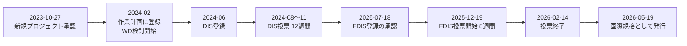

> 補足: 欧州規格としては EN ISO/IEC 15408 シリーズ(2026年版)も採用されている(CEN/CLC/TC 13、有効日 2026-06-03 とする記載が標準カタログサイトにある)。

---

## 2. Step 2: 第5版(2026年版)で何が変わったか

### 2.1 序文(Foreword)が示す主な変更点

ISO/OBPの序文によると、第5版は第4版(2022年版)を**技術的に改訂**したもので、主な変更は次の4点とされている。

| # | 変更点(要約) | 初学者向けの意味 |
|---|---|---|
| 1 | **用語を見直し・更新** | 定義の曖昧さや不整合を整理した。用語集(第3章)を読み直す価値がある |
| 2 | ST・PP・PP-Module の**パッケージ適合主張**を見直し、ISO/IEC 18045(CEM)と整合 | 「どのパッケージに従うか」の書き方と、評価方法側の扱いをそろえた |
| 3 | **複数の PP-Module Base** の記述を、より正確に改善 | PP-Module を組み合わせる際の土台指定が厳密になった |
| 4 | **誤りの訂正** | 2022年版の誤記・不備の修正 |

### 2.2 初学者が押さえるべきポイント

- 2022年版で入った大きな考え方(5部構成、**Exact Conformance**、**Direct Rationale**、**Multi-assurance**、**Composition**)は**2026年版でも前提**になっていると考えてよい。
- 2026年版は「大改革」というより**整備・精度向上のための改訂**という性格が強い。
- 具体的な条文レベルの差分は有償本文で確認が必要。CCRAは2022年版向けの正誤・解釈集(CCMB Errata and Interpretation)も公開しており、改訂の背景理解に役立つ。

### 2.3 参考: 2022年版で何が大きく変わったのか(CC v3.1 R5 → CC:2022)

2026年版を理解するうえで、2022年の大改訂を知っておくと流れがつかめる。CC:2022 の序文は、次のような変更を挙げている。

| 区分 | 内容 |
|---|---|
| 構成 | 文書を再構成し、**Part 4(評価方法とアクティビティの枠組み)**と **Part 5(定義済みパッケージ)**を新設 |
| 用語 | 用語の見直し・更新 |
| 要件 | 新しい機能要件・保証要件を追加 |
| 適合 | **Exact Conformance(完全適合)**を導入 |
| PP | 低保証PPを廃止し、**Direct Rationale PP**を導入 |
| 評価 | **Multi-assurance(複数保証)評価**を導入 |
| 合成 | **Composition(保証の合成)**を導入 |

また、CC:2022 は「まずISO/IEC規格として作られ、その後CCRAが新バージョンとして公開した」点も特徴的で、これまでのCC v3.1 までとは開発の順序が逆になっている。

---

## 3. Step 3: ISO/IEC 15408 シリーズの全体像

### 3.1 シリーズの構成

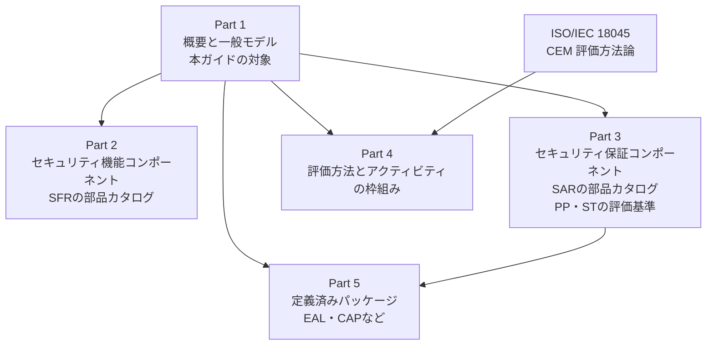

### 3.2 各パートの役割

| パート | 題名(概略) | 一言でいうと |
|---|---|---|
| Part 1 | 概要と一般モデル | 用語、TOE、PP・STなどの**部品の考え方**と**全体の地図** |
| Part 2 | セキュリティ機能コンポーネント | 「何ができるべきか」を書くための**標準テンプレート集** |
| Part 3 | セキュリティ保証コンポーネント | 「どう確かめるか」を書くための**標準テンプレート集**。PP・ST・TOEの評価基準も含む |
| Part 4 | 評価方法・アクティビティの枠組み | CEMから**評価アクティビティ**を導き出し記述するための枠組み |
| Part 5 | 定義済みパッケージ | **EAL**(評価保証レベル)や**CAP**(合成保証パッケージ)など、使い回せる要件セット |
| ISO/IEC 18045 | CEM | 評価者が**実際にどう評価するか**を定める方法論(CC本体とは別の規格) |

### 3.3 補助文書

ISO/IEC TR 22216 は、2022年版での新概念や変更点を解説する技術報告書として知られ、第5版の参考文献等でも言及されている。移行期の疑問を解く手掛かりになる。

---

## 4. Step 4: なぜ CC が必要なのか(一般モデルの出発点)

### 4.1 資産・脅威・対策・リスクの関係

CC Part 1 の一般モデルは、まず非常に基本的な話から始まる。

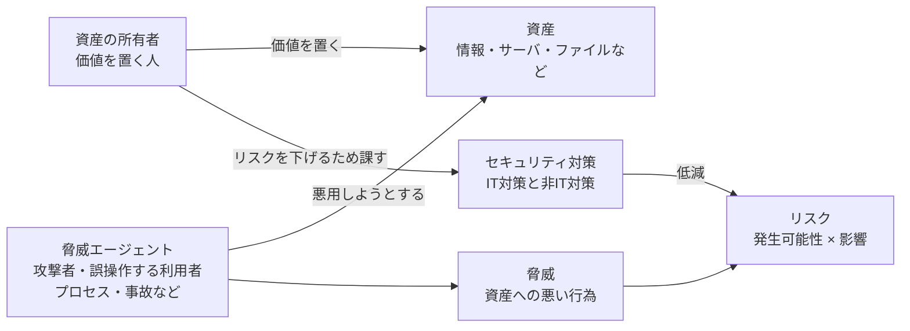

ポイントは次のとおり。

- セキュリティとは、**運用環境の中にある資産を守ること**。
- 損なわれるものは、典型的には**機密性・完全性・可用性**。
- 対策には、ファイアウォールやスマートカードなどの**IT対策**と、警備や手順などの**非IT対策**がある。
- CC は、機密性・完全性・可用性の3つ以外のITセキュリティ側面にも適用できる余地があるとされている。

### 4.2 「十分性」と「正しさ」: 評価が答える2つの問い

資産の所有者は、リスクを受け入れる判断を**説明できる**必要がある。そのために次の2点を示したい。

| 問い | 意味 | CCでの扱い |
|---|---|---|
| **十分か(Sufficiency)** | 対策が**主張どおりに動けば**、脅威は打ち消されるか | STの**論証**(目標・要件が課題をカバーしているか)で確認 |
| **正しいか(Correctness)** | 対策は**主張どおりに動いているか** | **保証要件(SAR)**に基づく評価で確認 |

多くの所有者には、これを自力で判断する知識やリソースがないため、**第三者による評価**で信頼を高める。これがCCの存在理由である。

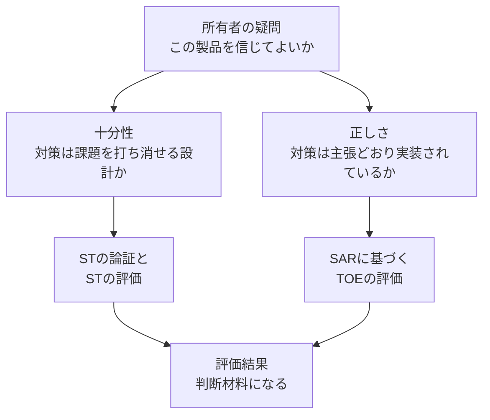

### 4.3 CC が「意味を持つ範囲」についての警告

CC Part 1 の序文には、初学者が必ず理解しておきたい注意書きがある。要約すると次のとおり。

- CC は意図的に**柔軟**に作られている。だからこそ、**不適切な評価方法・無関係なセキュリティ特性・不適切な製品**と組み合わせると、**意味のない評価結果**になりうる。
- つまり「評価された」という事実は、**どのセキュリティ特性を、どの方法で評価したか**という文脈の中でのみ意味を持つ。
- 購入者も、その文脈を確認して、自分の状況に合うか判断する必要がある。

> **現場での教訓**: 「CC認証済み」というラベルだけで安全とは言えない。**認証書とSTをセットで読む**ことが必須である。

---

## 5. Step 5: TOE(評価対象)を理解する

### 5.1 TOE とは

**TOE(Target of Evaluation)**は、評価の対象となる**ソフトウェア・ファームウェア・ハードウェアの集合**(必要に応じてガイダンス文書を伴う)である。

CC は「製品」ではなく「TOE」という言葉を使う。理由は、評価対象が必ずしも製品と一致しないからである。

| TOEになりうるもの | 例 |
|---|---|
| 製品全体 | ネットワーク機器、OS、アプリ |
| 製品の一部 | ICの暗号コプロセッサ、DBアプリ本体(リモートクライアントを除く) |
| 複数製品の集合 | 端末・サーバ・ネットワーク機器・ソフトを含むLAN |
| 技術そのもの | 製品化されない固有技術 |
| 上記の組み合わせ | OS上のアプリケーションと組み合わせたもの |

CC Part 1 は、比較的単純なTOE(インタフェースが少なく、サプライチェーンが明確)と、複雑なTOE(インタフェースやコンポーネントが多い、複数の製造・統合工程がある)の例を挙げている。

| 比較的シンプル | より複雑 |
|---|---|
| ネットワーク機器、ソフトウェアアプリ、OS、仮想化システム、IC、モバイルアプリ | LAN全体、モバイル機器、ゲートウェイ、複合機、HSM |

### 5.2 TOE の境界(Boundary)

TOEの**境界**は、STを書くうえで根本的に重要な概念である。

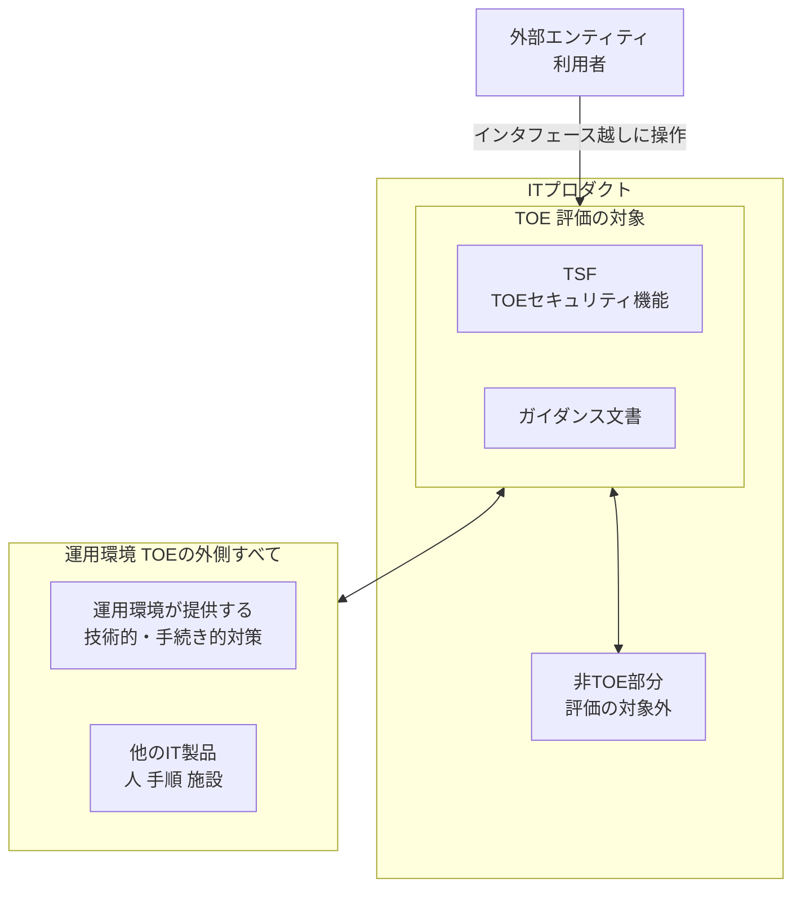

- STは、**顧客に提供される形での物理的・論理的な範囲**を明確に示す。
- TOE境界の外にある製品部分は**非TOE部分**と呼ばれ、評価の対象外。
- **TOEの一部だけを評価したのに、製品全体を評価したかのように見せてはいけない**(CCが明示的に注意している点)。
- TOE境界の外側はすべて**運用環境**に属する。

### 5.3 TOE の「表現」と「構成」

**表現の違い**: 評価の観点によって、TOEは異なる姿で現れる。

| 保証の観点 | 必要なTOEの姿(ソフトウェアの例) |
|---|---|
| テスト、脆弱性分析 | 動作する**サンプル**(インストール済みの実機・実行ファイル) |
| 実装表現の検査 | 特定バージョンの**ソースコード** |
| ライフサイクル管理 | 構成管理システム上の**ファイル一覧(構成リスト)** |
| 配布・納品 | 梱包された媒体、ダウンロード用バイナリ |

**構成の違い**: 同じ製品でも設定次第で挙動が変わる。そのため、

- TOE向けガイダンスは、一般製品向けガイダンスより**構成を厳しく絞る**ことが多い。
- ガイダンスが複数の構成を許す場合、それらの構成を**まとめて「TOE」**と呼び、**すべての構成が要件を満たす**必要がある。

---

## 6. Step 6: セキュリティ課題定義(SPD)

### 6.1 SPD とは

**SPD(Security Problem Definition)**は、「このTOEが対処すべきセキュリティ課題」を形式的に定義した記述である。**脅威・組織のセキュリティ方針(OSP)・前提条件**の3要素でできている。

> SPD の導出プロセスそのものはCCの範囲外(CCにとってSPDは公理的に与えられる)。ただし、**SPDの質が評価結果の有用性を大きく左右する**ため、リスク分析などに十分な労力をかけるべきとされている。導出の手引きとして ISO/IEC 15446 が参照されている。

| 要素 | 意味 | 例(筆者による例示) |
|---|---|---|
| **脅威(Threat)** | 脅威エージェントが資産に対して行う**悪い行為** | 「ネットワーク上の攻撃者が、転送中のファイルを盗み見る」 |
| **OSP(組織のセキュリティ方針)** | 組織や法規制が課す**ルール・手順・指針** | 「管理操作は管理者権限を持つ者のみが行えること」 |
| **前提条件(Assumption)** | 運用環境について**真であると仮定する事柄** | 「管理コンソールは入退室管理された部屋に置かれる」 |

### 6.2 脅威の構成

脅威は、次の3要素で表せる。

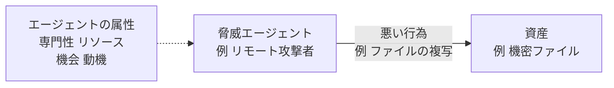

脅威エージェントは、個人だけでなく**種類やグループ**として記述してもよい。

### 6.3 前提条件の重要な性質

- 評価中、前提条件は**真であるものとして扱われ、テストされない**。
- 前提を置いてよいのは**運用環境に対してだけ**。**TOEの振る舞いについて前提を置くことは決して許されない**(評価とは、TOEに関する主張を検証する行為であって、主張が真だと仮定する行為ではないため)。
- 一方で、PP・ST評価は、そのTOE種別や環境にとって**非現実的な前提**を見つける助けにもなる。

> **よくある失敗**: 守れない仕事を「前提」に押し込んで評価を楽にしようとする。非現実的な前提は評価で指摘され、製品の利用者にとっても無意味になる。

---

## 7. Step 7: セキュリティ対策目標(Security Objectives)

### 7.1 役割は3つ

セキュリティ対策目標は、課題に対する**簡潔な解決策の宣言**で、自然言語で書かれる。

1. 課題に対する**高レベルの解決策**を、読み手(購入候補者)に分かりやすく示す。
2. 解決策を**TOEの役割**と**運用環境の役割**に**分割**する。
3. この分割された解決策が**課題を過不足なく解く**ことを示す。

### 7.2 2種類の対策目標

| 種類 | 担い手 | 評価での扱い | 例(CC Part 1の例示を要約) |
|---|---|---|---|
| **TOE のセキュリティ対策目標** | TOE自身 | **正しさ(実装)が評価される** | 「利用者を識別・認証してからサービスを使わせる」「ファイル内容の機密性を保つ」 |
| **運用環境のセキュリティ対策目標** | 運用環境 | **正しさは評価されない**(正しく実現されると仮定) | 「利用者に適切な訓練を行う」「TOEへの物理アクセスを管理者に限る」 |

### 7.3 なぜ「環境の対策」を評価の外に置くのか

CC Part 1 は理由を3点挙げている。

- CCは、**開発・製造環境や製品ライフサイクル管理**の正しさを評価するのに向いており、運用環境側の対策は評価対象外とするのが筋である。
- 対策の正しさの評価には**時間と費用**がかかり、すべてを評価するのは現実的でない。
- ある対策の正しさが**別の評価ですでに確認済み**の場合もあり、再評価は非効率である。

ただし、**購入者が別の手段で環境の正しさを確認することは妨げない**。例えば、OSのTOEが「信頼できないネットワークからはFTPだけを許可する」という環境目標を持つなら、購入者は評価済みのファイアウォールを選んで設定すればよい。

### 7.4 トレース(追跡)と正当化

STなどには、対策目標と課題をつなぐ**根拠説明(rationale)**が含まれる。

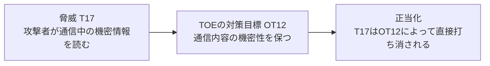

トレースの規則(Part 1の要旨)は次のとおり。

| 規則 | 意味 |
|---|---|
| **余計な目標がない** | すべての対策目標は、少なくとも1つのSPD要素にさかのぼれる |
| **課題が漏れなく覆われる** | すべてのSPD要素に、少なくとも1つの対策目標が対応する |
| **対応が正しい** | トレースが論理的に成り立つ |
| **前提へのトレースはTOE目標では不可** | 前提条件は常に「環境」に置くため、TOEの対策目標は前提条件にさかのぼらない |
| **複数目標で1脅威を扱える** | 複数の目標の組み合わせで、1つの脅威を打ち消してよい |

### 7.5 「脅威を打ち消す(counter)」の意味

「打ち消す」は、**脅威を完全に除去する**ことだけを指さない。

| 方法 | 例 |
|---|---|
| **除去** | 脅威エージェントから悪い行為の能力を奪う、資産を移動・保護して行為を無効にする |
| **低減** | 攻撃者の能力・機会を制限する、成功率を下げる、抑止する、より高い専門性やリソースを要求する |
| **影響の緩和** | 頻繁なバックアップ、予備の確保、保険、迅速な検知と対応 |

### 7.6 結論

> すべての対策目標が達成されれば、SPDは解決される。すべての脅威は打ち消され、すべてのOSPは実施され、すべての前提は維持される。

---

## 8. Step 8: セキュリティ要件(SFR と SAR)

### 8.1 全体像

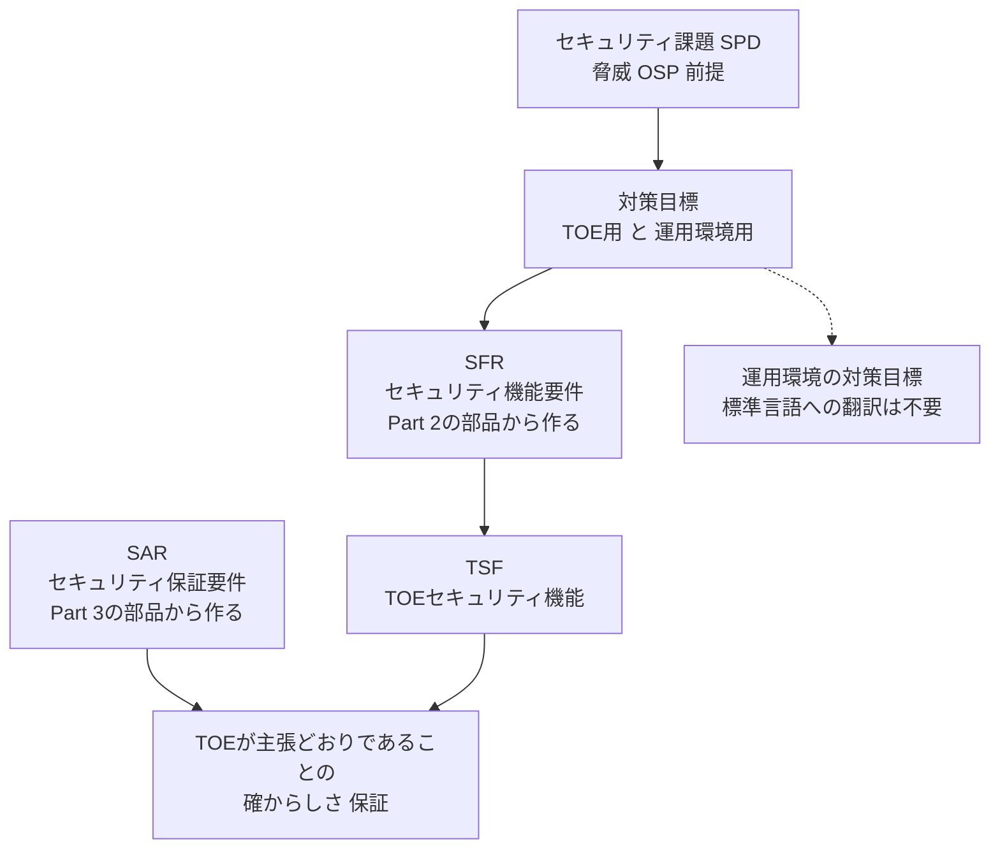

### 8.2 SFR(セキュリティ機能要件)

- 「TOEが課題にどう対処するか」を**標準化された言語**で記述する。
- TOEの対策目標を**完全に翻訳**したものでなければならない。
- **標準言語で書く理由**:
  1. 評価対象を**正確に**記述するため(自然言語の目標を精密化する)。
  2. 異なるSTを**比較**できるようにするため(同じ用語・概念を使うため、著者が違っても比較できる)。
- PPやPP-Moduleでは、SFRは**特定の実装に依存しない**ように書く。
- **運用環境の対策目標**は評価されないため、標準言語に翻訳する必要がない。

### 8.3 SAR(セキュリティ保証要件)

- 「TOEがSFRを満たしていることに、どうやって**確信**を得るか」を記述する。
- TOEの**開発・納品の条件やプロセス**と、それに関する**評価者の作業**を定める。
- 例: 設計の検査、テスト、開発環境の物理セキュリティの確認など。
- SARは**課題のカバー**には関与しない(カバーは対策目標とSFRの役割)。SARが扱うのは「TOEがSTに忠実か」である。

| 比較 | SFR | SAR |
|---|---|---|
| 問い | TOEは**何をするか** | その主張を**どう確かめるか** |
| 対象 | TOEのセキュリティ機能 | 開発・納品プロセス、証拠、評価者の作業 |
| 部品の出どころ | Part 2 | Part 3 |
| 代表的なクラスの例* | FAU(監査)、FCS(暗号サポート)、FDP(利用者データ保護)、FIA(識別と認証)、FMT(セキュリティ管理)、FPT(TSFの保護)、FTP(高信頼パス/チャネル)など | ADV(開発)、AGD(ガイダンス)、ALC(ライフサイクル)、ATE(テスト)、AVA(脆弱性評定)、ACO(合成)など |

\* クラス名は一般に知られるものの例示。2026年版Part 2・Part 3での正確な一覧は各パートで確認すること。

### 8.4 Direct Rationale(直接的根拠)

標準的な方法では、課題 → TOE対策目標 → SFR と段階を踏む。しかし場合によっては、**TOEの対策目標を省略して、SPDからSFRへ直接対応づける**ほうが適切なことがある。これが **Direct Rationale** で、PP・PP-Module・STで使える。この場合、TOEの対策目標は含まれず、運用環境の対策目標は残りうる。

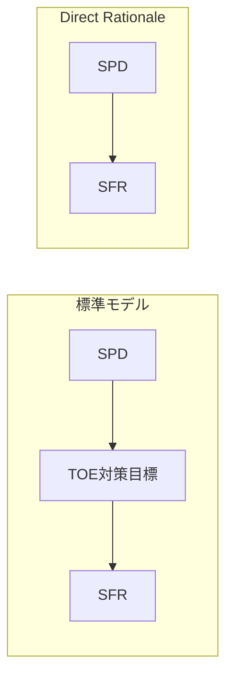

---

## 9. Step 9: セキュリティコンポーネントの構造と操作

### 9.1 部品の階層

要件は、決まった階層構造の部品から作られる。

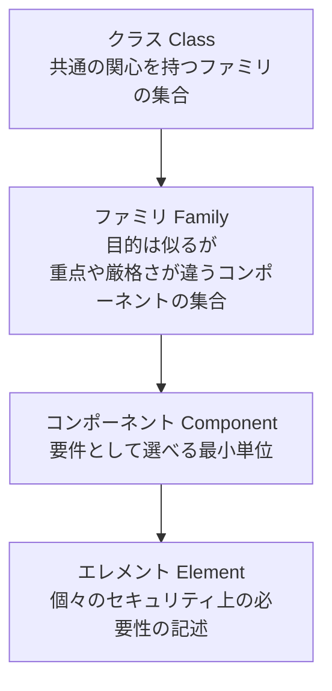

| 階層 | 説明 |
|---|---|
| クラス | 共通の焦点を持つファミリの集まり |
| ファミリ | 目的は同じだが、強調点や厳しさが異なるコンポーネントの集まり |
| コンポーネント | 要件の基礎として**選択できる最小のまとまり** |
| エレメント | 個別のセキュリティニーズの自己完結した記述 |

### 9.2 4つの操作(Operations)

部品は「穴あきテンプレート」のようなもので、**操作**によって自分のTOEに合わせて仕上げる。この仕上げ作業を**完成(completion)**と呼ぶ。

| 操作 | 英語 | 内容 | イメージ |
|---|---|---|---|
| **反復** | Iteration | 同じコンポーネントを**複数回**使い、異なる要件を表す | 認証要件を「管理者用」「一般利用者用」で2回使う |
| **割当** | Assignment | 指定されたパラメータに**値を入れる** | 認証失敗の許容回数に数値を入れる |
| **選択** | Selection | 用意された**選択肢から選ぶ** | 「監査記録の対象」から該当するものを選ぶ |
| **詳細化** | Refinement | 部品に**詳細を追加**する | 自分のTOEに即した具体的な条件を書き足す |

> STでは**完全に完成した**コンポーネントだけを示す。PP・PP-Module・パッケージは、利用者に柔軟性を残すため**未完成のコンポーネント**を含むことが多い。

### 9.3 依存関係

コンポーネントの中には、他のコンポーネントを**前提として必要とする**ものがある。PP・ST・パッケージにあるコンポーネントを含めたら、その依存先も含める必要がある(含めない場合は**根拠**を示す)。

### 9.4 拡張コンポーネント

Part 2・Part 3にない要件が必要な場合、CC Part 1のルールに従って**拡張要件(extended components)**を定義できる。拡張要件はPart 2の形式・構文を保ち、ST・PP・PP-Moduleの著者が定義できる。

> 注意(移行期): CCRAの移行ポリシーでは、CC v3.1のPPにある拡張コンポーネントは、CC:2022のPart 2・3の部品への置き換えが望ましいとされている。

---

## 10. Step 10: 5つの核となる構成物と適合の種類

### 10.1 5つの構成物

CC のパラダイムは、次の5つの構成物でできている。

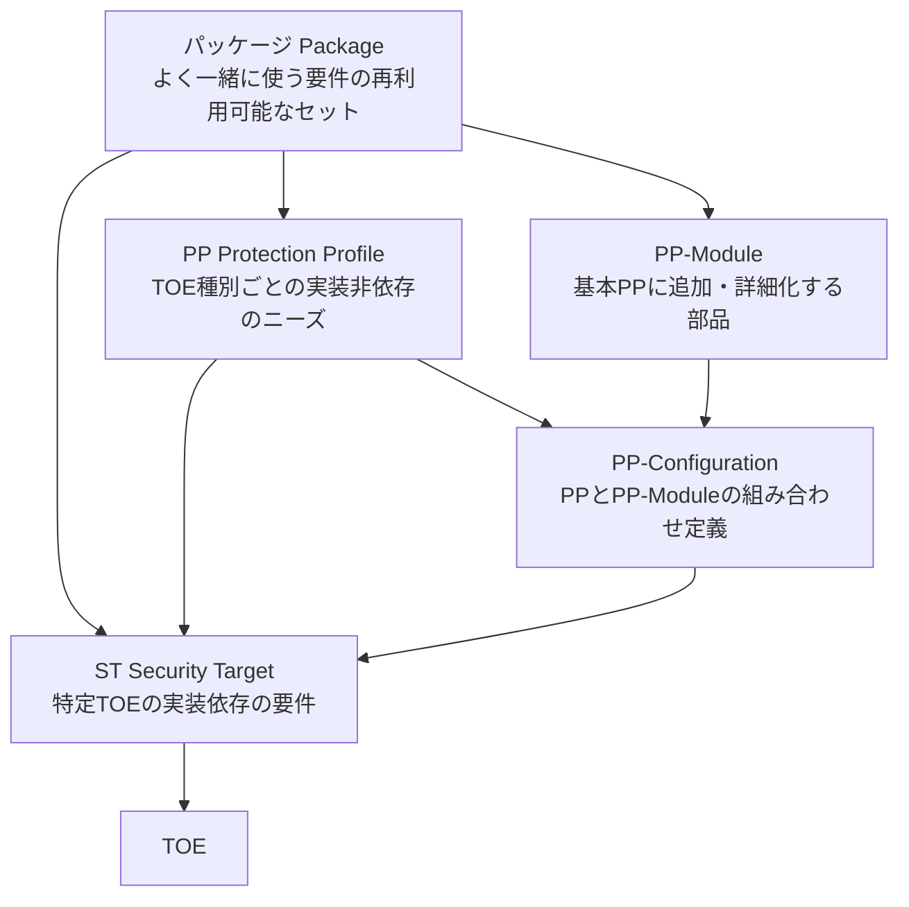

| 構成物 | 一言で | 実装依存か | 主な書き手 |
|---|---|---|---|
| **パッケージ** | 要件の再利用可能なセット(**機能パッケージ**と**保証パッケージ**がある) | 非依存 | 技術作業部会など |
| **PP** | あるTOE**種別**に期待されるSFR・SARをまとめた「共通の要求仕様」 | 非依存 | 利用者団体、技術作業部会 |
| **PP-Module** | 基本PPの種別を詳細化したり、特定技術の要件を**追加**する部品 | 非依存 | 技術作業部会 |
| **PP-Configuration** | 複数のPPとPP-Moduleを**組み合わせた**仕様 | 非依存 | 技術作業部会 |
| **ST** | **特定のTOE**について、SPDからSFR・SARまでを記した**核心文書** | 依存 | 開発者 |

### 10.2 PP-Module と PP-Configuration の考え方(CC Part 1の例を要約)

基本PPが「OS」「モバイル機器」で、PP-Moduleが「Bluetooth」「無線LANクライアント」だとする。すると、次の6通りのPP-Configurationが作れる。

| # | 組み合わせ |
|---|---|
| 1 | OS + Bluetooth |
| 2 | OS + 無線LANクライアント |
| 3 | OS + Bluetooth + 無線LANクライアント |
| 4 | モバイル機器 + Bluetooth |
| 5 | モバイル機器 + 無線LANクライアント |
| 6 | モバイル機器 + Bluetooth + 無線LANクライアント |

PP-Moduleは、他のPP-Moduleを土台にすることもできる(基本のPP-Moduleを辿ると最終的にPPに行き着く)。

### 10.3 ST の中身(概略)

STは、**課題定義から始まる一貫した論理**を持つ。Part 1は、STが次の流れを示すとしている。

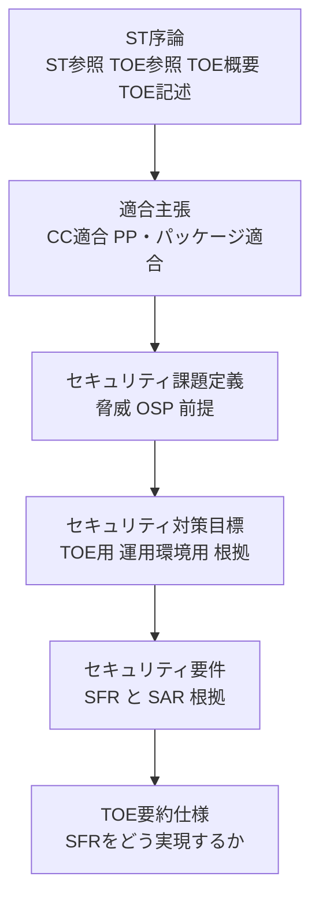

STは単独の文書でも、既存のPP・PP-Configurationに**適合する**形でもよい。後者なら、同じ種別のTOE同士で**評価結果の比較**がしやすくなり、効率も上がる。

### 10.4 適合の種類(Conformance Types)

STがPPやPP-Configurationに「従う」とき、その**従い方**には3種類ある。PP・PP-Module・PP-Configurationは、**どの種類かを必ず明示**しなければならない。

| 種類 | 略称 | 内容(要約) | こんなときに |
|---|---|---|---|
| **Exact(完全)適合** | EC | STの要件が、**PP/PP-Configurationの中のものだけ**で構成される。範囲を超えた追加を認めない | 同一の厳密な要件で評価結果を**揃えたい**(cPPなど) |
| **Strict(厳格)適合** | SC | PPの要件が**すべてSTにも含まれる**。STはそれに**追加**してもよい | 守るべき要件は厳しく守らせつつ、拡張は許す |
| **Demonstrable(実証可能)適合** | DC | PP/STが、PPの課題を解く**同等以上に厳しい解決策**を示す | 構成が違っても、同等の保証を**論証**できる |

> 補足: STは**1つ以上のPP**に完全適合を主張できるが、**PP-Configurationには1つだけ**。

### 10.5 低保証PPの廃止

CC:2022で**低保証PP**は廃止され、代わりに**Direct Rationale PP**が導入された(2.3節参照)。

---

## 11. Step 11: 評価と評価結果

### 11.1 何が評価されるのか

CCでの「評価」とは、**PP-Configuration、PP、ST、TOE**のいずれかを、**定められた基準に照らして評価**することである。

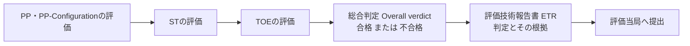

| 対象 | 何を確認するか(イメージ) |
|---|---|
| PP / PP-Configuration | 内部矛盾がなく、課題・目標・要件が整合し、実用になるか |
| ST | STが一貫していて、TOEの評価の基礎として使えるか |
| TOE | TOEがSTの主張(SFR)を、SARに沿って満たしているか |

### 11.2 評価の関係者

| 役割 | 内容 |
|---|---|
| 開発者 | TOEを開発し、評価に必要な**証拠**を提供する |
| 評価者 | 規格と方法論に従い評価を実施する |
| 評価当局 | **評価スキーム**を運用し、評価の品質を監視する |
| 評価スキーム | 評価を実施するための規則・手続き・運営。CCの全パートを実装する |

### 11.3 評価方法・評価アクティビティ(Part 4 と CEM)

- **CEM(ISO/IEC 18045)**は、評価の**基本となる方法論**で、「作業単位(work unit)」が定められている。
- **Part 4**は、そのCEMの作業単位から**評価アクティビティ(EA)**を導き、PPやSTなどに含めるための**枠組み**。
- **評価方法(EM)**は、特定の文脈で適用する1つ以上のEAの集まり。
- これにより、製品種別ごとに**保証活動をカスタマイズ**でき、個々のセキュリティ機能に対する客観的な評価指針が作れる。

### 11.4 EAL(評価保証レベル)

EALは、Part 5で定義される、**あらかじめ用意された保証要件のパッケージ**である。保証の厳しさが段階的に上がる。

| レベル | 一般に知られる名称 |
|---|---|
| EAL1 | 機能テスト済み |
| EAL2 | 構造テスト済み |
| EAL3 | 方法論的にテスト・チェック済み |
| EAL4 | 方法論的に設計・テスト・レビュー済み |
| EAL5 | 準形式的に設計・テスト済み |
| EAL6 | 準形式的に検証された設計とテスト済み |
| EAL7 | 形式的に検証された設計とテスト済み |

> 目安: 市販製品では EAL2〜EAL4 を狙う例が多いと一般に紹介されている。EALは**数字が大きいほど優れた製品という意味ではなく、保証活動の厳しさの違い**である。

### 11.5 単一保証評価と複数保証(Multi-assurance)評価

| 項目 | 単一保証評価 | 複数保証評価 |
|---|---|---|
| 考え方 | TOE全体に**同じ**SARを適用 | TOEの部分(**sub-TSF**)ごとに**異なる**SARを適用しつつ、全体には**共通のSAR**も課す |
| 向く製品 | 全体に同じ保証が妥当な製品 | 一部の機能だけ高い保証が必要な異種混合製品 |
| 例 | 通常のSTによる評価 | 鍵の保管・処理部、セキュアブート部だけを高保証にする製品、電子パスポート(BACとEACで異なる保証要件) |
| 仕組み | STが(任意の)PPなどに適合 | STが**1つだけ**の複数保証PP-Configurationに適合 |

複数保証評価が特に有効な状況(Part 1の例の要約)は次のとおり。

- 製品の**一部の機能だけ**がより高い保証を必要とする(鍵保管ユニット、セキュアブートなど)。
- 製品の**露出の大きい部分**と、そうでない部分で、必要な保証が異なる(インターネットゲートウェイなど)。
- **製品ファミリ**で、共通機能は同じ保証、実装が異なる機能は別の保証が必要(耐タンパーモジュール版とソフトウェア版など)。

---

## 12. Step 12: 保証の合成(Composition)

### 12.1 なぜ合成が必要か

実際の製品は、**すでに評価済みの部品**の上に作られることが多い(例: 評価済みICの上のアプリ)。その評価結果を**再利用**して、重複作業を減らすための仕組みが、2022年版で導入された**合成**である。

### 12.2 3つの合成モデル(Part 1の構成より)

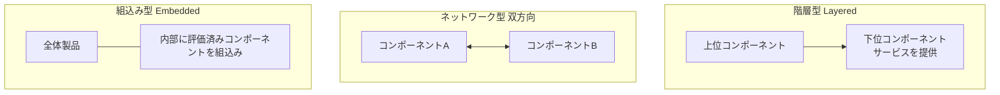

### 12.3 2つの評価手法

| 手法 | 対象 | 使う仕組み |
|---|---|---|
| **合成評価(Composed evaluation)** | **複数の独立したコンポーネント**から成る**合成TOE**(各コンポーネントがそれぞれTOE) | Part 3の**ACOクラス**、**CAP**(合成保証パッケージ) |
| **複合評価(Composite evaluation)** | **評価済みの基盤コンポーネント**の上に**依存コンポーネント**を載せた**複合製品** | Part 3の**COMP**関連ファミリ(ADV・ALC・ASE・ATE・AVAに追加)、基盤側の**ETR_COMP** |

**複合評価(composite evaluation)**は、スマートカードのように、評価済みのIC(基盤)の上にOSやアプリ(依存側)を載せるときの典型的な方法で、基盤側の評価者が、攻撃経路やテストの情報を**複合評価用に整理した報告書(ETR_COMP)**として提供する。

### 12.4 再利用の注意

評価結果を再利用するときは、再利用してよい範囲や、合成特有の評価上の論点を意識する必要がある。この詳細はPart 1の合成に関する箇条に書かれている。

---

## 13. Step 13: 読者別ロードマップ(どのパートを誰が使うか)

CC Part 1は、5つの読者グループを想定している。

| グループ | 主な関心 |
|---|---|
| **消費者(リスク所有者)** | 評価結果を見て、製品が自分のニーズに合うか判断し、製品を比較する |
| **開発者** | 評価の準備・支援、要件の把握、証拠の整備 |
| **技術作業部会** | PP・PP-Module・PP-Configuration・パッケージの作成 |
| **評価者** | TOE・ST・PP・PP-Configurationの適合性を判断 |
| **その他** | 監査人、セキュリティアーキテクト、承認者、評価依頼者、評価当局、研究者など |

Part 1のロードマップ表の要点を整理すると次のとおり。

| パート | 消費者 | 開発者 | 技術作業部会 | 評価者 |
|---|---|---|---|---|
| Part 1 | 背景理解・参照用(should) | **セキュリティ仕様とSPDの開発に使う(shall)** | 背景・構造の参照(should)、**仕様作成に使う(shall)** | **PP・ST評価に使う(shall)** |
| Part 2 | リスク環境のための機能コンポーネントの検討に使う(shall) | **ST作成に使う(shall)** | 機能コンポーネントの記述に使う(shall) | 機能コンポーネントやSFRの評価に使う(shall) |
| Part 3 | 必要な保証の判断に使う(shall) | **ST作成に使う(shall)** | 保証コンポーネントの記述に使う(shall) | 保証コンポーネントやSARの評価に使う(shall) |
| Part 4 | 参考(should) | 参考(should) | 参考(should) | 評価方法・アクティビティの策定に使う(should) |
| Part 5 | 定義済みパッケージの内容確認(should) | 定義済みパッケージを使うST作成で使う(shall) | 定義済みパッケージを使うPP等の作成で使う(shall) | 定義済みパッケージを主張するPP・STの評価に使う(shall) |

> 読み方: **shall = 必須**、**should = 推奨**。開発者は、**Part 1・2・3**が実質必読。

---

## 14. Step 14: 実務での使われ方(制度・運用)

### 14.1 評価・認証の関係者と流れ

CCは**規格**であり、実際の評価・認証は国や地域ごとの**スキーム**が運営する。

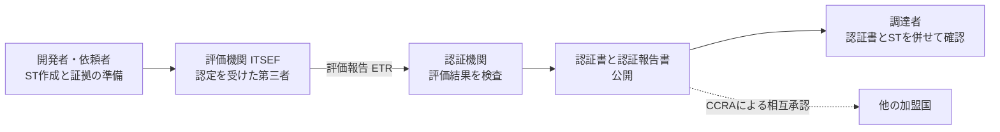

### 14.2 日本の場合(JISEC)

IPAの公式ページによると、

- **JISEC**(ITセキュリティ評価及び認証制度)は、IT関連製品のセキュリティ機能の適切性・確実性を、**ISO/IEC 15408**に基づき第三者(評価機関)が評価し、**認証機関**が認証する日本の制度である。
- 主に**政府調達**で活用されている。
- 認証機関は**IPA**(経済産業省の事業を受託して運営)。評価機関は認定機関から認定を受ける必要がある。
- 日本は2003年10月31日に国際相互承認アレンジメント**CCRA**に加盟し、JISECの認証製品が加盟国でも承認される枠組みに入っている。
- IPAの公式ページでは、2025年にウクライナが、2026年にバングラデシュが**CCRA受入国(承認のみを行う参加国)**として承認されたとの掲載がある。

### 14.3 欧州の場合(EUCC)

- **EUCC**は、サイバーセキュリティ法に基づく最初の欧州認証スキームで、**Commission Implementing Regulation (EU) 2024/482** により制定され、**ISO/IEC 15408とISO/IEC 18045**を基礎にしている。
- EUCCの保証レベルは **Substantial(相当)** と **High(高)** の2つで、CCの**AVA_VAN(脆弱性評定)**にひも付く。規則上、AVA_VAN 1〜2が Substantial、3〜5が High に対応する。
- 2025年2月27日から全面適用とする解説がある。
- ENISAは、EUCCが現在運用中で、定期的に保守されているとしている。また、EUCC規則が適用する規格のバージョンは、改正された第2条・第3条で定められ、移行規則は第3条にあるとされている。

> **注意(情報の食い違い)**: 一部の事業者の解説に「2026年2月以降、EALは使われなくなる」とする記述がある一方、別の解説では「EUCCはEALを廃止せず、2つの保証区分の下に位置づけ直した」としている。**EUCCの規則(EUR-Lex)と ENISA の公式文書で、自分のケースを必ず確認**すること。

### 14.4 米国など

- 米国では NIAP(National Information Assurance Partnership)が承認するPPに基づく評価が一般的。ある解説は、**CCの暗号評価は、CAVP/CMVPによる暗号アルゴリズム・モジュールの検証を代替せず、その上に積み上げる**関係にあると説明している(NIAP Policy Letter #5に言及)。これは二次情報なので、実務では一次情報の確認を推奨する。

### 14.5 CC:2022への移行(CCRAの方針)

CCRAの移行ポリシーと各国の認証機関の公開情報から確認できる要点は次のとおり。

| 項目 | 内容 |
|---|---|
| 新規評価 | 2024年7月1日以降、新規の認証申請は**CC:2022 Rev.1**を示す必要がある(ポーランド認証機関NASKなどの案内) |
| 旧版 | CC v3.1 R5 は v3.1 の最終リビジョン。移行期間中は一定の条件下で使用できる |
| 再利用 | 一定の条件下で、旧版の評価結果(ALCなど)を新版評価で再利用できる |
| PP移行 | CC v3.1 のPPを、段階的にCC:2022へ移行できる |
| 2026年版 | ISO側は2026年に第5版が発行。**CCRAや各スキームがどのタイミングで2026年版に追随するか**は、各スキームの最新の公表で確認すること |

---

## 15. Step 15: CC の範囲外にあるもの(重要)

CC Part 1の序文は、**CCが扱わない事項**を明示している。これを知らないと過信につながる。

| 範囲外の事項 | 意味 |
|---|---|
| **管理的なセキュリティ対策**(IT機能に直結しない) | 組織・人事・物理・手続き面の対策は評価基準に含まれない(重要だが別途必要) |
| **評価方法論そのもの** | 基準をどう適用するかはCEM等が担う |
| **評価を適用する行政・法制度の枠組み** | 各国のスキームが担う |
| **認定(accreditation)の手続き** | 評価結果は認定の**入力**の一つにすぎず、非ITの側面は別途検討が必要 |
| **暗号アルゴリズムの固有の品質の評価** | 数学的性質の独立評価が必要なら、スキーム側が別途規定する |

---

## 16. Step 16: よくある誤解と正しい理解

| よくある誤解 | 正しい理解 |
|---|---|
| 「CC認証=製品全体が安全」 | **TOEとSTで定義された範囲と主張**に対する評価結果。TOEが製品の一部のこともある |
| 「EALが高い=優れた製品」 | EALは**保証活動の厳しさ**を表す。機能の良し悪しではない |
| 「運用環境の対策も評価される」 | **評価されない**。運用環境の対策は正しく実現されると仮定される |
| 「前提条件はTOEの機能にも置ける」 | 前提を置けるのは**運用環境だけ**。TOEの挙動に前提は置けない |
| 「PPがあればSTは不要」 | PPは**種別**の要求、STは**特定のTOE**の記述。評価にはSTが必須 |
| 「Part 1に評価手順が書いてある」 | **手順はCEM**。Part 1は概念・構造・要求の考え方 |
| 「暗号アルゴリズムの強さもCCで保証される」 | 暗号アルゴリズムの固有の品質評価は**CCの範囲外** |
| 「2026年版で全部が変わった」 | 第5版は**技術的改訂**。主な変更は用語、パッケージ適合主張、PP-Module Baseの記述、誤り訂正(序文より) |

---

## 17. 用語集(初学者向けの言い換え付き)

| 用語 | 略称 | やさしい説明 |
|---|---|---|
| Target of Evaluation | TOE | 評価の対象になるソフト・ファーム・ハードの集まり |
| TOE Security Functionality | TSF | TOEの中で、セキュリティ要件を正しく実行するために頼る機能の全体 |
| Operational environment | - | TOE境界の外側すべて |
| Asset | - | TOEの所有者が価値を置くもの |
| Threat agent | - | 資産に悪い行為をしうる主体(攻撃者、誤操作する利用者、事故など) |
| Security Problem Definition | SPD | 脅威・OSP・前提で書かれた、守るべき課題の定義 |
| Organizational Security Policy | OSP | 組織や法規制が課すセキュリティのルール |
| Assumption | - | 運用環境について真と仮定する事柄 |
| Security objective | - | 課題を解くための意図の宣言(TOE用と環境用) |
| Security Functional Requirement | SFR | TOEが何をするかを標準言語で書いた要件 |
| Security Assurance Requirement | SAR | TOEの正しさを確かめる方法を書いた要件 |
| Protection Profile | PP | TOE種別ごとの、実装に依存しないセキュリティニーズ |
| PP-Module | - | 基本PPを補う、実装非依存の要件部品 |
| PP-Configuration | - | PPとPP-Moduleの組み合わせ仕様 |
| Security Target | ST | 特定TOEの、実装に依存したセキュリティ要件の記述 |
| Package | - | 要件の再利用可能なまとまり(機能・保証) |
| Evaluation Assurance Level | EAL | 定義済みの保証パッケージの段階 |
| Composed Assurance Package | CAP | 合成の保証のための定義済みパッケージ |
| Evaluation Activity | EA | CEMの作業単位から導いた評価の活動 |
| Evaluation Method | EM | 特定の文脈で使うEAの集まり |
| Evaluation Technical Report | ETR | 総合判定とその根拠を書いた評価報告書 |
| Exact / Strict / Demonstrable Conformance | EC / SC / DC | PP等への適合の3種類 |
| Direct Rationale | - | TOE対策目標を省き、SPDからSFRへ直接対応づける方式 |
| Multi-assurance evaluation | - | TOEの部分ごとに異なる保証を適用する評価 |
| sub-TSF | - | 複数保証で、あるPP-Configuration構成要素に対応するTSFの部分 |
| Iteration / Assignment / Selection / Refinement | - | 部品を仕上げる4つの操作 |
| Attack potential | - | 脆弱性の悪用に必要な労力(攻撃者の専門性・リソース等で決まる) |
| Attack surface | - | 対象にアクセスしようとする入口(論理・物理インタフェース)の集合 |

---

## 18. 理解度チェック(10問)

**Q1.** TOEとITプロダクトは、いつも同じものか。

答え
同じとは限らない。TOEは製品全体、製品の一部、複数製品、技術などでありうる。一部だけの評価を製品全体の評価として見せてはならない。

**Q2.** 前提条件(Assumption)を置けるのは、TOEと運用環境のどちらか。

答え
運用環境のみ。TOEの挙動については前提を置けない。

**Q3.** 運用環境の対策目標は評価されるか。

答え
評価されない。評価上は正しく実現されると仮定される。ただし購入者が別の手段で確認することは妨げない。

**Q4.** SFRとSARの違いを一言で述べよ。

答え
SFRはTOEが何をするか、SARはその主張をどう確かめるか。

**Q5.** 部品を仕上げる4つの操作は何か。

答え
反復、割当、選択、詳細化。

**Q6.** Exact適合とStrict適合の違いは。

答え
Exactは要件がPP等の中のものだけで構成され範囲を超えない。StrictはPPの要件をすべて含めば追加してよい。

**Q7.** Direct Rationaleでは何が省かれるか。

答え
TOEのセキュリティ対策目標。SPDからSFRへ直接対応づける。

**Q8.** 第5版(2026年版)の主な変更点を、序文に沿って挙げよ。

答え
用語の見直し、パッケージ適合主張の見直し(ISO/IEC 18045と整合)、複数のPP-Module Baseの記述の改善、誤りの訂正。

**Q9.** 複数保証評価が有効なのはどんな製品か。

答え
一部の機能(鍵保管、セキュアブートなど)だけ高い保証が必要な製品、露出度の違う機能を持つ製品、共通機能と個別実装を持つ製品ファミリなど。

**Q10.** CCが扱わない事項を3つ挙げよ。

答え
管理的セキュリティ対策、評価方法論、行政・法制度の枠組み、認定手続き、暗号アルゴリズムの固有の品質評価など(いずれか3つ)。

---

## 19. 次に学ぶ順序(学習ロードマップ)

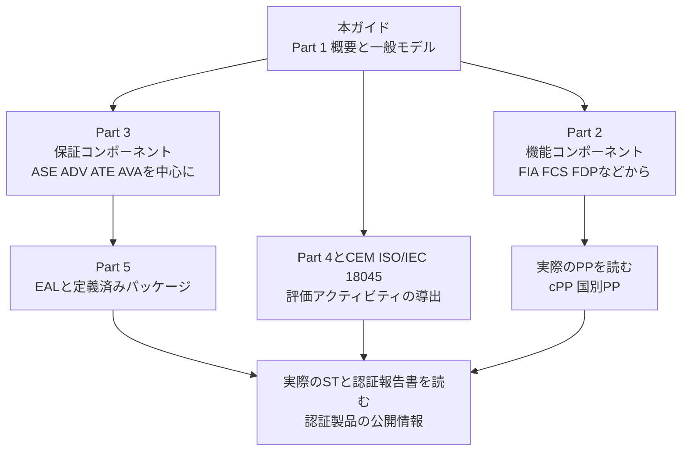

実践的な学習のコツは次のとおり。

1. **実際のSTを1つ**読む(CCポータルや各国の認証製品一覧で公開されている)。本ガイドの Step 6〜10 の構造がそのまま現れる。
2. 同じ種別のPPと、それに適合するSTを**並べて**、適合の種類(Exact / Strict / Demonstrable)を確認する。
3. 自社製品で**TOE境界を仮に引いてみる**。どこが非TOEで、どこが運用環境か。
4. 前提条件を書き出し、**本当に環境側で守れるか**を点検する。

---

## 20. 参考文献・出典URL(2026年10月15日時点で確認)

### 20.1 規格・公式情報

| 区分 | 内容 | URL |
|---|---|---|
| ISO公式 | ISO/IEC 15408-1:2026 製品ページ(版、発行日、ステージ、概要、ライフサイクル) | https://www.iso.org/standard/15408-1 |
| ISO公式(OBP) | ISO/IEC 15408-1:2026 プレビュー(序文の変更点要約、導入の記述) ※閲覧にJavaScriptが必要 | https://www.iso.org/obp/ui/#iso:std:iso-iec:15408:-1:en |
| IEC Webstore | ISO/IEC 15408-1:2026 の書誌情報(発行日2026-05-19、第5版、138ページ) | https://webstore.iec.ch/en/publication/113680 |
| CCRA公式 | CC:2022 Part 1 Revision 1(概念・構造・用語の根拠。本ガイドの解説の主な土台) | https://commoncriteriaportal.org/files/ccfiles/CC2022PART1R1.pdf |
| CCRA公式 | CC/CEM 各版の一覧と著作権・再利用に関する案内 | https://commoncriteriaportal.org/cc/index.cfm |
| CCRA公式 | CC:2022 / CEM:2022 移行ポリシー | https://www.commoncriteriaportal.org/files/ccfiles/CC2022CEM2022TransitionPolicy.pdf |
| CCRA公式(CCMB) | CC:2022 / CEM:2022 正誤・解釈集 | https://www.commoncriteriaportal.org/files/ccfiles/CCMB-2025-001-v1_2-Errata_Interpretation_CC_CEM_2022.pdf |

### 20.2 国際的に著名な評価機関・コミュニティの解説

| 区分 | 内容 | URL |
|---|---|---|
| atsec(国際的な評価機関) | CC:2022の解説ブログ(CC v3.1 R5からの変化、Exact Conformance、移行期限など) | https://atsec.de/cc2022-is-here/ |
| atsec | 開発者向けCC入門スライド(一般モデル、STの構造、PP・ST・パッケージの関係) | https://atsec.de/wp-content/uploads/2024/07/Developer-intro-to-CC.pdf |
| ICCC(国際CC会議) | プログラム(Part 4のEA、CC:2022への移行、PP更新などの発表) | https://iccconference.org/?page_id=3244 |

### 20.3 各国・地域の制度

| 区分 | 内容 | URL |
|---|---|---|
| IPA(日本) | JISECのトップページ(CCRA受入国の承認など) | https://www.ipa.go.jp/security/jisec/index.html |
| IPA(日本) | 評価認証制度(JISEC)概要(制度の目的、CCRA加盟、政府調達での活用) | https://www.ipa.go.jp/security/jisec/scheme/index.html |
| ENISA(EU) | EUCC(保証レベルとAVA_VANの対応、適用規格) | https://certification.enisa.europa.eu/browse-topic/EUCC_en |
| EUR-Lex(EU) | Commission Implementing Regulation (EU) 2024/482(EUCC)統合版 | https://eur-lex.europa.eu/eli/reg_impl/2024/482/2025-01-08/eng |

### 20.4 補助的な情報源(二次情報。参考として利用)

| 区分 | 内容 | URL |
|---|---|---|
| Keyfactor | CCとCAVP/CMVP・NIAPポリシーの関係の解説 | https://www.keyfactor.com/compliance-hub/iso-iec-15408-common-criteria/ |
| QIMA | EUCCとCCの保証レベル対応の解説 | https://blog.qima.com/due-cybersecurity/mapping-eucc-to-common-criteria-a-technical-overview-of-assurance-levels-and-evaluation-requirements |
| UL Solutions | CCとEUCC、AVA_VANレベルの解説(EALの扱いについて他の資料と表現が異なる点に注意) | https://www.ul.com/services/common-criteria-certification-information-technology-it-security |
| NASK(ポーランド認証機関) | CC:2022への移行に関する案内(2024年7月1日以降の扱い) | https://certyfikacja.nask.pl/?p=2401 |
| Wikipedia | Common Criteria の概説 | https://en.wikipedia.org/wiki/Common_Criteria |

### 20.5 この文書の確度についてのまとめ

| 内容 | 確度 | 根拠 |
|---|---|---|
| 版情報、発行日、ステージ、置き換え関係 | 高 | ISO公式ページ |
| 第5版の主な変更点(4点) | 高(要約) | ISO OBPの序文 |
| 一般モデル、TOE、SPD、対策目標、SFR/SAR、構成物、適合、評価、合成の概念 | 高(2022年版に基づく) | CC:2022 R1 Part 1。2026年版で表現・番号が変わっている可能性あり |
| EALの名称一覧、クラス名の例 | 中(一般に知られる内容) | 2026年版Part 3・5で要確認 |
| 各国スキームの2026年版への移行時期 | 未確定 | 各スキームの最新公表を確認 |

---

*本ガイドは学習用の解説であり、規格そのものの代替ではありません。認証取得・調達・監査などで正式な根拠が必要な場合は、ISO/IEC 15408-1:2026 の本文(英語または仏語)と、適用する各スキームの最新の公式文書を確認してください。*
