# ISO/IEC 27001:2022 初学者向け ステップバイステップ解説ガイド

> **情報時点:2026年10月14日**　／　**対象:前提知識ゼロの初学者(開発者・QA・情報システム担当・経営企画など)**
> 本文中の `[S1](https://www.iso.org/standard/27001)` などの記号は、末尾「[16. 出典URL一覧](#16-出典url一覧)」の番号に対応します。

---

## 目次

1. [0. このガイドの読み方](#0-このガイドの読み方)
2. [1. 30秒でわかる ISO/IEC 27001](#1-30秒でわかる-isoiec-27001)
3. [2. 情報セキュリティの3要素(CIA)](#2-情報セキュリティの3要素cia)
4. [3. 規格ファミリーの地図](#3-規格ファミリーの地図)
5. [4. 最初に覚える用語集](#4-最初に覚える用語集)
6. [5. 規格の全体構造(本文と附属書A)](#5-規格の全体構造本文と附属書a)
7. [6. 本文 箇条4〜10 を1つずつ理解する](#6-本文-箇条410-を1つずつ理解する)
8. [7. 附属書A:93の管理策](#7-附属書a93の管理策)
9. [8. リスクアセスメントの進め方](#8-リスクアセスメントの進め方)
10. [9. 導入ステップ(ゼロから認証まで)](#9-導入ステップゼロから認証まで)
11. [10. 認証審査の流れ](#10-認証審査の流れ)
12. [11. 2013年版→2022年版の移行と2026年10月時点の最新動向](#11-2013年版2022年版の移行と2026年10月時点の最新動向)
13. [12. 開発者・クラウド利用者の視点](#12-開発者クラウド利用者の視点)
14. [13. よくある誤解 Q&A](#13-よくある誤解-qa)
15. [14. 学習ロードマップと自己診断](#14-学習ロードマップと自己診断)
16. [15. 理解度チェック](#15-理解度チェック)
17. [16. 出典URL一覧](#16-出典url一覧)

---

## 0. このガイドの読み方

| 項目 | 内容 |
|---|---|
| 情報の基準日 | 2026年10月14日時点でウェブ検索・取得できた情報 |
| 想定読者 | ISO規格を読んだことがない人。ソフトウェア/クラウドに関わる人は [12章](#12-開発者クラウド利用者の視点) が実務に直結します |
| 規格本文の扱い | ISO/IEC 27001の本文は有料の著作物です。本ガイドは**要点を筆者が言い換えて解説**しており、条文の引用・再掲はしていません。監査や認証を目指す場合は必ず正式な規格(ISO、またはJIS Q 27001)を入手してください [S1](https://www.iso.org/standard/27001) |
| 管理策の日本語名 | 管理策名は初学者向けの**意訳**です。JIS Q 27001:2023附属書Aの公式訳とは表現が異なる場合があります |
| 情報の優先順位 | ① 標準化機関・認定機関・政府(ISO、Global ACI、NIST、経産省、JIPDEC/ISMS-AC) → ② 認証機関・クラウド事業者の公式発信(BSI、SGS、DQS、AWS) → ③ 専門ベンダーの解説記事 |
| 補足(情報源について) | 規格の解説は、個人開発者のブログよりも、規格そのものと国際的な認証機関・クラウド事業者の公式資料のほうが根拠として強いため、そちらを中心に参照しました。ベンダー記事由来の情報には末尾で種別を明記しています |

### このガイドの学び方(おすすめ順)

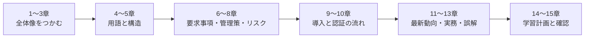

---

## 1. 30秒でわかる ISO/IEC 27001

### 1-1. ひとことで言うと

**ISO/IEC 27001は、組織が「情報セキュリティを管理する仕組み(ISMS)」を作り、運用し、改善し続けるための国際規格です。** 特定の製品や技術を指定する規格ではなく、「リスクを見つけて、対策を決めて、回して、見直す」という**マネジメントの型**を定めています [S1](https://www.iso.org/standard/27001)。

### 1-2. 基本情報

| 項目 | 内容 | 出典 |
|---|---|---|
| 正式名称 | Information security, cybersecurity and privacy protection — Information security management systems — Requirements | [S1](https://www.iso.org/standard/27001) |
| 日本語での通称 | 情報セキュリティ、サイバーセキュリティ及びプライバシー保護 — 情報セキュリティマネジメントシステム — 要求事項 | [S15](https://www.meti.go.jp/press/2023/09/20230920001/20230920001-2.pdf) |
| 現行版 | **ISO/IEC 27001:2022**(第3版、2022年10月25日発行、19ページ) | [S1](https://www.iso.org/standard/27001) |
| 追補(Amendment) | **Amd 1:2024**(気候変動への対応、2024年2月発行) | [S1](https://www.iso.org/standard/27001)[S10](https://www.tuvsud.com/en-ae/services/auditing-and-system-certification/climate-action-changes-amendment-1-in-management-system-standards) |
| 作成組織 | ISO/IEC JTC 1/SC 27(情報セキュリティ、サイバーセキュリティ及びプライバシー保護) | [S1](https://www.iso.org/standard/27001) |
| 前版 | ISO/IEC 27001:2013(撤回済み) | [S1](https://www.iso.org/standard/27001) |
| 認証の可否 | **認証可能**(要求事項を定めた規格のため)。認証は ISO 自身ではなく、独立した認証機関が行う | [S1](https://www.iso.org/standard/27001)[S4](https://www.iso.org/the-iso-survey.html) |
| 日本での対応JIS | JIS Q 27001:2023(2022年版に対応)、追補対応のJIS Q 27001:2025 | [S15](https://www.meti.go.jp/press/2023/09/20230920001/20230920001-2.pdf)[S14](https://www.jnsa.org/seminar/std/isms/20251205/data/20251205_01.pdf) |

> **「ISO 27001」と「ISO/IEC 27001」の違い**
> 正式表記は **ISO/IEC 27001** です。ISOとIEC(国際電気標準会議)が共同で発行しているためで、ISOは認証を表記する際にも「ISO/IEC 27001:2022」と版を付けることを勧めています [S1](https://www.iso.org/standard/27001)。

### 1-3. 規格が約束してくれること / してくれないこと

| 規格が目指すこと | 規格が保証しないこと |
|---|---|
| リスクを把握し、優先順位をつけて対策する「仕組み」の確立 | 「絶対に事故が起きない」という保証 |
| 人・プロセス・技術をまとめて管理する(紙・クラウド・デジタル全般) | 特定のツール・製品の導入 |
| 組織の規模や業種に合わせて調整できる柔軟性 | 全組織に同一の対策リストを強制すること |
| 継続的な改善サイクル | 一度取得すれば何もしなくてよい状態 |

ISO公式ページも、この規格を「リスク管理・サイバーレジリエンス・業務の卓越性のためのツール」と位置づけ、人・方針・技術を総合的に扱うと説明しています [S1](https://www.iso.org/standard/27001)。

### 1-4. 全体像

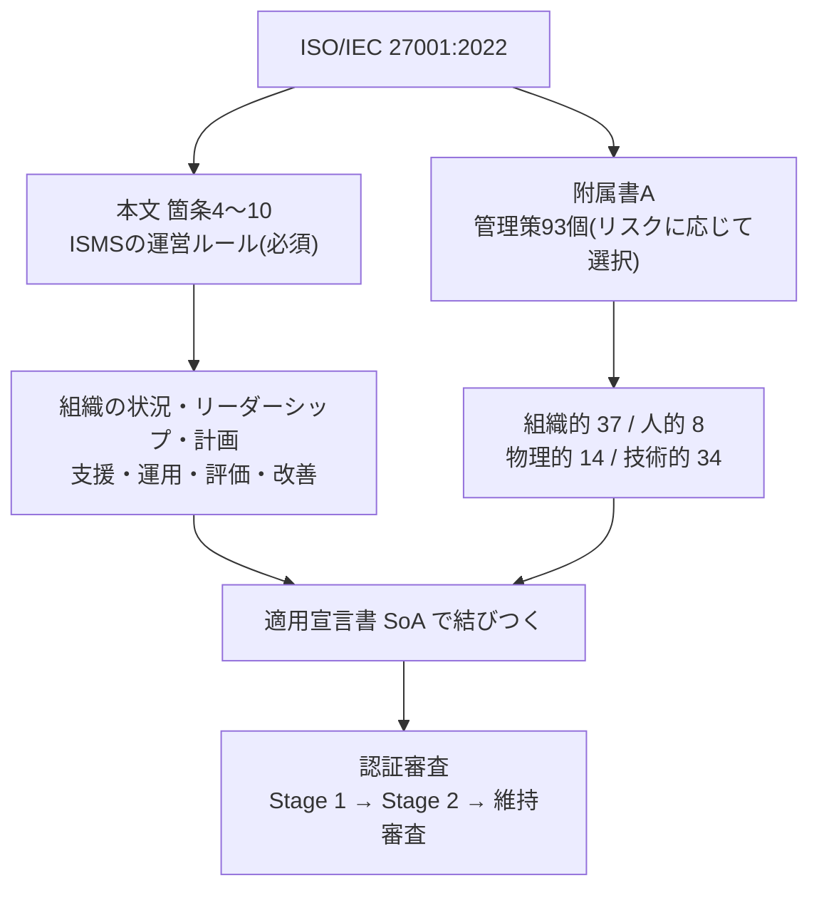

---

## 2. 情報セキュリティの3要素(CIA)

ISO/IEC 27001は、情報の次の**3つの性質を守る**ことを目的にしています [S1](https://www.iso.org/standard/27001)。

| 要素 | 英語 | 意味(やさしく) | 失われた例(ISO公式ページの例を参考に言い換え) |
|---|---|---|---|
| **機密性** | Confidentiality | 許可された人だけが情報にアクセスできる | 顧客のログイン情報が盗まれて売買される |
| **完全性** | Integrity | 情報が正確で、壊されたり消されたりしていない | 担当者が処理中に誤ってデータの行を消してしまう |
| **可用性** | Availability | 必要なときに必要な人が使える | サーバー障害とバックアップ不足でDBが止まる |

> **開発者向けの覚え方**
> 機密性=認可/暗号化、完全性=入力検証/改ざん検知/バージョン管理、可用性=冗長化/バックアップ/DR。この3つに分類して考えると、後述の管理策(附属書A)が整理しやすくなります。

---

## 3. 規格ファミリーの地図

ISO/IEC 27001には「兄弟規格」があり、役割が違います。**ISMSとして認証の対象になるのは27001**です [S37](https://www.vikingcloud.com/blog/iso-27002-2022)。ただし、ISO/IEC 27701:2025はプライバシー情報マネジメントシステムとして単独で認証を受けられます [S22](https://en.wikipedia.org/wiki/ISO/IEC_27701)。

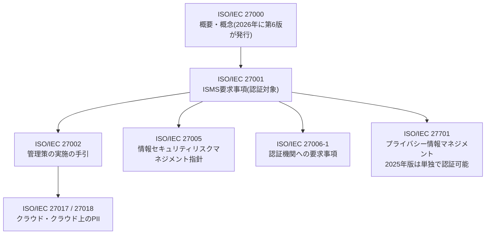

| 規格 | 役割 | 初学者への一言 | 出典 |
|---|---|---|---|
| ISO/IEC 27000 | 用語・概念・ファミリーの概観。**2026年7月に第6版**が発行され、用語集中心から概観・概念・関係性の整理へ性格が変わった | まず用語の拠り所 | [S3](https://www.iso.org/standard/27000)[S24](https://www.dqsglobal.com/en/explore/blog/iso-iec-27000-2026-released) |
| **ISO/IEC 27001** | ISMSの**要求事項**(やるべきこと) | 本ガイドの主役 | [S1](https://www.iso.org/standard/27001) |
| ISO/IEC 27002:2022 | 管理策の**実施の手引**(どうやるか)。2022年2月15日発行、93管理策、4分類 | 27001の附属書Aの「取扱説明書」 | [S8](https://www.sgs.com/en-ke/news/2022/07/key-changes-in-iso-iec-27002-2022) |
| ISO/IEC 27005 | リスクマネジメントの指針(2022年版) | リスク評価の進め方の参考書 | [S14](https://www.jnsa.org/seminar/std/isms/20251205/data/20251205_01.pdf) |
| ISO/IEC 27006-1 | 認証機関への要求事項(2024年版) | 認証機関側の規格 | [S14](https://www.jnsa.org/seminar/std/isms/20251205/data/20251205_01.pdf) |
| ISO/IEC 27701 | プライバシー情報マネジメント。2025年10月に**単独で実施・認証可能**な規格へ改訂 | 個人情報を重点的に扱う組織向け | [S22](https://en.wikipedia.org/wiki/ISO/IEC_27701) |
| ISO/IEC 42001 | AIマネジメントシステム | AI利用組織が27001の上に重ねて検討 | [S1](https://www.iso.org/standard/27001) |

---

## 4. 最初に覚える用語集

専門用語を先に押さえると、以降がぐっと楽になります。

| 用語 | 意味 | たとえ |
|---|---|---|
| **ISMS** | Information Security Management System。情報セキュリティを管理する仕組み全体 | 「会社の防犯・防災の運営体制」 |
| **情報資産** | 守るべき情報とその入れ物(データ、書類、システム、人の知識など) | 顧客名簿、ソースコード、設計書、クラウドアカウント |
| **脅威** | 情報資産に害を与える原因 | 不正アクセス、マルウェア、誤操作、災害 |
| **脆弱性** | 脅威につけ込まれる弱点 | 古いライブラリ、弱いパスワード、MFA未導入 |
| **リスク** | 脅威が脆弱性を突いて損害が出る可能性(起きやすさ × 影響の大きさ) | 「多要素認証がない顧客DBが乗っ取られる」 |
| **リスクアセスメント** | リスクの特定・分析・評価の一連の作業 | 健康診断 |
| **リスク対応** | 評価したリスクをどうするか決めて実行すること | 治療方針 |
| **管理策(コントロール)** | リスクを下げるための具体的な対策 | アクセス制御、バックアップ、教育 |
| **附属書A** | 管理策の参照リスト(93個) | 「対策のカタログ」 |
| **適用宣言書(SoA)** | 必要な管理策、それを含めた理由、実施状況、附属書Aの管理策を除外した場合の除外理由を記載する必須文書(6.1.3 d)。附属書Aの並びに沿った一覧表は実務でよく使われる形式の一つで、必須ではない | 「必要な対策とその理由・状況の説明書」 |
| **適用範囲(スコープ)** | ISMSが対象とする部署・拠点・システム・サービスの境界 | 「どこまでを守るか」の線引き |
| **残留リスク** | 対策を打った後に残るリスク | 「ゼロにはできない分」 |
| **内部監査** | 自組織(または委託先)が行う、ISMSが規格や自社ルールに合っているかの確認 | 模擬試験 |
| **マネジメントレビュー** | 経営層がISMSの状況を定期的に見直す会議 | 経営層の定例点検 |
| **不適合/是正処置** | 要求事項を満たしていない事実と、再発防止のための対応 | 不具合の根本対策 |
| **認証機関(CB)** | 審査して認証書を発行する第三者機関 | 試験官 |
| **認定機関(AB)** | 認証機関が適切か審査して認定する機関。日本ではISMS-AC | 試験官を認定する機関 |

> **「認証」と「認定」の違い(日本のISMS制度)**
> 日本では、認定機関である**ISMS-AC**が認証機関を審査・認定し、認証機関が組織を審査・認証する二層構造です [S17](https://www.jipdec.or.jp/library/report/h3taia0000001qn3-att/20230703-r01.pdf)。国際的には、国際的な相互承認の枠組みに参加する認定機関が認定した認証機関の証明書がより高い信頼を得やすい、とISOも説明しています [S1](https://www.iso.org/standard/27001)。この枠組みは2026年1月1日から**Global Accreditation Cooperation Incorporated(Global ACI)**が担っています。従来のIAF(国際認定フォーラム)とILACは同日に統合されました。IAF MLAの下で認定された認証は、移行期間中も引き続き有効です [S42](https://iaf.nu/en/news/global-accreditation-cooperation-incorporated-launch-unifies-international-accreditation-organisations-and-strengthens-worldwide-trust/)。

---

## 5. 規格の全体構造(本文と附属書A)

ISO/IEC 27001は、大きく**2つの部分**でできています。

| 部分 | 内容 | 必須度 | 出典 |
|---|---|---|---|
| **本文 箇条4〜10** | ISMSの運営ルール(組織の状況、リーダーシップ、計画、支援、運用、パフォーマンス評価、改善) | **すべて必須**。除外できない | [S26](https://www.surecloud.com/resource-hub/iso-27001-annex-a-enterprise-implementation)[S27](https://bastion.tech/learn/iso27001/iso-27001-requirements) |
| **附属書A** | 情報セキュリティ管理策の参照リスト(93個) | リスクに応じて選ぶ。**除外する場合は理由を適用宣言書に記録** | [S26](https://www.surecloud.com/resource-hub/iso-27001-annex-a-enterprise-implementation)[S29](https://www.orbiqhq.com/templates/iso-27001-statement-of-applicability-template.md) |

> 箇条1〜3(適用範囲・引用規格・用語)は、適合のための要求事項を含みません。審査で問われるのは箇条4〜10と、リスク対応で選んだ管理策です [S27](https://bastion.tech/learn/iso27001/iso-27001-requirements)。

### 5-1. PDCAとの対応

マネジメントシステム規格は、**計画(Plan)→実施(Do)→点検(Check)→改善(Act)**の循環で理解すると読みやすくなります(この対応づけは筆者の整理です)。

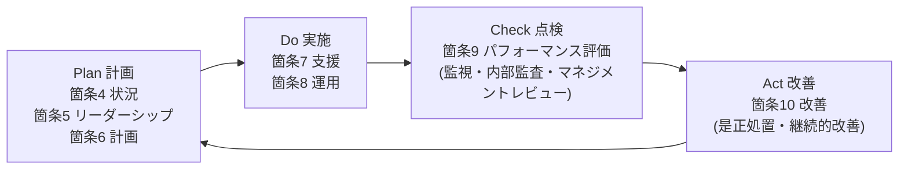

### 5-2. 他のISOマネジメントシステム規格との共通骨格

箇条4〜10の構成は、ISO 9001(品質)、ISO 14001(環境)、ISO/IEC 42001(AI)など、他のマネジメントシステム規格と**共通の骨格(附属書SL)**を使っています [S35](https://docs.modulos.ai/frameworks/iso-27001/clauses-4-10)。そのため、複数規格を統合運用しやすく、2024年の気候変動追補も複数規格に同時に入りました [S10](https://www.tuvsud.com/en-ae/services/auditing-and-system-certification/climate-action-changes-amendment-1-in-management-system-standards)。

---

## 6. 本文 箇条4〜10 を1つずつ理解する

ここでは各箇条を **「何を求めているか → かみ砕くと → 残す記録(成果物) → つまずきやすい点」** の順で解説します。条文自体は引用せず、筆者が言い換えています。

### 箇条4:組織の状況 — 「自分たちは何者で、何を守るのか」を決める

| 項目 | 内容 |
|---|---|
| 4.1 組織及びその状況の理解 | 事業に影響する内部・外部の課題(法規制、技術、競合、委託先、災害など)を把握する。**2024年追補で、気候変動が関連する課題かどうかを判断することが明記された** [S11](https://services.bis.gov.in/tmp/LITD23425400_06092024_1.pdf) |
| 4.2 利害関係者のニーズ・期待 | 顧客、規制当局、取引先、従業員など、関係者の情報セキュリティ上の要求を把握する。追補で「関係者が気候変動に関する要求を持つことがある」旨の注記が追加された [S11](https://services.bis.gov.in/tmp/LITD23425400_06092024_1.pdf) |
| 4.3 適用範囲の決定 | ISMSが対象とする組織・拠点・システム・サービスの境界を決め、**文書化**する |
| 4.4 ISMS | 必要なプロセスとその相互関係を含め、ISMSを確立し、維持し、継続的に改善する |

- **成果物:** 状況分析メモ、利害関係者一覧、**ISMS適用範囲文書**
- **つまずき:** 範囲を広げすぎて運用が破綻する/狭すぎて顧客要求を満たせない。まずは「顧客に提供するサービスと、それを支える人・システム」から始めるのが定石です。
- **ワンポイント(追補):** 4.1で気候変動が関連課題かどうかを判断するだけでは足りません。4.2に基づき、顧客・規制当局などの利害関係者が気候変動に関する要求を持つかを確認し、その結果も踏まえて対応の要否を判断・記録します [S11](https://services.bis.gov.in/tmp/LITD23425400_06092024_1.pdf)。どちらにも該当しないと判断し根拠を残した場合に限り、追加対応は不要とする解説が複数あります [S10](https://www.tuvsud.com/en-ae/services/auditing-and-system-certification/climate-action-changes-amendment-1-in-management-system-standards)。具体的な運用は認証機関に確認してください。

### 箇条5:リーダーシップ — 「経営層が本気であること」を形にする

| 項目 | 内容 |
|---|---|
| 5.1 リーダーシップ及びコミットメント | 経営層が方針・目的の整合、資源の提供、ISMSの組込み、改善の推進に責任を持つ |
| 5.2 方針 | 情報セキュリティ方針を定め、文書化し、組織内に伝え、必要に応じ関係者が入手できるようにする |
| 5.3 役割・責任・権限 | ISMSに関わる役割を割り当て、伝達する |

- **成果物:** **情報セキュリティ方針**、役割・責任の定義(組織図やRACI)
- **つまずき:** 「情報システム部門だけの活動」になる。審査では経営層へのインタビューが行われ、関与が確認されます。ISMSは経営層主導のトップダウン型として説明されることが一般的です [S34](https://hightable.io/iso-27001-reference-guide/)。

### 箇条6:計画 — 「リスクを見つけ、対策を決め、目標を立てる」

ここがISMSの**心臓部**です。

| 項目 | 内容 |
|---|---|
| 6.1.1 一般 | 4.1・4.2を踏まえ、取り組むべきリスクと機会を決める |
| **6.1.2 リスクアセスメント** | リスクの基準(受容基準など)を決め、繰り返し実施でき比較可能な方法でリスクを特定・分析・評価する |
| **6.1.3 リスク対応** | 対応方法を選び、**必要な管理策を決め、附属書Aと突き合わせて漏れを確認し、適用宣言書(SoA)を作る**。リスク対応計画を作り、リスク所有者の承認(残留リスクの受容)を得る |
| 6.2 情報セキュリティ目的 | 測定可能な目的を設定し、誰が・何を・いつまでに・どう評価するかを計画する |
| **6.3 変更の計画(2022年版で追加)** | ISMSを変更する場合は、計画的に実施する |

- **成果物:** リスクアセスメント手順、**リスクアセスメント結果**、**リスク対応計画**、**適用宣言書(SoA)**、情報セキュリティ目的
- **SoAは必須文書:** 規格の6.1.3 d)が求めており、必要な管理策・採用理由・実施状況、除外した管理策の除外理由を含める必要があります [S29](https://www.orbiqhq.com/templates/iso-27001-statement-of-applicability-template.md)。
- **つまずき:** 「全部の管理策をYesにして見栄えを良くする」「SoAを作って放置する」。これは審査で指摘されやすい典型例として複数の解説で挙げられています [S26](https://www.surecloud.com/resource-hub/iso-27001-annex-a-enterprise-implementation)。

### 箇条7:支援 — 「実行に必要な人・知識・記録」を整える

| 項目 | 内容 |
|---|---|
| 7.1 資源 | ISMSに必要な人・予算・設備を用意する |
| 7.2 力量 | 担当者に必要な知識・スキルがあることを確認し、証拠を残す |
| 7.3 認識 | 全従業員が方針、自分の貢献、違反した場合の影響を理解している |
| 7.4 コミュニケーション | 誰に・何を・いつ・どう伝えるかを決める(2022年版で「どのように」が明確化された) |
| 7.5 文書化した情報 | 文書・記録の作成、更新、管理(版管理、アクセス制御、保管) |

- **成果物:** 教育計画・受講記録、力量マトリクス、文書管理台帳
- **つまずき:** 「教育を1年目にやったきり」。2年目以降の維持審査で記録不足が露呈しやすいポイントです [S40](https://timewell.jp/en/columns/iso-iec-27001-certification-complete-guide-2026)。

### 箇条8:運用 — 「計画したことを、実際に回す」

| 項目 | 内容 |
|---|---|
| 8.1 運用の計画及び管理 | 必要なプロセスの基準を決め、その通りに運用し、**外部委託したプロセスも管理**する |
| 8.2 リスクアセスメントの実施 | 計画した間隔、または重大な変更があったときにリスクアセスメントを実施し、結果を残す |
| 8.3 リスク対応の実施 | リスク対応計画を実行し、結果を残す |

- **成果物:** リスクアセスメント結果(定期更新分)、リスク対応の実施記録
- **つまずき:** 外部委託(クラウド、開発委託、保守)の管理が抜ける。[12章](#12-開発者クラウド利用者の視点)で扱います。

### 箇条9:パフォーマンス評価 — 「効いているか」を測って見直す

| 項目 | 内容 |
|---|---|
| 9.1 監視・測定・分析・評価 | 何を・どう測るか決め、ISMSと管理策の有効性を評価する |
| **9.2 内部監査** | 計画した間隔で内部監査を実施する(監査プログラム、基準、範囲、公平性を確保) |
| **9.3 マネジメントレビュー** | 経営層が計画した間隔でISMSをレビューし、結果を記録する |

- **成果物:** 測定結果、**内部監査計画と報告書**、**マネジメントレビュー議事録**
- **重要:** 認証審査(Stage 2)の前に、**内部監査とマネジメントレビューを少なくとも1サイクル実施している**ことを多くの認証機関が求めます [S28](https://www.a-lign.com/articles/iso-27001-audit-essentials)。

### 箇条10:改善 — 「直して、より良くする」

| 項目 | 内容 |
|---|---|
| 10.1 継続的改善 | ISMSの適切性・妥当性・有効性を継続的に改善する |
| 10.2 不適合及び是正処置 | 不適合が出たら、対処し、原因を除去する処置を取り、効果を確認して記録する |

2022年版では、**10.1(継続的改善)が先、10.2(不適合・是正処置)が後**という並びに入れ替わりました [S27](https://bastion.tech/learn/iso27001/iso-27001-requirements)。

### 6-1. 必須の文書化した情報(まとめ)

審査で「ある」ことを確認される主な文書・記録です(規格の要求に基づく筆者整理)。

| 箇条 | 文書化した情報 | 種別 |
|---|---|---|
| 4.3 | ISMS適用範囲 | 文書 |
| 5.2 | 情報セキュリティ方針 | 文書 |
| 6.1.2 | リスクアセスメントのプロセス | 文書 |
| 6.1.3 | リスク対応のプロセス、**適用宣言書(SoA)** | 文書 |
| 6.2 | 情報セキュリティ目的 | 文書 |
| 7.2 | 力量の証拠 | 記録 |
| 8.1 | 運用が計画どおり実施された確信を得るための情報 | 記録 |
| 8.2 / 8.3 | リスクアセスメント結果 / リスク対応結果 | 記録 |
| 9.1 | 監視・測定の結果 | 記録 |
| 9.2 | 内部監査プログラムと結果 | 記録 |
| 9.3 | マネジメントレビューの結果 | 記録 |
| 10.2 | 不適合の性質と是正処置の結果 | 記録 |

> 上記以外(アクセス制御規程、インシデント対応手順、バックアップ手順など)は、リスク対応で選んだ管理策に応じて必要になります。「何を文書化するか」は規模・複雑さ・担当者の力量で決めてよい、というのが考え方です。

---

## 7. 附属書A:93の管理策

### 7-1. 4つのテーマ

2013年版は「114管理策・14分類」でしたが、2022年版は**93管理策・4テーマ**に再編されました。内容が大きく削られたのではなく、重複する管理策を統合し、新しい管理策を追加したうえで整理し直したものです [S8](https://www.sgs.com/en-ke/news/2022/07/key-changes-in-iso-iec-27002-2022)[S26](https://www.surecloud.com/resource-hub/iso-27001-annex-a-enterprise-implementation)。

| テーマ | 番号 | 数 | 何を扱うか | 主な担当(目安) |
|---|---|---|---|---|
| **組織的管理策** | A.5.1〜A.5.37 | 37 | 方針、役割、資産管理、アクセス制御、供給者、インシデント、事業継続、法令順守 | 経営層、情報セキュリティ責任者、法務、購買 |
| **人的管理策** | A.6.1〜A.6.8 | 8 | 採用前の確認、雇用条件、教育、懲戒、退職後の責任、秘密保持、リモートワーク、事象の報告 | 人事、各部門長 |
| **物理的管理策** | A.7.1〜A.7.14 | 14 | 境界、入退室、オフィス保護、物理監視、機器の設置・保守・廃棄 | 総務、施設管理 |
| **技術的管理策** | A.8.1〜A.8.34 | 34 | 端末、特権、認証、マルウェア、脆弱性、ログ、暗号、ネットワーク、セキュア開発 | 情報システム、開発、SRE |

合計:37 + 8 + 14 + 34 = **93** [S26](https://www.surecloud.com/resource-hub/iso-27001-annex-a-enterprise-implementation)

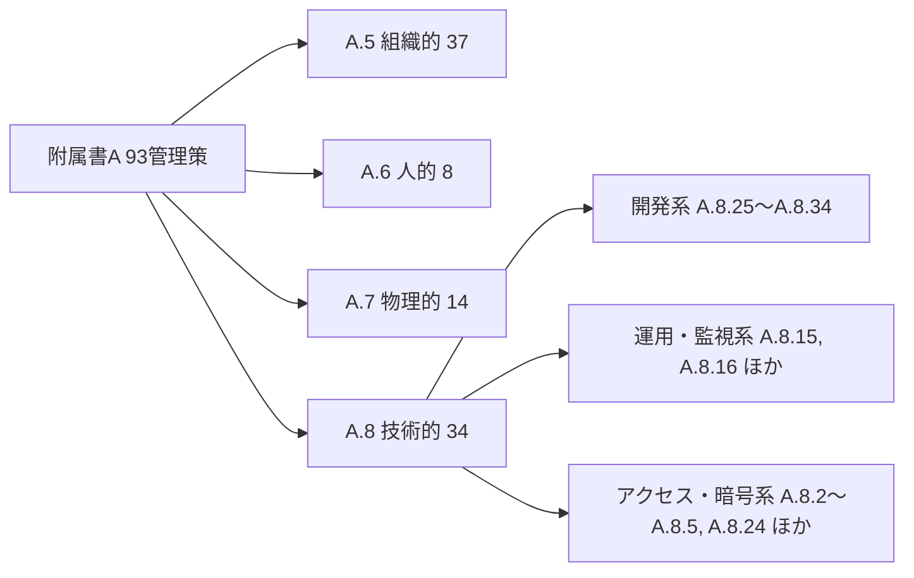

### 7-2. 管理策の主な例(初学者向け意訳)

| 番号 | 管理策(意訳) | ひとこと |
|---|---|---|
| A.5.1 | 情報セキュリティのための方針群 | 方針を決めて周知し、定期見直し |
| A.5.9 | 情報及び関連資産の目録 | 何を守るかの棚卸し |
| A.5.12 | 情報の分類 | 機密レベルを決める |
| A.5.15〜A.5.18 | アクセス制御、本人確認、認証情報、アクセス権 | 最小権限の基本 |
| A.5.19〜A.5.22 | 供給者(委託先)関係の管理 | 委託先・クラウド事業者の管理 |
| A.5.24〜A.5.28 | インシデント管理 | 検知・対応・学習 |
| A.5.34 | プライバシー及びPIIの保護 | 個人情報の取扱い |
| A.6.3 | 情報セキュリティの認識、教育及び訓練 | 全員教育 |
| A.6.7 | リモートワーク | 在宅・外出先での保護 |
| A.7.1〜A.7.2 | 物理的境界、入退管理 | 入れる人を制限 |
| A.7.14 | 機器の安全な処分又は再利用 | 廃棄時のデータ消去 |
| A.8.2〜A.8.5 | 特権アクセス、情報アクセス制限、ソースコードへのアクセス、セキュアな認証 | MFA、権限管理 |
| A.8.7〜A.8.8 | マルウェア対策、技術的脆弱性の管理 | パッチ適用、脆弱性診断 |
| A.8.13 | 情報のバックアップ | 復元テストも含めて |
| A.8.15 | ロギング | 誰が何をしたかの記録 |
| A.8.24 | 暗号の使用 | 鍵管理を含む |
| A.8.25〜A.8.34 | セキュアな開発ライフサイクル、設計原則、コーディング、テスト、変更管理、テスト情報の保護 ほか | 開発者に直結(12章で解説) |

### 7-3. 2022年版で追加された11の新規管理策

ISO/IEC 27002:2022で追加された11管理策が、そのまま附属書Aに入りました [S8](https://www.sgs.com/en-ke/news/2022/07/key-changes-in-iso-iec-27002-2022)[S9](https://hightable.io/the-ultimate-guide-to-iso-27002-changes-2022)。**既存の認証組織が移行時に最も影響を受けた部分**です [S6](https://www.sgs.com/en/news/2024/05/iso-iec-27001-transition-what-you-should-know)。

| 番号 | 新規管理策(意訳) | 目的(やさしく) | 開発・運用との関係 |
|---|---|---|---|
| A.5.7 | 脅威インテリジェンス | 自組織を取り巻く脅威の情報を集め、分析し、対策に活かす | 脆弱性情報・攻撃動向の収集 |
| A.5.23 | クラウドサービス利用の情報セキュリティ | クラウドの選定・利用・終了までのルールを定める | SaaS/IaaS利用の承認プロセス、退出計画 |
| A.5.30 | 事業継続のためのICTの備え | 障害時にも情報・システムの可用性を確保する | DR、冗長構成、復旧訓練 |
| A.7.4 | 物理的セキュリティの監視 | 重要区域を監視する | 監視カメラ、入退ログ |
| A.8.9 | 構成管理 | システム構成を管理された状態で維持する | IaC、ベースライン、構成ドリフト検知 |
| A.8.10 | 情報の削除 | 不要になった情報を確実に削除する | データ保持期間、退会時の削除 |
| A.8.11 | データマスキング | 機微な情報を隠して使う(匿名化・仮名化など) | テストデータのマスキング |
| A.8.12 | データ漏えい防止 | 機微情報の持ち出し・流出を防ぐ | DLPツール、外部共有制限 |
| A.8.16 | 監視活動 | システムの異常な挙動を検知する | SIEM、アラート運用 |
| A.8.23 | Webフィルタリング | 危険なWebサイトへのアクセスを制限する | プロキシ、DNSフィルタ |
| A.8.28 | セキュアコーディング | 安全なコードを書くための原則を適用する | コーディング規約、SAST、レビュー |

> 統合・更新の規模については、SGSは「新規11、統合24、更新58」と整理しています [S8](https://www.sgs.com/en-ke/news/2022/07/key-changes-in-iso-iec-27002-2022)。数え方は解説元によって異なるため、数字そのものよりも「何が増えたか」を押さえるのが実用的です。

### 7-4. 管理策の「属性(アトリビュート)」

ISO/IEC 27002:2022は、各管理策に**属性**を付け、さまざまな切り口で並べ替えられるようにしました [S8](https://www.sgs.com/en-ke/news/2022/07/key-changes-in-iso-iec-27002-2022)。筆者の知る範囲では、属性は「管理策のタイプ(予防・検知・是正)」「情報セキュリティの特性(CIA)」「サイバーセキュリティの概念」「運用能力」「セキュリティドメイン」などで構成されます。たとえば「検知系の管理策だけ」「機密性に効くものだけ」を取り出して、抜け漏れ確認に使えます。

> 属性の詳細な分類名は、ISO/IEC 27002:2022(またはJIS Q 27002)で確認してください。日本ではJIS Q 27002が2024年に改正されています [S16](https://www.meti.go.jp/press/2024/06/20240620002/20240620002-d-2.pdf)。

### 7-5. 管理策はどう選ぶのか(重要)

**93個すべてを実施する必要はありません。** リスクアセスメントの結果に基づいて必要な管理策を決め、附属書Aと照らして漏れがないか確認し、SoAに採否と理由を記録します [S26](https://www.surecloud.com/resource-hub/iso-27001-annex-a-enterprise-implementation)[S29](https://www.orbiqhq.com/templates/iso-27001-statement-of-applicability-template.md)。

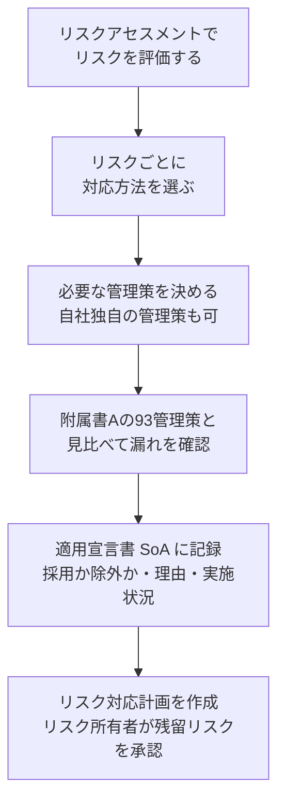

#### SoAの書き方イメージ(記入例)

| 管理策 | 適用 | 採否の理由 | 実施状況 | 根拠となる文書・記録 |
|---|---|---|---|---|
| A.5.15 アクセス制御 | 採用 | 顧客データ漏えいリスク対応 | 実施済み | アクセス制御規程、権限棚卸し記録 |
| A.8.28 セキュアコーディング | 採用 | 自社開発サービスの脆弱性リスク対応 | 一部実施(SAST導入中) | コーディング規約、レビュー記録 |
| A.7.4 物理的セキュリティの監視 | 採用 | 事務所のサーバー室の保護 | 実施済み | 入退ログ、監視カメラ設置記録 |
| A.8.30 外部委託による開発 | 除外 | 開発はすべて自社内で実施。委託先なし | (該当なし) | 開発体制図 |

> **除外理由の注意:** 「コストがかかるから」のような理由は通りにくい一方、「オフィスを持たない(全員リモート)ため、物理的境界の管理は対象外」のように**事実に基づく理由**は成立します [S29](https://www.orbiqhq.com/templates/iso-27001-statement-of-applicability-template.md)。ただし、その場合でも自宅・リモートワーク環境のリスクは別の管理策(A.6.7など)で扱う必要があります。

---

## 8. リスクアセスメントの進め方

ISMSの核心なので、手順を丁寧に見ていきます。**リスクの基準(受容基準・評価方法)を先に決め、繰り返しても同じ結果が出るやり方にする**のが規格の考え方です。ISO/IEC 27005:2022がリスクマネジメントの指針を提供しています [S14](https://www.jnsa.org/seminar/std/isms/20251205/data/20251205_01.pdf)。

### 8-1. 全体フロー

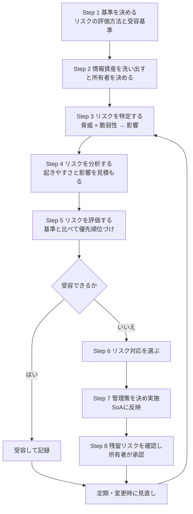

### 8-2. リスクの見積もり(簡易マトリクスの例)

**リスク値 = 起きやすさ × 影響度**。以下は3段階の例です。段階数や基準は組織が決めます。

| 起きやすさ \ 影響度 | 影響:小(1) | 影響:中(2) | 影響:大(3) |
|---|---|---|---|
| **高(3)** | 3(中) | 6(高) | **9(重大)** |
| **中(2)** | 2(低) | 4(中) | 6(高) |
| **低(1)** | 1(低) | 2(低) | 3(中) |

> 例:「受容基準は、リスク値が3以下」と決めておけば、4以上のリスクは対応が必要になります。基準自体を文書化し、誰がやっても同じ結論になることが重要です。

### 8-3. 4つのリスク対応オプション

| オプション | 意味 | 例 |
|---|---|---|
| **低減(modify)** | 管理策でリスクを下げる | MFA導入、パッチ適用、暗号化 |
| **回避(avoid)** | リスクの原因となる活動をやめる | 不要になった機能・データ収集の廃止 |
| **共有・移転(share)** | 第三者とリスクを分かち合う | サイバー保険、委託、クラウドの責任共有 |
| **保有(retain)** | 十分な情報に基づいて残留リスクを受容し、記録・監視を続ける(リスク所有者の承認が必要) | 影響が小さく対策コストが見合わない |

> 用語の英語名は、リスク対応の一般的な整理(ISO/IEC 27005やISO 31000の考え方)によるもので、筆者の補足です。

### 8-4. 具体例で理解する(1行ずつ)

| 項目 | 内容 |
|---|---|
| 情報資産 | 顧客データを保管するクラウドDB |
| 脅威 | 認証情報の窃取による不正アクセス |
| 脆弱性 | 管理者アカウントにMFA未導入 |
| 起きやすさ | 高(3) |
| 影響度 | 大(3)(個人情報漏えい、信用失墜) |
| リスク値 | 9(重大) |
| 対応方法 | 低減 |
| 管理策 | A.8.5 セキュアな認証(MFA)、A.8.2 特権アクセス管理、A.8.15 ロギング、A.8.16 監視活動 |
| 残留リスク | 中(3)。リスク所有者(CTO)が承認 |
| 記録 | リスクアセスメント結果、リスク対応計画、SoA |

---

## 9. 導入ステップ(ゼロから認証まで)

「何から始めればよいか」を **Step 0〜13** に分解しました。順序の考え方は、認証機関や専門ベンダーが示す一般的な導入手順と同様です [S28](https://www.a-lign.com/articles/iso-27001-audit-essentials)。

### 9-1. 全体ロードマップ

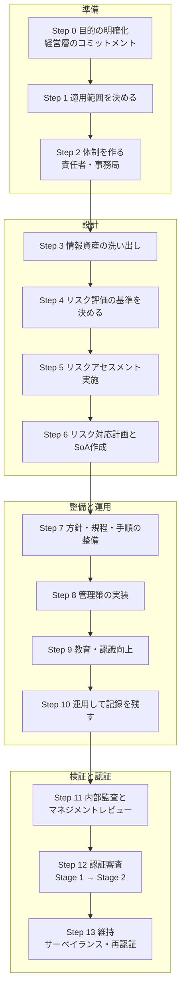

### 9-2. 各ステップの内容と成果物

| Step | やること | 主な成果物 | 対応する箇条 |
|---|---|---|---|
| 0 | 取得目的(顧客要求・入札・信頼性向上・自社統制)を言語化し、経営層の承認と予算を確保する | 目的メモ、承認 | 5.1 |
| 1 | 対象組織・拠点・サービス・システムの境界を決める | 適用範囲文書 | 4.1〜4.3 |
| 2 | ISMS責任者・事務局・各部門の担当を決める | 体制図、役割定義 | 5.3 |
| 3 | 情報資産(データ、システム、クラウド、委託先)を棚卸し、所有者を決める | 情報資産台帳 | A.5.9 |
| 4 | リスクの評価方法・受容基準を決める | リスクアセスメント手順 | 6.1.2 |
| 5 | リスクを特定・分析・評価する | リスクアセスメント結果 | 6.1.2, 8.2 |
| 6 | 対応方法を決め、管理策を選び、SoAを作る。残留リスクの承認を得る | リスク対応計画、**SoA** | 6.1.3 |
| 7 | 情報セキュリティ方針と、必要な規程・手順を作る | 方針、規程類 | 5.2, 7.5 |
| 8 | 管理策を実際に導入する(技術・人・物理・組織) | 設定、ツール、運用ルール | 8.3 |
| 9 | 全員教育と周知、力量の確認 | 教育計画・受講記録 | 7.2, 7.3, A.6.3 |
| 10 | ルールどおりに運用し、記録を残す。インシデント対応も実際に回す | 運用記録、ログ、チケット | 8.1, 9.1 |
| 11 | 内部監査を実施し、経営層がマネジメントレビューを行う。不適合は是正する | 内部監査報告書、マネジメントレビュー議事録 | 9.2, 9.3, 10.2 |
| 12 | 認証機関によるStage 1(文書・準備状況)→ Stage 2(実施状況・有効性) | 認証書 | — |
| 13 | 年1回のサーベイランス審査、3年ごとの再認証審査 | 継続的な運用記録 | 10 |

### 9-3. 期間の目安と注意

- **審査実施の目安:** 認証審査の準備ができてから認証書発行までは、3〜6か月程度とする説明があります [S28](https://www.a-lign.com/articles/iso-27001-audit-essentials)。
- **運用実績:** Stage 2の前に、ISMSを少なくとも3か月程度は実際に運用し、内部監査とマネジメントレビューを1回は終えておくよう求める認証機関・事業者の説明が多く見られます [S28](https://www.a-lign.com/articles/iso-27001-audit-essentials)[S40](https://timewell.jp/en/columns/iso-iec-27001-certification-complete-guide-2026)。**要件は認証機関によって異なる**ため、早い段階で確認してください。
- **全体期間:** 組織の規模、既存の整備状況、専任の有無によって大きく変わります。「何か月で取れる」という数字は参考値として扱ってください(筆者は特定の数値を保証できません)。

### 9-4. 導入でつまずきやすいポイント

| つまずき | 対策 |
|---|---|
| 範囲が広すぎて運用が回らない | 最初は事業の核となるサービスと支える部門に絞り、あとで拡張する |
| 規程を作ることが目的化する | 「記録が残る運用」を先に設計する。審査は書類より**実際の運用**を見る |
| 外部委託・クラウドの管理が抜ける | 委託先一覧と評価、契約上のセキュリティ要件を整える(A.5.19〜A.5.23) |
| SoAを作って放置する | リスク対応計画と連動して更新し、変更時に見直す [S26](https://www.surecloud.com/resource-hub/iso-27001-annex-a-enterprise-implementation) |
| 経営層が関与しない | 方針承認、目的設定、マネジメントレビューに経営層を必ず参加させる |

---

## 10. 認証審査の流れ

### 10-1. 誰が何をするのか

認証は**ISOではなく、独立した認証機関**が行います [S1](https://www.iso.org/standard/27001)[S4](https://www.iso.org/the-iso-survey.html)。認証機関は、各国・地域の認定機関(日本ではISMS-AC)の認定を受けていることが望ましく、これが証明書の信頼性につながります。2026年以降、認定機関の国際的な相互承認はGlobal ACIが担っています(旧IAF MLAからの移行期間中) [S1](https://www.iso.org/standard/27001)[S17](https://www.jipdec.or.jp/library/report/h3taia0000001qn3-att/20230703-r01.pdf)[S42](https://iaf.nu/en/news/global-accreditation-cooperation-incorporated-launch-unifies-international-accreditation-organisations-and-strengthens-worldwide-trust/)。

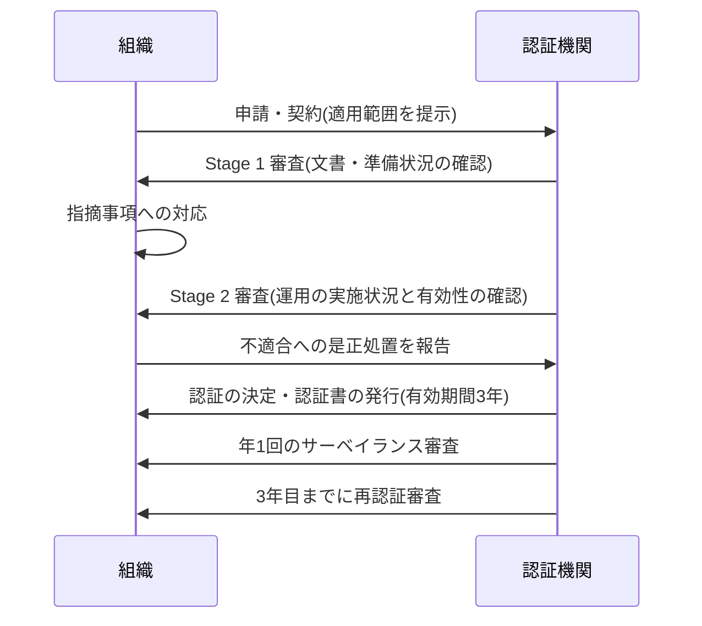

### 10-2. 審査の種類

| 審査 | 目的 | 内容 | 出典 |
|---|---|---|---|
| **Stage 1** | ISMSの設計と準備状況の確認 | 適用範囲、方針、リスクアセスメント、SoAなどの文書を確認し、Stage 2に進める状態かを判断 | [S28](https://www.a-lign.com/articles/iso-27001-audit-essentials) |
| **Stage 2** | ISMSが実際に運用され、有効に機能しているかの確認 | 担当者へのインタビュー、記録の確認、管理策の実施状況の抽出確認 | [S28](https://www.a-lign.com/articles/iso-27001-audit-essentials) |
| **サーベイランス** | 認証後も維持されているかの確認 | 年1回。範囲を絞った抽出審査。内部監査・マネジメントレビュー・過去の不適合への対応・継続的改善を確認 | [S28](https://www.a-lign.com/articles/iso-27001-audit-essentials) |
| **再認証** | 認証書の更新 | 有効期限前に実施。範囲は初回のStage 2に近く、通常はStage 1は不要 | [S28](https://www.a-lign.com/articles/iso-27001-audit-essentials) |

### 10-3. 3年サイクル

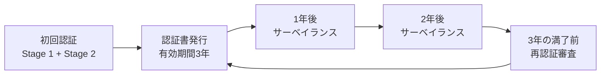

> 「認証が取れたらゴール」ではなく、**3年サイクルの出発点**です。維持審査では「初年度だけ実施して記録が途切れている」状態が問題になりやすいと言われます [S40](https://timewell.jp/en/columns/iso-iec-27001-certification-complete-guide-2026)。

### 10-4. 審査で見られるもの(準備チェック)

| 観点 | 審査員が確認する例 |
|---|---|
| 経営層の関与 | 方針の承認、目的、マネジメントレビューへの参加 |
| リスクの考え方 | リスクアセスメントの方法と結果、リスク対応計画、SoAとの一貫性 |
| 運用の実態 | 規程どおりに実際に運用しているか。アクセス権の棚卸し、ログ確認、教育受講、バックアップ復元テストなどの記録 |
| 改善の仕組み | 内部監査の指摘、是正処置、インシデントからの学び |
| 変更管理 | 2022年版で明確化された、ISMSの変更の計画性(6.3) |

---

## 11. 2013年版→2022年版の移行と2026年10月時点の最新動向

### 11-1. 時系列(2026年10月14日時点)

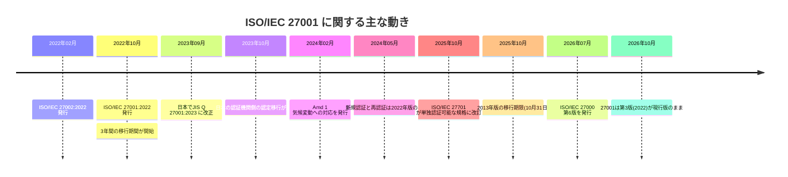

| 日付 | できごと | 出典 |
|---|---|---|
| 2022年2月15日 | ISO/IEC 27002:2022 発行(93管理策・4分類) | [S8](https://www.sgs.com/en-ke/news/2022/07/key-changes-in-iso-iec-27002-2022) |
| 2022年10月25日 | ISO/IEC 27001:2022 発行(第3版) | [S1](https://www.iso.org/standard/27001) |
| 2022年10月31日 | 2013年版からの3年間の移行期間が開始(2025年10月31日まで) | [S6](https://www.sgs.com/en/news/2024/05/iso-iec-27001-transition-what-you-should-know)[S7](https://www.bsigroup.com/globalassets/localfiles/en-au/ISO%2027001/documents/iso-iec-27001-transition-guide.pdf) |
| 2023年9月 | 経済産業省がJIS Q 27001を改正(2022年版に対応) | [S15](https://www.meti.go.jp/press/2023/09/20230920001/20230920001-2.pdf) |
| 2023年10月 | 日本のISMS認証機関側の認定移行が完了 | [S12](https://www.jnsa.org/result/isms/seminar/2023/2023-005.pdf) |
| 2024年2月 | Amd 1:2024(気候変動への対応)発行 | [S1](https://www.iso.org/standard/27001)[S10](https://www.tuvsud.com/en-ae/services/auditing-and-system-certification/climate-action-changes-amendment-1-in-management-system-standards) |
| 2024年5月1日 | 新規認証・再認証は2022年版のみ。2013年版では実施されない | [S6](https://www.sgs.com/en/news/2024/05/iso-iec-27001-transition-what-you-should-know)[S12](https://www.jnsa.org/result/isms/seminar/2023/2023-005.pdf)[S31](https://presencis.com/regulations/iso-27001/timeline/) |
| 2025年10月 | ISO/IEC 27701が単独で実施・認証できる規格へ改訂 | [S22](https://en.wikipedia.org/wiki/ISO/IEC_27701) |
| **2025年10月31日** | **移行期限。2013年版の認証は失効または取下げ** | [S6](https://www.sgs.com/en/news/2024/05/iso-iec-27001-transition-what-you-should-know)[S7](https://www.bsigroup.com/globalassets/localfiles/en-au/ISO%2027001/documents/iso-iec-27001-transition-guide.pdf)[S12](https://www.jnsa.org/result/isms/seminar/2023/2023-005.pdf)[S32](https://www.brightdefense.com/news/iso-270012022-deadline-puts-legacy-certificates-at-risk/) |
| 2026年7月 | ISO/IEC 27000:2026(第6版)発行 | [S3](https://www.iso.org/standard/27000)[S24](https://www.dqsglobal.com/en/explore/blog/iso-iec-27000-2026-released) |

### 11-2. 2013年版と2022年版の主な違い

| 区分 | 2013年版 | 2022年版 |
|---|---|---|
| 本文(箇条4〜10) | 旧構成 | **大きな変更なし**。附属書SL(共通骨格)に沿った軽微な整理と文言調整 [S39](https://www.lrqa.com/ja-jp/events/iso-27001-webinar-032023/)[S18](https://www.nemko.com/ja/blog/iso/iec-270012022-what-has-changed) |
| 附属書A | 114管理策・14分類 | **93管理策・4テーマ**(組織的37/人的8/物理的14/技術的34) [S8](https://www.sgs.com/en-ke/news/2022/07/key-changes-in-iso-iec-27002-2022)[S26](https://www.surecloud.com/resource-hub/iso-27001-annex-a-enterprise-implementation) |
| 新規管理策 | — | **11個追加**(脅威インテリジェンス、クラウド、構成管理、データマスキング、DLP、監視、Webフィルタ、セキュアコーディングなど) [S8](https://www.sgs.com/en-ke/news/2022/07/key-changes-in-iso-iec-27002-2022)[S9](https://hightable.io/the-ultimate-guide-to-iso-27002-changes-2022) |
| 統合 | — | 既存の管理策を整理・統合(SGSの整理では24が統合) [S8](https://www.sgs.com/en-ke/news/2022/07/key-changes-in-iso-iec-27002-2022) |
| 属性 | なし | 管理策に属性を付与(27002:2022) [S8](https://www.sgs.com/en-ke/news/2022/07/key-changes-in-iso-iec-27002-2022) |
| 本文の主な調整 | — | 変更の計画(6.3)の追加、コミュニケーション(7.4)の明確化、箇条10の並び替えなど [S27](https://bastion.tech/learn/iso27001/iso-27001-requirements) |

> ISO/IEC 27001:2022は「全面改訂」ではなく、**27002:2022との整合と附属書Aの更新が主**の改訂だと説明されています [S6](https://www.sgs.com/en/news/2024/05/iso-iec-27001-transition-what-you-should-know)[S39](https://www.lrqa.com/ja-jp/events/iso-27001-webinar-032023/)。

### 11-3. 2024年追補(Amd 1:2024)で変わったこと

| 箇条 | 追加内容(要旨) |
|---|---|
| 4.1 組織及びその状況の理解 | 気候変動が組織にとって関連する課題かどうかを決定する |
| 4.2 利害関係者のニーズ及び期待 | 関係者が気候変動に関する要求を持つことがあるという注記 |

- 追補の原文(4.1と4.2への追記)はISO公式ページから確認できます [S2](https://www.iso.org/standard/88435.html)。ISO・IAFの共同声明に基づき、ISO 9001、ISO 14001、ISO/IEC 20000-1など**複数のマネジメントシステム規格に同時に**追補が発行されました [S10](https://www.tuvsud.com/en-ae/services/auditing-and-system-certification/climate-action-changes-amendment-1-in-management-system-standards)。
- 追補は短く、日本の専門家の解説でも「気候変動が自組織の課題であるかを判断すること」が追加要求事項と整理されています [S13](https://www.jnsa.org/result/isms/seminar/2024/2024-002.pdf)。
- 日本では、追補に対応するJISが **JIS Q 27001:2025** と表記されます。JIS Q 27001:2023を改正した**追補の内容のみ**を示す規格です。JISでは、追補が出ると直近の追補の発行年だけを元の規格番号に付す表記ルールがあるためです [S14](https://www.jnsa.org/seminar/std/isms/20251205/data/20251205_01.pdf)。

### 11-4. 日本のJIS・制度の整理

| JIS | 対応する国際規格 | 補足 |
|---|---|---|
| JIS Q 27001:2014 | ISO/IEC 27001:2013 | 移行期限(2025年10月31日)後は、この版による認証は無効 [S12](https://www.jnsa.org/result/isms/seminar/2023/2023-005.pdf) |
| JIS Q 27001:2023 | ISO/IEC 27001:2022 | 2024年5月以降の新規認証・再認証は2022年版が必須 [S12](https://www.jnsa.org/result/isms/seminar/2023/2023-005.pdf)[S15](https://www.meti.go.jp/press/2023/09/20230920001/20230920001-2.pdf) |
| JIS Q 27001:2025 | ISO/IEC 27001:2022/Amd 1:2024 | 追補部分のみを示す [S14](https://www.jnsa.org/seminar/std/isms/20251205/data/20251205_01.pdf)[S33](https://www.issoh.co.jp/column/details/12644/) |
| JIS Q 27002 | ISO/IEC 27002:2022 | 2024年6月に改正 [S16](https://www.meti.go.jp/press/2024/06/20240620002/20240620002-d-2.pdf) |

- 日本の認定機関は **ISMS-AC**、運営の中心は **JIPDEC** です [S17](https://www.jipdec.or.jp/library/report/h3taia0000001qn3-att/20230703-r01.pdf)。
- 認証書の規格表記(「ISO/IEC 27001:2022」か「JIS Q 27001:2023」か等)は、移行時期や認証機関によって異なっていました。ISMS-ACは、2022年版対応のJISが発行されるまでの間は認証文書上の規格表示を「ISO/IEC 27001:2022」とするよう案内しており [S17](https://www.jipdec.or.jp/library/report/h3taia0000001qn3-att/20230703-r01.pdf)、実際に「ISO/IEC 27001:2022 / JIS Q 27001:2014」と併記した認証の公表例もあります [S41](https://www.nojima.co.jp/news/category/press/218441/)。**自社の認証書の表記は認証機関に確認**してください。

### 11-5. ISO/IEC 27001に「2026年版」はあるか?

- 2026年10月14日時点で、**ISO公式ページの現行版は2022年10月発行の第3版**で、追補は1件(Amd 1:2024)と表示されています [S1](https://www.iso.org/standard/27001)。
- 「ISO 27001:2026」という版は存在しないと、複数の解説が明記しています [S25](https://www.konfirmity.com/blog/iso-27001-what-changed-in-2026)[S36](https://tecrill.substack.com/p/iso-27001-is-there-a-2026-edition)。2026年に注目されたのは、**ISO/IEC 27000の第6版**(2026年7月)と、他規格(ISO 9001:2026など)の改訂で、混同が生じているようです [S24](https://www.dqsglobal.com/en/explore/blog/iso-iec-27000-2026-released)[S36](https://tecrill.substack.com/p/iso-27001-is-there-a-2026-edition)。
- ISO/IEC 27000:2026が出たことで、27001・27002などは今後徐々に整合していく見込みとされますが、**既存の27001認証の有効性には直接影響しない**と認証機関は説明しています [S24](https://www.dqsglobal.com/en/explore/blog/iso-iec-27000-2026-released)。

> **筆者の注意点:** 将来の改訂予定は、2026年10月時点でISO公式からは確認できていません。「次の改訂がいつ出るか」は、ISOのISO/IEC 27001ページ(ライフサイクル表示)で随時確認してください [S1](https://www.iso.org/standard/27001)。

### 11-6. 世界の認証件数(ISO Survey)

| 年 | ISO/IEC 27001 有効認証数 |
|---|---|
| 2018 | 31,910 |
| 2019 | 36,362 |
| 2020 | 44,486 |
| 2021 | 58,687 |
| 2022 | 71,549 |
| 2023 | 48,671(※) |
| 2024 | 96,709 |
| **2025** | **125,622**(前年比 +29.9%) |

(※)2023年の数値は、データ収集方式の変更や報告の不完全さの影響が指摘されており、単純な減少とは読めません。ISO Surveyは2024年調査を移行期として、2025年調査からIAF CertSearchの匿名化・集計データを直接用いて作成する方式に変わったため、**集計方式が異なる年をまたぐ比較には注意が必要**です [S4](https://www.iso.org/the-iso-survey.html)[S5](https://www.dqsglobal.com/es/acerca-de/sala-de-prensa/iso-survey-2025-las-certificaciones-iso-crecen-un-11-en-el-mundo-y-un-28-en-espana)。

- 2025年調査は、2025年12月31日時点の有効認証数です。DQSの2026年10月8日付の記事が結果を紹介しています [S5](https://www.dqsglobal.com/es/acerca-de/sala-de-prensa/iso-survey-2025-las-certificaciones-iso-crecen-un-11-en-el-mundo-y-un-28-en-espana)。
- ISO公式ページには「2022年調査で70,000件超、150か国」という説明も掲載されています [S1](https://www.iso.org/standard/27001)。

---

## 12. 開発者・クラウド利用者の視点

ソフトウェア開発やクラウド運用に関わる人は、**附属書Aの技術的管理策(A.8)**がもっとも身近です。

### 12-1. 開発ライフサイクルと管理策の対応

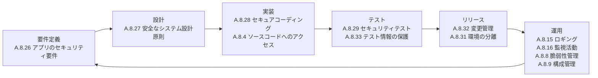

### 12-2. 実務の活動 → 管理策 → 審査で示す証拠(例)

| 開発・運用の活動 | 関連する管理策 | 審査で示せる証拠の例 |
|---|---|---|
| 認可・権限設計、最小権限、MFA | A.5.15〜A.5.18, A.8.2, A.8.3, A.8.5 | IAMポリシー、権限棚卸し記録、MFA設定画面 |
| ソースコードのアクセス制御、ブランチ保護、レビュー必須化 | A.8.4, A.8.32 | リポジトリ設定、PRレビュー履歴 |
| SAST/DAST、依存関係スキャン、ペネトレーションテスト | A.8.8, A.8.28, A.8.29 | スキャン結果、是正チケット |
| IaC、構成ベースライン、設定逸脱の検知 | A.8.9 | IaCコード、構成管理ポリシー |
| 本番とテスト環境の分離、テストデータのマスキング | A.8.31, A.8.33, A.8.11 | 環境構成図、マスキング手順 |
| ログ収集・監視・アラート対応 | A.8.15, A.8.16 | ログ設定、アラート運用記録 |
| バックアップと復元テスト、DR訓練 | A.8.13, A.5.30 | 復元テスト結果、DR訓練記録 |
| インシデント対応の手順・訓練 | A.5.24〜A.5.28, A.6.8 | 対応手順、ポストモーテム |
| 開発の外部委託、OSS・SaaSの利用管理 | A.5.19〜A.5.23, A.8.30 | 委託先評価、契約条項、利用承認 |
| データ保持期間、削除、暗号化と鍵管理 | A.8.10, A.8.24 | 保持ポリシー、鍵管理手順 |

> 管理策の番号と名称は規格で確認してください。上表は筆者による実務の対応づけの例で、審査員が求める証拠は組織のリスクやSoAの内容で変わります。

### 12-3. クラウド(AWS)と責任共有

AWSはISO/IEC 27001:2022、27017、27018などの認証を持ち、その認証はEY CertifyPointによる確認です [S20](https://aws.amazon.com/compliance/iso-27001-faqs)。ただし、**クラウド事業者が認証されていても、自社が認証されたことにはなりません**。AWSの認証が対象とするのは、AWSが指定するサービスとデータセンターに関するセキュリティ管理プロセスです。顧客は自社の適用範囲で別途ISMSを構築・運用します。AWSの認証は、自社の認証取得を**やりやすくする材料**にはなり得るとAWS自身が説明しています [S20](https://aws.amazon.com/compliance/iso-27001-faqs)。

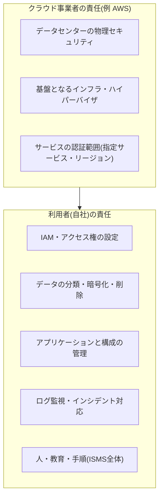

- AWSは、ISO/IEC 27001:2022の管理策とAWSサービスを対応づけた**公式ガイド**を公開しています。ISMSの箇条4〜10と一部の附属書A管理策を、責任共有モデルを踏まえてAWSサービスに結びつけています [S19](https://aws.amazon.com/blogs/security/new-compliance-guide-available-iso-iec-270012022-on-aws-compliance-guide)。
- 認証証明書は、AWS ArtifactからAWS利用者が入手でき、自社の委託先管理(A.5.19〜A.5.23)の証拠として使えます [S21](https://aws.amazon.com/blogs/security/2023-iso-and-csa-star-certificates-now-available-with-iso-27001-transition-from-2013-to-2022-version)。
- **注意点:** 「AWSがISO認証済みだから大丈夫」は審査では通りません。IAM設定、ログ、バックアップ、インシデント対応は、利用者側の責任として監査されます [S38](https://www.dqsglobal.com/en/explore/blog/aws-azure-iso-27001-certification-cloud-hong-kong)。

---

## 13. よくある誤解 Q&A

| # | 誤解 | 実際 | 出典 |
|---|---|---|---|
| 1 | 93管理策をすべて実施しなければならない | リスクに基づいて選び、除外する管理策は**理由をSoAに記録**する | [S26](https://www.surecloud.com/resource-hub/iso-27001-annex-a-enterprise-implementation)[S29](https://www.orbiqhq.com/templates/iso-27001-statement-of-applicability-template.md) |
| 2 | ISO 27001はセキュリティ製品を導入する規格 | 製品・技術を指定せず、**リスクに基づく管理の仕組み**を求める | [S1](https://www.iso.org/standard/27001) |
| 3 | 認証を取れば事故は起きない | 認証は仕組みが整い機能していることへの信頼を与えるもので、**事故ゼロの保証ではない** | [S1](https://www.iso.org/standard/27001) |
| 4 | 認証は一度取れば終わり | 3年間有効だが、**年1回の維持審査**と再認証が必要 | [S28](https://www.a-lign.com/articles/iso-27001-audit-essentials) |
| 5 | 2013年版の認証がまだ使える | **2025年10月31日で失効または取下げ**。期限後は2022年版の新規審査が必要 | [S6](https://www.sgs.com/en/news/2024/05/iso-iec-27001-transition-what-you-should-know)[S12](https://www.jnsa.org/result/isms/seminar/2023/2023-005.pdf)[S32](https://www.brightdefense.com/news/iso-270012022-deadline-puts-legacy-certificates-at-risk/) |
| 6 | ISO 27001:2026がある | **存在しない**。現行は2022年版(第3版)+Amd 1:2024 | [S1](https://www.iso.org/standard/27001)[S25](https://www.konfirmity.com/blog/iso-27001-what-changed-in-2026)[S36](https://tecrill.substack.com/p/iso-27001-is-there-a-2026-edition) |
| 7 | クラウドが認証済みなら自社もOK | 自社の範囲は自社で認証。責任共有モデルが前提 | [S20](https://aws.amazon.com/compliance/iso-27001-faqs)[S38](https://www.dqsglobal.com/en/explore/blog/aws-azure-iso-27001-certification-cloud-hong-kong) |
| 8 | ISO 27001とISO 27002は同じ | 27001は**要求事項(認証対象)**、27002は**管理策の手引き** | [S37](https://www.vikingcloud.com/blog/iso-27002-2022)[S8](https://www.sgs.com/en-ke/news/2022/07/key-changes-in-iso-iec-27002-2022) |
| 9 | ISMS認証とISO 27001認証は別物 | 日本では実務上ほぼ同義で使われる。国内ではJIS Q 27001を基準に審査 | [S33](https://www.issoh.co.jp/column/details/12644/) |
| 10 | プライバシーマークと同じ | ISMSは情報資産全般の管理、プライバシーマークは個人情報保護が中心(筆者の補足。制度の詳細は各運営団体で確認) | [S33](https://www.issoh.co.jp/column/details/12644/) |
| 11 | 規程さえあれば合格 | 審査は**実際の運用と記録**の確認が中心 | [S28](https://www.a-lign.com/articles/iso-27001-audit-essentials)[S40](https://timewell.jp/en/columns/iso-iec-27001-certification-complete-guide-2026) |
| 12 | 内部監査は形式的でよい | 認証前に実施が求められ、維持審査でも確認される | [S28](https://www.a-lign.com/articles/iso-27001-audit-essentials) |

---

## 14. 学習ロードマップと自己診断

### 14-1. 学習ステップ(おすすめ順)

| Step | 学ぶこと | 教材・入手先 | 出典 |
|---|---|---|---|
| 1 | まず概要を読む(無料) | ISO公式ページ「What is ISO/IEC 27001?」、規格本文の無料プレビュー(オンライン閲覧プラットフォーム) | [S1](https://www.iso.org/standard/27001) |
| 2 | 小規模組織向けの実践手引き | ISO「Information Security Management Systems: A practical guide for SMEs」(PUB100484、英語PDF、ISOストアで販売) | [S1](https://www.iso.org/standard/27001) |
| 3 | 規格本文を入手して通読 | ISO/IEC 27001:2022(英語/フランス語)、日本ではJIS Q 27001:2023 | [S1](https://www.iso.org/standard/27001)[S15](https://www.meti.go.jp/press/2023/09/20230920001/20230920001-2.pdf) |
| 4 | 管理策の実施手引き | ISO/IEC 27002:2022(日本ではJIS Q 27002)。管理策の「意図・実施の手引・属性」を確認 | [S8](https://www.sgs.com/en-ke/news/2022/07/key-changes-in-iso-iec-27002-2022)[S16](https://www.meti.go.jp/press/2024/06/20240620002/20240620002-d-2.pdf) |
| 5 | リスク評価の方法 | ISO/IEC 27005:2022 | [S14](https://www.jnsa.org/seminar/std/isms/20251205/data/20251205_01.pdf) |
| 6 | クラウドでの実装 | AWS「ISO/IEC 27001:2022 on AWS」コンプライアンスガイド(AWS Security Blogで案内) | [S19](https://aws.amazon.com/blogs/security/new-compliance-guide-available-iso-iec-270012022-on-aws-compliance-guide) |
| 7 | 認証制度・審査の実際 | 認証機関の移行ガイド・セミナー資料、ISMS-AC/JIPDECの資料 | [S7](https://www.bsigroup.com/globalassets/localfiles/en-au/ISO%2027001/documents/iso-iec-27001-transition-guide.pdf)[S12](https://www.jnsa.org/result/isms/seminar/2023/2023-005.pdf)[S17](https://www.jipdec.or.jp/library/report/h3taia0000001qn3-att/20230703-r01.pdf) |
| 8 | 実務スキルの強化 | リードインプリメンター/リードオーディターなどの研修(各社が提供。AWSの担当者がISO 27001リードオーディターを保有する例もあります) | [S21](https://aws.amazon.com/blogs/security/2023-iso-and-csa-star-certificates-now-available-with-iso-27001-transition-from-2013-to-2022-version) |

### 14-2. 規格の歴史(背景知識)

ISO/IEC 27001は、英国規格BS 7799-2を起源とし、**2005年10月**にISO/IEC 27001として発行されました。**2013年**に第2版、**2022年10月**に第3版へと改訂されています [S23](https://en.wikipedia.org/wiki/ISO/IEC_27001)。10年に1度ほどのペースで大きく更新され、今回は特に附属書Aが再編されました。

### 14-3. 関連フレームワークとの関係(次に学ぶと良いもの)

| 比較軸 | ISO/IEC 27001 | NIST CSF 2.0 |
|---|---|---|
| 位置づけ | 要求事項を定めた**マネジメントシステム規格** | リスクに基づく**成果(アウトカム)中心のフレームワーク** |
| 認証 | **可能**(認証機関による審査) | 認証制度なし(自己評価・プロファイルで活用) |
| 構成 | 本文(箇条4〜10)+附属書A(93管理策) | Govern、Identify、Protect、Detect、Respond、Recoverの6機能 [S30](https://csrc.nist.gov/projects/olir/informative-reference-catalog) |
| 関係 | NISTのカタログに登録された**参照マッピング(Informative References)**で、CSF 2.0とISO/IEC 27001が対応づけられている | 同左 [S30](https://csrc.nist.gov/projects/olir/informative-reference-catalog) |

> CSF 2.0は2024年2月26日に公開され、従来の5機能に**Govern(統治)**が加わりました [S30](https://csrc.nist.gov/projects/olir/informative-reference-catalog)。組織の状況によっては「社内の統制はNIST CSFで整理し、顧客要求への対応でISO 27001認証を取る」「SOC 2も求められる」といった**段階的な組み合わせ**がよく選ばれます。実際のマッピングは、NIST公式のOnline Informative Referencesを確認してください。

### 14-4. 自己診断チェックリスト(自分の組織を点検する)

**準備**
- [ ] 経営層が、取得・運用の目的と必要な資源(人・予算)を理解している
- [ ] ISMSの適用範囲(対象サービス・拠点・システム)を決めて文書にできる
- [ ] ISMSの責任者と事務局が決まっている

**リスクと管理策**
- [ ] 情報資産の棚卸しと所有者の割り当てができている
- [ ] リスクの評価方法と受容基準が決まっている
- [ ] リスクアセスメントを実施し、結果が残っている
- [ ] SoA(適用宣言書)に93管理策の採否と理由、実施状況が記録されている
- [ ] 2022年版の**新規11管理策**(特にクラウド、構成管理、監視、セキュアコーディング)を確認した

**運用**
- [ ] 情報セキュリティ方針が承認・周知されている
- [ ] 全員への教育とその記録がある
- [ ] 委託先・クラウド事業者の管理(選定・契約・監視・終了)ができている
- [ ] インシデント対応手順があり、訓練や実際の対応の記録がある
- [ ] バックアップの復元テストを実施している

**評価と改善**
- [ ] 内部監査を実施し、指摘への是正処置を行っている
- [ ] 経営層によるマネジメントレビューが実施され、議事録がある
- [ ] 2013年版の認証を保有していた場合、2022年版の認証を取得済み(または新規審査を計画済み)である

---

## 15. 理解度チェック

| # | 問題 | 答え |
|---|---|---|
| 1 | ISO/IEC 27001の現行版は何年に発行されたか | 2022年10月(第3版)。2024年にAmd 1が発行されている |
| 2 | 情報セキュリティの3要素(CIA)を答えよ | 機密性・完全性・可用性 |
| 3 | 認証の対象になるのは27001と27002のどちらか | 27001(27002は管理策の手引き) |
| 4 | 本文の「必須」の箇条は何番から何番までか | 箇条4〜10 |
| 5 | 附属書Aの管理策は何個で、いくつのテーマに分かれるか | 93個、4テーマ(組織的37・人的8・物理的14・技術的34) |
| 6 | 93個すべてを実施しなければならないか | いいえ。リスクに基づいて選び、除外理由をSoAに記録する |
| 7 | 2022年版で新設された管理策を3つ挙げよ | 例:脅威インテリジェンス、構成管理、セキュアコーディング(ほか計11個) |
| 8 | 2013年版の認証の移行期限はいつか | 2025年10月31日 |
| 9 | 認証書の有効期間と、認証後に必要な審査は何か | 3年。年1回のサーベイランスと、満了前の再認証 |
| 10 | 2024年追補(Amd 1)で箇条4.1に追加された要求は何か | 気候変動が関連する課題かどうかを決定すること |
| 11 | AWSがISO認証済みなら、自社も認証済みといえるか | いいえ。責任共有モデルにより、自社の範囲は自社で認証を受ける |
| 12 | Stage 1とStage 2の違いは何か | Stage 1は設計・準備状況、Stage 2は実際の運用と有効性の確認 |

---

## 16. 出典URL一覧

すべて**2026年10月14日**に参照しました。種別の見方:**一次**=規格・標準化機関・政府の発信、**準一次**=認証機関・クラウド事業者・専門機関の公式発信、**二次**=専門ベンダー等の解説(原典で確認することを推奨)。

| 番号 | 種別 | 内容 | URL |
|---|---|---|---|
| S1 | 一次 | ISO公式:ISO/IEC 27001:2022(基本情報、FAQ、ライフサイクル) | https://www.iso.org/standard/27001 |
| S2 | 一次 | ISO公式:ISO/IEC 27001:2022/Amd 1:2024(気候変動) | https://www.iso.org/standard/88435.html |
| S3 | 一次 | ISO公式:ISO/IEC 27000:2026(第6版) | https://www.iso.org/standard/27000 |
| S4 | 一次 | ISO Survey(認証件数の統計と取得方法) | https://www.iso.org/the-iso-survey.html |
| S5 | 準一次 | DQS:ISO Survey 2025の結果(27001は125,622件) | https://www.dqsglobal.com/es/acerca-de/sala-de-prensa/iso-survey-2025-las-certificaciones-iso-crecen-un-11-en-el-mundo-y-un-28-en-espana |
| S6 | 準一次 | SGS:ISO/IEC 27001移行の要点(期限、管理策の数) | https://www.sgs.com/en/news/2024/05/iso-iec-27001-transition-what-you-should-know |
| S7 | 準一次 | BSI:ISO/IEC 27001移行ガイド(PDF) | https://www.bsigroup.com/globalassets/localfiles/en-au/ISO%2027001/documents/iso-iec-27001-transition-guide.pdf |
| S8 | 準一次 | SGS:ISO/IEC 27002:2022の主な変更点 | https://www.sgs.com/en-ke/news/2022/07/key-changes-in-iso-iec-27002-2022 |
| S9 | 二次 | High Table:27002:2022の変更と新規11管理策の番号 | https://hightable.io/the-ultimate-guide-to-iso-27002-changes-2022 |
| S10 | 準一次 | TÜV SÜD:気候変動追補(マネジメントシステム規格共通) | https://www.tuvsud.com/en-ae/services/auditing-and-system-certification/climate-action-changes-amendment-1-in-management-system-standards |
| S11 | 一次相当 | インド規格協会(BIS):Amd 1の追補文書(PDF、各国版) | https://services.bis.gov.in/tmp/LITD23425400_06092024_1.pdf |
| S12 | 準一次 | JNSA日本ISMSユーザグループ:JIS Q 27001:2023への移行(IAF MD26、ISMS-AC資料) | https://www.jnsa.org/result/isms/seminar/2023/2023-005.pdf |
| S13 | 準一次 | JNSA/NICT 山下氏:ISO/IEC 27001:2022における気候変動への対応 | https://www.jnsa.org/result/isms/seminar/2024/2024-002.pdf |
| S14 | 準一次 | JIPDEC:ISO/IEC 27000ファミリー改訂状況、JIS Q 27001:2025の表記(2025年12月5日資料) | https://www.jnsa.org/seminar/std/isms/20251205/data/20251205_01.pdf |
| S15 | 一次 | 経済産業省:JIS Q 27001の改正(2023年9月) | https://www.meti.go.jp/press/2023/09/20230920001/20230920001-2.pdf |
| S16 | 一次 | 経済産業省:JIS Q 27002の改正(2024年6月) | https://www.meti.go.jp/press/2024/06/20240620002/20240620002-d-2.pdf |
| S17 | 準一次 | JIPDEC/ISMS-AC:ISO/IEC 27001:2022への移行セミナー講演レポート | https://www.jipdec.or.jp/library/report/h3taia0000001qn3-att/20230703-r01.pdf |
| S18 | 二次 | Nemko Japan:ISO/IEC 27001:2022の変更点(管理策の比較) | https://www.nemko.com/ja/blog/iso/iec-270012022-what-has-changed |
| S19 | 準一次 | AWS Security Blog:ISO/IEC 27001:2022 on AWS コンプライアンスガイド | https://aws.amazon.com/blogs/security/new-compliance-guide-available-iso-iec-270012022-on-aws-compliance-guide |
| S20 | 準一次 | AWS:ISO/IEC 27001 FAQ(認証範囲、EY CertifyPoint) | https://aws.amazon.com/compliance/iso-27001-faqs |
| S21 | 準一次 | AWS Security Blog:2023年のISO認証と27001の2022年版への移行 | https://aws.amazon.com/blogs/security/2023-iso-and-csa-star-certificates-now-available-with-iso-27001-transition-from-2013-to-2022-version |
| S22 | 二次 | Wikipedia:ISO/IEC 27701(2025年版は単独認証可能) | https://en.wikipedia.org/wiki/ISO/IEC_27701 |
| S23 | 二次 | Wikipedia:ISO/IEC 27001(歴史) | https://en.wikipedia.org/wiki/ISO/IEC_27001 |
| S24 | 準一次 | DQS:ISO/IEC 27000:2026の公開と影響 | https://www.dqsglobal.com/en/explore/blog/iso-iec-27000-2026-released |
| S25 | 二次 | Konfirmity:ISO 27001の2026年の状況(2026年版は存在しない) | https://www.konfirmity.com/blog/iso-27001-what-changed-in-2026 |
| S26 | 二次 | SureCloud:附属書Aの4テーマと93管理策 | https://www.surecloud.com/resource-hub/iso-27001-annex-a-enterprise-implementation |
| S27 | 二次 | Bastion/Effivity:箇条4〜10の解説(箇条10の並び替えなど) | https://bastion.tech/learn/iso27001/iso-27001-requirements 、 https://www.effivity.com/information-security-management-system/iso-27001-clauses |
| S28 | 二次 | A-LIGN/Secfix/Elevate Consulting:認証審査の流れ(Stage 1・2、維持審査、再認証) | https://www.a-lign.com/articles/iso-27001-audit-essentials 、 https://help.secfix.com/en/articles/6897312-key-stages-of-iso-27001-certification 、 https://elevateconsult.com/insights/iso-27001-audit-stage-1-vs-stage-2-differences-explained/ |
| S29 | 二次 | Orbiq:SoAテンプレート(6.1.3 d の要求と除外理由) | https://www.orbiqhq.com/templates/iso-27001-statement-of-applicability-template.md |
| S30 | 一次 | NIST公式:Informative Reference Catalog(OLIR)。ISO/IEC 27001とCSF 2.0の対応は提出者が作成し、カタログに登録された参照マッピング | https://csrc.nist.gov/projects/olir/informative-reference-catalog |
| S31 | 二次 | Presencis:ISO 27001移行タイムライン | https://presencis.com/regulations/iso-27001/timeline/ |
| S32 | 二次 | Bright Defense:2025年10月31日の移行期限の影響 | https://www.brightdefense.com/news/iso-270012022-deadline-puts-legacy-certificates-at-risk/ |
| S33 | 二次 | 一創:ISMSとISO 27001の違い、JIS Q 27001:2025の説明 | https://www.issoh.co.jp/column/details/12644/ |
| S34 | 二次 | High Table:ISO 27001:2022リファレンスガイド(リーダーシップ) | https://hightable.io/iso-27001-reference-guide/ |
| S35 | 二次 | Modulos:箇条4〜10の実装ガイド(共通骨格・必須文書) | https://docs.modulos.ai/frameworks/iso-27001/clauses-4-10 |
| S36 | 二次 | Tecrill:ISO 27001に2026年版はあるか(2026年7月10日) | https://tecrill.substack.com/p/iso-27001-is-there-a-2026-edition |
| S37 | 二次 | VikingCloud:ISO 27002:2022(認証対象は27001のみ) | https://www.vikingcloud.com/blog/iso-27002-2022 |
| S38 | 二次 | DQS:AWS・Azureの認証と自社認証の関係(責任共有) | https://www.dqsglobal.com/en/explore/blog/aws-azure-iso-27001-certification-cloud-hong-kong |
| S39 | 準一次 | LRQA Japan:ISO 27001:2022改訂版ウェビナー(改訂の要点) | https://www.lrqa.com/ja-jp/events/iso-27001-webinar-032023/ |
| S40 | 二次 | Timewell:ISO/IEC 27001認証の全体ガイド(維持審査での記録) | https://timewell.jp/en/columns/iso-iec-27001-certification-complete-guide-2026 |
| S41 | 二次 | ノジマ:2022年版への移行完了のプレスリリース(認証書の表記例) | https://www.nojima.co.jp/news/category/press/218441/ |
| S42 | 一次 | IAF:Global Accreditation Cooperation Incorporatedの発足(IAF・ILACの統合、2026年1月1日) | https://iaf.nu/en/news/global-accreditation-cooperation-incorporated-launch-unifies-international-accreditation-organisations-and-strengthens-worldwide-trust/ |

### 16-1. 情報の確かさについての注意

1. **条文の根拠:** 箇条ごとの細かな要求(6.3の追加や7.4の変更点など)は、ベンダー解説と筆者の理解に基づく要約です。**審査対応や契約で使う場合は、必ず規格本文(ISOまたはJIS)で確認**してください。
2. **統計値:** ISO Surveyの数値は、認証機関のデータ収集方式の変更に影響されます。DQSの記事(二次)が転載した表を参照しており、一次データは**IAF CertSearch**から取得できます [S4](https://www.iso.org/the-iso-survey.html)[S5](https://www.dqsglobal.com/es/acerca-de/sala-de-prensa/iso-survey-2025-las-certificaciones-iso-crecen-un-11-en-el-mundo-y-un-28-en-espana)。
3. **審査の実務(期間・必要な運用期間など):** 認証機関ごとに異なります。本ガイドの目安は一般的な解説に基づくもので、保証はできません。
4. **今後の改訂:** 2026年10月14日時点で、27001の新しい版の発行予定をISO公式ページから確認できていません [S1](https://www.iso.org/standard/27001)。ISOのページで最新状況を確認してください。
5. **日本語訳:** 管理策名は意訳です。JIS Q 27001:2023附属書Aの正式な表現とは異なる場合があります。
6. 本ガイドは法的・認証上の助言ではありません。認証の取得・維持に関する判断は、認証機関および専門家にご相談ください。

### 16-2. 参考:このガイドの更新方法

規格の状況は変化します。更新するときは、次の順で確認すると効率的です。

1. ISO公式ページ(S1)で**版・追補・ライフサイクル**を確認する
2. 日本の制度は**ISMS-AC/JIPDEC**と経済産業省の発表(JIS改正)を確認する
3. 認証機関(BSI、SGS、DQSなど)の**移行・変更に関するお知らせ**を確認する
4. 統計は**IAF CertSearch**のISO Surveyデータを確認する

---
*以上*
