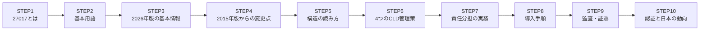
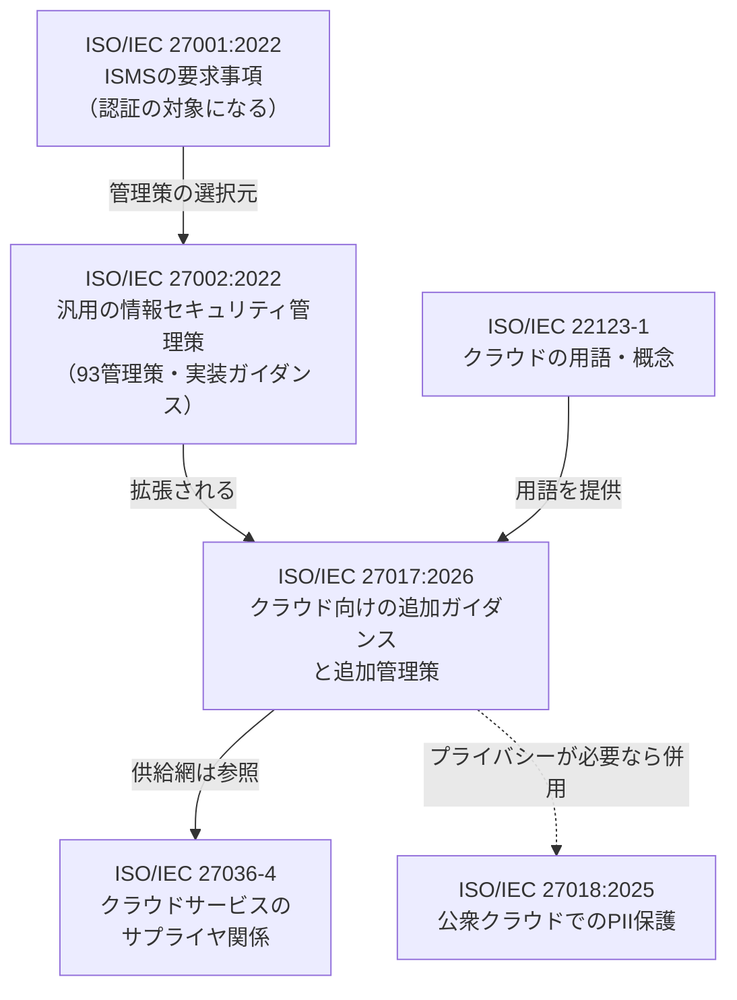
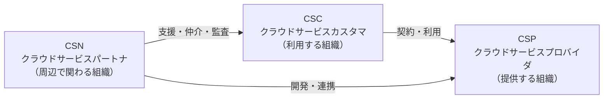
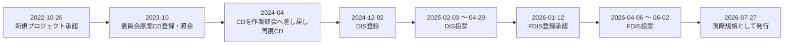
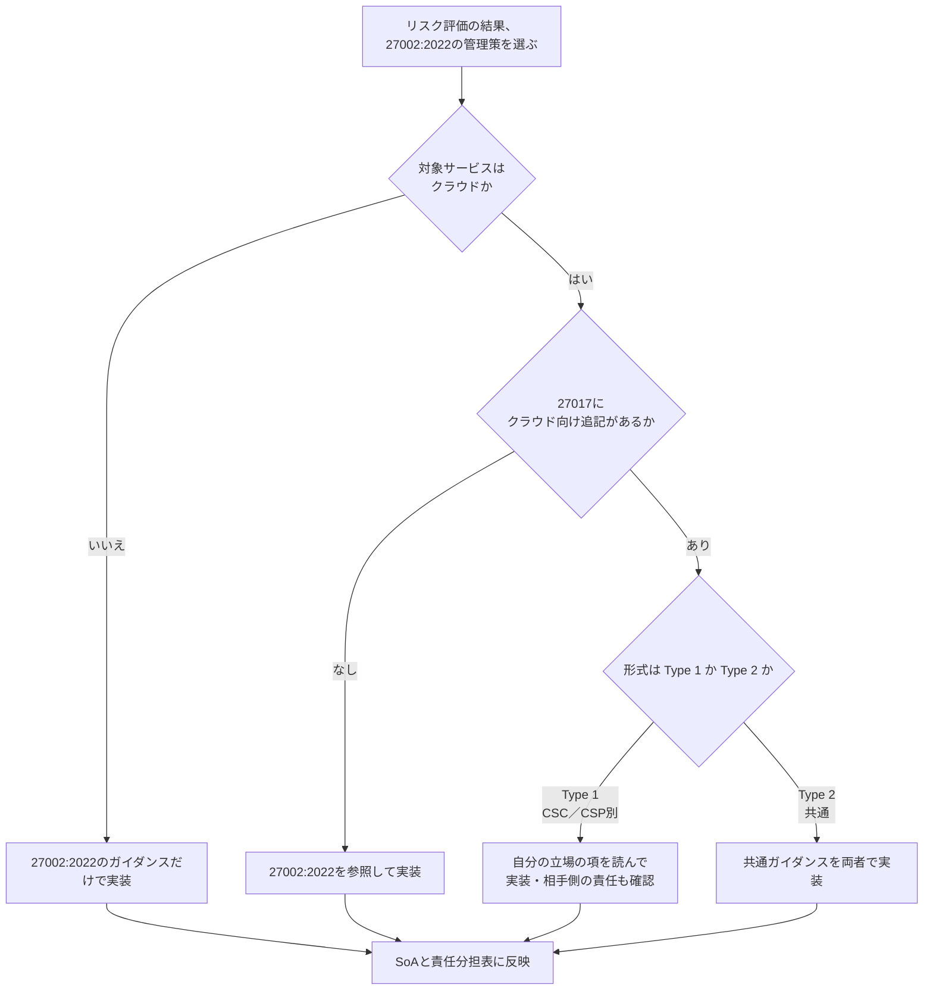
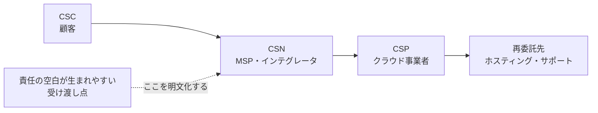
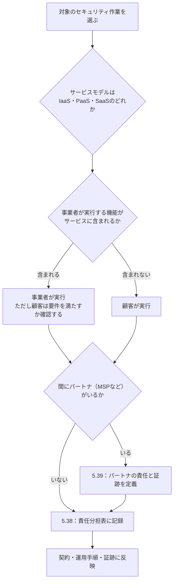
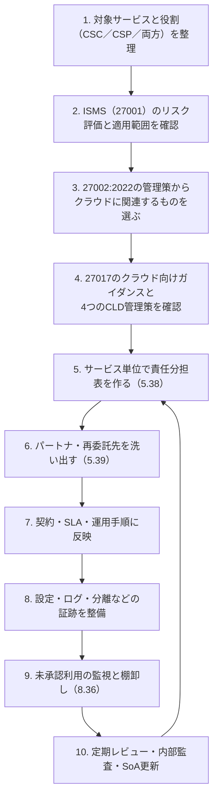
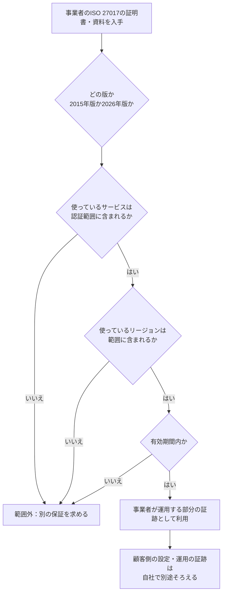
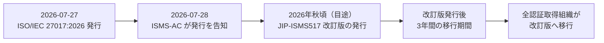

# ISO/IEC 27017:2026 初学者向けステップバイステップガイド

> **クラウドサービスの情報セキュリティ管理策（ISO/IEC 27002に基づく）を、責任分担の視点で理解する**

| 項目 | 内容 |
|---|---|
| 対象規格 | ISO/IEC 27017:2026 第2版（2026年7月発行） |
| 正式名称 | Information security, cybersecurity and privacy protection — Information security controls based on ISO/IEC 27002 for cloud services |
| 本ガイドの情報時点 | 2026年10月15日 |
| 想定読者 | クラウドを「使う側」「提供する側」の両方の初学者（エンジニア、情シス、品質・監査担当） |
| 一次情報 | https://www.iso.org/standard/27017 |

---

## 0. このガイドを読む前に（重要な前提）

### 0-1. 本ガイドの立ち位置

- 規格本文は有料（ISOストア価格 CHF 196［1］）で、著作権で保護されています。本ガイドは本文を転載せず、**ISO公式ページ・ISMS-AC・主要クラウド事業者の公開ページ・複数の実務家記事を突き合わせて整理した解説**です。
- 管理策の「名称と趣旨」は複数ソースで一致したものだけを採用しました。**条文レベルの要求・細かな対応関係は、必ず規格本文（特にAnnex A）で確認してください。**
- 「著名で国際的な開発者の個人投稿」については、2026年版に特化したものは今回の調査では見つかりませんでした。代わりに、**AWS・Microsoft・Google Cloudの公式ドキュメント**（国際的に最も影響力のあるクラウド開発元）を、責任分担と証跡の説明の根拠として使っています。

### 0-2. 確度の凡例（出典一覧でも使います）

| 記号 | 意味 |
|---|---|
| ★★★ | 規格発行元・認定機関・クラウド事業者の公式情報 |
| ★★ | 規格本文を読んだ上で書かれたと思われる実務家・コンサルの記事（複数ソースで一致した内容） |
| ★ | 単一ソースのみで、裏取りできていない内容（本文中で「要確認」と明記） |

**本文中の出典番号**：［1］のような番号は末尾の参考文献一覧の番号です。

- ［10］［11］のように**複数の番号**がある主張は、複数ソースで一致を確認したものです。
- 「［11］（単一）」は**単一ソース**に基づく情報です。
- 「【筆者整理】」は、0-1の注意書きに沿った**筆者による整理**で、特定の出典の記述ではありません。

### 0-3. 全体の学習ステップ



---

## STEP 1. ISO/IEC 27017 とは何か

### 1-1. 一言でいうと

**「クラウドを使う側（顧客）と提供する側（事業者）が、情報セキュリティの責任をどう分け合い、どの管理策をどう実装するかを示したガイドライン」**です。

ISO公式ページの説明を要約すると、次の3点が核です［1］。

1. ISO/IEC 27002 を土台に、**クラウド固有の追加ガイダンスと追加の管理策**を提供する
2. **クラウド顧客（CSC）とクラウド事業者（CSP）の両方**が対象
3. **パブリック・プライベート・ハイブリッドのすべて**のクラウドに適用でき、管理策はリスク評価や法令・契約要件に応じて選んで使う

### 1-2. なぜ必要なのか

クラウドでは、次のような「誰の仕事か曖昧な領域」が生まれやすくなります。

| 曖昧になりやすいこと | 起きがちな問題 |
|---|---|
| パッチ適用 | 事業者がやると思っていたら、顧客側の責任だった |
| バックアップ・復旧 | 取得はされているが、復元テストは誰も実施していない |
| インシデント対応 | 通知の窓口・時間が決まっておらず、初動が遅れる |
| 設定・権限 | 初期設定のまま公開状態になる |
| 再委託先（パートナー） | 契約の鎖のどこかで責任が消える |

27017は、これらを**共通の言葉と管理策で整理するための土台**です。

### 1-3. 規格ファミリー内の位置づけ



### 1-4. 27001・27002・27017・27018 の違い（比較表）

| 規格 | 主な役割 | 認証の対象になるか | 一言でいうと |
|---|---|---|---|
| ISO/IEC 27001:2022 | ISMSの**要求事項** | なる | 「仕組みを作って回す」ルール |
| ISO/IEC 27002:2022 | 汎用の**管理策ガイダンス** | ならない（ガイダンス） | 「何をやるか」のカタログ |
| ISO/IEC 27017:2026 | クラウド固有のガイダンスと追加管理策 | 単独ではならない（後述STEP10） | 「クラウドだとどう変わるか」の補足 |
| ISO/IEC 27018:2025 | 公衆クラウドでPII処理者が守る事項 | 単独ではならない | 「個人情報をクラウドで預かるとき」の補足 |

---

## STEP 2. 基本用語を押さえる

### 2-1. 登場人物（3つの役割）



| 略称 | 日本語の目安 | 例 |
|---|---|---|
| CSC | クラウド利用者 | Microsoft 365やSaaSを使う企業 |
| CSP | クラウド提供者 | AWS、Azure、Google Cloud、自社SaaS提供会社 |
| CSN | クラウドパートナ | クラウドブローカ、クラウド監査人、クラウドサービス開発者（ISO/IEC 22123-3が定義する3つの役割）［11］（単一） |

> **ポイント**：役割は「組織そのもの」ではなく「果たしている役割」です。**1つの組織がCSCとCSPの両方を兼ねる**ことがあります（たとえば、他社のIaaSを借りてSaaSを提供する会社、社内プラットフォームチームが社内向けに提供するプライベートクラウド）。

### 2-2. その他の基本用語

| 用語 | やさしい説明 |
|---|---|
| 共有責任（Shared Responsibility） | クラウドのセキュリティを、事業者と顧客で分担する考え方 |
| マルチテナント | 1つの基盤を複数の顧客が共用すること。顧客間の分離が重要 |
| テナント | 顧客ごとの論理的な区画 |
| CLD管理策 | 27017が追加した「クラウド拡張（CLouD service extended controls）」の管理策。2026年版は4つ |
| SoA（適用宣言書） | ISMSで、どの管理策を適用するか／しないかを示す文書 |
| シャドーIT／シャドークラウド | 組織が把握していないクラウド利用 |
| 属性（Attributes） | 管理策に付く分類タグ。フィルタや対応付けに使う（27002:2022で導入） |

---

## STEP 3. 2026年版の基本情報

### 3-1. ISO公式ページで確認できる事実［1］

| 項目 | 内容 |
|---|---|
| 規格番号 | ISO/IEC 27017:2026 |
| 版 | Edition 2（第2版） |
| 発行 | 2026年7月（ステージ記録上は2026-07-27に国際規格として発行） |
| ページ数 | 39 |
| 言語 | 英語・フランス語 |
| 担当委員会 | ISO/IEC JTC 1/SC 27 |
| ICS | 35.030（ITセキュリティ）、03.100.70（マネジメントシステム） |
| 前版 | ISO/IEC 27017:2015（**撤回済み**） |
| 価格 | CHF 196（PDF+ePub／紙） |

### 3-2. 発行までの経緯（ISOのステージ記録より［1］）



> 補足：日本のISMS-ACも2026年7月28日付で発行を告知しています［3］（STEP10参照）。

---

## STEP 4. 2015年版から何が変わったか

### 4-1. 一目でわかる比較表

| 観点 | ISO/IEC 27017:2015 | ISO/IEC 27017:2026 |
|---|---|---|
| ベースの27002 | ISO/IEC 27002:2013（14領域・114管理策の構造） | **ISO/IEC 27002:2022**（4テーマ・93管理策の構造） |
| クラウド固有の追加管理策 | **7つ**（CLD番号。附属書に集約） | **4つ**（本体内の 5.38 / 5.39 / 8.35 / 8.36） |
| 構造 | 27002:2013に準拠した分類 | 27002:2022と同じ**簡素な分類＋属性** |
| ガイダンスの書き方 | 各管理策に重複して記載しがち | 追加が不要な管理策は27002:2022への参照のみ（文章が軽くなった） |
| 適用範囲の明示 | デプロイモデルの明示なし | **プライベートクラウドを含む全モデル**に適用（NOTEで明記） |
| 用語の出典 | ISO/IEC 17788 | ISO/IEC 22123-1 |
| 供給網 | ほぼ言及なし | 新しい箇条4でサプライヤ関係を扱い、**ISO/IEC 27036-4を参照** |
| 附属書 | Annex A：クラウド拡張管理策（規範的） | Annex A：**2015年版との対応表**（参考）／Annex B：**クラウドサービスの監視**（参考） |

> 出典：ベースの27002:2022 ［1］［11］、2015年版のCLD 7つ ［8］［10］、2026年版のCLD 4つ ［10］［11］［12］、プライベートクラウドを含む全モデル ［10］［13］（NOTEでの明記は［13］）、箇条4と27036-4 ［11］（単一）、附属書A ［9］［11］・附属書B ［11］（単一）。用語の出典がISO/IEC 22123-1である点は、今回確認したソースで直接の記載を確認できていません（★要確認）。

### 4-2. 変更のポイントを5つに整理

1. **構造の統一**：27002:2022と同じ4テーマ（組織・人・物理・技術）になり、27001:2022のAnnex Aと並べて使いやすくなりました。
2. **CLD管理策は7つから4つへ**［8］［10］［11］：減ったのは「保護が減った」からではなく、**多くが27002:2022の該当管理策のクラウド向けガイダンスに吸収された**ためです（吸収の整理は【筆者整理】。個別の対応はAnnex Aで確認）。
3. **新しい論点**：クラウドパートナ（ブローカ・監査人・開発者）の責任、シャドークラウド（未承認利用）の検知・防止［10］［11］。
4. **プライベートクラウドも対象**［10］［13］：社内の部門が顧客と提供者を兼ねる場合には、調整が必要になる点も注記されています［13］（単一）。
5. **使い方の注意**：2015年版のCLD番号（例：CLD.6.3.1）で管理策表やSoAを作っている場合は、**「作り直す」前に「対応表で読み替える（remap）」**のが現実的です［10］（単一）。

### 4-3. 2つの書式（Type 1 と Type 2）

2026年版では、クラウド向けの追加ガイダンスが次の2形式で書かれていると複数ソースが説明しています［11］［13］。

| 形式 | 使われる場面 | 読み方 |
|---|---|---|
| Type 1 | CSCとCSPで**ガイダンスが別々**のとき | 自分の立場（CSC／CSP）の項を読む |
| Type 2 | CSCとCSPで**同じ内容**のとき | 両者が同じ項を読む |

> 27002:2022のままで足りる管理策には、クラウド向けの追記はなく「27002:2022を参照」とだけ書かれます。

---

## STEP 5. 規格の構造と読み方

### 5-1. 管理策の番号の意味（なぜ 5.38 や 8.36 なのか）

27002:2022の管理策は次の4テーマ・93個です。

| テーマ | 番号の範囲 | 個数 |
|---|---|---|
| 組織的管理策 | 5.1 〜 5.37 | 37 |
| 人的管理策 | 6.1 〜 6.8 | 8 |
| 物理的管理策 | 7.1 〜 7.14 | 14 |
| 技術的管理策 | 8.1 〜 8.34 | 34 |

27017:2026のクラウド拡張管理策は、この番号の**続き**として 5.38・5.39（組織的）と 8.35・8.36（技術的）に置かれています。つまり「27002:2022の末尾に、クラウド専用の管理策を継ぎ足した」形です。

### 5-2. 管理策を読む手順（フローチャート）



### 5-3. 附属書の役割

| 附属書 | 性質 | 何が書いてあるか（複数ソースの要約） |
|---|---|---|
| Annex A | 参考（informative） | 2026年版の管理策と2015年版の管理策の**対応表**。移行作業で使う［9］［11］ |
| Annex B | 参考（informative） | クラウドサービスの**監視**。SaaSでは見える範囲が限られ、IaaSでは広い監視が可能。大規模では自動化が必要になる、という趣旨［11］（単一） |

> ⚠️ **要注意（情報の食い違い）**：FDIS（最終国際規格案）投票期間中の一部の解説には「附属書が3つある」とするものがありましたが、発行版を確認した実務家（Certi360）は**附属書は2つ（A・B）**と報告しています。本ガイドは後者に従っています。

---

## STEP 6. 4つのCLD管理策を一つずつ理解する

### 6-0. 全体像

| 番号 | 名称（意訳） | 一言でいうと | 2015年版との関係 |
|---|---|---|---|
| 5.38 CLD | クラウド環境での役割と責任の共有 | 「誰が何をやるか」を決めて書く | 2015年の「共有責任」の管理策の後継 |
| 5.39 CLD | クラウドサービスパートナの役割と責任の合意 | 再委託・仲介先まで責任を定める | **新規** |
| 8.35 CLD | 仮想コンピューティング環境での分離 | 他の顧客と混ざらない | 2015年の「仮想環境の分離」に対応 |
| 8.36 CLD | クラウドサービスの未承認利用の検知と防止 | 勝手に使われていないか見つける | **新規** |

> 出典：4つのCLD管理策の番号と名称 ［10］［11］［12］。
>
> 注：「後継」「対応」は管理策の名称・趣旨の一致に基づく【筆者整理】です。正式な対応は規格本文のAnnex Aで確認してください。

### 6-1. 5.38 CLD：役割と責任の共有

**何を求めているか**：クラウドのセキュリティ責任を、**CSCとCSPの双方が割り当て・文書化・周知・実装する**こと。

**なぜ重要か**：事業者の「共有責任モデル」の図は一般論です。実際には、**自分のサービス構成ごとに「誰がやるか」を決めない限り、空白が残ります**。

| 立場 | やること |
|---|---|
| CSC | 事業者に、認証・暗号化・バックアップ・ログ等の**セキュリティ機能の説明**を求める／自社が担う範囲を実行できるか確認／分担を**契約書（サービス合意）に明記**する |
| CSP | 自社が提供する機能と、顧客が担う範囲を**分かりやすく公開**し、顧客がセキュリティ要件を満たせるよう情報を提供する |

**責任分担表（例：サービス単位で作成）**

| セキュリティ作業 | CSC（顧客）の責任 | CSP（事業者）の責任 | 証跡例 |
|---|---|---|---|
| IDとアクセス | ユーザー・ロール・権限・棚卸しの定義 | IAM機能の提供 | IAM設定、棚卸記録 |
| 暗号化 | 必要な暗号化設定の選択、顧客管理鍵の運用 | 暗号化・鍵管理の機能提供 | 設定エクスポート、鍵ポリシー |
| ログ | 必要イベントの定義と有効化 | ログの生成・提供 | ログ設定、保存期間、サンプル |
| バックアップと復旧 | 対象範囲・保持期間・復旧目標の定義、復元テスト | 管理型バックアップ機能の運用 | 復元テスト記録 |
| プラットフォームのパッチ | 顧客管理部分のパッチ | 管理サービス基盤のパッチ | 事業者の保証資料、社内パッチ記録 |
| インシデント対応 | 顧客側の調査・封じ込め・エスカレーション | 合意に沿った通知と支援 | 手順書、連絡網、通知条件 |

### 6-2. 5.39 CLD：クラウドパートナの役割と責任

**何を求めているか**：クラウドサービスパートナ（CSN）が関わる場合に、**情報セキュリティの役割と責任を定める**こと。

**例**：クラウドブローカ、クラウド監査人、クラウドサービス開発者、MSP（運用委託先）、システムインテグレータなど。



**記録しておくと良い項目**（実務家記事の整理より）

- パートナが運用する機能・サービス
- 付与された権限の範囲
- 割り当てられたセキュリティ責任
- パートナが提出すべき証跡
- インシデントとエスカレーションの責任
- 責任がCSCまたはCSPに戻る点

### 6-3. 8.35 CLD：仮想環境の分離

**何を求めているか**：マルチテナント環境で、**ある顧客の環境が他の顧客や事業者の管理系統から保護される**こと（データ・アプリ・OS・ストレージ・ネットワークの論理的な分離）。

| 立場 | やること |
|---|---|
| CSC | 自社データ・ワークロードの**分離要件を定義**する。SaaSでは自分で検証できないため、**事業者の保証（ISO 27001認証、SOC 2報告書など）**を確認する。IaaS等では自分が設定する境界（アカウント、ネットワーク、ID）を適切に構成する |
| CSP | 顧客間の分離、および顧客環境と事業者の**管理用システムとの分離**を実装し、その有効性を示せるようにする |

> **証跡は二層で揃える**：事業者側の保証（継承される仕組み）＋顧客側の設定証跡（自分が制御できる部分）。

### 6-4. 8.36 CLD：未承認のクラウド利用の検知と防止

**何を求めているか**：組織の承認プロセスの外で使われるクラウド（シャドークラウド）を**検知し、防止**すること。

**典型例**：部署が会社のクレジットカードで勝手にSaaSを契約する／承認外のAWSアカウントやAzureサブスクリプションを作る。

| やること | 具体例 |
|---|---|
| クラウド利用ポリシーを定める | 利用開始の承認フロー、禁止事項 |
| 利用状況を監視する | SSOログ、経費データ、ネットワークログ、CASBの活用 |
| 異常を検知する | 想定外のサービス、急な利用量増加、未承認のデータ転送 |
| 例外を処理する | 所有者の特定→承認可否判断→是正または正式な例外承認 |

**簡単な棚卸しスクリプト例（学習用・規格が定める手順ではありません）**

```python
import csv

def load(path: str, col: str) -> set[str]:
    with open(path, newline="", encoding="utf-8") as f:
        return {row[col].strip().lower() for row in csv.DictReader(f)}

approved = load("approved_cloud_services.csv", "domain")   # 承認済みクラウド台帳
observed = load("observed_usage.csv", "domain")            # SSO・経費・プロキシログから抽出

unknown = sorted(observed - approved)  # 台帳にないのに使われている（未承認の可能性）
unused = sorted(approved - observed)   # 台帳にあるのに使われていない（棚卸し候補）

print("要確認（未承認の可能性）:")
for d in unknown:
    print(f"  - {d}")
print("棚卸し候補（利用実績なし）:")
for d in unused:
    print(f"  - {d}")
```

---

## STEP 7. 2015年版の「7つのCLD管理策」はどうなったか

2015年版が追加していた7つの論点は、AWS・Microsoft・Google Cloudの公式ページに今も記載されています［5］［6］［8］（いずれも**2015年版**を前提とした記述）。

| 2015年版の論点 | 2026年版での扱い（複数ソースの要約） |
|---|---|
| 共有責任（役割と責任） | **5.38 CLD** として継続 |
| 契約終了時の顧客資産の返却・削除 | 27002:2022の該当管理策のクラウド向けガイダンスで扱う想定（正確な対応はAnnex A） |
| 顧客の仮想環境の保護・分離 | **8.35 CLD** として継続 |
| 仮想マシンの要塞化（構成） | 27002:2022の該当管理策のクラウド向けガイダンスで扱う想定（Annex A） |
| クラウド環境の管理運用手順 | 同上（Annex A） |
| 顧客による活動の監視 | 27002:2022のガイダンスとAnnex B（監視）で扱う想定 |
| 仮想・物理ネットワークの整合 | 27002:2022の該当管理策のクラウド向けガイダンスで扱う想定（Annex A） |
| （新規）パートナの責任 | **5.39 CLD** |
| （新規）未承認のクラウド利用 | **8.36 CLD** |

> ⚠️ 「Annex A」と書いた行は、私が条文対応を確認できていないものです。**既存のSoAやリスク対応表を移行する際は、Annex Aの対応表を一次資料にしてください。**

---

## STEP 8. 責任分担を実務に落とす

### 8-1. サービスモデルごとの責任の違い（Microsoft公式の整理［7］）

| 責任領域 | オンプレ | IaaS | PaaS | SaaS |
|---|---|---|---|---|
| データ | 顧客 | 顧客 | 顧客 | 顧客 |
| 設定・構成 | 顧客 | 顧客 | 顧客 | 顧客 |
| IDとユーザー | 顧客 | 顧客 | 顧客 | 顧客 |
| クライアント端末 | 顧客 | 顧客 | 顧客 | 共有 |
| アプリケーション | 顧客 | 顧客 | 共有 | 共有 |
| ネットワーク制御 | 顧客 | 顧客 | 共有 | 事業者 |
| OS | 顧客 | 顧客 | 事業者 | 事業者 |
| 物理ホスト | 顧客 | 事業者 | 事業者 | 事業者 |
| 物理ネットワーク | 顧客 | 事業者 | 事業者 | 事業者 |
| 物理データセンター | 顧客 | 事業者 | 事業者 | 事業者 |

> どのモデルでも**データ・ID・アクセス管理・端末は顧客が責任を保持**します。これは5.38で責任分担表を作るときの出発点になります。

### 8-2. 「誰の責任か」を決めるフロー



> **重要な考え方**：**実行を委託しても、説明責任（アカウンタビリティ）は残る**。「事業者がやっている」ことと「自社の要件を満たしている」ことは別です。

### 8-3. 責任分担レジスタのひな形（YAML例・学習用）

```yaml
# 規格が定める書式ではなく、実務で使いやすい一例
service: managed-database
owner: platform-team
roles:
  csc: 自社（アプリ開発部門）
  csp: クラウド事業者
  csn: 運用委託先（MSP）
controls:
  - ref: "5.38 CLD"
    task: ログの取得と保持
    csc: 必要イベントの定義、保存期間の設定
    csp: ログ機能の提供
    csn: 日次確認と異常の一次報告
    evidence: ログ設定のエクスポート、月次確認記録
    last_validated: "2026-10-01"
```

---

## STEP 9. 導入ステップ（CSC向け・CSP向け）

### 9-1. 導入の全体フロー



### 9-2. 立場別のチェックポイント

**CSC（使う側）**

| 確認事項 | 目安 |
|---|---|
| 利用中クラウドの一覧がある | 承認済み台帳と実利用が一致している |
| 責任分担が契約に書かれている | 利用規約の奥ではなく、サービス合意に明記 |
| 事業者のセキュリティ機能を把握している | 認証・暗号化・バックアップ・ログ |
| 事業者の保証資料を確認している | 認証の版・対象サービス・リージョン・有効期間 |
| 監視の限界を理解している | SaaSは事業者が提供する範囲に依存（Annex Bの趣旨） |

**CSP（提供する側）**

| 確認事項 | 目安 |
|---|---|
| 顧客向けの責任分担を公開している | サービスごとの分担を明示 |
| 顧客間分離の方式を説明できる | 論理分離の考え方と保証資料 |
| 管理用システムと顧客環境を分離している | 管理者の操作権限と記録 |
| パートナ・再委託先の責任を定めている | 契約の鎖が途切れていない |
| 顧客が使える監視情報を提供している | ログ・イベント・通知の窓口 |

### 9-3. 自社が「顧客と提供者の両方」を兼ねる場合

2026年版では、プライベートクラウドも対象と明記され、**社内のプラットフォームチームが提供者、事業部門が顧客**となる場合も想定されます。

| 落とし穴 | 対策 |
|---|---|
| 「同じ会社だから分担表は不要」と考える | 内部でもCSC／CSPの責任分担を文書化する |
| 自己評価を提供側のチームが書いている | 顧客側のレビューは別の部門・担当者が行う |
| 台帳が実環境とずれていく | 変更のたびに台帳と実環境を突き合わせる |

---

## STEP 10. 監査・証跡・認証

### 10-1. 証跡は3層で揃える

| 層 | 内容 | 例 |
|---|---|---|
| 事業者の証跡 | 事業者が運用する部分の保証 | 認証書の範囲、SLA、サービス資料、第三者監査報告 |
| 顧客の証跡 | 顧客が制御する部分の状態 | 構成情報、ID・権限、ポリシー、ログ、変更履歴 |
| 運用の証跡 | 運用が回っている証拠 | 所有者、例外承認、是正記録、再テスト、最終確認日 |

### 10-2. 事業者のISO 27017保証を使うときの確認フロー



### 10-3. 主要クラウド事業者の公開ページは、まだ2015年版

筆者が2026年10月15日時点で確認した公開ページは、次のとおり**2015年版を前提**にしています。

| 事業者 | 確認したページの記述 |
|---|---|
| AWS ［5］ | ISO/IEC 27017:2015の準拠ページ。**顧客が事業者の認証によって自動的に認証されるわけではない**と明記 |
| Microsoft ［6］ | ISO/IEC 27017:2015のページ。事業者の認証や監査資料を顧客の評価に使えるが、**自社の実装・統制・プロセスは自分で評価する必要がある**と記載 |
| Google Cloud ［8］ | 2015年版の「37管理策＋7つの新管理策」を説明。Google CloudのISMSが認定された27017認証を取得している旨を記載 |

> つまり、**事業者への質問票や調達要件に「27017:2026」と書いても、相手の認証がまだ2015年版である可能性**があります。移行計画の有無と時期を確認してください。

### 10-4. 「27017の認証」をどう考えるか

ここは情報が食い違いやすい部分なので、整理します。

| 観点 | 内容 |
|---|---|
| 規格の性質 | 27017は**ガイダンス**であり、要求事項を持つ27001とは性質が異なる |
| ISO側の考え方 | 認証は要求事項を持つ文書に対してのみ行える。SC 27の資料（2026年版）では、27017・27018は27001の拡張であり、**拡張部分について別個の証明書を出すべきではない**と説明されている（Cloudawareの引用による）［10］（単一） |
| 国・制度ごとの違い | 各国の適合性評価制度が27017をどう取り込むかは**市場ごとに異なる** |
| 日本の制度 | ISMS適合性評価制度に**ISMSクラウドセキュリティ認証**がある（次項） |

### 10-5. 日本：ISMSクラウドセキュリティ認証（JIP-ISMS517）

ISMS-ACの公式情報から整理します［3］［4］。

| 項目 | 内容 |
|---|---|
| 位置づけ | ISMS（JIS Q 27001）認証に**上乗せ**して、クラウド固有の管理策（ISO/IEC 27017）が適切に導入・実施されていることを認証する制度 |
| 認証基準 | JIPDECの「JIP-ISMS517」（現行はISO/IEC 27017:2015／JIS Q 27017:2016に基づく JIP-ISMS517-1.0） |
| 対象 | ISMS認証を取得している／取得する組織で、クラウドサービスの提供者・利用者・その両方 |
| 2026年版への対応 | ISMS-ACは**2026年7月28日**付で2026年版の発行を告知。JIP-ISMS517は**2026年秋頃の発行を目途にJIPDECで改訂中** |
| 移行期間 | JIP-ISMS517改訂版の発行後**3年間**の予定［3］［11］。詳細は改訂版の発行後に案内予定［3］ |



> ⚠️ **2026年10月15日時点の注意**：改訂版JIP-ISMS517が発行済みかどうかは、今回の調査では確認できませんでした。**最新の状況はISMS-ACのトピックスで必ず確認してください。** また、2026年版に対応するJIS規格についても、筆者の調べた範囲では確認できていません。

認証機関の案内によると、ISMS認証とクラウドセキュリティ認証の審査は同時に受けられ、登録証はそれぞれ別に発行されます［17］［18］。

---

## STEP 11. 27017 と 27018 の使い分け

| 観点 | ISO/IEC 27017:2026 | ISO/IEC 27018:2025 |
|---|---|---|
| 主題 | クラウドの**情報セキュリティ管理策** | クラウドでの**PII（個人を特定できる情報）の保護** |
| 対象者 | CSCとCSPの両方 | 主に、PII処理者として公衆クラウドで処理を提供する組織 |
| 対象のクラウド | パブリック・プライベート・ハイブリッドの全て | 公衆クラウド |
| 構造 | 27002:2022を拡張（クラウド拡張管理策は4つ） | 独自の原則を持つ実施規範 |
| 併用の目安 | クラウド利用・提供がある組織は基本 | 個人情報をクラウドで処理するなら追加で検討 |

> 個人情報の法的義務（日本なら個人情報保護法など）は、規格の適用有無とは別に発生します。

---

## STEP 12. よくある誤解

| 誤解 | 実際 |
|---|---|
| 「事業者が27017認証だから、自社も安全」 | 事業者の保証は**事業者の認証範囲だけ**。顧客側の設定・運用は自社の責任 |
| 「27017は事業者だけのもの」 | **顧客にも**適用される（顧客向けガイダンスがある） |
| 「パブリッククラウド専用」 | プライベート・ハイブリッドを含む**全モデル**が対象（2026年版はNOTEで明記） |
| 「27017は単独で認証できる」 | 規格の性質はガイダンス。実際の認証は**ISMS認証への上乗せ**として運用される制度が多い（国により異なる） |
| 「CLD管理策が4つに減ったから要求が減った」 | 多くは27002:2022側のガイダンスに**吸収**されただけ |
| 「2015年版のCLD番号をそのまま使い続けてよい」 | 撤回済み版の番号。**Annex Aの対応表で読み替え**、SoAや調達文書を更新する |

---

## STEP 13. 学習ロードマップとチェックリスト

### 13-1. 初学者向けの進め方（目安）

| 段階 | やること |
|---|---|
| ① 全体像 | ISO公式ページ、本ガイドのSTEP1〜4を読む |
| ② 土台 | 27001:2022と27002:2022の概要（4テーマ・93管理策）を理解する |
| ③ 実物 | 規格本文（特に箇条4、5.38・5.39・8.35・8.36、Annex A・B）を購入して読む |
| ④ 実践 | 利用中クラウド1サービスを選び、責任分担表を作ってみる |
| ⑤ 応用 | 事業者の保証資料をチェックし、証跡の三層を揃える |

### 13-2. 自己点検チェックリスト（CSC向け）

- [ ] 利用中のクラウドサービスの台帳がある
- [ ] サービスごとに責任分担表がある（5.38）
- [ ] パートナ・再委託先まで把握している（5.39）
- [ ] 顧客間分離に関する事業者の保証を確認した（8.35）
- [ ] 未承認クラウド利用を検知する仕組みと棚卸しがある（8.36）
- [ ] 事業者のISO 27017保証が**どの版か**確認した
- [ ] SoA・リスク対応表・調達文書に2015年版のCLD番号が残っていないか確認した

### 13-3. 理解度クイズ

<details>
<summary><b>Q1. 2026年版でCLD管理策はいくつ？ 番号は？</b></summary>

**4つ**。5.38（役割と責任の共有）、5.39（パートナの役割と責任）、8.35（仮想環境の分離）、8.36（未承認利用の検知と防止）。
</details>

<details>
<summary><b>Q2. 2015年版と2026年版で、ベースとなる27002はどう違う？</b></summary>

2015年版は27002:2013、2026年版は27002:2022（4テーマ・93管理策）。
</details>

<details>
<summary><b>Q3. CSNとは何で、例は？</b></summary>

クラウドサービスパートナ。クラウドブローカ、クラウド監査人、クラウドサービス開発者など。
</details>

<details>
<summary><b>Q4. 事業者がISO 27017の認証を持っていれば、顧客は何もしなくてよい？</b></summary>

いいえ。事業者の保証は事業者が運用する範囲だけ。顧客側の設定・運用・証跡は自社で用意する。
</details>

<details>
<summary><b>Q5. 社内のプラットフォームチームが社内向けに基盤を提供する場合、27017は関係ある？</b></summary>

ある。2026年版はプライベートクラウドを含む全モデルに適用され、社内の部門間でCSCとCSPの役割分担を考える（調整が必要な場合がある）。
</details>

<details>
<summary><b>Q6. 日本で2026年版に対応するクラウドセキュリティ認証の移行期間は？</b></summary>

ISMS-ACの告知では、JIP-ISMS517の改訂版発行後3年間の予定（改訂版は2026年秋頃の発行を目途に改訂中）。詳細は改訂版発行後に案内される。
</details>

<details>
<summary><b>Q7. 2015年版のCLD番号で作ったSoAがある。どうする？</b></summary>

作り直す前に、Annex Aの対応表で2026年版に読み替える（remap）。そのうえでSoA、リスク対応表、クラウド方針、質問票、契約を更新する。
</details>

---

## 付録A. 用語集

| 用語 | 意味 |
|---|---|
| CSC | Cloud Service Customer。クラウドサービス利用者 |
| CSP | Cloud Service Provider。クラウドサービス提供者 |
| CSN | Cloud Service Partner。ブローカ・監査人・開発者など |
| CLD | CLouD service extended controls。クラウド拡張管理策の接頭辞 |
| ISMS | 情報セキュリティマネジメントシステム |
| SoA | Statement of Applicability（適用宣言書） |
| FDIS／DIS／CD | 規格開発の段階（最終国際規格案／国際規格案／委員会原案） |
| JIP-ISMS517 | ISMSクラウドセキュリティ認証の認証基準（JIPDEC） |
| ISMS-AC | 情報マネジメントシステム認定センター（日本の認定機関） |
| PII | 個人を特定できる情報 |
| IaaS／PaaS／SaaS | クラウドのサービスモデル |

---

## 付録B. 情報の確度に関する注意（読者への正直な申告）

| 論点 | 状況 |
|---|---|
| 規格本文の直接確認 | **していません**（有料のため）。管理策名・趣旨は公式ページ・目録情報・複数の実務家記事の一致点を採用 |
| 附属書の数 | 一部解説は3つとしたが、発行版を確認した記事は2つ（A・B）。本ガイドは2つを採用 |
| コンテナ・サーバーレスへの言及が追加された | **単一ソース（DJB Doradztwo）のみ**で、他で裏取りできていません（★要確認） |
| 2015年版CLDと2026年版の個別対応 | 5.38と8.35は名称の一致に基づく整理。他は**Annex Aで確認が必要** |
| 認証の扱い | ISO側の説明と日本の制度が異なる点があり、**国ごとの制度確認が必要** |
| JIP-ISMS517改訂版の発行状況 | 2026年10月15日時点では**未確認** |
| 事業者ページの版 | 取得時点でAWS・Microsoft・Google Cloudとも2015年版の記述 |

---

## 参考文献・出典URL（2026年10月15日時点で参照）

### ★★★ 公式・規格発行元・認定機関・クラウド事業者

| # | 内容 | URL |
|---|---|---|
| 1 | ISO公式：ISO/IEC 27017:2026（版・発行日・ライフサイクル・前版撤回・FAQ） | https://www.iso.org/standard/27017 |
| 2 | ISO公式：ISO/IEC 27017:2015（撤回済みの前版） | https://www.iso.org/standard/43757.html |
| 3 | ISMS-AC：ISO/IEC 27017:2026発行のお知らせ（2026年7月28日） | https://isms.jp/topics/news/20260728.html |
| 4 | ISMS-AC：ISMSクラウドセキュリティ認証（JIP-ISMS517の説明） | https://isms.jp/isms-cls.html |
| 5 | AWS：ISO/IEC 27017 FAQ（顧客は自動的に認証されない旨） | https://aws.amazon.com/compliance/iso-27017-faqs |
| 6 | Microsoft：ISO/IEC 27017:2015 コンプライアンス | https://learn.microsoft.com/en-us/compliance/regulatory/offering-iso-27017 |
| 7 | Microsoft：Azureの共有責任モデル（2026-08-24更新） | https://learn.microsoft.com/en-us/azure/security/fundamentals/shared-responsibility |
| 8 | Google Cloud：ISO/IEC 27017 コンプライアンス | https://cloud.google.com/security/compliance/iso-27017 |
| 9 | CEN（EN ISO/IEC 27017:2026）の目録ページ（要旨・Annex A対応表の言及） | https://ecommerce.sist.si/catalog/standards/cen/c7a14ce5-5df4-43a3-a552-fe0a53590ab4/en-iso-iec-27017-2026 |

### ★★ 実務家・専門家による解説（2026年版の内容）

| # | 内容 | URL |
|---|---|---|
| 10 | Cloudaware（2026-10-08）：2026年版の管理策、実装、証跡、認証の考え方 | https://cloudaware.com/blog/iso-27017-cloud-security-controls/ |
| 11 | Certi360（2026-08-06）：4つの新CLD管理策、箇条4、附属書A・B、日本の移行予定 | https://certi360.com/en/iso-iec-27017-2026-what-changes-for-your-cloud-providers/ |
| 12 | Assent Risk Management（2026-08-13）：変更点とCLD管理策の説明 | https://www.assentriskmanagement.co.uk/iso-270172026-explained-key-changes-new-cloud-controls-and-what-it-means-for-certification/ |
| 13 | Stribog（2026-09-06）：規格の序文・範囲・箇条4.3.1、プライベートクラウド | https://stribog.com/blog/iso-27017-cloud-controls-when-you-are-your-own-provider |
| 14 | DJB Doradztwo（2026-08-12）：2015年版との比較（コンテナ等の言及は★要確認） | https://djb-doradztwo.pl/en/blog/the-second-edition-of-iso-iec-270172026-key-changes-to-cloud-security/ |
| 15 | ISMS Copilot：2026年版への移行（CLD 4管理策、2附属書） | https://www.ismscopilot.com/blog/iso-27017-2026-edition |
| 16 | ISMS CORE：27017:2026の構造（27002:2022の93管理策との対応） | https://isms-core.com/isos/iso-27017/ |

### 補助的に参照した情報（日本の認証機関）

| # | 内容 | URL |
|---|---|---|
| 17 | ペリージョンソンレジストラー：ISMSクラウドセキュリティ認証の審査案内 | https://www.pjr.jp/service/iso-iec27017/ |
| 18 | 日本化学キューエイ：ISMSクラウドセキュリティ認証の案内（登録証が別々に発行される旨） | https://www.jcqa.co.jp/iso27017/ |

---

*本ガイドは学習用の解説であり、法務・監査上の助言ではありません。実務への適用は、規格本文と所属組織の認証機関・監査人に確認してください。*
