# ISO/IEC 18045:2026 初学者向けステップバイステップ解説ガイド

> **対象規格**: ISO/IEC 18045:2026 — Information security, cybersecurity and privacy protection — Evaluation criteria for IT security — Requirements and methodology for IT security evaluation
> **通称**: CEM(正式名称: Common Methodology for Information Technology Security Evaluation。「Common Evaluation Methodology」は非公式の展開形で、正式名称ではない)
> **情報時点**: 2026年10月14日までのウェブ公開情報
> **作成日**: 2026年10月15日
> **読者想定**: ソフトウェアエンジニア、セキュリティエンジニア、QAエンジニア、Common Criteria を初めて学ぶ方

---

## 0. このガイドの読み方

### 0.1 このガイドが扱う範囲と扱わない範囲

| 区分 | 内容 |
|---|---|
| 扱うこと | ISO/IEC 18045:2026 の位置づけ、構造、評価の流れ、各評価クラスの考え方、認証制度での使われ方、2022年版からの変更点(公開情報で確認できた範囲) |
| 扱わないこと | 規格本文の逐語的な転載、各 work unit の全文解説、ITSEF(評価機関)の内部手順書の再現 |
| 理由 | 規格本文は ISO/IEC の著作物です。本ガイドは ISO 公式ページ、公式プレビューの目次・序文、各国認証機関・評価機関・業界団体の公開資料に基づき、**自分の言葉で要点を解説**しています |

### 0.2 根拠の信頼度タグ

本ガイドでは、記述の確からしさを次のタグで区別します。

| タグ | 意味 |
|---|---|
| **【確認済】** | 今回のウェブ調査で、出典URLの記載内容として確認できた事項 |
| **【一般知識】** | Common Criteria / CEM の解説書や認証制度で広く知られている事項。ただし 2026年版の全文では今回再確認していないため、**実務で使う前に規格本文で確認**してください |
| **【筆者整理】** | 初学者の理解のために、ソフトウェア開発の実務用語へ読み替えた整理。規格の記述ではありません |

### 0.3 学習の全体像

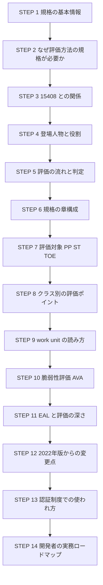

---

## STEP 1. ISO/IEC 18045:2026 を一言でいうと

### 1.1 一言での説明

**「Common Criteria(ISO/IEC 15408)で製品を評価するとき、評価者は最低限何をどう確認しなければならないか」を定めた規格**です。

ISO の公式ページの要旨(Abstract)によると、この規格は ISO/IEC 15408 シリーズの評価基準と評価証拠を使って評価を行うために、評価者が実施する**要件と最低限のアクション**を規定しています【確認済】。

たとえ話をすると次のようになります。

| たとえ | 対応する規格 |
|---|---|
| 運転免許の**試験項目表**(何ができれば合格か) | ISO/IEC 15408(Common Criteria) |
| 試験官向けの**採点マニュアル**(どう確認し、どう判定するか) | **ISO/IEC 18045(CEM)** |

> **つまずきポイント**: ISO/IEC 18045 は「製品がどうあるべきか」を直接定める規格ではありません。**評価する人(評価者)の作業手順と判定の考え方**を定める規格です。

### 1.2 基本情報

| 項目 | 内容 | 根拠 |
|---|---|---|
| 規格番号 | ISO/IEC 18045:2026 | 【確認済】ISO公式ページ |
| 版 | Edition 4(第4版) | 【確認済】ISO公式ページ |
| 発行 | 2026年5月(ISOのライフサイクル上、60.60 の日付は 2026-05-19) | 【確認済】ISO公式ページ |
| ページ数 | 447ページ | 【確認済】ISO公式ページ |
| 担当委員会 | ISO/IEC JTC 1/SC 27(情報セキュリティ、サイバーセキュリティ及びプライバシー保護) | 【確認済】ISO公式ページ |
| ICS | 35.030(IT Security) | 【確認済】ISO公式ページ |
| 前版 | ISO/IEC 18045:2022(第3版)。2026年5月19日付で廃止(Withdrawn) | 【確認済】ISO公式ページ、モンテネグロ規格協会ページ |
| ISOサイトの価格表示 | 取得時点で「CHF 0」と表示 | 【確認済】ISO公式ページ。購入・閲覧条件は変わり得るため公式サイトで確認してください |
| 欧州規格化 | EN ISO/IEC 18045:2026 として採用(エストニア規格協会の掲載では 2026年6月15日から有効) | 【確認済】EVS、BSI |

### 1.3 規格の策定タイムライン

ISO公式ページのステージ履歴から、策定の流れを整理します【確認済】。

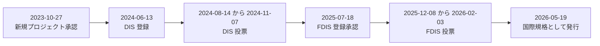

> 用語: **DIS** = Draft International Standard(国際規格案)、**FDIS** = Final Draft International Standard(最終国際規格案)。

---

## STEP 2. なぜ「評価方法の規格」が必要なのか

### 2.1 歴史を知ると目的が分かる

atsec information security(Common Criteria 評価で国際的に知られる評価機関)の解説記事によると、Common Criteria は各国で別々に作られていた評価基準が統合されて生まれました【確認済】。

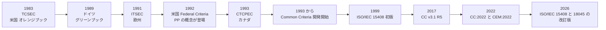

### 2.2 「基準」だけでは足りない理由

評価基準(ものさし)だけがあっても、**評価者ごとに確認の深さや判定がバラバラ**だと、次の問題が起きます。

| 問題 | 具体例 |
|---|---|
| 評価結果が比較できない | A社の評価機関では合格、B社の評価機関では不合格 |
| 国をまたいだ相互承認ができない | 日本で取得した認証書が海外で信頼されない |
| 開発者が準備できない | 何の証拠をどの程度用意すれば良いか分からない |

そこで、**評価者が最低限やるべきことを共通化する規格**として CEM(= ISO/IEC 18045)が存在します。国際相互承認の枠組み(CCRA)の下で、各国の認証制度が同じ水準で評価結果を受け入れるための土台になっています【一般知識】。

### 2.3 CEM の著作権と ISO 版の関係

2026年版の序文(Introduction)によると、CEM は複数の政府機関が共同で著作権を保有しており、ISO/IEC に対して ISO/IEC 18045 の継続的な開発・保守のために CEM を使用する非独占的ライセンスを許諾しています。政府機関側は CEM を使用・複製・配布・翻訳・改変する権利を保持しています【確認済】(ANSI公式プレビュー)。

---

## STEP 3. Common Criteria(ISO/IEC 15408)との関係

### 3.1 ISO/IEC 15408 シリーズと 18045 の関係

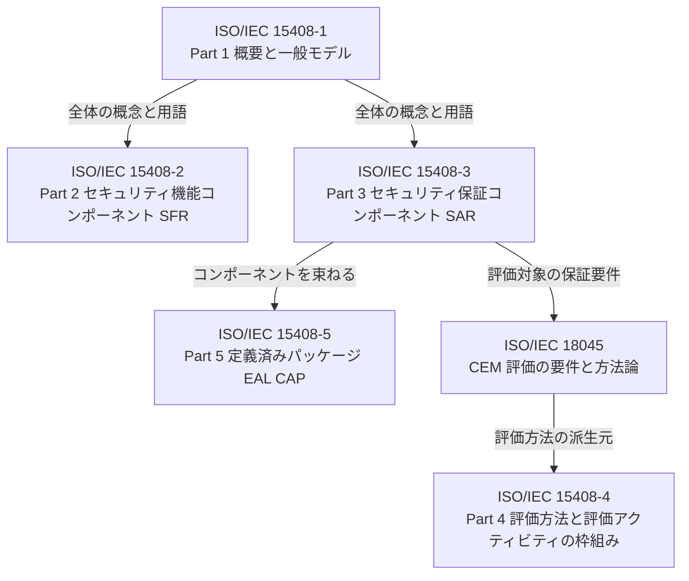

### 3.2 各パートの役割

| 規格 | 役割 | 初学者向けの言い換え |
|---|---|---|
| ISO/IEC 15408-1 | 一般概念、用語、TOE(評価対象)の概念、評価の全体モデル | 取扱説明書の「はじめに」 |
| ISO/IEC 15408-2 | セキュリティ機能要件(SFR)のカタログ | 「製品がこんな機能を持つべき」の部品表 |
| ISO/IEC 15408-3 | セキュリティ保証要件(SAR)のカタログと、PP・PP-Module・PP-Configuration・ST の評価基準 | 「この証拠でここまで確認する」の部品表 |
| ISO/IEC 15408-4 | 評価方法(EM)と評価アクティビティ(EA)を定めるための枠組み | 技術分野ごとの評価手順を作るための型枠 |
| ISO/IEC 15408-5 | EAL などの定義済みパッケージ | 要件のセットメニュー |
| **ISO/IEC 18045** | **評価者が何をどう確認し、どう判定するか** | **採点マニュアル** |

各パートの説明は、ISO/IEC 15408-1:2026 と 15408-3:2026 の公開されている要旨に基づいています【確認済】(EVS、ISO各ページ)。Part 1 の要旨では、18045 に関する一般情報と、18045 から派生する評価方法・評価アクティビティを作るための Part 4 の適用指針も扱うと説明されています【確認済】。

### 3.3 2026年に 15408 シリーズも改訂されている

エストニア規格協会(EVS)のページによると、ISO/IEC 15408-1 から -5 までの **2026年版**(いずれも 2026年6月15日から有効)が EN として採用されています【確認済】。ISO のページでは ISO/IEC 15408-1 は Edition 5(2026年)と表示されています【確認済】。

> **ポイント**: 18045:2026 の序文は「15408 シリーズの変更に合わせた」と述べています。つまり **15408 と 18045 はセットで読む**のが基本です。

### 3.4 他の ISO 規格との違い

| 規格 | 対象 | 何を確認するか |
|---|---|---|
| ISO/IEC 27001 | 組織の ISMS(情報セキュリティマネジメントシステム) | 組織の管理の仕組み |
| ISO/IEC 15408 + 18045 | **IT 製品・システム(TOE)** | 製品が主張するセキュリティ機能と、その保証の確からしさ |

【一般知識】ISO/IEC 27001 は組織の仕組みを認証し、Common Criteria は**個別の製品**を評価します。両者は補完関係にあり、置き換え関係ではありません。

---

## STEP 4. 登場人物と役割

### 4.1 評価に関わる主な役割

2026年版の序文では、**主な読者は ISO/IEC 15408 を適用する評価者と、評価者の作業を確認する認証者(certifier)**とされています。副次的な読者として、評価スポンサー、開発者、PP・PP-Module・PP-Configuration・ST の作成者、その他 IT セキュリティに関心のある方が挙げられています【確認済】。

| 役割 | 英語 | 主な責任 | 根拠 |
|---|---|---|---|
| スポンサー | Sponsor | 評価を依頼し、必要な証拠の提供を取りまとめる | 【一般知識】 |
| 開発者 | Developer | ST、設計文書、ソース、テスト証拠などの評価証拠を用意する | 【一般知識】 |
| 評価者 | Evaluator | CEM に従って評価アクティビティを実施し、判定する | 【確認済】 |
| 認証者 | Certifier | 評価者の作業が CEM に沿っているか確認し、認証判断に使う | 【確認済】 |
| 認証制度(スキーム) | Scheme | 国・地域ごとの運用ルールを決める | 【確認済】 |

### 4.2 スキームの役割がなぜ重要か

序文には、この規格は IT セキュリティ評価に関するすべての疑問に答えるものではなく、追加の解釈が必要になり得ること、そうした解釈の扱いは**個々のスキームが決めるが、相互承認協定の対象になり得る**ことが書かれています。スキームが扱い得る方法論関連の活動の一覧は **Annex A** に載っています【確認済】。

### 4.3 評価の一般的なやり取り

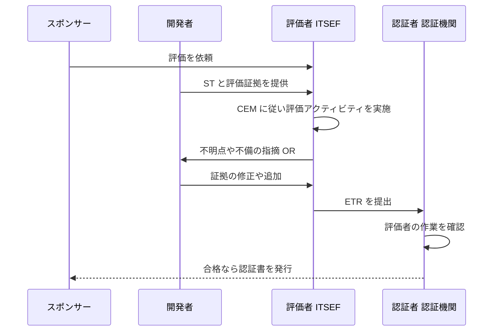

> 用語: **ITSEF** = IT Security Evaluation Facility(評価機関)、**OR** = Observation Report(所見報告書)、**ETR** = Evaluation Technical Report(評価技術報告書)。OR と ETR の作成は 18045 の章構成で「評価出力タスク」の一部として登場します【確認済】(目次の 8.5.4 と 8.5.5)。

---

## STEP 5. 評価の全体の流れと「判定」

### 5.1 評価プロセスの3段構え

18045 の第8章「Evaluation process and related tasks」は、次の構成になっています【確認済】(目次)。

| 節 | 内容 |
|---|---|
| 8.1 General | 総論 |
| 8.2 Evaluation process overview | 目的、役割ごとの責任、役割の関係、一般的な評価モデル、評価者の判定(verdict) |
| 8.3 Evaluation input task | 評価入力タスク(証拠の受領と管理) |
| 8.4 Evaluation sub-activities | 評価サブアクティビティ |
| 8.5 Evaluation output task | 評価出力タスク(成果物の管理、OR の作成、ETR の作成) |
| 共通タスク(別項目) | evaluation authority task を遂行する技術的能力の実証。入力・サブアクティビティ・出力の3段とは別に、評価全体に共通して求められる【一般知識】(2026年版での節番号は本文で確認) |

### 5.2 評価の流れ(フローチャート)

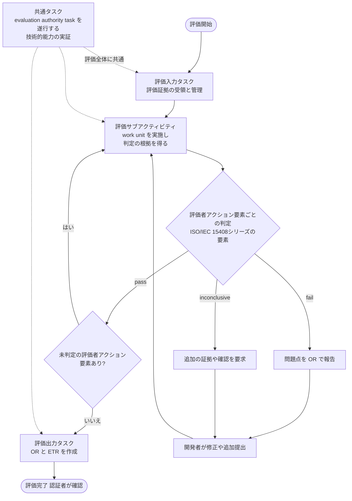

> 上記は評価の一般的なイメージです。実際の手戻りの扱い、タイミング、報告様式は**各スキームのルール**によって異なります【一般知識】。

### 5.3 評価者の判定(Evaluator verdicts)

18045 には「評価者の判定」を扱う節(8.2.5)があります【確認済】(目次)。判定の対象は ISO/IEC 15408 シリーズの**評価者アクション要素**であり、work unit の実施結果は判定そのものではなく、**その判定の根拠**として扱われます【一般知識】。CEM の判定は一般に次の3種類です【一般知識】。

| 判定 | 意味 | 開発者への影響 |
|---|---|---|
| **pass** | 要求を満たし、かつ証拠に一貫性があると評価者が判断 | 次へ進める |
| **fail** | 要求を満たしていない、または証拠に不整合や明白な矛盾があると評価者が判断 | 修正が必要 |
| **inconclusive** | まだ判断できない(証拠が不足、確認待ちなど) | 追加の証拠や説明が必要 |

CEM では、下位の判定が積み上がって上位の判定になる構造をとります。基本的な考え方は「**すべての下位判定が pass のときだけ上位も pass**」です【一般知識】。

### 5.4 評価の階層構造

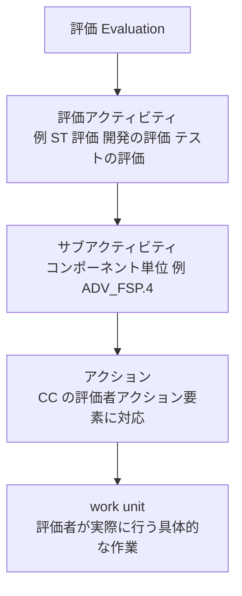

【一般知識】ADV_FSP.4 のようなコンポーネントに対して、CEM は評価者の作業を **work unit** という単位に分解して示します。

---

## STEP 6. 規格の章構成を読む

### 6.1 18045:2026 の全体地図

ANSI が公開している公式プレビューの目次に基づく章構成です【確認済】。

| 章 | タイトル(英語) | 内容の概要 |
|---|---|---|
| Foreword / Introduction | 序文と導入 | 改訂の要点、想定読者、スキームとの関係 |
| 1 | Scope | 適用範囲 |
| 2 | Normative references | 引用規格 |
| 3 | Terms and definitions | 用語と定義 |
| 4 | Terminology | 用語の使い方 |
| 5 | Verb usage | 動詞の使い方(義務を示す動詞の規則) |
| 6 | General evaluation guidance | 一般的な評価ガイダンス |
| 7 | Relationship between structures within the CC and the structure of this document | CC の構造と本書の構造の対応 |
| 8 | Evaluation process and related tasks | 評価プロセスと関連タスク |
| 9 | Protection Profile (PP) evaluation | PP の評価(APE) |
| 10 | Protection Profile Configuration evaluation | PP-Module と PP-Configuration の評価(ACE) |
| 11 | Security Target (ST) evaluation | ST の評価(ASE) |
| 12 | Development | 開発(ADV) |
| 13 | Guidance documents | ガイダンス文書(AGD) |
| 14 | Life cycle support | ライフサイクルサポート(ALC) |
| 15 | Tests | テスト(ATE) |
| 16 | Vulnerability assessment | 脆弱性評価(AVA) |
| 17 | Composition | コンポジション(ACO) |
| Annex A(参考) | General evaluation guidance and requirements | 一般的な評価ガイダンスと要件 |
| Annex B(規定) | Vulnerability assessment (AVA) | 脆弱性評価の詳細 |
| Annex C(参考) | Evaluation techniques and tools — Semi-formal and formal methods | セミフォーマル手法・フォーマル手法 |

> 序文によれば、この文書では、必須の評価アクティビティに関する特別な動詞を**太字の斜体**で表します【確認済】。読むときは、まずここに注目すると「評価者が必ずやること」が見分けられます。

### 6.2 章ごとのボリューム感

目次の開始ページから、おおよそのページ数を計算しました。**正確なページ数ではなく、目次の開始ページ同士の差による概算**です【筆者整理】。

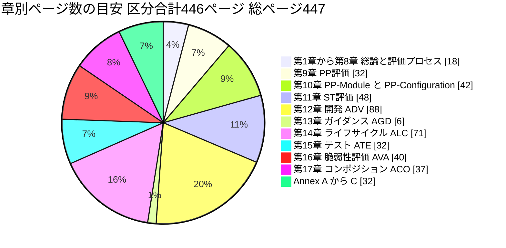

| 読み取れること | 解説 |
|---|---|
| ADV(開発)が最大 | 設計情報の評価は、評価のなかで最も作業量が大きい領域です |
| ALC(ライフサイクル)も大きい | 構成管理、開発環境のセキュリティ、欠陥修正などソフトウェア開発プロセスの評価が含まれます |
| AGD(ガイダンス)は小さい | 評価対象の文書は少なめですが、運用上の重要情報が含まれます |

### 6.3 初学者のおすすめの読み順

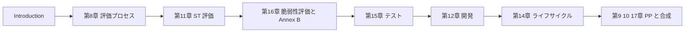

---

## STEP 7. 評価の対象は4種類 — PP、PP-Configuration、ST、TOE

### 7.1 キーワード整理

| 用語 | 正式名 | 一言でいうと | 18045 の該当章 |
|---|---|---|---|
| **PP** | Protection Profile | 製品カテゴリごとの、再利用できるセキュリティ要件の雛形 | 第9章(APE) |
| **PP-Configuration** | Protection Profile Configuration | PP と PP-Module(PP に追加する機能単位の要件の部品)を組み合わせた構成。PP-Module はこの評価の一部として評価される | 第10章(ACE) |
| **ST** | Security Target | 特定の製品について、そのセキュリティの主張を記したもの | 第11章(ASE) |
| **TOE** | Target of Evaluation | 評価対象の製品・システム(の範囲) | 全体 |

### 7.2 評価の順序

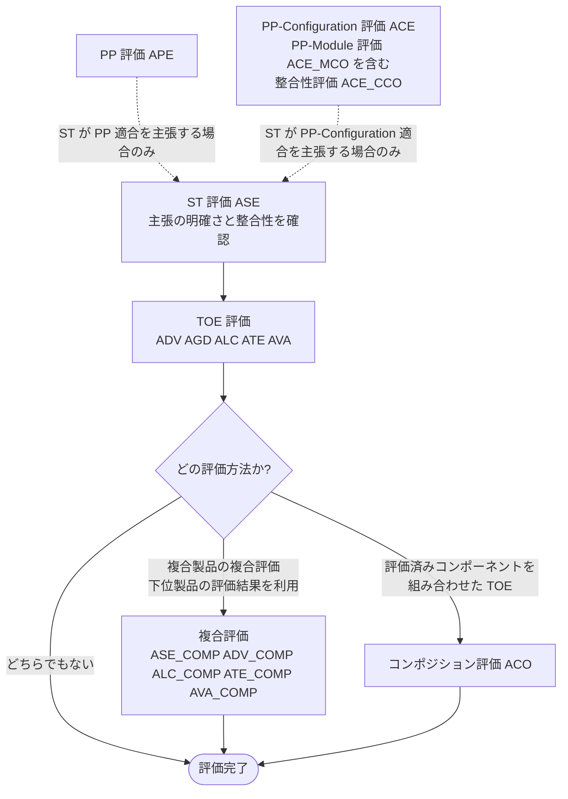

【一般知識】基本的な考え方は、**まず ST(主張)が評価に値する品質かを確認し、次に TOE が ST の主張どおりかを確認する**というものです。

### 7.3 ST 評価(ASE)と PP 評価(APE)のファミリー

目次に基づくファミリー(評価の観点)の一覧です【確認済】。

| 観点 | APE(PP評価) | ASE(ST評価) | ACE(PP-Module / PP-Config) |
|---|---|---|---|
| Introduction(導入) | APE_INT.1 | ASE_INT.1 | ACE_INT.1 |
| Conformance claims(適合主張) | APE_CCL.1 | ASE_CCL.1 | ACE_CCL.1 |
| Security problem definition(セキュリティ課題定義) | APE_SPD.1 | ASE_SPD.1 | ACE_SPD.1 |
| Security objectives(セキュリティ対策方針) | APE_OBJ.1 から .2 | ASE_OBJ.1 から .2 | ACE_OBJ.1 から .2 |
| Extended components definition(拡張コンポーネント定義) | APE_ECD.1 | ASE_ECD.1 | ACE_ECD.1 |
| Security requirements(セキュリティ要件) | APE_REQ.1 から .2 | ASE_REQ.1 から .2 | ACE_REQ.1 から .2 |
| TOE summary specification(TOE要約仕様) | なし | ASE_TSS.1 から .2 | なし |
| Composite product ST 整合性 | なし | ASE_COMP.1 | なし |
| PP-Module の整合性 | なし | なし | ACE_MCO.1 |
| PP-Configuration の整合性 | なし | なし | ACE_CCO.1 |

> **ポイント**: ST 評価は、**セキュリティ課題 → 対策方針 → 要件 → TOE要約仕様**という論理の筋が通っているかを確認する作業です。ソフトウェアで言えば「脅威 → セキュリティ設計方針 → 実装要件 → 実装の概要」のトレーサビリティ確認に近いものです【筆者整理】。

---

## STEP 8. クラス別の評価ポイント(ADV・AGD・ALC・ATE・AVA・ACO)

TOE 本体の評価では、保証クラスごとに評価者が確認する観点があります。以下の表のファミリーとコンポーネントの範囲は、**保証コンポーネントを定義する ISO/IEC 15408-3:2026** に基づくもので、ISO/IEC 18045:2026 の目次に載っている範囲そのものではありません【一般知識:範囲と解説】。

> **18045 との違い**: 18045 では、すべてのコンポーネントに個別の評価サブアクティビティがあるわけではありません。たとえば ADV_FSP は .5 まで、ADV_TDS は .5 まで、ATE_DPT は .3 まで、ATE_IND は .2 までしか個別のサブアクティビティがありません。表に載っている .6 や .4、.3 といった上位コンポーネントは 15408-3 には定義されていますが、18045 に個別のサブアクティビティはありません。

### 8.1 ADV — Development(開発)

「製品がどう設計・実装されているか」の説明が、ST の主張と矛盾しないかを確認します。

| ファミリー | 名称 | コンポーネント | 初学者向けの説明 |
|---|---|---|---|
| ADV_ARC | Security architecture | .1 | セキュリティアーキテクチャ(自己保護、バイパス防止など)の説明 |
| ADV_FSP | Functional specification | .1 から .6 | 外部インターフェース(API、コマンドなど)の仕様。番号が上がるほど詳細で形式的 |
| ADV_IMP | Implementation representation | .1 から .2 | 実装表現(ソースコードなど)の確認 |
| ADV_INT | TSF internals | .1 から .3 | セキュリティ機能の内部構造(モジュール化、複雑さの抑制) |
| ADV_SPM | Formal TSF model | .1 | セキュリティ方針の形式モデル |
| ADV_TDS | TOE design | .1 から .6 | TOE の設計(サブシステム、モジュールの説明) |
| ADV_COMP | Composite design compliance | .1 | 複合製品の設計適合性 |

### 8.2 AGD — Guidance documents(ガイダンス文書)

| ファミリー | 名称 | コンポーネント | 初学者向けの説明 |
|---|---|---|---|
| AGD_OPE | Operational user guidance | .1 | 利用者向けの運用ガイダンスが、安全な使い方を正しく示しているか |
| AGD_PRE | Preparative procedures | .1 | 受け入れ手順と導入手順(セットアップ)が、評価した構成を再現できるか |

> 実務の観点: 「安全に使うための手順書」も評価対象です。ハードニングガイドや初期設定手順書が曖昧だと、ここで指摘されます【筆者整理】。

### 8.3 ALC — Life-cycle support(ライフサイクルサポート)

ソフトウェア開発・保守のプロセスが、製品の信頼性を裏付けるかを確認します。

| ファミリー | 名称 | コンポーネント | 初学者向けの説明 | 実務への読み替え【筆者整理】 |
|---|---|---|---|---|
| ALC_CMC | CM capabilities | .1 から .5 | 構成管理の能力 | Git、ブランチ戦略、CI による変更追跡 |
| ALC_CMS | CM scope | .1 から .5 | 構成管理の対象範囲 | 何をバージョン管理するか(ソース、設計書、テスト、ツール) |
| ALC_DEL | Delivery | .1 | 配布の安全性 | 署名付き配布、改ざん検知 |
| ALC_DVS | Developer environment security | .1 から .2 | 開発環境のセキュリティ | 開発環境のアクセス制御、ビルド環境の保護 |
| ALC_FLR | Flaw remediation | .1 から .3 | 欠陥修正の手順 | 脆弱性対応、パッチ提供、PSIRT の運用 |
| ALC_LCD | Development life cycle definition | .1 から .2 | 開発ライフサイクルの定義 | SDLC、DevSecOps の定義 |
| ALC_TDA | TOE development artefacts | .1 から .3 | TOE の開発成果物 | 目次上の名称のみ確認。詳細は規格本文を参照 |
| ALC_TAT | Tools and techniques | .1 から .3 | 開発ツールと技法 | コンパイラ、静的解析、実装標準 |
| ALC_COMP | Integration of composition parts and consistency check of delivery procedures | .1 | 複合製品の統合と配布手順の整合性 | 下位製品との統合確認 |

### 8.4 ATE — Tests(テスト)

| ファミリー | 名称 | コンポーネント | 初学者向けの説明 |
|---|---|---|---|
| ATE_COV | Coverage | .1 から .3 | 開発者のテストが、機能インターフェースをどの程度カバーしているか |
| ATE_DPT | Depth | .1 から .4 | テストが設計のどの深さ(サブシステム、モジュール)まで届いているか |
| ATE_FUN | Functional tests | .1 から .2 | 開発者の機能テストの計画・実施・結果 |
| ATE_IND | Independent testing | .1 から .3 | **評価者自身が行う**独立テスト |
| ATE_COMP | Composite functional testing | .1 | 複合製品の機能テスト |

2026年版の第15章には、応用上の注記として次の見出しが目次に載っています【確認済】。

| 節 | 見出し |
|---|---|
| 15.2.2 | Understanding the expected behaviour of the TOE(TOE の期待される動作の理解) |
| 15.2.3 | Testing vs. alternate approaches to verify the expected behaviour of functionality(テストと他の検証手段の比較) |
| 15.2.4 | Verifying the adequacy of tests(テストの妥当性の検証) |

> **QA エンジニア向けの要点**: ATE は「テストがある」ことではなく、**テストが何をどの深さで検証しているか**を問われます。カバレッジ表、テスト仕様、期待結果と実績の対応が重要です【筆者整理】。

### 8.5 AVA — Vulnerability assessment(脆弱性評価)

| ファミリー | 名称 | コンポーネント | 初学者向けの説明 |
|---|---|---|---|
| AVA_VAN | Vulnerability analysis | .1 から .5 | 評価者が脆弱性を調査し、侵入テストで確認する |
| AVA_COMP | Composite vulnerability assessment | .1 | 複合製品の脆弱性評価 |

詳細は STEP 10 で解説します。

### 8.6 ACO — Composition(コンポジション)

すでに評価・認証された製品(下位コンポーネント)の上に、別の製品(上位コンポーネント)を載せる場合の評価です。

| ファミリー | 名称 | コンポーネント | 初学者向けの説明 |
|---|---|---|---|
| ACO_COR | Composition rationale | .1 | 組み合わせの妥当性の根拠 |
| ACO_DEV | Development evidence | .1 から .3 | 組み合わせに必要な開発証拠 |
| ACO_REL | Reliance of dependent component | .1 から .2 | 上位が下位にどう依存しているか |
| ACO_CTT | Composed TOE testing | .1 から .2 | 組み合わせた TOE のテスト |
| ACO_VUL | Composition vulnerability analysis | .1 から .3 | 組み合わせに特有の脆弱性分析 |

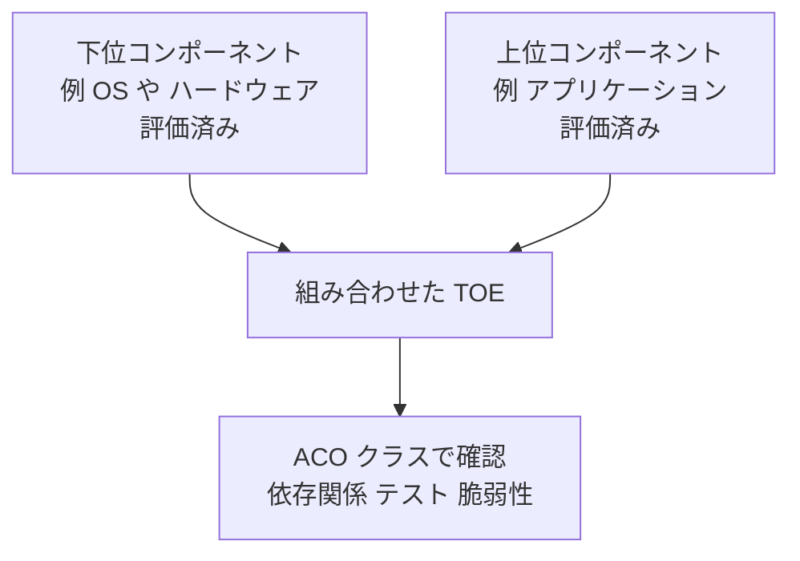

---

## STEP 9. work unit と action element の読み方

### 9.1 コンポーネント名の読み方

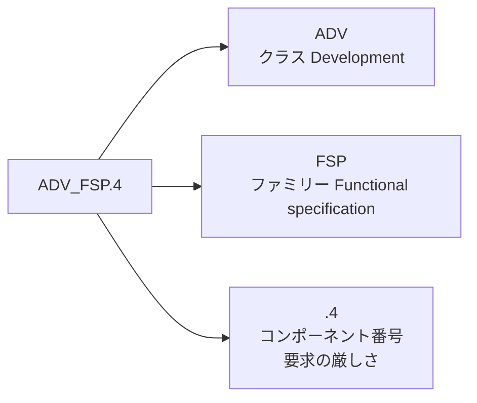

| 部分 | 意味 | 例 |
|---|---|---|
| 先頭3文字 | **クラス**(大分類) | ADV, AGD, ALC, ATE, AVA, ACO, APE, ASE, ACE |
| アンダースコア後の3文字 | **ファミリー**(中分類) | FSP, TDS, CMC |
| ドット後の数字 | **コンポーネント**(厳しさのレベル) | .1 から .5 など。数字が大きいほど一般に要求が厳しい【一般知識】 |

### 9.2 CC 側の要素と CEM 側の work unit

【一般知識】CC Part 3 の各コンポーネントは、次の3種類の要素(element)から成ります。CEM は、このうち**評価者アクション要素**を、さらに具体的な work unit へ分解します。加えて、評価者アクション要素の多くは「提供された情報が内容・提示の要求を満たすことを確認する」ものであるため、**開発者アクション要素(D)**や**内容・提示要素(C)**の要求も、その確認を通じて work unit の派生元になります。

| 要素 | 記号 | 誰が何をするか |
|---|---|---|
| Developer action elements | D | 開発者が提供しなければならないこと |
| Content and presentation elements | C | 提供される証拠が含むべき内容と表現 |
| Evaluator action elements | E | 評価者が行わなければならないこと |

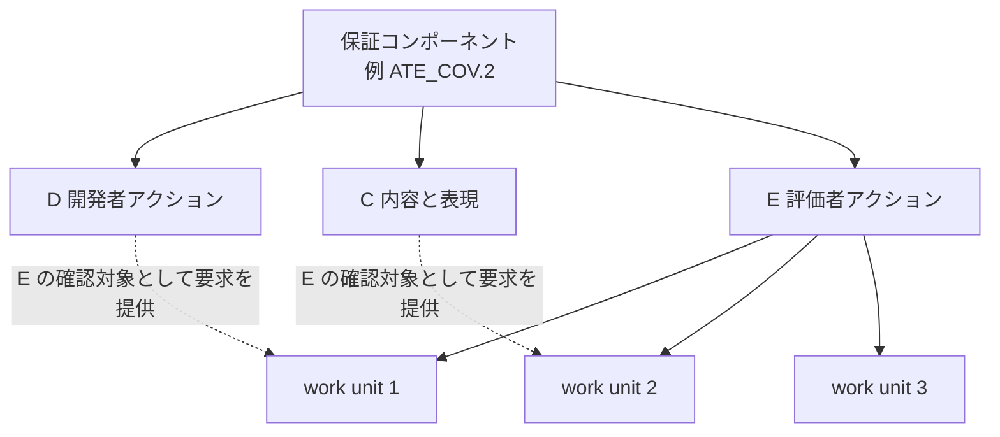

### 9.3 「動詞」に注目する読み方

序文によれば、この文書は**必須の評価アクティビティに関する特別な動詞を太字の斜体**で示します【確認済】。第5章「Verb usage」はその動詞の使い方を定めています【確認済:章題】。

読むときのコツは次のとおりです【筆者整理】。

| 読み方のコツ | 具体的な意味 |
|---|---|
| 太字の斜体の動詞を探す | 評価者が**必ず**行う動作 |
| 1つの work unit は1つの判断 | 「確認する」「検討する」「決定する」といった動作の単位 |
| 証拠と結びつける | どの証拠(ST、設計文書、ソースコード、テスト)を見るのか |

---

## STEP 10. 脆弱性評価(AVA)と攻撃能力(Attack potential)

### 10.1 AVA_VAN の5段階

第16章と Annex B(規定)が脆弱性評価を扱います【確認済:構成】。以下は一般的な理解です【一般知識】。

| コンポーネント | 名称(一般) | 評価者の主な作業 | 想定する攻撃者の能力 |
|---|---|---|---|
| AVA_VAN.1 | Vulnerability survey | 公開情報の調査と基本的な確認 | 基本レベル程度の確認 |
| AVA_VAN.2 | Vulnerability analysis | 脆弱性分析と侵入テスト | Basic に耐える |
| AVA_VAN.3 | Focused vulnerability analysis | 重点を絞った分析 | Enhanced-Basic に耐える |
| AVA_VAN.4 | Methodical vulnerability analysis | 体系的な分析 | Moderate に耐える |
| AVA_VAN.5 | Advanced methodical vulnerability analysis | 高度で体系的な分析 | High に耐える |

> EUCC では、Common Criteria の脆弱性評価ファミリー AVA_VAN のコンポーネント 1 から 5 を使うと、EUCC 関連の解説(Applus+ Laboratories)が述べています【確認済】。

### 10.2 脆弱性評価の流れ

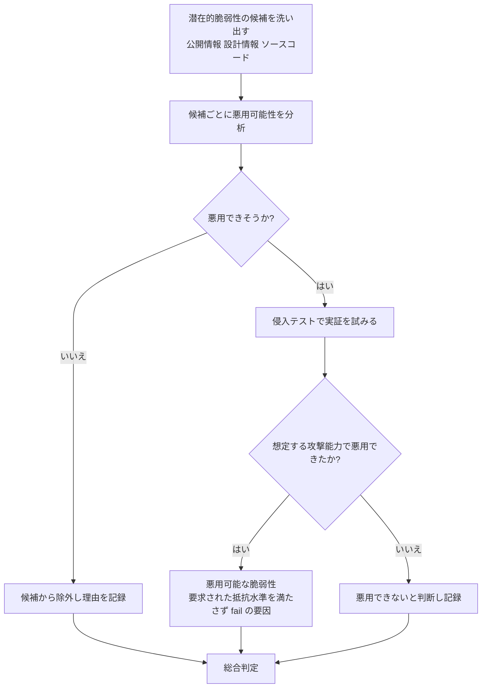

### 10.3 攻撃能力(Attack potential)を決める要素

【一般知識】CEM の Annex B では、攻撃の難しさを次の要素で評価します。

| 要素 | 意味 |
|---|---|
| Elapsed time | 攻撃の準備と実行にかかる時間 |
| Specialist expertise | 必要な専門知識のレベル |
| Knowledge of the TOE | TOE についてどの程度の情報が必要か |
| Window of opportunity | 攻撃の機会がどれだけ得られるか |
| Equipment | 必要な機材やソフトウェア |

> 具体的な点数表と判定のしきい値は、規格本文(Annex B)と各スキームの運用文書で確認してください。本ガイドでは数値を転載しません。

---

## STEP 11. EAL と評価の深さ

### 11.1 EAL とは

EAL(Evaluation Assurance Level)は、保証要件を段階的にまとめた定義済みパッケージです。ISO/IEC 15408-5 に定義されています【確認済:パッケージが Part 5 にあること】(atsec による CC:2022 の概要では、Part 5 に CC 3.1 R5 の EAL1〜7 と CAP が含まれると説明されています)。

| EAL | 一般的な呼び名 | 一言でいうと |
|---|---|---|
| EAL1 | Functionally tested | 機能テストした |
| EAL2 | Structurally tested | 構造的にテストした |
| EAL3 | Methodically tested and checked | 体系的にテストし確認した |
| EAL4 | Methodically designed, tested and reviewed | 体系的に設計・テスト・レビューした |
| EAL5 | Semiformally designed and tested | セミフォーマルに設計しテストした |
| EAL6 | Semiformally verified design and tested | セミフォーマルに設計を検証しテストした |
| EAL7 | Formally verified design and tested | フォーマルに設計を検証しテストした |

【一般知識】上記は一般的な呼び名です。**EAL が高い = 製品が安全**ではなく、「**セキュリティ機能の保証を確認した深さ**が深い」という意味です。

### 11.2 EAL と CEM の関係

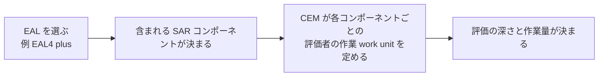

> **つまずきポイント**: EAL の「plus(+)」は、EAL の標準パッケージに**追加または強化したコンポーネント**があることを示します【一般知識】。

---

## STEP 12. 2022年版から何が変わったか

### 12.1 公式に確認できた変更点

2026年版の序文には、第3版(ISO/IEC 18045:2022)を置き換える第4版で、技術的に改訂されたと書かれています。主な変更点は次の2点です【確認済】。

| 変更の区分 | 内容 |
|---|---|
| ISO/IEC 15408 シリーズとの整合 | 15408 シリーズの変更に合わせた |
| 技術的変更 | 用語の見直しと更新、各コンポーネントの work unit の見直しと更新 |

### 12.2 2022年版と2026年版の比較表

| 項目 | 2022年版 | 2026年版 | 根拠 |
|---|---|---|---|
| 版 | Edition 3 | Edition 4 | 【確認済】 |
| タイトル | …Methodology for IT security evaluation | …**Requirements and** methodology for IT security evaluation | 【確認済】ISO、モンテネグロ規格協会 |
| 適用範囲の表現 | 評価者が実施する最低限のアクションを定義 | 評価者が実施する**要件**と最低限のアクションを規定 | 【確認済】 |
| 状態 | 2026-05-19 に廃止 | 発行済み | 【確認済】 |
| 欧州との連携 | (本調査では未確認) | CEN/CLC/JTC 13 との協力で作成(ウィーン協定) | 【確認済】序文 |
| 関連する 15408 | ISO/IEC 15408 Part 1 から 5 の 2022年版 | 15408-1:2026(Edition 5)ほか Part 1 から 5 の 2026年版 | 【確認済】EVS、ISO |

> **注意**: 2022年版と2026年版の**work unit 単位の差分**は、公開情報だけでは確認できていません。実務で影響を調べる際は、規格本文を入手して差分を確認してください。

### 12.3 CC:2022 で導入された主要概念(2026年版でも前提となる土台)

atsec の解説と ICCC 2023 の講演概要によると、CC:2022 では次の変化がありました【確認済】。

| 概念 | 内容 |
|---|---|
| 5パート構成 + CEM | Part 1 から 5 と CEM |
| 新しい SAR | 新たな保証要件の追加 |
| Exact Conformance | 以前はアドンダム(追補)だった適合方法を正式化し、cPP(collaborative PP)の方式を支持 |
| TOE のモジュール化 | 許容されるようになった |
| 新しい機能要件 | 追加された |
| マルチアシュアランス評価 | 評価の保証水準を部分ごとに変える考え方 |
| コンポジションの3類型 | Layered、Network(双方向)、Embedded |
| 評価方法と評価アクティビティの枠組み(Part 4) | PP の作者が技術分野ごとの評価作業を調整できる |

---

## STEP 13. 認証制度での使われ方(CCRA、EUCC、日本)

### 13.1 全体像

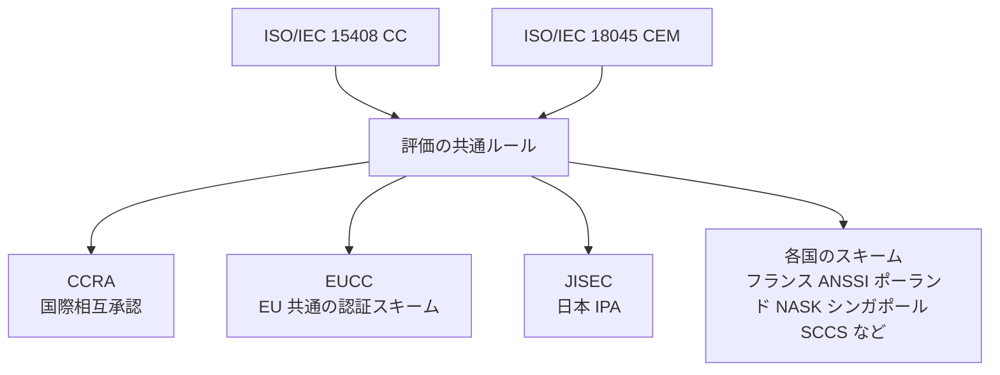

### 13.2 CCRA と CC:2022 / CEM:2022 への移行

| 項目 | 内容 | 根拠 |
|---|---|---|
| CC/CEM:2022 の公開 | CC:2022 Release 1 と CEM:2022 が CC ポータルに掲載。CC:2022 の ISO 版は ISO/IEC 15408-1 から -5:2022、CEM の ISO 版は ISO/IEC 18045:2022 | 【確認済】CCポータル、IPA 翻訳 |
| 公開の特徴 | これまでと異なり、**まず ISO/IEC 規格として開発され、その後に CCRA が発行**した | 【確認済】atsec(イタリア)の解説 |
| 移行ポリシー | CC v3.1 R5 は 3.1 系の最後の改訂。CC:2022 への移行に関する規則が CCRA の移行ポリシーに定義されている | 【確認済】CCポータル |
| 新規評価の受付 | 2024年7月1日以降の新規認証申請は CC:2022 Release 1 が必須(NASK、シンガポール SCCS) | 【確認済】 |
| 日本(JISEC) | CC/CEM v3.1 R5 に基づく認証申請は、原則として 2024年5月31日で受付終了。現行標準は CC/CEM:2022 Release 1 | 【確認済】IPA |
| 日本(JISEC)の例外 | (1) Exact Conformance を要求する PP に適合する申請には、上記とは別の期限がある(日付は下の「日付に関する注意」を参照)。(2) 指定された cPP は、後継の PP が公開されてから6か月間、v3.1 R5 から移行できる | 【確認済】IPA |
| PP が v3.1 の場合の猶予 | 3.1 R5 を前提とする PP に準拠する ST の申請は **2027年12月31日**まで受付(NASK の掲載) | 【確認済】NASK |

> **日付に関する注意**: Exact Conformance の cPP に関する v3.1 での評価開始の期限は、資料により異なる記載が見られます(atsec の 2023年10月時点の資料では 2026年12月31日、IPA の掲載では 2025年12月31日と cPP 移行の遅れへの対応に言及)。**最新の CCRA 移行ポリシーと各スキームの通知を必ず確認**してください。

### 13.3 2026年版との関係(重要な未確認事項)

| 確認できたこと | 確認できなかったこと |
|---|---|
| ISO/IEC 18045:2026 と 15408:2026 が ISO から発行され、EN として採用された | CCRA が **CC/CEM の2026年相当版**をいつ公開するか(今回の調査では、CC ポータルの掲載ページに CC:2022 Release 1 と CEM:2022 が現行として表示されていた) |
| EUCC の実施規則(EU 2024/482)は、2022年版の ISO/IEC 15408 と 18045 を参照している | EUCC が 2026年版を参照するよう更新される時期 |

補足: CC ポータルのニュースページ(2026年7月31日付の掲載が最新)を再確認したところ、CC:2022 Release 1 の公開(2022年11月14日)以降に、新しい CC/CEM 本体の公開を知らせる項目は見当たりませんでした。直近の項目は cPP(HCD、DBMS)関連です【確認済】。

つまり、**規格としての ISO/IEC 18045:2026 は発行済みですが、各認証制度がいつ 2026年版を採用するかは、各スキームの通知を確認する必要があります**。

### 13.4 EUCC(欧州の Common Criteria ベース認証スキーム)

| 項目 | 内容 | 根拠 |
|---|---|---|
| 位置づけ | Cybersecurity Act(規則 2019/881)に基づく最初の認証スキーム | 【確認済】EUR-Lex、Applus+ |
| 法的根拠 | 実施規則(EU) 2024/482 | 【確認済】EUR-Lex |
| 評価の基準と方法 | Common Criteria(ISO/IEC 15408)と共通評価方法(ISO/IEC 18045)を使用 | 【確認済】ENISA、EUR-Lex、Thales |
| 自己評価 | 適合性の自己評価は認められない | 【確認済】EUR-Lex の要約 |
| 評価機関 | 認定された ITSEF による第三者評価 | 【確認済】Applus+ |
| 参照する版 | 実施規則では ISO/IEC 15408-1 から -5:2022 と ISO/IEC 18045:2022、または CC:2022 と CEM:2022 を参照 | 【確認済】ENISA、EUR-Lex |
| 旧版の移行措置 | 実施規則(EU) 2024/3144 で改正された第3条により、**2027年12月31日まで**は、旧版の ISO/IEC 15408(15408-1:2009、15408-2:2008、15408-3:2008)と ISO/IEC 18045:2008、または CC v3.1 R5 と CEM v3.1 R5 を適用した証明書も発行できる。同じ期限まで、2022年版を適用しつつ旧版で作られた PP への適合を主張する証明書も発行できる。期限後は2022年版の適用が必要 | 【確認済】ENISA |
| 期限のない例外 | CC/CEM v3.1 R1〜R4 を適用した PP への適合を主張する場合でも、その PP の使用が実施規則(EU) 2016/799、規則(EU) 910/2014、または実施決定(EU) 2016/650 で求められているときは、2022年版を適用した証明書を発行できる | 【確認済】ENISA |
| 証明書の発行 | フランス ANSSI などの**認証機関(CB)**が EUCC 証明書を発行する。**ENISA は証明書を掲載するウェブサイトを運営**する立場であり、証明書の発行者ではない | 【確認済】EUR-Lex、Thales |

### 13.5 日本(JISEC)

IPA の JISEC は、CC/CEM の英語版と日本語翻訳版の両方を提供しており、どちらも利用できます【確認済】。CC:2022 Part 5 などの日本語訳も IPA が公開しています【確認済】。

---

## STEP 14. 開発者・セキュリティエンジニア向けの実務ロードマップ

### 14.1 評価を受ける側の準備の流れ

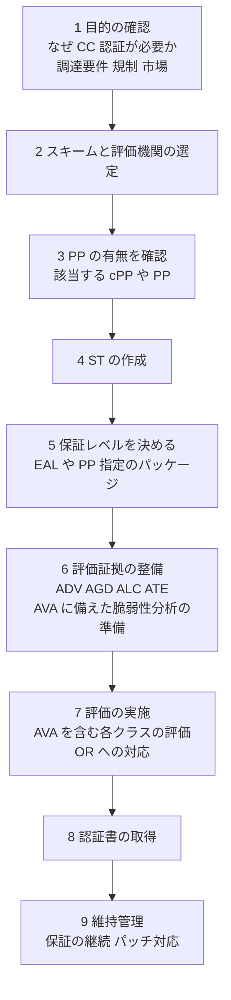

### 14.2 開発プロセスと CEM の対応【筆者整理】

| 開発の実務 | 関連する CEM のクラスとファミリー |
|---|---|
| 脅威モデリング、セキュリティ設計書 | ASE_SPD, ASE_OBJ, ADV_ARC |
| API 仕様書、インターフェース定義 | ADV_FSP |
| 設計書(モジュール構成) | ADV_TDS, ADV_INT |
| Git、ブランチ運用、CI | ALC_CMC, ALC_CMS |
| ビルド環境のアクセス制御 | ALC_DVS |
| 署名付きリリース、配布 | ALC_DEL |
| PSIRT、脆弱性対応、パッチ提供 | ALC_FLR |
| 静的解析、コーディング規約 | ALC_TAT |
| 自動テスト、カバレッジ計測 | ATE_COV, ATE_DPT, ATE_FUN |
| ペネトレーションテスト、ファジング | AVA_VAN |
| ハードニングガイド、導入手順書 | AGD_OPE, AGD_PRE |

### 14.3 よくある準備不足

| 失敗パターン | 原因 | 対策 |
|---|---|---|
| 証拠が評価の粒度に合わない | 設計書が概要レベルで止まっている | 選んだ EAL や SAR のレベルに必要な詳細度を早期に確認する |
| ST の主張が曖昧 | TOE の境界(何が評価対象か)が不明確 | TOE と運用環境の境界を最初に明確化する |
| テスト証拠がトレースできない | テストと機能インターフェースの対応表がない | カバレッジ表を作る |
| 脆弱性対応の記録がない | 受付から修正までの手順が非公式 | 受付窓口、トリアージ、修正、配布の手順を文書化する |
| 開発環境の統制が不十分 | ビルド環境の管理が属人化 | アクセス制御とビルドの再現性を整える |

---

## STEP 15. 最近の動向(2026年秋時点)

| 動向 | 内容 | 根拠 |
|---|---|---|
| ICCC 2026 | 2026年9月28日に開幕(ローマ)。欧州の EUCC など規制要件への対応が焦点 | 【確認済】atsec |
| 注目テーマ | SBOM、人工知能、Cyber Resilience Act(CRA)が複数の発表で議論 | 【確認済】atsec |
| SBOM と EUCC | EUCC 第33条に関連して、SBOM をライフサイクルの脆弱性管理に活用する発表がある | 【確認済】atsec |
| パッチ管理 | jtsec(Applus+)の専門家が、ISO SC 27 WG 3 の技術報告書「Towards Creating an Extension for Patch Management for ISO/IEC 15408 and ISO/IEC 18045」に協力 | 【確認済】Applus+ |
| 暗号 | CC 開発委員会の暗号作業部会が「Specification of Functional Requirements for Cryptography」を公開 | 【確認済】CCポータル |
| クラウド | Common Criteria in the Cloud(CCitC)が評価ガイダンスを公開 | 【確認済】CCポータル |
| 相互承認 | ICCC 2026 の閉会プレナリーで「相互承認における課題は改善しているか」のパネルが開催 | 【確認済】atsec |

---

## STEP 16. 用語集

| 用語 | 正式名 | 意味 |
|---|---|---|
| CC | Common Criteria | IT セキュリティ評価の国際基準(ISO/IEC 15408) |
| CEM | Common Methodology for Information Technology Security Evaluation | CC に基づく評価方法(ISO/IEC 18045)。「Common Evaluation Methodology」は非公式の展開形 |
| CCRA | Common Criteria Recognition Arrangement | CC 認証の国際相互承認の枠組み |
| TOE | Target of Evaluation | 評価対象 |
| TSF | TOE Security Functionality | TOE のセキュリティ機能 |
| PP | Protection Profile | 製品カテゴリ向けのセキュリティ要件の雛形 |
| cPP | collaborative Protection Profile | 国際的な技術コミュニティが作る PP |
| ST | Security Target | 特定製品のセキュリティ主張 |
| SFR | Security Functional Requirement | セキュリティ機能要件 |
| SAR | Security Assurance Requirement | セキュリティ保証要件 |
| EAL | Evaluation Assurance Level | 評価保証レベル |
| CAP | Composed Assurance Package | 合成保証パッケージ |
| ITSEF | IT Security Evaluation Facility | 評価機関 |
| OR | Observation Report | 所見報告書 |
| ETR | Evaluation Technical Report | 評価技術報告書 |
| work unit | (CEM の用語) | 評価者アクションを分解した具体的作業単位 |
| verdict | (CEM の用語) | pass、fail、inconclusive の判定 |
| EM / EA | Evaluation Method / Evaluation Activity | Part 4 で定める評価方法と評価アクティビティ |
| EUCC | European Common Criteria-based cybersecurity certification scheme | EU の CC ベース認証スキーム |
| JISEC | Japan Information Technology Security Evaluation and Certification Scheme | 日本の IT セキュリティ評価・認証制度(IPA) |

---

## STEP 17. よくある質問と誤解

| 質問・誤解 | 回答 |
|---|---|
| ISO/IEC 18045 を読めば製品のセキュリティ要件が分かる? | いいえ。要件の中身は ISO/IEC 15408(特に Part 2 と Part 3、および PP や ST)にあります。18045 は評価者の作業を定めます |
| 開発者は 18045 を読まなくてよい? | 序文では開発者は副次的な読者です。ただし、評価者が何を見るかを知ると、**証拠の準備の質が上がります** |
| CC 認証を取れば製品は安全? | 認証は、**ST に書かれた主張が評価された範囲で確認された**ことの証明です。範囲外の安全性は保証しません【一般知識】 |
| EAL が高いほど良い製品? | EAL は確認の深さであり、製品の優劣ではありません。用途と PP の要求で適切な水準が決まります |
| 2026年版が出たので今すぐ全部切り替わる? | いいえ。各スキームがいつ採用するかは別です(STEP 13.3 参照) |
| ISO/IEC 27001 と何が違う? | 27001 は組織の ISMS、CC は製品の評価です(STEP 3.4 参照) |

---

## STEP 18. 学習ロードマップ

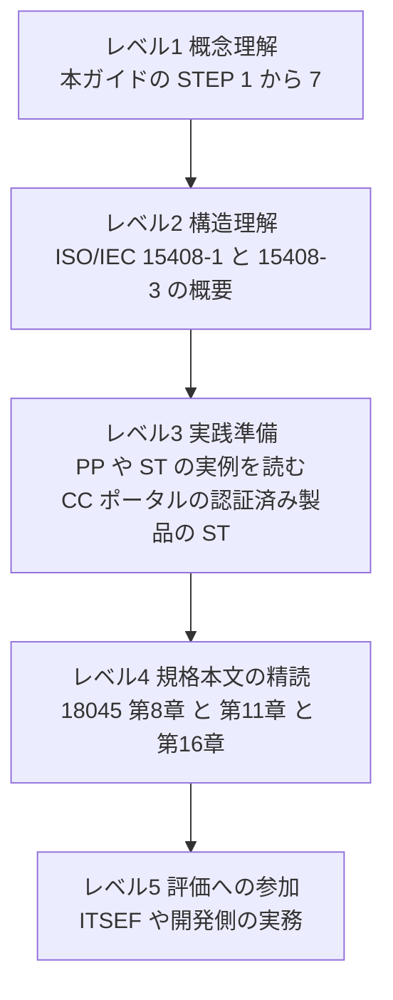

| レベル | 学ぶこと | 教材 |
|---|---|---|
| 1 | 全体像と用語 | 本ガイド、IPA JISEC のページ |
| 2 | CC の5パート構成 | CC:2022 Part 1(CC ポータル、IPA 翻訳) |
| 3 | 実際の ST と認証報告書 | CC ポータルの認証済み製品の ST と Certification Report |
| 4 | 評価者視点の work unit | ISO/IEC 18045:2026 本文、CEM:2022 |
| 5 | 実務 | 評価機関、国際会議(ICCC)、CCUF のワークショップ |

---

## STEP 19. 出典URL一覧(2026年10月14日時点で参照)

### 19.1 規格の一次情報(ISO と各国の規格団体)

| 区分 | 内容 | URL |
|---|---|---|
| ISO 公式 | ISO/IEC 18045:2026 のページ(要旨、版、ステージ履歴、前版の情報) | https://www.iso.org/standard/18045 |
| 公式プレビュー | ANSI 掲載の ISO/IEC 18045:2026 プレビュー(目次、序文、変更点) | https://webstore.ansi.org/preview-pages/ISO/preview_ISO+IEC+18045-2026.pdf |
| 前版の状態 | モンテネグロ規格協会の ISO/IEC 18045:2022(廃止の情報) | https://isme.me/en/project/show/iso:proj:72889 |
| 欧州規格 | EVS-EN ISO/IEC 18045:2026 | https://www.evs.ee/en/evs-en-iso-iec-18045-2026 |
| 英国規格 | BSI の BS EN ISO/IEC 18045:2026 | https://knowledge.bsigroup.com/products/information-security-cybersecurity-and-privacy-protection-evaluation-criteria-for-it-security-requirements-and-methodology-for-it-security-evaluation-1 |
| カナダ規格 | SCC の ISO/IEC 18045:2026 | https://scc-ccn.ca/standardsdb/standards/2058669 |
| 15408-1 | EVS-EN ISO/IEC 15408-1:2026 | https://www.evs.ee/en/evs-en-iso-iec-15408-1-2026 |
| 15408-3 | EVS-EN ISO/IEC 15408-3:2026 | https://www.evs.ee/en/evs-en-iso-iec-15408-3-2026 |
| 15408-1 ISO | ISO/IEC 15408-1 のページ(Part 1 の要旨) | https://committee.iso.org/standard/88134.html |

### 19.2 CCRA、CC ポータル、各国認証機関

| 区分 | 内容 | URL |
|---|---|---|
| CC ポータル | CC:2022 と CEM:2022 の公開ページ | https://www.commoncriteriaportal.org/cc/index.cfm |
| CC ポータル | CC:2022 と CEM:2022 の移行ポリシー | https://www.commoncriteriaportal.org/files/ccfiles/CC2022CEM2022TransitionPolicy.pdf |
| CC ポータル | ニュース(暗号、クラウド、XML 版などの公開情報) | https://www.commoncriteriaportal.org/news/index.cfm |
| CC ポータル | CC:2022 と CEM:2022 の正誤表と解釈 | https://www.commoncriteriaportal.org/files/ccfiles/CCMB-2025-001-v1_2-Errata_Interpretation_CC_CEM_2022.pdf |
| 日本 IPA | JISEC の CC/CEM ページ | https://www.ipa.go.jp/en/security/jisec/cc-cem.html |
| 日本 IPA | CC:2022 Part 5 日本語訳 | https://www.ipa.go.jp/security/jisec/about/cdk3vs000000240h-att/CC2022PART5R1-J1.0.pdf |
| フランス ANSSI | CC:2022 と CEM:2022 のスキームへの適用に関する通知 | https://cyber.gouv.fr/sites/default/files/document/ANSSI-CC-NOTE-29_Transposition_CC2022_v1.1_ORIGINAL_SIGNE.pdf |
| ポーランド NASK | CC 認証の移行情報 | https://certyfikacja.nask.pl/en/en-common-criteria/ |
| シンガポール | SCCS の CC:2022 移行の情報 | https://csa.gov.sg/our-programmes/certification-and-labelling-schemes/singapore-common-criteria-scheme/updates |

### 19.3 EUCC

| 区分 | 内容 | URL |
|---|---|---|
| EU 法令 | 実施規則(EU) 2024/482(EUCC) | https://eur-lex.europa.eu/eli/reg_impl/2024/482/2025-12-29/eng/pdf |
| EU 法令 | EUCC の要約 | https://eur-lex.europa.eu/EN/legal-content/summary/european-common-criteria-based-cybersecurity-certification-scheme-eucc.html |
| ENISA | EUCC のページ | https://certification.enisa.europa.eu/browse-topic/EUCC_en |
| Thales | EUCC の解説 | https://www.thalesgroup.com/en/news-centre/insights/public-security/national-security/introducing-eucc-new-certificate-boost |
| Applus+ Laboratories(jtsec) | EUCC と CRA、パッチ管理に関する解説 | https://appluslaboratories.com/global/en/news/publications/eucc-new-eu-common-criteria |

### 19.4 国際的な評価機関・専門家による解説と講演

| 区分 | 内容 | URL |
|---|---|---|
| atsec | CC:2022 の解説記事(歴史、5パート構成、主要な変更点) | https://atsec.de/cc2022-is-here/ |
| atsec | CC:2022 と CEM:2022 の移行の概要資料(PDF) | https://atsec.de/wp-content/uploads/2024/07/atsec_CC-2022-Transition.pdf |
| atsec | ICCC 2026 の参加報告(SBOM、AI、CRA、EUCC) | https://atsec.de/atsec-at-iccc-2026/ |
| ICCC | 「CC:2022 – How it Compares and Differs from CC3.1R5」講演概要(ISO/IEC JTC 1/SC 27/WG 3 のコンビーナである Miguel Banon 氏ほかによる) | https://iccconference.org/session/cc2022-how-it-compares-and-differs-from-cc3-1r5-l21b/ |
| Agenda Digitale | CC:2022 の新機能と移行時期の解説(atsec のマネージングディレクターによる寄稿) | https://www.agendadigitale.eu/sicurezza/common-criteria-cc2022-nuova-versione-novita-e-tempi-di-transizione/ |

---

## STEP 20. 確認できなかった点と注意事項

| 項目 | 状況 | 推奨する対応 |
|---|---|---|
| 2026年版の work unit ごとの差分 | 公開情報では確認できず | 規格本文とCEM:2022の差分を直接比較する |
| 規格本文の詳細(第9章から第17章の全文) | 公式プレビューは序文と目次まで | ISO の Online Browsing Platform や購入版で確認する |
| CCRA の 2026年相当版の公開時期 | 取得したページでは CC:2022 Release 1 が現行表示 | CC ポータルとスキームの最新通知を確認する |
| EUCC が 2026年版へ更新される時期 | 実施規則は 2022年版を参照 | ENISA と各国認証機関の通知を確認する |
| 移行期限の日付 | 資料により記載の差がある | 最新の CCRA 移行ポリシーを確認する |
| 【一般知識】タグの記述 | 2026年版の全文では再確認していない | 実務で使う前に規格本文で確認する |

> **免責**: 本ガイドは学習のための解説であり、認証取得の可否や法的適合性を保証するものではありません。実際の評価や認証の申請では、選定したスキームの最新ルール、評価機関の指示、規格本文を必ず参照してください。

---
