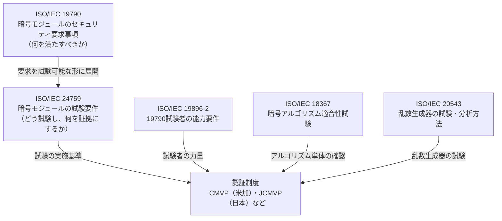
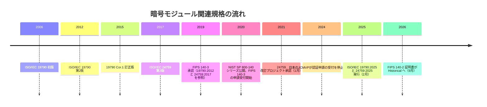
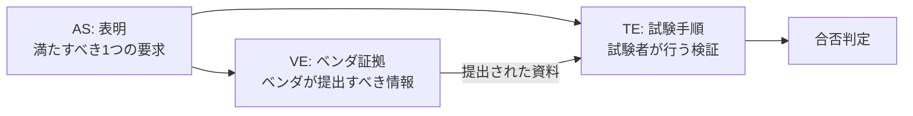
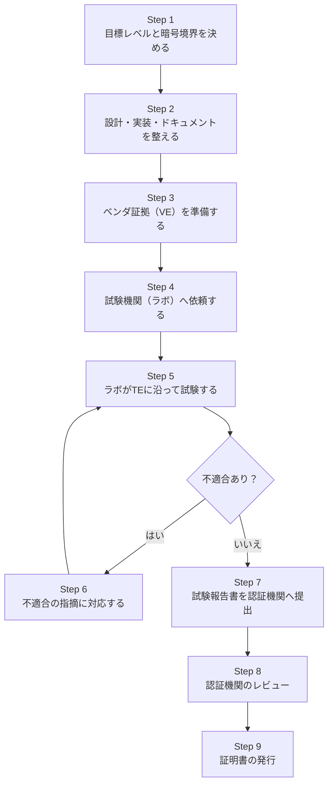
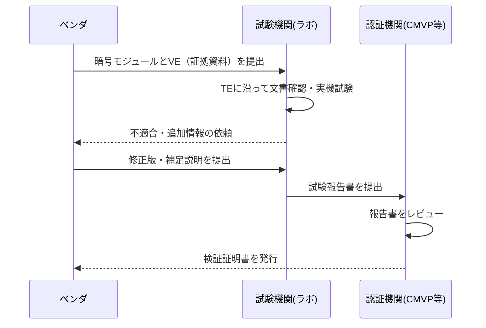
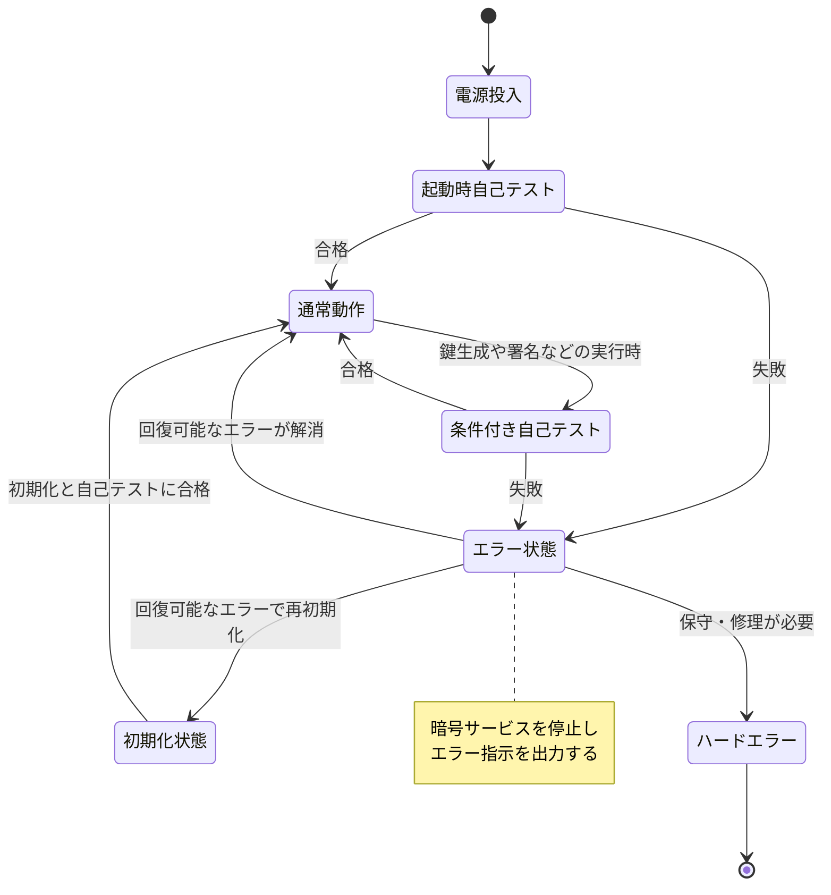
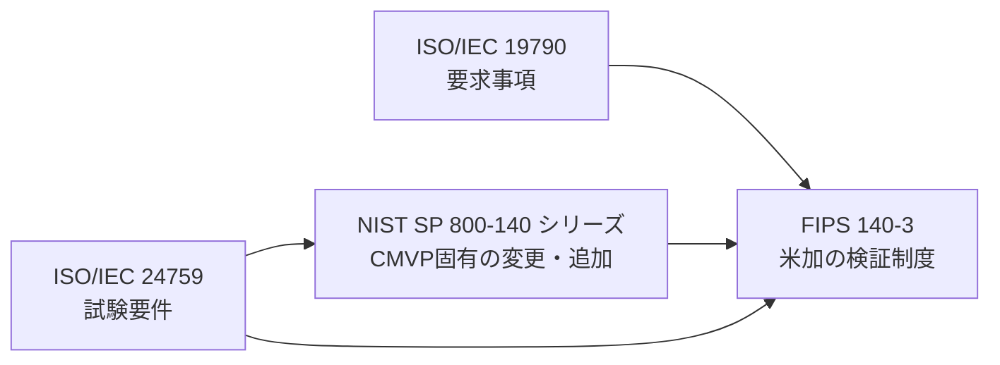
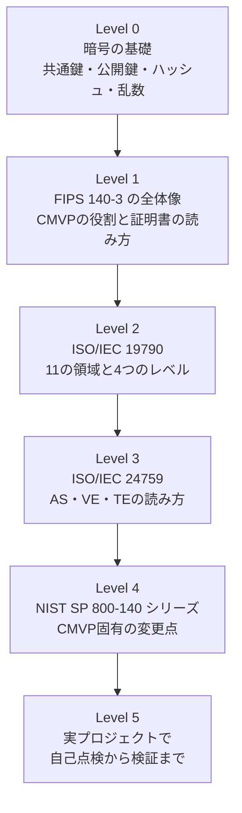

# ISO/IEC 24759:2025 初学者向けステップバイステップ解説ガイド

> **暗号モジュールは「どうやって試験され、何を証拠として提出すればよいのか」を定めた国際規格を、ゼロから理解する**

- 対象規格: ISO/IEC 24759:2025 — Information security, cybersecurity and privacy protection — Test requirements for cryptographic modules（暗号モジュールの試験要件）
- 情報の確認時点: **2026年10月15日**
- 想定読者: 暗号ライブラリ・HSM・組込み機器・クラウド基盤の開発者、QAエンジニア、セキュリティエンジニア、調達担当者
- 主な参照元: ISO公式ページ、NIST CMVP、IPA（JCMVP）、atsec、INCITS、AWS Security Blog（URLは[第16章](#16-出典url一覧)にまとめています）

---

## 0. 本ガイドの読み方と、先に知っておくべき注意点

### 0.1 このガイドの作り方（情報の限界を正直に書きます）

ISO/IEC 24759:2025 の**規格本文は著作権で保護**されています。なお、価格については、ISO公式ページの価格表示は **CHF 0** となっています（表示は変わることがあるため、入手時に公式ページで確認してください）。本ガイドは本文を転載せず、次の**公開情報だけ**を根拠に、私の言葉で再構成した解説です。

| 区分 | 使った情報 | 信頼度 |
|---|---|---|
| 一次情報 | ISO公式ページ（要旨・版情報・ライフサイクル）、IPA公式ページ、NIST CMVP公式ページ、NIST SP 800-140（全文公開） | 高 |
| 準一次情報 | 規格づくりに関わった団体（atsec、INCITS）の発表 | 高 |
| 開発者の発信 | AWS Security Blog（AWS-LC のFIPS 140-3検証に関する投稿） | 中〜高（事例として利用） |
| 二次情報 | FIPS 140-2 の終了日程などを解説する各社ブログ | 中（日付は NIST 公式で裏取りできたものだけ断定） |

### 0.2 とくに注意してほしい3点

1. **2025年版の条番号・個別要件の逐条内容は、本文を入手していないため断定しません。** 条の構成の説明は、NIST SP 800-140 が前提としている **2017年版（第3版）の構成**に基づきます。2025年版でも骨格は引き継がれている可能性が高いですが、実際の番号は購入した原文で確認してください。
2. **「2025年版で何がどう変わったか」は、公開情報で確認できた範囲だけ**を[第8章](#8-2025年版のポイント確認できたことできていないこと)に整理します。推測は推測と明記します。
3. 本ガイドは学習用の解説であり、**認証取得・調達の最終判断の根拠にはなりません**。必ず最新の原文と、適用される制度（CMVP、JCMVPなど）の運用文書を確認してください。

---

## 1. 一言でいうと

**ISO/IEC 24759 は、「暗号モジュールが ISO/IEC 19790 の要求を満たしているか」を、試験機関（ラボ）が誰がやっても同じ結果になるように確かめるための"採点基準と試験手順書"です。**

もう少し分解すると、次の3つの役割があります（ISO公式の要旨を、私の言葉で言い換えています）。

| 役割 | 平易な言い換え |
|---|---|
| 試験方法を定める | ラボが使う試験・検証の手順を決める。客観性が高く、ラボごとのばらつきが出ないようにする |
| ベンダが出す証拠を定める | 開発元（ベンダ）が、適合を示すためにラボへ渡すべき資料を決める |
| 事前チェックにも使える | ベンダがラボへ申し込む前に、自社製品が19790を満たしているか自己点検するのにも使える |

> **たとえ話**
> ISO/IEC 19790 が「運転免許の**合格基準**（何ができれば合格か）」だとすると、ISO/IEC 24759 は「**試験官用の採点マニュアル**と、受験者が持参すべき**提出書類リスト**」にあたります。

---

## 2. 前提知識：まず用語を揃えよう

### 2.1 暗号モジュールとは

暗号アルゴリズム（AES、RSA、ECDSA、SHA-2など）や鍵管理を**ひとまとまりの境界（暗号境界）の中に閉じ込めた部品**です。形はさまざまです。

| 形態 | 例 |
|---|---|
| ハードウェア | HSM、スマートカード、TPM、暗号チップ |
| ソフトウェア | 暗号ライブラリ（例: OpenSSL系、BoringSSL系の派生ライブラリ） |
| ファームウェア | 機器に組み込まれた暗号処理部 |
| ハイブリッド | ハードウェアとソフトウェアの組み合わせ |

NIST SP 800-140 には、ハードウェア／ファームウェア／ハイブリッドそれぞれの暗号境界に関する個別要件が出てきます。形態によって、試験で見られる点が変わることがわかります。

### 2.2 登場人物と略語

| 用語 | 意味 | ひとこと |
|---|---|---|
| ベンダ | 暗号モジュールの開発元 | 証拠（VE）を出す人 |
| 試験機関（ラボ） | 試験を実施する第三者機関。FIPS 140-3 では CSTL（暗号・セキュリティ試験機関） | 試験（TE）をする人 |
| CMVP | 暗号モジュール検証プログラム。米NISTとカナダ CCCS が運営 | 結果をレビューして証明書を出す |
| JCMVP | 日本の暗号モジュール試験及び認証制度。IPAが運用 | 日本版の認証制度 |
| AS | Assertion（表明）。19790 の要求を試験可能な形に書き直した文 | 「〜であること」という合否の基準 |
| VE | Vendor Evidence（ベンダ証拠）。ベンダが提出すべき情報 | 提出書類のリスト |
| TE | Test Evidence（試験の証拠）。試験者が行うべき検証手順 | 試験官の手順書 |
| SSP | Sensitive Security Parameter（機微なセキュリティパラメータ）。鍵やパスワードなど | 守るべき秘密の総称 |
| ゼロ化 | SSPを復元できないように消去すること | 「鍵を完全に消す」操作 |

### 2.3 セキュリティレベル（1〜4）の超ざっくり像

19790 系の規格では、モジュールを4段階のレベルで評価します（一般知識としての概観です。厳密な定義は原文で確認してください）。

| レベル | イメージ |
|---|---|
| 1 | 基本的な要件。ソフトウェア単体のモジュールも対象になりやすい |
| 2 | 改ざんの**痕跡が残る**ことや、役割ベースの認証を重視 |
| 3 | 改ざんに**抵抗する**物理防護や、個人を識別する認証を重視 |
| 4 | 環境条件（温度・電圧）の異常を含む、より厳しい防護 |

NIST SP 800-140 の個別要件には、「Levels 1, 2, 3, and 4」「Levels 3 and 4」のようにレベルが明記されており、**同じ領域でもレベルによって試験項目が増える**ことが見て取れます。

---

## 3. 規格ファミリーの全体像：24759 はどこに位置するか



| 規格 | 位置づけ | 24759との関係 |
|---|---|---|
| ISO/IEC 19790:2025 | 暗号モジュールの要求事項（第3版） | 24759:2025 は、この2025年版の要求に対する試験要件 |
| ISO/IEC 24759:2025 | 試験要件（第4版） | 本ガイドの主題 |
| ISO/IEC 19896-2 | 19790の試験者に求める知識・技能 | ラボの人材面を支える |
| ISO/IEC 18367 | 暗号アルゴリズムの実装が仕様どおりかの試験方法 | 米CAVPや日本のアルゴリズム確認の基礎 |
| ISO/IEC 20543 | 19790・15408に基づく乱数生成器の試験方法 | 乱数生成器の試験で併用 |

（19896-2、18367、20543 の位置づけは IPA の JCMVP 関連規格ページの説明に基づきます）

---

## 4. 基本情報（ISO公式ページより）

| 項目 | 内容 |
|---|---|
| 規格番号 | ISO/IEC 24759:2025 |
| 題名 | Information security, cybersecurity and privacy protection — Test requirements for cryptographic modules |
| 版 | 第4版（Edition 4） |
| 発行 | 2025年2月（公開日 2025-02-26） |
| ステータス | 発行済み（Published、ステージ 60.60） |
| ページ数 | 182 |
| 担当委員会 | ISO/IEC JTC 1/SC 27（情報セキュリティ、サイバーセキュリティ及びプライバシー保護） |
| ICS | 35.030（ITセキュリティ） |
| 置き換え対象 | ISO/IEC 24759:2017（廃止済み） |
| 言語 | 英語 |

> 規格名が、2017年版の「Information technology — Security techniques —」から、2025年版では「Information security, cybersecurity and privacy protection —」に変わっている点にも注目してください（IPAのページでは旧名称のまま紹介されている箇所があります）。名称変更の理由は、公開情報では確認できていません。

---

## 5. 沿革：なぜ2025年版が出たのか

### 5.1 年表



### 5.2 改訂の舞台裏（確認できた事実）

- ISO公式ページのライフサイクルによると、改訂プロジェクトは**2021年1月18日**に承認され、複数回の作業原案（WD）を経て、2023年にCD、2023年11月にDIS投票、2024年にFDIS登録、**2025年2月26日に発行**されました。
- atsec の発表によれば、FIPS 140-3 が19790:2012/Cor.1:2015 と 24759:2017 を土台に採用した2019年3月以降、**CMVP職員・試験機関・ベンダ**が CMUF（暗号モジュール利用者フォーラム）の FIPS 140-3 作業部会で、約5年にわたり規格の改善点を磨いてきました。その成果が2025年版に反映されています。
- つまり2025年版は、**「現場で運用して見つかった曖昧さ・重複・運用上の課題」を国際規格に還元した改訂**と読むことができます。

---

## 6. 24759 の中身：AS・VE・TE という3点セット

### 6.1 基本の考え方

24759 は、19790 の要求を**「表明（AS）」単位**に分解し、それぞれに次の2つをぶら下げる構造です。



| 要素 | 誰のためのもの | 中身 |
|---|---|---|
| AS（Assertion） | 全員 | 「ゼロ化された鍵は取り出し・再利用できないこと」のような、合否が判断できる要求 |
| VE（Vendor Evidence） | ベンダ | 設計書、仕様書、セキュリティポリシーなど、何を提出するか |
| TE（Test Evidence） | ラボ | 資料を確認する／実機で操作して確かめる、といった手順 |

### 6.2 番号の読み方（NIST SP 800-140 の記法から）

NIST SP 800-140 に出てくる実例から、番号の付け方が読み取れます。

| 例 | 意味 |
|---|---|
| AS09.28 | 「09」番の領域（SSP管理）の28番目の表明（SSPのゼロ化に関するもの） |
| VE09.28.01 | AS09.28 に対する、ベンダ証拠の1番目 |
| TE09.28.02 | AS09.28 に対する、試験手順の2番目 |

つまり **AS／VE／TE の番号をたどれば、要求→提出物→試験手順が1本の線でつながる**ようになっています。

### 6.3 実例で理解する：鍵のゼロ化（AS09.28 の場合）

NIST SP 800-140 に載っている、保護されていないSSPのゼロ化に関する項目を、要点だけ言い換えます。

| 区分 | 内容（要約） |
|---|---|
| AS（要求） | モジュールは、保護されていないSSPと鍵コンポーネントをすべてゼロ化する方法を備えること |
| VE（提出物） | ゼロ化の手法、ゼロ化できるタイミングの制約、ゼロ化されるSSP・されないSSPとその理由、攻撃者が侵害できない短時間で完了する根拠、などを文書化する |
| TE（試験） | 文書の記載を確認する → モジュール内のSSPを特定してゼロ化コマンドを実行する → 実行後にそのSSPで暗号処理を試みて、アクセスできないことを確かめる → 消去が十分に速いことを確かめる |

ここから学べる大切な姿勢が2つあります。

1. **「できます」と書くだけでは足りず、試験者が実際に動かして確かめる**（運用試験）項目がある。
2. ベンダが示した根拠の正しさは試験者が検証し、**立証責任はベンダ側**にある。曖昧さや不確かさがあれば、試験者は追加情報を求める。

### 6.4 CMVP が求める「回答の質」

NIST SP 800-140 は、試験項目への回答が **「はい／いいえ」だけでは不十分**だと明記しています。要求される回答の中身は、確認の種類によって異なります。

| 確認の種類 | 求められる回答 |
|---|---|
| 文書確認 | 該当するベンダ文書を引用・参照し、内容を要約する |
| 運用試験 | 試験方法とツールを説明し、結果を要約する |
| 検証（検査による検証を含む） | 確認に用いた試験・検査の方法と、詳細な結果を示す |

> **初学者への一言**
> 試験とは「合格しました」と書く作業ではなく、**第三者が再現・追跡できる証拠を残す作業**です。

---

## 7. 試験の対象領域：12の区分

NIST SP 800-140 は 24759:2017 の構成に沿って、**総則（6.1）＋11の個別領域（6.2〜6.12）**を扱っています。以下はその一覧です（2017年版ベース。2025年版の番号は原文で確認してください）。

| 条 | 領域 | 何を見るか（初学者向け） | SP 800-140 で追加要件が確認できる例 |
|---|---|---|---|
| 6.1 | 総則 | 試験全体の共通事項 | 変更なし |
| 6.2 | 暗号モジュール仕様 | 暗号境界はどこか、承認モードとは何か | ハード／ファーム／ハイブリッドの境界、ベンダ確認済み手法の列挙 |
| 6.3 | 暗号モジュールインタフェース | データ入出力口の分離・抑止 | 出力経路とSSP処理の論理的・物理的分離 |
| 6.4 | 役割・サービス・認証 | 誰が何をできるか、認証データの保護 | 認証データの保護、入力時の秘匿 |
| 6.5 | ソフトウェア／ファームウェアセキュリティ | 完全性確認、ロード時の検証 | 変更なし |
| 6.6 | 運用環境 | OSが秘密を守るよう構成されているか | OSによる不正な実行・変更・読取りの防止 |
| 6.7 | 物理セキュリティ | 筐体・樹脂封止・温度電圧異常への対処 | 温度範囲での筐体強度、環境異常時のシャットダウン／ゼロ化 |
| 6.8 | 非侵襲セキュリティ | 電力解析などの非侵襲攻撃への緩和 | 変更なし |
| 6.9 | SSP管理 | 鍵の生成・入出力・保存・ゼロ化 | 分割知識手続き、ゼロ化の詳細 |
| 6.10 | 自己テスト | 起動時・条件付きテストの実施と失敗時の挙動 | 合否判定をモジュール自身が行うこと |
| 6.11 | ライフサイクル保証 | 設計・試験・ガイダンス文書・脆弱性対応 | 関連CVEの有無と緩和の提示 |
| 6.12 | その他の攻撃の緩和 | 上記以外の攻撃への対処 | 変更なし |

さらに NIST の対応表では、24759:2017 の **6.13〜6.18** が、19790 の附属書A〜F（文書要件、セキュリティポリシー、承認済みセキュリティ機能、SSPの生成・確立方法、認証メカニズム、非侵襲攻撃緩和の試験指標）に対応する内容を扱っています。

---

## 8. 2025年版のポイント：確認できたこと／できていないこと

### 8.1 公開情報から確認できたこと

| 項目 | 確認できた内容 | 出典の種類 |
|---|---|---|
| 版 | 第3版の24759:2017を基に、SC 27が改訂して**第4版**として2025年2月に発行 | IPA、ISO |
| 改訂の方針 | 19790:2025 に基づき、**個別要件・ベンダ情報要件・試験手順要件の一部が更新**された | IPA |
| 19790側の改訂 | 要件の表現を見直して再構成し、**新要件の追加・重複や不要な要件の削除**を行った | IPA |
| 改訂の推進力 | CMUF FIPS 140-3 作業部会による約5年分の現場フィードバックが反映された | atsec |
| 関係者の評価 | 暗号が現代ITの重要要素であり、19790・24759 は実装の機密性・完全性の保証に寄与するという業界関係者の評価 | INCITS（採択発表） |

### 8.2 まだ確認できていないこと（断定を避けます）

| 項目 | 状況 |
|---|---|
| どの個別要件が具体的に何件追加・変更・削除されたか | 逐条の差分は有償の原文が必要なため未確認 |
| 2025年版の条番号が2017年版と一致するか | 未確認 |
| CMVP が2025年版を FIPS 140-3 の基準としていつ採用するか | NIST の SP 800-140 シリーズ対応表（2026年8月21日更新版）は、**確認できた時点では2012年版／2017年版との対応で記載**されていた。採用時期の公式発表は確認できていない |
| JCMVP が2025年版でいつ受付を再開するか | IPAは「再開時に改めて知らせる」としており、日付は確認できていない |

> **ここが実務の落とし穴**
> 「規格は2025年版が出ている」ことと、「あなたが受ける認証制度が2025年版を使っている」ことは**別の話**です。申請前に、必ず対象制度の最新運用文書で「どの版を基準にしているか」を確認してください。

---

## 9. 試験の流れをステップで追う

### 9.1 ステップ・バイ・ステップ



| ステップ | やること | 24759 との関係 |
|---|---|---|
| 1 | 狙うセキュリティレベル、暗号境界、承認モードを決める | 6.2 の要求が出発点 |
| 2 | 設計・実装を、各領域の要求に合わせる | 各ASを満たす |
| 3 | 提出物を揃える | VEが「提出物チェックリスト」になる |
| 4 | ラボと契約し、証拠を渡す | 事前に24759で自己点検できる |
| 5 | 文書確認・実機試験・検査 | TEに沿って実施 |
| 6 | 指摘に対する修正・追加説明 | 立証責任はベンダ側 |
| 7〜9 | 報告書提出、レビュー、証明書 | 制度（CMVPやJCMVP）の運用に従う |

### 9.2 3者の関係（シーケンス図）



---

## 10. 具体例で深掘り：自己テストとエラー状態

### 10.1 要求の概要

NIST SP 800-140 の項目から、自己テストに関する要求の要点を整理します。

| 要求 | 要点 |
|---|---|
| 合否判定の主体 | 自己テストの合否は**モジュール自身**が判断する。外部からのテストベクトルや期待値の入力、操作者の介入に頼らない |
| 失敗時の挙動 | 自己テストに失敗したら**エラー状態**に入り、エラー指示を出力する |
| 試験者の確認 | 試験者は、文書と検査によって、上記の判定が外部要因なしに行われることを確認する |

### 10.2 状態遷移で理解する



### 10.3 コードで体感する（概念実証）

**既知解答テスト（KAT）の発想**を、Pythonで最小限に表したものです。これは「考え方」を示すだけの例で、このコードで認証が通るわけではありません。

```python
import hashlib

# SHA-256("abc") の既知の正解値（NIST等が公開している有名なテストベクトル）
EXPECTED_SHA256_ABC = (
    "ba7816bf8f01cfea414140de5dae2223"
    "b00361a396177a9cb410ff61f20015ad"
)

class CryptoModuleError(Exception):
    """モジュールがエラー状態に入ったことを表す例外"""

class MiniModule:
    def __init__(self):
        self.state = "INIT"
        self._pre_operational_self_test()   # 起動時にモジュール自身が判定する

    def _pre_operational_self_test(self):
        actual = hashlib.sha256(b"abc").hexdigest()
        # 合否は外部入力ではなく、モジュール内部の期待値だけで判定する
        if actual != EXPECTED_SHA256_ABC:
            self.state = "ERROR"
            raise CryptoModuleError("self-test failed: module is in error state")
        self.state = "OPERATIONAL"

    def sha256(self, data: bytes) -> str:
        if self.state != "OPERATIONAL":
            raise CryptoModuleError("module is not operational")
        return hashlib.sha256(data).hexdigest()

module = MiniModule()
print(module.sha256(b"hello"))
```

このコードのポイントと、**本物の試験との差**を整理します。

| 観点 | この例 | 実際の暗号モジュール試験 |
|---|---|---|
| 判定の主体 | モジュール内部で完結 | 同じ。外部入力に依存しないことを試験者が確認 |
| 失敗時 | 例外を出して以後のサービスを拒否 | エラー状態に入り、エラー指示を出力する |
| 対象範囲 | SHA-256 の1件のみ | 承認アルゴリズムごと、完全性確認、条件付きテストなど多数 |
| 試験の方法 | なし | 文書確認、実機での故障注入的な確認、検査など |

---

## 11. FIPS 140-3 と CMVP との関係

### 11.1 24759 を「そのまま」使うのではない

FIPS 140-3 は、モジュールの要求を直接書き下す代わりに ISO/IEC 19790 を参照し、試験は ISO/IEC 24759 に従います。ただし CMVP は、NIST SP 800-140 シリーズで**変更・追加・削除する権限（検証機関としての調整）**を持っています。

| NIST SP | 内容 | 対応する ISO/IEC（NIST対応表の記載） |
|---|---|---|
| SP 800-140 | 導出試験要件（DTR）。TE・VE を変更 | 24759:2017 の 6.1〜6.12 |
| SP 800-140A | 文書要件 | 19790 附属書A／24759 6.13 |
| SP 800-140B | セキュリティポリシー要件 | 附属書B／6.14 |
| SP 800-140C | 承認済みセキュリティ機能 | 附属書C／6.15 |
| SP 800-140D | 承認済みSSP生成・確立方法 | 附属書D／6.16 |
| SP 800-140E | 承認済み認証メカニズム | 附属書E／6.17 |
| SP 800-140F | 非侵襲攻撃緩和の試験指標 | 附属書F／6.18 |



> **開発者向けの理解**
> ISO は「世界共通の骨格」、SP 800-140x は「米加CMVP向けの追加ルール」です。**FIPS 140-3 の検証を受けるなら、ISO原文とSP 800-140xの両方を読む**のが基本です。

### 11.2 米国の日程（FIPS 140-2 の終了）

| 日付 | できごと |
|---|---|
| 2020年9月 | FIPS 140-3 の検証申請の受付開始（NIST「2020年9月までに体制を整える」） |
| 2022年4月1日 | CMVP が FIPS 140-2 の**新規**検証証明書の申請受付を終了 |
| 2026年9月22日 | 残る FIPS 140-2 の証明書がすべて Historical（履歴）リストへ移行 |

NIST の移行ページは、FIPS 140-2 のモジュールが、検証から5年、または2026年9月21日までのいずれか早い時点まで有効だと説明しています。2026年10月15日の現在は、この日付を過ぎています。**FIPS 140-3 の証明書がなければ、新規調達で不利になる**点が、実務上のインパクトです。

### 11.3 CMVP の最新運用（参考）

- FIPS 140-3 の実装ガイダンス（IG）は、確認できた中で**2026年8月19日版**が最新でした。
- CMVP 管理マニュアルは、確認できた中で**2026年4月9日付 Version 2.7**が最新でした。

どちらも更新が続いているため、申請時は必ず NIST CSRC の最新版を参照してください。

---

## 12. 日本の視点：JCMVP と JIS

| 項目 | 内容（IPA公式ページ、最終更新2026年4月3日に基づく） |
|---|---|
| 運用機関 | IPA（セキュリティセンター 技術評価部） |
| 関連規格 | ISO/IEC 19790:2025、24759:2025 に改正された旨を掲載 |
| JIS | **JIS X 19790:2023** と **JIS X 24759:2023**（それぞれ 19790:2012/Cor.1:2015、24759:2017 を基にした国際一致規格） |
| 申請受付 | **2024年4月1日から暗号モジュール認証の申請受付を停止**。2025年版に基づく新規申請の受付再開時には、改めて知らせるとしている |
| 調達での活用 | 政府機関等の対策基準策定のためのガイドラインが、「暗号モジュール試験及び認証制度に基づく認証取得製品の選択」を基本対策事項に挙げている |

> **ここに注意**
> JIS は 2023 年に**旧版（2012/2017）に対応するもの**として改正されたものです。ISO の2025年版と JIS の版が**一致していない**時期があることを理解しておきましょう。

---

## 13. 開発者向け：実際の製品はどう向き合っているか

### 13.1 事例：AWS-LC（オープンソース暗号ライブラリ）

AWS の暗号チームは、AWS Security Blog で次のような取り組みを発信しています（執筆者の一人は AWS Cryptography の Nevine Ebeid）。

- AWS-LC は Google の BoringSSL をフォークしたオープンソースの暗号ライブラリで、**FIPS 140-3 レベル1のモジュールとして NIST の検証証明書を取得**した（2023年10月に最初の証明書）。
- 取得にあたり、NIST認定ラボによる**徹底したコードレビューと試験**を経て、CMVPがさらにレビューした。
- 後続版（AWS-LC FIPS 3.0）では、ML-KEM（耐量子の鍵カプセル化方式）を含む検証をプロセスに入れ、**「継続的に検証を更新し続ける」方針**を示している。

ここから学べるのは、暗号モジュールの検証が**一回きりのイベントではなく、製品の進化に合わせて更新し続けるプロセス**だという点です。

### 13.2 「検証されやすい設計」の実務チェックリスト

24759 の AS／VE／TE の考え方から導ける、開発初期に押さえるべき項目です。

| # | チェック項目 | 関連する領域 |
|---|---|---|
| 1 | 暗号境界を図で説明できるか（含むもの・含まないもの・出入口） | 6.2 |
| 2 | 承認モードと非承認モードを明確に区別・表示できるか | 6.2 |
| 3 | データ出力経路が、鍵処理やゼロ化処理と分離されているか | 6.3 |
| 4 | 認証データを保護し、入力時に画面に出さないか | 6.4 |
| 5 | 使用するOSの設定で、不正な実行・変更・読取りを防げるか | 6.6 |
| 6 | 鍵のゼロ化手順と、その完了時間の根拠を文書化したか | 6.9 |
| 7 | 起動時・条件付き自己テストの合否を内部で判断し、失敗時にエラー状態へ移るか | 6.10 |
| 8 | 機能試験の内容、管理者向けガイダンス、関連CVEの扱いを文書化したか | 6.11 |
| 9 | 提出物を「引用・要約できる」形で整理したか（「はい／いいえ」では通らない） | 全般 |

---

## 14. よくある誤解

| 誤解 | 実際 |
|---|---|
| 24759 は暗号モジュールの要求仕様そのものだ | 要求は19790。24759は**試験方法とベンダ証拠**を定める |
| 24759 に合格すれば認証が取れる | 24759は試験の基準であり、認証は各制度（CMVP、JCMVPなど）の手続きと審査を経て与えられる |
| 2025年版が出たので、すぐ全制度が2025年版になる | 制度側の採用時期は別。確認できた時点のNIST対応表は2012／2017年版のままだった |
| 「FIPS準拠」と「FIPS検証済み」は同じ | 検証済みとは、特定のモジュールの版について認定ラボが試験し、証明書が発行されていること。ベンダの自己主張とは別物 |
| 文書を提出すれば試験は終わる | 文書確認に加え、実機での運用試験や検査がある。立証責任はベンダにある |
| ソフトウェアのみのライブラリは対象外 | ソフトウェアモジュールも対象（物理セキュリティなどは該当外として扱われる項目がある） |

---

## 15. 学習ロードマップ



| レベル | 学ぶこと | 手を動かす課題 |
|---|---|---|
| 0 | 暗号の基礎 | 自分の使うライブラリに含まれる暗号アルゴリズム実装の検証状況(CAVPなど)を調べる |
| 1 | 検証の全体像 | NISTの検証済みモジュール一覧で、任意の証明書を1件読む |
| 2 | 19790の11領域 | 自分の製品を11領域に当てはめ、該当しない項目を洗い出す |
| 3 | 24759のAS・VE・TE | 1つの領域（例: ゼロ化）で、VEの提出物リストを作る |
| 4 | SP 800-140x | 無料公開されているSP 800-140を読み、ISO原文からの変更点を整理する |
| 5 | 実プロジェクト | 暗号境界図とセキュリティポリシー案を作り、ラボに相談する |

---

## 16. 出典URL一覧

### 16.1 規格・制度の一次情報

| 区分 | 内容 | URL |
|---|---|---|
| ISO | ISO/IEC 24759:2025 公式ページ（要旨・版情報・ライフサイクル） | https://www.iso.org/standard/82424.html |
| ISO | ISO/IEC 19790:2025 公式ページ | https://www.iso.org/standard/82423.html |
| ISO | ISO/IEC 24759:2017（置き換え前の版） | https://www.iso.org/standard/72515.html |
| IPA | JCMVP に関連するISO/IEC規格（2025年版の改訂内容・申請受付停止・JIS） | https://www.ipa.go.jp/security/jcmvp/kikaku.html |
| NIST | FIPS 140-3 関連規格・SP 800-140 シリーズの概要 | https://csrc.nist.gov/projects/cryptographic-module-validation-program/fips-140-3-standards |
| NIST | SP 800-140 シリーズの補足情報・ISO/IEC との対応表（2026年8月21日更新） | https://csrc.nist.gov/Projects/cryptographic-module-validation-program/sp-800-140-series-supplemental-information |
| NIST | FIPS 140-3 移行（Transition）情報 | https://csrc.nist.gov/Projects/FIPS-140-3-Transition-Effort |
| NIST | NIST SP 800-140（DTR、全文公開） | https://nvlpubs.nist.gov/nistpubs/SpecialPublications/NIST.SP.800-140.pdf |
| NIST | SP 800-140x サブシリーズ公開のお知らせ | https://csrc.nist.gov/News/2020/nist-publishes-sp-800-140x-subseries-for-the-cmvp |
| NIST | FIPS 140-3 実装ガイダンス（IG）更新履歴 | https://csrc.nist.gov/projects/cryptographic-module-validation-program/fips-140-3-ig-announcements |
| NIST/CCCS | FIPS 140-3 CMVP 管理マニュアル（2026年4月9日付 Version 2.7） | https://csrc.nist.gov/csrc/media/Projects/cryptographic-module-validation-program/documents/fips%20140-3/FIPS-140-3-CMVP%20Management%20Manual.pdf |

### 16.2 2025年版の発行に関する専門家・業界の発信

| 発信者 | 内容 | URL |
|---|---|---|
| atsec（Yi Mao 氏のコメントを含む発表） | 2025年版の発行と、CMUF作業部会による約5年のフィードバックの経緯 | https://atsec.de/the-publication-of-iso-iec-197902025-and-iso-iec-247592025/ |
| atsec（Business Wire配信） | 同上のプレスリリース | https://www.businesswire.com/news/home/20250228223976/en/Exciting-News-The-Publication-of-ISOIEC-197902025-and-ISOIEC-247592025 |
| INCITS（Eric Hibbard 氏のコメントを含む発表） | 米国での19790:2025・24759:2025 の採択 | https://www.incits.org/news-events/press-releases/incits-announces-that-two-new-cybersecurity-cryptographic-standards-have-been-adopted |
| ICMC（国際暗号モジュール会議） | 次期19790に関するパネル（CMUF連絡役、編集関係者らが登壇） | https://icmconference.org/session/panel-facing-the-future-the-next-iso-iec-19790-c13a/ |

### 16.3 開発者による発信（事例）

| 発信者 | 内容 | URL |
|---|---|---|
| AWS Security Blog（Nevine Ebeid 氏） | AWS-LC が FIPS 140-3 レベル1の検証証明書を取得 | https://aws.amazon.com/blogs/security/aws-lc-is-now-fips-140-3-certified |
| AWS Security Blog | AWS-LC FIPS 3.0 が ML-KEM を含む検証プロセスに入った | https://aws.amazon.com/blogs/security/aws-lc-fips-3-0-first-cryptographic-library-to-include-ml-kem-in-fips-140-3-validation |

### 16.4 FIPS 140-2 終了日程の補足（二次情報）

| 内容 | URL |
|---|---|
| FIPS 140-3 への移行タイムライン解説 | https://www.encryptionconsulting.com/knowing-the-new-fips-140-3/ |
| FIPS 140-2 の終了と影響（HSM／暗号モジュール） | https://www.safelogic.com/blog/what-happens-on-september-21-2026/ |

### 16.5 補助的な参考

| 内容 | URL |
|---|---|
| ISO/IEC 19790（Wikipedia、概要把握用） | https://en.wikipedia.org/wiki/ISO/IEC_19790 |

> **出典の使い分けについて**
> 日付や運用の断定は、可能な限り ISO・NIST・IPA の一次情報で裏取りしたものに限りました。二次情報は、背景理解の補助としてのみ使っています。

---

## 17. 用語集

| 用語 | 説明 |
|---|---|
| 暗号境界 | 暗号モジュールの範囲を示す境界。試験の「どこまでが対象か」を決める |
| 承認モード | 承認された暗号アルゴリズムやプロセスのみを使う動作モード |
| SSP | 鍵やパスワードなど、機微なセキュリティパラメータの総称 |
| ゼロ化 | SSPを復元・再利用できないように消去すること |
| 自己テスト | モジュールが自分自身の正常性を確認するテスト。起動時と、条件付きのものがある |
| KAT | Known Answer Test。既知の入力と正解値の一致を確かめるテスト |
| DTR | Derived Test Requirements。FIPS 140-3 向けに導出された試験要件（NIST SP 800-140） |
| CSTL | 暗号・セキュリティ試験機関（FIPS 140-3 の試験ラボ） |
| CMUF | 暗号モジュール利用者フォーラム。CMVP職員・ラボ・ベンダが意見交換する場 |
| Historical | CMVP の証明書が現役でなくなり、履歴リストへ移された状態 |

---

## 18. まとめ

1. **24759 は「合否の物差し」ではなく「試験官用マニュアル＋提出書類リスト」**。要求は19790、試験と証拠は24759。
2. **AS→VE→TE の1本の線**で、要求・提出物・試験手順がつながる。番号をたどれば、何を準備すべきかがわかる。
3. **2025年版は第4版**で、19790:2025 に合わせて個別要件・ベンダ情報要件・試験手順要件の一部が更新された。ただし逐条の差分は原文で確認が必要。
4. **制度側の採用時期は別問題**。確認できた時点で、NISTの対応表は2012／2017年版のまま、日本のJCMVPは申請受付停止中。申請前に必ず最新の運用文書を確認する。
5. 実務では、**暗号境界、ゼロ化、自己テスト、文書化**の4点を設計の初期から意識すると、検証の手戻りを減らせる。

---

*本ガイドの情報確認日: 2026年10月15日。規格・制度は更新されることがあります。最新情報は[第16章](#16-出典url一覧)のURLからご確認ください。*