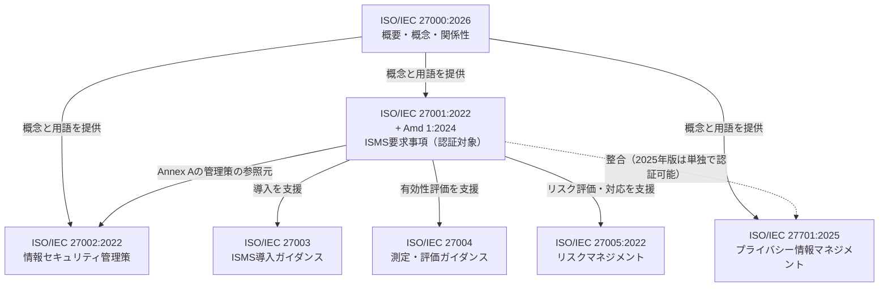
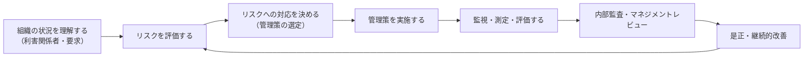
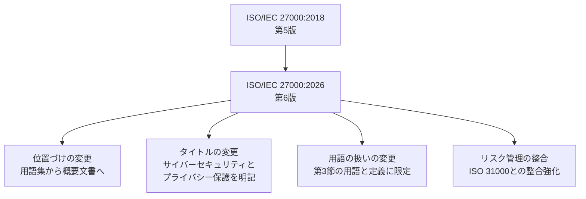
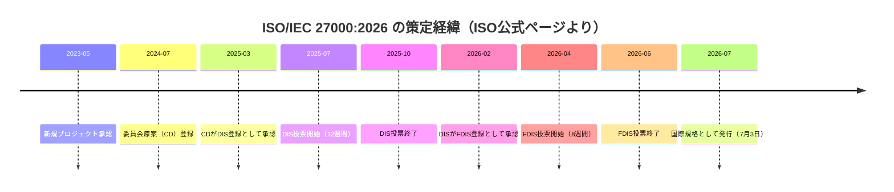
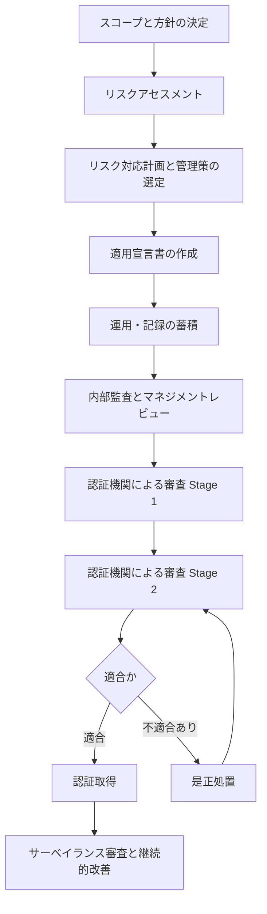
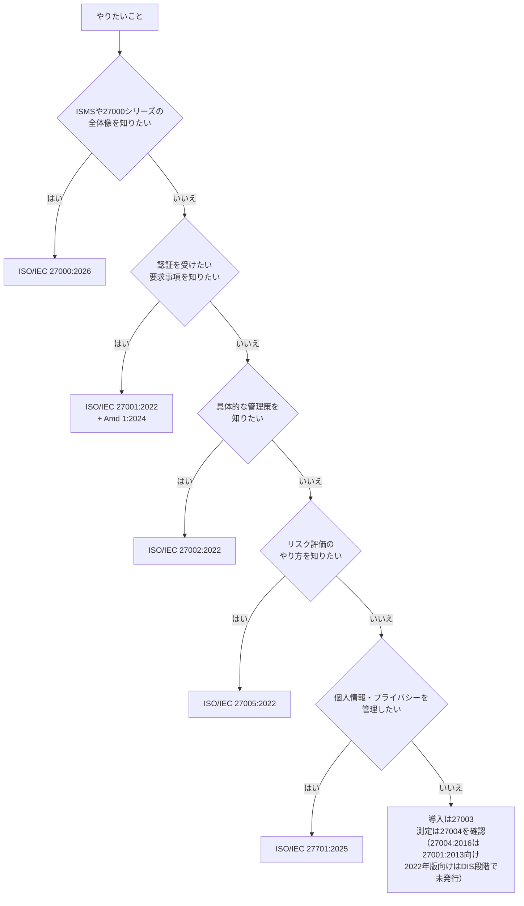

# ISO/IEC 27000:2026 初学者向けステップバイステップ解説ガイド

> **対象規格**: ISO/IEC 27000:2026（Information security, cybersecurity and privacy protection — Information security management systems — Overview）
> **情報確認日**: 2026年10月13日時点までに公開されている情報
> **想定読者**: ISMS・ISO/IEC 27000シリーズをこれから学ぶソフトウェアエンジニア／QAエンジニア

---

## 0. このガイドの読み方と前提

### 0-1. 情報の根拠について

| 区分 | 内容 |
|---|---|
| 一次情報 | ISO公式の規格ページ（エディション、発行日、ライフサイクル、FAQ） |
| 二次情報 | 認証機関（DQS）、ANSI、各社解説記事による変更点の整理 |
| 本文の未確認事項 | 規格本文は全11ページで、本ガイドは規格本文そのものを引用・転載していません。ISO公式ページと二次情報を自分の言葉で整理したものです |

> **注意**: ISOのサイトは、規格コンテンツのAI・機械学習用途での利用に制限を設けています（ISO Open dataを除く）。本ガイドは公開ページの要旨を再構成したもので、規格の条文は含みません。正式な解釈は必ず規格本文で確認してください。

### 0-2. 先に結論（3行サマリ）

1. **ISO/IEC 27000:2026は「認証用の規格」ではなく、ISMS規格群の地図（概要・概念・関係性）を示す入口の規格です。**
2. 2026年7月に**第6版**として発行され、2018年版（第5版）を置き換えました。**用語集中心の文書から、概要・概念・関係性を説明する文書へ**位置づけが変わっています。
3. 認証の対象は引き続き**ISO/IEC 27001**です。27000:2026の発行だけで、既存の27001認証の有効性が直接変わることはありません。

---

## Step 1. ISO/IEC 27000:2026とは何か

### 1-1. 基本情報

| 項目 | 内容 |
|---|---|
| 規格番号 | ISO/IEC 27000:2026 |
| タイトル | Information security, cybersecurity and privacy protection — Information security management systems — Overview |
| 版 | 第6版（Edition 6） |
| 発行日 | 2026年7月3日 |
| ステージ | 60.60（International Standard published） |
| 担当委員会 | ISO/IEC JTC 1/SC 27（情報セキュリティ、サイバーセキュリティ及びプライバシー保護） |
| ページ数 | 11ページ |
| 置き換え対象 | ISO/IEC 27000:2018（第5版、撤回済み） |
| ICS | 35.030（ITセキュリティ）、01.040.35（情報技術の用語） |
| 価格表示 | ISO公式ページ上ではCHF 0（ISOの規格ページ表示。入手可否は公式ページで確認してください） |

### 1-2. 一言でいうと

> **「ISMS関連の規格を使う前に、全体像と共通の考え方をそろえるための概説書」**

ISOのFAQでは、27000は要求事項規格ではなく、ISMSの概念・原則・関連規格の概観を示すもの、27001が要求事項を規定するものと整理されています。

### 1-3. 規格の種類で位置づけを理解する

| 種類 | 役割 | 例 | 認証の対象か |
|---|---|---|---|
| 概要・概念規格 | 全体像と用語・関係性の説明 | **ISO/IEC 27000** | いいえ |
| 要求事項規格 | 「やるべきこと」を定める | ISO/IEC 27001 | **はい** |
| ガイダンス規格 | 「どうやるか」の手引き | ISO/IEC 27002、27003、27004、27005 | いいえ |

---

## Step 2. ISO/IEC 27000ファミリーの全体像

### 2-1. 規格同士の関係図

### 2-2. 主要規格の一覧

| 規格 | 内容 | 現行版（確認できた範囲） | 役割 |
|---|---|---|---|
| ISO/IEC 27000 | ISMSの概要・概念 | **2026（第6版）** | 入口・地図 |
| ISO/IEC 27001 | ISMS要求事項 | 2022＋Amd 1:2024（気候変動対応の変更） | 認証対象 |
| ISO/IEC 27002 | 情報セキュリティ管理策 | 2022（93管理策、4テーマ） | 管理策の実装指針 |
| ISO/IEC 27003 | ISMS導入ガイダンス | 発行済み: 2017（ISO/IEC 27001:2013向け）／改訂中: 2022年版向けの改訂版は未発行（2026年10月13日確認時点のISO公式情報でDIS登録済み） | 導入手引き |
| ISO/IEC 27004 | 監視・測定・分析・評価 | 発行済み: 2016／改訂中: DIS段階（SCC規格データベースの記載） | 指標設計 |
| ISO/IEC 27005 | 情報セキュリティリスクマネジメント | 2022 | リスク評価手法 |
| ISO/IEC 27701 | プライバシー情報マネジメント（PIMS） | **2025（単独で認証可能）** | プライバシー |

> **確認のヒント**: 27003・27004の発行済み版は二次情報（presencis.com）、27003の改訂状況はISO公式情報（2026年10月13日確認）、27004の改訂状況は二次情報（SCC）に基づいています。**27003:2017はISO/IEC 27001:2013向けの手引きで、27001:2022向けの改訂版はまだ発行されていません。** 最新の状況はISO公式の各規格ページで確認してください。

### 2-3. 27002:2022の構造（参考）

27002:2022は、旧版の114管理策・14箇条から、**93管理策・4テーマ**へ再編されています。

| テーマ | 意味 |
|---|---|
| 組織的（Organizational） | 方針、役割、サプライヤ管理など |
| 人的（People） | 採用、教育、リモートワークなど |
| 物理的（Physical） | 施設、機器の保護など |
| 技術的（Technological） | アクセス制御、暗号、ログ、セキュアコーディングなど |

---

## Step 3. ISMSの基本概念をやさしく理解する

### 3-1. ISMSとは

**ISMS（Information Security Management System：情報セキュリティマネジメントシステム）** は、組織が情報セキュリティを**継続的に管理・改善する仕組み**です。単発のセキュリティ対策ではなく、**組織の運営の仕組み**として扱います。

### 3-2. 情報セキュリティの3要素と関連する属性

| 要素 | 意味 | 開発・QAでの例 |
|---|---|---|
| 機密性（Confidentiality） | 許可された人だけが情報にアクセスできる | アクセス制御、暗号化 |
| 完全性（Integrity） | 情報が正確で改ざんされていない | 入力検証、署名、ハッシュ |
| 可用性（Availability） | 必要なときに情報を使える | 冗長化、バックアップ、障害対応 |

2026年版の公開定義（3.1）が定義する情報セキュリティは、上記のCIAの維持です。これとは別に、**真正性（Authenticity）・責任追跡性（Accountability）・否認防止（Non-repudiation）** は、ISO/IEC 27000:2018でも情報セキュリティに関係し得る属性として示されている一般的な属性です。2026年版で新たに追加された要素ではありません。

| 関連する属性（CIAとは区別） | 意味 | 開発・QAでの例 |
|---|---|---|
| 真正性 | 情報や主体が本物であること | 認証、証明書、署名検証 |
| 責任追跡性 | 操作を特定の主体に結びつけられること | 監査ログ、操作履歴 |
| 否認防止 | 行為を後から否認できないこと | 電子署名、改ざん防止ログ |

### 3-3. ISMSの回り方（継続的改善）

> **ポイント**: ISMSの中心は**リスクベースの考え方**です。「全部対策する」のではなく、リスクを評価して**優先順位をつけ、必要な管理策を選ぶ**流れです。

### 3-4. 基本用語ミニ辞典（一般的な理解の整理）

| 用語 | 初学者向けの説明 |
|---|---|
| ISMS | 情報セキュリティを継続管理する仕組み |
| リスク | 目的の達成に影響する不確かさ。脅威×脆弱性×影響のイメージ |
| 管理策（Control） | リスクを維持または変更するための手段。リスクを減らす対策はその一例 |
| 適用宣言書（SoA） | どの管理策を採用／除外したか、その理由を示す文書（27001の要求事項） |
| 内部監査 | 自社でISMSが機能しているか確認する活動 |
| マネジメントレビュー | 経営層によるISMSの見直し |
| 認証 | 第三者（認証機関）が27001への適合を審査し証明すること |

---

## Step 4. 2018年版から2026年版への変更点

### 4-1. 変更の全体像

### 4-2. 比較表

| 観点 | 2018年版（第5版） | 2026年版（第6版） |
|---|---|---|
| タイトル | Information technology — Security techniques — ISMS — Overview and vocabulary | Information security, cybersecurity and privacy protection — ISMS — Overview |
| 主目的 | 概要と用語集 | **概要・概念・関係性の説明** |
| 用語の扱い | 規格本文に用語を集約 | 用語と定義は**第3節（Terms and definitions）**に掲載。従来の大規模な用語集は廃止され、この規格で使う用語に限定（ISO27001security.comの構成解説。正式な目次はISO公式で確認） |
| 情報セキュリティの定義 | CIAの維持（真正性・責任追跡性・否認防止などは関係し得る属性として注記） | CIAの維持（公開定義3.1）。真正性・責任追跡性・否認防止は2026年版の新規追加ではない |
| リスク管理 | ― | **ISO 31000との整合**を強化（DQS解説） |
| 文書の性格 | ― | ISO/IEC Directives Part 1に基づく**水平文書（horizontal document）** |

### 4-3. 変更が意味すること

| 変更 | 実務への意味 |
|---|---|
| タイトルから「Information technology」「Security techniques」が外れた | ISMSをIT部門の技術論ではなく、**組織全体のガバナンス**として扱う流れ（DQSの解釈） |
| 大規模な用語集の廃止 | 各用語の正式な定義は、ISO Online Browsing Platform（OBP）などで確認する（ISO27001security.com） |
| ISO 31000との整合 | 品質・環境・労働安全など他のマネジメントシステムと**共通のリスク言語**で扱いやすくなる |

> **補足**: 上記の「意味合い」は認証機関による解釈を含みます。規格本文の記述と区別して読んでください。

### 4-4. 発行までのタイムライン

欧州では、**EN ISO/IEC 27000:2026が2026年7月15日に採択**され、EN ISO/IEC 27000:2020を置き換えたと報告されています（DQS）。

---

## Step 5. ISO/IEC 27001との関係と認証

### 5-1. よくある疑問（FAQ）

| 質問 | 回答 |
|---|---|
| 27000は要求事項規格か | **いいえ**。概要・概念・関連規格の説明です |
| 27000で認証を受けられるか | **いいえ**。認証は27001に対して行われます |
| 27000:2026の発行で27001の認証は無効になるか | **いいえ**。直接の影響はありません |
| 27001は改訂されるか | 27000が共通の概念・用語を提供するため、27001や27002などは**段階的に整合していく見込み**（DQSの見解。具体的な改訂時期は公式情報を確認） |
| 27001の現行版は | 27001:2022＋Amd 1:2024。2013年版からの移行期限は**2025年10月31日**でした |

### 5-2. 27001:2022 Amd 1:2024（気候変動対応）

2024年2月に発行されたAmd 1は、**気候変動に関する考慮事項**を27001に追加する修正です。既存の27001:2022に適用されます。

### 5-3. 27701:2025の位置づけ

2025年10月に発行された27701:2025は、2019年版の「27001・27002の拡張」から、**単独で実施・認証できるPIMS規格**へ変わりました。27001を先に認証する必要はありません。ただし、27001:2022・27002:2022との整合は保たれています。

### 5-4. 認証までの流れ（27001の場合）

> 27000は、この流れの**どこにも登場しない「前提知識の規格」**です。審査対象にならないことを覚えておきましょう。

---

## Step 6. 「どの規格を読めばよいか」の判断フロー

> **27003を読む際の注意**: 現在発行済みのISO/IEC 27003:2017は**ISO/IEC 27001:2013向け**の導入ガイダンスです。27001:2022向けの改訂版は**未発行**のため、条項番号や附属書Aの管理策は27001:2022・27002:2022と照らし合わせて読んでください。

---

## Step 7. 開発・QA現場への落とし込み（筆者による整理）

> この章は、規格の記載ではなく、**エンジニア視点での活用アイデア**です。

### 7-1. 概念と現場活動の対応

| 規格の概念 | 開発・QAでの具体例 |
|---|---|
| 機密性 | 認可テスト、シークレット管理のレビュー、ログへの個人情報混入チェック |
| 完全性 | 入力検証テスト、データ整合性テスト、成果物の署名検証 |
| 可用性 | 障害注入テスト、復旧手順テスト、バックアップのリストア検証 |
| 責任追跡性 | 監査ログの出力項目・保持期間・改ざん耐性の確認 |
| 否認防止 | 重要操作の署名・タイムスタンプ付与の検証 |
| 監視・測定 | 脆弱性対応リードタイム、テスト実施率などの指標設計 |
| 継続的改善 | 振り返りからの是正、パイプラインへのセキュリティテスト追加 |

### 7-2. 最初の一歩（推奨アクション）

| 順番 | アクション |
|---|---|
| 1 | ISO公式ページで27000:2026の入手可否を確認し、全体像をつかむ |
| 2 | 自組織が27001認証を持つか、目指すかを確認する |
| 3 | 27002の4テーマと、自分の担当領域（主に技術的テーマ）を対応づける |
| 4 | 監査ログや証跡の設計が責任追跡性・否認防止に耐えるか点検する |
| 5 | 他のマネジメントシステムとのリスク評価基準の違いを確認する |

---

## Step 8. 理解度チェック

| # | 問い | 答え |
|---|---|---|
| 1 | 27000:2026は認証の対象か | いいえ。認証対象は27001 |
| 2 | 27000:2026は第何版で、いつ発行されたか | 第6版、2026年7月3日 |
| 3 | 2026年版で位置づけはどう変わったか | 用語集中心から、概要・概念・関係性の説明へ |
| 4 | 2026年版のタイトルに初めて入った語は | Cybersecurity、Privacy protection（DQSの記載） |
| 5 | 27001の気候変動対応の修正は何年か | 2024年（Amd 1:2024） |
| 6 | 27701:2025の大きな変更は | 27001に依存せず単独で認証可能になった |

---

## 付録A. 情報源URL一覧

### A-1. 一次情報（ISO公式）

| 内容 | URL |
|---|---|
| ISO/IEC 27000:2026 規格ページ（エディション、ライフサイクル、FAQ） | https://www.iso.org/standard/27000 |
| ISO/IEC 27001:2022/Amd 1:2024（気候変動対応） | https://www.iso.org/standard/88435.html |
| ISO/IEC DIS 27003（ISO/IEC 27001:2022向けの改訂版。2026年10月13日確認時点でDIS登録済み・未発行） | https://www.iso.org/standard/85919.html |

### A-2. 認証機関・標準化団体による解説（二次情報）

| 内容 | URL |
|---|---|
| DQS：27000:2026の主要変更点（タイトル、定義拡張、ISO 31000整合、EN採択日） | https://www.dqsglobal.com/en/explore/blog/iso-iec-27000-2026-released |
| ISO27001security.com：27000:2026の構成（第3節 用語と定義、第4節 概念と原則、第5節 関連規格）と用語集の廃止 | https://www.iso27001security.com/html/27000 |
| ANSI Blog：27000:2026の概要と水平文書としての位置づけ | https://blog.ansi.org/ansi/iso-iec-27000-2026-isms-overview/ |
| Certifico：27000:2026の変更点（構造変更）と発行日 | https://certifico.com/normazione/documenti-riservati-normazione/organismi-normazione/documenti-iso/iso-iec-27000-2026 |
| DQS：ISO 27001の現行版と移行期限 | https://www.dqsglobal.com/en/explore/dqs-knowledge-center/iso-27001-explained |
| EVS：EN ISO/IEC 27001:2023+A1:2024（27002、27005との関連） | https://www.evs.ee/en/evs-en-iso-iec-27001-2023-a1-2024-consolidated |
| Presencis：27000ファミリー一覧（27001、27002、27003、27004、27005） | https://presencis.com/regulations/iso-27001/documents/ |
| ISO27001security.com：27003改訂（27003:2017は27001:2013向け。同サイトの2025年12月時点の記載ではCD段階で、2026年10月13日確認時点のISO公式情報ではDIS登録済み） | https://www.iso27001security.com/post/iso-iec-27003-revision |
| SCC（カナダ規格評議会）：ISO/IEC DIS 27004の登録 | https://scc-ccn.ca/standardsdb/standards/8193369 |

### A-3. ISO/IEC 27701:2025 関連

| 内容 | URL |
|---|---|
| Amtivo：27701:2025の発行日（2025年10月14日）と単独認証化 | https://amtivo.com/uk/standards/iso-27701/insights/what-you-need-to-know-about-the-updated-privacy-standard/ |
| Scrut：27701:2025の主要変更点 | https://www.scrut.io/post/new-iso-iec-27701-2025 |
| Kiwa：27701:2025の発行と独立規格化 | https://www.kiwa.com/nl/en-nl/areas-of-expertise/cyber-security/news/isoiec-277012025-published-updated-privacy-standard-offers-organizations-more-guidance/ |
| Wikipedia：ISO/IEC 27701の概要と経緯 | https://en.wikipedia.org/wiki/ISO/IEC_27701 |

---

## 付録B. 本ガイドの限界と注意点

| 項目 | 内容 |
|---|---|
| 個人開発者の投稿 | 27000:2026は2026年7月発行の新しい規格のため、著名な個人開発者による詳細な解説投稿は今回の検索では確認できませんでした。代わりに、認証機関・標準化団体・コンプライアンス企業の解説を参照しています |
| 二次情報の解釈 | 「ガバナンスへの移行」「ISO 31000整合の実務効果」などは認証機関の解釈を含みます |
| 規格本文の逐条確認 | 全11ページの規格本文は逐条では確認していません。条文の直接引用は含みません。公開されている定義の番号（例: 3.1）は、出典の位置を示すために必要に応じて記載しています |
| 版の変動 | 27003・27004などの現行版は、ISO公式の各ページで最新状況を確認してください |
| 入手性 | 27000の入手条件（無償か否か）は、ISO公式ページの最新表示を確認してください |
