# ISO/IEC 29100:2024 プライバシーフレームワーク 初学者向けステップバイステップ解説ガイド

> **対象規格**: ISO/IEC 29100:2024 — Information technology — Security techniques — Privacy framework（Edition 2）
> **調査基準日**: 2026年10月14日（この日までに確認できたウェブ情報に基づく）
> **想定読者**: プライバシーやISO規格に初めて触れるソフトウェアエンジニア、QAエンジニア、セキュリティ担当、プロダクト担当
> **言語方針**: 日本語中心。技術用語は英語を併記（例: PII、PII controller）
> **出典の見方**: 本文中の `[S1]` のような記号は、末尾「[参考文献と出典URL](#step-14-参考文献と出典url)」の番号に対応します

---

## 目次

- [0. このガイドの読み方](#0-このガイドの読み方)
- [Step 1. ISO/IEC 29100 とは何か](#step-1-isoiec-29100-とは何か)
- [Step 2. 2011年版から2024年版への変更点](#step-2-2011年版から2024年版への変更点)
- [Step 3. 規格の全体像（6つの構成要素）](#step-3-規格の全体像6つの構成要素)
- [Step 4. 最低限おぼえる用語](#step-4-最低限おぼえる用語)
- [Step 5. 登場人物と役割（Actors and roles）](#step-5-登場人物と役割actors-and-roles)
- [Step 6. PII を見分ける（Recognizing PII）](#step-6-pii-を見分けるrecognizing-pii)
- [Step 7. プライバシー保護要件・ポリシー・コントロール](#step-7-プライバシー保護要件ポリシーコントロール)
- [Step 8. 11のプライバシー原則](#step-8-11のプライバシー原則)
- [Step 9. 開発・QAの現場に落とし込む](#step-9-開発qaの現場に落とし込む)
- [Step 10. 関連規格・フレームワークとの関係](#step-10-関連規格フレームワークとの関係)
- [Step 11. 導入ロードマップ](#step-11-導入ロードマップ)
- [Step 12. よくある誤解](#step-12-よくある誤解)
- [Step 13. 理解度チェック](#step-13-理解度チェック)
- [Step 14. 参考文献と出典URL](#step-14-参考文献と出典url)
- [付録. 用語集（英日対応）](#付録-用語集英日対応)

---

## 0. このガイドの読み方

### 0.1 読み終えたらできるようになること

1. ISO/IEC 29100 が「何を決めている規格で、何を決めていないか」を説明できる
2. PII principal / PII controller / PII processor / third party を、自社のシステムに当てはめて区別できる
3. ある情報が PII かどうかを、判断の手順に沿って説明できる
4. 11のプライバシー原則を、開発・テストの具体的な作業に結びつけられる
5. ISO/IEC 27001、27701、29134、NIST Privacy Framework などとの関係を整理できる

### 0.2 前提知識

- 必須の前提知識はありません。情報セキュリティの基礎（機密性・完全性・可用性）を知っていると理解が早くなります
- 法律の専門知識は不要ですが、本ガイドは**法的助言ではありません**。法令対応は必ず専門家に確認してください

### 0.3 本ガイドの位置付け（著作権への配慮）

- ISO/IEC 29100 の本文は ISO/IEC の著作物です。本ガイドは規格本文を転載せず、**要点を独自の言葉で要約・解説**しています
- 条番号は **2024年版（Edition 2）** のものです。2011年版とは番号が異なる箇所があります（[Step 2](#step-2-2011年版から2024年版への変更点)）
- 正確な要求事項や用語の定義は、必ず原文で確認してください。ISO の規格ページでは、2026年10月14日時点で価格が CHF 0 と表示されていました [S1]。国際エディター本人も、無償で読めることを案内しています [S7]

### 0.4 学習の流れ

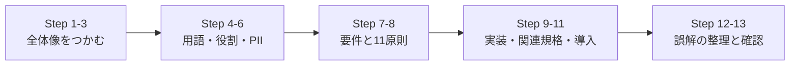

---

## Step 1. ISO/IEC 29100 とは何か

### 1.1 一言でいうと

**「個人を特定できる情報（PII）を扱う ICT システムで、プライバシーを守るための"共通言語・登場人物・考え方（原則）"をそろえるための地図」** です。

規格自身は、次の4つを提供すると述べています [S1]。

| 提供するもの | 意味 |
|---|---|
| 共通のプライバシー用語 | 関係者が同じ言葉で話せるようにする |
| 登場人物と役割の定義 | 誰が PII をどう扱う立場かを明確にする |
| プライバシー保護の検討事項 | 何を考慮して要件を決めるかを示す |
| 既知のプライバシー原則への参照 | 国際的に共有された考え方（11原則）を示す |

### 1.2 基本情報

| 項目 | 内容 | 出典 |
|---|---|---|
| 規格番号 | ISO/IEC 29100:2024 | [S1] |
| 正式名称 | Information technology — Security techniques — Privacy framework | [S1] |
| 版 | Edition 2（第2版） | [S1] |
| 発行 | 2024年2月（ステージ 60.60 は 2024-02-16） | [S1][S4] |
| ページ数 | 22ページ | [S1][S5] |
| 担当委員会 | ISO/IEC JTC 1/SC 27（Information security, cybersecurity and privacy protection） | [S1] |
| ICS | 35.030（IT Security） | [S1] |
| 置き換えた規格 | ISO/IEC 29100:2011 および Amd 1:2018（いずれも Withdrawn） | [S1][S5] |
| 言語 | English | [S1] |
| 価格表示 | CHF 0（2026-10-14 時点の ISO 規格ページの表示） | [S1] |
| 日本語版（JIS） | JIS X 9250:2017（2011年版に基づく）。2024年版に対応する JIS 案が JSA に掲載 | [S8][S9] |

### 1.3 この規格が「ある」ことの意味

規格の序文は、次のような背景を挙げています [S3]（要約）。

- PII の商業的な価値が高まり、国境を越えた共有も増え、ICT システムも複雑になった
- その結果、組織がプライバシーを確保し、各国の法令に対応することが難しくなった
- そこで、PII 保護について**共通の理解**を持てる国際的な標準が必要になった

### 1.4 この規格は「何ではないか」

| よくある期待 | 実際 |
|---|---|
| 法律である | **法律ではありません**。国際規格（任意の枠組み）です。各国の法令（GDPR、日本の個人情報保護法など）は別に存在します |
| 認証を取れる規格である | **認証用の要求事項規格ではありません**。高水準のフレームワークで、用語と原則を示す文書です。認証の対象になるのは、たとえば ISO/IEC 27701 のようなマネジメントシステム規格です [S13][S14] |
| 具体的な技術対策を指定する | 指定しません。「どんな暗号方式を使うか」などは決めず、考え方と観点を示します |
| セキュリティ規格と同じ | 同じではありません。ISO/IEC 27001 などのセキュリティ規格に**プライバシーの視点を足す**ためのものです [S3] |

### 1.5 誰のための規格か

規格の適用対象は、PII のプライバシー対策が必要な ICT システムやサービスについて、**仕様策定、調達、アーキテクチャ設計、設計、開発、テスト、保守、管理、運用に関わる個人と組織**です [S1]。つまり開発者もQAも対象です。

| 役割 | この規格の使いどころ |
|---|---|
| プロダクト担当 | 収集する情報・目的・同意の設計（原則1〜4） |
| アーキテクト | 役割（controller / processor）と PII の流れの設計（Step 5） |
| 開発者 | 最小収集、保持期間、アクセス制御、削除機能の実装（原則3〜6、10） |
| QA | 同意撤回・削除・開示請求・ログ内の PII などのテスト（Step 9） |
| セキュリティ担当 | 統制の選定とリスク評価（原則10、Step 7） |
| 調達・法務 | 委託先・第三者との契約条件（原則9、Step 5） |

### 1.6 版の履歴

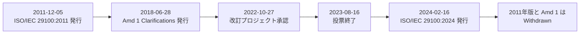

出典: [S1][S4][S5]

---

## Step 2. 2011年版から2024年版への変更点

### 2.1 結論: 「小幅な改訂」

2024年版は、2011年版を**小幅に修訂**し、Amd 1:2018 の内容も取り込んだ版と説明されています [S6]。11原則を中心とした枠組み自体は維持されています。

### 2.2 確認できた変更点

| # | 変更点 | 内容 | 出典 |
|---|---|---|---|
| 1 | 版の統合 | 2011年版と Amd 1:2018 を一本化した | [S1][S6] |
| 2 | 引用規格の条を追加 | Clause 2（Normative references）が追加された（記載は「引用規格なし」） | [S3] |
| 3 | 用語の置き換え | Clause 3 で "secondary use" が "secondary purpose" に置き換えられた | [S3] |
| 4 | 相互参照の更新 | 文書全体の相互参照が更新された | [S3] |
| 5 | 参考文献の更新 | Bibliography が更新された（ISO/IEC 27001、27002、27701 などを列挙） | [S3] |
| 6 | 条番号の繰り下がり | Clause 2 の追加により、「基本要素」が 4→5、「原則」が 5→6 になった（2011年版の目次との比較） | [S3] |

> 補足: 2011年版の目次では「4.4.3 Information which is or **might** be linked to a PII principal」でしたが、2024年版は「5.4.4 … or **can** be linked …」と表現が改められています [S3]。内容の本質は同じ方向ですが、引用する際は2024年版の表現を使うと安全です。

### 2.3 実務への影響

| 影響 | 対応 |
|---|---|
| 社内文書が「2011年版の条番号」を引用している | 2024年版の番号に更新する（原則の章は 5→6） |
| 用語 "secondary use" を使っている | 規格に合わせるなら "secondary purpose"（別の目的での利用）に寄せる |
| JIS X 9250:2017 を参照している | 2011年版に基づく内容。2024年版との差分を確認する [S9] |
| 11原則の運用ルールが既にある | 原則の名称・枠組みは維持されているため、大きな作り直しは通常不要 |

---

## Step 3. 規格の全体像（6つの構成要素）

### 3.1 構成要素

規格の Clause 5 は、プライバシーフレームワークを次の6つの構成要素で説明します [S3]。

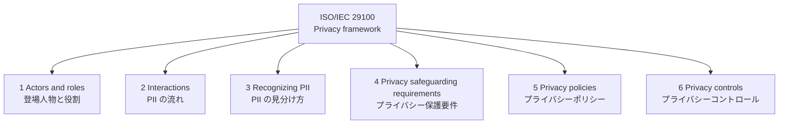

| # | 構成要素 | 一言でいうと | 2024年版の条 | 本ガイド |
|---|---|---|---|---|
| 1 | Actors and roles | PII を扱う4種類の主体 | 5.2 | Step 5 |
| 2 | Interactions | 主体間の PII の流れ（8つのシナリオ） | 5.3 | Step 5 |
| 3 | Recognizing PII | 何が PII かを判断する視点 | 5.4 | Step 6 |
| 4 | Privacy safeguarding requirements | 何を守らねばならないかの要因 | 5.5 | Step 7 |
| 5 | Privacy policies | 組織が定める方針 | 5.6 | Step 7 |
| 6 | Privacy controls | 要件を満たすための対策 | 5.7 | Step 7 |

そのうえで、Clause 6 が **11のプライバシー原則** を示します（[Step 8](#step-8-11のプライバシー原則)）。付録 Annex A（参考）は、29100 の概念と ISO/IEC 27000 ファミリーの概念の対応表です [S3]。

### 3.2 規格全体の構造（目次）

| Clause | タイトル | 内容 |
|---|---|---|
| Introduction | 序文 | 背景と目的 |
| 1 | Scope | 適用範囲 |
| 2 | Normative references | 引用規格（なし） |
| 3 | Terms and definitions | 用語と定義（3.1〜3.24） |
| 4 | Abbreviated terms | 略語（ICT、PET、PII） |
| 5 | Basic elements of the privacy framework | 基本要素（5.1〜5.7） |
| 6 | The privacy principles of this document | 11原則（6.1〜6.12） |
| Annex A | 29100 と 27000 ファミリーの概念対応 | 参考 |
| Bibliography | 参考文献 | 関連規格の一覧 |

出典: [S3]

### 3.3 学習のコツ

- まず **Step 5（役割）と Step 6（PII）** を理解すると、他の部分が読みやすくなります
- 原則（Step 8）は暗記ではなく、「PII のライフサイクルのどこで効くか」で整理すると定着します

---

## Step 4. 最低限おぼえる用語

規格の Clause 3 には24の用語が定義されています [S3]。ここでは初学者がまず押さえるべきものを、独自の言葉で説明します（正確な定義は原文で確認してください）。

### 4.1 中核となる用語

| 用語 | やさしい説明 | 補足 |
|---|---|---|
| **PII**（personally identifiable information） | 特定の個人と結びつけられる、または結びつく可能性のある情報 | 「特定できる」だけでなく「結びつく可能性がある」も含む広い定義 |
| **PII principal** | その PII が誰についての情報かという、**本人**（自然人） | 一般に data subject と同義として扱われる |
| **PII controller** | PII を**何のために（目的）どうやって（手段）**処理するかを決める主体 | 個人的な目的で使う自然人は含まない |
| **PII processor** | controller の**指示に従って**PII を処理する主体 | 委託先など。責任の所在は controller に残る |
| **Third party** | 本人・controller・processor 以外の主体（controller または processor の直接の権限下で PII を処理する自然人は含まない） | 受け取った後に自分で目的を決めれば controller になり得る |
| **Privacy stakeholder** | PII の処理に関する判断や活動の影響を与える・受ける・受けると感じる、あらゆる主体 | 個人、法人、公的機関など |
| **Processing of PII** | PII に対するあらゆる操作 | 収集、保管、変更、検索、開示、匿名化、仮名化、削除、廃棄などを含む |

### 4.2 同意・選択に関する用語

| 用語 | やさしい説明 |
|---|---|
| **Consent** | 本人が自由に、具体的に、十分な情報を得たうえで、処理に同意すること |
| **Opt-in** | 本人が事前に**自ら行動して**同意を表明する方式 |
| **Opt-out** | 本人が**別の行動をとって**、同意を差し控える・同意を撤回する・処理に反対する方式。controller に処理する権利があることが前提 |
| **Privacy preference** | 特定の目的について、本人が示す PII の扱い方への選択 |

### 4.3 データの加工に関する用語

| 用語 | やさしい説明 | 重要ポイント |
|---|---|---|
| **Pseudonymization**（仮名化） | 識別情報を別名（alias）に置き換える処理 | **リンク可能性が残る**。別名と対応表を持つ者は本人を特定できる |
| **Anonymization**（匿名化） | 本人を、controller 単独でも他者との協力でも、特定できないよう**不可逆に**変える処理 | 匿名化されたデータは PII ではなくなる |
| **Anonymity** | 本人が直接にも間接にも特定されない性質 | |
| **Identifiability** | 与えられた PII から本人が特定され得る状態 | |
| **Sensitive PII** | 本人の最も私的な領域に関わる、または本人に重大な影響を与え得る PII | 例は Step 6 |
| **PET**（privacy enhancing technology） | PII を減らしたり、不要な処理を防いだりして、機能を損なわずにプライバシーを守る ICT 上の対策 | 匿名化・仮名化・マスキングのツールなど |

### 4.4 リスクと統制に関する用語

| 用語 | やさしい説明 |
|---|---|
| **Privacy risk** | プライバシーに対する「不確かさの影響」。ISO 31000 のリスクの考え方をプライバシーに当てはめたもの |
| **Privacy breach** | PII が、関連する保護要件に違反して処理された状況（漏えいだけを指さない） |
| **Privacy safeguarding requirement** | PII を処理する組織が、保護のために考慮すべき要件 |
| **Privacy control** | プライバシーリスクの可能性や影響を減らす措置（組織的・物理的・技術的を含む） |
| **Privacy policy** | PII の処理に関して、controller が正式に示す意図・方向性・規則・コミットメント |
| **PIA / privacy risk assessment** | PII 処理が個人に与える影響を、特定・分析・評価・協議・伝達・対応計画までの一連の流れで扱うプロセス |
| **Privacy principle** | ICT システムで処理される PII の保護に関する、共有された価値 |

> **注意**: 「Privacy breach」は個人情報の「漏えい」より広い概念です。たとえば、同意の範囲を超えて目的外に使うことも、保護要件に違反する処理であれば privacy breach になり得ます。

---

## Step 5. 登場人物と役割（Actors and roles）

### 5.1 4種類の主体

規格は、PII の処理に関わる主体を次の4種類に分けます（5.2）[S3]。

| 主体 | 役割 | 具体例（ECサイトの場合） |
|---|---|---|
| **PII principal** | 自分の PII を提供し、同意や privacy preference を示す本人 | 購入者 |
| **PII controller** | 処理の目的と手段を決め、プライバシー原則の遵守を確保する | ECサイトの運営会社 |
| **PII processor** | controller の指示に従い、決められた要件と統制のもとで処理する | 配送管理の委託先、クラウド基盤、決済代行（契約内容による） |
| **Third party** | controller や processor から PII を受け取るが、controller のために処理するわけではない（controller または processor の直接の権限下で処理する自然人は第三者に含まれない） | 広告配信パートナー、提携先企業 |

ポイント:

- 同じ PII の集合について **controller が複数**いることもあります。その場合は協力して、原則が守られるよう必要な取り決めをする必要があります [S3]
- controller は、sensitive PII を扱っていないかを慎重に評価し、リスク評価で見つかった本人への悪影響に対して適切な統制を実施することが期待されます [S3]
- processor は、契約で拘束される法域もあります [S3]

### 5.2 PII の流れ（Interactions）：8つのシナリオ

規格は、PII の流れを a〜h の8シナリオで整理しています（5.3）[S3]。

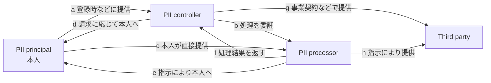

| シナリオ | 提供する側 | 受け取る側 | 例 |
|---|---|---|---|
| a | 本人 | controller | サービス登録で情報を入力 |
| b | controller | processor | 業務委託で顧客データを渡す |
| c | 本人 | processor | 委託先が運営する入力フォームに本人が入力 |
| d | controller | 本人 | 本人からの請求に応じて自分のデータを開示 |
| e | processor | 本人 | controller の指示で、委託先が本人へデータを送る |
| f | processor | controller | 委託業務の完了後に結果を返す |
| g | controller | third party | 事業契約に基づく提供 |
| h | processor | third party | controller の指示で第三者へ提供 |

### 5.3 processor と third party の違いが大切な理由

規格は、この2つを区別する必要がある理由を次のように説明しています [S3]（要約）。

- PII が **processor** に渡っても、法的な管理は元の controller に残る
- **third party** は、PII を受け取った時点で、自ら目的を決めれば**独自の controller になり得る**
- 例: 第三者が受け取った PII を、さらに別の主体へ移転すると決めたなら、その時点で controller として行動しており、もはや third party ではない

実務的には、「委託先」と「提供先」を契約上も運用上も別に扱うことの根拠になります。

### 5.4 自社はどの役割か？（判断フロー）

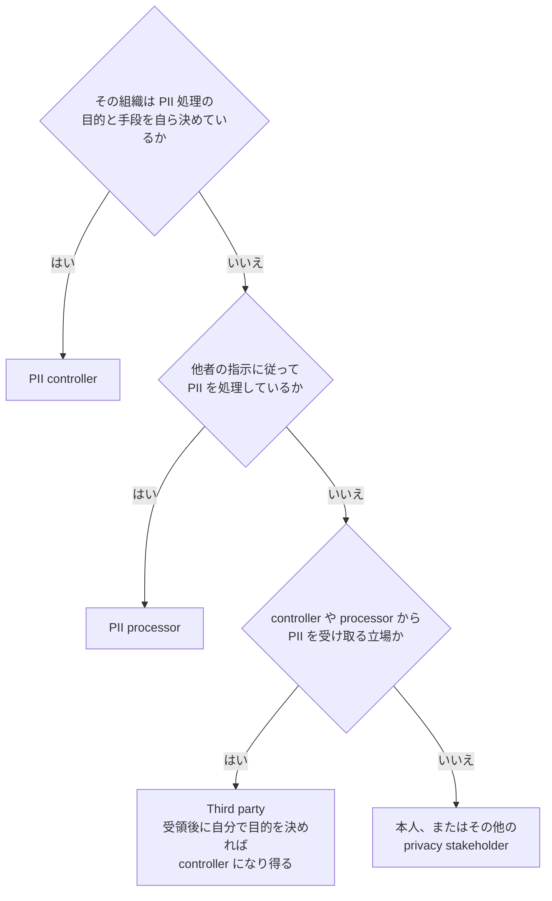

> **現場での注意**: 1つの組織が、サービスや業務ごとに役割を使い分けることがあります（ある業務では controller、別の業務では processor）。**システム単位ではなく「処理単位」**で役割を整理しましょう。

### 5.5 開発者が最初にやること

- システムのデータフロー図に、各接続先の**役割（controller / processor / third party）**を書き込む
- 委託先・SaaS・SDK・広告タグ・分析ツールが、どの区分に当たるかを一覧にする
- 区分ごとに、契約・通知・同意・セキュリティ要件が変わることを確認する

---

## Step 6. PII を見分ける（Recognizing PII）

### 6.1 基本の考え方

PII かどうかの判断は、「名前があるか」だけでは決まりません。規格は、**データを持つ主体、または他の誰かが、合理的に使い得るあらゆる手段**を考慮して、自然人が特定可能かを判断するよう求めています（5.4.1）[S3]。さらに、ICT システムは、本人がそのような PII を認識でき、共有に対して適切な管理を持てる仕組みを支えるべきだとされています [S3]。

### 6.2 判断フロー

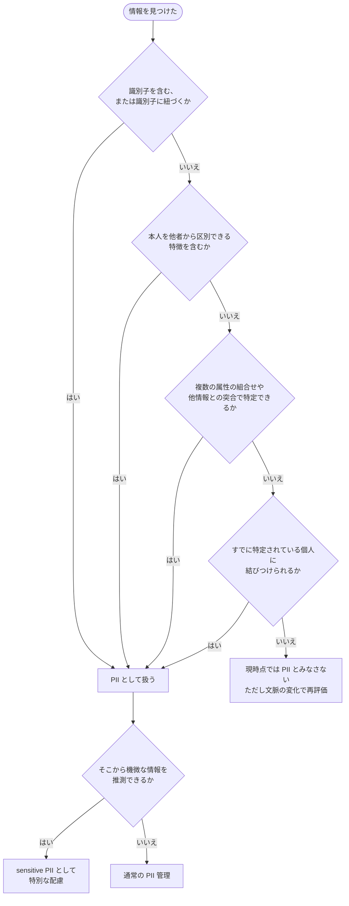

### 6.3 5.4 の7つの視点

| 条 | 視点 | 要点 | 開発での具体例 |
|---|---|---|---|
| 5.4.2 | **Identifiers**（識別子） | 本人を直接指す識別子、関連づけられる識別子、連絡手段になる識別子、それらへの参照を含む情報は PII になり得る | 氏名、社会保障番号、パスポート番号、口座番号、電話番号、正確な位置情報、ユーザーID |
| 5.4.3 | **Other distinguishing characteristics**（その他の区別できる特徴） | 識別子がなくても、本人を他者から区別する特徴があれば PII。単独で一意でなくても**属性の組合せ**で特定できる場合がある | 生体情報。社内なら「女性・45歳・弁護士」の組合せで特定できる、など |
| 5.4.4 | **Information which is or can be linked**（結びつく情報） | 特定の個人と関係づけられるなら、その人についての情報は PII として扱う | 病歴、金融プロファイル、閲覧履歴から得られる関心 |
| 5.4.5 | **Pseudonymous data**（仮名データ） | 別名に置換した情報。**リンク可能性は残る** | ハッシュ化したユーザーID、トークン化した顧客番号 |
| 5.4.6 | **Metadata**（メタデータ） | 利用者に見えない形で保存された PII | 文書プロパティの作成者名、変更履歴、コメント、画像の EXIF |
| 5.4.7 | **Unsolicited PII**（求めていない PII） | 意図せず取得した PII | 匿名フィードバックフォームに書かれた個人情報。設計時の配慮（privacy by design）でリスクを下げる |
| 5.4.8 | **Sensitive PII**（機微な PII） | そこから機微な情報を**推測**できる PII も含めて、特別な注意が必要 | 処方箋から健康状態を推測できる、など |

### 6.4 文脈によって変わる判断

- **同じ属性でも、範囲によって識別力が変わります**。たとえば姓は、世界規模では個人を特定できなくても、会社規模では特定できることがあります [S3]
- 判断は、ドメインや利用文脈に依存します。**一度決めて終わりにせず**、システムの利用範囲が変わったら見直します

### 6.5 PII の例（規格が挙げる属性の整理）

規格の Table 2 は、PII になり得る属性を例示しています（informative）[S3]。ここではカテゴリで整理します。

| カテゴリ | 例 |
|---|---|
| 基本的な識別情報 | 氏名、生年月日、性別、住所、個人のメールアドレス、電話番号 |
| 公的・金融の番号 | 国の識別番号（パスポート番号等）、口座番号、クレジットカード番号、PIN・パスワード |
| 位置・通信 | GPS 位置、GPS の軌跡、通信システム由来の位置情報、IP アドレス |
| 画像・生体 | 個人が特定できる写真・動画、生体識別子 |
| 行動・嗜好 | ウェブサイトの追跡から得られる関心、行動プロファイル、商品・サービスの嗜好 |
| 健康・福祉 | 医療履歴、診断情報、障害、診療費の請求 |
| 雇用・財務 | 従業員の給与や人事ファイル、請求書（公共料金など）、財務プロファイル |
| 法的な事項 | 犯罪の嫌疑、刑事の有罪判決・犯罪事実、捜査報告 |
| 機微な属性 | 人種・民族的出自、宗教・哲学的信条、性的指向、労働組合への加入 |

### 6.6 開発現場で見落としやすい PII

| 場所 | 見落とし例 | 対策の方向性 |
|---|---|---|
| アプリケーションログ | リクエストボディ、クエリ文字列、例外メッセージに氏名やメールが含まれる | ログの出力項目を allow-list 化、マスキング |
| アクセスログ | IP アドレス、ユーザーID、位置情報 | 保持期間と用途を定義 |
| 分析・計測 SDK | 端末ID、広告ID、行動履歴 | 第三者提供の有無と同意の確認 |
| ファイル | 画像の EXIF（位置情報）、文書の作成者・変更履歴 | 公開前にメタデータを除去 |
| テスト環境 | 本番データのコピー | 匿名化・合成データの利用 |
| バックアップ | 削除済みデータが残る | 保持期間と削除の方針に含める |
| 自由記述欄 | 利用者が書き込む想定外の PII | 入力ガイド、検知、保持期間の短縮 |

### 6.7 仮名化と匿名化の違い

規格は、仮名化と匿名化を明確に区別します（5.4.5）[S3]。

| 観点 | 仮名化（Pseudonymization） | 匿名化（Anonymization） |
|---|---|---|
| 識別情報の扱い | 別名に置き換える | 消去する、または別名に置き換えて対応表・関数を**破棄**する |
| リンク可能性 | **残る**（同じ別名のデータは結びつけられる） | **失われる** |
| PII か | **PII のまま** | PII ではなくなる |
| 対応表を持つ者 | 本人を特定できる | 誰も（合理的な努力では）特定できない |
| リスクが増える条件 | 別名に紐づくデータが増える、対象集団が小さい、他情報と突合しやすい | — |

仮名化が成立するための条件（要約）[S3]:

1. 別名に紐づく残りの属性だけでは、本人を特定できないこと
2. 別名の割当てが、割当てを行った者以外の合理的な努力では元に戻せないこと

> **よくある落とし穴**: 「メールアドレスをハッシュ化したから匿名化できた」は誤りです。同じ入力から同じ値ができるなら、リンク可能性が残るため、**多くの場合は仮名化**に過ぎません。さらに、他の属性との組合せや突合で特定できる場合は、PII のままです。

### 6.8 Sensitive PII（機微な PII）

- 規格は、機微の範囲を「本人の最も私的な領域に関わる、または本人に重大な影響を与え得る」ものとして説明し、**直接の記載がなくても推測できるなら機微とみなす**考え方を取ります [S3]
- 法域によっては、人種・民族、宗教・信条、政治的意見、労働組合への加入、性生活・性的指向、心身の健康が明示的に定められています。また、なりすましや経済的損害につながる情報（カード番号、口座情報、政府発行の識別番号）や、リアルタイムの位置情報を含める法域もあります [S3]
- sensitive PII の処理には**特別な注意**が必要で、法域によっては本人の opt-in 同意があっても処理が禁止されることがあります [S3]

---

## Step 7. プライバシー保護要件・ポリシー・コントロール

### 7.1 Privacy safeguarding requirements（5.5）

組織が PII を守る動機は、本人のプライバシー保護、法令対応、企業の社会的責任、消費者からの信頼の向上など、さまざまです [S3]。

規格は次の考え方を示しています [S3]（要約）。

- PII を扱う ICT システムの設計は、**関連する保護要件の特定から始める**
- 新規または大幅に変更するシステムの**プライバシー上の影響は、実装前に解決する**
- 要件は、「高水準の原則の列挙」から「特定の PII 処理への具体的な制限や統制の義務づけ」まで、具体性にばらつきがある

### 7.2 要件に影響する4つの要因

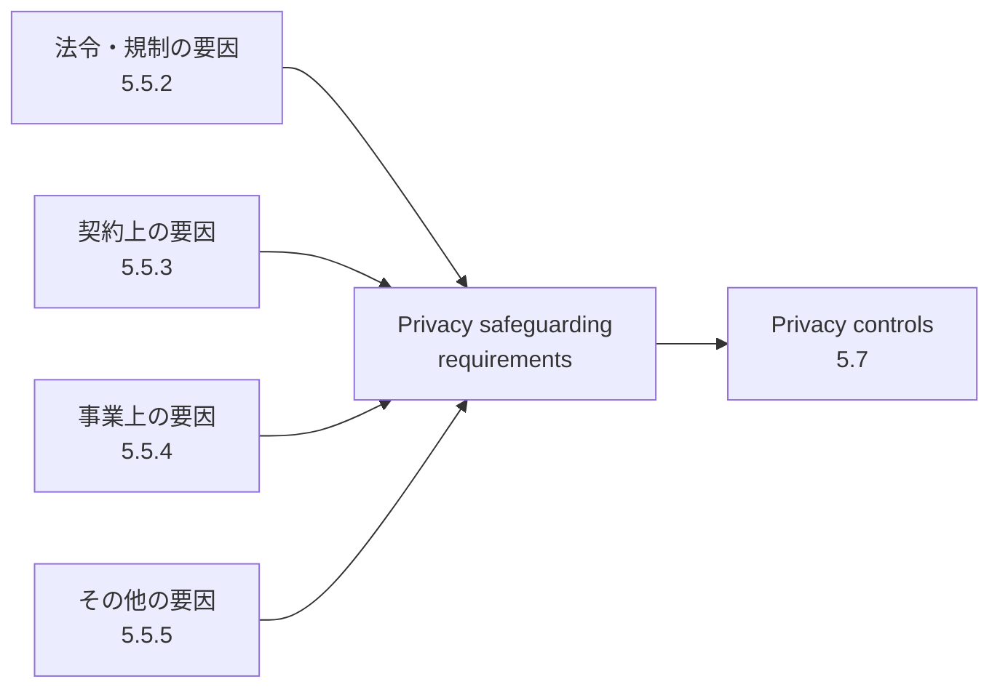

| 要因 | 内容 | 具体例 |
|---|---|---|
| **法令・規制**（5.5.2） | 国際・国内・地域の法、規則、判例、労働組合等との協定。データ保護法、消費者保護法、侵害通知法、データ保持法、雇用法など | 各国の個人情報保護法、越境移転ルール |
| **契約**（5.5.3） | 当事者間の契約、社内ポリシー、拘束的企業準則（binding corporate rules） | 委託契約、データ処理契約（DPA）、PII 廃棄条件 |
| **事業**（5.5.4） | 業種ごとの業界ガイドライン、行動規範、ビジネスモデルの特性 | 24時間オンラインサービス、銀行アプリ |
| **その他**（5.5.5） | 組織が採用している内部統制や技術標準、**本人の privacy preference** | 匿名・仮名での利用の希望、アクセス制限の希望 |

### 7.3 事業上の都合と原則の関係

規格は、**事業上の要因があっても、組織が採用した原則を変えるべきではない**と述べています [S3]。たとえば、サービス提供のために追加の PII が必要でも、「サービスに本当に必要なものか」を慎重に評価し（collection limitation）、従業員による処理を職務上必要な範囲に限る（data minimization）べきとされます。

### 7.4 一番重要な「その他の要因」：本人の期待

規格は、要件特定で考慮すべき最も重要な要因として、**PII principal の privacy preference** を挙げています（5.5.5）[S3]。

- ICT システムの設計者は、想定される本人のプライバシー上の懸念を理解しようとすべき
- 本人の希望例: 匿名・仮名での利用、特定の PII へのアクセスを制限する、処理目的を制限する
- マーケティングのような**二次的な目的**での利用は、可能な限り本人が選べるようにする
- UI では、分かりやすい言葉で選択肢を示す（チェックボックスやドロップダウンなど）

### 7.5 プライバシーリスクマネジメントの流れ

規格は、プライバシーリスクマネジメントを次の5つのプロセスで説明します（5.5.1）[S3]。

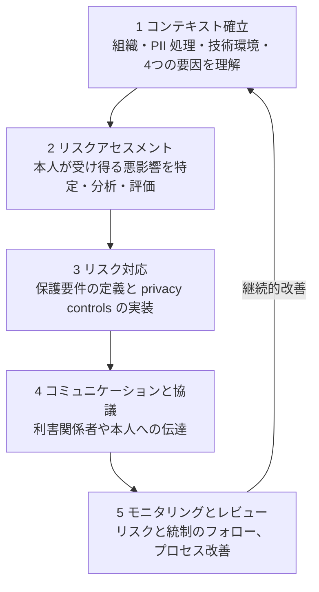

- ここでのリスクは**「組織へのリスク」ではなく「PII principal（本人）が不利益を受けるリスク」**を中心に考えます [S3]
- 成果物の1つが **PIA（privacy impact assessment）** です。PIA は、プライバシー・データ保護法令の要件への適合と、新規・大幅変更の施策のプライバシー上の影響を評価する、リスクマネジメントの構成要素です。組織全体のリスクマネジメントの枠組みの中に位置づけます [S3]
- PIA の具体的な進め方は **ISO/IEC 29134:2023** が扱います [S24]（[Step 10](#step-10-関連規格フレームワークとの関係)）

### 7.6 Privacy policies（5.6）

| 項目 | 内容 |
|---|---|
| 策定主体 | PII 処理に関わる組織の**トップマネジメント** |
| 満たすべき性質 | 組織の目的に適切／目標設定の枠組みを与える／適用される保護要件を満たすコミットメントを含む／継続的改善のコミットメントを含む／組織内で周知される／必要に応じて関係者が入手できる |
| 形式 | **書面で文書化**する |
| processor の場合 | 方針の多くを controller が決めることがある |
| 補完文書 | 部署や担当者ごとの詳細な手順・規則、方針を実施する統制（アクセス制御、通知、監査など）の文書 |

**用語の整理（初心者がつまずきやすい点）**:

| 呼び方 | 本規格での意味 |
|---|---|
| Privacy policy（内部） | 組織が採用した目的・規則・義務・制限・統制を記した**社内向け**の文書。本規格で "privacy policy" といえば基本的にこちら |
| Notice（外部） | 組織外の人に向けて、プライバシー実務を知らせる文書（controller の身元、連絡窓口など）。**一般にいう「プライバシーポリシー」のウェブページはこちら** |

> **日本の実務との違い**: 日本では、ウェブサイトに掲載する文書を「プライバシーポリシー」と呼ぶのが一般的ですが、本規格の用語では **notice** に当たります。

### 7.7 Privacy controls（5.7）

| 規格の考え方 | 説明 |
|---|---|
| 特定と実装 | リスクアセスメントと対応で特定された保護要件を満たす privacy controls を特定し、実装し、**文書化**する |
| 個別の統制 | ある種の PII 処理では、処理を詳しく分析して初めて必要性が明らかになる特定の統制がある |
| **Privacy by design** | プライバシー対応は設計段階で考慮し、後から付け足さない |
| リスクに応じた保護 | すべての PII 処理に同じ水準の保護は不要。処理ごとのリスクで情報セキュリティ統制を使い分ける |
| ISMS との統合 | privacy controls の特定は、組織の情報セキュリティマネジメントの枠組みの一部とする |

---

## Step 8. 11のプライバシー原則

### 8.1 原則の位置付け（6.1）

- 11原則は、複数の国と国際機関が策定してきた既存の原則から**導出**されたものです [S3]
- 重点は、原則を **ICT システムでどう実装するか**、そして組織の ICT システムに実装するプライバシー管理の仕組みを作ることにあります [S3]
- 原則は、プライバシーポリシーと統制の**設計・開発・実装の指針**であり、パフォーマンスの監視・測定、ベンチマーク、監査の**基準線**としても使えます [S3]
- 社会的・文化的・経済的な要因で適用が難しい場面があっても、**すべての原則の適用が推奨**され、**例外は限定的であるべき**とされます [S3]

### 8.2 11原則の一覧

| # | 原則（英語） | 一言でいうと | 2024年版の条 |
|---|---|---|---|
| 1 | Consent and choice | 本人に選ばせる | 6.2 |
| 2 | Purpose legitimacy and specification | 目的を適法に定め、先に伝える | 6.3 |
| 3 | Collection limitation | 目的に必要な分だけ集める | 6.4 |
| 4 | Data minimization | 処理も関与者も最小にする | 6.5 |
| 5 | Use, retention and disclosure limitation | 使う・持つ・渡すを必要な範囲に | 6.6 |
| 6 | Accuracy and quality | 正確で最新に保つ | 6.7 |
| 7 | Openness, transparency and notice | 隠さず分かりやすく知らせる | 6.8 |
| 8 | Individual participation and access | 本人が見て、直せる | 6.9 |
| 9 | Accountability | 責任を持ち、説明できる | 6.10 |
| 10 | Information security | 守る（CIA を確保） | 6.11 |
| 11 | Privacy compliance | 守れていることを検証・実証する | 6.12 |

### 8.3 PII のライフサイクルと原則の関係

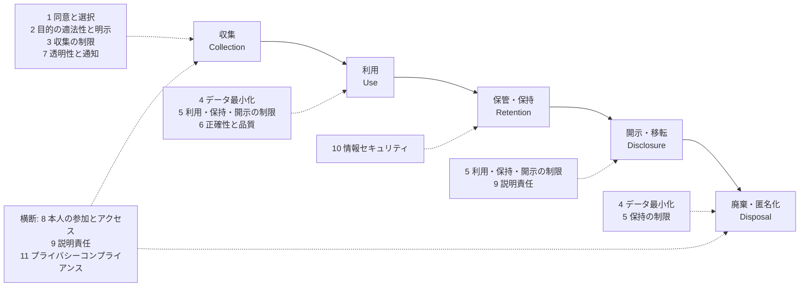

### 8.4 原則1: Consent and choice（同意と選択）[6.2]

**要点**

- 本人が、**自由な意思で、内容を理解したうえで**、処理を許すかどうかを選べること
- sensitive PII は、原則として **opt-in** で同意を得る
- 同意の前に、権利・通知内容・同意するかどうかの影響を伝える
- **撤回しやすさ**が重要。撤回は、同意するのと同じくらい簡単で、負担がないこと
- 同意だけが法的根拠ではなく、未成年者や越境移転などには別の要件があり得る

**開発・QAでの実装例**

| 観点 | 例 |
|---|---|
| 設計 | 目的ごとの同意設定。デフォルトは「同意しない」 |
| データ | 同意記録（誰が・いつ・何に・どの版の通知で・どう同意または撤回したか） |
| 運用 | 撤回の反映を、委託先・分析基盤・バックアップへ伝播させる |
| テスト | 撤回後に該当目的で処理されないこと、撤回の導線が登録と同程度に簡単なこと |

**よくあるNG**: 複数の目的を1つのチェックにまとめる／撤回の導線が見つかりにくい／同意しないと使えないのに「任意」と見せる。

### 8.5 原則2: Purpose legitimacy and specification（目的の適法性と明示）[6.3]

**要点**

- 目的が**法令に適合し、正当な根拠**に基づくこと
- 目的は**収集の前に**（または新しい目的で初めて使う前に）、**分かりやすい言葉で**本人に伝える
- sensitive PII を扱うなら、その必要性も説明する

**開発・QAでの実装例**

- **データ目録（data inventory）**で、項目ごとに「何の目的で使うか」を紐づける
- 新機能で既存データを使うときは、**目的が変わらないか**をレビューする（変わるなら通知・同意の見直し）

**よくあるNG**: 「サービス向上のため」のような曖昧な目的で、あらゆる用途に使い回す。

### 8.6 原則3: Collection limitation（収集の制限）[6.4]

**要点**

- 法令の範囲内で、**目的に厳密に必要なもの**だけを集める（種類と量の両方）
- 何を集め、なぜ必要かを**文書で説明できる**ようにする
- 目的外の追加情報（マーケティング用など）は、本人が**任意で選べる**ようにし、任意であることを明示する

**開発・QAでの実装例**

| 観点 | 例 |
|---|---|
| フォーム | 必須項目と任意項目を明確に分ける |
| API | 受け付けるフィールドを allow-list で制限し、余分な項目は保存しない |
| 計測 SDK | 収集項目を棚卸しし、不要なものは無効化 |
| テスト | 必須項目だけで登録・購入ができること。余分な項目が保存されないこと |

### 8.7 原則4: Data minimization（データ最小化）[6.5]

**要点**

- 処理する PII だけでなく、**扱える人・渡す先の数**も最小にする（need-to-know）
- 可能な限り、**本人を特定しない・行動を観測しにくい・データをつなげにくい**やり方を標準にする
- 目的が終われば、安全に処分する

**原則3との違い**: 原則3は「集める段階の絞り込み」、原則4は「**処理全体**を最小化する」考え方です [S3]。

**開発・QAでの実装例**

- 役割ベースのアクセス制御（RBAC）、列単位のアクセス制御、マスキング
- 分析用途は、集計値や仮名化データで足りるようにする
- **開発・テスト環境に本番の PII をそのまま持ち込まない**

### 8.8 原則5: Use, retention and disclosure limitation（利用・保持・開示の制限）[6.6]

**要点**

- 使う・持つ・渡す（移転を含む）を、**本来の目的に必要な範囲**に限る
- 保持は必要な期間だけ。期間後は**破棄または匿名化**する
- 法令で保持が必要な場合は、通常の処理から切り離して**ロック**（アーカイブ・保護）する
- 国際移転には、追加の要件があり得る

**開発・QAでの実装例**

| 観点 | 例 |
|---|---|
| 設計 | データ種別ごとの保持期間表、目的終了時の処理（削除／匿名化／ロック） |
| 実装 | TTL、定期削除ジョブ、legal hold フラグ |
| 範囲 | **バックアップ、ログ、検索インデックス、分析基盤、キャッシュ**まで対象に含める |
| 提供 | 第三者提供の台帳（誰に・何を・なぜ・いつ） |

**よくあるNG**: アプリのDBから削除したつもりが、ログや分析基盤、検索インデックスに残り続ける。

### 8.9 原則6: Accuracy and quality（正確性と品質）[6.7]

**要点**

- PII を、**正確・完全・最新**で、目的に合った状態に保つ
- 本人以外から得たデータは、使う前に**信頼性を確認**する
- 本人からの変更依頼は、**正当な依頼か検証**してから反映する
- 個人への重要な判断（便益の付与・拒否など）に使うデータほど、重要度が高い

**開発・QAでの実装例**

- 入力検証、データソースの記録、変更時の本人確認と承認フロー
- 名寄せ・重複統合の誤りを検知するテスト
- ML で個人に関する判定を行う場合は、**学習・評価データの品質**も対象

### 8.10 原則7: Openness, transparency and notice（透明性と通知）[6.8]

**要点**

- 組織の方針・手順・実務を、**分かりやすく入手しやすい形**で本人に示す
- 通知の中心は、**PII を処理している事実、目的、開示先の種類、controller の身元と連絡先**
- 本人が使える選択肢（制限・アクセス・訂正・削除）と、**大きな変更**の通知も含める
- 本人に影響する判断を伴う処理では、**判断の考え方の概要**を示す必要が出てくる

**開発・QAでの実装例**

- 通知を**階層化**（要約＋詳細）し、**入力の直前など適切なタイミング**で表示する
- 通知の版管理と、同意記録との紐づけ
- オンラインの通知と同意の進め方には **ISO/IEC 29184** がある [S7]

### 8.11 原則8: Individual participation and access（本人の参加とアクセス）[6.9]

**要点**

- 本人が、**認証されたうえで**自分の PII を確認でき、誤りがあれば**訂正・削除**を求められること
- 訂正などは、**委託先や提供先**にも伝える
- 手続は、簡単で速く、過大な費用を求めない
- **他人の PII が見えない**統制が前提

**開発・QAでの実装例**

| 観点 | 例 |
|---|---|
| 機能 | 自分のデータの閲覧・エクスポート・修正・削除の導線（セルフサービス） |
| 認証 | 開示・削除の請求時に、適切な強度の本人確認 |
| 連携 | 委託先・提供先への修正・削除の伝達 |
| テスト | 他人のデータが見えないこと（権限昇格・IDOR）、本人確認の回避ができないこと |

> **セキュリティ視点**: 開示請求の窓口は、なりすましによる情報の持ち出し経路になり得ます。**本人確認の強度**は、原則8と原則10をつなぐ重要な設計点です。

### 8.12 原則9: Accountability（説明責任）[6.10]

**要点**

- 方針・手順を**文書化して周知**し、実施の**責任者を決める**
- 第三者へ渡すときは、契約などで**同等の保護**を求める
- 担当者への**研修**、本人向けの**苦情処理と救済**の仕組みを用意する
- 本人に重大な被害を与え得る privacy breach は、**本人へ通知**し、必要なら当局にも通知する。対応はリスクに見合い、迅速に行う

**開発・QAでの実装例**

- 責任分担表（RACI）、データ処理契約（DPA）、委託先・再委託先の管理台帳
- インシデント対応手順に、**privacy breach の判断と通知**の分岐を含める
- 研修の記録、苦情対応の記録

### 8.13 原則10: Information security（情報セキュリティ）[6.11]

**要点**

- PII の**機密性・完全性・可用性**を、**ライフサイクル全体**で守る
- 委託先は、**十分な保証を示せる者**を選ぶ
- 統制は、リスクアセスメントと費用対効果に基づき、**PII の機微度・影響を受ける人数・起こりやすさ**に見合った強さにする
- アクセスは**職務上必要な人・範囲**に限り、統制を**定期的に見直す**

**開発・QAでの実装例**

| 領域 | 例 |
|---|---|
| 保護 | 保管時・通信時の暗号化、鍵管理 |
| アクセス | 最小権限、職務分離、特権アクセスの管理 |
| 検知 | PII を含むログのアクセス監視、異常検知 |
| 脆弱性 | 脆弱性管理、依存関係の更新 |
| 委託先 | セキュリティ評価、契約でのセキュリティ要件 |

> **ポイント**: この原則は、**ISO/IEC 27001/27002 とつながる橋**です。概念の対応は [Step 10](#step-10-関連規格フレームワークとの関係) を参照してください。

### 8.14 原則11: Privacy compliance（プライバシーコンプライアンス）[6.12]

**要点**

- 要件を満たしていることを、**内部監査または信頼できる第三者監査で検証し、示せる**ようにする
- 内部統制と、**独立した監督**の仕組みを持つ
- 施策やサービスごとに **privacy risk assessment** を整備・維持する
- 監督当局がいる法域では、当局に協力する

**開発・QAでの実装例**

- SDLC に **PIA のゲート**を組み込み、新機能や仕様変更のたびに実施
- ポリシーのチェックを CI に組み込む（例: スキーマ変更で新しい PII 列が追加されたらレビュー必須）
- 監査証跡（誰が・いつ・何にアクセスしたか）の整備

### 8.15 11原則と一般的なデータ保護の考え方の対応（目安）

> **注意**: 次の表は**概念的な目安**であり、法的な対応表ではありません。法令対応は専門家に確認してください。

| ISO/IEC 29100 の原則 | 近い考え方の例（GDPR など） |
|---|---|
| 1 Consent and choice | 同意、適法性の根拠 |
| 2 Purpose legitimacy and specification | 目的の限定（purpose limitation）、適法性 |
| 3 Collection limitation | 収集の限定 |
| 4 Data minimization | データの最小化 |
| 5 Use, retention and disclosure limitation | 利用の制限、保存の制限（storage limitation） |
| 6 Accuracy and quality | 正確性 |
| 7 Openness, transparency and notice | 透明性、情報提供 |
| 8 Individual participation and access | データ主体の権利（アクセス、訂正、削除など） |
| 9 Accountability | 説明責任（accountability） |
| 10 Information security | 完全性と機密性、安全管理措置 |
| 11 Privacy compliance | 遵守の実証、監査、監督当局との協力 |

29100 の原則は**法域に中立**であり、複数の法域で事業を行う組織が、共通の土台として使いやすいとされています [S13]。

---

## Step 9. 開発・QAの現場に落とし込む

規格は、PII を扱うシステムの**設計・実装・運用の各段階**でプライバシーを考慮することを求めています（privacy by design）[S3]。ここでは、規格の考え方を開発ライフサイクルに当てはめる一例を示します（規格の指定ではなく、本ガイドの整理です）。

### 9.1 ライフサイクルへの当てはめ

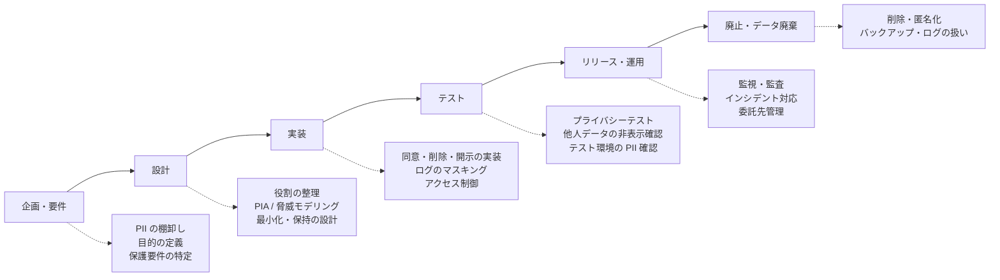

| フェーズ | やること | 主な成果物 | 関連原則 |
|---|---|---|---|
| 企画・要件 | PII の種類と目的の洗い出し、保護要件（法令・契約・事業・本人の期待）の特定 | データ目録、要件一覧 | 2, 3 |
| 設計 | controller / processor / third party の整理、PIA、最小化と保持期間の設計 | データフロー図、PIA 報告、保持期間表 | 4, 5, 9, 11 |
| 実装 | 同意管理、本人の開示・訂正・削除、ログのマスキング、暗号化、アクセス制御 | 実装、設定、ポリシーコード | 1, 6, 8, 10 |
| テスト | プライバシー観点のテスト（9.3）、テスト環境の PII 確認 | テスト仕様・結果 | 1〜11 |
| リリース・運用 | 通知の掲載、監視、委託先管理、インシデント対応、定期監査 | 運用手順、監査記録 | 7, 9, 10, 11 |
| 廃止・廃棄 | 保持期間後の削除・匿名化、バックアップ・ログの扱い | 廃棄記録 | 4, 5 |

### 9.2 コード例（考え方を示す簡易例）

> **注意**: 以下は理解のための簡略例です。本番では、鍵管理、法令、リスク評価に基づいて設計してください。数値（日数など）は**例**であり、規格が定めた値ではありません。

#### (1) 仮名化（HMAC）— ただし PII のまま

```python
import hmac
import hashlib
import os

# 本番では環境変数ではなく KMS / Secret Manager から取得するのが望ましい
# 実行前に環境変数 PSEUDONYM_KEY を設定すること（未設定の場合は KeyError で停止する）
PSEUDONYM_KEY = os.environ["PSEUDONYM_KEY"].encode("utf-8")


def pseudonymize(value: str) -> str:
    """HMAC-SHA256 による決定的な仮名化。

    同じ入力は同じ別名になるため、リンク可能性は残る（= 仮名データは PII のまま）。
    """
    # 入力値はそのまま扱う（小文字化や前後空白の除去をすると別の識別子が同じ HMAC になる）。
    # 識別子の仕様で大小文字や空白を区別しないと明示されている場合に限り、専用の正規化を適用する。
    return hmac.new(PSEUDONYM_KEY, value.encode("utf-8"), hashlib.sha256).hexdigest()
```

この方式で注意すること:

| 注意点 | 理由 |
|---|---|
| 鍵を持つ者は、候補値から照合して特定できる | 仮名化の条件（別名の割当てを他者が合理的な努力で戻せない）を満たすには、鍵の管理が前提 |
| 同じ人のデータが結びつく | 利用目的が「結びつける必要がない」なら、**ランダムなトークン**や、目的ごとに別の鍵を使う設計を検討 |
| 匿名化にはならない | 元に戻せない状態にし、他の属性との組合せでも特定できないことが必要 |

#### (2) ログからの PII マスキング

```python
import logging
import re

EMAIL = re.compile(r"[A-Za-z0-9._%+-]+@[A-Za-z0-9.-]+\.[A-Za-z]{2,}")


class RedactPII(logging.Filter):
    """ログ出力前にメールアドレスを伏せる簡易フィルタ（補助的な手段）。"""

    def filter(self, record: logging.LogRecord) -> bool:
        message = record.getMessage()
        record.msg = EMAIL.sub("[REDACTED_EMAIL]", message)
        record.args = ()
        if record.exc_info:
            try:
                exc_text = logging.Formatter().formatException(record.exc_info)
            except Exception:
                # 安全にマスクできない場合は、例外情報そのものを出力しない
                exc_text = "[REDACTED_EXCEPTION]"
            # Formatter は exc_text が設定済みならそれを使うため、マスク済みの文字列を渡し、元の例外情報は外す
            record.exc_text = EMAIL.sub("[REDACTED_EMAIL]", exc_text)
            record.exc_info = None
        elif record.exc_text:
            record.exc_text = EMAIL.sub("[REDACTED_EMAIL]", record.exc_text)
        return True
```

正規表現によるマスキングは**取りこぼしがある補助策**です。根本的には「**そもそも出力しない**」設計（原則3・4）を優先します。

#### (3) 同意記録のデータ例

```json
{
  "principal_id": "u_123",
  "purpose": "marketing_email",
  "notice_version": "2026-10-01",
  "decision": "opt_in",
  "recorded_at": "2026-10-14T09:00:00Z",
  "channel": "web_settings",
  "withdrawn_at": null
}
```

「誰が・何の目的に・どの版の通知で・いつ・どう決めたか」を残すことで、原則1・7・9を裏づけられます。

#### (4) 保持期間の定義（例）

```yaml
retention:
  - data: access_logs
    purpose: security_monitoring
    keep_days: 90          # 例。実際の期間は目的・法令・リスクで決める
    on_expiry: delete
  - data: invoices
    purpose: legal_obligation
    keep_days: 2555        # 例。法令で定められた期間に合わせる
    on_expiry: lock        # 通常の処理から切り離して保護（locking）
```

「何を・なぜ・いつまで持ち・期間後にどうするか」を**コードや設定として管理**すると、原則5の運用と監査（原則11）がしやすくなります。

### 9.3 QA向け：プライバシーテスト観点

| 観点 | テスト例 | 期待結果 | 関連原則 |
|---|---|---|---|
| 同意前の挙動 | 同意前にアクセスして、計測タグや第三者通信が発生しないか確認 | 同意前は不要な通信が出ない | 1, 2 |
| 同意の撤回 | 撤回後に、通知配信・分析・第三者提供が止まるか | 撤回が全経路に反映される | 1 |
| 収集の最小化 | 必須項目だけで登録・購入できるか。API に余分な項目を送る | 余分な項目は保存されない | 3, 4 |
| ログ | 例外発生時・検索時のログに、氏名・メール・トークンが残っていないか | PII が出力されない | 3, 4, 10 |
| 削除 | アカウント削除後、DB・検索インデックス・キャッシュ・分析基盤に残っていないか | 方針どおりに削除・匿名化・ロックされる | 5, 8 |
| 開示・エクスポート | 自分のデータを出力できるか。他人のIDを指定して取得できないか | 本人のデータのみ。IDOR がない | 8, 10 |
| 訂正の伝播 | 訂正が委託先・提供先にも届くか | 全関係先に反映 | 6, 8 |
| 通知と同意の整合 | 通知の版と同意記録の版が一致しているか | 追跡できる | 7, 9 |
| 第三者通信 | ネットワーク通信を確認し、提供先台帳にない宛先へ PII が送られていないか | 台帳と実際の通信が一致 | 5, 9 |
| テスト環境 | テスト・ステージングに本番の PII がないか | 匿名化・合成データのみ | 4, 10 |
| アクセス権限 | 職務外のロールで PII 項目が見えないか | 必要な範囲のみ | 4, 10 |
| インシデント | 漏えい想定の机上演習で、privacy breach の判断と通知の流れが動くか | 通知判断・連絡経路が機能する | 9 |

### 9.4 簡易 PIA チェック（新機能の企画時に）

| # | 質問 |
|---|---|
| 1 | どの PII（sensitive PII を含むか）を、何のために、どこから集めるか |
| 2 | その収集は目的に**本当に必要**か。減らせる項目はないか |
| 3 | 誰が（controller / processor / third party）、どこで処理するか |
| 4 | 本人にどう伝え、どう選ばせるか。撤回は簡単か |
| 5 | いつまで保持し、期間後どうするか |
| 6 | 本人が見て・直して・消せるか |
| 7 | 本人が受け得る不利益（差別、なりすまし、追跡、評判への影響など）は何か。その対策は |
| 8 | 見直しの時期と責任者は誰か |

詳しい進め方と報告書の構成は、**ISO/IEC 29134:2023** を参照してください [S24]。

---

## Step 10. 関連規格・フレームワークとの関係

### 10.1 全体マップ

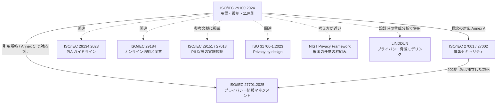

> 実線は出典で確認できた関係、点線は本ガイドによる整理（関連する、という程度）です。

### 10.2 関連規格の一覧

| 規格・枠組み | 何をするものか | 29100 との関係 | 出典 |
|---|---|---|---|
| **ISO/IEC 27001 / 27002** | ISMS の要求事項と、情報セキュリティ統制 | 29100 は、既存のセキュリティ標準に**プライバシーの視点を足す**ことを意図する。Annex A に概念対応表がある | [S3] |
| **ISO/IEC 27701:2025** | プライバシー情報マネジメントシステム（PIMS）の要求事項と指針。**2025年10月に改訂**され、ISO/IEC 27001 を前提としない**独立した認証可能な規格**になった | 29100 は 27701 の**引用規格**で、27701 の Annex C が 29100 の原則との対応を示す。PII controller 向け・processor 向けの統制ごとに対応づけられ、processor には当てはまらない原則もある | [S13][S15][S16][S17] |
| **ISO/IEC 29134:2023** | PIA のプロセスと、報告書の構成と内容のガイドライン（第2版、2023年5月） | 29100 が示すリスクマネジメントの成果物としての PIA を、具体的に進めるための規格 | [S24] |
| **ISO/IEC 29151:2017** | PII 保護の実施規範（code of practice、第1版） | 29100 の参考文献に掲載。27701 が対応づけている | [S3][S14] |
| **ISO/IEC 29151:2026** | 2017年版の後継（第2版、2026年7月発行）。表題は "Controls, requirements, and guidance for personally identifiable information protection" に変わり、実施規範から「管理策・要求事項・指針」へ位置付けが変わった | 上記の 29100・27701 との関係の記述は2017年版に基づく。2026年版との対応は未確認 | [S27] |
| **ISO/IEC 27018** | パブリッククラウドで PII processor として動作する場合の PII 保護の実施規範 | 29100 の参考文献に掲載。27701 が対応づけている | [S3][S14] |
| **ISO/IEC 29184** | オンラインのプライバシー通知と同意（2020年版。日本では JIS X 9252:2023） | 原則1・7 の具体化に関わる | [S7] |
| **ISO 31700-1:2023** | 消費者向け商品・サービスの privacy by design の高水準要求事項（2023年発行、約30の要求事項） | プライバシーを設計段階で組み込む点で関連。Ann Cavoukian が2009年に示した7原則を具体化したものと説明される | [S25][S26] |
| **NIST Privacy Framework** | 米国 NIST の、プライバシーリスク管理のための任意の枠組み。1.1 の初回公開草案は2025年4月14日。CSF 2.0 との整合を重視 | 目的は近いが、構成が異なる（Core の機能など）。**最終版の公表有無は、本調査では確認できなかった**。NIST は2026年中の公表を予告している | [S18][S19][S20] |
| **LINDDUN** | KU Leuven（DistriNet）が開発した、プライバシー脅威モデリング手法。7つの脅威カテゴリ（Linkability、Identifiability、Non-repudiation、Detectability、Disclosure of information、Unawareness、Non-compliance）を、データフロー図に当てはめて分析する | 設計段階で、29100 の原則に関わるプライバシー上の問題を洗い出すのに使える。**GenAI 向けの拡張**（2026年3月の arXiv 論文）もある | [S21][S22][S23] |
| **ENISA 系の報告書** | "Privacy and Data Protection by Design — from policy to engineering"（プライバシー・バイ・デザインを政策から技術へ） | 29100 の11原則を、設計の出発点として取り上げている | [S10] |

### 10.3 29100 と ISO/IEC 27000 ファミリーの概念対応（Annex A）

Annex A（参考）は、プライバシーの用語と情報セキュリティの用語の対応を示しています [S3]。

| ISO/IEC 29100 の概念 | ISO/IEC 27000 の概念 |
|---|---|
| Privacy stakeholder | Stakeholder（利害関係者） |
| PII | Information asset（情報資産） |
| Privacy breach | Information security incident（情報セキュリティインシデント） |
| Privacy control | Control（管理策） |
| Privacy risk | Risk（リスク） |
| Privacy impact assessment | Risk management（リスクマネジメント） |
| Privacy safeguarding requirements | Control objectives（管理目的） |

> **使い方のヒント**: 既に ISMS（ISO/IEC 27001）を運用している組織は、この表を使って「PII を情報資産として棚卸し」「privacy breach をインシデント管理の対象に加え」「privacy risk をリスクアセスメントに含める」といった形で、**既存の仕組みにプライバシーを接続**できます。

### 10.4 日本での位置付け

| 項目 | 内容 | 出典 |
|---|---|---|
| JIS 版 | JIS X 9250:2017。2011年版に基づく | [S9] |
| 2024年版対応 | JSA のサイトに、ISO/IEC 29100:2024 に対応する JIS X 9250 の案（音声読み上げ用ファイル）が掲載されている。**正式な改正版の発行状況は、本調査では確認できなかった** | [S8] |
| 閲覧 | JIS X 9250 は無償で閲覧できると案内されている（ウォーターマーク付き） | [S7] |
| ISO/IEC 27701 との整合 | 27701 は 29100 と整合するように策定されたと紹介されている | [S9] |

#### 日本の個人情報保護法の用語との対応（目安）

> **注意**: 次の表は**概念の目安**であり、法的に同義ではありません。範囲や要件が異なります。法令の運用は、個人情報保護委員会のガイドラインや専門家の見解で確認してください。

| ISO/IEC 29100 | 日本の法令で近い概念（例） | 注意点 |
|---|---|---|
| PII | 個人情報、個人データ | 範囲・定義が一致するとは限らない |
| Sensitive PII | 要配慮個人情報 | 該当する種類は法令で定められている |
| PII principal | 本人 | |
| PII controller | 個人情報取扱事業者 | 法的な義務の主体は法令による |
| PII processor | 委託先 | 委託元の監督義務などは法令による |
| Third party | 第三者 | 「提供」の扱いは法令による |
| Pseudonymization | 仮名加工情報 | 法的な要件は規格の定義と同じではない |
| Anonymization | 匿名加工情報 | 法的な加工基準・公表義務がある |

---

## Step 11. 導入ロードマップ

### 11.1 流れ

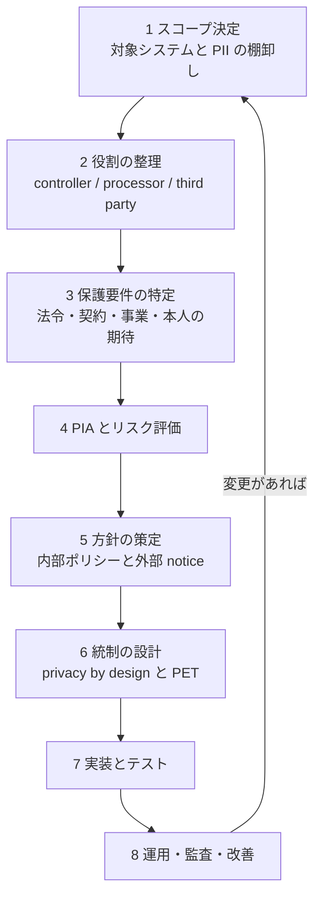

### 11.2 ステップごとの成果物

| # | ステップ | 具体的な作業 | 成果物の例 |
|---|---|---|---|
| 1 | スコープ決定 | 対象システム、PII の種類、データの流れを洗い出す | データ目録、データフロー図 |
| 2 | 役割の整理 | 処理ごとに役割を決め、委託先・提供先を区別する | 役割マップ、委託先・提供先一覧 |
| 3 | 保護要件の特定 | 4つの要因（法令・契約・事業・その他）を整理する | 要件一覧 |
| 4 | PIA・リスク評価 | 本人への悪影響を評価し、優先度を決める | PIA 報告、リスク登録簿 |
| 5 | 方針の策定 | トップマネジメントが内部ポリシーを承認し、外部向け notice を整備する | プライバシーポリシー（内部）、notice（外部） |
| 6 | 統制の設計 | 最小化・保持・アクセス制御・暗号化・同意・開示の仕組みを設計する | 設計書、統制一覧 |
| 7 | 実装とテスト | 9章の観点で実装・テストする | テスト結果、証跡 |
| 8 | 運用・監査・改善 | 定期監査、インシデント対応、教育、見直し | 監査報告、改善計画 |

### 11.3 最初の30日でやること（小さく始める例）

1. 主要なサービスについて、**収集している PII の一覧**を作る（目的の列を必ずつける）
2. 全ての外部サービス（SDK、SaaS、委託先）を、**役割ごとに分類**する
3. ログ・バックアップ・テスト環境に、**不要な PII がないか**を点検する
4. **削除と開示請求**の手順が実際に動くか、1件で試す
5. 新機能のレビュー時に使う**簡易 PIA の質問**（9.4）を、チームに配る

---

## Step 12. よくある誤解

| # | 誤解 | 実際 | 根拠 |
|---|---|---|---|
| 1 | 29100 に準拠すれば法令に準拠したことになる | 29100 は**法令ではなく**、法域に中立な枠組み。各国の法令への対応は別に必要 | [S3][S13] |
| 2 | 29100 の認証を取れる | 認証用の要求事項規格ではない。認証の対象は、27701 のような**マネジメントシステム規格** | [S13][S16] |
| 3 | 同意を取れば何をしてもよい | 目的の適法性、最小化、利用制限など、**他の原則も同時に満たす**必要がある。同意が十分な根拠にならない場合もある | [S3] |
| 4 | ハッシュ化すれば匿名化になる | リンク可能性が残る限り**仮名化**であり、PII のまま | [S3] |
| 5 | セキュリティ対策をすればプライバシーも守れる | セキュリティは原則10の1つに過ぎない。目的外利用や過剰収集は、セキュリティだけでは防げない | [S3] |
| 6 | プライバシーポリシー（外部向け）を載せれば十分 | 規格での「privacy policy」は**内部向けの方針**。外部向けは notice で、さらに統制の実装と文書化が必要 | [S3] |
| 7 | 名前やメールがなければ PII ではない | 属性の組合せや、他情報との突合で特定できるなら PII になり得る。メタデータ・ログ・位置情報も対象 | [S3] |
| 8 | 委託すれば責任も移る | processor に委託しても、**責任は controller に残る** | [S3] |
| 9 | 29100 は大企業だけのもの | ICT システムで PII を扱う組織なら、規模を問わず参考になる | [S1] |
| 10 | 一度 PIA をすれば終わり | 規格は、定期的な監査と、PIA/リスクアセスメントの**維持**を求めている（原則11） | [S3] |

---

## Step 13. 理解度チェック

### 問題

1. ISO/IEC 29100:2024 が置き換えた規格を2つ挙げてください。
2. PII の処理に関わる4種類の主体は何ですか。
3. PII controller と PII processor の違いを、「目的と手段」という言葉を使って説明してください。
4. 受け取った PII を、自ら目的を決めて使い始めた third party は、どの主体になりますか。
5. 仮名化と匿名化の最大の違いは何ですか。
6. 「メールアドレスを SHA-256 でハッシュ化して保存している」データは、通常どう扱うべきですか。
7. 11原則のうち、「収集段階の絞り込み」と「処理全体の最小化」を扱う原則はそれぞれ何ですか。
8. 規格の「privacy policy」は、内部向けと外部向けのどちらを指しますか。外部向けは何と呼びますか。
9. プライバシーリスクマネジメントの5つのプロセスを挙げてください。
10. 29100 の原則10（情報セキュリティ）は、どの規格群とつながっていますか。

### 解答

1. ISO/IEC 29100:2011 と、ISO/IEC 29100:2011/Amd 1:2018 [S1][S5]。
2. PII principal、PII controller、PII processor、third party [S3]。
3. controller は PII 処理の**目的と手段を決める**主体。processor は controller の**指示に従って**処理する主体で、責任は controller に残る [S3]。
4. 独自の **PII controller**（受領後に目的を決めれば controller になり得る）[S3]。
5. 仮名化は**リンク可能性が残り PII のまま**。匿名化は**不可逆に特定できなくし、PII ではなくなる** [S3]。
6. 同じ入力から同じ値ができるなら**リンク可能性が残る**ため、多くの場合は**仮名化**であり PII として扱う [S3]。
7. 収集段階の絞り込みは**原則3（Collection limitation）**、処理全体の最小化は**原則4（Data minimization）** [S3]。
8. **内部向け**。外部向けは **notice** と呼ぶ [S3]。
9. コンテキスト確立、リスクアセスメント、リスク対応、コミュニケーションと協議、モニタリングとレビュー [S3]。
10. **ISO/IEC 27000 ファミリー**（27001/27002 など）。Annex A で概念が対応づけられている [S3]。

---

## Step 14. 参考文献と出典URL

> 調査基準日は **2026年10月14日** です。URL はこの日までの検索・取得で確認したものです。ISO や各国標準化団体のページは、販売ページの形で掲載されることがあり、表示が変わる場合があります。

### A. 規格の公式情報・各国の標準化機関

| # | 内容 | URL | 何の根拠か |
|---|---|---|---|
| S1 | ISO 公式: ISO/IEC 29100:2024 | https://www.iso.org/standard/85938.html | 版、発行日、ページ数、SC 27、ICS、置換関係、スコープ、価格表示（CHF 0）、ライフサイクル |
| S2 | ISO 公式: ISO/IEC 29100:2011（Withdrawn） | https://www.iso.org/standard/45123.html | 旧版の位置付け |
| S3 | インド規格協会（BIS）: IS/ISO/IEC 29100:2024（ISO/IEC 29100:2024 と同一内容の国家規格） | https://services.bis.gov.in/tmp/1734079775.pdf | 国家序文の「主な変更点」、規格の構成・条番号、用語、原則 |
| S4 | セルビア標準化機関 ISS: ISO/IEC 29100:2024 | https://iss.rs/en/project/show/iso:proj:85938 | 発行日、ステージ、旧版との関係 |
| S5 | スウェーデン標準化機関 SIS: ISO/IEC 29100:2024 | https://www.sis.se/produkter/informationsteknik-kontorsutrustning/itsakerhet/isoiec-291002024/ | 発行日、ページ数、置換関係 |
| S6 | BSI（英国規格協会）台湾: ISO/IEC 29100:2024 基礎コース | https://www.bsigroup.com/zh-TW/ISO_29100/Information_Security_Privacy-framework/Privacy-framework-ESS | 2024年版が小幅修訂で、Amd 1:2018 を統合したとの説明 |
| S8 | 日本規格協会（JSA）: JIS X 9250（ISO/IEC 29100:2024 対応の JIS 案・音声読み上げ用） | https://webdesk.jsa.or.jp/pdf/jisnintei/jisgenan_voice/JIS_X9250_情報技術－セキュリティ技術－プライバシーフレームワーク（プライバシー保護の枠組み及び原則）_加工後_.pdf | JIS 案の存在（正式な改正版の発行状況は未確認） |

### B. 著名な専門家・開発者による情報

| # | 内容 | URL | 何の根拠か |
|---|---|---|---|
| S7 | @_Nat Zone（崎村夏彦氏）: ISO/IEC 29100:2024 で国際規格開発賞を受賞（本人が国際エディター（プロジェクトリーダー）） | https://www.sakimura.org/en/2025/03/7832/ （日本語版: https://www.sakimura.org/2025/03/7832 ） | 規格が ISO のプライバシー関連規格の基盤であること、無償で閲覧できること、JIS X 9250 の無償閲覧、ISO/IEC 29184 への関連 |
| S10 | Danezis ほか（ENISA 報告書）: Privacy and Data Protection by Design — from policy to engineering | https://arxiv.org/pdf/1501.03726 | 29100 の11原則を、privacy by design の出発点として取り上げている |
| S21 | Wuyts, Joosen（KU Leuven）: LINDDUN privacy threat modeling: a tutorial | https://lirias.kuleuven.be/handle/123456789/505941 | LINDDUN の手順 |
| S22 | KU Leuven（imec-DistriNet）: Interaction-based Privacy Threat Elicitation | https://lirias.kuleuven.be/1656890 | LINDDUN の拡張と脅威カタログ |
| S23 | KU Leuven ほか: A LINDDUN-based Privacy Threat Modeling Framework for GenAI（arXiv） | https://arxiv.org/html/2603.06051v1 | LINDDUN の GenAI 向け拡張 |

### C. 解説・実務情報

| # | 内容 | URL | 何の根拠か |
|---|---|---|---|
| S9 | ITmedia: プライバシーリスクを回避しながら DX を推進（2021年） | https://www.itmedia.co.jp/business/articles/2108/26/news010.html | JIS X 9250:2017 が 2011年版に基づくこと、27701 との整合 |
| S11 | Swiss Post Cybersecurity: ISO Privacy Framework — Principles of data protection | https://www.swisspost-cybersecurity.ch/news/iso-privacy-framework-principles-of-data-protection-part-1 | 役割と11原則の実務的な解説 |
| S12 | Kantara Initiative: Privacy Principles（29100 の原則の解説） | https://kantara.atlassian.net/wiki/x/EwCDBQ | 原則の実装観点 |
| S13 | ISMS.online: ISO/IEC 27701:2025 Annex C — ISO 29100 mapping | https://www.isms.online/iso-27701/annex-c-2025-iso-29100-mapping/ | 27701 と 29100 の関係、原則の controller/processor への対応、法域中立性 |
| S14 | PECB: The Future of Privacy with ISO/IEC 27701 | https://pecb.com/en/whitepaper/the-future-of-privacy-with-isoiec-27701 | 27701 と 29100、27018、29151 の対応づけ |

### D. ISO/IEC 27701 関連

| # | 内容 | URL | 何の根拠か |
|---|---|---|---|
| S15 | Wikipedia: ISO/IEC 27701 | https://en.wikipedia.org/wiki/ISO/IEC_27701 | 2025年10月に独立した規格へ改訂、Annex C（29100 への対応） |
| S16 | Kiwa: ISO/IEC 27701:2025 published | https://www.kiwa.com/en/nl/areas-of-expertise/cyber-security/news/isoiec-277012025-published-updated-privacy-standard-offers-organizations-more-guidance/ | 27701:2025 が独立した規格になったこと |
| S17 | Management Solutions: ISO/IEC 27701:2025 | https://www.managementsolutions.com/sites/default/files/publicaciones/eng/iso-iec-27701-information-security-cybersecurity-privacy.pdf | 発行日（2025年10月14日と記載）、29100:2024 との整合 |

### E. NIST Privacy Framework 関連

| # | 内容 | URL | 何の根拠か |
|---|---|---|---|
| S18 | NIST: NIST Updates Privacy Framework, Tying It to Recent Cybersecurity Guidelines（2025年4月） | https://www.nist.gov/news-events/news/2025/04/nist-updates-privacy-framework-tying-it-recent-cybersecurity-guidelines | 1.1 初回公開草案の概要、CSF 2.0 との整合 |
| S19 | NIST: Celebrating Data Privacy Week with NIST's Privacy Engineering Program | https://www.nist.gov/node/1905096 | 1.1 の最終版が2026年中に公表予定との記載 |
| S20 | NIST CSRC: CSWP 40（NIST Privacy Framework 1.1 初回公開草案） | https://csrc.nist.gov/pubs/cswp/40/nist-privacy-framework-11/ipd | 草案の位置付け、コメント期限（2025年6月13日） |

### F. PIA・Privacy by design 関連

| # | 内容 | URL | 何の根拠か |
|---|---|---|---|
| S24 | AFNOR: ISO/IEC 29134:2023 | https://www.boutique.afnor.org/en-gb/standard/iso-iec-291342023/information-technology-security-techniques-guidelines-for-privacy-impact-as/xs143470/345510 | PIA の規格（2023年5月、第2版）。VDE: https://vde-verlag.de/iec-normen/251846/iso-iec-29134-2023.html |
| S25 | Genorma: ISO 31700-1:2023 | https://genorma.com/en/standards/iso-31700-1-2023 | ISO 31700-1 のスコープと発行日 |
| S26 | Hogan Lovells（Privacy World）: ISO 31700 — the latest tool to operationalize GDPR privacy by design compliance | https://www.privacyworld.blog/2023/02/iso-31700-the-latest-tool-to-operationalize-gdpr-privacy-by-design-compliance/ | 約30の要求事項、GDPR の privacy by design との関係。補足: https://www.activemind.legal/guides/iso-31700/ |
| S27 | ISO: ISO/IEC 29151:2026 | https://www.iso.org/standard/88151.html | 第2版（2026年7月）、表題、2017年版の後継 |

### G. 本調査の限界（確認できなかった点）

| 項目 | 状況 |
|---|---|
| NIST Privacy Framework 1.1 の最終版 | 2026年中の公表予定という NIST の記載は確認したが、最終版の公表は確認できなかった。NIST のサイトで最新状況を確認してください |
| JIS X 9250 の2024年版対応の正式な改正版 | JSA に JIS 案が掲載されていることは確認したが、正式な発行状況は確認できなかった |
| 規格本文 | 条文の正確な解釈は、ISO の規格ページ（S1）から入手できる原文で確認してください |
| ベンダー・コンサル系の解説 | S11〜S17、S26 などは実務の理解を助ける補足情報で、規格の解釈の根拠としては S1 と S3 を優先してください |

---

## 付録. 用語集（英日対応）

| 英語 | 日本語 | 備考 |
|---|---|---|
| Anonymization | 匿名化 | 不可逆。PII でなくなる |
| Anonymity | 匿名性 | |
| Consent | 同意 | 自由・具体的・十分な情報に基づく |
| Data minimization | データ最小化 | 原則4 |
| Data subject | データ主体 | PII principal と同義 |
| Identifiability | 識別可能性 | |
| Opt-in / Opt-out | オプトイン / オプトアウト | |
| PET（privacy enhancing technology） | プライバシー強化技術 | |
| PII（personally identifiable information） | 個人を特定できる情報 | |
| PII controller | PII の管理者（目的と手段を決める主体） | |
| PII principal | PII の本人 | |
| PII processor | PII の処理者（controller の指示で処理する主体） | |
| Privacy breach | プライバシー侵害 | 漏えいだけでなく、保護要件に違反した処理全般 |
| Privacy by design | プライバシー・バイ・デザイン | 設計段階から組み込む |
| Privacy control | プライバシー統制 | |
| Privacy impact assessment（PIA） | プライバシー影響評価 | |
| Privacy policy | プライバシーポリシー（本規格では内部向け） | 外部向けは notice |
| Privacy preference | プライバシーに関する本人の選好 | |
| Privacy principle | プライバシー原則 | 11原則 |
| Privacy risk | プライバシーリスク | |
| Privacy safeguarding requirement | プライバシー保護要件 | |
| Privacy stakeholder | プライバシー関係者 | |
| Processing of PII | PII の処理 | 収集から削除まで全般 |
| Pseudonymization | 仮名化 | リンク可能性が残る |
| Sensitive PII | 機微な PII | |
| Third party | 第三者 | |

---

*このガイドは学習目的の解説であり、法的助言ではありません。規格の正確な内容は ISO の原文（https://www.iso.org/standard/85938.html）で確認してください。*