# ISSAP（Information Systems Security Architecture Professional）初学者向け完全ガイド

> **対象**: ISC2 ISSAP（セキュリティアーキテクチャ専門認定）をこれから学ぶ方
> **準拠**: 2025年8月1日発効の ISSAP 試験アウトライン（4ドメイン構成）
> **情報取得日**: 2026年10月17日（ウェブ情報ベース。最新は必ず ISC2 公式で確認してください）
> **作図ルール**: ASCII 図は不使用。フローチャートは Mermaid、図解・表は Markdown

---

## 目次

1. [このガイドの使い方](#1-このガイドの使い方)
2. [ISSAP とは](#2-issap-とは)
3. [試験アウトライン全体像](#3-試験アウトライン全体像)
4. [共通基礎: アーキテクトの設計原則](#4-共通基礎-アーキテクトの設計原則)
5. [ドメイン1: GRC（21%）](#5-ドメイン1-ガバナンスリスクコンプライアンスgrc21)
6. [ドメイン2: セキュリティアーキテクチャモデリング（22%）](#6-ドメイン2-セキュリティアーキテクチャモデリング22)
7. [ドメイン3: インフラ・システムセキュリティアーキテクチャ（32%）](#7-ドメイン3-インフラシステムセキュリティアーキテクチャ32)
8. [ドメイン4: IAMアーキテクチャ（25%）](#8-ドメイン4-iamアーキテクチャ25)
9. [横断テーマ: AI セキュリティ](#9-横断テーマ-ai-セキュリティ)
10. [試験対策](#10-試験対策)
11. [確認問題（一問一答）](#11-確認問題一問一答)
12. [出典一覧（URL）](#12-出典一覧url)
13. [情報の確度と注意事項](#13-情報の確度と注意事項)

---

## 1. このガイドの使い方

### 1.1 読み進め方

各トピックを次の4点セットで説明します。

| 要素 | 内容 |
|---|---|
| **まず押さえる** | 初学者向けのやさしい説明 |
| **重要ポイント** | 試験で問われやすい用語・区別 |
| **ベストプラクティス** | 実務・試験の両方で「正解」とされやすい設計判断 |
| **根拠** | `[S番号]` で末尾の出典一覧に対応 |

### 1.2 前提知識

ISSAP は CISSP の上位に位置づけられる資格です。認定取得に必要な経験要件の経路は2つあり（受験資格ではなく、合格後に認定を受けるための要件です）、**CISSP を保有・維持している場合**は ISSAP の4ドメインのいずれか1つ以上で累計2年以上のフルタイム経験、**CISSP を要件としない経路**では4ドメインのうち2つ以上で累計7年以上のフルタイム経験が必要です [S1] [S3]。必要な経験がなくても試験に合格すれば **Associate of ISC2** を申請でき、経験を積む間この称号を**最大8年間**保持できます [S22]。**7年経路に限り**、学位（コンピューターサイエンス・IT等の学士／修士）または ISC2 の承認資格リストにある資格で、**最大1年**の経験が免除されます（学位と資格を合算して2年分を免除することはできません。CISSP 保有者の2年経路には適用されません）。**パートタイム勤務やインターン経験**も経験年数に算入できます（パートタイムはフルタイム換算で計上し、無給インターンは組織の公式レターヘッドによる証明が必要）[S1] [S2]。本ガイドは CISSP の8ドメイン（セキュリティとリスク管理、資産保護、セキュリティ設計・エンジニアリング、通信とネットワーク、IAM、評価とテスト、運用、ソフトウェア開発セキュリティ）を一通り理解している前提で、**「設計者として判断する力」**を深掘りする試験です。

### 1.3 アーキテクトの立ち位置

ISC2 は ISSAP を、**経営層（C-suite）とセキュリティプログラムの実装の間に立つ役割**向けの資格と説明しています [S1]。

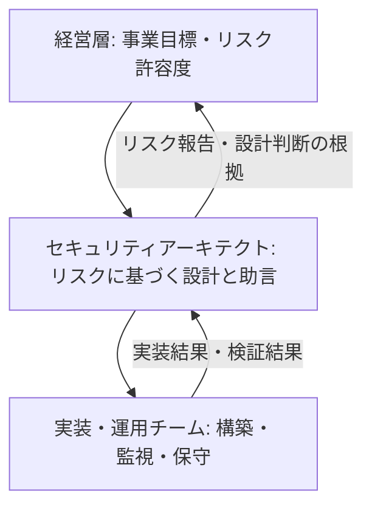

つまり試験で最も重視されるのは、**「技術的に正しい」より「事業目標とリスクに整合した設計判断」**です。

---

## 2. ISSAP とは

### 2.1 概要

| 項目 | 内容 | 出典 |
|---|---|---|
| 正式名称 | Information Systems Security Architecture Professional | [S1] |
| 位置づけ | 上位（Advanced）3資格の1つ（ISSAP / ISSEP / ISSMP） | [S3] |
| 想定職種 | チーフセキュリティアーキテクト、アナリスト等 | [S1] |
| 証明する能力 | セキュリティソリューションの開発・設計・分析、および上級管理職へのリスクベースの助言 | [S1] |
| 認定の経験要件（A: CISSP 経路） | CISSP の保有・維持 + 4ドメインのいずれか1つ以上で累計2年以上のフルタイム経験 | [S1] [S3] |
| 認定の経験要件（B: CISSP 不要の経路） | CISSP を要件とせず、4ドメインのうち2つ以上で累計7年以上のフルタイム経験 | [S1] [S3] |
| 経験の免除 | 7年経路のみ、学位（CS・IT等の学士／修士）または ISC2 承認資格で最大1年（学位と資格の併用で2年免除は不可。CISSP 保有者の2年経路は対象外） | [S2] |
| パートタイム・インターン | 経験年数に算入可（パートタイムはフルタイム換算、無給インターンは公式レターヘッドの証明が必要） | [S2] |
| 認定規格 | ANAB 認定（ISO/IEC 17024）、米国 DoDM 8140 承認 | [S1] |
| 試験時間 | 3時間 | [S2] |
| 試験言語 | 英語のみ（アウトライン記載） | [S2] |

### 2.2 試験の形式（要確認項目）

| 項目 | 情報 | 確度 |
|---|---|---|
| 問題数・問題形式 | 125問（多肢選択および高度な問題形式） | **高**（ISC2 公式の試験アウトライン）[S2] |
| 合格点 | 1000点満点中700点（スケールドスコア） | **高**（ISC2 公式の試験アウトライン）[S2] |
| 形式 | リニア（適応型ではない） | 第三者情報 [S8] |
| 会場 | Pearson VUE テストセンター | **高**（ISC2 公式の試験アウトライン）[S2] |

> 受験前に必ず ISC2 の試験ポリシー・再受験規定を確認してください [S6] [S7]。

### 2.3 2025年の改訂ポイント

- **旧アウトライン（6ドメイン）から、新アウトライン（4ドメイン）へ統合**されました。2025年8月1日発効です [S3]。
- 配分は **インフラ・システム 32%、IAM 25%** が上位になりました [S3]。
- 6ドメイン前提の古い教材・模擬問題は、構成が合わない可能性があります。**教材の発行年とドメイン数を必ず確認**してください。
- 試験アウトライン上で **AI セキュリティの観点**が各ドメインに織り込まれると説明されています [S2]（第9章）。

### 2.4 学習ロードマップ

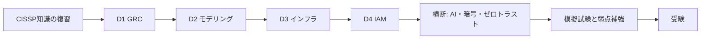

---

## 3. 試験アウトライン全体像

### 3.1 ドメイン配分

| # | ドメイン | 配分 | サブドメイン |
|---|---|---|---|
| 1 | Governance, Risk, and Compliance (GRC) | **21%** | 1.1 要件の特定 / 1.2 GRCのための設計 |
| 2 | Security Architecture Modeling | **22%** | 2.1 アプローチの特定 / 2.2 設計の検証・妥当性確認 |
| 3 | Infrastructure and System Security Architecture | **32%** | 3.1 要件の特定 / 3.2 インフラ・システムの設計 / 3.3 暗号ソリューションの設計 |
| 4 | Identity and Access Management (IAM) Architecture | **25%** | 4.1 ライフサイクル / 4.2 認証 / 4.3 認可 / 4.4 アカウンティング |

出典: [S2] [S3]（配分は [S3] の ISC2 公式記事）

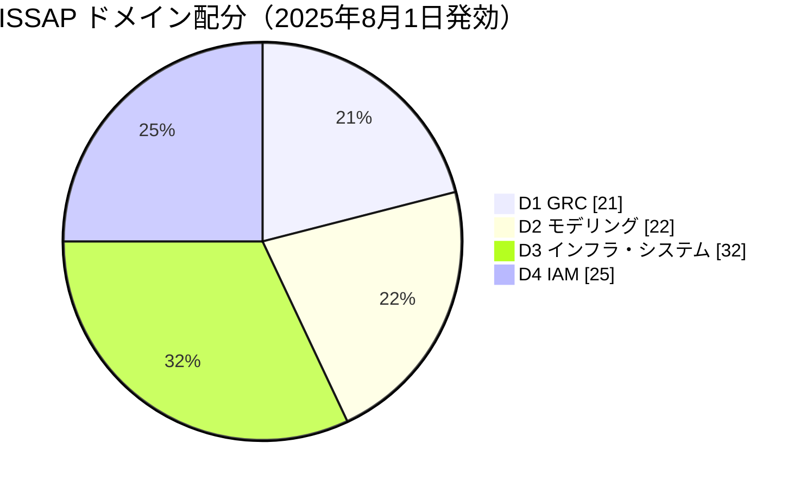

### 3.2 学習の優先順位

| 優先度 | ドメイン | 理由 |
|---|---|---|
| 1 | D3 インフラ・システム（32%） | 配分が最大。サブトピックも最多で、暗号・ネットワーク・クラウド・OTまで幅広い |
| 2 | D4 IAM（25%） | プロトコル（SAML/OAuth/Kerberos等）の区別が頻出 |
| 3 | D2 モデリング（22%） | フレームワーク（TOGAF/SABSA）と脅威モデリングの使い分け |
| 4 | D1 GRC（21%） | 設計判断の「なぜ」を支える。他ドメインの問題にも混ざる |

> D1 は配分が小さく見えても、**他ドメインの問題の「判断基準」**として登場します。軽視しないでください。

---

## 4. 共通基礎: アーキテクトの設計原則

どのドメインでも「正解の選択肢」を選ぶ軸になる原則です。

| 原則 | 意味 | 設計での使い方 |
|---|---|---|
| **多層防御（Defense in Depth）** | 単一の対策に依存せず複数層で守る | ネットワーク・ホスト・アプリ・データの各層に独立した統制 |
| **最小権限（Least Privilege）** | 業務に必要な最小限だけ付与 | ロール設計、PAM、サービスアカウント |
| **職務分掌（SoD）** | 重要作業を複数人に分ける | 承認者と実行者の分離、ログ管理者と運用者の分離 |
| **ゼロトラスト** | 場所に基づく暗黙の信頼を与えない | 毎回の認証・認可・継続評価 [S10] |
| **フェイルセキュア** | 障害時は安全側に倒れる | 認可サービス停止時は拒否（ただし人命に関わる物理扉は例外設計） |
| **セキュアバイデフォルト** | 初期設定が安全 | 不要サービス無効、強い既定の暗号設定 |
| **完全な調停（Complete Mediation）** | すべてのアクセスを毎回検査 | PEP を迂回できない構成 |
| **機構の経済性** | 設計をシンプルに保つ | 複雑さは攻撃面と運用ミスを増やす |
| **公開設計（Open Design）** | 秘密は鍵だけ、アルゴリズムは公開 | 独自暗号を作らず標準を使う |
| **セキュリティ・バイ・デザイン** | 後付けでなく最初から組み込む | 要求定義段階で脅威モデリング |

### 試験での考え方

- 「速くて安い」より「**リスクに見合った統制**」を選ぶ。
- 「最新の製品を導入」より「**要件に合う設計判断とその根拠**」を選ぶ。
- 選択肢に **技術と運用・ガバナンスの両面**があるなら、両方を満たすものが正解になりやすい。

---

## 5. ドメイン1: ガバナンス・リスク・コンプライアンス（GRC）（21%）

アーキテクトは、**法規・契約・事業目標・リスク**を「設計要件」に翻訳する役割を担います。

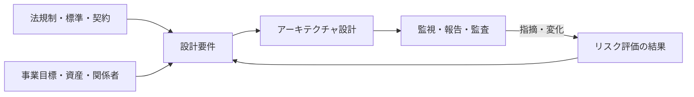

### 5.1 サブドメイン 1.1: 法的・規制・組織・業界要件の特定

アウトライン項目 [S2]:
- 適用される情報セキュリティ標準・ガイドライン
- 第三者・契約上の義務（サプライチェーン、アウトソーシング、パートナー）
- 機微情報／個人データに関する標準・ガイドライン・プライバシー規制
- レジリエントなソリューション

#### 5.1.1 適用される情報セキュリティ標準

**まず押さえる**: 標準は「何をすべきか」の共通言語です。アーキテクトは**どの標準が自社に義務で、どれが参考か**を切り分けます。

| 種別 | 例 | 使いどころ |
|---|---|---|
| マネジメントシステム | ISO/IEC 27001 | ISMS の枠組み・認証 |
| 管理策カタログ | ISO/IEC 27002、NIST SP 800-53 | 統制の選定 |
| フレームワーク | NIST CSF | 成熟度・コミュニケーション |
| 業界・データ要件 | PCI DSS、HIPAA | 該当業種・データで必須 |
| 連邦情報セキュリティ法 | FISMA | 米連邦政府機関と、その代理で運用されるシステムに適用 |
| 評価基準 | Common Criteria（ISO/IEC 15408） | 高保証な製品・システムの調達 |
| 暗号モジュール要件 | FIPS 140-3（CMVP が検証する暗号モジュールのセキュリティ要件。製品・システム全体の評価基準ではない） | 暗号機能を含む製品の調達（CMVP 検証済みモジュールの確認） |

**ベストプラクティス**
- 要件を**一元的な要件台帳**に集め、重複する統制は1つの設計で複数の要件を満たすよう統合する（統制のマッピング）。
- 「義務（must）」と「推奨（should）」を区別して記録する。
- 地域・業種ごとの適用範囲（データの所在、処理場所）を先に確定する。

#### 5.1.2 第三者・契約上の義務

**重要ポイント**
- アウトソーシング・クラウド・パートナー連携では、**責任をアウトソースしても説明責任は残る**。
- 契約に入れるべき項目: SLA、セキュリティ要件、**監査権**、インシデント通知期限、データ返却・消去、再委託の制限。
- サプライチェーンでは、**ソフトウェア部品表（SBOM）**やベンダーのセキュリティ評価、第三者保証報告書（SOC 2 など）を確認する。

**ベストプラクティス**
- 統合前に**ベンダーリスク評価**を行い、結果を設計（分離・暗号化・最小権限）に反映する。
- 契約終了時の**出口戦略**（データ移行・鍵の返却/破棄）を設計段階で決める。

#### 5.1.3 個人データ・プライバシー規制

| 規制の例 | 範囲 | 設計への影響 |
|---|---|---|
| GDPR | EU 域内の拠点の活動に関連する処理、および EU 域外の組織が EU 域内の人への商品・サービス提供や行動の監視に関連して行う処理 | 同意、目的限定、データ主体の権利、越境移転 |
| 個人情報保護法（日本） | 日本の個人情報取扱事業者 | 安全管理措置、委託先監督、漏えい報告 |
| HIPAA | 対象事業者（covered entities）とビジネスアソシエイトが扱う保護対象医療情報（PHI）。Security Rule は電子的な PHI（ePHI）に適用 | 保護対象医療情報の技術的保護 |
| CCPA/CPRA | 適用要件（年間売上高・取扱件数等の基準）を満たす事業者が扱う、米カリフォルニア州居住者の個人情報。適用除外（例: HIPAA 対象の PHI など、法定の適用除外）あり | 開示・削除・オプトアウト |

**ベストプラクティス**
- **データ分類**（公開／内部／機密／規制対象）を設計の起点にする。
- **データ最小化**（収集しない、保持しない）を最初の統制とする。
- 仮名化・匿名化・マスキング・トークン化を、用途別に使い分ける。
- 保存場所（データレジデンシー）をアーキテクチャ図に明示する。

#### 5.1.4 レジリエントなソリューション

| 用語 | 意味 |
|---|---|
| BIA（事業影響度分析） | 業務停止の影響を定量・定性で評価 |
| RTO | 復旧までに許容できる時間 |
| RPO | 許容できるデータ損失の時間幅 |
| MTD/MAO | 許容できる最大停止時間 |
| HA / DR | 同一サイトの冗長化／被災時の別サイト復旧 |

**ベストプラクティス**
- RTO/RPO は**BIA の結果から決め**、構成（冗長化、レプリケーション方式）を後から選ぶ。
- 単一障害点を洗い出し、**依存関係（DNS、時刻同期、認証基盤、鍵管理）**も復旧順序に含める。
- バックアップは**分離（不変・オフライン）**し、復元テストを定期的に行う。

### 5.2 サブドメイン 1.2: GRC のための設計

アウトライン項目 [S2]:
- 主要資産・事業目標・関係者の特定
- 監視・報告の設計（脆弱性管理、コンプライアンス監査）
- 監査可能性のための設計（規制・法令・フォレンジック要件、分離、高保証システム）
- リスク評価成果物の取り込み
- リスク処理の助言（低減・移転・受容・回避）

#### 5.2.1 資産・事業目標・関係者の特定

| 成果物 | 目的 |
|---|---|
| 資産台帳（CMDB） | 守る対象の明確化 |
| データフロー図 | どこでデータが生成・移動・保存されるか |
| ステークホルダー一覧 / RACI | 誰が決め、誰が責任を負うか |
| ビジネス属性プロファイル | 事業要求を測定可能な属性（可用性・機密性等）に変換（SABSA で使用） |

**ベストプラクティス**: 最初に**「何を守るか」「誰が決めるか」**を決める。ここが曖昧だと、後の統制選定が根拠を失う。

#### 5.2.2 監視・報告の設計

- **脆弱性管理**: 資産発見 → スキャン → 優先順位付け（CVSS＋脅威＋資産重要度）→ 是正 → 検証 のサイクルを設計に組み込む。
- **コンプライアンス監査**: 統制の有効性を示す証跡（ログ、設定、承認記録）が**自動収集できる**設計にする。
- 報告は受け手別に設計する（経営層向けはリスクと傾向、運用向けは詳細）。

#### 5.2.3 監査可能性のための設計

| 要件 | 設計の例 |
|---|---|
| 規制・法令 | 保持期間付きログ、変更管理の記録 |
| フォレンジック | 時刻同期、改ざん防止ログ、証拠の保全（チェーン・オブ・カストディ） |
| 分離（Segregation） | 環境分離（開発/本番）、職務分掌、ログ管理者の独立 |
| 高保証システム | Common Criteria 評価済み製品、CMVP で FIPS 140-3 検証済みの暗号モジュール、ハードウェアルートオブトラスト |

**ベストプラクティス**
- ログは**生成元から別の保護領域へ転送**し、運用者が消せない構成にする。
- 全システムの**NTP を信頼できる時刻源に統一**する（ログ相関の前提）。

#### 5.2.4 リスク評価成果物とリスク処理

| 成果物 | 内容 |
|---|---|
| リスク登録簿 | リスク、可能性、影響、担当者、処理方針 |
| 脅威モデリング結果 | 脅威ベクトル、影響、発生確率（第6章） |
| BIA | 業務の重要度と許容停止時間 |
| 脆弱性評価結果 | 技術的弱点の一覧 |

**リスク処理の4種**

| 処理 | 意味 | 例 |
|---|---|---|
| 低減（Mitigate） | 統制で可能性・影響を下げる | MFA 導入、暗号化 |
| 移転（Transfer） | 第三者に負担を移す | サイバー保険、契約での責任分担 |
| 受容（Accept） | 許容水準内として受け入れる | 低影響リスク（要・承認と記録） |
| 回避（Avoid） | リスクの原因活動をやめる | 高リスク機能の提供停止 |

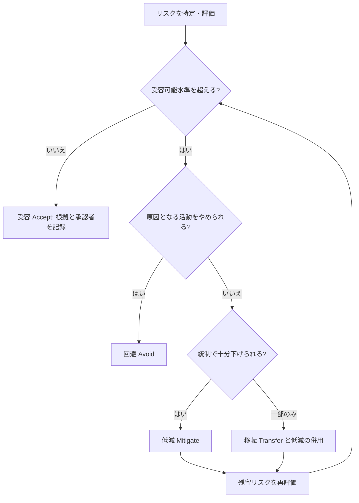

**重要ポイント**
- アーキテクトの役割は**助言**であり、**受容の最終決定は事業責任者（リスクオーナー）**。
- 移転しても**説明責任・評判リスクは残る**。
- 低減後も**残留リスク**が必ず残る。再評価のループを設計に入れる。

### 5.3 ドメイン1の根拠
[S2] 試験アウトライン／[S3] ISC2 解説記事／[S14] NIST AI RMF（AIガバナンス、第9章）

---

## 6. ドメイン2: セキュリティアーキテクチャモデリング（22%）

「**どんな型・枠組みで設計し、その設計が正しいとどう確かめるか**」を扱います。

### 6.1 サブドメイン 2.1: セキュリティアーキテクチャのアプローチ

アウトライン項目 [S2]:
- 範囲（エンタープライズ、クラウド等）と種類（ネットワーク、SOA 等）
- フレームワーク（TOGAF、SABSA、サービス指向モデリングフレームワーク）
- 参照アーキテクチャとブループリント
- 脅威モデリングフレームワーク（STRIDE、CVSS、脅威インテリジェンス）

#### 6.1.1 範囲と種類

| 切り口 | 例 | 注意点 |
|---|---|---|
| 範囲（Scope） | エンタープライズ、システム、クラウド、ソリューション | 範囲を先に決めないと要件が膨らむ |
| 種類（Type） | ネットワーク、アプリケーション、データ、SOA（サービス指向） | 種類ごとに重要な統制が異なる |

**ベストプラクティス**: 設計文書の冒頭に**スコープ・前提・制約・対象外**を明記する。

#### 6.1.2 フレームワーク

##### TOGAF（The Open Group Architecture Framework）

**まず押さえる**: 企業全体のアーキテクチャ（EA）を開発・管理するための方法論です。中核は **ADM（Architecture Development Method）**。

ADM のフェーズ: Preliminary、A（Architecture Vision）、B（Business）、C（Information Systems: データ＋アプリケーション）、D（Technology）、E（Opportunities & Solutions）、F（Migration Planning）、G（Implementation Governance）、H（Architecture Change Management）、そして全体を貫く **Requirements Management** [S15]。

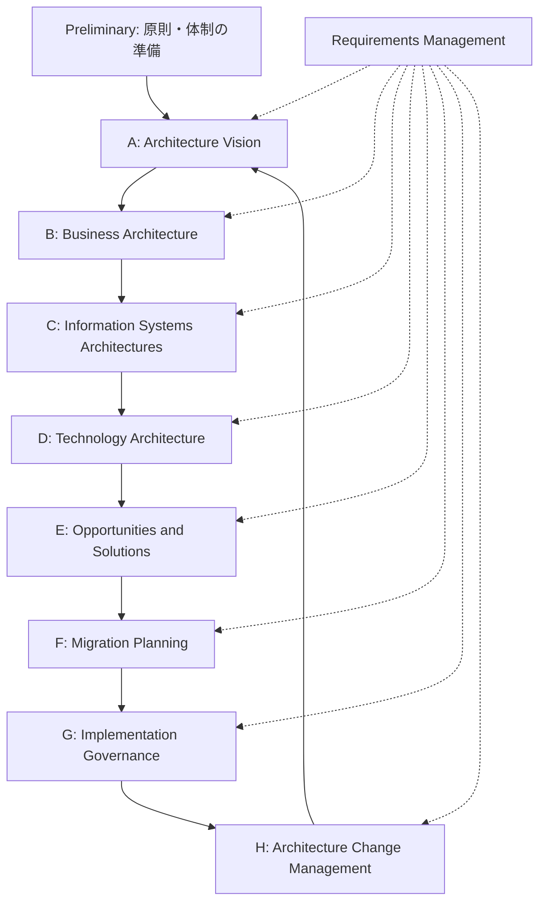

**重要ポイント**
- ADM は**反復的**で、フェーズ順を厳密な滝（ウォーターフォール）として強制しない [S15]。
- TOGAF は**汎用 EA**。セキュリティ専用ではないので、セキュリティを織り込むには SABSA 等と併用することが多い。

##### SABSA（Sherwood Applied Business Security Architecture）

**まず押さえる**: **事業要求とリスクから出発**して、上位の抽象から下位の実装へ層を下りていく、セキュリティ専用のフレームワークです [S16]。

| 層 | 視点 | 内容 |
|---|---|---|
| コンテキスト（Contextual） | ビジネスの視点 | 事業、リスクモデル、組織・関係、地理、時間依存 |
| コンセプト（Conceptual） | アーキテクトの視点 | ビジネス属性プロファイル、統制目標、セキュリティ戦略、信頼フレームワーク |
| ロジカル（Logical） | 設計者の視点 | セキュリティポリシー、セキュリティサービス、ドメイン定義 |
| フィジカル（Physical） | 構築者の視点 | ルール・手順、メカニズム、プラットフォーム・ネットワーク基盤 |
| コンポーネント（Component） | 職人の視点 | 具体的製品・技術の選定 |
| オペレーショナル（Operational） | 運用管理者の視点 | 運用継続の保証、運用リスク管理、サービス管理 |

SABSA マトリクスの縦軸（各層）に対し、横軸は **What（資産）・Why（動機）・How（プロセス）・Who（人）・Where（場所）・When（時間）** の6つの問い [S16]。

**TOGAF と SABSA の使い分け**

| 観点 | TOGAF | SABSA |
|---|---|---|
| 目的 | 企業アーキテクチャ全体の開発 | 事業駆動のセキュリティアーキテクチャ |
| 中核 | ADM（フェーズ） | マトリクス（層 × 問い） |
| 強み | 全社の整合・ガバナンス | リスク・事業属性からの追跡可能性 |
| 併用 | セキュリティの観点を SABSA で補う | EA の枠組みに SABSA を載せる |

**ベストプラクティス**: 設計判断を**事業要求までさかのぼって追跡**できるようにする（トレーサビリティ）。

##### その他: サービス指向モデリング

SOA ではサービス境界、契約（インターフェース）、メッセージ保護（署名・暗号化）、サービス間認証が主題になります。

#### 6.1.3 参照アーキテクチャとブループリント

**まず押さえる**: ゼロから設計せず、**実績ある型を出発点にして自社要件に合わせて調整**します。

- 例: NIST SP 800-207 のゼロトラストの論理構成 [S10]、クラウド事業者の参照アーキテクチャ、業界別の参照モデル。
- **ブループリント**は、再利用可能な設計テンプレート（承認済みの構成パターン）。

**ベストプラクティス**: 標準パターン（承認済み構成）を用意すると、**一貫性が上がり、例外申請が可視化**される。

##### 参考: ゼロトラストの論理構成

NIST SP 800-207 は、ゼロトラストを「**資産やアカウントに、ネットワーク上の位置だけで暗黙の信頼を与えない**」考え方と整理し、守る対象をネットワークセグメントではなく**リソース**に置きます [S10]。

| 主要コンポーネント | 役割 |
|---|---|
| PE（Policy Engine） | 信頼度評価でアクセス可否を判断 |
| PA（Policy Administrator） | 判断を実行に移す（セッション確立・遮断の指示） |
| PEP（Policy Enforcement Point） | リソースの手前で通信を許可・遮断 |

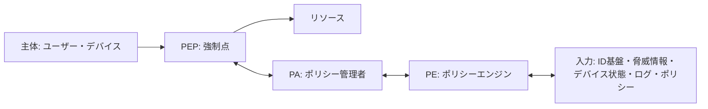

##### 7つの基本原則（概要）

1. すべてのデータソースと計算サービスをリソースとみなす
2. ネットワークの場所に関係なく通信を保護する
3. リソースへのアクセスはセッション単位で許可する
4. アクセスは動的ポリシー（主体・資産の状態・環境）で決める
5. 所有・関連するすべての資産の完全性とセキュリティ態勢を監視・測定する
6. 認証と認可はアクセス許可前に動的に厳格に実施する
7. 資産・ネットワーク・通信の状態をできるだけ収集し、態勢改善に使う

（概念の要約。正確な文言は [S10] 本文で確認してください）

#### 6.1.4 脅威モデリングフレームワーク

**まず押さえる**: 攻撃者視点で「**何が、どこで、どう壊されうるか**」を設計段階で洗い出す手法です。

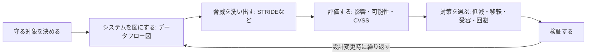

##### STRIDE

| 文字 | 脅威 | 侵害される性質 | 対策の方向性 |
|---|---|---|---|
| S | Spoofing（なりすまし） | 認証 | 強い認証、相互認証 |
| T | Tampering（改ざん） | 完全性 | 署名、MAC、アクセス制御 |
| R | Repudiation（否認） | 否認防止 | 監査ログ、デジタル署名 |
| I | Information Disclosure（情報漏えい） | 機密性 | 暗号化、アクセス制御、最小開示 |
| D | Denial of Service（サービス拒否） | 可用性 | 冗長化、レート制限、DDoS対策 |
| E | Elevation of Privilege（権限昇格） | 認可 | 最小権限、入力検証、分離 |

STRIDE は Microsoft が分類に使ってきた手法で、脅威カテゴリの**網羅性を助ける**ものです。ただし**カテゴリ間に重なりがあり、厳密な分類機構ではない**点に注意してください [S18]。

##### CVSS（Common Vulnerability Scoring System）

- FIRST が管理する**脆弱性の深刻度**スコア（0〜10）[S17]。
- v4.0 の指標グループは **Base / Threat / Environmental / Supplemental** の4つ [S17]。
- 表記: **CVSS-B**（Base）、**CVSS-BT**、**CVSS-BE**、**CVSS-BTE** [S17]。
- **Supplemental は最終スコアを変えない**（追加の洞察用）[S17]。

| 指標グループ | 意味 | 誰が使う |
|---|---|---|
| Base | 脆弱性固有で、時間・環境で変わらない性質 | 発行者・ベンダー |
| Threat | 時間とともに変わる脅威状況（悪用の成熟度など） | 利用者 |
| Environmental | 利用者環境固有の事情（代替統制、資産重要度） | 利用者 |
| Supplemental | 自動化可能性など、追加の判断材料 | 利用者 |

> **最重要**: CVSS は**深刻度（severity）であり、リスクではない**。リスク判断には脅威情報と資産の事業的重要度を組み合わせる。

##### 脅威インテリジェンス

実際の攻撃者の手口（戦術・技術・手順）、悪用されている脆弱性、攻撃インフラ情報を、脅威モデルの**発生可能性の根拠**として使います。

**ベストプラクティス（脅威モデリング）**
- **設計の早い段階**で実施し、**設計変更のたびに更新**する。
- 開発者・運用・事業担当を巻き込む（セキュリティ担当だけで完結させない）。
- 結果は**対策の追跡可能なバックログ**にし、検証で閉じる。

### 6.2 サブドメイン 2.2: 設計の検証と妥当性確認

アウトライン項目 [S2]:
- 脅威モデリングの結果（脅威ベクトル、影響、確率）
- ギャップ
- 代替ソリューション／緩和策／補完統制
- 内部または外部第三者による検証（机上演習、モデリングとシミュレーション、機能の手動レビュー、ピアレビュー）
- コードレビュー手法（動的、手動、静的、ソース構成分析）

**検証（Verification）と妥当性確認（Validation）の違い**

| 用語 | 問い | 例 |
|---|---|---|
| 検証 Verification | 仕様どおりに**作ったか** | 設計レビュー、コード解析、構成確認 |
| 妥当性確認 Validation | 要求を**満たすものを作ったか** | 受入テスト、机上演習での運用確認 |

#### 6.2.1 ギャップと代替策・補完統制

- **ギャップ分析**: 要求（法規・標準・リスク対応）と現状設計の差を一覧化する。
- **補完統制（Compensating Control）**: 本来の統制が実施不可の場合の代替手段。**元の統制の意図と同等以上のリスク低減**を示す必要がある。

#### 6.2.2 検証手法

| 手法 | 目的 | 補足 |
|---|---|---|
| 機能受入テスト | 要件どおり動くか | 事業部門が参加 |
| 回帰テスト | 変更で既存の統制が壊れていないか | CI で自動化 |
| 机上演習（Tabletop） | 手順・役割・判断の確認 | 技術実装を伴わない対話型 |
| モデリング・シミュレーション | 負荷・障害・攻撃の影響予測 | 実環境に影響を与えず試せる |
| ピアレビュー | 設計の見落としを他者が発見 | 設計書・構成図の相互確認 |
| 外部第三者評価 | 独立性・客観性の確保 | 侵入テスト、設計レビュー |

#### 6.2.3 コードレビュー手法

| 手法 | 内容 | 長所 | 短所 |
|---|---|---|---|
| 静的（SAST） | 実行せずソースを解析 | 早期・網羅的 | 誤検知、実行時の問題は不可 |
| 動的（DAST） | 実行中のアプリを外部から試験 | 実際の挙動を確認 | 到達できない経路は見落とす |
| 手動レビュー | 人が読む | 業務ロジックの欠陥に強い | 時間とスキルが必要 |
| ソース構成分析（SCA） | 依存ライブラリの既知脆弱性・ライセンスを確認 | サプライチェーン対策 | 未知の脆弱性は検出不可 |

**ベストプラクティス**
- 手法を**組み合わせる**（単一手法で十分とはしない）。
- 重大な設計は**独立した第三者**が検証する（作成者が自分で承認しない＝職務分掌）。
- 検証で見つかったギャップは**リスク登録簿へ戻す**。

### 6.3 ドメイン2の根拠
[S2] 試験アウトライン／[S15] TOGAF／[S16] SABSA／[S17] CVSS／[S18] STRIDE／[S10] NIST SP 800-207

---

## 7. ドメイン3: インフラ・システムセキュリティアーキテクチャ（32%）

最大配分のドメインです。範囲が広いため、**3.1（要件）→ 3.2（設計）→ 3.3（暗号）**の順に整理します。

### 7.1 サブドメイン 3.1: インフラ・システムのセキュリティ要件

アウトライン項目 [S2]:
- 展開モデル（オンプレミス、クラウド、ハイブリッド）
- IT と運用技術（OT）
- 物理セキュリティ（境界防護、内部ゾーニング、消火設備）
- インフラ・システムの監視
- インフラ・システムの暗号
- アプリケーションセキュリティ（要件追跡マトリクス、セキュリティアーキテクチャ文書、セキュアコーディング）

#### 7.1.1 展開モデル

| モデル | 特徴 | セキュリティ上の主な論点 |
|---|---|---|
| オンプレミス | 全層を自組織が管理 | 物理・基盤の責任がすべて自組織 |
| パブリッククラウド | 事業者が基盤を提供 | **共有責任モデル**、設定ミス、データ所在 |
| プライベートクラウド | 専用環境 | 運用負担、統制の自由度 |
| ハイブリッド | 上記の組み合わせ | **境界が曖昧**、ID・ネットワーク・鍵の一貫性 |

**ベストプラクティス**: 展開モデルに関わらず、**ID・ログ・鍵管理・ポリシーを一貫して適用**できる構成にする。

#### 7.1.2 IT と OT の違い

| 観点 | IT | OT（制御系） |
|---|---|---|
| 一般的な優先順位（システムにより異なる） | 機密性 → 完全性 → 可用性 | **安全性 → 可用性 → 完全性 → 機密性** |
| 更新 | 頻繁なパッチ | 長期稼働、パッチ困難 |
| ライフサイクル | 数年 | 数十年 |
| 通信 | 標準 IP 中心 | 産業用プロトコル、レガシー |

#### 7.1.3 物理セキュリティ要件

- **境界防護**: 敷地・建物・フロア・室・ラックの**同心円状**の層。
- **内部ゾーニング**: 区域ごとに権限を分け、重要区画ほど認証を強化。
- **消火設備**: 電子機器には、水損害を避ける方式（ガス系消火、プレアクション方式など）を検討。
- CPTED（環境設計による犯罪予防）の考え方: 見通し、自然監視、領域性の明確化。

#### 7.1.4 アプリケーションセキュリティ要件

| 成果物・概念 | 意味 |
|---|---|
| **要件追跡マトリクス（RTM）** | 要件 → 設計 → 実装 → テストを紐づける表。**要求の漏れ・過剰を検出** |
| セキュリティアーキテクチャ文書 | 設計判断・統制配置・信頼境界・前提を記録 |
| セキュアコーディング | 入力検証、出力エンコード、エラー処理、秘密情報の扱いなど |

#### 7.1.5 要件の考え方

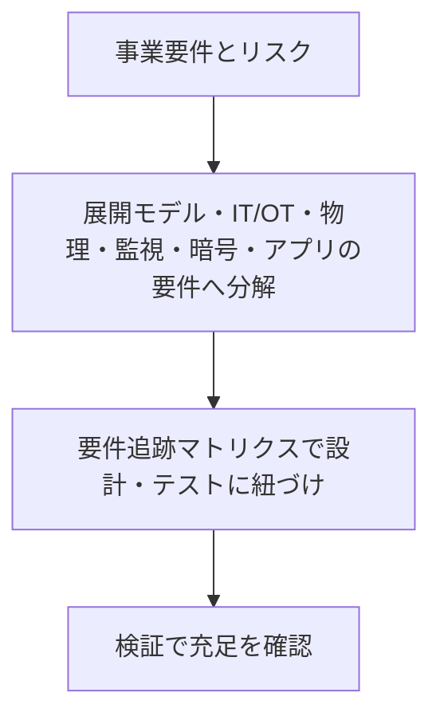

### 7.2 サブドメイン 3.2: インフラ・システムの設計

アウトライン項目 [S2]（要約）: 物理統制、プラットフォーム、ネットワーク、ストレージ、データリポジトリ、クラウド、OT、エンドポイント、共有サービス、第三者連携、インフラ監視、コンテンツ監視、帯域外通信、システム構成要素への統制適用性の評価。

#### 7.2.1 物理セキュリティの統制セット

| 統制 | 例 | 留意点 |
|---|---|---|
| 抑止・検知 | カメラ、照明、警報 | 映像の保管期間・プライバシー規制 |
| 遅延 | フェンス、扉、錠 | 層で時間を稼ぐ |
| 認証 | カード、生体、PIN | 多要素化、共連れ防止（マントラップ） |
| 制御 | ドアコントローラ、リーダー | 通信の保護（旧式の方式は暗号化がなく弱い。セキュアチャネル対応方式を選ぶ） |
| 対応 | 警備、手順 | 訓練と記録 |

**ベストプラクティス**: 物理統制の**システム（コントローラ・カメラ・ネットワーク）自体もIT資産**として保護・パッチ・監視する。

#### 7.2.2 プラットフォームセキュリティ

| 対象 | 主な統制 |
|---|---|
| 物理サーバ | BIOS/UEFI 保護、セキュアブート、TPM、物理アクセス制限 |
| 仮想 | ハイパーバイザの堅牢化、VM 間分離、管理面の分離、VM エスケープ対策 |
| コンテナ | 信頼できるイメージ、脆弱性スキャン、最小権限（非 root）、読み取り専用ファイルシステム、ネットワークポリシー |
| ファームウェア | 署名検証、改ざん検知、更新の保護 |
| OS | 堅牢化ベースライン、不要サービス停止、パッチ管理、構成の継続検査 |

**ベストプラクティス**: **ゴールデンイメージ**と構成管理で、逸脱を検出・自動修復する。

#### 7.2.3 ネットワークセキュリティ

##### ゾーニングと分離の基本

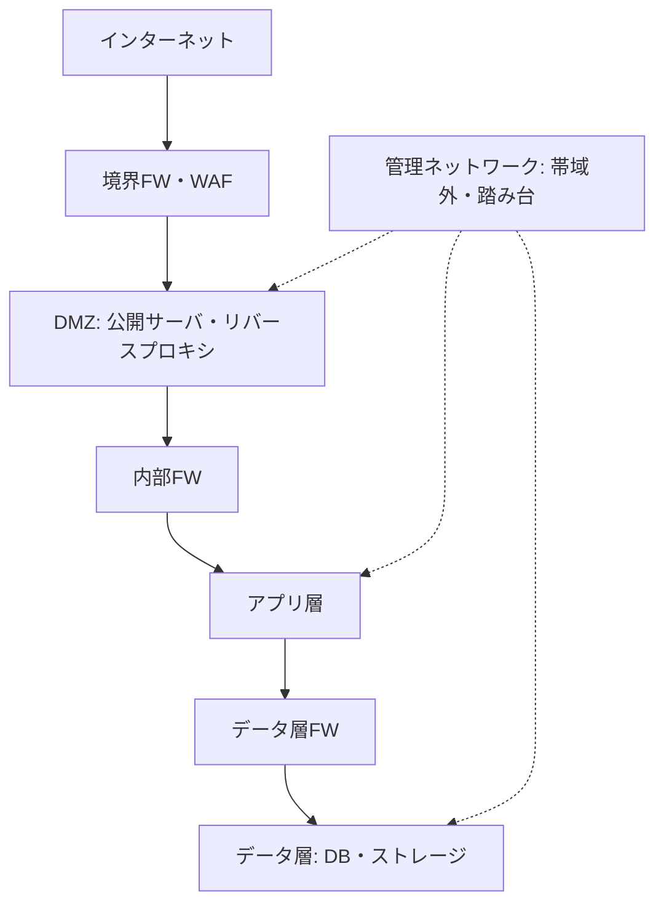

**重要ポイント**: 管理用通信は、業務通信と**別の経路・別の認証**で隔離する。

##### 要素別の整理

| 要素 | 要点 | ベストプラクティス |
|---|---|---|
| ファイアウォール | ステートフル、次世代（アプリ識別）、プロキシ型 | **デフォルト拒否**、ルールの定期棚卸し |
| WAF | Web アプリ層（HTTP）を保護 | ネットワーク FW の代替ではなく**補完** |
| VPN / IPsec | IPsec は AH/ESP と IKE。トンネルモードは拠点間、トランスポートモードはホスト間 | 強い暗号スイート、証明書認証、分割トンネルのリスク評価 |
| NAC | 接続端末の認証・健全性確認（802.1X など） | 検疫 VLAN、ゲスト分離 |
| DNS | 名前解決の保護が重要 | DNSSEC、再帰の制限、DNS 監視・フィルタリング |
| NTP | 時刻はログ相関・証明書・Kerberos の基盤 | 内部の信頼できる時刻源、認証付き時刻同期 |
| VoIP | 盗聴・なりすまし・DoS | 信号と音声の暗号化、音声 VLAN 分離、境界装置 |
| 無線 | 認証と暗号の選択が要 | 企業は 802.1X 認証（証明書ベース）を優先、ゲストは分離 |
| IoT | 脆弱・更新困難 | **専用セグメント**、通信先の最小化、既定パスワード排除 |
| SDP（ソフトウェア定義境界） | 認証・認可後にのみ接続経路が見える | ゼロトラストの実装手段の1つ |
| エアギャップ | 物理的に分離 | USB 等の**リムーバブル媒体が最大の穴**。運用手順が必須 |

##### マイクロセグメンテーション

ワークロード単位で通信を最小化し、**侵入後の横移動（ラテラルムーブメント）を抑える**。東西トラフィックの可視化が前提。

#### 7.2.4 ストレージセキュリティ

| 方式 | 説明 | 統制 |
|---|---|---|
| DAS | サーバ直結 | OS アクセス制御、暗号化 |
| SAN | ブロックレベルのネットワーク | ゾーニング、LUN マスキング、管理面の分離 |
| NAS | ファイルレベルの共有 | 共有権限、プロトコル保護 |
| アーカイブ・リムーバブル | 長期保存、持ち運び | 暗号化、保管場所の施錠、**媒体の廃棄・消去手順** |

**ベストプラクティス**: **保存時暗号化**＋**鍵を別管理**。廃棄時は暗号鍵の破棄（暗号的消去）も選択肢。

#### 7.2.5 データリポジトリのセキュリティ

| 統制 | 目的 |
|---|---|
| アクセス制御 | 最小権限、行・列レベル制御 |
| 暗号化 | 保存時・通信時 |
| 墨消し（Redaction） | 不要な部分を除去して共有 |
| マスキング | 表示・非本番利用時に値を置換（静的／動的） |
| トークン化 | 実値を代替値に置換し、実値は別の保護領域へ |
| 監査 | 特権アクセス・大量取得の監視 |

#### 7.2.6 クラウドセキュリティ

| サービスモデル | 利用者の主な責任 | 事業者の主な責任 |
|---|---|---|
| IaaS | OS・ミドルウェア・アプリ・データ・ID・ネットワーク設定 | 物理・ハイパーバイザ |
| PaaS | アプリ・データ・ID・設定 | 基盤・OS・ランタイム |
| SaaS | データ・ID・利用設定 | ほぼすべての基盤とアプリ |

**重要**: どのモデルでも、**データと ID の責任は利用者に残る**。

**ベストプラクティス**
- **設定ミス**が最大要因の1つ → ポリシー・アズ・コード、構成の継続検査（CSPM）。
- ID を境界とし、**最小権限・短命の資格情報**を使う。
- 鍵は **KMS/HSM** で管理し、必要に応じて利用者管理鍵（BYOK/HYOK）を検討。
- ログ・監視を**事業者の標準機能＋自社 SIEM**で二重化。
- 複数クラウド・ハイブリッドでは**統一ポリシー**で一貫性を確保。

#### 7.2.7 運用技術（OT）セキュリティ

**パデュー・モデル（階層）と ゾーン／コンデュイット**

| レベル | 内容 | 代表資産 |
|---|---|---|
| 0〜1 | 現場機器・基本制御 | センサー、アクチュエータ、PLC、RTU |
| 2 | 監視制御 | HMI、エンジニアリング端末、SCADA サーバ |
| 3 | 運用管理 | MES、ヒストリアン |
| 4〜5 | 企業 IT | 業務システム、インターネット接続 |

出典（二次情報）: [S19]

- **ゾーン**: 似たセキュリティ要件を持つ資産のグループ。**コンデュイット**: ゾーン間の管理された通信路。IEC 62443 の考え方 [S19]。
- IT と OT の間には **DMZ** を置き、直接通信を避ける。

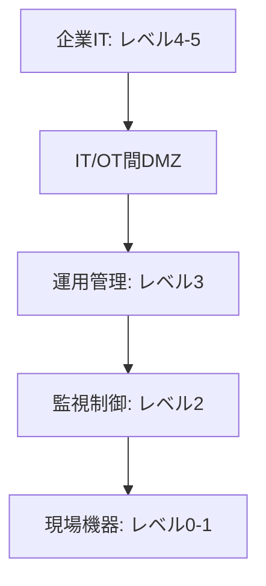

**ベストプラクティス**
- **安全（人命・環境）と可用性を最優先**に、セキュリティ統制が制御を妨げないようにする。
- パッチが当てられない資産は**補完統制**（ネットワーク分離、産業用ゲートウェイ、許可リスト）。
- OT の監視は、**制御に影響しない受動的監視**を基本とする。
- リモート保守は、**多要素認証・踏み台・セッション記録**を必須にする。

#### 7.2.8 エンドポイントセキュリティ

| 論点 | 統制 |
|---|---|
| BYOD / モバイル | MDM/MAM、業務領域の分離、紛失時のリモートワイプ、準拠確認 |
| EDR | 端末上の挙動を継続監視し、検知・封じ込め・調査 |
| HIDS / HIPS | ホスト上のファイル・ログ・挙動の検知／防御 |
| 基本衛生 | 堅牢化、パッチ、ディスク暗号化、アプリ許可リスト |

#### 7.2.9 共有サービス

- **電子メール**: 送信ドメイン認証（SPF・DKIM・DMARC）、通信路暗号化、添付・URL の検査。
- **VoIP・ユニファイドコミュニケーション**: 管理面・信号・メディアを保護し、外部連携先を限定。

#### 7.2.10 第三者連携

| 連携 | 統制 |
|---|---|
| 内部／外部連携 | 信頼境界の明示、最小限の通信許可 |
| フェデレーション | 標準プロトコル、属性の最小化、信頼関係の管理（第8章） |
| API | 認証・認可、レート制限、入力検証、API ゲートウェイ、ログ |
| VPN | 拠点間・パートナー間は IPsec 等、終端の管理を明確に |
| SFTP | ファイル連携。鍵認証、ディレクトリ分離、保持期間の管理 |

#### 7.2.11 監視（インフラ・コンテンツ）

- **インフラ監視**: ネットワーク・ホスト・クラウドのログとフローを集約し、SIEM／NDR で相関分析。
- **コンテンツ監視**: メール・Web・データ・SNS を対象に、DLP で機密データの持ち出しを検知／防止。

**ベストプラクティス**
- 監視は**「何を検知したいか」から逆算**して収集対象を決める。
- 暗号化通信の可視化（復号箇所）は**プライバシー・法規要件**と併せて設計する。

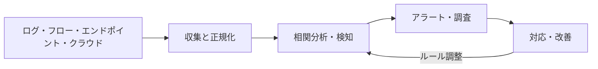

#### 7.2.12 帯域外通信（Out-of-Band）

**まず押さえる**: **業務ネットワークが使えない／信頼できない状況**でも使える別経路の通信です。

- 用途: インシデント対応の連絡、IT システム管理（IPMI 等の管理インタフェース）、事業継続・災害復旧（BC/DR）。
- **ベストプラクティス**: 管理系を別ネットワークに分離し、**踏み台＋MFA**で接続。緊急連絡手段は平時から訓練。

#### 7.2.13 システム構成要素への統制の適用性評価

Web クライアント、プロキシ、アプリケーションサービスなど、**構成要素ごとに「どの統制が効くか」を判断**する。

| 構成要素 | 効く統制の例 |
|---|---|
| Web クライアント | ブラウザ分離、CSP、更新管理 |
| プロキシ | URL フィルタ、TLS 検査、認証連携 |
| アプリケーションサービス | 認証・認可、入力検証、シークレット管理 |

### 7.3 サブドメイン 3.3: 暗号ソリューションの設計

アウトライン項目 [S2]:
- 暗号設計の考慮事項と制約（技術、ライフサイクル、計算能力、アルゴリズム、システム内の攻撃）
- 暗号の実装（通信中、使用中、保存時）
- 鍵管理ライフサイクルの計画（生成、保管、配布）

#### 7.3.1 設計の考慮事項

| 観点 | 論点 |
|---|---|
| 目的 | 機密性・完全性・認証・否認防止のどれを満たすか |
| 制約 | 端末の計算能力、遅延、帯域、規制（承認アルゴリズム） |
| ライフサイクル | アルゴリズム・鍵・証明書の**寿命と更新** |
| 攻撃 | 鍵漏えい、実装の脆弱性、サイドチャネル、プロトコルダウングレード |
| **暗号アジリティ** | アルゴリズムを**差し替え可能**にしておく |

**ベストプラクティス**: **標準化・承認済みのアルゴリズムと検証済みの実装**を使う。**独自暗号は作らない**（公開設計の原則）。

#### 7.3.2 データの状態別の暗号実装

| 状態 | 保護 | 例 | 注意点 |
|---|---|---|---|
| 保存時（At rest） | ディスク／DB／オブジェクトの暗号化 | 自己暗号化ドライブ、透過的暗号化 | 鍵を**データと別**に管理 |
| 通信中（In transit） | TLS、IPsec、SSH | 相互 TLS、VPN | 旧版プロトコル・弱い暗号スイートを無効化 |
| 使用中（In use） | 実行中のデータの保護 | TEE（信頼実行環境）、機密コンピューティング | 対象ワークロードと性能影響を評価 |

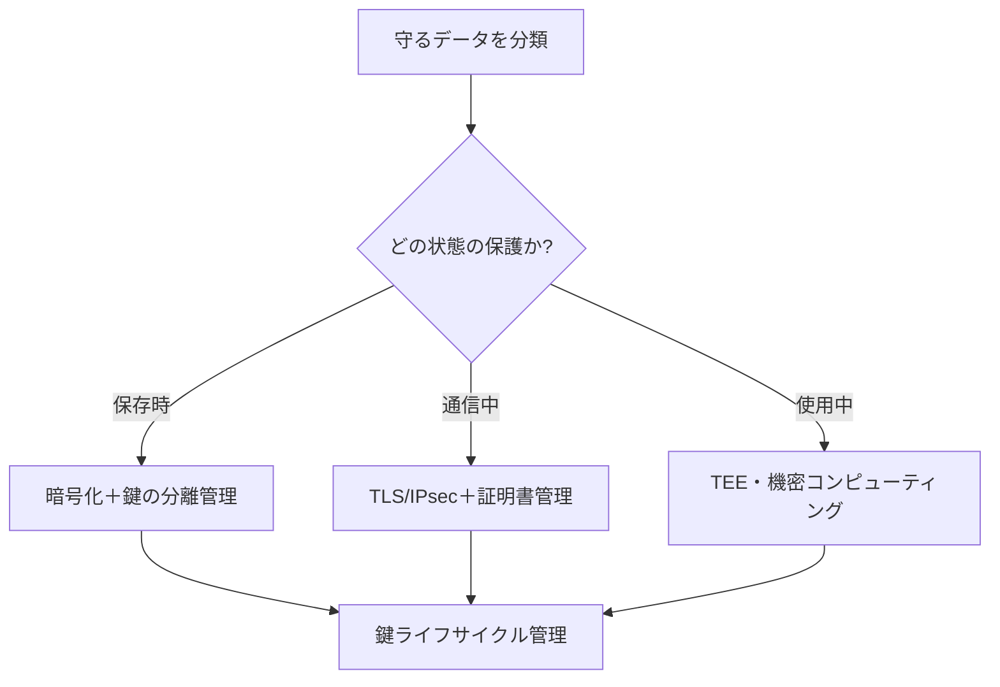

#### 7.3.3 鍵管理ライフサイクル

NIST SP 800-57 Part 1 は、鍵管理の汎用ガイダンスで、鍵の**用途、暗号期間（cryptoperiod）、監査、鍵管理システムの存続性**などを扱います [S12]。また、**弱い鍵管理は強いアルゴリズムも無力にする**旨を明記しています [S12]。

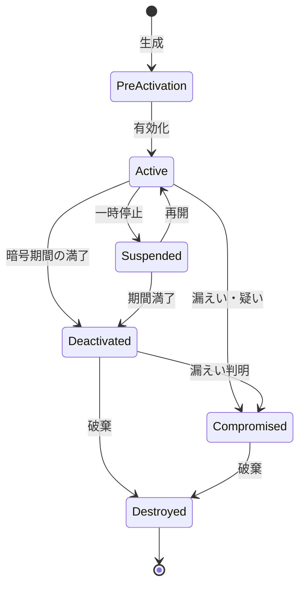

| 段階 | やること |
|---|---|
| 生成 | 承認された乱数源・HSM 内で生成 |
| 保管 | HSM/KMS、鍵の暗号化（鍵階層：マスター鍵 → 鍵暗号化鍵 → データ鍵） |
| 配布 | 安全な経路、公開鍵基盤（PKI）の活用 |
| 利用 | 用途の分離（署名用と暗号化用を分ける） |
| ローテーション | 暗号期間に基づく更新 |
| バックアップ・回復 | エスクロー/分割管理（必要に応じて） |
| 失効・破棄 | 漏えい時の迅速な失効、確実な消去 |

**ベストプラクティス**
- **職務分掌**: 鍵の管理者とデータの管理者を分ける。重要鍵は**二人制（デュアルコントロール）／分割知識**。
- 鍵の**使用を監査ログに記録**する。
- **証明書の有効期限切れ**は障害の典型原因 → 自動更新と棚卸し。

#### 7.3.4 ポスト量子暗号（PQC）への備え

- NIST は 2024年8月13日に **FIPS 203（ML-KEM）、FIPS 204（ML-DSA）、FIPS 205（SLH-DSA）** を最終化しました [S13]。
- NIST IR 8547（移行計画）の**提案**: 量子脆弱な公開鍵暗号のうち、112ビット強度のもの（RSA-2048 など）は **2030年以降非推奨、2035年以降使用禁止**。128ビット以上のもの（ECC P-256、RSA-3072 など）は2030年以降の非推奨区分には含まれず、**2035年以降使用禁止** [S13]。**提案段階の内容を含む**ため、最新の確定状況を確認してください。
- 実務の第一歩は、**暗号資産の棚卸し（どこで何の暗号を使っているか）** [S13]。

**ベストプラクティス**
- **暗号アジリティ**を設計要件にする。
- 「今盗んで将来解読する（Harvest Now, Decrypt Later）」リスクがある**長期機密データ**を優先して計画する。
- 移行初期は**ハイブリッド方式**（従来＋PQC の併用）を検討 [S13]。

### 7.4 ドメイン3の根拠
[S2] 試験アウトライン／[S12] NIST SP 800-57／[S13] PQC／[S19] OT（二次）／[S10] ゼロトラスト

---

## 8. ドメイン4: IAMアーキテクチャ（25%）

IAM は**「誰が」「何に」「どの条件で」アクセスできるかを設計する**領域です。サブドメインは **ライフサイクル → 認証 → 認可 → アカウンティング**の4つで、これは **IAAA（Identification・Authentication・Authorization・Accounting）**の流れに対応します。

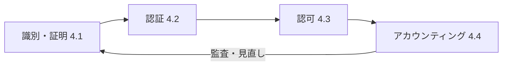

### 8.1 サブドメイン 4.1: アイデンティティライフサイクル

アウトライン項目 [S2]: 身元の確立と確認（物理・論理）、識別子の割り当て（ユーザー・サービス・プロセス・デバイス・コンポーネント）、プロビジョニング／デプロビジョニング（入社・異動・退社）、IDM 技術。

#### 8.1.1 身元確立と確認（アイデンティティ・プルーフィング）

NIST SP 800-63-4（2025年7月最終版）は、**身元確認（63A）・認証（63B）・フェデレーション（63C）**の3つの保証水準を扱います [S11]。

| ボリューム | 内容 | 水準 |
|---|---|---|
| 800-63A-4 | 身元確認と登録 | IAL |
| 800-63B-4 | 認証と認証器の管理 | AAL |
| 800-63C-4 | フェデレーション | FAL |

Rev.4 の主な更新: リスク管理の更新、継続評価指標、不正対策の強化、**ディープフェイク等の偽造メディア・インジェクション攻撃への対策**、**同期型認証器（同期パスキー）**の統合、**利用者管理ウォレット**のフェデレーションモデルへの追加 [S11]。

**ベストプラクティス**: 身元確認の厳格さは**リスク（保護対象・権限の大きさ）に比例**させる。

#### 8.1.2 識別子の割り当て

- 識別子は**一意**で、**再利用しない**（過去の権限・ログとの混同を防ぐ）。
- 対象は人だけでなく、**サービス・プロセス・デバイス・コンポーネント**にも付与する。
- 人の識別子と、アクセス権限（ロール・属性）は**分けて管理**する。

#### 8.1.3 プロビジョニング／デプロビジョニング（JML）

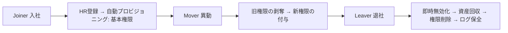

**重要ポイント（試験頻出）**
- **異動（Mover）**で旧権限が残る「**権限の蓄積（クリープ）**」が典型的な弱点。
- 退職時は**即時のアクセス停止**が原則。
- **HR を信頼できる情報源（Source of Truth）**として自動連携する。

#### 8.1.4 IDM 技術

| 技術 | 役割 |
|---|---|
| ディレクトリサービス | ID・属性の保管（LDAP 等） |
| IdP（ID プロバイダ） | 認証と ID 情報の発行 |
| IGA（ID ガバナンス） | 申請・承認・棚卸し・職務分掌検査 |
| プロビジョニング連携 | 外部サービスへの自動作成・削除（標準プロトコル活用） |

### 8.2 サブドメイン 4.2: アイデンティティ認証

アウトライン項目 [S2]: 認証アプローチ（単要素、多要素、リスクベース昇格）、認証プロトコル・技術（SAML、RADIUS、Kerberos、OAuth）、認証制御プロトコル・技術（XACML、LDAP）、信頼関係（フェデレーション、スタンドアロン）。

#### 8.2.1 認証アプローチ

| 要素 | 例 |
|---|---|
| 知識（Something you know） | パスワード、PIN |
| 所持（Something you have） | ハードウェアトークン、スマートカード、パスキー |
| 生体（Something you are） | 指紋、顔 |
| 場所・行動 | 位置、操作パターン（補助的） |

**重要**: **多要素＝異なる種類の要素を組み合わせる**こと。パスワードと秘密の質問は**同じ「知識」要素**で、多要素ではありません。

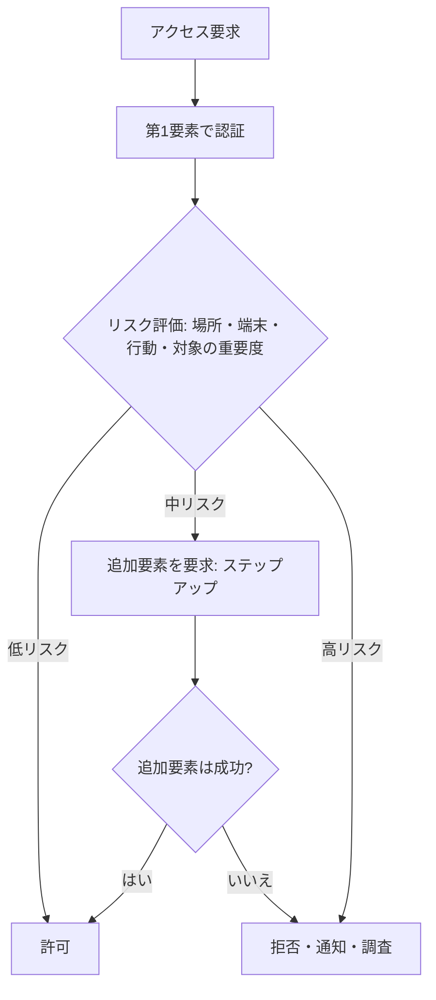

**ベストプラクティス**
- 特権・外部公開・高リスク操作は**多要素必須**、可能なら**フィッシング耐性のある認証（パスキー等）**。
- 認証強度は NIST 800-63B の **AAL** を目安に、リスクに合わせて選ぶ [S11]。
- **リスクベース（適応型）認証**で、利便性と安全性を両立する。

#### 8.2.2 認証プロトコル・技術

| プロトコル | 何をするか | 要点 |
|---|---|---|
| **SAML** | Web SSO / フェデレーション用の **アサーション**交換 | IdP と SP。XML ベース。企業向け SSO に多い |
| **RADIUS** | ネットワークアクセスの AAA | UDP ベース。VPN・無線（802.1X）の認証で使用 |
| **Kerberos** | チケットベースの認証と SSO（相互認証は要求時のみ） | KDC（AS・TGS）。**時刻同期が必須**。パスワードをネットワークに流さない |
| **OAuth 2.0** | **認可**の委譲フレームワーク | 認証プロトコルではない。アクセストークンを発行 [S20] |
| OpenID Connect | OAuth 2.0 上の**認証**レイヤ | ID トークンでログイン |
| LDAP | ディレクトリへの問い合わせ・認証（バインド） | **LDAPS または StartTLS で保護** |
| XACML | **アクセス制御ポリシーの記述・判断**の標準 | PEP/PDP/PAP/PIP の構成。ABAC で使用 |

**OAuth 2.0 の4つの役割**: リソースオーナー、クライアント、認可サーバー、リソースサーバー。認可サーバーがリソースオーナーの認証・認可を経てクライアントにアクセストークンを発行します [S20]。

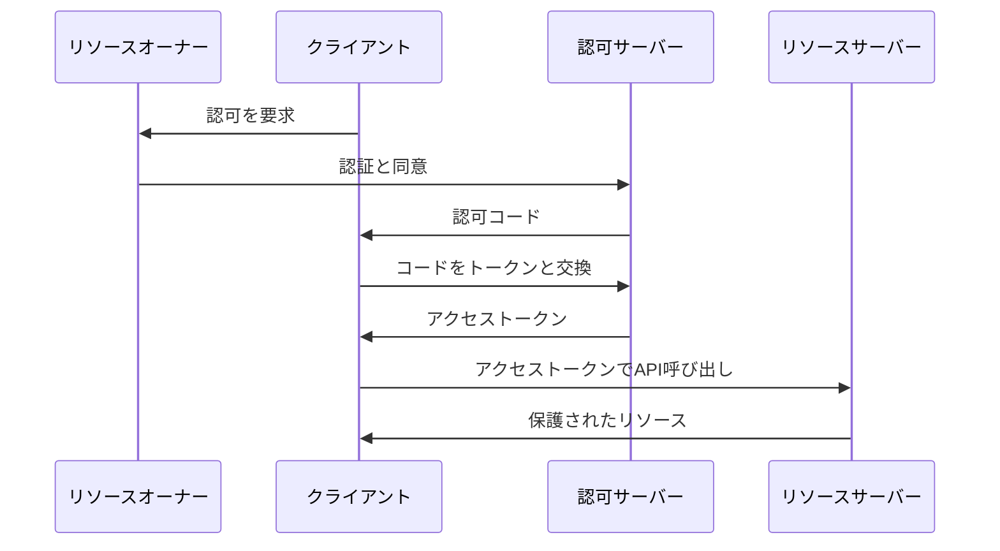

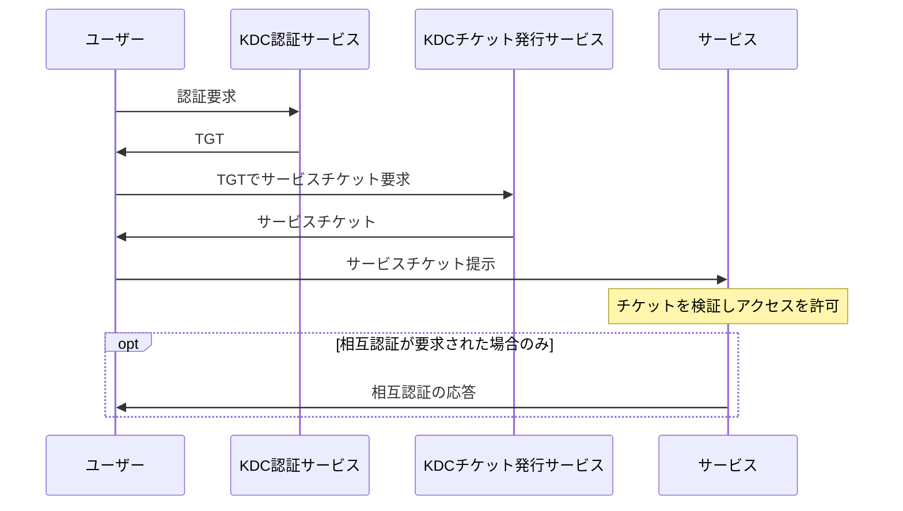

**試験での判断ポイント**

| 場面 | 選ぶもの |
|---|---|
| 社内 Web アプリへのクロスドメイン SSO | SAML（または OIDC） |
| API/モバイルへの権限委譲 | OAuth 2.0 |
| ドメイン内のシングルサインオン | Kerberos |
| VPN・無線・ネットワーク機器のユーザー認証 | RADIUS（機器管理には TACACS+ も） |
| 属性ベースの細粒度ポリシー判断 | XACML 系の PEP/PDP |

#### 8.2.3 信頼関係

| 種類 | 説明 | 留意点 |
|---|---|---|
| フェデレーション | 組織間で認証結果（アサーション）を信頼 | 契約・技術・属性共有の取り決め、アサーション署名の検証 |
| スタンドアロン | 組織内で完結 | 管理負担が大きく、ID が乱立しやすい |
| 一方向／双方向 | 信頼の向き | 必要最小限の向きに限定 |
| 推移的（Transitive） | A→B→C と連鎖 | 意図しない範囲に信頼が広がる |

**ベストプラクティス**: 外部 IdP を信頼する際は、**発行する属性の最小化**、**アサーションの有効期限・署名の検証**、**信頼関係の定期レビュー**を行う。

### 8.3 サブドメイン 4.3: アイデンティティ認可

アウトライン項目 [S2]: 認可の概念と原則（任意/強制、SoD、最小権限、対話的/非対話的）、認可モデル（物理・論理・管理）、プロセスとワークフロー（ガバナンス、発行、定期レビュー、失効、停止）、ロール・権利・責任（グループ、DRM、信頼関係）、特権アカウント管理（PAM）、認可アプローチ（SSO、ルールベース、ロールベース、属性ベース、トークン、証明書）。

#### 8.3.1 アクセス制御モデル

| モデル | 決める人・基準 | 特徴 | 向く場面 |
|---|---|---|---|
| DAC（任意） | リソースの所有者 | 柔軟だが統制が分散 | 一般ファイル共有 |
| MAC（強制） | システムのポリシー（ラベル） | 厳格、ユーザーは変更不可 | 機密区分の厳格な環境 |
| RBAC（ロール） | 職務ロール | 管理しやすい、**ロール爆発**に注意 | 業務が定型的な組織 |
| ABAC（属性） | 主体・資源・環境の属性 | **細粒度・動的** | クラウド・ゼロトラスト |
| ルールベース | 事前定義ルール | 時間帯・場所などの条件 | ネットワーク FW 等 |

#### 8.3.2 認可のワークフロー

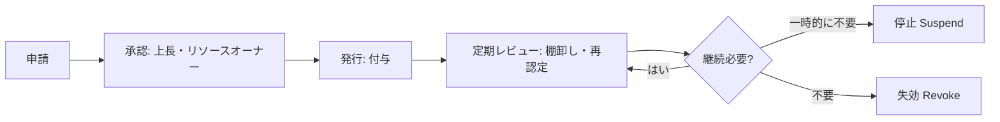

**ベストプラクティス**
- **最小権限**＋**職務分掌**（申請者と承認者の分離、利益相反の検査）。
- **定期的な権限の見直し（アクセス再認定）**を自動化する。
- **ロール設計はビジネス職務から**。ロール数を管理し、例外は期限付きで。

#### 8.3.3 特権アカウント管理（PAM）

| 機能 | 内容 |
|---|---|
| 認証情報の保管庫 | 特権パスワード・鍵を保管、自動ローテーション |
| ジャストインタイム | 必要な時間だけ昇格（常設特権をなくす） |
| セッション管理 | 踏み台経由、セッション記録 |
| 緊急用アカウント（ブレークグラス） | 使用時に強い通知・事後レビュー |

**ベストプラクティス**: **常設の特権を最小化**し、すべての特権操作を**記録と監査**の対象にする。

#### 8.3.4 認可の補足

- **SSO**: 利便性と統制の向上。ただし **SSO の IdP が単一障害点・攻撃の標的**になる → 強い認証と冗長化。
- **DRM**: コンテンツ使用権限を、文書そのものに紐づけて制御。
- **対話的／非対話的**: 人が操作する場合と、サービス・バッチの場合で認証方式・権限設計を分ける。
- **非人間 ID**（サービスアカウント、ワークロード、AI エージェント）にも**最小権限と棚卸し**を適用する（第9章）。

### 8.4 サブドメイン 4.4: アイデンティティアカウンティング

アウトライン項目 [S2]: アカウンティング・分析・フォレンジック要件の決定、監査イベントの定義、監査ログのアラートと通知、ログ管理（保持・完全性）、ログ分析とレポート、ポリシー・規制（PCI-DSS、FISMA、HIPAA、GDPR）への準拠。

```mermaid
flowchart LR
  A["監査イベントの定義"] --> B["ログ生成と時刻同期"]
  B --> C["保護された集中保管: 改ざん防止"]
  C --> D["分析・相関: SIEM・行動分析"]
  D --> E["アラート・通知"]
  D --> F["レポート・監査証跡"]
  E --> G["調査・対応"]
  F --> H["規制準拠の証明"]
```

| 項目 | 設計の要点 |
|---|---|
| 監査イベント | 認証成功/失敗、権限変更、特権操作、重要データへのアクセス、設定変更 |
| 保持 | 規制・法令・フォレンジック要件に合わせて期間を決定 |
| 完全性 | 転送先の分離、書き込み専用（WORM）、ハッシュ・署名、**運用者が消せない** |
| 時刻 | 全システム同一の時刻源（相関分析の前提） |
| 分析 | 相関ルール、行動分析（UEBA）、異常検知 |
| 準拠 | 規制ごとの必須イベント・保持期間をマッピング |

**ベストプラクティス**
- **個人を特定できる記録**で**個人の責任追及（アカウンタビリティ）**を可能にする（共有アカウントを避ける）。
- ログ自体に**機密情報（パスワード等）を書かない**。ログも保護対象。
- ログ量は**目的から逆算**して収集し、コストと検知力のバランスを取る。

### 8.5 ドメイン4の根拠
[S2] 試験アウトライン／[S11] NIST SP 800-63-4／[S20] RFC 6749／[S10] NIST SP 800-207

---

## 9. 横断テーマ: AI セキュリティ

ISC2 の ISSAP アウトライン解説ページは、AI を**「強力な防御資産」であり、同時に「価値の高い保護対象面」**として扱う旨を説明しています [S2]。

> 注: 取得したページ本文では、見出しと本文の対応がずれて表示されていたため、**内容に基づいて**以下のように整理しています。ISC2 の原文で最終確認してください [S2]。

| 観点 | 内容（ISC2 解説の要旨） | 設計での意味 |
|---|---|---|
| **IAM と AI** | 自律型 AI エージェントや自動化サービスアカウントの ID 管理。非人間エンティティにも最小権限を強制し、AI が自ら権限昇格できない設計。行動バイオメトリクスや AI による適応型認証でゼロトラストへ | 非人間 ID を**人間と同等以上に統制** |
| **IAM の運用** | 異常検知に連動してリアルタイムに動く、自動プロビジョニング／デプロビジョニング | ハイブリッド・マルチクラウドでの**アクセス制御のオーケストレーション** |
| **モデリング** | SOAR や AI 駆動 SIEM を支える高スループットのデータパイプライン。AI モデル自体を守る「AI ファイアウォール」や、プロンプトインジェクション・モデル回避の検知用プローブの配置 | **従来資産と ML パイプラインの統一的な可視化** |
| **インフラ** | AI 学習・推論の高性能計算環境。ハードウェアルートオブトラスト、TEE（信頼実行環境）でモデル重みや学習データを保護。AI ワークロードの分離とマイクロセグメンテーション。AI 搭載のネットワークセンサー、SDP | 侵害された AI インタフェースから**横移動させない** |
| **GRC** | 「設計段階から安全かつ準拠」。**NIST AI RMF** の実装、説明を受ける権利などの要件、AI の意思決定の監査可能ログ。AI のサードパーティ・サプライチェーンのリスクアーキテクチャ | **AI 導入をリスク許容度と法的境界内に収める** |

### NIST AI RMF の骨格

NIST AI RMF 1.0（2023年1月公開）は、**自主的な**枠組みで、中核は **Govern（統治）・Map（文脈の把握）・Measure（測定）・Manage（管理）** の4機能です [S14]。

```mermaid
flowchart TD
  G["Govern: 方針・責任・文化（全体を貫く）"]
  G --- M1["Map: 文脈とリスクの把握"]
  G --- M2["Measure: 測定・評価"]
  G --- M3["Manage: 優先順位付けと対応"]
  M1 --> M2
  M2 --> M3
  M3 -- "継続的改善" --> M1
```

**ベストプラクティス**
- AI 資産（モデル、学習データ、プロンプト、接続先）を**資産台帳に含める**。
- **学習データ・モデルの完全性**を、サプライチェーン対策として保護する。
- AI の判断を**追跡できるログ**と、人間による**確認・停止（オーバーライド）**の仕組みを設計に入れる。

> 補足: ISC2 は 2026年9月1日付で「AI 試験ガイダンス」に関する記事を公開しています（見出しのみ確認、本文は未確認）[S21]。受験前に確認してください。

---

## 10. 試験対策

### 10.1 設問の読み方

1. **誰の視点か**（アーキテクト＝助言・設計。運用担当の手順ではない）
2. **何が目的か**（事業要件・リスク・規制のどれが起点か）
3. **制約は何か**（予算・時間・レガシー・可用性）
4. 選択肢を**「最初にやること」「最も適切」「最善」**の語に注意して比較する。

### 10.2 よくある判断基準

| 迷ったときの方針 | 理由 |
|---|---|
| 技術導入の前に**要件・リスクの確認** | 設計は事業起点 |
| **単一の対策より多層防御** | 一点依存は脆弱 |
| **人手の運用より自動化・標準化** | ミス削減と一貫性 |
| **例外には期限と承認と記録** | 受容は管理された形で |
| **最小権限と職務分掌**を満たす選択肢 | 基本原則 |
| **標準・承認済みの暗号／プロトコル** | 独自実装は避ける |

### 10.3 用語の混同ポイント

| 混同しやすい組 | 違い |
|---|---|
| 検証 vs 妥当性確認 | 作り方が仕様どおりか vs 要求を満たすか |
| 認証 vs 認可 | 本人確認 vs 何を許すか |
| OAuth vs OIDC vs SAML | 認可委譲 vs OAuth 上の認証 vs XML ベースの SSO/連携 |
| CVSS vs リスク | 深刻度 vs 可能性×影響×資産価値 |
| 低減 vs 移転 | 統制で下げる vs 負担を移す（責任は残る） |
| RTO vs RPO | 復旧時間 vs データ損失許容 |
| HA vs DR | 同一サイトの継続 vs 別サイトでの復旧 |
| ゾーン vs コンデュイット | 資産のグループ vs ゾーン間の通信路 |
| 暗号化 vs トークン化 vs マスキング | 鍵で可逆変換 vs 代替値に置換 vs 表示値の置換 |
| 補完統制 vs 代替統制 | 本来の統制を補う vs 同等の目的を別手段で達成（試験では「意図と同等」の根拠が鍵） |

### 10.4 8週間の学習計画例

| 週 | 内容 | 到達目標 |
|---|---|---|
| 1 | 第1〜4章、CISSP 復習、アウトライン熟読 [S4] | 4ドメインの構造を説明できる |
| 2 | D1 GRC（第5章） | リスク処理4種と契約・規制要件の設計反映 |
| 3 | D2 モデリング（第6章） | TOGAF/SABSA の違い、STRIDE と CVSS の使い分け |
| 4 | D3 前半（物理・プラットフォーム・ネットワーク） | ゾーニングと各装置の役割 |
| 5 | D3 後半（ストレージ・クラウド・OT・暗号） | 共有責任、OT の優先順位、鍵ライフサイクル |
| 6 | D4 IAM（第8章） | 各プロトコルの用途、JML、PAM、ログ設計 |
| 7 | 横断（第9章）＋模擬試験（長時間・通し） | 3時間を通した集中の維持 |
| 8 | 弱点補強、第10章の再確認 | 試験の判断基準を言語化できる |

> 公式の補助資料は ISC2 の参考文献一覧から確認できます [S5]。**ダンプ（流出問題）の利用は倫理規定違反**になり得ます。使わないでください。

---

## 11. 確認問題（一問一答）

**Q1.** 2025年8月1日発効の ISSAP で、最も配分が大きいドメインは？
**A.** インフラ・システムセキュリティアーキテクチャ（32%）[S3]。

**Q2.** リスク処理の4種は？
**A.** 低減・移転・受容・回避 [S2]。

**Q3.** 事業要求とリスクから出発してセキュリティを層ごとに設計するフレームワークは？
**A.** SABSA [S16]。

**Q4.** STRIDE の「R」が侵害する性質は？
**A.** 否認防止（Repudiation）。

**Q5.** CVSS v4.0 の4つの指標グループは？また最終スコアを変えないのは？
**A.** Base・Threat・Environmental・Supplemental。Supplemental は最終スコアを変えない [S17]。

**Q6.** OAuth 2.0 は認証プロトコルか？
**A.** いいえ、**認可**の委譲フレームワーク。認証には OIDC 等を重ねる [S20]。

**Q7.** Kerberos の運用上の必須条件は？
**A.** 参加するシステム間の**時刻同期**。

**Q8.** IT と OT で、OT が最優先するのは？
**A.** 安全性と可用性。

**Q9.** 鍵ライフサイクルで「漏えいが判明した鍵」が向かう状態は？
**A.** Compromised → Destroyed（失効・破棄）[S12]。

**Q10.** 異動（Mover）時の最大の落とし穴は？
**A.** 旧権限が残る権限の蓄積（クリープ）。

**Q11.** NIST SP 800-63-4 が扱う3つの保証水準は？
**A.** IAL（身元確認）、AAL（認証）、FAL（フェデレーション）[S11]。

**Q12.** NIST IR 8547 で提案されている RSA-2048 等の移行時期は？
**A.** 2030年以降非推奨、2035年以降使用禁止（提案段階）[S13]。

---

## 12. 出典一覧（URL）

> 取得日: 2026年10月17日。**一次情報（ISC2・NIST・IETF・FIRST・The Open Group）を優先**し、二次情報は区別して記載しています。

### 12.1 ISC2（一次情報）

| ID | 内容 | URL |
|---|---|---|
| S1 | ISSAP 認定ページ（要件・役割・認定規格） | https://www.isc2.org/certifications/issap |
| S2 | ISSAP 試験アウトライン概要（2025年8月1日発効、サブドメイン、AI の織り込み） | https://www.isc2.org/certifications/issap/issap-certification-exam-outline |
| S3 | 上位3資格の新アウトライン告知（4ドメインと配分） | https://www.isc2.org/Insights/2025/07/new-exam-outlines-for-isc2-advanced-certifications |
| S4 | ISSAP 試験アウトライン PDF（2025） | https://edge.sitecorecloud.io/internationf173-xmc4e73-prodbc0f-9660/media/Project/ISC2/Main/Media/certifications/Certs/ISSAP/ISSAP-Exam-Outline-2025.pdf |
| S5 | 補助参考文献一覧 | https://www.isc2.org/certifications/references |
| S6 | 試験登録・ポリシー | https://www.isc2.org/register-for-exam |
| S7 | 再受験ポリシー | https://www.isc2.org/exams/after-your-exam#retakePolicy |
| S21 | AI 試験ガイダンス記事（見出しのみ確認） | https://www.isc2.org/insights/2026/09/updated-isc2-ai-guidance-published |
| S22 | Associate of ISC2（資格ごとの称号保持期間） | https://www.isc2.org/certifications/associate |

### 12.2 標準・フレームワーク（一次情報）

| ID | 内容 | URL |
|---|---|---|
| S10 | NIST SP 800-207 ゼロトラストアーキテクチャ（発表） | https://csrc.nist.gov/news/2020/zero-trust-architecture-nist-publishes-sp-800-207 |
| S10 | 同 本文 PDF | https://nvlpubs.nist.gov/nistpubs/specialpublications/NIST.SP.800-207.pdf |
| S11 | NIST SP 800-63-4 デジタルアイデンティティガイドライン（最終版） | https://csrc.nist.gov/pubs/sp/800/63/4/final |
| S11 | 同 Web 版・実装リソース | https://pages.nist.gov/800-63-4/ |
| S12 | NIST SP 800-57 Part 1 Rev.5 鍵管理 | https://nvlpubs.nist.gov/nistpubs/SpecialPublications/NIST.SP.800-57pt1r5.pdf |
| S12 | 同 NIST 解説ページ | https://www.nist.gov/publications/recommendation-key-management-part-1-general-1 |
| S13 | PQC 標準（FIPS 203/204/205）と IR 8547 の NIST 発表資料 | https://csrc.nist.gov/csrc/media/presentations/2025/nist-pqc-project/nist_pqc_the_road_ahead-moody_1.1.pdf |
| S14 | NIST AI RMF 1.0 公開発表 | https://www.nist.gov/node/1731521 |
| S15 | TOGAF 9.2 ADM（The Open Group） | https://pubs.opengroup.org/architecture/togaf9-doc/m/pt2.html |
| S15 | TOGAF Pocket Guide: ADM | https://pubs.opengroup.org/pocket-guides/togaf-pocket-guide/main/chap06.html |
| S16 | SABSA（公式） | https://sabsa.org/ |
| S17 | CVSS（FIRST） | https://www.first.org/cvss/ |
| S20 | RFC 6749 OAuth 2.0 | https://datatracker.ietf.org/doc/html/rfc6749 |

### 12.3 二次情報（補助。一次情報で裏取り推奨）

| ID | 内容 | URL |
|---|---|---|
| S8 | 試験形式（問題数・合格点）の第三者解説 | https://www.examcert.app/blog/cissp-issap-readiness-checklist/ |
| S8 | 同 | https://www.ucertify.com/blog/everything-you-want-to-know-about-issap-exam/ |
| S23 | IR 8547 の解説（第三者） | https://www.encryptionconsulting.com/nist-ir-8547-2030-2035-action-plan/ |
| S16 | SABSA の層構造の概説 | https://en.wikipedia.org/wiki/Sherwood_Applied_Business_Security_Architecture |
| S16 | SABSA 概説ホワイトペーパー紹介 | https://cioindex.com/reference/sabsa-executive-white-paper/ |
| S18 | STRIDE の概説（Microsoft 関連記事） | https://learn.microsoft.com/ja-jp/archive/blogs/larryosterman/threat-modeling-again-stride |
| S18 | STRIDE の概説（MSDN） | https://msdn.microsoft.com/en-us/library/ee823878 |
| S19 | IEC 62443 ゾーン／コンデュイットの解説 | https://www.trendmicro.com/en_us/research/20/g/guidelines-related-to-security-in-smart-factories-part-2-system-design-and-security-level-of-iec62443.html |
| S19 | NIST SP 800-82 と OT セキュリティ概説 | https://www.securityscientist.net/blog/12-questions-and-answers-about-nist-sp-800-82/ |

---

## 13. 情報の確度と注意事項

| 項目 | 確度 | 補足 |
|---|---|---|
| 4ドメイン構成・配分（21/22/32/25%） | **高** | ISC2 公式記事で確認 [S3] |
| サブドメインの項目 | **高** | ISC2 のアウトライン概要ページで確認 [S2]。最終確認は PDF [S4] |
| 認定の経験要件・Associate of ISC2 | **高** | [S1] [S3] [S22] |
| 問題数 125／合格点 700／会場 | **高** | ISC2 公式の試験アウトラインで確認 [S2] |
| リニア形式 | **中** | 第三者情報。ISC2 公式で要確認 [S8] |
| AI の織り込み内容（第9章） | **中** | 取得ページの見出し対応がずれていたため、内容に基づいて整理 [S2] |
| NIST IR 8547 の期限 | **中** | 提案段階を含む。最新状況は NIST で確認 [S13] |
| OT（ゾーン／コンデュイット等） | **中** | 二次情報中心。NIST SP 800-82 Rev.3 と IEC 62443 本体で確認を推奨 [S19] |
| 製品名・個別設定値 | — | 本ガイドは概念中心で、特定製品の設定値は扱いません |
| 試験料金・再受験費用 | — | 変動するため記載していません。[S6] [S7] で確認 |

### 免責
- 本ガイドは学習補助であり、ISC2 の公式教材ではありません。
- 試験内容・要件・料金は変更されることがあります。**受験前に ISC2 公式サイトで最新情報を確認**してください。
- ISSAP、CISSP は ISC2 の登録商標です。

<!-- 出典マーカー [S番号] の参照定義（12章の出典一覧の先頭URLに対応） -->

[S1]: https://www.isc2.org/certifications/issap
[S2]: https://www.isc2.org/certifications/issap/issap-certification-exam-outline
[S3]: https://www.isc2.org/Insights/2025/07/new-exam-outlines-for-isc2-advanced-certifications
[S4]: https://edge.sitecorecloud.io/internationf173-xmc4e73-prodbc0f-9660/media/Project/ISC2/Main/Media/certifications/Certs/ISSAP/ISSAP-Exam-Outline-2025.pdf
[S5]: https://www.isc2.org/certifications/references
[S6]: https://www.isc2.org/register-for-exam
[S7]: https://www.isc2.org/exams/after-your-exam#retakePolicy
[S8]: https://www.examcert.app/blog/cissp-issap-readiness-checklist/
[S10]: https://csrc.nist.gov/news/2020/zero-trust-architecture-nist-publishes-sp-800-207
[S11]: https://csrc.nist.gov/pubs/sp/800/63/4/final
[S12]: https://nvlpubs.nist.gov/nistpubs/SpecialPublications/NIST.SP.800-57pt1r5.pdf
[S13]: https://csrc.nist.gov/csrc/media/presentations/2025/nist-pqc-project/nist_pqc_the_road_ahead-moody_1.1.pdf
[S14]: https://www.nist.gov/node/1731521
[S15]: https://pubs.opengroup.org/architecture/togaf9-doc/m/pt2.html
[S16]: https://sabsa.org/
[S17]: https://www.first.org/cvss/
[S18]: https://learn.microsoft.com/ja-jp/archive/blogs/larryosterman/threat-modeling-again-stride
[S19]: https://www.trendmicro.com/en_us/research/20/g/guidelines-related-to-security-in-smart-factories-part-2-system-design-and-security-level-of-iec62443.html
[S20]: https://datatracker.ietf.org/doc/html/rfc6749
[S21]: https://www.isc2.org/insights/2026/09/updated-isc2-ai-guidance-published
[S22]: https://www.isc2.org/certifications/associate
