# ISC2 ISSEP 初学者向け完全ガイド

**Information Systems Security Engineering Professional（情報システムセキュリティエンジニアリング専門家）**

- 対象: セキュリティ／システムエンジニアリングを学び始めた方（用語は本文中で都度説明します）
- 準拠: ISC2 ISSEP 試験アウトライン（**2025年8月1日発効版**）
- 情報確認日: **2026年10月25日**（本ガイドの Web 情報はこの日時点）
- 出典表記: 文中の `[S1]` などは、末尾「参考文献」の番号に対応します
- 図表: フローチャートは Mermaid、表と箇条書きは Markdown で記述しています

> **ご注意**
> 試験の配点・出題範囲・受験料・要件は ISC2 が変更することがあります。受験前に必ず ISC2 公式ページ [S1][S2][S3] で最新情報を確認してください。
> また、本ガイドは学習用の解説であり、試験問題そのものや公式教材の転載ではありません。

---

## 目次

1. ISSEP とは何か
2. 試験の基本情報と配点
3. 学習ロードマップ
4. Step 0: 前提知識（これだけは先に理解する）
5. Domain 1: Systems Security Engineering Foundations（24%）
6. Domain 2: Risk Management（20%）
7. Domain 3: Security Planning and Engineering（22%）
8. Domain 4: Systems Security Implementation, Verification and Validation（20%）
9. Domain 5: Secure Operations, Change Management and Disposal（14%）
10. 横断テーマ: AI を含むシステムの扱い
11. 試験対策（解答の考え方・混同しやすい用語・確認問題）
12. ベストプラクティス総まとめチェックリスト
13. 参考文献（URL）

---

## 1. ISSEP とは何か

### 1.1 ひとことで言うと

ISSEP は、**セキュリティを「後付け」ではなく、システムの企画から廃棄までの全工程に「設計として組み込む」ための知識と実務能力**を証明する、ISC2 の上級認定です。ISC2 は、この認定がシステム開発にセキュリティを組み込む力を示すものであり、米国国家安全保障局（NSA）と共同で開発されたと説明しています [S1]。

### 1.2 ISC2 の上級認定 3 種との違い

| 認定 | 主な役割 | スコープ | 一言でいうと |
|---|---|---|---|
| **ISSEP** | セキュリティ**エンジニアリング** | 1 つのシステムのライフサイクル全体 | 作る人（要件→設計→実装→検証→運用→廃棄） |
| ISSAP | セキュリティ**アーキテクチャ** | 組織全体の構造 | 全体設計図を描く人 |
| ISSMP | セキュリティ**マネジメント** | プログラムと人 | 運営・統括する人 |

出典: [S4][S16]（役割の説明部分は第三者の整理を含みます。ISC2 公式は 3 認定の存在とドメイン構成を [S4] で示しています）

### 1.3 受験資格（概要）

ISC2 公式によると、次のいずれかを満たします [S3][S4]。

| ルート | 条件 |
|---|---|
| **A（CISSP ルート）** | CISSP の資格を良好な状態で保持し、ISSEP の 5 ドメインのうち 1 つ以上で**累積 2 年以上**のフルタイム実務経験 |
| **B（実務経験ルート）** | ISSEP の 5 ドメインのうち 2 つ以上で**累積 7 年以上**のフルタイム実務経験。学士・修士（情報系など）または ISC2 承認の追加資格で**1 年分を代替**できる場合がある。パートタイム勤務やインターンも経験に算入され得る |

> 補足: ISSEP は ANAB（ANSI 認定機関）の ISO/IEC 17024 に適合する認定で、米国 DoD の DoDM 8140 でも承認されていると ISC2 は表示しています [S1][S3]。

### 1.4 ISSEP が活きる場面

- 防衛・政府系システム、重要インフラ、大規模システム統合（SIer）
- 「セキュリティ要件を定義し、設計レビューで守り、検証して受け入れる」仕事
- 認可（ATO: Authorization to Operate）に向けた評価・文書化の支援

---

## 2. 試験の基本情報と配点

### 2.1 試験概要（ISC2 公式アウトラインより）[S3]

| 項目 | 内容 |
|---|---|
| 試験時間 | 3 時間 |
| 問題数 | 125 問 |
| 形式 | 択一式および高度な問題形式（Multiple choice and advanced item types） |
| 合格ライン | 1000 点満点中 700 点 |
| 言語 | 英語 |
| 会場 | Pearson VUE テストセンター |

> ISC2 公式の出題形式は「Multiple choice and advanced item types」です [S3]。第三者サイト [S16] は受験料を「約 599 USD」と記載しています。**受験料・出題形式の最新情報は ISC2 公式の登録ページで確認してください。**

### 2.2 ドメインと配点（2025年8月1日発効）[S3]

| # | ドメイン | 配点 |
|---|---|---|
| 1 | Systems Security Engineering Foundations（システムセキュリティエンジニアリングの基礎） | **24%** |
| 2 | Risk Management（リスクマネジメント） | **20%** |
| 3 | Security Planning and Engineering（セキュリティ計画とエンジニアリング） | **22%** |
| 4 | Systems Security Implementation, Verification and Validation（実装・検証・妥当性確認） | **20%** |
| 5 | Secure Operations, Change Management and Disposal（安全な運用・変更管理・廃棄） | **14%** |
| | 合計 | 100% |

> **配点の食い違いに関する注意**
> ISC2 の公式アウトライン PDF [S3] は上表のとおり（24/20/22/20/14）で、合計が 100% になります。第三者サイト [S16] も同じ数値を掲載しています。
> 一方、ISC2 の 2025年7月のお知らせ記事 [S4] では Domain 4 が 14%、Domain 5 が 15% と記載されており、合計が 95% になります（記載の誤りと思われますが、ISC2 に確認したわけではありません）。また別の第三者サイト [S17] は、さらに異なる数値とドメイン名を掲載しています。
> 本ガイドは**公式アウトライン PDF [S3]** を正としています。なお ISC2 の試験概要ページ [S2] は、配点表が動的に読み込まれる作りのため、本ガイド作成時には配点の数値そのものを取得できませんでした。

### 2.3 試験の出題範囲を「ライフサイクル」で眺める

5 つのドメインは、システムの一生にほぼ沿って並んでいます。

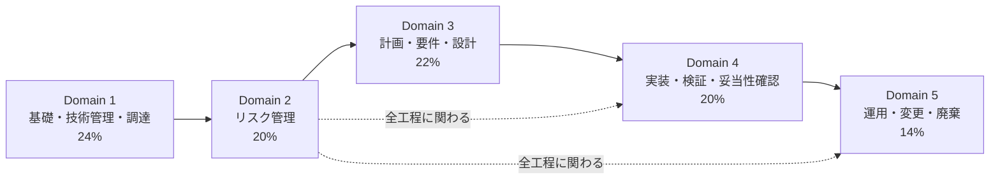

ポイント: **Domain 1・2 は「全工程に共通する土台」**、Domain 3〜5 が「時系列に沿った実務」です。配点の約 6 割（Domain 1〜3）が「作る前・設計」に偏っている点が ISSEP の特徴です。

---

## 3. 学習ロードマップ

### 3.1 全体の進め方（ステップバイステップ）

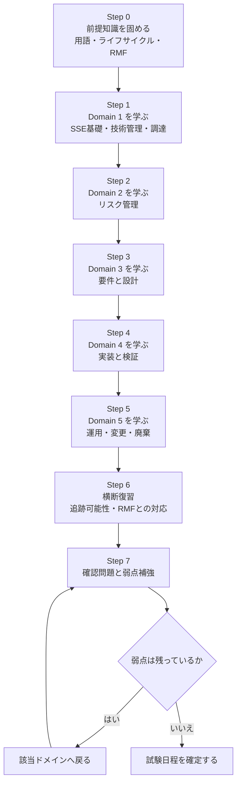

### 3.2 学習期間の目安（個人差が大きいため目安です）

| 週 | 内容 | ゴール |
|---|---|---|
| 1 | Step 0 と Domain 1 前半（1.1〜1.3） | SSE とライフサイクルを自分の言葉で説明できる |
| 2 | Domain 1 後半（1.4〜1.6） | CM と SCRM を説明でき、MTBF などの指標を計算できる |
| 3 | Domain 2 | RMF 7 ステップと Risk の扱いを説明できる |
| 4 | Domain 3 | 要件→設計の追跡可能性を説明できる |
| 5 | Domain 4 と Domain 5 | 検証と妥当性確認の違い、廃棄の流れを説明できる |
| 6 | 総復習・確認問題 | 各ドメインで安定して正答できる |

---

## 4. Step 0: 前提知識（これだけは先に理解する）

### 4.1 システムエンジニアリングとセキュリティの関係

**システムエンジニアリング（SE）** は、「目的を満たす複雑なシステムを、要件定義から廃棄まで一貫して成立させる」ための学際的な技術分野です。**システムセキュリティエンジニアリング（SSE）** は、その**サブ分野**として、セキュリティ上の成果（守るべきもの・信頼できる振る舞い）を SE の成果と整合させる活動です。

NIST SP 800-160 Vol.1 Rev.1 は、SSE を SE の一部として明確に位置づけ、セキュリティ担当だけでなく**エンジニアリング全体の責任**であることを強調しています [S5]。ISSEP の出題の背骨はこの考え方です。

### 4.2 ISSEP を理解する 4 つのキーワード

| キーワード | かんたんな説明 | たとえ |
|---|---|---|
| **システムライフサイクル** | 構想→開発→運用→廃棄までの一生 | 建物の設計・建築・使用・解体 |
| **要件（Requirement）** | システムが満たすべき条件。テスト可能であることが大切 | 建築基準＋施主の希望 |
| **追跡可能性（Traceability）** | 要件→設計→実装→テストを双方向にたどれること | 設計図の各線が、施工と検査記録に結びついている |
| **保証（Assurance）** | 「守れている」と**証拠で示す**信頼度 | 検査合格証 |

### 4.3 検証（Verification）と妥当性確認（Validation）【最頻出の区別】

| 用語 | 問い | 例 |
|---|---|---|
| **検証（Verification）** | 「**作り方は正しいか**」（仕様どおりにできているか） | 要件「通信を TLS で暗号化」→ 暗号化されていることをテスト |
| **妥当性確認（Validation）** | 「**正しいものを作ったか**」（利用者・ミッションのニーズを満たすか） | 運用者が実際の業務で使えて、守りたいものが守れているか |

覚え方: Verification = **V**erify the **S**pec（仕様に照らす）、Validation = **V**alue for the **U**ser（利用者の価値に照らす）。

### 4.4 システムライフサイクルの技術プロセス（参考）

ISO/IEC/IEEE 15288 系のライフサイクル規格では、技術プロセスとして概ね次の流れが整理されます。NIST SP 800-160 Vol.1 Rev.1 は、これらの各プロセスに対するセキュリティの考慮事項を示しています [S5]。

| 順 | 技術プロセス | セキュリティ上の主な論点 |
|---|---|---|
| 1 | ビジネス／ミッション分析 | 何を守るべきか、ミッション影響 |
| 2 | ステークホルダーのニーズ・要件定義 | 保護ニーズ、制約 |
| 3 | システム要件定義 | セキュリティ要件の文書化 |
| 4 | アーキテクチャ定義 | 信頼境界、機能配置 |
| 5 | 設計定義 | 詳細設計・制御の選定 |
| 6 | システム分析 | トレードオフ、リスク、性能 |
| 7 | 実装 | セキュアなコーディング・構成 |
| 8 | 統合 | インターフェース・結合時の弱点 |
| 9 | 検証 | 要件充足の証拠 |
| 10 | 移行（Transition） | 導入・受け入れ |
| 11 | 妥当性確認 | ニーズへの適合 |
| 12 | 運用 | 監視・インシデント対応 |
| 13 | 保守 | パッチ・変更管理 |
| 14 | 廃棄 | データ消去・撤去 |

> 上の一覧は ISO/IEC/IEEE 15288 の一般的な整理に基づく学習用の要約です。版による細部の違いは規格本文で確認してください。

### 4.5 重要な頭字語リスト（先に目を通す）

| 略語 | 正式名称 | 意味 |
|---|---|---|
| SSE | Systems Security Engineering | システムセキュリティエンジニアリング |
| ISSE | Information System Security Engineer | 情報システムのセキュリティエンジニア（役割名） |
| ISSO | Information System Security Officer | 情報システムのセキュリティ担当官（運用側の役割） |
| AO | Authorizing Official | 認可権限者（残余リスクを受容して ATO を出す人） |
| ATO | Authorization to Operate | 運用認可 |
| RMF | Risk Management Framework | NIST のリスク管理フレームワーク |
| SSP | System Security Plan | システムセキュリティ計画書 |
| POA&M | Plan of Action and Milestones | 是正計画・マイルストーン |
| CM | Configuration Management | 構成管理 |
| SCRM | Supply Chain Risk Management | サプライチェーンリスク管理 |
| MBSE | Model-Based Systems Engineering | モデルベースシステムズエンジニアリング |
| MTBF / MTTF / MTTR | Mean Time Between Failures / To Failure / To Repair | 平均故障間隔／故障までの時間／修復時間 |
| MTD | Maximum Tolerable Downtime | 許容できる最大停止時間 |
| CONOPS | Concept of Operations | 運用コンセプト |
| RTM | Requirements Traceability Matrix | 要件追跡マトリクス |

---
## 5. Domain 1: Systems Security Engineering Foundations（24%）

最も配点が高いドメインです。**「セキュリティエンジニアリングを、プロジェクトの仕組みの中でどう回すか」**がテーマで、1.1〜1.6 の 6 項目で構成されます [S3]。

| 項目 | 内容 |
|---|---|
| 1.1 | SSE の基礎を適用する |
| 1.2 | SSE プロセスを実行する（ハードウェア・ソフトウェア・データ） |
| 1.3 | システム開発方法論と統合する |
| 1.4 | 技術管理を行う |
| 1.5 | 技術調達管理に参加する |
| 1.6 | リソース分析（コスト見積り、人件費、確率・統計、Monte Carlo） |

---

### 1.1 SSE の基礎を適用する

**公式アウトラインの論点** [S3]: 信頼の概念と階層／システムエンジニアリングとセキュリティエンジニアリングのプロセスの関係／構造的セキュリティ設計原則（NIST のエンジニアリングフレームワーク、ISO 27001 など）

#### Step 1: 「信頼」と「信頼性（Trustworthiness）」を分けて理解する

| 用語 | 意味 | 例 |
|---|---|---|
| **信頼（Trust）** | ある主体が、別の主体を「頼ってよい」と**判断・期待する関係** | 利用者が OS ベンダーを信頼する |
| **信頼性（Trustworthiness）** | 主体が実際に**頼れる性質**。証拠（保証）で裏づけられる | 第三者評価・テスト結果で裏づけられた OS |

NIST SP 800-160 Vol.1 Rev.1 は、安全で信頼できるシステム（trustworthy secure systems）を、**証拠に基づく保証**を伴うエンジニアリング成果として扱います [S5]。「信頼してください」ではなく「**信頼してよい理由を示せる**」ことが目標です。

#### Step 2: 信頼の階層（Trust Hierarchy）

信頼は一点から出発し、下位へ連鎖します。

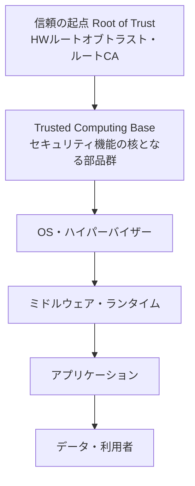

| 概念 | 説明 |
|---|---|
| Root of Trust | それ以上検証できない前提として信頼する起点（TPM、セキュアブートの ROM、ルート CA など） |
| Chain of Trust | 起点から順に「前の層が次の層を検証する」連鎖（セキュアブート、証明書チェーン） |
| TCB（Trusted Computing Base） | セキュリティポリシーの実施に関わる全要素。**小さく保つほど検証しやすい** |
| Trust Boundary（信頼境界） | 信頼レベルが変わる境目。ここで認証・検証・入力検査を行う |
| Reference Monitor | すべてのアクセスを仲介し、改ざんされず、検証可能であるべき概念 |

#### Step 3: SE プロセスと SSE プロセスの関係

- SSE は SE プロセスの**中に埋め込まれる**（別工程ではない）[S5]。
- 要件定義・設計・検証などの各プロセスに、セキュリティ観点の活動が対応します（4.4 の表）。
- セキュリティの成果は、コスト・性能・スケジュールなどの SE 成果と**整合**させる（セキュリティだけが孤立しない）。

#### Step 4: 構造的セキュリティ設計原則

試験では「原則名と意味の対応」が問われやすい分野です。古典的な Saltzer & Schroeder の原則を軸に覚えると整理しやすくなります（学習用の整理。NIST の設計原則も同様の考え方を含みます [S5]）。

| 原則 | 意味 | 3.2 との関係 |
|---|---|---|
| 最小権限（Least privilege） | 必要最小限の権限だけ与える | 3.2 |
| 失敗時安全な既定値（Fail-safe defaults） | 明示許可がなければ拒否 | 3.2 |
| 機構の経済性（Economy of mechanism） | 設計をシンプルで小さく | 3.2 |
| 完全な仲介（Complete mediation） | すべてのアクセスを毎回確認 | |
| オープン設計（Open design） | 安全性を設計の秘密に依存させない | 1.2 |
| 権限分離（Separation of privilege） | 重要操作に複数条件 | 3.2 |
| 共通機構の最小化（Least common mechanism） | 利用者間で共有する機構を減らす | |
| 心理的受容性（Psychological acceptability） | 使いやすくして回避を防ぐ | |

**構造規格の位置づけ**

| 枠組み | 役割 |
|---|---|
| NIST SP 800-160 Vol.1 Rev.1 | SSE の原則・概念・活動・タスクの基礎 [S5] |
| NIST SP 800-37 Rev.2 (RMF) | リスク管理の 7 ステップ [S6] |
| NIST SP 800-53 Rel.5.2.0 | セキュリティ・プライバシー管理策のカタログ（2025年8月27日に 5.2.0 公開。パッチ・更新の信頼性に関する内容を追加）[S7] |
| ISO/IEC 27001 | 情報セキュリティマネジメントシステム（ISMS）の要求事項。2022 年版の Annex A は 4 テーマ・93 管理策（一般知識。ISO 公式で確認）|

#### ベストプラクティス（1.1）

- **要件の根拠を「保護ニーズ」から始める**（技術から始めない）。
- 設計判断は**証拠（保証）とセットで文書化**する。
- TCB と信頼境界を設計図に**明示**し、境界ごとに検証を置く。
- 規格（NIST/ISO）は「チェックリスト」ではなく**根拠と語彙の共通基盤**として使う。

#### よくある落とし穴

- 「暗号化したから信頼できる」と**保証の裏づけなし**で結論づける。
- SSE を「テスト工程の担当」と誤解する（実際は全工程）。

---

### 1.2 SSE プロセスを実行する（ハードウェア・ソフトウェア・データ）

**公式アウトラインの論点** [S3]: 組織のセキュリティ権限（内部・外部）／システムセキュリティのガバナンスとコンプライアンス（法律・規則・標準）／設計概念（オープン・プロプライエタリ・モジュール式）

#### Step 1: 権限者（Authority）を整理する

誰が決める権限を持つかを最初に特定します。

| 区分 | 例 | 役割 |
|---|---|---|
| 内部 | CISO、システム所有者、認可権限者（AO）、ISSO、変更管理委員会（CCB） | 方針承認、リスク受容、運用管理 |
| 外部 | 規制当局、契約元（顧客）、監査人、標準化団体、上位機関（政府機関など） | 法令・契約・基準の要求 |

> RMF では、**AO がリスクを受容して運用を認可する**のが原則です [S6]。ISSE はこの判断に必要な**証拠と説明**を提供します。

#### Step 2: ガバナンスとコンプライアンス

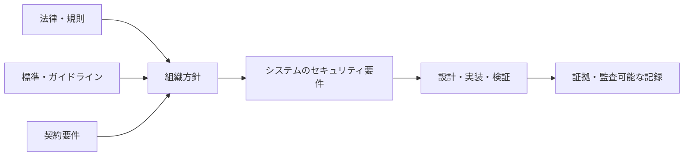

| 層 | 具体例（米国政府系の例を含む） |
|---|---|
| 法令 | 連邦情報セキュリティ近代化法（FISMA）など |
| 標準 | NIST SP 800-53、FIPS 199（分類）など |
| 契約 | サプライヤー向けの追加条項、報告義務 |

#### Step 3: 設計概念の比較

| 設計 | 特徴 | 長所 | 注意点 |
|---|---|---|---|
| **オープン** | 仕様が公開・標準準拠 | 相互運用性、第三者レビュー | 公開＝安全ではない。設定・実装品質は別問題 |
| **プロプライエタリ** | 独自仕様・非公開 | ベンダーサポート、差別化 | 検証しにくい、ロックイン |
| **モジュール式** | 交換可能な部品に分割 | 保守性、影響範囲の限定、段階的更新 | インターフェース設計が重要 |

重要な考え方: **「秘密にしておけば安全（Security through obscurity）」を防御の主柱にしない。** 暗号では「アルゴリズムは公開、鍵だけ秘密」が原則です。

#### ベストプラクティス（1.2）

- ISSE は**内部／外部の権限者と承認フロー**を最初に RACI などで可視化する。
- 要件の根拠を**法令・標準・契約**に紐づけて記録する（なぜその要件か）。
- 設計は**オープン標準＋モジュール式**を既定とし、プロプライエタリ採用時は**トレードオフ分析**を残す（3.4 参照）。
- ハードウェア・ソフトウェア・データの**それぞれに別の観点**を設ける（下表）。

| 対象 | 重点 |
|---|---|
| ハードウェア | 調達元の真正性、改ざん対策、ファームウェア更新の署名検証 |
| ソフトウェア | セキュアコーディング、依存関係管理、SBOM |
| データ | 分類、暗号化、アクセス制御、保持・廃棄 |

---

### 1.3 システム開発方法論と統合する

**公式アウトラインの論点** [S3]: セキュリティタスク・活動／要件検証を工程全体で／保証手法（ソフトウェア・ハードウェア・仮想・クラウド）／モデル（SDLC、ISO/IEC 24641:2023、MBSE）

#### Step 1: セキュリティ活動を SDLC の各フェーズに差し込む

| フェーズ | 代表的なセキュリティ活動 |
|---|---|
| 構想・計画 | 保護ニーズ分析、セキュリティ分類（FIPS 199）、リスクの初期評価 |
| 要件定義 | セキュリティ要件、誤用ケース、規制・契約の反映 |
| 設計 | 脅威モデリング、セキュリティ設計レビュー、トレードオフ分析 |
| 実装 | セキュアコーディング、静的解析、依存関係スキャン |
| 検証 | セキュリティテスト、脆弱性評価、ペネトレーションテスト |
| 導入・移行 | 構成のハードニング、受け入れ、認可 |
| 運用・保守 | 継続的監視、パッチ、変更管理 |
| 廃棄 | データ消去、撤去、記録保持 |

#### Step 2: V モデルで「作る側」と「確かめる側」を対応させる

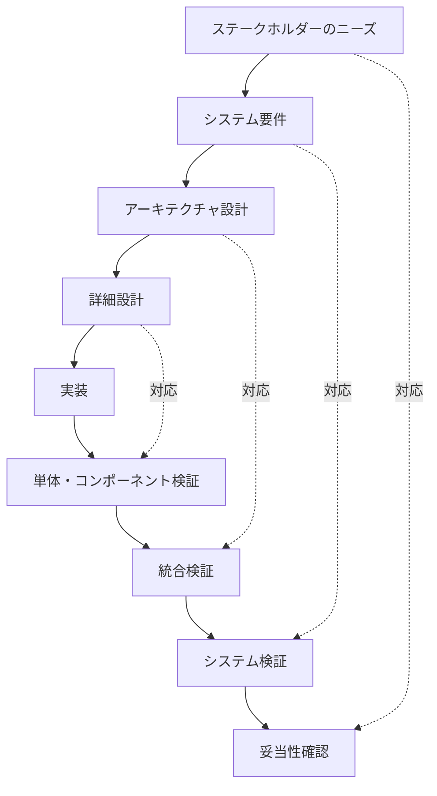

読み方: **左側で決めたこと（ニーズ・要件・設計）を、右側の関連する検証・妥当性確認の活動と結び付けます**（1 つの決定に複数の活動が対応することも、その逆もあります）。要件がテスト不能なら右側の対応が作れません。だから要件は「テスト可能」でなければなりません。

#### Step 3: 要件の検証方法（4 種）

| 方法 | 内容 | 例 |
|---|---|---|
| テスト（Test） | 実際に動かして確認 | ログイン失敗 5 回でロックされるかを実行確認 |
| 分析（Analysis） | 計算・モデル・シミュレーション | 暗号強度の分析、可用性の数値計算 |
| 検査（Inspection） | 成果物・コードの目視確認 | 設定ファイルのレビュー |
| 実演（Demonstration） | 機能を実際に見せる | 監査ログ出力の実演 |

#### Step 4: 保証手法（ソフトウェア・ハードウェア・仮想・クラウド）

| 対象 | 主な保証手法 |
|---|---|
| ソフトウェア | コードレビュー、静的解析（SAST）、動的解析（DAST）、ソフトウェア構成分析（SCA）、SBOM、ファジング |
| ハードウェア | 調達元確認、改ざん検出（tamper evidence）、サプライチェーン検証、ファームウェア署名 |
| 仮想環境 | ハイパーバイザーのハードニング、VM 分離、イメージの完全性確認 |
| クラウド | 責任共有モデルの整理、IAM 設計、構成ベースラインと継続的な構成監査 |
| 横断 | 第三者評価（例: Common Criteria）、形式手法、ペネトレーションテスト |

#### Step 5: モデル（SDLC・MBSE）

| モデル | ポイント |
|---|---|
| ウォーターフォール／V モデル | 計画重視。要件と検証の対応が明快。変更に弱い |
| アジャイル／DevSecOps | 反復的。セキュリティを自動化してパイプラインに組み込む（4.1） |
| **MBSE** | 文書ではなく**モデル**を中心に要件・設計・検証を管理。整合性と追跡可能性を高めやすい |
| ISO/IEC/IEEE 24641:2023 | モデルベースのシステム・ソフトウェアエンジニアリング（MBSSE）の方法・ツール能力を規定。新たなライフサイクルプロセスを追加するのではなく、既存プロセスを支えるモデル管理の参照モデルを示す [S14] |

> 表記補足: ISC2 のアウトラインは「ISO/IEC 24641:2023」と記載していますが、規格の正式名称は ISO/IEC/IEEE 24641:2023 です [S3][S14]。

#### ベストプラクティス（1.3）

- 要件の段階で**検証方法（T/A/I/D）を割り当てる**（後回しにしない）。
- **要件追跡マトリクス（RTM）**で、要件→設計→テスト→結果を双方向に追跡する。
- 開発方法論が変わっても**セキュリティ成果物（要件・脅威モデル・検証記録）は変えない**。
- MBSE 採用時は、モデルの**正本（single source of truth）**とアクセス制御・版管理を決める。

#### よくある落とし穴

- セキュリティテストを「最後だけ」に集中する（設計の欠陥が高コストで見つかる）。
- 要件が曖昧で、検証が「やった気」で終わる。

---

### 1.4 技術管理を行う

**公式アウトラインの論点** [S3]: プロジェクト管理プロセスへの参加／構成管理／情報管理／測定／品質保証／セキュリティプロセス自動化ソリューションの評価

#### Step 1: 6 つの管理プロセスの役割

| プロセス | 何をするか | セキュリティ上の価値 |
|---|---|---|
| プロジェクト管理への参加 | 計画・WBS・スケジュール・リスク登録簿へセキュリティ作業を載せる | 作業が「見えない」ことで抜けるのを防ぐ |
| **構成管理（CM）** | 構成要素の識別、ベースライン、変更管理、状況記録、監査 | 不正・無承認の変更を検知・防止 |
| 情報管理 | 情報の分類、取扱い、記録、保管、共有 | 機密・完全性の維持 |
| 測定 | 指標の定義・収集・分析 | 改善とリスク判断の根拠 |
| 品質保証（QA） | プロセスと成果物が基準に合うかの保証 | 欠陥の予防 |
| 自動化の評価 | ツール（SAST/SCA、SOAR、GRC など）の採否判断 | 再現性・速度・証跡 |

#### Step 2: 構成管理（CM）を深掘り

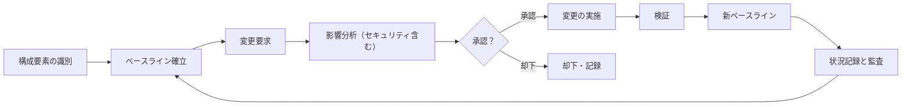

| 用語 | 意味 |
|---|---|
| 構成要素（CI） | 管理対象（ソフトウェア、設定、文書、ハードウェア） |
| ベースライン | 正式に承認された基準状態。変更はここからの差分として管理 |
| 変更管理 | 変更を要求→分析→承認→実施→検証する統制 |
| 構成監査 | 実環境がベースラインと一致するかの確認 |

NIST SP 800-53 の CM ファミリーが関連管理策を整理しており、構成管理の詳細は NIST SP 800-128 が扱います（本セッションでは SP 800-128 の個別ページは確認していません。NIST 公式で確認してください）。

#### Step 3: 測定（メトリクス）の考え方

| 区分 | 説明 | 例 |
|---|---|---|
| 有効性の指標（MOE） | ミッション成果への貢献 | 重要データの漏えいゼロ |
| 性能の指標（MOP） | システムの性能・機能の達成度 | 認証応答 1 秒以内 |
| プロセス指標 | 作業の健全性 | 脆弱性の平均修正日数 |
| リスク指標 | 脅威・弱点の傾向 | 未修正の重大脆弱性数 |

良い指標の条件: **目的に直結（なぜ測るか）、定義が明確、自動収集できる、行動につながる**。

#### Step 4: セキュリティ自動化ツールの評価観点

| 観点 | 確認内容 |
|---|---|
| 適合性 | 要件・対象技術（言語、クラウド）を網羅するか |
| 精度 | 誤検知・見逃しの水準 |
| 統合 | CI/CD、チケット、SIEM との連携 |
| 証跡 | 監査に使える記録が残るか |
| ツール自身の安全性 | 権限、秘密情報の扱い、サプライチェーン |
| 総所有コスト | ライセンス、運用負荷、教育 |
| 標準対応 | 機械可読な形式（例: OSCAL）への対応 |

> NIST の SP 800-53 は OSCAL・JSON などの機械可読形式でも提供されています [S7]。SP 800-18 Rev.2 も、機械可読データによる自動収集とダッシュボード報告を重視しています [S9]。

#### ベストプラクティス（1.4）

- セキュリティ作業は**プロジェクト計画に明示**し、工数・担当・成果物を割り当てる。
- ベースラインと変更履歴は**改ざん防止**された場所で管理する。
- 指標は**少数精鋭**（見て行動が変わるものだけ）。
- ツールは**導入前に PoC**し、誤検知のトリアージ手順まで設計する。

---

### 1.5 技術調達管理に参加する

**公式アウトラインの論点** [S3]: 調達のセキュリティ要件／選定プロセス／サプライチェーンリスク管理（SCRM）／契約上のセキュリティ関連成果物（ハードウェア・ソフトウェア・サービス・文書）のレビュー

#### Step 1: 調達プロセス全体像

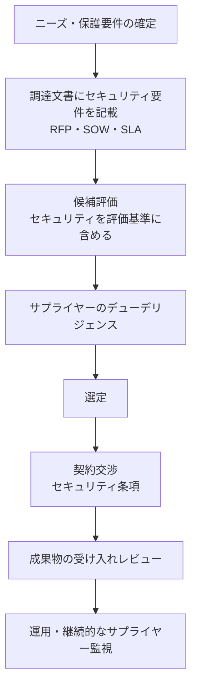

#### Step 2: 調達に入れるべきセキュリティ要件の例

| 区分 | 例 |
|---|---|
| 製品要件 | 暗号方式、認証、ログ、パッチ提供期間 |
| 開発プロセス | セキュアな開発手法（SSDF 準拠など）の証明 |
| 透明性 | SBOM の提供、脆弱性開示方針 |
| 通知義務 | インシデント・脆弱性の通知期限 |
| 監査権 | 監査・立入検査の受け入れ |
| サプライチェーン | 下請け（再委託）管理、フローダウン条項 |
| 契約終了時 | データ返却・消去、移行支援 |

#### Step 3: サプライチェーンリスク管理（SCRM / C-SCRM）

NIST SP 800-161 Rev.1 は、サプライチェーン全体のサイバーセキュリティリスクを、組織の複数レベルで特定・評価・対応するための実践を示します。完成品だけでなく**構成部品と、その流通経路（どこから来たか）**まで考えるよう促しています [S8]。

主な脅威の例（学習用の整理）:

| 脅威 | 例 |
|---|---|
| 偽造品 | 偽の部品・製品 |
| 改ざん | 製造・輸送中のファームウェア改変 |
| 悪意ある機能 | バックドア、悪意ある依存パッケージ |
| 品質不良 | 不十分な開発・製造慣行による脆弱性 |
| サプライヤーの依存 | 単一供給元への集中、倒産・撤退 |

NIST SP 800-18 Rev.2（2026年6月に最終化）は、システムセキュリティ計画、プライバシー計画、**C-SCRM 計画**を「システム計画」として一体で扱い、RMF の各ステップと対応づけています [S9]。調達段階から C-SCRM 計画を意識する根拠になります。

#### Step 4: 契約成果物のレビュー観点

| 成果物 | 確認すること |
|---|---|
| ハードウェア | 真正性、出荷時の改ざん痕跡、ファームウェア署名 |
| ソフトウェア | 署名、SBOM、既知脆弱性、ライセンス |
| サービス | SLA、データの所在・取扱い、再委託、退出条件 |
| 文書 | 構成・運用手順・セキュリティ設定ガイドの網羅性 |

#### ベストプラクティス（1.5）

- **「要件を書いてから選ぶ」**（選んでから要件を足さない）。
- セキュリティ要件は**測定可能・検収可能**な言葉で書く。
- 重要部品は**複数調達・代替策**を検討し、単一障害点を避ける。
- 受け入れ時は**チェックサム・署名・SBOM**で真正性を確認する。
- サプライヤー評価は契約後も**定期的に再評価**する。

---

### 1.6 リソース分析（コスト見積り、人件費、確率・統計）

**公式アウトラインの論点** [S3]: コスト見積り／人件費／確率と統計（Monte Carlo 法、MTBF、MTD、MTTF、MTTR（修復）、MTTR（復旧））

> 受験者の非公式な報告として、この項目（特に Monte Carlo 法）は従来の公式教材で手薄だったという声があります [S18]。数式を伴う項目なので、手を動かして確認しておくと安心です。
> 補足: 該当の ISC2 コミュニティは 2026年5月29日に廃止予定と告知されていたため、リンクが開けない可能性があります。

#### Step 1: コスト見積りの代表手法

| 手法 | 内容 | 向く場面 |
|---|---|---|
| 類推見積り | 過去の類似案件から推定 | 初期段階、情報が少ない |
| パラメトリック見積り | 規模などの係数×単価 | 過去データが蓄積されている |
| ボトムアップ見積り | 作業を分解して積み上げ | 詳細が固まった後。精度が高い |
| 三点見積り（PERT） | 楽観・最可能・悲観から期待値 | 不確実性が大きい作業 |

三点見積りの期待値（PERT）:

```text
期待値 = (楽観値 + 4 × 最可能値 + 悲観値) / 6
```

例: 楽観 10 日・最可能 14 日・悲観 24 日 → (10 + 4×14 + 24) / 6 = **15 日**

#### Step 2: 人件費の考え方

| 要素 | 説明 |
|---|---|
| FTE（フルタイム換算） | 人数ではなく「工数」で見る |
| 負荷込み単価 | 給与に福利厚生・間接費を加えた単価 |
| スキル構成 | 上級エンジニア／レビュー担当／テスト担当の比率 |
| 特殊要件 | セキュリティクリアランス、希少スキルの割増 |
| 教育・ツール | 研修費、ライセンス、環境構築 |

#### Step 3: Monte Carlo 法

**目的**: 不確実な入力（工数・単価・故障など）を**確率分布で与え、何千回もランダムに試行**して、結果（総コスト・納期）の**分布**を得ること。

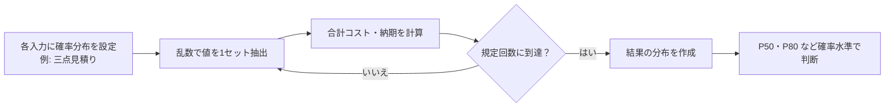

| 読み取り | 意味 |
|---|---|
| P50 | 半々の確率で収まる値（楽観寄りになりがち） |
| P80 | 80% の確率で収まる値（予備費を決める目安に使われる） |

利点: 「**単一の数字**」ではなく「**どのくらいの確率でその予算内に収まるか**」を示せる。注意点: 入力の分布や相関の仮定が結果を左右するため、**前提を記録**する。

#### Step 4: 信頼性・可用性の指標

| 指標 | 意味 | 補足 |
|---|---|---|
| **MTBF** | 故障と次の故障の平均間隔 | 修理して使い続ける**修理可能**システム向け |
| **MTTF** | 故障までの平均時間 | 修理しない（交換する）部品向け |
| **MTTR（修復: Repair）** | 故障の修理にかかる平均時間 | |
| **MTTR（復旧: Recovery）** | 障害発生からサービス復旧までの平均時間 | 検知・切り分け・復旧を含むことが多い |
| **MTD** | 業務が停止して許容できる最大時間 | BIA で決める。MTPD と呼ぶ文脈もある |

> アウトラインは MTTR を 2 通り（repair / recovery）併記しています [S3]。試験では**文脈で意味を判断**します。

**計算式（定常状態の目安）**

```text
可用性 A = MTBF / (MTBF + MTTR)
故障率 λ = 1 / MTBF            （指数分布を仮定）
信頼度 R(t) = exp(-t / MTBF)   （時間 t の間、故障しない確率）
```

> MTBF の定義には「稼働時間のみ」と「修理時間を含む」の流儀があり、式が微妙に変わります。問題文に定義が書かれていればそれに従ってください。

**例題**: MTBF = 1,000 時間、MTTR = 4 時間

- 可用性 A = 1000 / 1004 ≈ **0.9960（約 99.6%）**
- 年間停止時間 ≈ 8,760 × (1 − 0.9960) ≈ **約 35 時間**
- 100 時間無故障の確率 R(100) = e^(−0.1) ≈ **0.905**

**MTD と復旧目標の関係**（BIA の基本）

```text
MTD ≧ RTO + WRT
  RTO: システムを復旧する目標時間
  WRT: 復旧後、業務データ確認などで業務再開できるまでの作業時間
```

つまり **RTO + WRT が MTD 以下**になるよう設定する必要があります。WRT > 0 の場合に限り、RTO は MTD より短くなります（WRT = 0 なら RTO = MTD も許容）。

#### ベストプラクティス（1.6）

- 見積りは**範囲と前提**で示す（単点にしない）。
- 不確実性の高い項目は **Monte Carlo または三点見積り**で扱う。
- 可用性要件は**MTBF/MTTR の目標値**まで分解して設計に反映する。
- MTD は**事業側（BIA）が決め**、技術側（RTO/RPO）がそれを満たす。

#### よくある落とし穴

- MTTF と MTBF、2 つの MTTR を混同する。
- WRT を考慮せず、RTO + WRT が MTD を超える設定にしてしまう。

---
## 6. Domain 2: Risk Management（20%）

**「リスクを、エンジニアリングの意思決定の材料にする」**ドメインです。2.1 が原則、2.2 が「システム」のリスク、2.3 が「運用」のリスクです [S3]。

---

### 2.1 セキュリティリスクマネジメントの原則を適用する

**公式アウトラインの論点** [S3]: セキュリティリスク管理と**企業リスク管理（ERM）**の整合／ライフサイクル全体へのリスク管理の統合

#### Step 1: リスクの基本用語

| 用語 | 意味 | 例 |
|---|---|---|
| 資産（Asset） | 守る価値があるもの | 顧客データ、制御システム |
| 脅威（Threat） | 害を与え得る原因・主体 | 攻撃者、内部不正、災害 |
| 脆弱性（Vulnerability） | 悪用され得る弱点 | 未修正のソフトウェア |
| 影響（Impact） | 発生時の被害の大きさ | 業務停止、法的責任 |
| 可能性（Likelihood） | 発生のしやすさ | 低・中・高 |
| リスク | 脅威が脆弱性を突いて影響を与える見込み | 可能性 × 影響 |
| 固有リスク（Inherent） | 管理策を考慮する**前**のリスク | |
| 残余リスク（Residual） | 管理策を実施した**後**に残るリスク | AO が受容する対象 |

#### Step 2: 組織の 3 階層で考える

NIST のリスク管理は、組織レベル（戦略）、ミッション／業務プロセスレベル、システムレベルの**3 階層**で考えます（SP 800-39 の枠組み。本セッションでは個別ページ未確認、NIST 公式で確認してください）。ISSEP はおもに**システムレベル**で動きつつ、上位階層（組織のリスク許容度・戦略）を**入力**として受け取ります。

| 階層 | 主な関心 |
|---|---|
| 組織 | リスク選好・許容度、方針、共通管理策 |
| ミッション／業務 | 業務の重要度、依存関係 |
| システム | 具体的な脅威・脆弱性・管理策 |

#### Step 3: リスク対応の 4 つの選択肢

| 対応 | 内容 | 例 |
|---|---|---|
| 軽減（Mitigate） | 管理策でリスクを下げる | MFA の導入 |
| 回避（Avoid） | リスクの源をやめる | 危険な機能を提供しない |
| 移転・共有（Transfer / Share） | 第三者に負担を移す | 保険、委託契約 |
| 受容（Accept） | 許容範囲として受け入れる | AO による残余リスクの受容 |

#### Step 4: ライフサイクル統合（RMF の 7 ステップ）

NIST SP 800-37 Rev.2 の RMF は、Prepare, Categorize, Select, Implement, Assess, Authorize, Monitor の**7 ステップ**です。Rev.2 で **Prepare（準備）**が追加されました [S6]。RMF は SDLC に組み込んで実施します。

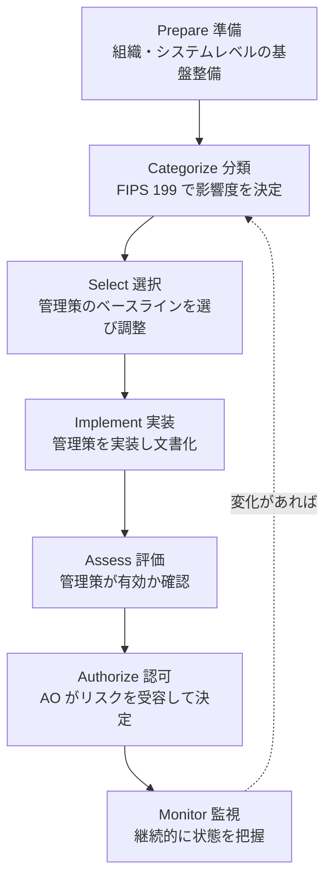

| ステップ | 主な目的 | ISSE の関わり |
|---|---|---|
| Prepare | 役割・リスク戦略・共通管理策の整備 | 役割の確認、前提条件の把握 |
| Categorize | 情報・システムの影響度を決める | 保護ニーズの整理、境界の定義 |
| Select | 管理策（SP 800-53 ベースライン）を選びテーラリング | 要件への落とし込み |
| Implement | 管理策を実装し、実装内容を文書化 | 設計・統合の主担当 |
| Assess | 管理策の有効性評価 | 評価の支援、証拠の準備 |
| Authorize | AO が残余リスクを受容して運用認可 | 判断材料の提供 |
| Monitor | 継続的に管理策とリスクを監視 | 変更の影響確認 |

> 補足: FIPS 199 では、機密性・完全性・可用性それぞれに **Low / Moderate / High** の影響度を付け、システム全体の分類は**最も高いもの（high-water mark）**で決めます（一般知識。NIST 公式で確認してください）。

#### ベストプラクティス（2.1）

- リスク評価は**単発ではなく、設計の各節目で繰り返す**（要件・設計・検証・変更時）。
- 組織の**リスク許容度**を最初に確認し、基準を言語化してから評価する。
- 「リスクゼロ」を目指さず、**受容・軽減・移転の判断を記録**する。

---

### 2.2 システムに対するリスクを管理する

**公式アウトラインの論点** [S3]: リスクコンテキストの確立／システムセキュリティリスクの特定（脅威・事象・脆弱性・影響）／固有リスク分析／リスク評価／リスク態勢（残余・変化・新規）の監視と評価／リスク態勢の文書化

#### Step 1: 全体プロセス

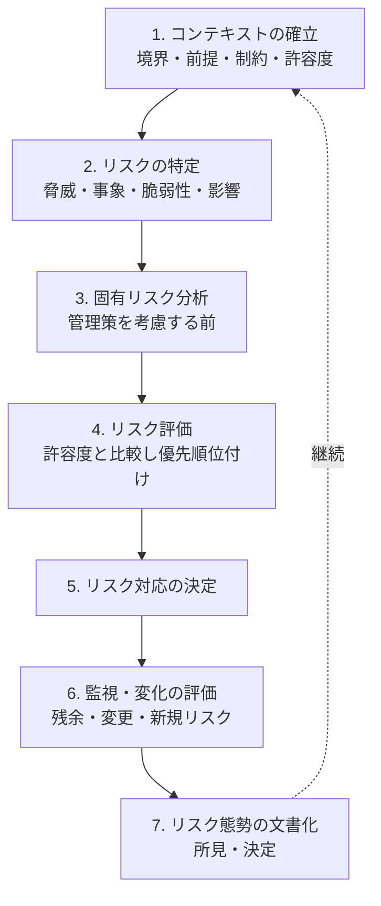

#### Step 2: 各工程の中身

| 工程 | やること | 成果物の例 |
|---|---|---|
| コンテキスト確立 | 範囲、システム境界、前提、制約、リスク許容度、評価方法（定性／定量）の合意 | 評価計画書 |
| リスク特定 | 脅威源・脅威事象、脆弱性、影響の洗い出し（脅威モデリング、資産分析） | 脅威・脆弱性一覧 |
| 固有リスク分析 | 管理策がない前提で、可能性と影響を見積もる | リスクマトリクス |
| リスク評価 | 許容度と比較、優先順位付け | リスク登録簿 |
| 監視・変化評価 | 残余リスク、変更によるリスク、新規リスクの追跡 | リスク状態レポート |
| 文書化 | 所見と**決定（なぜそうしたか）**の記録 | SSP、POA&M、評価報告 |

#### Step 3: 定性評価と定量評価

| 方式 | 特徴 | 例 |
|---|---|---|
| 定性 | 高・中・低などで評価。迅速で合意しやすい | 5×5 リスクマトリクス |
| 定量 | 金額・確率で評価。根拠が数値で示せる | 年間予想損失額（ALE） |

```text
SLE（1回あたりの損失額） = 資産価値(AV) × 曝露係数(EF)
ALE（年間予想損失額）    = SLE × ARO（年間発生率）
```

例: 資産価値 1,000 万円、曝露係数 30%、年間発生率 0.5 → SLE = 300 万円、ALE = **150 万円**。
対策費用が ALE の削減額（効果）より大きければ、費用対効果が合わないと判断できます。

#### Step 4: 「残余」「変化」「新規」を区別する

| 種類 | 意味 | 例 |
|---|---|---|
| 残余リスク | 管理策後に残るリスク | 暗号化後も鍵管理に残るリスク |
| 変化したリスク | 状況の変化で大きさが変わったリスク | 新たな攻撃手法の登場で可能性が上昇 |
| 新規リスク | これまでなかったリスク | 新機能追加により発生 |

#### ベストプラクティス（2.2）

- 評価の**前提と除外範囲**を明示する（範囲外リスクの存在も記録）。
- **証拠（脅威情報、スキャン結果、テスト結果）**に基づいて可能性を見積もる。
- リスク登録簿には**オーナー・期限・対応状況**を必須項目にする。
- 受容は**AO など権限者の署名つき**で記録する。
- 脆弱性対応は POA&M で**期限付き**に管理する。

---

### 2.3 運用に対するリスクを管理する

**公式アウトラインの論点** [S3]: 2.2 と同じ 6 つのプロセス（コンテキスト確立、リスク特定、固有リスク分析、リスク評価、リスク態勢の監視、文書化）を**運用の視点**で行う

> 注: ISC2 のアウトラインでは、2.2 と 2.3 の列挙項目が同一の文言で記載されています [S3]。ここでは、**2.2＝システム（設計・構築物）に対するリスク**、**2.3＝運用（稼働中のシステムと業務）に対するリスク**と区別して解説します。これは学習上の整理であり、ISC2 の明文化された区分ではありません。

#### 2.2 と 2.3 の視点の違い

| 観点 | 2.2 システム | 2.3 運用 |
|---|---|---|
| 主な対象 | 設計・構成・実装の弱点 | 稼働中の手順・人・環境の弱点 |
| 典型的なリスク | 設計欠陥、不十分な分離、脆弱なコンポーネント | 設定ドリフト、パッチ遅延、特権の乱用、外部委託先の障害 |
| 入力 | 要件・設計・テスト結果 | 監視データ、インシデント履歴、変更履歴 |
| 判断の観点 | 設計の妥当性 | ミッション・業務への影響 |

#### 運用リスク管理の流れ

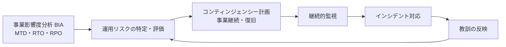

| 用語 | 意味 |
|---|---|
| BIA | 業務停止が事業に与える影響を分析し、重要度と許容停止時間を決める |
| RTO | 復旧目標時間 |
| RPO | 復旧時点目標（どれだけのデータ損失まで許容か） |

#### ベストプラクティス（2.3）

- 運用リスクは**事業側（ミッションオーナー）**と共同で評価する。
- 変更・インシデント・監査所見を**リスク登録簿に自動で反映**する流れを作る。
- 外部委託先・クラウド事業者の障害を**運用リスクとして明示**する。
- 年次などの**定期見直しと、重大変更時の臨時見直し**を決めておく。

---

## 7. Domain 3: Security Planning and Engineering（22%）

**「ニーズを、検証できる要件と設計に変える」**ドメインです。3.1 環境分析 → 3.2 原則 → 3.3 要件 → 3.4 設計 の順に進みます [S3]。

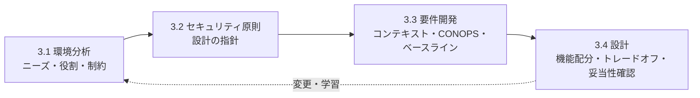

---

### 3.1 組織・運用環境を分析する

**公式アウトラインの論点** [S3]: ステークホルダー要件の把握／役割と責任の特定／制約と前提の特定／セキュリティ妥当性確認計画の準備

#### Step 1: ステークホルダー要件の把握

| ステークホルダー | 関心の例 |
|---|---|
| 利用者・運用者 | 使いやすさ、可用性、運用負荷 |
| ミッション／事業オーナー | 業務継続、リスク許容度 |
| 認可権限者（AO） | 残余リスクの説明、証拠 |
| 規制当局・監査人 | 法令順守、証跡 |
| 開発者・保守者 | 実現性、保守性 |

収集手法: インタビュー、ワークショップ、ユースケース分析、**誤用ケース（ミスユースケース）**、既存文書の分析。

#### Step 2: 役割と責任（RACI の活用）

| 役割 | 責任の例 |
|---|---|
| ISSE | セキュリティ要件・設計の整合を確保、証拠の整備 |
| システム所有者 | システムの調達・開発・運用に責任 |
| ISSO | 運用中のセキュリティ維持 |
| AO | 運用認可、リスク受容 |
| 評価者 | 管理策の有効性評価 |

#### Step 3: 制約と前提

| 区分 | 例 |
|---|---|
| 制約 | 予算、納期、既存システムとの互換性、法規制、技術的制限 |
| 前提 | 「利用者は事前審査済み」「ネットワークは閉域」など（**崩れるとリスクが変わる**） |

重要: 前提は**検証して記録**し、崩れたら再評価する（変更管理と連動）。

#### Step 4: セキュリティ妥当性確認計画

Validation（「正しいものを作ったか」）を、**この段階で**計画します。

| 項目 | 内容 |
|---|---|
| 目的 | ステークホルダーのニーズを満たすことの確認 |
| 基準 | 受け入れ基準（誰が、どの条件で合格と判断するか） |
| 方法 | 運用シナリオでの確認、パイロット運用など |
| 環境 | 現実に近い環境と、利用者の参加 |

#### ベストプラクティス（3.1）

- 要件は**ステークホルダー単位でトレース**できるよう、出所（誰の要望か）を記録する。
- 前提の**有効期限と確認方法**を決める。
- 妥当性確認計画は**要件定義の時点から**作り始める。

---

### 3.2 システムセキュリティ原則を適用する

**公式アウトラインの論点** [S3]: レジリエンス手法／多層防御・ゼロトラスト・セキュアバイデフォルト／フェイルセーフ既定値／単一障害点／最小権限／機構の経済性／インターフェース・機能・サービス・役割の分離／自動化／ソフトウェア保証／データセキュリティ

#### 各原則の解説

| 原則 | 意味 | 実践例 |
|---|---|---|
| **レジリエンス** | 障害・攻撃を受けても機能を維持・回復する | 冗長化（redundancy）、**構成要素の多様性（diversity / disparity）**で同一欠陥の共倒れを避ける |
| **多層防御** | 複数の独立した層で守る | ネットワーク／ホスト／アプリ／データの各層に対策 |
| **ゼロトラスト** | ネットワーク位置だけで信頼せず、リソースごとに継続検証 | 強い認証、最小権限、マイクロセグメンテーション（NIST SP 800-207 参照。個別ページは未確認） |
| **セキュアバイデフォルト** | 初期設定が安全 | 不要なポートは閉じ、既定で暗号化有効 |
| **フェイルセーフ既定値** | 障害時・不明時の既定状態を安全側に | 明示許可がなければ拒否（default deny） |
| **単一障害点の排除** | 1 か所の故障が全体停止にならない | 冗長構成、フェイルオーバー、依存関係の可視化 |
| **最小権限** | 必要最小限の権限のみ | ロールベースのアクセス、期間限定の特権付与 |
| **機構の経済性** | 設計をシンプルに | 機能を絞り、攻撃面を小さくする |
| **分離** | インターフェース・機能・サービス・役割を分ける | 管理系と業務系のネットワーク分離、職務分掌 |
| **自動化** | 人手のばらつきを減らし速度を上げる | 脅威対応の自動化（SOAR）、SecDevOps |
| **ソフトウェア保証** | ソフトウェアが意図どおり・安全に動く証拠 | 静的/動的解析、SBOM、署名 |
| **データセキュリティ** | データの全ライフサイクルで保護 | 分類、暗号化（保存・転送）、鍵管理、保持・廃棄 |

#### フェイルオープンとフェイルクローズド（頻出）

| 方式 | 障害時の動作 | 守るもの | 適する例 |
|---|---|---|---|
| **フェイルクローズド（フェイルセキュア）** | **遮断**する／拒否する | 機密性・完全性 | ファイアウォール、データセンターの出入口の施錠 |
| **フェイルオープン** | **通過**させる／開放する | 可用性・人命の安全 | 火災時に開く非常口 |

> 「Fail-safe」という語は、セキュリティでは「安全側（拒否）」、安全工学では「人命に安全な側（開放）」を指すことがあります。**問題文で何を守る文脈か**を確認して判断します。

#### 単一障害点（SPOF）の洗い出し方

| 手法 | 内容 |
|---|---|
| 依存関係マッピング | 各コンポーネントが何に依存するかを図示 |
| FMEA | 故障モードごとに影響・重大度を分析 |
| FTA（故障の木） | 重大な事象から原因を逆にたどる |
| 障害注入テスト | 実際に停止させて挙動を確認 |

#### ベストプラクティス（3.2）

- 原則は**要件と設計に翻訳**する（例:「最小権限」→「ロール X は読み取りのみ」）。
- **冗長性と多様性**は片方だけでは不十分（同一製品の冗長化は同一欠陥で同時に落ちる）。
- 自動化は**変更管理と監査ログ**とセットで導入する（自動化が攻撃面にならないように）。
- データは**ライフサイクル（作成→利用→保管→共有→廃棄）**で保護策を設計する。

---

### 3.3 システム要件を開発する

**公式アウトラインの論点** [S3]: システムセキュリティコンテキストの作成／システム内の機能とセキュリティ運用コンセプトの特定／セキュリティ要件ベースラインの文書化／要件の分析

#### Step 1: コンテキストを描く

**システムセキュリティコンテキスト**は、システムの境界、外部の主体（利用者・他システム）、やり取りされる情報、信頼境界を整理したものです。

| 要素 | 内容 |
|---|---|
| 境界 | 何がシステムの中で、何が外か |
| 外部主体 | 利用者、運用者、外部システム、供給元 |
| インターフェース | データの流れ、プロトコル、認証方法 |
| 信頼境界 | 信頼度が変わる箇所 |
| 環境の脅威 | 想定する攻撃者、物理環境 |

#### Step 2: 機能とセキュリティ CONOPS

| 項目 | 内容 |
|---|---|
| 機能一覧 | システムが提供する機能と、それぞれの保護ニーズ |
| **CONOPS** | 誰が・どんな状況で・どう使うか（通常時、障害時、保守時、緊急時） |
| 運用モード | 通常／縮退／保守／訓練など。モードごとのセキュリティ要件 |

#### Step 3: 要件ベースラインの作成

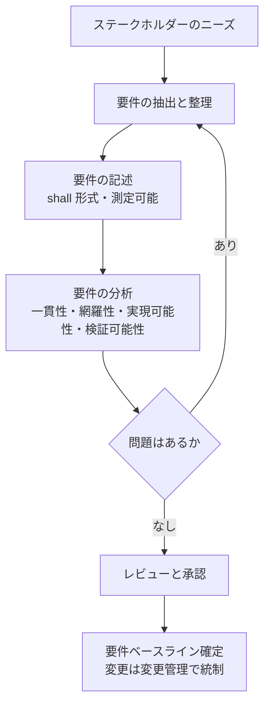

**良い要件の条件**（チェックリスト）

| 条件 | 悪い例 | 良い例 |
|---|---|---|
| 必要性 | 「あれば便利」 | 守るべきリスクや規制に紐づく |
| 曖昧さがない | 「十分に安全であること」 | 「保存データは AES-256 で暗号化」 |
| テスト可能 | 「高速に認証する」 | 「認証応答は 95% が 1 秒以内」 |
| 一貫性 | 要件間で矛盾 | 矛盾なし |
| 追跡可能 | 出所不明 | ニーズ・規制に紐づく ID |
| 実現可能 | 技術的に不可能 | 予算・技術で実現可能 |

#### Step 4: 要件の分析

- **矛盾・重複・欠落**の確認
- **セキュリティと性能・可用性**のトレードオフ
- 各要件に**検証方法（T/A/I/D）**を割り当て
- 保護ニーズが**漏れなく**要件に反映されているかを確認

#### ベストプラクティス（3.3）

- すべての要件に**一意な ID・出所・検証方法・オーナー**を付ける。
- 「どうやって（HOW）」ではなく「**何を（WHAT）**」を書く（実装の自由度を残す）。
- 基準（ベースライン）確定後の変更は**変更管理（CCB）**を通す。

---

### 3.4 システムセキュリティ設計を作成する

**公式アウトラインの論点** [S3]: 機能分析と配分／設計コンポーネントの開発／設計と要件の追跡可能性の維持／トレードオフ検討／設計の妥当性確認

#### Step 1: 機能分析と配分

要件を満たすために必要な**機能を分解**し、それを**コンポーネント（ハードウェア・ソフトウェア・人・手順）に割り当てる**作業です。

| 段階 | 内容 |
|---|---|
| 機能分解 | 上位機能を下位機能へ分解 |
| 配分 | 各機能を実現する要素へ割当 |
| インターフェース定義 | 要素間のデータ・制御の受け渡し |
| セキュリティ機能の配置 | 認証・認可・ログ・暗号化などをどこに置くか |

#### Step 2: 追跡可能性（Traceability）


| 追跡の種類 | 目的 |
|---|---|
| 前方追跡（要件→設計→テスト） | すべての要件が実装・検証されたことの確認 |
| 後方追跡（設計→要件） | 要件に対応しない余計な設計要素・機能（不要な攻撃面）がないことの確認 |
| 後方追跡（テスト→設計→要件） | 各テストが要件に対応していることの確認 |

#### Step 3: トレードオフ検討

選択肢が複数あるときは、基準と重みを定めて比較します。

| 選択肢 | セキュリティ（重み 40） | コスト（30） | 性能（20） | 保守性（10） | 合計 |
|---|---|---|---|---|---|
| 案 A | 5 | 3 | 4 | 3 | 5×40+3×30+4×20+3×10 = **400** |
| 案 B | 4 | 5 | 3 | 4 | 4×40+5×30+3×20+4×10 = **410** |
| 案 C | 3 | 4 | 5 | 5 | 3×40+4×30+5×20+5×10 = **390** |

（各項目は 1〜5 点。単なる例です。）合計が近いときは、**感度分析**（重みを変えたら順位が変わるか）も行います。**選んだ理由と捨てた案を記録**することが最も重要です。

#### Step 4: 設計の妥当性確認

| 手法 | 内容 |
|---|---|
| 設計レビュー | 節目のレビュー（要件レビュー SRR、基本設計 PDR、詳細設計 CDR など） |
| 脅威モデリング | 設計に対する脅威の洗い出し（STRIDE など） |
| 分析・シミュレーション | 性能・可用性・暗号強度の計算 |
| プロトタイプ | 早期に試作して確認 |

STRIDE（学習用）: Spoofing（なりすまし）、Tampering（改ざん）、Repudiation（否認）、Information disclosure（情報漏えい）、Denial of service（サービス拒否）、Elevation of privilege（権限昇格）。

#### ベストプラクティス（3.4）

- **設計判断記録（ADR）**を残す（背景・選択肢・決定・結果）。
- **すべての設計要素が少なくとも 1 つの要件に紐づく**ことを確認する。
- 設計レビューでは**セキュリティ担当だけでなく運用・保守の担当**も参加させる。
- 設計が固まる前に**検証可能性**（テスト容易性）をレビューする。

---
## 8. Domain 4: Systems Security Implementation, Verification and Validation（20%）

**「設計したものを作り、仕様どおりであることを証拠で示す」**ドメインです。4.1 が実装・統合、4.2 が検証です [S3]。

---

### 4.1 セキュリティソリューションを実装・統合する

**公式アウトラインの論点** [S3]: システムセキュリティの実装と統合／継続的なセキュリティ活動の支援（CI/CD、DevSecOps など）

#### Step 1: 実装・統合の流れ

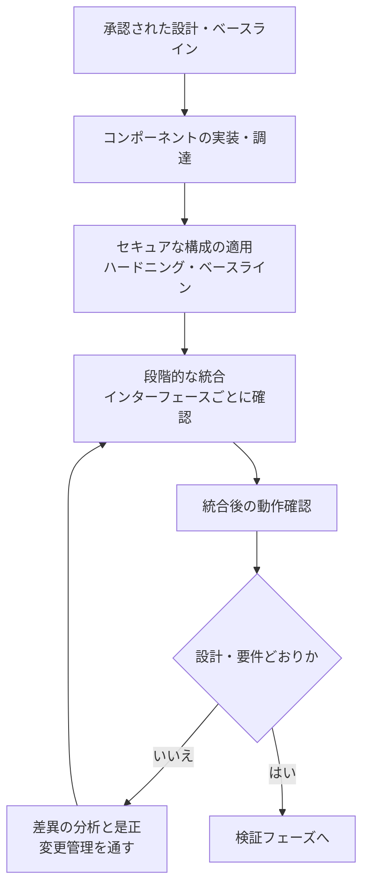

| 活動 | 内容 |
|---|---|
| セキュア構成 | 不要機能の無効化、既定アカウント変更、ログ有効化、業界標準のハードニング指針の適用 |
| 段階的統合 | 一度に全部ではなく**小さい単位で結合**して問題の原因を特定しやすくする |
| インターフェース確認 | 認証・暗号化・入力検査が境界で働くか |
| 文書化 | 実際の構成（as-built）を記録し、設計との差分を明示 |

#### Step 2: CI/CD と DevSecOps にセキュリティを組み込む

NIST SP 800-218（SSDF v1.1）は、既存の SDLC に組み込める高レベルの安全な開発慣行の集合を示します。SSDF の改訂（SP 800-218 Rev.1、SSDF v1.2）は 2025年12月17日にドラフトが公開されており、また生成 AI 向けの SSDF コミュニティプロファイル SP 800-218A（2024年7月最終）もあります [S13]。確認時点で Rev.1 はドラフトとされています。

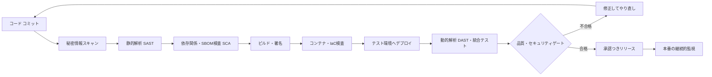

| ゲート | 目的 |
|---|---|
| 秘密情報スキャン | 鍵・パスワードの混入を防止 |
| SAST | ソースコードの欠陥を早期検出 |
| SCA / SBOM | 依存コンポーネントの既知脆弱性・ライセンスを把握 |
| 署名 | 成果物の完全性・出所を保証 |
| DAST | 動作中のアプリの脆弱性を検出 |

NIST SP 800-53 Release 5.2.0 は、ソフトウェアとシステムの設計段階からの強靭性、開発者によるテスト、更新・パッチの展開と管理、ソフトウェアの完全性と検証といった側面を扱っています [S7]。

#### ベストプラクティス（4.1）

- **「ビルド環境」自体も守る**（権限・秘密情報・署名鍵の保護）。
- パイプラインのゲートは**失敗時に止まる**設計（警告だけで通過させない）。
- 自動化の結果は**証拠として保存**し、検証・監査で使えるようにする。
- インフラも**コード化（IaC）**してレビューとテストの対象に含める。

---

### 4.2 実装の成功を検証する

**公式アウトラインの論点** [S3]: セキュリティテスト計画の策定／システムセキュリティ検証の支援／リスク分析のレビューと更新／実装に関するステークホルダー受け入れの文書化

#### Step 1: セキュリティテスト計画

| 項目 | 内容 |
|---|---|
| 目的・範囲 | どの要件・どの範囲を確認するか |
| 方法 | テスト／分析／検査／実演（T/A/I/D） |
| 環境・データ | 本番に近い環境、テストデータの保護 |
| 合否基準 | 事前に定める（後から基準を動かさない） |
| 役割 | 実施者、独立性、報告先 |
| 追跡 | **どのテストがどの要件を検証するか**の対応表 |

#### Step 2: 検証手法の使い分け

| 手法 | 見つけるもの |
|---|---|
| 脆弱性スキャン | 既知の脆弱性・誤設定 |
| 構成コンプライアンス確認 | ベースラインとのずれ |
| コードレビュー・静的解析 | 実装の欠陥 |
| ファジング | 想定外入力による異常 |
| ペネトレーションテスト | 攻撃者視点での連鎖的な弱点 |
| 機能的セキュリティテスト | 認証・認可・ログなどの要件の動作確認 |

NIST SP 800-53A の評価手順は、**調べる（Examine）・聞く（Interview）・試す（Test）**の 3 つの手法を軸に整理されています（一般知識。5.2.0 でも更新されています [S7]）。

#### Step 3: 検証結果をリスクに戻す（閉ループ）

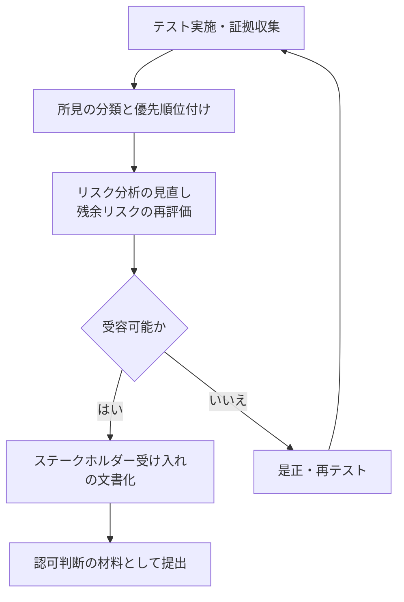

| 成果物 | 内容 |
|---|---|
| テスト報告書 | 方法・結果・証拠・逸脱 |
| 更新されたリスク登録簿 | 新規・変化・残余リスク |
| POA&M | 未解決の所見と是正計画 |
| 受け入れ記録 | 誰が、いつ、どの条件で受け入れたか |

#### 検証 vs 妥当性確認（再掲・試験の頻出）

| | 検証 | 妥当性確認 |
|---|---|---|
| 問い | 仕様どおりか | ニーズを満たすか |
| 基準 | 要件・設計 | 運用上の目的・ステークホルダー |
| 時期 | 各段階で | 主に最終段階・運用想定環境 |
| 例 | テスト結果と要件の照合 | 運用者による実運用シナリオでの確認 |

#### ベストプラクティス（4.2）

- テスト計画は**要件定義と並行して作り始める**。
- 独立性を確保する（作った人とテストする人を**できる限り分ける**）。
- 所見は「**重大度と悪用可能性**」で優先順位付けし、期限つきで管理する。
- 受け入れは**条件つき受け入れ**も含め、書面で残す。

---

## 9. Domain 5: Secure Operations, Change Management and Disposal（14%）

配点は最小ですが、**「運用以降に何が起きるか」**を理解していないと設計も歪みます。5.1〜5.4 の 4 項目です [S3]。

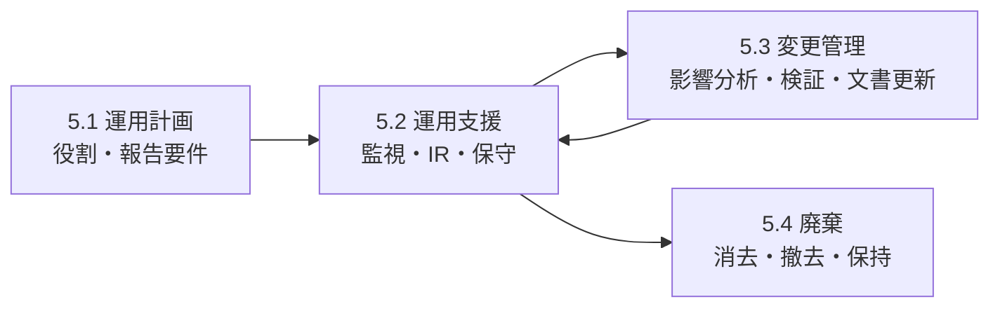

---

### 5.1 安全な運用計画を作成する

**公式アウトラインの論点** [S3]: 運用に当たるシステムセキュリティ要員の役割・責任・要件の特定／セキュリティ関連イベント報告の要件の規定

| 内容 | 解説 |
|---|---|
| 役割と責任 | システム管理者、ISSO、SOC、特権利用者、保守担当。職務分掌（Separation of Duties）と、必要な教育・資格 |
| 運用手順書 | 起動・停止、バックアップ、アカウント管理、ログ確認の標準手順 |
| イベント報告要件 | **何を（種類）、誰に（報告先）、いつまでに（期限）、どう（手段）**報告するか |
| 閾値と分類 | 重大度の定義、エスカレーション基準 |

#### ベストプラクティス（5.1）

- 運用手順は**設計段階から**作る（運用で初めて考えない）。
- 報告ルートは**夜間・休日**でも機能するように設計する。
- 特権利用は**申請・承認・ログ**を必須にする。

---

### 5.2 安全な運用を支援する

**公式アウトラインの論点** [S3]: 継続的監視機能の設計（人・プロセス・技術）／インシデント対応プロセスの支援／安全な保守手順の策定

#### Step 1: 継続的監視（ISCM）

NIST SP 800-137 は、組織が継続的監視の戦略を立て、プログラムを実装するための指針です。脅威・脆弱性への認識と、管理策の有効性の可視性を得ることが目的です [S11]。


| 要素 | 内容 |
|---|---|
| 人 | 監視・分析・意思決定の担当と訓練 |
| プロセス | 監視頻度、エスカレーション、レビュー会議 |
| 技術 | ログ収集、SIEM、構成・脆弱性スキャン、異常検知 |

#### Step 2: インシデント対応の支援

NIST SP 800-61 Rev.3（2025年4月最終）は、インシデント対応をサイバーセキュリティリスク管理の一部として組み込み、CSF 2.0 のコミュニティプロファイルとして整理しました。旧版（Rev.2）を置き換えています [S12]。CSF 2.0 の 6 つの機能（Govern、Identify、Protect、Detect、Respond、Recover）すべてがインシデント対応に関わる、という考え方です [S12]。

ISSE の貢献:

- 設計段階で**ログ・フォレンジック**に必要な情報が出るようにする
- 隔離・復旧がしやすい**構成（分離、バックアップ）**にする
- 手順書・連絡先・訓練計画へ**設計知識**を提供する

#### Step 3: 安全な保守

| 管理策 | 内容 |
|---|---|
| 保守要員 | 認可された人のみ。遠隔保守は多要素認証＋記録 |
| 保守ツール | 持ち込みツールの検査・管理 |
| 持ち出し | 保守でシステム・媒体を外へ出す前に**消去**または**暗号化・管理** |
| パッチ | リスクに基づき優先度付け、テスト後に適用、**ロールバック手順** |

> NIST SP 800-53 Release 5.2.0 は、更新やパッチの安全かつ信頼できる展開に焦点を当てた改訂でした [S7]。

#### ベストプラクティス（5.2）

- 監視は**「何を検知したいか」から**逆算して設計する。
- 警告は**行動につながる量**に絞る（アラート疲れを避ける）。
- 保守作業は**変更管理と同じ統制**で扱う。

---

### 5.3 変更管理に参加する

**公式アウトラインの論点** [S3]: 変更レビューへの参加／変更影響の評価／変更の検証と妥当性確認／リスク評価文書の更新

#### 変更管理の流れ

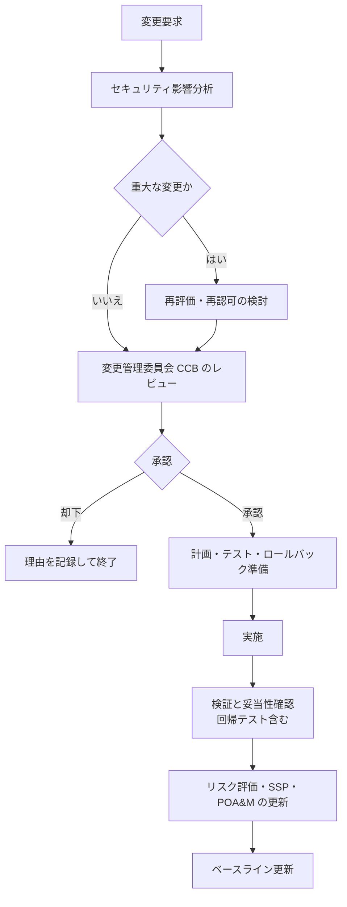

| 活動 | ポイント |
|---|---|
| 影響分析 | 変更が**リスク・管理策・境界**に与える影響を事前に評価 |
| 検証・妥当性確認 | 変更後の機能が要件を満たし、既存の管理策が壊れていないか（回帰テスト） |
| 緊急変更 | 手順を簡略化しても、事後レビューと記録は必須 |
| 文書の更新 | SSP、リスク評価、構成記録などを**変更とセットで**更新 |

#### ベストプラクティス（5.3）

- **「小さな変更」ほど記録を省略しない**（積み重なって設定ドリフトになる）。
- 変更前に**ロールバック手順**を確認する。
- 重大な変更は**再評価・再認可**を検討する。

---

### 5.4 廃棄プロセスに参加する

**公式アウトラインの論点** [S3]: 廃棄時のセキュリティ要件の特定／安全な廃棄計画の策定／廃止・廃棄手順の策定／廃止・廃棄結果の監査／データ保持方針の実施

#### Step 1: 廃棄の流れ

```mermaid
flowchart TD
    A["廃棄要件の特定<br/>法令・契約・データ分類"] --> B["廃棄計画の策定"]
    B --> C["資産・データの棚卸し"]
    C --> D["必要データの移行・保存"]
    D --> E["アクセス権・鍵・証明書・外部接続の廃止"]
    E --> F["媒体の消去<br/>Clear・Purge・Destroy"]
    F --> G["消去結果の検証"]
    G --> H["記録・証明書・監査"]
    H --> I["保持期間の管理と最終削除"]
```

#### Step 2: 媒体の消去（NIST SP 800-88 Rev.2）

NIST SP 800-88 Rev.2（2025年9月最終）は、旧版（Rev.1、2014年）から焦点を「現場の個別判断」から**組織の媒体消去プログラムの確立**へ移しました。技術手順の細目は、IEEE 2883、NSA の仕様、または組織が承認した基準に従う方針に変わっています（暗号消去を除く）[S10][S20]。

| 方法 | 内容 | 使い分け |
|---|---|---|
| **Clear** | ユーザーがアクセスできる領域を論理的に消去 | 再利用・低〜中リスクの媒体 |
| **Purge** | 研究所レベルの高度な復元攻撃に耐える消去（暗号消去など） | 機密度が高い媒体、組織外へ出す場合 |
| **Destroy** | 媒体を物理的に使用不能にする | 最高機密、消去を保証できない媒体 |

> 第三者の解説は、Rev.2 が HDD の多重上書き（旧来の複数回上書き）を推奨しない点にも触れています。詳細は NIST 原文 [S10] で確認してください。

| 概念 | 説明 |
|---|---|
| **暗号消去（Cryptographic Erase）** | 暗号化されたデータの**鍵を安全に消去**して、データを復元不能にする |
| **消去の検証** | 消去が有効に行われたことの確認（Rev.2 で強化） |
| **論理的消去** | クラウドなど、物理媒体を直接扱えない環境での消去の考え方 |

#### Step 3: データ保持方針

| 観点 | 内容 |
|---|---|
| 保持期間 | 法令・契約・業務で決まる最低期間と最長期間 |
| リーガルホールド | 訴訟・調査中は削除を停止 |
| 最小化 | 不要になったデータは速やかに削除 |
| 証跡 | 削除の記録（いつ・誰が・何を） |

#### ベストプラクティス（5.4）

- 廃棄要件は**設計段階で決める**（暗号化済みなら鍵の廃棄が消去になる、など設計で楽になる）。
- **鍵・証明書・アカウント・DNS・外部接続**を忘れずに廃止する（「データ以外」の残存が事故になる）。
- 消去は**証跡（誰・いつ・どの媒体・どの方法・確認者）**を残す。
- クラウドでは**データの所在**と事業者の消去保証を契約で確認する。

---

## 10. 横断テーマ: AI を含むシステムの扱い

ISC2 の ISSEP 試験概要ページは、AI が主要コンポーネントになる時代を踏まえ、5 ドメインにそれぞれ AI セキュリティの観点を位置づけて説明しています [S2]。以下は、その要旨を自分の言葉で整理したものです。**AI の観点は新しい別ドメインではなく、既存ドメインの中に織り込まれている**点が重要です。

| ドメイン | AI に関する観点（要旨） | 設計・運用への含意 |
|---|---|---|
| 1 基礎 | AI/ML モデルの理論的・数学的な検証、**回避攻撃（Adversarial Evasion）**を含む脅威モデリングを初期要件に入れる。AI を含むことで信頼境界・セキュリティエンクレーブを侵害しないよう配慮 | ML モデルを**高価値資産**として扱う |
| 2 リスク | モデルの頑健性、本番での挙動のずれ（ロジックドリフト）を評価。**説明可能な AI**を、監査・認可のための証拠として設計 | 判断経路を追跡・説明できるようにする |
| 3 計画・設計 | **データポイズニング**を防ぐデータ取り込みパイプライン、TEE（信頼できる実行環境）でモデルを保護、**外部 AI API・事前学習モデルの出所（プロベナンス）**の確認 | AI のサプライチェーンも SCRM 対象 |
| 4 検証 | AI の出力がセキュリティポリシーに沿うかをテスト。**敵対的テスト**、幻覚（ハルシネーション）が任務に影響しないことの確認。ML でログ・テストデータを解析 | 通常テストに加え、AI 特有のテストを追加 |
| 5 運用 | **コンセプトドリフト**を追跡する継続的監視、再学習・ロールバックの自動トリガー、モデル更新の安全な配信。**人間がループに残る（human-in-the-loop）**設計 | モデルの更新も変更管理の対象 |

関連資料: NIST の SP 800-218A（生成 AI および汎用基盤モデル向けの SSDF コミュニティプロファイル）は、AI モデル開発の安全な実践の参考になります [S13]。

---

## 11. 試験対策

### 11.1 解答の考え方（ISSEP らしい判断軸）

```mermaid
flowchart TD
    Q["問題文を読む"] --> A{"どのライフサイクル段階か"}
    A --> B["構想・要件"]
    A --> C["設計"]
    A --> D["実装・検証"]
    A --> E["運用・変更・廃棄"]
    B --> F["ステークホルダーのニーズと保護ニーズから始める"]
    C --> G["要件への追跡可能性を維持しトレードオフを記録する"]
    D --> H["要件に対する証拠を作る"]
    E --> I["変更はリスクを再評価して文書を更新する"]
    F --> J{"選択肢のうち<br/>プロセスに沿うのはどれか"}
    G --> J
    H --> J
    I --> J
    J --> K["証拠・文書・権限者の承認を伴う案を選ぶ"]
```

**覚えておく判断軸**

| 軸 | 意味 |
|---|---|
| 要件から始める | 技術選定より先に、ニーズと保護要件を確定 |
| 追跡可能性 | 要件・設計・テストの対応がとれている |
| ライフサイクル全体 | 運用・廃棄まで見て設計する |
| 証拠 | 「やった」ではなく「やった証拠がある」 |
| 権限と記録 | 判断者（AO など）と記録を明確に |
| 自動化は統制つき | 自動化しても変更管理・ログは必須 |
| リスクの再評価 | 変更・新情報・検証結果で更新する |

### 11.2 混同しやすい用語

| 用語 A | 用語 B | 違い |
|---|---|---|
| 検証（Verification） | 妥当性確認（Validation） | 仕様どおりか／ニーズを満たすか |
| 固有リスク | 残余リスク | 管理策の前／後 |
| MTBF | MTTF | 修理可能／交換型 |
| MTTR（repair） | MTTR（recovery） | 修理時間／サービス復旧までの時間 |
| MTD | RTO | 許容できる最大停止時間／復旧目標時間（RTO + WRT ≦ MTD） |
| RTO | RPO | 時間／データ損失量（時点） |
| フェイルオープン | フェイルクローズド | 障害時に開放／遮断 |
| ISSE | ISSO | 設計・工学担当／運用担当 |
| Clear | Purge | 論理的消去／高度な復元にも耐える消去 |
| 要件ベースライン | 構成ベースライン | 要件の基準／システム構成の基準 |
| SSP | POA&M | 実装内容の計画書／未解決事項の是正計画 |

### 11.3 確認問題（オリジナル）

**問 1.** 要件「保存データは暗号化されること」に対し、実際に暗号化されていることを確認する作業はどれか。
A. 妥当性確認　B. 検証　C. 認可　D. 廃棄
<details><summary>解答</summary>B（仕様に対する確認＝検証）</details>

**問 2.** 管理策を実施する**前**のリスクを何と呼ぶか。
A. 残余リスク　B. 固有リスク　C. 受容リスク　D. 転嫁リスク
<details><summary>解答</summary>B</details>

**問 3.** MTBF が 2,000 時間、MTTR が 8 時間のとき、可用性（A = MTBF / (MTBF + MTTR)）に最も近い値は。
A. 99.2%　B. 99.6%　C. 99.9%　D. 98.0%
<details><summary>解答</summary>B（2000 / 2008 ≈ 0.996）</details>

**問 4.** 業務の MTD が 8 時間の場合、RTO の設定として最も適切なのは。
A. 12 時間　B. 8 時間より十分短い値（例: 4 時間）　C. MTD と無関係　D. 24 時間
<details><summary>解答</summary>B（RTO + WRT ≦ MTD のため、WRT > 0 なら RTO は MTD より短くする必要がある）</details>

**問 5.** RMF（SP 800-37 Rev.2）で Rev.1 から追加されたステップはどれか。
A. Categorize　B. Authorize　C. Prepare　D. Monitor
<details><summary>解答</summary>C</details>

**問 6.** 残余リスクを受容して運用を認可する責任は主に誰にあるか。
A. ISSE　B. 開発者　C. 認可権限者（AO）　D. 監査人
<details><summary>解答</summary>C</details>

**問 7.** 暗号化されたストレージの廃棄時、鍵を安全に消去してデータを復元不能にする方法はどれか。
A. 暗号消去（Cryptographic Erase）　B. 再フォーマットのみ　C. 名前変更　D. 保管のみ
<details><summary>解答</summary>A</details>

**問 8.** 要件追跡マトリクス（RTM）の主な目的は。
A. 予算の管理　B. 要件・設計・テストの対応を追跡し、漏れや余剰を発見する　C. 人員配置　D. 契約交渉
<details><summary>解答</summary>B</details>

**問 9.** 三点見積りで、楽観 6 日・最可能 9 日・悲観 18 日のときの PERT 期待値は。
A. 9 日　B. 10 日　C. 11 日　D. 12 日
<details><summary>解答</summary>B（(6 + 4×9 + 18)/6 = 60/6 = 10）</details>

**問 10.** 稼働中システムへの変更で、セキュリティ上最初に行うべきことはどれか。
A. すぐ実施する　B. セキュリティ影響分析を行う　C. 文書を更新する　D. ベースラインを更新する
<details><summary>解答</summary>B（影響分析→承認→実施→検証→文書・ベースライン更新）</details>

### 11.4 受験前チェック

| 確認 | 状態 |
|---|---|
| 公式アウトライン（2025年8月1日版）を通読した | □ |
| 5 ドメインの全サブ項目（1.1〜5.4）を自分の言葉で説明できる | □ |
| RMF 7 ステップを順に説明できる | □ |
| MTBF・可用性・ALE・PERT の計算ができる | □ |
| 検証と妥当性確認の違いを例で説明できる | □ |
| 最新の受験資格・受験料・予約方法を ISC2 公式で確認した | □ |

---

## 12. ベストプラクティス総まとめチェックリスト

### ドメイン別

| ドメイン | 重要なベストプラクティス |
|---|---|
| 1 基礎 | 保護ニーズから始める／TCB と信頼境界を明示／要件ごとに検証方法を割当／CM と変更管理を最初から／SCRM を調達で／見積りは範囲と前提で示す |
| 2 リスク | 組織の許容度を先に確認／評価を節目ごとに反復／リスク登録簿にオーナーと期限／受容は権限者の記録つき／運用リスクを事業側と共同評価 |
| 3 計画・設計 | 要件は測定可能・テスト可能に／前提を記録し検証／原則を要件に翻訳／冗長性＋多様性／トレードオフと理由を記録／双方向の追跡 |
| 4 実装・検証 | セキュア構成とハードニング／段階的統合／パイプラインのゲートは止まる設計／テスト計画は早期に／所見をリスクに戻す／書面で受け入れ |
| 5 運用・変更・廃棄 | 運用手順を設計時から／継続的監視は目的から逆算／保守も変更管理と同等の統制／変更は影響分析から／廃棄要件は設計時に／消去の証跡を残す |

### 横断

- **追跡可能性**: ニーズ→要件→設計→実装→テスト→証拠が一本の線でつながる。
- **証拠主義**: 「やった」ではなく「やった証拠がある」。
- **ライフサイクル思考**: 運用・廃棄を見据えて設計する。
- **リスクの継続更新**: 変更・検証・新情報のたびに見直す。
- **自動化には統制**: 自動化は変更管理・ログ・アクセス制御とセットで。

---

## 13. 参考文献（URL）

> 確認日: 2026年10月25日。ISC2 や NIST は文書を更新するため、受験・実務の際は必ず原典の最新版を確認してください。「区分」は一次情報（公式）か、第三者かを示します。

| 番号 | 区分 | 資料 | URL |
|---|---|---|---|
| S1 | 公式 | ISC2 ISSEP 認定ページ（起点） | https://www.isc2.org/certifications/issep |
| S2 | 公式 | ISC2 ISSEP 試験アウトライン概要ページ（AI の観点を含む） | https://www.isc2.org/certifications/issep/issep-certification-exam-outline |
| S3 | 公式 | ISC2 ISSEP Exam Outline（2025年8月1日発効・PDF） | https://edge.sitecorecloud.io/internationf173-xmc4e73-prodbc0f-9660/media/Project/ISC2/Main/Media/certifications/Certs/ISSEP/ISSEP-Exam-Outline-2025.pdf |
| S4 | 公式 | ISC2 Insights: 上級認定の新アウトライン（2025年7月） | https://www.isc2.org/insights/2025/07/new-exam-outlines-for-isc2-advanced-certifications |
| S5 | 公式 | NIST SP 800-160 Vol.1 Rev.1 Engineering Trustworthy Secure Systems（2022年11月） | https://csrc.nist.gov/pubs/sp/800/160/v1/r1/final |
| S6 | 公式 | NIST SP 800-37 Rev.2 RMF（2018年12月）※URL は第三者記事で確認 | https://csrc.nist.gov/publications/detail/sp/800-37/rev-2/final |
| S7 | 公式 | NIST SP 800-53 Release 5.2.0 公開ニュース（2025年8月27日） | https://csrc.nist.gov/News/2025/nist-releases-revision-to-sp-800-53-controls |
| S8 | 公式 | NIST SP 800-161 Rev.1 C-SCRM（2022年5月、2024年11月更新含む） | https://csrc.nist.gov/pubs/sp/800/161/r1/upd1/final |
| S9 | 公式 | NIST SP 800-18 Rev.2（2026年6月）システム計画（セキュリティ・プライバシー・C-SCRM） | https://csrc.nist.gov/pubs/sp/800/18/r2/final |
| S10 | 公式 | NIST SP 800-88 Rev.2 Guidelines for Media Sanitization（2025年9月） | https://csrc.nist.gov/pubs/sp/800/88/r2/final |
| S11 | 公式 | NIST SP 800-137 ISCM（2011年9月） | https://csrc.nist.gov/pubs/sp/800/137/final |
| S12 | 公式 | NIST SP 800-61 Rev.3 インシデント対応（2025年4月） | https://csrc.nist.gov/pubs/sp/800/61/r3/final |
| S13 | 公式 | NIST SSDF プロジェクト関連文書一覧（SP 800-218、Rev.1 ドラフト、SP 800-218A） | https://csrc.nist.gov/projects/ssdf/publications |
| S14 | 規格 | ISO/IEC/IEEE 24641:2023 モデルベースのシステム・ソフトウェアエンジニアリング | https://www.iso.org/standard/79111.html |
| S15 | 公式 | NIST Risk Management Framework プロジェクト（SP 800-53 5.2.0、SP 800-18r2 の更新情報） | https://csrc.nist.gov/Projects/risk-management |
| S16 | 第三者 | Training Camp: What Is ISSEP?（配点・形式・CPE などの整理） | https://trainingcamp.com/what-is-issep/ |
| S17 | 第三者 | Destination Certification: CISSP concentrations（配点の記載が公式 PDF と異なる） | https://destcert.com/resources/cissp-concentrations/ |
| S18 | 非公式 | ISC2 Community: ISSEP Exam Changes（受験者の声。廃止予定の告知あり） | https://community.isc2.org/t5/ISSEP-Study-Group/ISSEP-Exam-Changes-Effective-August-2025/m-p/81860 |
| S19 | 第三者経由 | DoD 8140 資格マトリクス（S16 内のリンク。本ガイド作成時は未取得） | https://www.cyber.mil/dod-workforce-innovation-directorate/dod8140/qualification-matrices |
| S20 | 公式 | NIST: SP 800-88r2 公開ニュース | https://www.nist.gov/node/1898251 |

### 補足: 追加で確認するとよい資料（本セッションでは本文を取得していないもの）

| 資料 | URL |
|---|---|
| ISC2 補助参考資料リスト | https://www.isc2.org/certifications/references |
| ISC2: AI 関連の試験ガイダンス（2026年9月の記事。タイトルのみ確認） | https://www.isc2.org/insights/2026/09/updated-isc2-ai-guidance-published |
| NIST 出版物の総合入口（SP 800-30 Rev.1、SP 800-34、SP 800-39、SP 800-128、SP 800-207、FIPS 199 などはここから検索） | https://csrc.nist.gov/publications |

---

### 本ガイドの限界と使い方

1. 出題範囲は ISC2 公式アウトライン [S3] に厳密に準拠していますが、**試験問題の内容は公開されておらず**、本ガイドは試験問題を予想・再現するものではありません。
2. 「一般知識」と記した箇所（ISO 27001 の管理策数、FIPS 199、SP 800-53A の評価手法、Saltzer & Schroeder の原則、ISCM の流れなど）は、本セッションで原典を取得して確認していません。公式資料で裏づけを取ってから暗記してください。
3. 受験料、試験形式、受験資格の細部、CPE 要件、DoD 8140 の適用範囲は変更され得ます。**必ず ISC2 公式で最新情報を確認**してください。