# ISSMP 初学者向けステップバイステップ完全ガイド

**ISC2 ISSMP – Information Systems Security Management Professional（情報システムセキュリティ管理プロフェッショナル）**

| 項目 | 内容 |
|---|---|
| 対象読者 | セキュリティ管理・リーダーシップの初学者（CISSP 取得済み、または管理業務の経験がある方） |
| 準拠アウトライン | ISSMP Exam Outline（**2025年8月1日発効**） |
| 情報確認日 | 2026年10月25日（ウェブ情報ベース） |
| 起点URL | https://www.isc2.org/certifications/issmp |
| 図解ルール | ASCII 図解は不使用。フローチャートは Mermaid、表は Markdown |
| 出典の表記 | 各章末の「根拠ソース」に URL を記載。末尾に確認状況つきの一覧あり |

> **重要な注意**: 試験の出題範囲・配点・受験料・要件は変更されることがあります。受験前に必ず ISC2 公式ページで最新情報を確認してください。本ガイドは学習の補助資料であり、試験問題や合格を保証するものではありません。

---

## 目次

1. [Step 0: このガイドの使い方](#step-0-このガイドの使い方)
2. [Step 1: ISSMP とは何か](#step-1-issmp-とは何か)
3. [Step 2: 出題ドメインと配点](#step-2-出題ドメインと配点)
4. [Step 3: 管理者の思考法（前提知識）](#step-3-管理者の思考法前提知識)
5. [Domain 1: Leadership and Organizational Management](#domain-1-leadership-and-organizational-management)
6. [Domain 2: Systems Lifecycle Management](#domain-2-systems-lifecycle-management)
7. [Domain 3: Risk Management](#domain-3-risk-management)
8. [Domain 4: Security Operations](#domain-4-security-operations)
9. [Domain 5: Contingency Management](#domain-5-contingency-management)
10. [Domain 6: Law, Ethics and Security Compliance Management](#domain-6-law-ethics-and-security-compliance-management)
11. [横断テーマ: AI とセキュリティマネジメント](#横断テーマ-ai-とセキュリティマネジメント)
12. [試験戦略と学習計画](#試験戦略と学習計画)
13. [確認テスト](#確認テスト)
14. [用語集](#用語集)
15. [参考ソース一覧と確認状況](#参考ソース一覧と確認状況)

---

## Step 0: このガイドの使い方

ISSMP は「技術を設定する人」ではなく「**セキュリティプログラム全体に責任を持つ人**」の試験です。そのため、各章を次の 5 点セットで読むと理解が定着します。

| 読む順 | 見出し | ねらい |
|---|---|---|
| 1 | この項目は何か | 用語と目的をつかむ |
| 2 | 試験アウトラインの要点 | ISC2 公式の項目を確認する |
| 3 | ステップバイステップ | 実務での進め方を順に理解する |
| 4 | ベストプラクティス | 現場で推奨される型を覚える |
| 5 | 根拠ソース | 一次情報にあたり、深掘りする |

### 学習ロードマップ

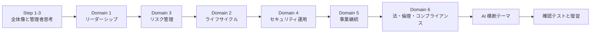

> 配点が大きい Domain 1（21%）と Domain 3（20%）を先に固めると、他ドメインの理解が楽になります。

---

## Step 1: ISSMP とは何か

### 1-1. 定義

ISC2 は ISSMP を、情報セキュリティプログラムの**確立・提示・統治**を専門とするセキュリティリーダーのための認定資格と位置づけています。組織の使命・目標・戦略とセキュリティプログラムを整合させ、事業上・運用上の要求と、望ましいリスク姿勢（risk position）の両立を主導することが期待されます。

### 1-2. 同系統の認定との違い

| 認定 | 焦点 | ドメイン数 |
|---|---|---|
| **ISSMP** | セキュリティ**管理**（プログラムを運営する） | 6 |
| ISSAP | セキュリティ**アーキテクチャ**（設計する） | 4 |
| ISSEP | セキュリティ**エンジニアリング**（システムに作り込む） | 5 |

### 1-3. 受験要件（概要）

| ルート | 条件 |
|---|---|
| ルート A | **CISSP を良好な状態で保持**し、ISSMP の 6 ドメインのうち 1 つ以上で累計 **2 年**のフルタイム実務経験 |
| ルート B | 6 ドメインのうち **2 つ以上**で累計 **7 年**のフルタイム実務経験（CISSP は不要） |

- 2023年10月以降、ISSMP は単独（スタンドアロン）の認定として扱われています（二次情報）。
- 試験合格後に経験要件を満たしていない場合は、ISC2 の Associate になれる制度があります（要公式確認）。

### 1-4. 試験の基本情報

| 項目 | 内容 | 確認元 |
|---|---|---|
| 問題数 | 125 問（固定） | 二次情報（Training Camp） |
| 試験時間 | 3 時間 | ISC2 アウトライン概要・二次情報 |
| 合格ライン | 1000 点中 700 点 | 二次情報 |
| 言語 | 英語 | ISC2 アウトライン概要 |
| 形式 | 多肢選択＋拡張形式の問題 | 二次情報 |
| 試験料金 | 米国 599 ドル（地域により異なる） | 二次情報 |
| 認定の認証 | ANAB（ISO/IEC 17024）認定、米国 DoDM 8140 承認 | ISC2 公式ページ |

> 料金・問題数などは必ず公式ページで最終確認してください。

### 1-5. 取得後の維持（目安）

- 有効期間 3 年。CISSP と併せて保持する場合、グループ A の CPE を 3 年で 60（CISSP 側にも算入）、ISSMP 単独の場合は 140（二次情報）。
- ISC2 の年会費は複数認定を持っても 1 本分（二次情報、金額は要確認）。

### 根拠ソース

- ISC2 ISSMP 公式ページ: https://www.isc2.org/certifications/issmp
- ISC2 ISSMP 試験アウトライン: https://www.isc2.org/certifications/issmp/issmp-certification-exam-outline
- ISC2 発表（2025年8月1日の新アウトライン）: https://www.isc2.org/insights/2025/07/new-exam-outlines-for-isc2-advanced-certifications
- 二次情報（要件・試験仕様の整理）: https://trainingcamp.com/what-is-issmp/

---

## Step 2: 出題ドメインと配点

### 2-1. 6 ドメインと配点

| # | ドメイン | 配点 | サブドメイン数 |
|---|---|---|---|
| 1 | Leadership and Organizational Management | **21%** | 10 |
| 2 | Systems Lifecycle Management | 15% | 4 |
| 3 | Risk Management | **20%** | 4 |
| 4 | Security Operations | 18% | 3 |
| 5 | Contingency Management | 12% | 4 |
| 6 | Law, Ethics and Security Compliance Management | 14% | 5 |

> 配点は二次情報（Training Camp）が引用する 2025年8月1日版アウトラインの値です。ISC2 の公式ページでは配点表が動的表示のため、本ガイド作成時には本文として取得できませんでした。PDF 版アウトラインで最終確認してください。なお、公式ページのドメイン 1 の見出しは "Leadership and Operational Management" と表記されており、資料により表記ゆれがあります。

### 2-2. ドメイン同士の関係

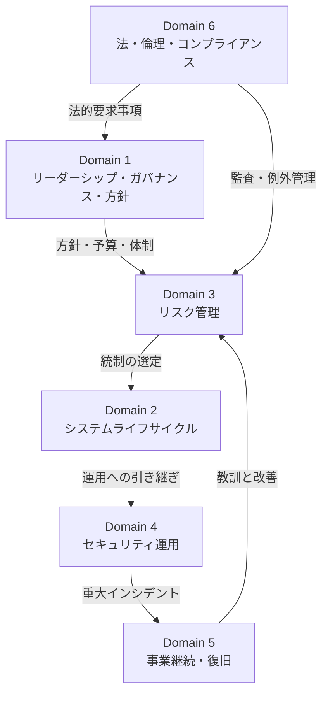

### 根拠ソース

- https://www.isc2.org/certifications/issmp/issmp-certification-exam-outline
- https://trainingcamp.com/what-is-issmp/

---

## Step 3: 管理者の思考法（前提知識）

ISSMP の設問は「どの設定が正しいか」ではなく「**管理者として最初に／最も適切にとるべき行動は何か**」を問うものが中心になります。まず次の基礎を押さえましょう。

### 3-1. ガバナンスとマネジメントの違い

| 観点 | ガバナンス（Governance） | マネジメント（Management） |
|---|---|---|
| 役割 | 方向を示し、監督する | 方向に沿って計画・実行する |
| 担い手 | 取締役会・経営層 | CISO・セキュリティ管理者 |
| 問い | 「何をすべきか。誰が責任を持つか」 | 「どうやって実現するか」 |
| 成果物の例 | 方針、リスク許容度の承認 | 手順、プロジェクト、運用 |

NIST CSF 2.0 は、従来の 5 機能に **Govern（統治）** を加えた 6 機能（Govern / Identify / Protect / Detect / Respond / Recover）で構成されます。Govern は他の 5 機能の土台です。

### 3-2. 基本の三要素と用語

| 用語 | 意味 |
|---|---|
| CIA | 機密性（Confidentiality）・完全性（Integrity）・可用性（Availability） |
| 資産（Asset） | 組織にとって価値のあるもの（情報、システム、人、評判） |
| 脅威（Threat） | 損害を与えうる原因 |
| 脆弱性（Vulnerability） | 脅威に悪用されうる弱点 |
| リスク（Risk） | 脅威が脆弱性を突き、資産に損害が生じる可能性と影響 |
| 統制（Control） | リスクを低減する対策（管理的・技術的・物理的） |
| 残留リスク（Residual Risk） | 対策後に残るリスク |

### 3-3. 管理者としての優先順位の型

試験で迷ったときの判断軸です。

1. **人命と安全**が最優先（災害・事故対応）
2. **事業目的**に貢献する（セキュリティは目的ではなく手段）
3. **経営層の承認・権限**を確認する（独断で進めない）
4. **リスクに基づく**判断をする（全てを守るのではなく、優先順位をつける）
5. **記録・説明責任**を残す（文書化・報告）
6. **法令・倫理**に従う（ISC2 倫理規約の優先順位に従う）

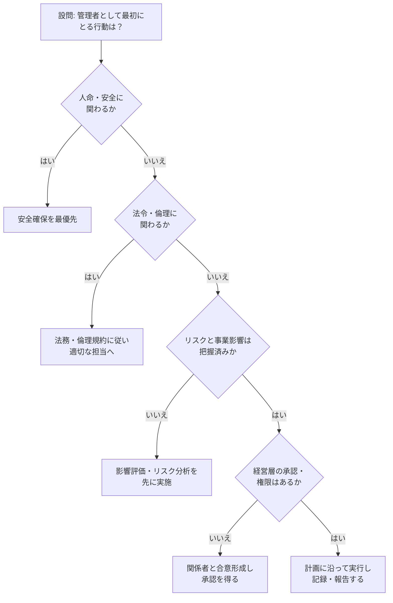

### 根拠ソース

- NIST Cybersecurity Framework 2.0: https://www.nist.gov/cyberframework
- NIST SP 800-100 Information Security Handbook: A Guide for Managers: https://csrc.nist.gov/pubs/sp/800/100/final
- ISC2 Code of Ethics: https://www.isc2.org/ethics

---

# Domain 1: Leadership and Organizational Management

**配点 21%（最大）**。セキュリティの役割・ガバナンス・戦略・方針・契約・教育・指標・予算・チーム運営・プロジェクト管理までを扱います。

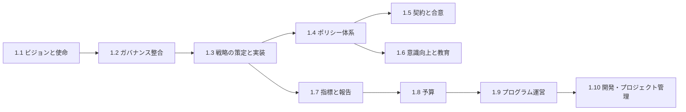

---

## 1.1 セキュリティの役割を組織文化・ビジョン・使命の中に位置づける

### この項目は何か

セキュリティを「情報システム部門だけの仕事」にせず、**組織の使命や価値観と結びついた活動**として定義する項目です。

### 試験アウトラインの要点

- 情報セキュリティプログラムのビジョンと使命を定義する
- 組織の目標・目的・価値観とセキュリティを整合させる
- 組織内の他のプロセスとセキュリティの関係を定義する
- 組織文化とセキュリティの関係を定義する

### ステップバイステップ

1. 組織の使命・戦略・重要な事業プロセスを把握する（経営計画、中期計画、IR 資料）
2. 経営層・事業部門にヒアリングし、守るべき価値を言語化する
3. セキュリティの**ビジョン**（目指す姿）と**使命**（役割）を 1〜2 文で定義する
4. 組織文化（リスクを取る文化か、慎重な文化か）を観察・評価する
5. 文化に合わせた推進方法を選ぶ（例: 規制産業では統制重視、スタートアップでは自動化重視）
6. 経営層の承認を得て、全社に周知する

### ビジョン・使命の違い

| 要素 | 意味 | 例 |
|---|---|---|
| ビジョン | 将来のあるべき姿 | 「顧客に最も信頼される事業基盤を提供する」 |
| 使命（ミッション） | 日々の役割 | 「事業に見合ったリスクの範囲で情報資産を守り、事業を止めない」 |
| 価値観 | 判断の拠り所 | 透明性、説明責任、最小権限 |

### ベストプラクティス

| 推奨事項 | 理由 |
|---|---|
| セキュリティを**事業のイネーブラー**として表現する | 「止める部署」と見なされると協力が得られない |
| ビジョンは経営層の言葉で書き、技術用語を避ける | 承認と浸透が早まる |
| 文化の評価（アンケート・面談）を定期的に行う | 施策の受け入れやすさを把握できる |
| 他部門（人事・法務・調達・広報）との接点を明文化する | セキュリティは横断活動のため |
| エグゼクティブスポンサーを立てる | 資源と権限の裏付けになる |

### 根拠ソース

- ISSMP 試験アウトライン: https://www.isc2.org/certifications/issmp/issmp-certification-exam-outline
- NIST CSF 2.0（GV.OC: Organizational Context）: https://www.nist.gov/cyberframework
- 経済産業省・IPA「サイバーセキュリティ経営ガイドライン」: https://www.meti.go.jp/policy/netsecurity/mng_guide.html

---

## 1.2 セキュリティプログラムを組織のガバナンスと整合させる

### この項目は何か

組織の意思決定構造の中で、セキュリティの**権限の出所**と**責任の所在**を明確にする項目です。

### 試験アウトラインの要点

- 組織のガバナンス構造を特定し、うまく進む
- 主要なステークホルダーの役割を確認・検証する
- 権限の根拠と境界（sources and boundaries of authorization）を検証する
- セキュリティ施策への組織の支持を提唱し、獲得する

### ガバナンスの流れ

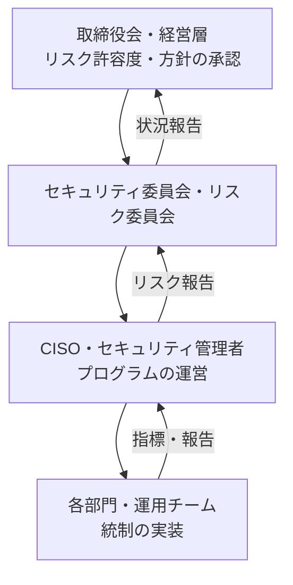

### ステップバイステップ

1. 組織図・意思決定会議体（取締役会、リスク委員会、CAB など）を把握する
2. ステークホルダーを洗い出し、**影響度×関心度**で分類する
3. RACI（Responsible / Accountable / Consulted / Informed）で責任を明確にする
4. セキュリティ責任者の権限が何に基づくか（憲章、取締役会決議、法令）を確認する
5. 権限の境界（誰の承認が必要か、どこまで独自判断できるか）を文書化する
6. 経営層に対して、事業言語（損失・信頼・売上）で支援を依頼する

### CSF 2.0 の GOVERN 機能（参考）

| カテゴリ | 内容 |
|---|---|
| GV.OC | 組織の背景（Organizational Context） |
| GV.RM | リスクマネジメント戦略 |
| GV.RR | 役割・責任・権限 |
| GV.PO | ポリシー |
| GV.OV | 監督（Oversight） |
| GV.SC | サイバーセキュリティサプライチェーンリスク管理 |

### ベストプラクティス

| 推奨事項 | 理由 |
|---|---|
| CISO の報告ライン（CIO 配下か、CEO/リスク責任者直下か）を意図して設計する | 独立性と発言力が変わる |
| セキュリティ憲章（Charter）を取締役会レベルで承認する | 権限の根拠になる |
| 経営層向けに**リスクの意思決定**を求める（技術報告にしない） | 経営が決めるべき事項を明確にする |
| 年次で役割・権限を見直す | 組織変更に追随する |

### 根拠ソース

- NIST CSF 2.0: https://www.nist.gov/cyberframework
- ISSMP 試験アウトライン: https://www.isc2.org/certifications/issmp/issmp-certification-exam-outline

---

## 1.3 情報セキュリティ戦略を定義し、実装する

### 試験アウトラインの要点

- 組織の取り組みからセキュリティ要件を特定する
- 戦略を実装する**能力と余力（capacity and capability）**を評価する
- セキュリティアーキテクチャ設計を示す（prescribing）
- 戦略の実装を管理する
- 戦略をレビューし、維持する

### ステップバイステップ

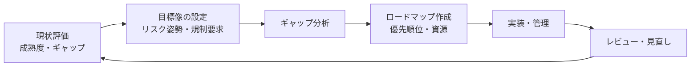

1. 事業計画（新規事業、クラウド移行、M&A、海外展開）から**セキュリティ要件**を抽出する
2. 現状を評価する（成熟度モデル、CSF の Current Profile）
3. 目標像（Target Profile）を設定し、**ギャップ**を特定する
4. 人員・予算・技術・スキルなどの**実行能力**を評価する
5. 優先順位を付けたロードマップ（短期・中期・長期）を作る
6. アーキテクチャ方針（ゼロトラスト、多層防御、ID 中心 など）を示す
7. 実装を進捗管理し、定期的に戦略自体を見直す（PDCA）

### 主な枠組み

| 枠組み | 用途 |
|---|---|
| NIST CSF 2.0 の Profile / Tier | 現状と目標の整理、成熟度の目安 |
| ISO/IEC 27001 の ISMS（PDCA） | 継続的改善の運用モデル |
| CMMI などの成熟度モデル | プロセス成熟度の段階評価 |
| NIST SP 800-207（ゼロトラスト） | アーキテクチャ方針の参考 |

### ベストプラクティス

| 推奨事項 | 理由 |
|---|---|
| 戦略は**事業戦略から逆算**して作る | 投資の正当化がしやすい |
| 目標は測定可能にする（指標と期限） | 達成度を客観的に評価できる |
| 「できること」を過大評価しない（人員・スキルを現実的に見積もる） | 実行不能な計画を避ける |
| 戦略を年次＋重大変化時に見直す | 脅威・事業環境が変わるため |
| 設計は**セキュリティ管理者が方向を示し、詳細設計はアーキテクトに任せる** | 役割分担（ISSAP との違い） |

### 根拠ソース

- NIST CSF 2.0: https://www.nist.gov/cyberframework
- NIST SP 800-207 Zero Trust Architecture: https://csrc.nist.gov/pubs/sp/800/207/final
- ISO/IEC 27001:2022: https://www.iso.org/standard/82875.html
- CMMI Institute: https://cmmiinstitute.com/

---

## 1.4 セキュリティポリシー体系を定義し、維持する

### 試験アウトラインの要点

- 適用される外部標準・法律・規制を特定する
- **データ分類**と保護要件を決める
- 社内ポリシーを制定する
- ポリシーへの組織の支持を獲得する
- 手順・標準・ガイドライン・ベースラインを作成する
- ポリシー体系の定期レビューを確実にする

### 文書体系（階層）

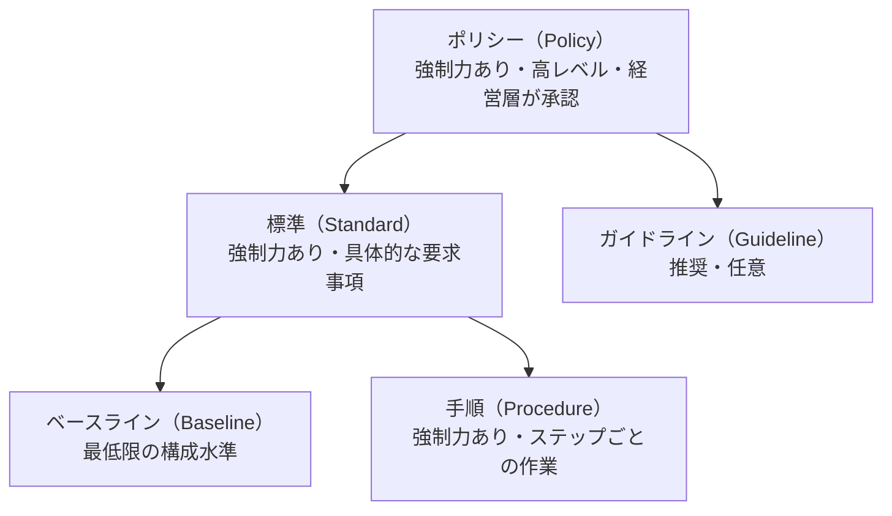

| 種類 | 強制力 | 変更頻度 | 例 |
|---|---|---|---|
| ポリシー | 必須 | 低い | 情報セキュリティ基本方針 |
| 標準 | 必須 | 中 | パスワード要件、暗号化標準 |
| ベースライン | 必須 | 中 | OS の最低限の設定基準 |
| 手順 | 必須 | 高い | アカウント発行手順 |
| ガイドライン | 任意（推奨） | 高い | 安全なリモートワークの手引き |

### ステップバイステップ

1. 適用法令・業界標準・契約要求を洗い出す
2. データ分類スキームを定義する（例: 公開 / 社内 / 機密 / 極秘）
3. 各分類に対する取扱い要件（保管・伝送・廃棄・アクセス）を決める
4. ポリシーを起案し、法務・人事・事業部門の意見を集める
5. 経営層の承認を得て発行・周知する
6. 標準・手順・ベースラインに落とし込む
7. 例外処理（6.5 参照）とレビューサイクル（例: 年次）を設定する

### ベストプラクティス

| 推奨事項 | 理由 |
|---|---|
| ポリシーは**短く・技術非依存**に書く | 技術変化の影響を受けにくい |
| 詳細な技術要求は標準・手順に分離する | 改訂の手間を減らせる |
| データ所有者（Data Owner）を決め、分類責任を割り当てる | 分類の責任が明確になる |
| 全ポリシーに所有者・版数・承認日・次回レビュー日を付ける | 管理可能性が高まる |
| 従業員が内容を理解したことの確認（確認署名など）を取る | 執行可能性の裏付けになる |

### 根拠ソース

- NIST SP 800-53 Rev.5（各ファミリの -1 統制がポリシー・手順を要求）: https://csrc.nist.gov/pubs/sp/800/53/r5/upd1/final
- ISO/IEC 27001:2022（5.2 情報セキュリティ方針）: https://www.iso.org/standard/82875.html
- NIST CSF 2.0（GV.PO）: https://www.nist.gov/cyberframework

---

## 1.5 契約・合意におけるセキュリティ要件を管理する

### 試験アウトラインの要点

- サービス管理契約（リスク、財務など）を評価する
- マネージドサービス（インフラ、クラウド）を統制する
- 組織変更（M&A、アウトソーシング、能力開発）の影響を管理する
- 規制遵守に関する記述が契約に含まれることを確実にする
- 契約の遵守状況を監視・強制する

### 主な文書

| 文書 | 目的 |
|---|---|
| SLA（Service Level Agreement） | サービス水準（可用性、応答時間）を定める |
| OLA（Operational Level Agreement） | 組織内部門間の運用水準 |
| UC（Underpinning Contract） | 外部委託先との下支え契約 |
| NDA（秘密保持契約） | 秘密情報の取扱いを制限する |
| DPA（データ処理契約） | 個人データの処理委託条件を定める |
| MOU / MOA | 当事者間の合意事項の覚書 |

### 契約に入れるべきセキュリティ条項

| 条項 | 内容 |
|---|---|
| 監査権（Right to Audit） | 委託先への監査・第三者報告書の入手 |
| インシデント通知 | 通知期限・連絡先・協力義務 |
| データの所在・再委託 | 保管場所、サブプロセッサの承認 |
| 暗号化・アクセス管理 | 最低限の統制 |
| 終了時の対応 | データ返却・消去証明・移行支援（Exit） |
| 責任と補償 | 損害賠償の範囲・保険 |
| 規制要求の継承 | 法令・業界標準の遵守義務 |

### ステップバイステップ

1. 委託の目的・取り扱うデータ・重要度を整理する
2. 委託先のセキュリティを評価する（質問票、第三者認証、SOC 2 / ISO 27001 報告書）
3. 契約要件を法務・調達と共同で定義する
4. SLA の指標と測定方法を合意する
5. 契約後は定期的にレビューし、違反時の是正を要求する
6. 組織変更（M&A 等）では、統合前に**デューデリジェンス**を行い、統合後の統制水準を揃える

### ベストプラクティス

| 推奨事項 | 理由 |
|---|---|
| クラウドでは**責任共有モデル**を文書化する | 自社と事業者の責任範囲を明確にするため |
| 契約更新と退出計画（Exit Strategy）を最初から検討する | ベンダーロックイン・サービス停止に備える |
| 重要度（ティア）に応じて評価の深さを変える | 資源を集中できる |
| 契約の遵守状況を KPI として定期報告する | 実効性を担保する |

### 根拠ソース

- NIST SP 800-161 Rev.1（サプライチェーンリスク管理）: https://csrc.nist.gov/pubs/sp/800/161/r1/final
- ISO/IEC 27001:2022（附属書 A: 供給者関係）: https://www.iso.org/standard/82875.html
- 個人情報保護委員会（委託先の監督）: https://www.ppc.go.jp/

---

## 1.6 セキュリティ意識向上・教育プログラムを管理する

### 試験アウトラインの要点

- セキュリティプログラムをステークホルダーに周知する
- 対象セグメント別に教育ニーズを特定し、教育を実施する
- 意識向上・教育プログラムの有効性を監視・評価・報告する

### 意識向上・教育・訓練の違い

| 区分 | 目的 | 対象 | 例 |
|---|---|---|---|
| Awareness（意識向上） | 注意を喚起する | 全従業員 | ポスター、メール、動画 |
| Training（訓練） | 特定のスキルを習得する | 役割別 | フィッシング対応演習、IR 演習 |
| Education（教育） | 深い知識・理解を得る | 専門職 | 資格取得、大学講座 |

### ステップバイステップ


1. 対象を分類する（全従業員、管理職、開発者、システム管理者、経営層、委託先）
2. 近年のインシデント・リスク評価から重点テーマを選ぶ
3. 内容と形式を設計する（短時間の反復、ロールプレイ、模擬攻撃）
4. 入社時・年次・随時（事故発生時）に実施する
5. 受講率・テスト結果・行動指標で効果を測る

### 効果測定の指標例

| 指標 | 意味 |
|---|---|
| 受講完了率 | 参加の網羅性 |
| 模擬フィッシングのクリック率・報告率 | 行動の変化（報告率が上がるのが望ましい） |
| 事故報告までの時間 | 気づきと報告文化 |
| ポリシー違反の件数・傾向 | 理解度と実効性 |

### ベストプラクティス

| 推奨事項 | 理由 |
|---|---|
| 懲罰的でなく、**報告を歓迎する文化**を作る | 隠蔽を防ぐ |
| 役割別（開発者向けには安全なコーディング等）に内容を変える | 関連性が高いほど定着する |
| 経営層自身も受講する | 文化形成と説得力 |
| 参加率だけでなく**行動の変化**で評価する | 本来の目的は行動を変えること |

### 根拠ソース

- NIST SP 800-50 Rev.1 Building a Cybersecurity and Privacy Learning Program: https://csrc.nist.gov/pubs/sp/800/50/r1/final
- ISO/IEC 27001:2022（7.3 認識、附属書 A 6.3）: https://www.iso.org/standard/82875.html

---

## 1.7 セキュリティ指標を定義・測定・報告する

### 試験アウトラインの要点

- KPI（重要業績評価指標）と KRI（重要リスク指標）を特定する
- 指標を組織のリスク姿勢と関連づける
- 指標を使ってセキュリティプログラム・運用を改善する

### KPI と KRI の違い

| 項目 | KPI | KRI |
|---|---|---|
| 意味 | 活動・成果の**達成度** | リスクの**増大の兆候** |
| 問い | 「計画どおり進んでいるか」 | 「リスクが許容を超えそうか」 |
| 例 | パッチ適用率、訓練受講率、MTTR | 重大な未修正脆弱性の件数、特権アカウント数の増加、委託先の監査指摘の未是正数 |
| 性質 | 遅行／先行どちらもある | 先行指標（早期警戒）が望ましい |

### ステップバイステップ

1. 目的を決める（誰が・何の意思決定に使うか）
2. 候補指標を挙げ、**SMART**（具体的・測定可能・達成可能・関連性・期限）で絞り込む
3. データ源・測定方法・頻度・責任者を定義する
4. 閾値（目標値・警告値・許容限度）を設定し、リスク許容度と紐づける
5. 対象者別にダッシュボードを作る（経営層は少数・傾向重視、運用はきめ細かく）
6. 逸脱時の対応（エスカレーション）を決める
7. 指標自体を定期見直しし、無意味なものは廃止する

### ベストプラクティス

| 推奨事項 | 理由 |
|---|---|
| 少数精鋭（経営層向けは 5〜10 指標程度が目安） | 情報過多を避ける |
| 数値だけでなく**文脈と推奨アクション**を添える | 意思決定を促す |
| 「虚栄の指標」（ブロックしたメール総数など）に頼らない | 改善に結びつかない |
| 指標の定義を固定し、傾向を時系列で見る | 比較可能性を保つ |
| 指標の操作・歪みを防ぐため、データ源を独立させる | 信頼性の確保 |

### 根拠ソース

- NIST SP 800-55（情報セキュリティの測定）: https://csrc.nist.gov/pubs/sp/800/55/r1/final
- NIST SP 800-137 ISCM: https://csrc.nist.gov/pubs/sp/800/137/final
- CIS Controls: https://www.cisecurity.org/controls

---

## 1.8 セキュリティ予算を準備・獲得・管理する

### 試験アウトラインの要点

- 年間予算を準備し、確保する
- リスクと脅威の変化に応じて予算を調整・追加要求する
- 財務責任を管理し、報告する

### 主な概念

| 用語 | 意味 |
|---|---|
| CapEx（資本的支出） | 設備・ソフトウェア購入など資産計上される支出 |
| OpEx（運用費） | 保守・サブスクリプション・人件費などの経常費用 |
| TCO | 導入から廃棄までの総保有コスト |
| ROI / ROSI | 投資対効果 / セキュリティ投資対効果 |
| SLE | 1 回の事象による損失額（単一損失予測） |
| ARO | 年間発生率 |
| ALE | 年間損失予測 = SLE × ARO |

ROSI の考え方: （対策前の ALE − 対策後の ALE − 対策の年間コスト）÷ 対策の年間コスト

### ステップバイステップ

1. 事業計画・リスク評価・コンプライアンス要求から必要な投資を洗い出す
2. 各投資のコスト（TCO）と効果（ALE の削減、規制対応、事業機会）を見積もる
3. 優先順位付けし、必須・推奨・任意に分類する
4. 経営層向けに**リスク低減効果を事業言語で**説明する
5. 承認後は支出を追跡し、予実差異を定期報告する
6. 重大な脅威の変化・事件があれば、追加予算または再配分を要請する

### ベストプラクティス

| 推奨事項 | 理由 |
|---|---|
| 予算説明は「何を買うか」でなく**「何のリスクをどれだけ減らすか」** | 経営判断に直結する |
| 人件費・教育・運用費を含めて TCO で評価する | 隠れコストを避ける |
| 予備費（コンティンジェンシー）を確保する | 緊急事態に備える |
| コスト対効果の判断は**対策費が守る資産の価値を上回らない**ことが原則 | リスク対策の基本原則 |
| ベンダー依存の集中を避ける | 価格・継続性リスクの低減 |

### 根拠ソース

- NIST SP 800-100（予算・資源管理を含む管理者向けハンドブック）: https://csrc.nist.gov/pubs/sp/800/100/final
- NIST SP 800-30 Rev.1（リスク評価）: https://csrc.nist.gov/pubs/sp/800/30/r1/final

---

## 1.9 セキュリティプログラムを運営する

### 試験アウトラインの要点

- 役割と責任を定義する
- チームの説明責任を決定し、管理する
- 部門横断の関係を構築する
- セキュリティと他のステークホルダー間の対立を解決する
- コミュニケーション上の障害・ボトルネックを特定する
- セキュリティ統制を組織のプロセスに統合する

### ステップバイステップ

1. セキュリティ組織構造を設計する（集中型・分散型・ハイブリッド）
2. 役割（CISO、リスク管理者、SOC、アーキテクト、コンプライアンス担当など）と責任を RACI で定義する
3. 採用・育成・後継計画・燃え尽き防止を含む人材戦略を作る
4. 部門横断の連携先を整理する（人事、法務、調達、IT、事業、広報、内部監査）
5. 対立（スピード対セキュリティ）は、**リスクを可視化し、代替案を提示**して解決する
6. セキュリティ統制を HR（採用・異動・退職）、調達、変更管理などのプロセスに組み込む

### 人事プロセスへの統合

| フェーズ | 主なセキュリティ施策 |
|---|---|
| 採用前 | 身元確認（法令の範囲で）、秘密保持契約 |
| 入社 | 最小権限でのアカウント発行、教育 |
| 在職中 | 職務分掌、強制休暇、ローテーション、定期的な権限見直し |
| 異動 | 旧権限の剥奪、新権限の付与 |
| 退職 | 即時のアクセス停止、資産返却、退職面談、秘密保持義務の再確認 |

### ベストプラクティス

| 推奨事項 | 理由 |
|---|---|
| **職務分掌（Separation of Duties）**と**最小権限**を役割設計の基本とする | 不正と事故のリスクを抑える |
| セキュリティチャンピオン制度（各部門の窓口）を導入する | 現場への浸透と早期相談 |
| 対立は**事実・リスク・選択肢**で整理して意思決定者に上げる | 属人的な言い合いを避ける |
| 定例の部門横断会議（セキュリティ委員会）を持つ | コミュニケーション障害を減らす |

### 根拠ソース

- NIST SP 800-53 Rev.5（PS: 人的セキュリティ、AC-5 職務分掌、AC-6 最小権限）: https://csrc.nist.gov/pubs/sp/800/53/r5/upd1/final
- NIST CSF 2.0（GV.RR）: https://www.nist.gov/cyberframework

---

## 1.10 製品開発・プロジェクト管理の原則を適用する

### 試験アウトラインの要点

- ライフサイクル全体にセキュリティを組み込む
- 適用可能な手法（アジャイル、ウォーターフォール、リーン、RAD）を特定・適用する
- スコープ・スケジュール・品質・予算を分析する

### 開発手法の比較

| 手法 | 特徴 | セキュリティ上の要点 |
|---|---|---|
| ウォーターフォール | 工程を順に進める | 要件段階でセキュリティ要件を確定し、各工程の承認ゲートで確認 |
| アジャイル（Scrum 等） | 短い反復で増分を提供 | セキュリティ要件をバックログに入れ、受け入れ基準・Definition of Done に含める |
| リーン | ムダの排除・価値重視 | 手戻りを避けるため、自動化されたチェックを入れる |
| RAD | 試作を素早く繰り返す | 試作が本番に残らないよう統制する |
| DevSecOps | 開発・運用・セキュリティの統合 | CI/CD にスキャンとゲートを組み込む |

### プロジェクトの制約（トリプルコンストレイント＋リスク）

| 要素 | セキュリティ管理者の視点 |
|---|---|
| スコープ | セキュリティ要件が含まれているか |
| スケジュール | セキュリティ検証のための時間が確保されているか |
| 予算 | セキュリティ関連費用が計上されているか |
| 品質 | セキュリティ品質（脆弱性の水準）が基準に含まれているか |

### ベストプラクティス

| 推奨事項 | 理由 |
|---|---|
| **早期（左側）からセキュリティを入れる（Shift Left）** | 後工程の修正は高コスト |
| NIST SSDF（SP 800-218）を安全な開発の基準にする | 実践項目が体系化されている |
| セキュリティ要件の受け入れ基準を明文化する | 品質を検証可能にする |
| セキュリティの例外は期限付き・承認付きにする | 恒久的な抜け道を防ぐ |
| 手法の選択は**プロジェクトの特性（変更頻度・規制）**で決める | 万能な手法はない |

### 根拠ソース

- NIST SP 800-218 SSDF: https://csrc.nist.gov/pubs/sp/800/218/final
- CISA Secure by Design: https://www.cisa.gov/securebydesign
- NIST SP 800-160 Vol.1 Rev.1（システムセキュリティエンジニアリング）: https://csrc.nist.gov/pubs/sp/800/160/v1/r1/final

---

# Domain 2: Systems Lifecycle Management

**配点 15%**。システムの企画から廃棄までの全期間でセキュリティを管理します。構成管理、新技術の取り込み、脆弱性管理、変更管理が柱です。

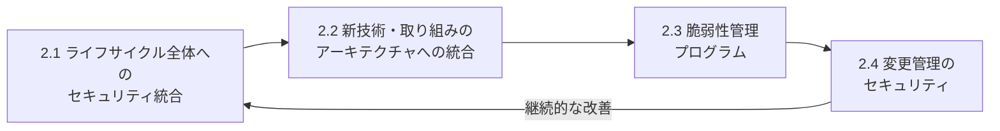

---

## 2.1 システムライフサイクル全体にセキュリティを統合する

### この項目は何か

システムの**全フェーズ**（企画・要件・設計・開発・試験・導入・運用・廃棄）で、セキュリティの判断ポイントと統制を組み込む管理活動です。

### 試験アウトラインの要点

- ライフサイクル全体にセキュリティの**意思決定ポイント**と要件を統合する
- ライフサイクル全体でセキュリティ統制を実装する
- セキュリティ**構成管理（CM）**プロセスを監督する

### ライフサイクルとセキュリティ活動

| フェーズ | 主なセキュリティ活動 | 管理者の確認事項 |
|---|---|---|
| 企画・開始 | 情報のカテゴリ分け、初期リスク評価 | 事業目的と重要度は明確か |
| 要件定義 | セキュリティ・プライバシー要件の確定 | 法令・契約要求が反映されているか |
| 設計 | 脅威モデリング、セキュア設計のレビュー | 設計レビューの承認ゲートがあるか |
| 開発 | セキュアコーディング、依存関係管理、SAST | 開発者が教育を受けているか |
| 試験 | DAST、ペネトレーションテスト、受入試験 | 重大な欠陥が未解決のまま進んでいないか |
| 導入 | 本番移行の承認、構成の確認、引き継ぎ | 変更管理を通過しているか |
| 運用・保守 | 監視、パッチ、継続的モニタリング | 構成のドリフトが検出されているか |
| 廃棄 | データのサニタイズ、資産の処分、ライセンス・アクセス回収 | 情報が残っていないか |

### RMF（リスク管理フレームワーク）の 7 ステップ

NIST SP 800-37 Rev.2 の RMF は、ライフサイクルにセキュリティとリスク管理を組み込む代表的な型です。

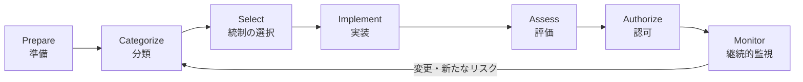

### 構成管理（Configuration Management）

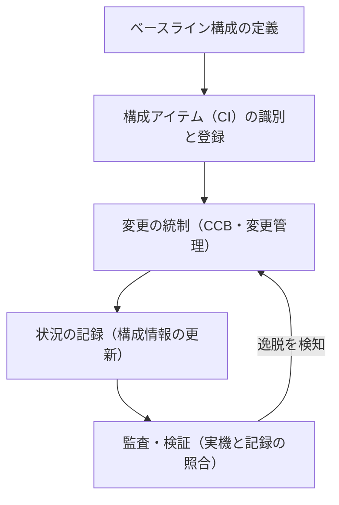

| 用語 | 意味 |
|---|---|
| ベースライン | 承認された基準構成 |
| CI（Configuration Item） | 管理対象（サーバー、アプリ、文書など） |
| CCB（Configuration Control Board） | 構成変更を審査する会議体 |
| ドリフト | 実機が承認済み構成から外れること |

### ベストプラクティス

| 推奨事項 | 理由 |
|---|---|
| 各フェーズに**セキュリティゲート**（通過基準）を設ける | 欠陥を持ち越さない |
| セキュリティ要件を**要件管理ツールで追跡**し、試験にトレースする | 実装漏れを防ぐ |
| 構成を**コード化（IaC）**してバージョン管理する | 再現性・監査性が向上 |
| 廃棄時のデータサニタイズを手順化し、証跡を残す | 情報漏えい防止 |
| 継続的モニタリングで承認後の状態を保つ | 一度の認可で安心しない |

### 根拠ソース

- NIST SP 800-37 Rev.2 RMF: https://csrc.nist.gov/pubs/sp/800/37/r2/final
- NIST SP 800-128 構成管理: https://csrc.nist.gov/pubs/sp/800/128/final
- NIST SP 800-160 Vol.1 Rev.1: https://csrc.nist.gov/pubs/sp/800/160/v1/r1/final
- NIST RMF プロジェクト（SP 800-18 Rev.2 は 2026年6月30日に最終化）: https://csrc.nist.gov/projects/risk-management

---

## 2.2 組織の取り組みと新技術をセキュリティアーキテクチャに統合する

### 試験アウトラインの要点

- セキュリティ原則を実装する
- 組織の取り組みがセキュリティ態勢に与える影響に対処する

### 代表的なセキュリティ設計原則

| 原則 | 意味 |
|---|---|
| 最小権限 | 必要最小限の権限だけ付与する |
| 多層防御（Defense in Depth） | 複数の防御層を重ねる |
| フェイルセーフ | 障害時は安全側に倒す |
| 職務分掌 | 重要作業を複数人に分ける |
| 経済性（シンプルさ） | 複雑さを抑え、攻撃面を減らす |
| ゼロトラスト | 場所や所有に基づく暗黙の信頼を置かず、継続的に検証する |
| Secure by Design | 設計時から安全を既定値にする |

### 新しい取り組みへの対応フロー

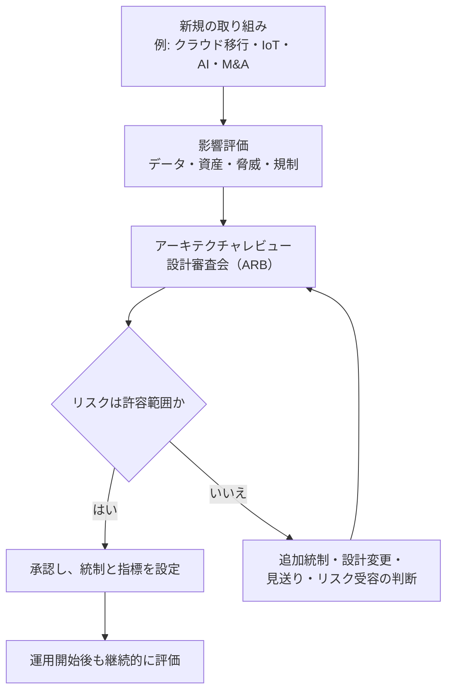

### ベストプラクティス

| 推奨事項 | 理由 |
|---|---|
| 新規導入前に**セキュリティ・プライバシーのレビュー**を必須にする | 導入後の手戻りを避ける |
| シャドーIT／シャドーAIの発見手段（CASB、ネットワーク可視化）を持つ | 未承認利用の把握 |
| 脅威モデリング（STRIDE 等）を設計段階で実施する | 設計欠陥を早期に発見 |
| 承認済みの**リファレンスアーキテクチャ**を整備する | 判断のばらつきを抑える |
| M&A では統合前にセキュリティ・デューデリジェンスを行う | 負債を引き継がない |

### 根拠ソース

- NIST SP 800-207 ゼロトラスト: https://csrc.nist.gov/pubs/sp/800/207/final
- CISA Secure by Design: https://www.cisa.gov/securebydesign
- NIST SP 800-160 Vol.1 Rev.1: https://csrc.nist.gov/pubs/sp/800/160/v1/r1/final

---

## 2.3 包括的な脆弱性管理プログラムを定義・管理する

### 試験アウトラインの要点

- 資産・システム・サービスを**重要度と影響**に基づいて特定・分類・優先順位付けする
- 脅威と脆弱性を**リスクに基づいて**優先順位付けする
- セキュリティテストを管理する
- 脆弱性の緩和・是正を管理する
- 脆弱性の監視と報告を行う

### 脆弱性管理サイクル

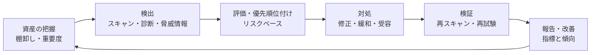

### テストの種類

| 種類 | 内容 | 管理上の注意 |
|---|---|---|
| 脆弱性スキャン | ツールで既知の弱点を網羅的に検出 | 誤検知の精査が必要 |
| ペネトレーションテスト | 脆弱性を実際に悪用して到達範囲を確認 | **事前の合意書・ルール・範囲（RoE）**が必須 |
| レッドチーム演習 | 敵対者を模して検知・対応能力も評価 | 経営層の承認と安全対策 |
| コードレビュー／SAST・DAST | ソースや実行中アプリの検査 | 開発工程に組み込む |
| 脅威分析 | 想定される攻撃者・手口の分析 | 脅威情報と連携 |

### 優先順位付けの指標

| 指標 | 内容 |
|---|---|
| CVSS | 脆弱性の技術的な深刻度（共通指標） |
| EPSS | 今後 30 日以内に悪用される確率の推定 |
| CISA KEV | 悪用が確認された脆弱性の一覧 |
| 資産の重要度 | 事業への影響 |
| 露出度 | インターネット公開、重要データへの近接性 |

> CVSS だけでなく、**悪用の有無・資産の重要度・露出**を併せて優先度を判断するのが現在の推奨です。

### ベストプラクティス

| 推奨事項 | 理由 |
|---|---|
| 修正期限（SLA）を重大度・資産重要度別に定める | 対応の一貫性を確保 |
| パッチ適用ができない場合は**補完的対策**と期限付き例外を設ける | 受容の統制 |
| ペネトレーションテストの実施前に**書面の承認とルール**を取り交わす | 法的・運用上の事故を防ぐ |
| 脆弱性情報の受付窓口（開示方針）を公開する | 外部報告を受けやすくする |
| 報告は「件数」より**傾向・滞留期間・リスク低減**を示す | 意思決定に役立つ |

### 根拠ソース

- NIST SP 800-40 Rev.4 パッチ管理: https://csrc.nist.gov/pubs/sp/800/40/r4/final
- NIST SP 800-115 技術的セキュリティテスト: https://csrc.nist.gov/pubs/sp/800/115/final
- FIRST CVSS: https://www.first.org/cvss/
- FIRST EPSS: https://www.first.org/epss/
- CISA KEV カタログ: https://www.cisa.gov/known-exploited-vulnerabilities-catalog

---

## 2.4 変更管理のセキュリティ面を管理する

### 試験アウトラインの要点

- セキュリティ要件を変更管理プロセスに統合する
- **セキュリティ影響分析**を実施する
- ステークホルダーを特定し、調整する
- 文書化と追跡を管理する
- ポリシー遵守（例: 継続的モニタリング）を確実にする

### 変更管理の流れ

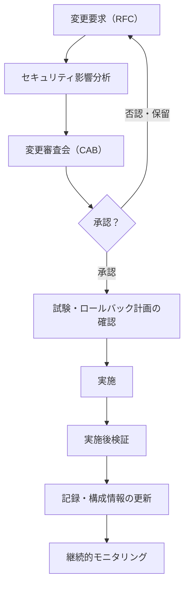

| 変更の種類 | 説明 | 統制 |
|---|---|---|
| 標準変更 | 事前承認済みの定型作業 | 手順どおりに実施し、記録する |
| 通常変更 | 影響評価・審査が必要 | CAB での承認 |
| 緊急変更 | 重大障害・脅威への即時対応 | 簡略承認＋**事後レビュー**を必須とする |

### セキュリティ影響分析で確認する項目

1. 変更が機密性・完全性・可用性に与える影響
2. 新たな脆弱性・攻撃面が生じないか
3. 既存の統制を弱めないか
4. 法令・契約・ポリシーとの適合
5. ロールバック（元に戻す）方法の有無

### ベストプラクティス

| 推奨事項 | 理由 |
|---|---|
| セキュリティ担当を CAB に含める | 影響を審査時に確認できる |
| **変更の事前承認なしの実施を許さない**（緊急時も記録を残す） | 統制の抜け穴を防ぐ |
| 実施後に構成情報を更新し、実機との差異を検知する | ドリフトの早期発見 |
| 変更の失敗率・緊急変更の割合を指標化する | プロセスの健全性を評価 |

### 根拠ソース

- NIST SP 800-128: https://csrc.nist.gov/pubs/sp/800/128/final
- NIST SP 800-53 Rev.5（CM ファミリ、CM-3 構成変更管理、CM-4 影響分析）: https://csrc.nist.gov/pubs/sp/800/53/r5/upd1/final
- NIST SP 800-137 ISCM: https://csrc.nist.gov/pubs/sp/800/137/final

---

# Domain 3: Risk Management

**配点 20%（第 2 位）**。リスクの特定・評価・対応・報告の一連の流れと、サプライチェーンリスク、統制の有効性評価が柱です。

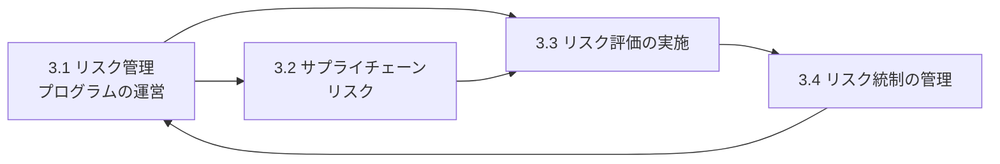

---

## 3.1 リスク管理プログラムを開発・管理する

### 試験アウトラインの要点（12 項目）

目標の特定 → リスク所有者との目標定義 → 範囲の決定 → **リスク許容度/選好の特定** → 資産目録の入手と検証 → リスクの分析 → 対策・補完統制・緩和統制の決定 → 対応オプションの特定 → **費用対効果分析（CBA）** → ステークホルダーへの推奨 → 合意済みリスク・課題の文書化と管理 → リスクと課題の試験・監視・報告

### リスクマネジメントのプロセス（ISO 31000 の考え方）

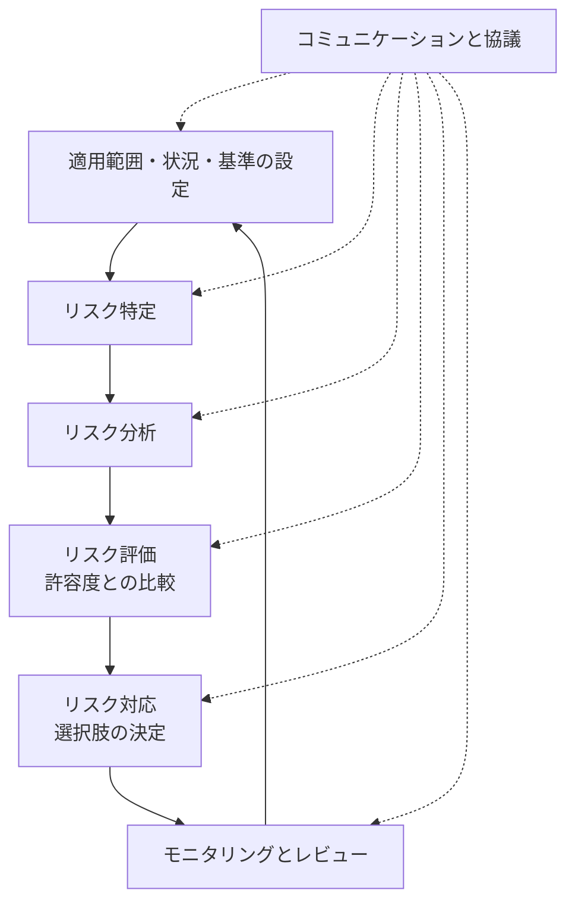

### 重要概念

| 用語 | 意味 | 例 |
|---|---|---|
| リスク選好（Risk Appetite） | 目標達成のために**進んで取る**リスクの量と種類 | 新規事業では高め、個人情報では低め |
| リスク許容度（Risk Tolerance） | 選好からの**許容できる逸脱の幅** | 可用性は年間 99.9% を下回らない |
| リスク所有者 | リスクを管理する責任と権限を持つ人 | 事業部門長 |
| リスク登録簿（Risk Register） | リスクの一覧と状況を記録する台帳 | 所有者・評価・対応・期限 |
| 残留リスク | 対応後に残るリスク | 受容の対象 |

### リスク対応の 4 つの選択肢

| 対応 | 意味 | 例 |
|---|---|---|
| 低減（Mitigate） | 統制で可能性・影響を下げる | MFA を導入する |
| 転嫁・共有（Transfer / Share） | 第三者に移す | サイバー保険、委託 |
| 回避（Avoid） | リスクの原因となる活動をやめる | サービスの提供中止 |
| 受容（Accept） | 認識したうえで受け入れる | 残留リスクを承認して受容 |

> 受容は「放置」ではありません。**権限のある所有者が、根拠を示して、文書で承認**し、期限を決めて見直します。

### 定量的な計算（試験頻出）

| 式 | 内容 |
|---|---|
| SLE = AV × EF | 単一損失予測 = 資産価値 × 曝露係数 |
| ALE = SLE × ARO | 年間損失予測 = 単一損失予測 × 年間発生率 |
| 対策の価値 | 対策前 ALE − 対策後 ALE − 対策の年間コスト |

**計算例**: 資産価値 1,000 万円、曝露係数 40%、年間発生率 0.5 の場合、SLE = 400 万円、ALE = 200 万円。年間コスト 80 万円の対策で ALE が 50 万円に下がるなら、価値 = 200 − 50 − 80 = **70 万円**で、実施の合理性があります。

### ステップバイステップ

1. 目的・範囲・リスク基準（影響・可能性のスケール）を、リスク所有者と合意する
2. 資産目録を入手・検証する（重要度と所有者つき）
3. リスクを特定・分析し、リスク登録簿に記録する
4. 許容度と比較して優先順位を付ける
5. 対応オプションを検討し、**CBA** を行い、ステークホルダーに推奨する
6. 決定事項（受容を含む）を文書化し、実施を管理する
7. 試験・監視・報告を継続し、プログラム自体も見直す

### ベストプラクティス

| 推奨事項 | 理由 |
|---|---|
| リスクの所有者を**必ず事業側に置く** | 事業が自分のリスクとして管理する |
| リスク許容度を経営層が承認し、基準にする | 判断の一貫性 |
| 定期（年次）＋イベント（重大変更・事故）で再評価する | リスクは変化する |
| 複数の手法（定性・定量）を目的に応じて使い分ける | 精度と手間のバランス |
| 経営層には**トップリスクと意思決定事項**を簡潔に報告する | 意思決定を促す |

### 根拠ソース

- NIST SP 800-39 リスクマネジメント: https://csrc.nist.gov/pubs/sp/800/39/final
- NIST SP 800-30 Rev.1: https://csrc.nist.gov/pubs/sp/800/30/r1/final
- ISO 31000:2018: https://www.iso.org/standard/65694.html
- ISC2 ISSMP 試験アウトライン: https://www.isc2.org/certifications/issmp/issmp-certification-exam-outline

---

## 3.2 サプライチェーン内のセキュリティリスクを管理する

### 試験アウトラインの要点

- サプライチェーンのセキュリティリスク目標を特定する
- サプライチェーンのリスクを組織全体のリスク管理に統合する
- サプライチェーンのリスク統制を確認・検証する
- サプライチェーンのリスクを監視・レビューする

### ステップバイステップ

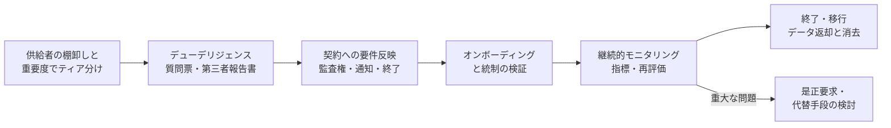

### 評価の観点

| 観点 | 確認内容 |
|---|---|
| 依存度 | 代替が難しい重要供給者か（集中リスク） |
| データ | 取り扱う情報の機密度・量・場所 |
| 統制 | 第三者認証（ISO 27001、SOC 2）や監査結果 |
| 再委託（第 4 者） | サブプロセッサの管理 |
| ソフトウェア部品 | SBOM（ソフトウェア部品表）の入手・脆弱性追跡 |
| 事業継続 | 供給者の BCP・DR とテスト状況 |

### ベストプラクティス

| 推奨事項 | 理由 |
|---|---|
| **ティア別**に評価の深さを変える | 資源を重要な供給者に集中できる |
| 供給者のインシデント通知期限を契約で明記する | 初動を早める |
| 認証書の**有効範囲・期限・除外事項**を確認する | 形式的な認証に頼らない |
| 集中リスクがある場合は**代替手段**（マルチベンダー、データのポータビリティ）を検討する | サービス停止に備える |
| 年次に加え、重大イベント（買収・事故）時に再評価する | 状況変化に追随 |

### 根拠ソース

- NIST SP 800-161 Rev.1: https://csrc.nist.gov/pubs/sp/800/161/r1/final
- NIST RMF（SP 800-18 Rev.2 最終化の告知）: https://csrc.nist.gov/projects/risk-management
- CISA SBOM: https://www.cisa.gov/sbom

---

## 3.3 リスクアセスメントを実施する

### 試験アウトラインの要点

- リスク要因を特定する
- リスクアセスメントのアプローチ（定性的・定量的など）を決める
- リスク分析を実施する

### 手法の比較

| 手法 | 特徴 | 長所 | 短所 |
|---|---|---|---|
| 定性的 | 高・中・低などの尺度、ワークショップ | 速く、理解しやすい | 主観的で比較が難しい |
| 半定量的 | 点数化（1〜5 など） | 優先順位づけに便利 | 数値が正確とは限らない |
| 定量的 | 金額・確率で表現（ALE、FAIR など） | 費用対効果を説明しやすい | データ収集が困難 |

### NIST SP 800-30 の評価プロセス

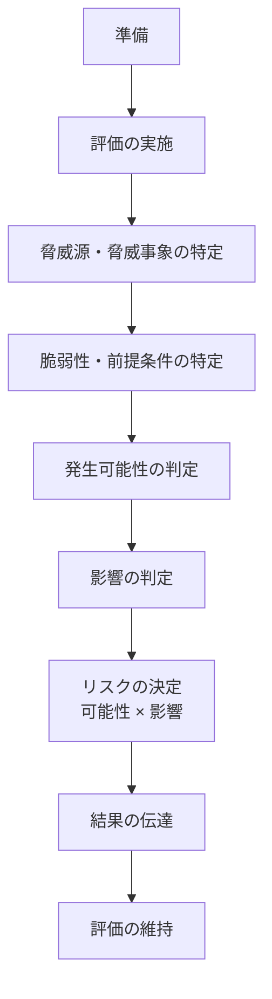

### リスク要因（Risk Factors）

| 要因 | 説明 |
|---|---|
| 脅威源 | 敵対的（攻撃者）、偶発的（誤操作）、構造的（障害）、環境的（災害） |
| 脅威事象 | 脅威源が起こす具体的な行為 |
| 脆弱性・素因 | 悪用されうる弱点 |
| 発生可能性 | 起こる確からしさ |
| 影響 | 組織・個人・他組織への損害 |
| 既存統制 | 現状の防御策 |

### ステップバイステップ

1. 評価対象・前提・制約・利用する手法を決める
2. 資産と脅威・脆弱性を特定する（脅威情報・過去事故を活用）
3. 現在の統制を考慮して可能性と影響を評価する
4. リスクレベルを決定し、許容度と比較する
5. 結果を登録簿に記録し、所有者と共有する

### ベストプラクティス

| 推奨事項 | 理由 |
|---|---|
| 手法・尺度を**事前に統一**して文書化する | 評価間の比較が可能 |
| **事業影響分析（BIA）**の結果と連携する | 影響評価の根拠になる |
| 前提と不確実性（信頼度）を明記する | 判断の透明性 |
| 重要な評価は複数人でレビューする | 偏りを減らす |
| 結果を**事業言語**に翻訳して報告する | 経営判断に使える |

### 根拠ソース

- NIST SP 800-30 Rev.1: https://csrc.nist.gov/pubs/sp/800/30/r1/final
- FAIR Institute: https://www.fairinstitute.org/
- ISO 31000:2018: https://www.iso.org/standard/65694.html

---

## 3.4 リスク統制（コントロール）を管理する

### 試験アウトラインの要点

- 統制を特定する
- 統制の**有効性**を判定する
- 統制の**カバレッジ**（適用範囲）を評価する
- 統制の有効性とカバレッジを監視・報告する

### 統制の分類

| 機能による分類 | 役割 | 例 |
|---|---|---|
| 抑止（Deterrent） | 思いとどまらせる | 警告バナー、監視カメラの表示 |
| 予防（Preventive） | 発生を防ぐ | アクセス制御、暗号化 |
| 検知（Detective） | 発生を見つける | ログ監視、IDS |
| 是正（Corrective） | 被害を修復する | パッチ、バックアップからの復旧 |
| 補完（Compensating） | 主統制の代替 | 承認者の追加承認、強化監視 |
| 指示（Directive） | 行動を指示する | ポリシー、手順 |
| 復旧（Recovery） | 通常運用へ戻す | DR 環境への切替 |

| 実装形態による分類 | 例 |
|---|---|
| 管理的（Administrative） | ポリシー、教育、職務分掌 |
| 技術的（Technical） | ファイアウォール、MFA、EDR |
| 物理的（Physical） | 入退室管理、施錠 |

### 有効性とカバレッジの考え方

| 観点 | 問い | 例 |
|---|---|---|
| 設計の有効性 | 統制は想定リスクを減らす設計か | MFA は資格情報窃取に有効か |
| 運用の有効性 | 実際に動作しているか | 例外なく適用されているか |
| カバレッジ | 対象範囲のどれだけを覆っているか | EDR 導入率 92% |

### ステップバイステップ

1. リスクごとに必要な統制を対応づける（統制マトリクス）
2. 統制の目的・責任者・証跡・測定方法を定義する
3. 有効性を検証する（試験、監査、継続的モニタリング）
4. カバレッジの空白（未適用の資産）を特定する
5. 弱い統制には是正計画または補完統制を設定する
6. 結果を報告し、残留リスクを更新する

### ベストプラクティス

| 推奨事項 | 理由 |
|---|---|
| **多層防御**で単一の統制に依存しない | 1 つが破られても防げる |
| 統制を**複数のフレームワーク間でマッピング**し、重複作業を減らす | 効率化 |
| 統制のテストは**独立した立場**（内部監査、第三者）でも行う | 客観性の確保 |
| 統制は費用対効果を評価し、**リスクに見合う強さ**にする | 過剰・過少を避ける |
| 統制の保証に**自動化・継続的モニタリング**を活用する | 時点の評価に頼らない |

### 根拠ソース

- NIST SP 800-53 Rev.5（Release 5.2.0、2025年8月27日）: https://csrc.nist.gov/pubs/sp/800/53/r5/upd1/final
- NIST SP 800-53A Rev.5: https://csrc.nist.gov/pubs/sp/800/53/a/r5/final
- CIS Controls: https://www.cisecurity.org/controls
- NIST SP 800-137: https://csrc.nist.gov/pubs/sp/800/137/final

---

# Domain 4: Security Operations

**配点 18%**。SOC（セキュリティオペレーションセンター）、脅威インテリジェンス、インシデント管理を、**管理者の立場**で整備・運営する領域です。ツールの設定ではなく、体制・文書・プロセス・報告が問われます。

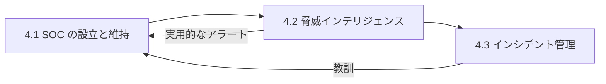

---

## 4.1 セキュリティオペレーションセンター（SOC）を設立・維持する

### 試験アウトラインの要点

- SOC の**文書**（SOC documentation）を整備する

### SOC とは

組織のログ・アラート・脅威情報を集約し、**24 時間 365 日**を目標に、検知・分析・初動対応を行う機能です。

### SOC の運営モデル

| モデル | 特徴 | 向く組織 |
|---|---|---|
| 自社運営 | 自社の事情に最適化、統制が強い | 大規模、規制が厳しい |
| MSSP（外部委託） | 立ち上げが早く、人材確保が容易 | 中小、人材不足 |
| ハイブリッド | 一次監視は委託、分析・判断は自社 | 多くの組織で現実的 |

### SOC の役割階層（例）

| 層 | 主な役割 |
|---|---|
| Tier 1 | アラートの一次トリアージ、分類 |
| Tier 2 | 詳細分析、封じ込め対応、エスカレーション |
| Tier 3 | 高度な分析、脅威ハンティング、検知ルール改善 |
| SOC マネージャー | 体制・指標・報告・他部門連携 |

### 整備すべき文書

| 文書 | 内容 |
|---|---|
| SOC 憲章 | 目的・範囲・権限・サービスレベル |
| 手順書・プレイブック | アラート種別ごとの対応手順 |
| ランブック | 特定の技術作業の操作手順 |
| エスカレーション表 | 重大度別の連絡先・判断者・期限 |
| ログ収集・保持標準 | 対象ログ、保存期間、改ざん防止 |
| シフト引き継ぎ・当番表 | 運用の継続性 |
| 指標定義書 | MTTD、MTTR など |

### ステップバイステップ

1. 目的・範囲・サービスレベル・予算をステークホルダーと合意する
2. 運営モデル（自社・委託・ハイブリッド）を選ぶ
3. 監視対象とログ源を決める（ID、エンドポイント、ネットワーク、クラウド、アプリ）
4. 基盤技術を整える（SIEM、SOAR、EDR/XDR、チケット管理）
5. 文書・プレイブックを整備し、定期的に更新する
6. 指標で運用を評価し、検知ルールとプロセスを改善する

### 主な指標

| 指標 | 意味 |
|---|---|
| MTTD | 検知までの平均時間 |
| MTTR | 対応・復旧までの平均時間 |
| 誤検知率 | アラートの品質 |
| アラート処理件数／滞留 | 負荷とボトルネック |
| カバレッジ | 監視対象資産・ログ源の網羅率 |

### ベストプラクティス

| 推奨事項 | 理由 |
|---|---|
| 検知は**リスクとシナリオ**（MITRE ATT&CK）に基づき設計する | 重要な脅威への網羅性 |
| ログの**時刻同期・改ざん防止・保持期間**を標準化する | 調査と証拠性の確保 |
| 自動化（SOAR）で定型作業を減らし、人は分析に集中させる | 燃え尽き防止と効率化 |
| プレイブックを**演習で検証**する | 机上のみの手順を避ける |
| 運用品質を**独立してレビュー**する | 盲点の発見 |

### 根拠ソース

- ISSMP 試験アウトライン: https://www.isc2.org/certifications/issmp/issmp-certification-exam-outline
- MITRE ATT&CK: https://attack.mitre.org/
- NIST SP 800-53 Rev.5（AU: 監査とアカウンタビリティ、SI-4: システム監視）: https://csrc.nist.gov/pubs/sp/800/53/r5/upd1/final

---

## 4.2 脅威インテリジェンスプログラムを設立・維持する

### 試験アウトラインの要点

- 複数の情報源から脅威データを集約する
- ネットワーク・データ・ユーザー行動の**ベースライン分析**を行う
- 異常な行動パターンを検出・分析する
- **脅威モデリング**を実施する
- 攻撃を特定・分類する
- 関連するイベントと脅威データを相関させる
- **実用的なアラート**を定義する

### 脅威インテリジェンスの 4 層

| 区分 | 対象者 | 内容 |
|---|---|---|
| 戦略的（Strategic） | 経営層 | 業界動向、攻撃者の動機、地政学リスク |
| 運用的（Operational） | 管理者 | 攻撃キャンペーンの意図・時期・手口 |
| 戦術的（Tactical） | SOC・IR | TTP（戦術・技術・手順）、検知ルールへの反映 |
| 技術的（Technical） | ツール | IoC（IP、ドメイン、ハッシュ等） |

### インテリジェンスサイクル


### 情報源

| 種類 | 例 |
|---|---|
| オープンソース（OSINT） | 公開ブログ、脆弱性情報、報道 |
| 業界共有（ISAC/ISAO） | 業界ごとの情報共有組織 |
| 商用フィード | ベンダーの脅威情報サービス |
| 政府・CSIRT | 各国の CERT/CSIRT の注意喚起 |
| 内部情報 | 自社ログ、過去インシデント、ハニーポット |

### 標準・フレームワーク

| 名称 | 用途 |
|---|---|
| STIX / TAXII | 脅威情報の記述形式／交換プロトコル |
| MITRE ATT&CK | 攻撃者の戦術・技術の分類 |
| Cyber Kill Chain | 攻撃の段階モデル |
| Diamond Model | 攻撃者・能力・インフラ・被害者の関係分析 |
| TLP（Traffic Light Protocol） | 共有範囲の指定（情報の取扱い区分） |
| STRIDE / PASTA | 脅威モデリング手法 |

### ステップバイステップ

1. 組織の重要資産・業界・脅威に基づき、**情報要求（PIR）**を定義する
2. 信頼性の評価をした上で情報源を選び、収集する
3. 正規化・重複排除し、**相関分析**（ログ、資産、脆弱性と突き合わせる）を行う
4. ベースラインからの逸脱（異常）を検出する（UEBA、ネットワーク分析）
5. 結果を**対象者別**に整理して配布する（経営層・SOC・運用）
6. 検知ルール・防御設計・訓練に反映し、有効性を評価する

### 実用的なアラートの条件

| 条件 | 内容 |
|---|---|
| 関連性 | 自組織の資産・脅威に関係する |
| 文脈 | 何が・どこで・なぜ重要かの情報がある |
| 優先度 | 重大度とリスクが示されている |
| 対応可能 | 次に取るべき行動が明確 |
| 低誤検知 | 品質が管理されている |

### ベストプラクティス

| 推奨事項 | 理由 |
|---|---|
| 情報は**量でなく関連性**で選ぶ | ノイズで疲弊しない |
| TLP などで**共有ルール**を守る | 信頼関係と法的リスク |
| 共有コミュニティに**参加し貢献**する | 早期警戒につながる |
| 脅威情報を**リスク評価・脆弱性優先度**に反映する | 実務への接続 |
| 検知を**ATT&CK にマッピング**し、カバレッジの穴を可視化する | 改善点が明確になる |

### 根拠ソース

- NIST SP 800-150 サイバー脅威情報共有: https://csrc.nist.gov/pubs/sp/800/150/final
- MITRE ATT&CK: https://attack.mitre.org/
- OASIS STIX/TAXII: https://oasis-open.github.io/cti-documentation/
- FIRST TLP: https://www.first.org/tlp/

---

## 4.3 インシデント管理プログラムを設立・維持する

### 試験アウトラインの要点

- プログラムの文書を整備する
- インシデント対応（IR）の**ケース管理**プロセスを確立する
- IR チームを設置する
- インシデント管理の手法を適用する
- インシデントの処理プロセスを確立・維持する
- 調査プロセスを確立・維持する
- インシデントの影響と調査結果を定量化し、ステークホルダーに報告する
- **根本原因分析**を実施する

### 最新の考え方: NIST SP 800-61 Rev.3

2025年4月に最終化された NIST SP 800-61 Rev.3 は、旧 Rev.2（4 段階のライフサイクル）に代わり、インシデント対応を **CSF 2.0 の 6 機能すべて**に関わる活動として位置づけました。つまり、事前の備え（Govern/Identify/Protect）が対応の質を左右するという考え方です。

| 従来（Rev.2）のフェーズ | 概要 |
|---|---|
| 準備 | 体制・ツール・訓練の整備 |
| 検知と分析 | 兆候の確認、影響範囲の判断 |
| 封じ込め・根絶・復旧 | 被害拡大の防止、原因の除去、通常運用への復帰 |
| 事後活動 | 教訓の整理と改善 |

> 試験では従来のフェーズ名が引き続き使われる場面があります。**どちらの見方も理解しておく**と安全です。

### インシデント対応の流れ

```mermaid
flowchart TD
    P["準備<br/>体制・手順・訓練・連絡網"] --> D["検知・報告"]
    D --> T["トリアージ<br/>インシデントか判断・重大度分類"]
    T --> AN["分析<br/>範囲・影響・原因の調査"]
    AN --> CT["封じ込め"]
    CT --> ER["根絶"]
    ER --> RC["復旧"]
    RC --> PI["事後レビュー<br/>根本原因分析・教訓"]
    PI --> P
    T -.-> CM["コミュニケーション<br/>経営層・法務・広報・当局・顧客"]
    AN -.-> CM
    RC -.-> CM
```

### IR チームの構成（例）

| 役割 | 責任 |
|---|---|
| インシデント指揮官 | 全体の意思決定と調整 |
| 技術調査・フォレンジック担当 | 証拠保全・調査・分析 |
| 法務 | 法的義務、通知、証拠の取扱い |
| 広報・コミュニケーション | 社内外への発信 |
| 人事 | 内部不正の対応 |
| 事業部門 | 事業影響の判断、復旧優先度 |
| 経営層 | 重大な意思決定の承認 |

### フォレンジックと証拠の取扱い

| 概念 | 内容 |
|---|---|
| 証拠保全 | 改変を避け、**揮発性の高い順**（メモリ → ネットワーク状態 → ディスク等）に収集 |
| 保管の連鎖（Chain of Custody） | 誰がいつ何を扱ったかの記録 |
| 法的保全（Legal Hold） | 関連記録の削除を止める措置 |
| 原本の保護 | 複製に対して分析し、原本は保全 |

### 重大度分類の例

| レベル | 基準の例 | 対応 |
|---|---|---|
| 重大 | 重要システム停止、大規模漏えい | 経営層・法務へ即時エスカレーション、危機管理体制 |
| 高 | 限定的な漏えいの疑い、重要資産への侵入 | IR チーム全員召集 |
| 中 | 単一端末のマルウェア感染 | 通常の IR 手順 |
| 低 | 失敗した攻撃の試行 | 記録・監視 |

### 通知・報告義務（例、要最新確認）

| 法域・制度 | 概要 |
|---|---|
| EU GDPR | 個人データ侵害は、リスクがある場合に**監督当局へ原則 72 時間以内**に通知 |
| EU NIS2 | 重大インシデントは**早期警告 24 時間以内、通知 72 時間以内**、最終報告は 1 か月以内 |
| 米国 SEC（上場企業） | 重要性を判断後、**4 営業日以内**に Form 8-K の Item 1.05 で開示 |
| 日本 個人情報保護法 | 一定の漏えい等は、**速報（概ね 3〜5 日以内）と確報（原則 30 日以内、不正目的の場合は 60 日以内）**で個人情報保護委員会へ報告 |

> 通知期限は法改正・解釈で変わります。実際の対応では**必ず法務と最新の条文・ガイドラインを確認**してください。試験では「**法務に相談し、適用法に従う**」姿勢が基本です。

### 根本原因分析（RCA）の手法

| 手法 | 内容 |
|---|---|
| 5 Whys | 「なぜ」を繰り返して原因に到達する |
| 特性要因図（フィッシュボーン） | 人・プロセス・技術・環境などの観点で要因を整理 |
| タイムライン分析 | 時系列でイベントを並べ、因果を確認 |
| 障害ツリー（Fault Tree） | 事象から原因を論理的に分解 |

> RCA は**個人を責める場ではなく、仕組みを改善する場**です（ブレームレスの原則）。

### ベストプラクティス

| 推奨事項 | 理由 |
|---|---|
| **平時に手順と連絡網を作り、演習で検証する** | 非常時は考える余裕がない |
| 判断者とエスカレーション基準を事前に決める | 初動の遅れを防ぐ |
| 外部連絡先（法律事務所、フォレンジック業者、保険、当局、CSIRT）を事前に契約・整備する | 緊急時に調達できない事態を避ける |
| 記録（タイムライン・判断・証拠）を**その場で残す** | 後の報告・訴訟・保険請求に必要 |
| 事後レビューを**必ず実施**し、改善を追跡する | 同種の事故の再発防止 |
| 広報は**一元化**し、未確認情報を出さない | 信頼と法的リスクの管理 |
| 影響は**事業言語**（停止時間、件数、金額、信頼）で報告する | 経営の意思決定に必要 |

### 根拠ソース

- NIST SP 800-61 Rev.3（2025年4月3日最終化）: https://csrc.nist.gov/pubs/sp/800/61/r3/final
- NIST の告知: https://csrc.nist.gov/news/2025/nist-revises-sp-800-61
- EU GDPR（Regulation 2016/679）: https://eur-lex.europa.eu/eli/reg/2016/679/oj
- EU NIS2 指令（Directive 2022/2555）: https://eur-lex.europa.eu/eli/dir/2022/2555/oj
- 個人情報保護委員会: https://www.ppc.go.jp/
- 米国 SEC（サイバー開示規則）: https://www.sec.gov/

---

# Domain 5: Contingency Management

**配点 12%**。災害・障害・攻撃などの中断事象に備え、事業を継続し復旧するための計画・戦略・試験・実行を扱います。

```mermaid
flowchart LR
    P["5.1 計画の策定<br/>BIA・BCP・DRP・危機対応"] --> S["5.2 復旧戦略"]
    S --> M["5.3 計画の維持・試験"]
    M --> R["5.4 災害対応・復旧の実行"]
    R -->|"教訓"| P
```

---

## 5.1 コンティンジェンシー計画の策定を促進する

### 試験アウトラインの要点

- レジリエンス計画（COOP など）に関する要因（法令、BIA 等）を特定・分析する
- 事業継続計画（BCP）に関する要因（時間、資源、検証、BIA）を特定・分析する
- 災害復旧計画（DRP）に関する要因（時間、資源、検証）を特定・分析する
- コンティンジェンシー計画を主要ステークホルダーと調整する
- **社内外の危機コミュニケーション計画**を定義する
- 役割と責任を定義・周知する
- 計画が組織のプロセスや優先事項に与える影響を分析する
- **第三者への依存**（クラウド事業者、公益事業）を管理する
- **セキュリティ管理者の後継計画**を準備する

### 計画の種類と違い

| 計画 | 焦点 | 例 |
|---|---|---|
| BCP（事業継続計画） | 重要な事業機能を**継続**する | 代替拠点での業務再開、手作業への切替 |
| DRP（災害復旧計画） | **IT システム・データを復旧**する | DR サイトへの切替、バックアップの復元 |
| COOP（業務継続計画） | 政府・公共機関の重要機能継続 | 政府機関の主要機能維持 |
| インシデント対応計画 | セキュリティ事象への対応 | 4.3 参照 |
| 危機管理計画（CMP） | 経営層の意思決定と対外対応 | 記者会見、関係者通知 |
| 事業再開計画 | 事業プロセスの復帰 | 縮退運用から通常運用へ |
| 退避計画（OEP） | 人命の安全確保 | 避難、安否確認 |

### 事業影響分析（BIA）と主要な時間指標

```mermaid
flowchart LR
    A["中断発生"] --> B["RTO<br/>目標復旧時間<br/>システム・サービスの復旧"]
    B --> C["WRT<br/>作業復旧時間<br/>データ確認・手作業の戻し"]
    C --> D["MTD / MAO<br/>最大許容停止時間<br/>これを超えると存続の危機"]
```

| 指標 | 意味 | 関係 |
|---|---|---|
| MTD / MAO | 業務が許容できる**最大停止時間** | RTO + WRT ≦ MTD |
| RTO | 目標復旧時間（システムが復旧するまで） | MTD より短く設定 |
| WRT | 復旧後に業務へ戻すための作業時間 | データの検証、遅延処理の追込み |
| RPO | 目標復旧時点（**許容できるデータ損失の時間幅**） | バックアップ・複製頻度を決める |

### NIST SP 800-34 の 7 ステップ

1. コンティンジェンシー計画の方針を策定する
2. **BIA** を実施する
3. 予防統制を特定する
4. 復旧戦略を作成する
5. コンティンジェンシー計画を策定する
6. 計画の**試験・訓練・演習**を行う
7. 計画を**維持**する

### BIA のステップバイステップ

1. 重要な事業プロセスを特定する
2. 各プロセスの**依存関係**（システム、人、施設、供給者、データ）を整理する
3. 中断による影響（財務、法令、評判、安全）を時間軸で評価する
4. MTD・RTO・RPO を決定する
5. 復旧優先順位を付ける
6. 経営層の承認を得る

### 危機コミュニケーション計画

| 項目 | 内容 |
|---|---|
| 対象者 | 従業員、顧客、取引先、規制当局、メディア、株主 |
| 窓口と承認 | スポークスパーソン、承認フロー |
| メッセージ | 事実・影響・対応・次の連絡時期 |
| 手段 | 通常手段が使えない場合の代替連絡網（衛星電話、外部サービスなど） |

### ベストプラクティス

| 推奨事項 | 理由 |
|---|---|
| BIA は**事業部門と共同**で行い、経営層が承認する | 優先順位は事業が決める |
| **人命・安全**を最優先の目標とする | 全ての計画の原則 |
| 計画は**クラウド・外部委託先への依存**も反映する | 現代の障害の多くは第三者起因 |
| 計画書を**オフライン・別拠点にも保管**する | 障害時にアクセス不能となる |
| 代理者・後継者を定める（セキュリティ管理者も含む） | 人の不在に備える |
| ISO 22301 を参照する | BCMS の国際標準 |

### 根拠ソース

- NIST SP 800-34 Rev.1: https://csrc.nist.gov/pubs/sp/800/34/r1/upd1/final
- ISO 22301:2019: https://www.iso.org/standard/75106.html
- ISSMP 試験アウトライン: https://www.isc2.org/certifications/issmp/issmp-certification-exam-outline

---

## 5.2 復旧戦略を策定する

### 試験アウトラインの要点

- 代替案を特定・分析する
- 復旧戦略を推奨し、調整する
- 復旧の役割と責任を割り当てる

### 代替サイトの種類

| 種類 | 設備・データ | 切替時間 | コスト |
|---|---|---|---|
| ホットサイト | 設備・データが常時稼働・同期 | 数分〜数時間 | 高い |
| ウォームサイト | 設備はあるが、データ・構成の追加作業が必要 | 数時間〜数日 | 中 |
| コールドサイト | 空間・電源のみ | 数日〜数週間 | 低い |
| モバイルサイト | トレーラー等の移動式 | 場所により | 中 |
| 相互協定（Reciprocal） | 他組織との相互利用 | 不確実 | 低い（信頼性に課題） |
| クラウド／DRaaS | クラウド上に復旧環境 | 設計次第で短い | 利用量次第 |

### バックアップ方式

| 方式 | 内容 | 復元 |
|---|---|---|
| フルバックアップ | 全データ | 単純・時間は短いが取得に時間 |
| 差分バックアップ | 前回フルからの変更分 | フル＋最新の差分 |
| 増分バックアップ | 前回のバックアップ（種別問わず）からの変更分 | フル＋全増分（復元に時間） |

### データ保護の原則

| 原則 | 内容 |
|---|---|
| 3-2-1 ルール | 3 つのコピー、2 種類の媒体、1 つはオフサイト |
| 3-2-1-1-0 | さらに 1 つはオフライン／イミュータブル、復元検証の誤り 0 |
| 復元テスト | バックアップは**復元できて初めて有効** |
| ランサムウェア対策 | 変更不可（イミュータブル）、論理的に分離された保管 |

### 戦略の選び方

```mermaid
flowchart TD
    A["BIA の結果<br/>RTO・RPO・優先度"] --> B{"RTO が数時間以内か"}
    B -->|"はい"| C["ホット／クラウド常時稼働<br/>同期レプリケーション"]
    B -->|"数日以内"| D["ウォーム／DRaaS<br/>非同期レプリケーション"]
    B -->|"それ以上"| E["コールド／バックアップ復元"]
    C --> F["コストと効果を比較<br/>CBA"]
    D --> F
    E --> F
    F --> G["経営層の承認"]
```

### ベストプラクティス

| 推奨事項 | 理由 |
|---|---|
| 戦略は**RTO/RPO とコストのバランス**で決める | 過剰投資・不足を防ぐ |
| DR サイトを**本番と同じ地震・停電リスクの範囲に置かない** | 同時被災を避ける |
| 復旧の**依存順序**（認証基盤 → データ基盤 → アプリ）を定義する | 復旧の失敗を防ぐ |
| 役割は**代理者つき**で割り当て、連絡先を最新化する | 人の不在に備える |
| 重要な外部サービスには**契約上の復旧要件**を含める | 第三者依存の管理 |

### 根拠ソース

- NIST SP 800-34 Rev.1: https://csrc.nist.gov/pubs/sp/800/34/r1/upd1/final
- ISO 22301:2019: https://www.iso.org/standard/75106.html
- CISA Ransomware Guide: https://www.cisa.gov/stopransomware

---

## 5.3 コンティンジェンシー計画・BCP・DRP を維持する

### 試験アウトラインの要点

- 試験・評価・修正を計画する
- **生存可能性（survivability）とレジリエンス**能力を判断する
- 計画の更新プロセスを管理する

### 試験（テスト）の種類

| 種類 | 内容 | 影響度 | 目的 |
|---|---|---|---|
| チェックリスト／読み合わせ | 計画書を各担当が読み、確認する | 最小 | 記載の網羅性・誤りの発見 |
| ウォークスルー／机上演習（Tabletop） | シナリオに沿って会議室で議論 | 小 | 役割・判断の確認 |
| シミュレーション | 模擬環境・模擬事象で実際に動く | 中 | 手順と連携の検証 |
| 並行テスト | 代替環境を立ち上げ、本番と並行稼働 | 中〜大 | 復旧環境の能力確認（本番は止めない） |
| 完全中断テスト | 本番を実際に停止して切替 | 最大 | 実運用での完全な検証（リスクが高い） |

```mermaid
flowchart LR
    A["読み合わせ"] --> B["机上演習"]
    B --> C["シミュレーション"]
    C --> D["並行テスト"]
    D --> E["完全中断テスト"]
```

> 左から右へ、現実に近く、リスクも大きくなります。通常は**段階的に成熟**させ、完全中断は十分な準備・承認のうえで実施します。

### 計画更新のトリガー

| 区分 | 例 |
|---|---|
| 定期 | 年次レビュー |
| 事業変更 | 組織再編、新サービス、M&A |
| 技術変更 | クラウド移行、システム更新 |
| 人事 | 担当者の異動・退職、連絡先変更 |
| テスト結果 | 発見された問題点 |
| 実インシデント | 事後レビューでの教訓 |

### ベストプラクティス

| 推奨事項 | 理由 |
|---|---|
| **年次以上**の頻度で試験し、重要システムは頻度を上げる | 劣化を防ぐ |
| 試験は**成功・失敗を問わず結果を記録し、改善を追跡**する | 目的は問題の発見 |
| 試験に**事業部門と経営層**を参加させる | 意思決定の練習 |
| 計画の版管理と配布管理を行う | 古い版の混在を避ける |
| ランサムウェア等の**サイバー固有シナリオ**を含める | 現実の主要脅威 |

### 根拠ソース

- NIST SP 800-84 試験・訓練・演習ガイド: https://csrc.nist.gov/pubs/sp/800/84/final
- NIST SP 800-34 Rev.1: https://csrc.nist.gov/pubs/sp/800/34/r1/upd1/final
- ISO 22301:2019: https://www.iso.org/standard/75106.html

---

## 5.4 災害対応・復旧プロセスを管理する

### 試験アウトラインの要点

- 災害を**宣言し、周知**する
- 計画を実施する
- 通常運用へ**復帰**する
- 教訓を収集する
- 教訓に基づいて計画を更新する

### 災害対応の流れ

```mermaid
flowchart TD
    A["事象の発生・検知"] --> B["初期評価<br/>人命・被害・影響の確認"]
    B --> C{"宣言基準を満たすか"}
    C -->|"いいえ"| D["通常のインシデント対応で処理"]
    C -->|"はい"| E["災害の宣言<br/>権限者が判断・記録"]
    E --> F["関係者へ通知<br/>経営層・要員・顧客・当局"]
    F --> G["計画の実行<br/>代替拠点・DR 切替"]
    G --> H["暫定運用"]
    H --> I["本番環境の復旧・検証"]
    I --> J["通常運用への復帰（フェイルバック）"]
    J --> K["教訓の整理・計画更新"]
```

### 宣言の要点

| 項目 | 内容 |
|---|---|
| 判断者 | 計画で**事前に指名**された権限者（不在時の代理者も） |
| 基準 | 予想される停止時間が RTO/MTD を超える等、**事前に定めた基準** |
| 記録 | 宣言時刻、根拠、判断者を記録 |
| 周知 | 事前の連絡網で関係者へ通知 |

### 復旧作業の順序（一般原則）

1. **人命・安全**の確保
2. 被害の**封じ込めと状況把握**
3. 重要業務・重要システムの**優先順位に沿った復旧**
4. **データ整合性の検証**後に通常運用へ復帰
5. 最も重要度の低いものは最後に復旧
6. 元のサイトへの復帰（フェイルバック）は**慎重に、最も重要でないシステムから**行う（失敗しても影響が小さいため）

### 教訓の収集

| 観点 | 問い |
|---|---|
| 判断 | 宣言は適切なタイミングだったか |
| 計画 | 手順は実行可能だったか。不足はないか |
| 人 | 役割は理解され、連絡は機能したか |
| 技術 | RTO/RPO は達成できたか |
| 第三者 | 供給者の対応は十分だったか |
| コミュニケーション | 関係者への情報提供は適切だったか |

### ベストプラクティス

| 推奨事項 | 理由 |
|---|---|
| 宣言基準と判断者を**事前に文書化**する | 非常時の迷いを排除 |
| **意思決定ログ**を記録する | 説明責任・保険・法的対応 |
| 復旧後に**整合性検証**を行ってから事業を再開する | 不整合なデータでの再開を防ぐ |
| 教訓は**期限と担当者つきの改善項目**にする | 実行されなければ意味がない |

### 根拠ソース

- NIST SP 800-34 Rev.1: https://csrc.nist.gov/pubs/sp/800/34/r1/upd1/final
- ISO 22301:2019: https://www.iso.org/standard/75106.html

---

# Domain 6: Law, Ethics and Security Compliance Management

**配点 14%**。法令・規制、倫理、コンプライアンス運営、監査対応、例外管理を扱います。**法律の細部を暗記する試験ではなく、管理者として「どう動くべきか」**が問われます。

```mermaid
flowchart LR
    L["6.1 法令・規制の影響の把握"] --> C["6.3 コンプライアンスの検証"]
    E["6.2 倫理の遵守と推進"] --> C
    C --> A["6.4 監査・規制当局との連携"]
    A --> X["6.5 例外の文書化と管理"]
    X --> C
```

---

## 6.1 情報セキュリティに関わる法令・規制の影響を特定する

### 試験アウトラインの要点

- 組織と利用者が活動する**法域**（越境データ移転など）を特定する
- 適用される**セキュリティ・プライバシーの法令・規制・標準**を特定する
- **知的財産**に関する法律を特定する
- 不遵守・不適合のリスクを特定し、助言する

### 法的な論点の整理

| 区分 | 内容 | 代表例 |
|---|---|---|
| プライバシー・データ保護 | 個人データの取扱い、越境移転、侵害通知 | EU GDPR、日本の個人情報保護法、米国各州法（CCPA 等）、HIPAA |
| 金融・財務の統制 | 財務報告・金融情報の保護 | SOX、GLBA、日本の金融商品取引法（内部統制報告制度） |
| 重要インフラ・サイバー | 事業者に統制と報告を求める | EU NIS2、各国の重要インフラ規制 |
| AI 規制 | AI システムの分類別義務 | EU AI Act |
| コンピュータ犯罪 | 不正アクセス等の処罰 | 米国 CFAA、日本の不正アクセス禁止法 |
| 知的財産 | 創作・発明・営業秘密の保護 | 特許、著作権、商標、営業秘密（不正競争防止法） |
| 業界標準（法律ではない） | 契約・業界規約による遵守 | PCI DSS |

> **法律と標準の違い**: 法律は国家が強制します。標準（ISO 27001 等）は任意ですが、契約や取引条件で事実上必須になることがあります。PCI DSS はカード会員データを扱う契約上の要求です。

### 知的財産の 4 区分

| 区分 | 保護対象 | 保護の特徴 |
|---|---|---|
| 特許 | 発明 | 出願・登録が必要、期間限定、公開される |
| 著作権 | 創作的表現（ソフト、文書） | 創作と同時に発生（国による） |
| 商標 | 識別標識（名称、ロゴ） | 登録・使用により保護 |
| 営業秘密 | 秘密管理された情報 | **秘密として管理され続ける限り**保護 |

### 越境データ移転（Trans-border Data Flow）

| 手段 | 内容 |
|---|---|
| 十分性認定 | EU が、移転先の保護水準を十分と認める（日本は相互の十分性認定の枠組みあり） |
| 標準契約条項（SCC） | EU が承認した契約ひな形 |
| 拘束的企業準則（BCR） | グループ企業内の移転規則 |
| 同意・その他の根拠 | 個別の法的根拠 |
| データローカライゼーション | 国内保存を義務付ける規制 |

### ステップバイステップ

```mermaid
flowchart TD
    A["事業・データの棚卸し<br/>どこで何をどの国のデータ主体と扱うか"] --> B["適用される法令・標準の特定<br/>法務と協働"]
    B --> C["要件の整理<br/>義務・期限・罰則"]
    C --> D["現状とのギャップ評価"]
    D --> E["リスクの評価と助言<br/>不遵守の影響"]
    E --> F["計画化と実施<br/>経営層の承認"]
    F --> G["変化の監視<br/>法改正・新規制"]
    G --> B
```

### ベストプラクティス

| 推奨事項 | 理由 |
|---|---|
| **法解釈は法務部門・弁護士に依頼**し、管理者は技術・運用面を担当する | 専門領域の分離 |
| データの所在・流れを**データマップ**で管理する | 越境・通知義務の判断の基礎 |
| 法改正を**継続的に監視**する体制を持つ | 例: EU AI Act の適用時期は 2026 年に変更された |
| 不遵守の影響（罰金・契約解除・評判・刑事責任）を経営層に説明する | 優先順位の根拠 |
| 異なる法域の要件が**矛盾する場合**は、法務と協議し、最も厳しい要求に合わせる等の方針を定める | 一貫した運用 |

### 根拠ソース

- EU GDPR: https://eur-lex.europa.eu/eli/reg/2016/679/oj
- EU AI Act（Regulation 2024/1689）: https://eur-lex.europa.eu/eli/reg/2024/1689/oj
- EU NIS2: https://eur-lex.europa.eu/eli/dir/2022/2555/oj
- 個人情報保護委員会（日本）: https://www.ppc.go.jp/
- PCI Security Standards Council: https://www.pcisecuritystandards.org/
- EU AI Act の適用時期変更（Digital Omnibus、二次情報）: https://www.mondaq.com/eu-digital-omnibus-on-ai-enters-into-force/1825722
- 同上（Cloud Security Alliance の整理）: https://labs.cloudsecurityalliance.org/research/csa-research-note-eu-ai-act-high-risk-deadline-omnibus-20260/

---

## 6.2 職業倫理を理解し、遵守し、推進する

### 試験アウトラインの要点

- **ISC2 倫理規約（Code of Ethics）**
- 組織の倫理規約

### ISC2 倫理規約の 4 つの規範（カノン）

前文は、社会の安全と福祉・公共の利益、依頼主への義務、互いへの義務のために、最高水準の倫理的行動を守り、**そう見られること**も求めています。厳守が認定の条件です。

| 順位 | カノン | 意味 |
|---|---|---|
| I | 社会、公共の利益、必要な公共の信頼と信用、そして基盤（インフラ）を守る | 最優先 |
| II | 名誉を重んじ、誠実に、公正に、責任をもって、合法的に行動する | |
| III | 依頼主（プリンシパル）に対して、勤勉かつ有能なサービスを提供する | |
| IV | 専門職を発展させ、保護する | |

> **重要**: カノンには**優先順位**があり、衝突した場合は I → II → III → IV の順に解決します。たとえば、雇用主（III）の指示が違法・公共の利益に反する場合（I・II）は、雇用主の指示に従ってはいけません。

### 倫理的ジレンマの判断フロー

```mermaid
flowchart TD
    S["倫理的な判断が必要な状況"] --> A{"公共の利益・安全に<br/>害を及ぼすか（I）"}
    A -->|"はい"| B["やらない／止める<br/>適切な機関・上位者へ報告"]
    A -->|"いいえ"| C{"違法・不誠実か（II）"}
    C -->|"はい"| D["従わない<br/>法務へ相談し記録を残す"]
    C -->|"いいえ"| E{"依頼主への義務と<br/>利益相反はないか（III）"}
    E -->|"利益相反あり"| F["開示し、回避または<br/>承認を得る"]
    E -->|"なし"| G["職業上の責務に沿って実行（IV も考慮）"]
```

### 管理者が直面しやすい論点

| 論点 | 基本姿勢 |
|---|---|
| 従業員の監視 | 目的の正当性・比例性・事前の通知・法令適合 |
| 脆弱性の発見と公表 | 責任ある開示（Coordinated Disclosure）、まず当事者へ |
| 利益相反 | 事前に開示し、判断から外れる |
| 不正の発見 | 規定の報告経路で報告し、証拠を保全 |
| 経営者の指示が不適切 | 懸念を文書で伝え、上位・法務・監査へエスカレーション |
| 情報の取扱い | 業務で知った機密を目的外に使わない |

### ベストプラクティス

| 推奨事項 | 理由 |
|---|---|
| **倫理規約を組織の行動規範に反映**し、定期的に教育する | 日常の判断基準になる |
| 匿名通報窓口（内部通報制度）を整備し、報復を禁止する | 不正の早期発見 |
| 倫理的に疑わしい場合は「**そう見えるか**」も基準にする | 前文が外見も求めている |
| 判断と根拠を**記録**する | 説明責任 |

### 根拠ソース

- ISC2 Code of Ethics: https://www.isc2.org/ethics
- ISC2 認定の倫理に関する解説（二次情報）: https://infosecinstitute.com/resources/cissp/the-isc2-code-of-ethics-a-binding-requirement-for-certification/

---

## 6.3 適用される法令・規制・業界標準に対する遵守を検証する

### 試験アウトラインの要点

- 上級管理職への報告・助言
- コンプライアンスフレームワークの評価・選定
- フレームワークの実装
- コンプライアンス指標の定義と監視

### 代表的なフレームワークと標準

| 名称 | 性格 |
|---|---|
| ISO/IEC 27001 | ISMS の認証可能な国際規格 |
| NIST CSF 2.0 | 自主的なリスクベースの枠組み |
| NIST SP 800-53 | 統制カタログ（米国政府系で標準的） |
| SOC 2 | サービス事業者の統制に関する保証報告書 |
| PCI DSS | カード情報の保護 |
| ISO/IEC 42001 | AI マネジメントシステム |
| NIST AI RMF | AI リスク管理（Govern/Map/Measure/Manage） |
| CIS Controls | 優先順位付けされた実践的統制 |

### フレームワークの選定と実装

```mermaid
flowchart TD
    A["要求事項の洗い出し<br/>法令・契約・顧客・業界"] --> B["フレームワーク候補の評価<br/>適合性・コスト・認知度"]
    B --> C["選定と経営層の承認"]
    C --> D["統制の対応づけ（マッピング）<br/>重複を統合"]
    D --> E["実装・ギャップ是正"]
    E --> F["内部評価・証跡の整備"]
    F --> G["指標による監視と報告"]
    G --> H["レビューと改善"]
    H --> B
```

### コンプライアンス指標の例

| 指標 | 内容 |
|---|---|
| 統制の適合率 | 要求事項のうち適合している割合 |
| 監査指摘の件数と是正期限遵守率 | 是正の実行力 |
| 例外の件数・期限切れ件数 | 統制の抜け道の管理 |
| 教育の完了率 | 人的統制 |
| 規制報告の期限遵守 | 法的義務の履行 |

### 重要な考え方

| 項目 | 内容 |
|---|---|
| コンプライアンス ≠ セキュリティ | 遵守していても安全とは限らない。最低限の基準と考える |
| 共通統制フレームワーク | 複数の要求を 1 つの統制セットにまとめ、重複を減らす |
| 管理者の役割 | 上級管理職に**リスク・費用・選択肢**を説明し、判断を仰ぐ |

### ベストプラクティス

| 推奨事項 | 理由 |
|---|---|
| **証跡（エビデンス）を日常業務から自動収集**する | 監査対応の負荷を減らす |
| コンプライアンスを**リスク管理と統合**する（GRC） | 重複・矛盾を避ける |
| 遵守状況を**経営層・取締役会に定期報告**する | ガバナンスの担保 |
| 新しい法規制を**影響評価**してから導入する | 優先順位付け |

### 根拠ソース

- NIST CSF 2.0: https://www.nist.gov/cyberframework
- ISO/IEC 27001:2022: https://www.iso.org/standard/82875.html
- NIST AI RMF: https://www.nist.gov/itl/ai-risk-management-framework
- ISO/IEC 42001:2023: https://www.iso.org/standard/81230.html
- NIST SP 800-53 Rev.5: https://csrc.nist.gov/pubs/sp/800/53/r5/upd1/final

---

## 6.4 内部・外部監査プロセスにおける監査人・規制当局と連携する

### 試験アウトラインの要点

- 計画 → スケジュール → 監査活動の調整 → 指摘事項の評価・検証 → 対応の策定 → 実施した緩和・是正の監視・検証

### 監査の種類

| 区分 | 実施者 | 目的 |
|---|---|---|
| 内部監査 | 自組織の独立した監査部門 | 統制の有効性の評価、改善 |
| 外部監査 | 独立した外部の監査人 | 認証、保証報告書、財務監査 |
| 第三者による評価 | 顧客・取引先 | 取引条件の確認 |
| 規制当局の検査 | 当局 | 法令遵守の確認 |

### スリーラインモデル（3 つのライン）

| ライン | 役割 | 例 |
|---|---|---|
| 第 1 線 | 事業・運用部門が統制を**所有・運用**する | システム運用、事業部門 |
| 第 2 線 | リスク管理・コンプライアンスが**監督・助言**する | リスク管理部、セキュリティ管理者 |
| 第 3 線 | 内部監査が**独立して保証**する | 内部監査部門 |

### 監査対応の流れ

```mermaid
flowchart TD
    P["計画<br/>範囲・基準・体制"] --> S["スケジュール調整<br/>資料・関係者の確保"]
    S --> C["監査活動の調整<br/>面談・証跡提出・窓口の一本化"]
    C --> F["指摘事項の評価・検証<br/>事実確認・誤解の解消"]
    F --> R["対応策の策定<br/>是正計画・期限・担当者"]
    R --> M["緩和・是正の実施と<br/>検証・フォローアップ"]
    M --> P
```

### 指摘への対応の原則

| 項目 | 内容 |
|---|---|
| 事実確認 | 指摘が正確か、前提に誤りがないかを確認 |
| 誠実な対応 | 隠さない、偽らない（倫理規約 II） |
| 是正計画 | 原因・対策・責任者・期限を明記（CAP） |
| 正当な反論 | 事実誤認は証跡をもって丁寧に説明する |
| フォローアップ | 実施後に**効果を検証**し、クローズ |

### ベストプラクティス

| 推奨事項 | 理由 |
|---|---|
| **窓口を一本化**し、提出資料を管理・記録する | 情報の一貫性と漏れの防止 |
| 事前の**内部レビュー（模擬監査）**を行う | 指摘を先に把握 |
| 証跡は**改ざん不能な形**で保管する | 信頼性 |
| 規制当局とは**法務を交えて**対話し、記録を残す | 法的リスク管理 |
| 指摘の**根本原因**を扱い、再発を防止する | 表面的な修正で終わらせない |

### 根拠ソース

- The IIA（スリーラインモデル）: https://www.theiia.org/
- ISO/IEC 27001:2022（9.2 内部監査、9.3 マネジメントレビュー、10 改善）: https://www.iso.org/standard/82875.html
- NIST SP 800-53A Rev.5（統制の評価手順）: https://csrc.nist.gov/pubs/sp/800/53/a/r5/final

---

## 6.5 コンプライアンスの例外を文書化し管理する

### 試験アウトラインの要点

- 統制と**回避策（ワークアラウンド）**を特定・文書化する
- 報告し、**リスク放棄（risk waiver）**に対する権限者の承認を得る

### 例外管理の流れ

```mermaid
flowchart TD
    R["例外の申請<br/>理由・範囲・期間"] --> A["リスク評価<br/>影響と代替統制"]
    A --> C["補完統制の設計"]
    C --> D{"権限者の承認<br/>リスク所有者・経営層"}
    D -->|"否認"| X["統制に準拠するか<br/>別の方法を検討"]
    D -->|"承認"| E["例外登録簿へ記録<br/>期限・条件"]
    E --> M["監視<br/>補完統制の実効性"]
    M --> V{"期限到来"}
    V -->|"解消"| Z["クローズ"]
    V -->|"継続が必要"| A
```

### 例外申請に含める項目

| 項目 | 内容 |
|---|---|
| 対象 | どの要求事項・統制か |
| 理由 | 技術的制約、費用、事業要請 |
| リスク | 評価結果と影響 |
| 補完統制 | 代替として何をするか |
| 期間 | **有効期限**（無期限は不可） |
| 承認者 | リスク所有者と権限者 |
| 見直し | 再評価の時期 |

### ベストプラクティス

| 推奨事項 | 理由 |
|---|---|
| 例外は**期限つき・承認つき・補完統制つき**で、**3 点セット**が基本 | 恒久的な抜け道を防ぐ |
| **リスクを受け入れる権限は事業側のリスク所有者**が持つ | セキュリティ部門が代わりに受容しない |
| 例外登録簿を**定期的に棚卸し**、期限切れは自動で通知する | 放置を防ぐ |
| 例外の件数・傾向を**指標として報告**する | ポリシー自体の見直しのシグナル |
| 同一の例外が繰り返される場合は**ポリシー・標準を見直す** | 現実と乖離した統制を直す |

### 根拠ソース

- NIST SP 800-53 Rev.5（CA-5 是正計画、PM-4 是正処置のプロセス等）: https://csrc.nist.gov/pubs/sp/800/53/r5/upd1/final
- ISSMP 試験アウトライン: https://www.isc2.org/certifications/issmp/issmp-certification-exam-outline

---

# 横断テーマ: AI とセキュリティマネジメント

2025年8月1日発効のアウトラインでは、**AI の観点が 6 つすべてのドメインに織り込まれた**と ISC2 が説明しています（公式アウトラインページの各ドメイン解説）。ここでは、ドメイン横断で整理します。

### ドメイン別の AI 論点

| ドメイン | AI に関する主な論点 |
|---|---|
| 1 リーダーシップ | AI ガバナンスと倫理モデル、透明性・説明責任、**シャドー AI**（無許可の公開 AI ツール利用）の抑止と安全な実験文化、生成 AI 時代の知的財産保護 |
| 2 ライフサイクル | **MLSecOps**、AI を使った自動テスト、バイアスやハルシネーションが基準を超えたときに展開を止める**意思決定ゲート**、非構造化データの自動分類、再学習ループの管理 |
| 3 リスク | **NIST AI RMF**、**ISO/IEC 42001**、第三者 LLM とデータレイクのリスク、モデルの重み・アルゴリズムの保護、CDO・AI 倫理委員会との連携、許容される誤り水準の定義 |
| 4 セキュリティ運用 | AIOps による検知・対応、**プロンプトインジェクション**や**データポイズニング**への対応、AI セキュリティアナリストの配置、プレイブック作成への生成 AI 活用 |
| 5 コンティンジェンシー | データ取り込みパイプライン・ベクトルDBの復旧優先、**モデルドリフト**を継続性リスクとみなす、再学習に必要な計算資源を踏まえた RTO |
| 6 法・倫理・コンプライアンス | EU AI Act、アルゴリズム責任、データ最小化と大量学習の対立、**説明を受ける権利**、越境データ、OSS モデルの知的財産リスク、プロンプト履歴の保存とプライバシー |

### AI ガバナンスの基本フロー

```mermaid
flowchart TD
    A["AI 利用の申請・発見<br/>シャドー AI の検出を含む"] --> B["用途・データ・影響の分類<br/>リスクティア"]
    B --> C["リスク評価<br/>NIST AI RMF: Map と Measure"]
    C --> D{"受容可能か"}
    D -->|"いいえ"| E["追加統制または不許可"]
    D -->|"はい"| F["承認と統制の設定<br/>データ保護・人による監督"]
    F --> G["運用<br/>監視・ドリフト・インシデント対応"]
    G --> H["定期レビュー<br/>NIST AI RMF: Manage と Govern"]
    H --> C
```

### 主な枠組み

| 枠組み | 内容 |
|---|---|
| NIST AI RMF 1.0 | AI リスクを **Govern / Map / Measure / Manage** の 4 機能で管理する自主的枠組み |
| NIST AI 600-1 | 生成 AI 向けのプロファイル |
| ISO/IEC 42001:2023 | AI マネジメントシステムの認証可能な規格 |
| OWASP Top 10 for LLM Applications | LLM アプリの代表的な脅威（プロンプトインジェクション等） |
| MITRE ATLAS | AI システムに対する攻撃手法のナレッジベース |
| EU AI Act | リスクベースの AI 規制（禁止・高リスク・透明性・汎用 AI） |

### EU AI Act の適用時期（2026年10月時点の整理）

| 項目 | 状況 |
|---|---|
| 禁止される AI 慣行・AI リテラシー | 2025年2月2日から適用 |
| 汎用 AI（GPAI）モデル提供者の義務 | 2025年8月2日から適用（Digital Omnibus でも維持） |
| Annex III の独立型高リスク AI | 当初 2026年8月2日 → **2027年12月2日**へ延期 |
| Annex I の製品組込み高リスク AI | **2028年8月**へ延期 |
| Digital Omnibus on AI（Regulation (EU) 2026/1744） | 2026年7月27日に発効 |

> 延期は義務の廃止ではありません。**透明性義務の多くは延期されていない**との分析もあります。最新の日程は EUR-Lex・欧州委員会で確認してください。

### ベストプラクティス

| 推奨事項 | 理由 |
|---|---|
| **AI の利用台帳**（どの部門がどのモデル・データを使うか）を持つ | シャドー AI と越境データの把握 |
| AI への入力として許可するデータ区分を**データ分類と連動**させる | 情報漏えいの防止 |
| 重要な AI の判断には**人による監督（Human in the Loop）**を置く | 責任と品質の担保 |
| モデルの**性能・バイアス・ドリフトを継続監視**し、基準超過で停止できるようにする | 品質劣化が事業リスクになる |
| AI インシデント（誤出力、漏えい、攻撃）を**既存の IR 手順に組み込む** | 新しい手順を乱立させない |

### 根拠ソース

- ISC2 ISSMP 試験アウトライン（各ドメインの AI 解説）: https://www.isc2.org/certifications/issmp/issmp-certification-exam-outline
- NIST AI RMF: https://www.nist.gov/itl/ai-risk-management-framework
- NIST AI 600-1: https://doi.org/10.6028/NIST.AI.600-1
- ISO/IEC 42001:2023: https://www.iso.org/standard/81230.html
- OWASP GenAI Security Project（LLM Top 10）: https://genai.owasp.org/llm-top-10/
- MITRE ATLAS: https://atlas.mitre.org/
- EU AI Act 原文: https://eur-lex.europa.eu/eli/reg/2024/1689/oj
- Digital Omnibus on AI の整理（二次情報）: https://natlawreview.com/article/eu-digital-omnibus-ai-enters-force

---

# 試験戦略と学習計画

## 1. 設問の読み方

ISSMP は管理者視点の判断問題が中心です。次の型で考えると選択肢を絞りやすくなります。

| キーワード | 考え方 |
|---|---|
| 「**最初に**（FIRST）」 | 準備・影響評価・承認確認など**手順の最初**を選ぶ。いきなり実装しない |
| 「**最も適切**（BEST / MOST）」 | 複数が正しく見えても、事業目的・リスクに最も合うものを選ぶ |
| 「**主な理由**」 | 技術論より**経営層の承認・事業要求・法的義務**が根拠になることが多い |
| 技術的な詳細設定の選択肢 | ISSMP では**管理的な行動**（方針・承認・報告）が正答になりやすい |
| 「承認」「責任」「所有者」 | 判断すべき人（権限者・リスク所有者）が誰かを問うている |

### 選択肢の絞り込みフロー

```mermaid
flowchart TD
    Q["設問を読む"] --> K["問われている立場・段階を特定<br/>管理者／最初／最適"]
    K --> E["明らかに不適切な選択肢を除外<br/>違法・非倫理・独断・技術に偏った案"]
    E --> P{"残った選択肢は"}
    P -->|"手順の順序"| O["準備→評価→承認→実施→検証の<br/>順で最も早い段階を選ぶ"]
    P -->|"優先順位"| R["人命→法令・倫理→事業目的→<br/>リスク→コスト の順で判断"]
    O --> F["最終確認: 経営層・事業の視点に合うか"]
    R --> F
```

## 2. 混同しやすい用語の整理

| 用語の組 | 違い |
|---|---|
| ガバナンス／マネジメント | 方向付けと監督／実行と運営 |
| ポリシー／標準／手順／ガイドライン | 高レベル方針／具体要求／作業手順／推奨 |
| リスク選好／リスク許容度 | 進んで取る量／許容できる逸脱の幅 |
| BCP／DRP | 事業の継続／IT の復旧 |
| RTO／RPO／MTD | 復旧時間目標／許容データ損失／最大許容停止時間 |
| 脆弱性スキャン／ペネトレーションテスト | 網羅的な検出／悪用による到達確認 |
| KPI／KRI | 達成度／リスク増大の兆候 |
| 内部監査／外部監査 | 組織内の独立した評価／第三者による評価 |
| 受容／回避／転嫁／低減 | リスク対応の 4 選択肢 |
| 検知的統制／予防的統制 | 発生を見つける／発生を防ぐ |

## 3. 学習計画（8 週間の目安）

| 週 | 内容 | 目標 |
|---|---|---|
| 1 | Step 1〜3、Domain 1（1.1〜1.4） | 管理者の思考法とポリシー体系を理解 |
| 2 | Domain 1（1.5〜1.10） | 契約・教育・指標・予算・プログラム運営 |
| 3 | Domain 3（3.1〜3.2） | リスクプロセス、定量計算、サプライチェーン |
| 4 | Domain 3（3.3〜3.4）、Domain 2（2.1〜2.2） | 評価手法、統制、ライフサイクル |
| 5 | Domain 2（2.3〜2.4）、Domain 4（4.1〜4.2） | 脆弱性・変更管理、SOC、脅威情報 |
| 6 | Domain 4（4.3）、Domain 5 | インシデント、BCP/DRP |
| 7 | Domain 6、AI 横断テーマ | 法・倫理・監査・例外 |
| 8 | 確認テスト、弱点の復習、公式資料の確認 | 総復習 |

## 4. 学習のコツ

| コツ | 内容 |
|---|---|
| 公式アウトラインを**チェックリスト化**する | 各サブドメインを「説明できるか」で自己評価 |
| 用語は**自分の言葉**で事業例とともに説明する | 判断問題に強くなる |
| 経験のないドメインは**事例**（過去の大規模インシデント報告）で補う | 実感を持てる |
| NIST 文書は**目次と要旨**から読む | 全文読破より効率的 |
| 模擬問題は**なぜ他の選択肢が誤りか**まで説明する | 設問の意図が見える |

### 根拠ソース

- ISC2 公式（試験ポリシー・手順）: https://www.isc2.org/register-for-exam
- ISC2 推奨参考文献: https://www.isc2.org/certifications/references

---

# 確認テスト

理解度の確認用です（実際の試験問題ではありません）。

### 問題

**Q1.** 新しいクラウドサービスを事業部門が導入したいと申し出ている。セキュリティ管理者がまず行うべきことはどれか。
- A. 直ちに利用を禁止する
- B. 事業目的・取り扱うデータ・影響を把握し、リスク評価を行う
- C. ベンダーの技術仕様書を比較して最安のものを選ぶ
- D. 利用を許可し、問題が起きたら対応する

**Q2.** 資産価値が 2,000 万円、曝露係数 25%、年間発生率 0.4 のリスクの ALE はいくらか。
- A. 200 万円　B. 500 万円　C. 400 万円　D. 2,000 万円

**Q3.** リスク対応の「受容」について、最も適切な記述はどれか。
- A. セキュリティ部門が独自に判断して実施する
- B. 対応コストが高い場合は黙認する
- C. 権限のあるリスク所有者が根拠を示し、文書で承認し、見直し期限を定める
- D. 一度受容したリスクは再評価しない

**Q4.** BIA の結果、ある業務の MTD が 24 時間、WRT が 6 時間であった。RTO の上限として最も適切なのはどれか。
- A. 30 時間　B. 24 時間　C. 18 時間　D. 6 時間

**Q5.** 計画書を読み合わせ、役割や記載の誤りを確認する最も影響の小さい BCP/DRP の試験はどれか。
- A. 完全中断テスト　B. 並行テスト　C. シミュレーション　D. チェックリスト（読み合わせ）

**Q6.** ペネトレーションテストを外部委託するにあたり、実施前に最も重要なのはどれか。
- A. テスト結果を公表する計画
- B. 範囲・ルール・期間・連絡先を定めた書面による承認
- C. 最も安価な業者の選定
- D. すべての従業員への事前の非通知

**Q7.** ISC2 倫理規約で、カノンが衝突した場合の優先順位として正しいものはどれか。
- A. 依頼主への義務 → 公共の利益 → 専門職
- B. 公共の利益・インフラの保護 → 誠実・合法 → 依頼主への義務 → 専門職の発展
- C. 専門職の保護 → 依頼主 → 公共
- D. 優先順位はない

**Q8.** KRI の説明として最も適切なのはどれか。
- A. 計画に対する活動の達成度を示す
- B. リスクが許容を超えそうな兆候を早期に示す
- C. 過去の事故件数の合計
- D. 予算の消化率

**Q9.** 緊急変更を実施する際の統制として最も適切なのはどれか。
- A. 承認・記録を一切省略する
- B. 簡略化した承認で実施し、事後レビューと記録を必須とする
- C. 通常変更と同じ審査が終わるまで必ず待つ
- D. 変更後の構成情報は更新しない

**Q10.** 重大なインシデントで個人データの漏えいが疑われる。管理者がとるべき対応として最も適切なのはどれか。
- A. 事実が確定するまで誰にも報告しない
- B. 法務と連携して適用法と通知期限を確認し、記録を残しながら対応する
- C. 広報が独自にコメントを出す
- D. 証拠の保全よりシステムの再起動を優先する

**Q11.** 事業が続けられなくなる恐れがある災害時、最優先で確保すべきものはどれか。
- A. 最も高価なシステム　B. データのバックアップ　C. 人命と安全　D. 評判

**Q12.** サプライチェーンリスク管理として最も適切なのはどれか。
- A. 全ての供給者に同じ深さで評価を行う
- B. 重要度でティア分けし、深さを変え、契約で監査権とインシデント通知を定める
- C. 認証を持っていれば追加の確認は不要
- D. 契約後は評価しない

**Q13.** EU AI Act の説明として、2026年10月時点で正しいものはどれか。
- A. 全ての義務が廃止された
- B. Annex III の独立型高リスク AI の適用日は 2027年12月2日に延期された
- C. 汎用 AI の義務も 2027年に延期された
- D. EU 域内の事業者のみが対象で、域外には関係しない

**Q14.** 新しい法令への対応で、セキュリティ管理者の役割として最も適切なのはどれか。
- A. 法解釈を独断で確定する
- B. 法務と協働し、技術・運用面の要件へ落とし込み、ギャップとリスクを経営層に報告する
- C. 法務に全てを任せ関与しない
- D. 罰則が軽ければ無視する

**Q15.** スリーラインモデルで、内部監査が担うのはどれか。
- A. 第 1 線　B. 第 2 線　C. 第 3 線　D. いずれでもない

### 解答と解説

| 問 | 正解 | 解説 |
|---|---|---|
| Q1 | B | 「最初に」は影響評価・リスク評価。禁止や即許可は拙速（1.3、2.2、3.3） |
| Q2 | A | SLE = 2,000 × 0.25 = 500 万円、ALE = 500 × 0.4 = 200 万円（3.1） |
| Q3 | C | 受容は権限者・根拠・文書・見直しが条件（3.1、6.5） |
| Q4 | C | RTO + WRT ≦ MTD より RTO ≦ 24 − 6 = 18 時間（5.1） |
| Q5 | D | 読み合わせ（チェックリスト）が最も影響が小さい（5.3） |
| Q6 | B | 書面による承認と範囲・ルール（RoE）が必須（2.3） |
| Q7 | B | 倫理規約はカノン I → II → III → IV の順（6.2） |
| Q8 | B | KRI は先行指標でリスク増大の兆候（1.7） |
| Q9 | B | 緊急変更は簡略承認＋事後レビューと記録（2.4） |
| Q10 | B | 法務と連携し、法定期限と証拠保全に配慮（4.3） |
| Q11 | C | 人命・安全が全ての計画の最優先（5.1、5.4） |
| Q12 | B | ティア別評価と契約条項（1.5、3.2） |
| Q13 | B | Digital Omnibus により延期。GPAI の義務は維持（6.1、AI 横断テーマ） |
| Q14 | B | 管理者は法務と協働し、運用へ落とし込む（6.1） |
| Q15 | C | 内部監査は第 3 線（6.4） |

---

# 用語集

| 用語 | 意味 |
|---|---|
| ALE / SLE / ARO | 年間損失予測 / 単一損失予測 / 年間発生率 |
| BCP / DRP / COOP | 事業継続計画 / 災害復旧計画 / 業務継続計画（公共機関） |
| BIA | 事業影響分析 |
| CAB / CCB | 変更諮問委員会 / 構成管理委員会 |
| CBA | 費用対効果分析 |
| CISO | 最高情報セキュリティ責任者 |
| CM | 構成管理（Configuration Management） |
| CVSS / EPSS / KEV | 脆弱性の深刻度 / 悪用確率 / 悪用が確認された脆弱性の一覧 |
| GRC | ガバナンス・リスク・コンプライアンス |
| IoC / TTP | 侵害指標 / 戦術・技術・手順 |
| ISAC | 情報共有分析センター |
| ISMS | 情報セキュリティマネジメントシステム |
| KPI / KRI | 重要業績評価指標 / 重要リスク指標 |
| MLSecOps | 機械学習の開発・運用にセキュリティを統合する取り組み |
| MTD / MAO | 最大許容停止時間 |
| MTTD / MTTR | 平均検知時間 / 平均対応（復旧）時間 |
| RACI | 責任分担表（実行・説明責任・相談・報告） |
| RMF | リスク管理フレームワーク（NIST SP 800-37） |
| RoE | 交戦規定（テストのルール） |
| RPO / RTO / WRT | 目標復旧時点 / 目標復旧時間 / 作業復旧時間 |
| SBOM | ソフトウェア部品表 |
| SIEM / SOAR / EDR / XDR | ログ統合分析 / 対応自動化 / 端末の検知・対応 / 拡張検知・対応 |
| SLA / OLA / UC | サービス水準合意 / 運用水準合意 / 下支え契約 |
| SOC | セキュリティオペレーションセンター |
| STIX / TAXII | 脅威情報の記述形式 / 交換プロトコル |
| TLP | 情報の共有範囲を示す色分けプロトコル |
| TCO | 総保有コスト |

---

# 参考ソース一覧と確認状況

**確認状況の凡例**
- **取得済み**: 本ガイド作成時（2026年10月25日）にページ本文を取得・確認
- **検索結果で確認**: 検索結果の抜粋で内容を確認
- **公式ページ（未取得）**: 標準団体・公的機関の正規ページ。本文は未取得のため、受験・実務前に最新版を確認してください

### 試験・認定に関する情報

| 名称 | URL | 確認状況 |
|---|---|---|
| ISC2 ISSMP 公式ページ | https://www.isc2.org/certifications/issmp | 取得済み |
| ISSMP 試験アウトライン（2025年8月1日発効） | https://www.isc2.org/certifications/issmp/issmp-certification-exam-outline | 取得済み（サブドメインと AI 解説。配点表は未表示） |
| ISC2 発表: 新アウトライン（ISSAP/ISSEP/ISSMP） | https://www.isc2.org/insights/2025/07/new-exam-outlines-for-isc2-advanced-certifications | 検索結果で確認 |
| ISC2 Code of Ethics | https://www.isc2.org/ethics | 検索結果で確認 |
| ISC2 試験登録・ポリシー | https://www.isc2.org/register-for-exam | 公式ページ（未取得） |
| ISC2 推奨参考文献 | https://www.isc2.org/certifications/references | 公式ページ（未取得、アウトラインページ内でリンク確認） |
| Training Camp: What Is ISSMP?（二次情報: 配点・問題数・料金・CPE） | https://trainingcamp.com/what-is-issmp/ | 取得済み（二次情報） |

### NIST（米国標準技術研究所）

| 名称 | URL | 確認状況 |
|---|---|---|
| SP 800-61 Rev.3 インシデント対応（2025年4月） | https://csrc.nist.gov/pubs/sp/800/61/r3/final | 検索結果で確認 |
| SP 800-61 改訂の告知 | https://csrc.nist.gov/news/2025/nist-revises-sp-800-61 | 検索結果で確認 |
| SP 800-53 Rev.5（Release 5.2.0） | https://csrc.nist.gov/pubs/sp/800/53/r5/upd1/final | 検索結果で確認 |
| SP 800-53A Rev.5 | https://csrc.nist.gov/pubs/sp/800/53/a/r5/final | 検索結果で確認 |
| RMF プロジェクト（SP 800-18 Rev.2 最終化の告知） | https://csrc.nist.gov/projects/risk-management | 検索結果で確認 |
| Cybersecurity Framework 2.0 | https://www.nist.gov/cyberframework | 公式ページ（未取得） |
| SP 800-30 Rev.1 リスクアセスメント | https://csrc.nist.gov/pubs/sp/800/30/r1/final | 公式ページ（未取得） |
| SP 800-34 Rev.1 コンティンジェンシー計画 | https://csrc.nist.gov/pubs/sp/800/34/r1/upd1/final | 公式ページ（未取得） |
| SP 800-37 Rev.2 RMF | https://csrc.nist.gov/pubs/sp/800/37/r2/final | 公式ページ（未取得） |
| SP 800-39 リスクマネジメント | https://csrc.nist.gov/pubs/sp/800/39/final | 公式ページ（未取得） |
| SP 800-40 Rev.4 パッチ管理 | https://csrc.nist.gov/pubs/sp/800/40/r4/final | 公式ページ（未取得） |
| SP 800-50 Rev.1 学習プログラム | https://csrc.nist.gov/pubs/sp/800/50/r1/final | 公式ページ（未取得） |
| SP 800-55 セキュリティ測定 | https://csrc.nist.gov/pubs/sp/800/55/r1/final | 公式ページ（未取得） |
| SP 800-84 試験・訓練・演習 | https://csrc.nist.gov/pubs/sp/800/84/final | 公式ページ（未取得） |
| SP 800-100 管理者向けハンドブック | https://csrc.nist.gov/pubs/sp/800/100/final | 公式ページ（未取得） |
| SP 800-115 技術的セキュリティテスト | https://csrc.nist.gov/pubs/sp/800/115/final | 公式ページ（未取得） |
| SP 800-128 構成管理 | https://csrc.nist.gov/pubs/sp/800/128/final | 公式ページ（未取得） |
| SP 800-137 ISCM | https://csrc.nist.gov/pubs/sp/800/137/final | 公式ページ（未取得） |
| SP 800-150 脅威情報共有 | https://csrc.nist.gov/pubs/sp/800/150/final | 公式ページ（未取得） |
| SP 800-160 Vol.1 Rev.1 | https://csrc.nist.gov/pubs/sp/800/160/v1/r1/final | 公式ページ（未取得） |
| SP 800-161 Rev.1 サプライチェーン | https://csrc.nist.gov/pubs/sp/800/161/r1/final | 公式ページ（未取得） |
| SP 800-207 ゼロトラスト | https://csrc.nist.gov/pubs/sp/800/207/final | 公式ページ（未取得） |
| SP 800-218 SSDF | https://csrc.nist.gov/pubs/sp/800/218/final | 公式ページ（未取得） |
| AI Risk Management Framework | https://www.nist.gov/itl/ai-risk-management-framework | 公式ページ（未取得） |
| NIST AI 600-1（生成 AI プロファイル） | https://doi.org/10.6028/NIST.AI.600-1 | 公式ページ（未取得） |

### 国際標準・業界団体

| 名称 | URL | 確認状況 |
|---|---|---|
| ISO/IEC 27001:2022 | https://www.iso.org/standard/82875.html | 公式ページ（未取得） |
| ISO 22301:2019 | https://www.iso.org/standard/75106.html | 公式ページ（未取得） |
| ISO 31000:2018 | https://www.iso.org/standard/65694.html | 公式ページ（未取得） |
| ISO/IEC 42001:2023 | https://www.iso.org/standard/81230.html | 公式ページ（未取得） |
| MITRE ATT&CK | https://attack.mitre.org/ | 公式ページ（未取得） |
| MITRE ATLAS | https://atlas.mitre.org/ | 公式ページ（未取得） |
| OWASP GenAI Security Project | https://genai.owasp.org/llm-top-10/ | 公式ページ（未取得） |
| FIRST CVSS / EPSS / TLP | https://www.first.org/cvss/ ・ https://www.first.org/epss/ ・ https://www.first.org/tlp/ | 公式ページ（未取得） |
| OASIS STIX/TAXII | https://oasis-open.github.io/cti-documentation/ | 公式ページ（未取得） |
| CIS Controls | https://www.cisecurity.org/controls | 公式ページ（未取得） |
| CMMI Institute | https://cmmiinstitute.com/ | 公式ページ（未取得） |
| FAIR Institute | https://www.fairinstitute.org/ | 公式ページ（未取得） |
| The IIA（スリーラインモデル） | https://www.theiia.org/ | 公式ページ（未取得） |
| PCI Security Standards Council | https://www.pcisecuritystandards.org/ | 公式ページ（未取得） |

### 政府・法令

| 名称 | URL | 確認状況 |
|---|---|---|
| EU GDPR（2016/679） | https://eur-lex.europa.eu/eli/reg/2016/679/oj | 公式ページ（未取得） |
| EU AI Act（2024/1689） | https://eur-lex.europa.eu/eli/reg/2024/1689/oj | 公式ページ（未取得） |
| EU NIS2（2022/2555） | https://eur-lex.europa.eu/eli/dir/2022/2555/oj | 公式ページ（未取得） |
| Digital Omnibus on AI（二次情報: K&L Gates） | https://www.mondaq.com/eu-digital-omnibus-on-ai-enters-into-force/1825722 | 検索結果で確認（二次情報） |
| Digital Omnibus on AI（二次情報: Cloud Security Alliance） | https://labs.cloudsecurityalliance.org/research/csa-research-note-eu-ai-act-high-risk-deadline-omnibus-20260/ | 検索結果で確認（二次情報） |
| Digital Omnibus on AI（二次情報: NatLawReview） | https://natlawreview.com/article/eu-digital-omnibus-ai-enters-force | 検索結果で確認（二次情報） |
| 個人情報保護委員会（日本） | https://www.ppc.go.jp/ | 公式ページ（未取得） |
| 経済産業省 サイバーセキュリティ経営ガイドライン | https://www.meti.go.jp/policy/netsecurity/mng_guide.html | 公式ページ（未取得） |
| 米国 SEC | https://www.sec.gov/ | 公式ページ（未取得） |
| CISA（Secure by Design / SBOM / KEV / Ransomware） | https://www.cisa.gov/securebydesign ・ https://www.cisa.gov/sbom ・ https://www.cisa.gov/known-exploited-vulnerabilities-catalog ・ https://www.cisa.gov/stopransomware | 公式ページ（未取得） |
| InfoSec Institute: ISC2 倫理規約の解説（二次情報） | https://infosecinstitute.com/resources/cissp/the-isc2-code-of-ethics-a-binding-requirement-for-certification/ | 検索結果で確認（二次情報） |

---

## 免責と更新について

- 本ガイドは学習補助を目的とした解説であり、ISC2 の公式教材・試験問題ではありません。
- 試験の配点・問題数・料金・受験要件・CPE 要件は、必ず ISC2 公式サイトで最新情報を確認してください。
- 通知期限などの法的内容は、法改正により変わります。実務では必ず法務・専門家に確認してください。
- 表記ゆれ: ドメイン 1 の名称は、資料により「Organizational Management」と「Operational Management」の表記があります。
- 次回更新の目安: ISC2 が新しい試験アウトラインを公表したとき、または NIST・EU 規制の主要改訂があったとき。
