# 最新セキュリティ対策アプローチ ― SCS評価制度 & 脅威分析 初学者向けステップバイステップガイド

> **情報基準日**: 2026年11月6日
> **対象読者**: セキュリティの基礎を学び始めたエンジニア、情シス担当者、サプライチェーンの一員として取引先から対策を求められ始めた中小企業の方
> **ゴール**: 「SCS評価制度とは何か」「何をどの順で準備するのか」「自社の何が危ないのかをどう洗い出すのか（脅威分析）」を、自力で説明し、動き出せる状態になること

---

## 0. はじめに

### 0.1 このガイドで身につくこと

| # | 身につくこと | 主な章 |
|---|---|---|
| 1 | サプライチェーン攻撃の仕組みと、なぜ取引先ごとの対策が求められるのかを説明できる | 第1章 |
| 2 | SCS評価制度（★3・★4・★5）の全体像・費用・スケジュールを説明できる | 第2章 |
| 3 | ★3を取得するための手順を、ステップごとに実行できる | 第3章 |
| 4 | ★4が何を追加で求めるのかを理解する | 第4章 |
| 5 | 脅威分析（脅威モデリング）を、4つの質問とSTRIDEで実施できる | 第5章 |
| 6 | 架空の会社を題材に、脅威分析からSCSの準備項目までをつなげられる | 第6章 |
| 7 | 2026年に実際に起きた攻撃から学べる、開発者向けの最新ベストプラクティスを実践できる | 第7章 |
| 8 | 90日で動き出すための計画を立てられる | 第8章 |

### 0.2 学習ロードマップ

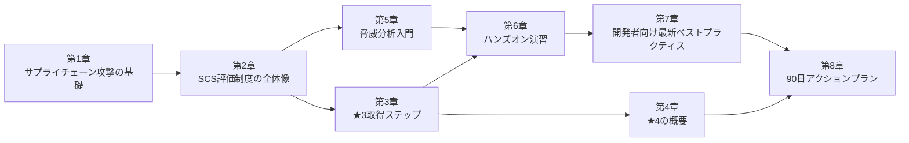

### 0.3 情報の信頼度ラベル

本ガイドは、2026年11月6日時点でウェブ上から確認できた情報にもとづきます。制度はまだ立ち上げの途中で、資料が頻繁に更新されています。記述ごとに、次のラベルで情報源の種類を示します。

| ラベル | 意味 | 扱い方 |
|---|---|---|
| **【一次】** | 経済産業省、IPA、MITRE、SLSA、各言語コミュニティの公式発表など | 最も信頼できる。まずここを確認する |
| **【二次】** | 企業・ベンダーの解説記事、ニュース | 理解の助けになる。数値や条件は一次情報で再確認する |
| **【開発者】** | 国際的に知られた開発者・研究者の個人ブログや投稿 | 実践的な知見。意見や推奨を含む |
| **【筆者整理】** | このガイドの筆者が学習用に整理した内容 | 公式見解ではない |

> 注意: ベンダーの解説記事には自社製品の紹介が含まれることがあります。本ガイドは、制度の事実関係を確認する目的でのみ参照しており、特定製品を推奨するものではありません。

### 0.4 本ガイドの表記ルール

- 図解は、フローチャートなどを Mermaid、比較や一覧を Markdown の表で表現します。
- 制度の正式名称は「サプライチェーン強化に向けたセキュリティ対策評価制度」、略称は「SCS評価制度」です。SCS は Supply Chain Security の略です【一次: 経済産業省】。

---

## 1. 基礎: サプライチェーン攻撃とは

### 1.1 まず用語を整理する

| 用語 | やさしい説明 |
|---|---|
| サプライチェーン | 原材料の調達から製造、納品、サービス提供までの、取引のつながり全体 |
| サプライチェーン攻撃 | 守りの固い企業を直接攻めず、その取引先やソフトウェア部品など、弱いところを経由して侵入する攻撃 |
| 脅威（Threat） | 被害を起こしうる出来事や攻撃者の行動 |
| 脆弱性（Vulnerability） | 攻撃に悪用される弱点（設定ミス、ソフトウェアの欠陥、運用の抜けなど） |
| リスク | 脅威と脆弱性が組み合わさって、実際に損害が出る可能性 |
| 対策（Mitigation / Control） | リスクを下げる行動。技術、ルール、教育のすべてを含む |
| IT基盤 | 社内外のサーバ、PC、ネットワーク、クラウドサービスなど、情報システムの土台 |

### 1.2 なぜ「取引先ごと」の対策が必要なのか

大企業が自社の守りを固めても、取引先の1社が突破されれば、そこから侵入されます。攻撃者から見れば、守りの弱い中小の取引先は「入口」です。

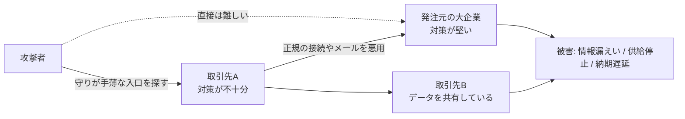

そこで経済産業省と内閣官房 国家サイバー統括室は、各企業が満たすべき対策の水準を共通の物差しで示し、その達成状況を「見える化」する仕組みとして、SCS評価制度の検討を進めました。2026年3月27日に「制度構築方針」が公表されています【一次: 経済産業省 https://www.meti.go.jp/policy/netsecurity/scs.html】。

### 1.3 2つのサプライチェーンを区別する

「サプライチェーン攻撃」という言葉は、2種類の意味で使われます。混同しないことが、初学者の最初の関門です。

| 種類 | 何がつながっているか | 攻撃の例 | 主な対策の場 |
|---|---|---|---|
| ① 取引先のつながり（ビジネス上の供給網） | 発注元、委託先、グループ会社、クラウド事業者 | 取引先の弱いVPN機器から侵入される | **SCS評価制度**（企業のIT基盤の対策水準を評価） |
| ② ソフトウェア部品のつながり（ソフトウェア供給網） | OSSライブラリ、パッケージレジストリ、CI/CD、ビルド成果物 | 人気のnpmパッケージに悪意あるバージョンが公開される | SLSA、依存関係の管理、公開・取得の統制（第7章） |

> 重要: SCS評価制度が直接の対象とするのは、サプライチェーンを構成する企業の**IT基盤**（クラウド環境も含む）です。製造現場の制御（OT）システムや、委託元に提供する製品そのものは、直接の対象ではありません【一次: 経済産業省】。②のソフトウェア供給網の対策は、制度の対象外の部分も多いものの、自社の開発環境という「IT基盤」を守るうえで欠かせません。

### 1.4 最新の脅威状況（IPA 情報セキュリティ10大脅威 2026）

IPAの「情報セキュリティ10大脅威 2026」では、組織向けの1位が「ランサム攻撃による被害」でした。また、組織編の3位に「AIの利用をめぐるサイバーリスク」が初めてランクインしています【一次: IPA https://www.ipa.go.jp/security/10threats/10threats2026.html / https://www.ipa.go.jp/pressrelease/2025/press20260129.html】。

IPAは、順位の高低が対策の優先順位ではないとも明記しています。自組織の立場や環境にもとづいて、優先する脅威を整理する必要があります【一次: IPA 解説資料 https://www.ipa.go.jp/security/10threats/omgdg50000008fi8-att/kaisetsu_2026_soshiki.pdf】。この「自社の環境に照らして整理する」作業こそが、第5章の脅威分析です。

### 1.5 確認問題（第1章）

1. 「サプライチェーン攻撃」の2つの意味を、それぞれ一言で説明してください。
2. SCS評価制度の直接の対象にならないものを2つ挙げてください。
3. 10大脅威の順位は、そのまま自社の対策優先順位になりますか。

<details>
<summary>解答例</summary>

1. ①取引先のつながりを経由した侵入、②ソフトウェア部品（OSSやCI/CD）の配布経路を悪用した攻撃。
2. 製造現場の制御（OT）システム、委託元に提供する製品そのもの。
3. なりません。自社の環境や立場にもとづいて優先順位を決める必要があります。

</details>

---

## 2. SCS評価制度とは

### 2.1 一言でいうと

**「取引先に求めるセキュリティ対策の水準を、★3・★4・★5という共通の段階で示し、企業がその達成状況を示せるようにする国の制度」**です。経済産業省と内閣官房 国家サイバー統括室が整備し、**IPA（情報処理推進機構）が運営**します【一次: IPA https://www.ipa.go.jp/security/scs/details.html】。

類似する制度との違いを、先に整理します。

| 観点 | SCS評価制度 | ISMS（ISO/IEC 27001） | SECURITY ACTION |
|---|---|---|---|
| 位置づけ | サプライチェーン上の企業の対策水準を★で示す | 組織のマネジメントシステムの認証 | 中小企業の自己宣言（取り組みの第一歩） |
| 目的 | 取引先に求める対策を共通化する | 情報セキュリティの管理体制を継続的に改善する | 対策に取り組む意思の表明 |
| 評価方法 | ★3: 専門家確認付き自己評価 / ★4: 第三者評価 | 認証機関による審査 | 自己宣言 |

※ ISMSの考え方は、★5のベンチマークとして参照されています【一次: IPA 詳細情報ページ】。

### 2.2 誰が何をするのか（運営体制）

【一次: IPA https://www.ipa.go.jp/security/scs/details.html】

| 登場人物 | 役割 |
|---|---|
| 経済産業省・内閣官房 国家サイバー統括室 | 制度の監督 |
| IPA（事務局） | 運営管理、★3・★4の登録、普及促進 |
| 運営審議委員会 | 運営方針や制度文書の策定を審議 |
| 指定委員会 | 評価機関、技術検証事業者、研修事業者の指定・監督 |
| 評価機関 | ★4の第三者評価を実施 |
| 技術検証事業者 | ★4の技術検証（脆弱性検査など）を実施 |
| セキュリティ専門家 | ★3の自己評価結果の確認・助言。評価機関では評価責任者を担う |
| 研修事業者 | セキュリティ専門家向けの研修を提供 |

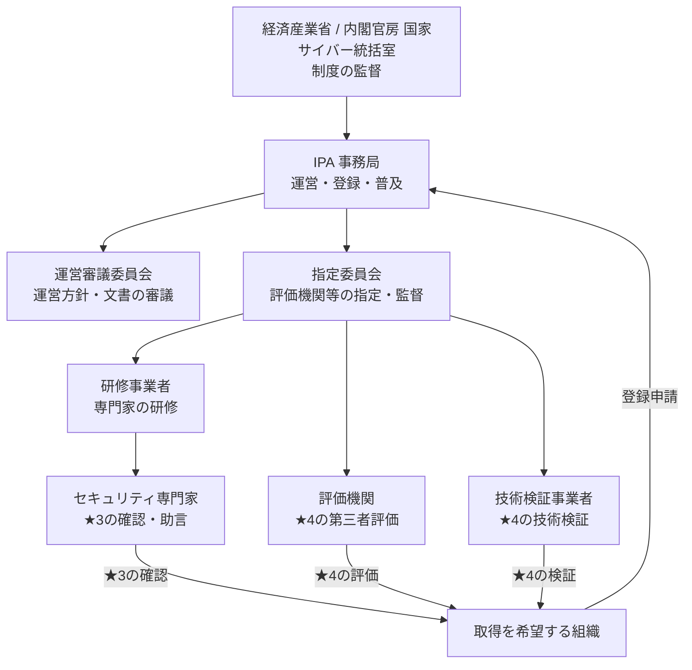

### 2.3 3つの★の段階

【一次: IPA https://www.ipa.go.jp/security/scs/details.html（2026年3月の制度構築方針にもとづく）】

| 項目 | ★3 | ★4 | ★5 |
|---|---|---|---|
| 想定する脅威 | 広く知られた脆弱性などを悪用する一般的なサイバー攻撃 | 供給停止などでサプライチェーンに大きな影響を与える企業への攻撃、機密情報を狙う攻撃 | 未知の攻撃を含む高度なサイバー攻撃 |
| 対策の基本的な考え方 | すべてのサプライチェーン企業が最低限実装すべき対策。基礎的な組織的対策とシステム防御策が中心 | 標準的に目指すべき包括的な対策。組織ガバナンス、取引先管理、システム防御・検知、インシデント対応など | さらに高度な対策。国際規格のリスクベースの考え方にもとづく改善プロセス、現時点のベストプラクティスにもとづく対策 |
| 要求事項数（2026年3月方針時点） | 26件 | 43件 | 今後検討 |
| 評価スキーム | 専門家確認付き自己評価 | 第三者評価 | 今後検討 |
| 有効期間 | 1年 | 3年 | 今後検討 |
| 参考にされたベンチマーク | 自工会・部工会ガイドLv1、Cyber Essentials | 自工会・部工会ガイドLv2〜3、分野別ガイドライン | ISO/IEC 27001、自工会・部工会ガイドLv3 など |

- 評価基準の数は、2026年10月28日公開のVer.1.1で、★3が**81評価基準**、★4が**153評価基準**（★3の81基準を含む）と整理されています【二次: Admina by Money Forward https://admina.moneyforward.com/jp/blog/scs-star3-checklist ／ IPAの原典で再確認してください】。
- **上位の★は下位の★の要求を包含**します。そのため、★3を取っていなくても★4は申請できます【一次: IPA 詳細情報ページ】。
- ★5は、スキームや開始時期を含めて、まだ検討中です【一次: IPA】。

### 2.4 ★3と★4の評価の流れ

**★3: 専門家確認付き自己評価**

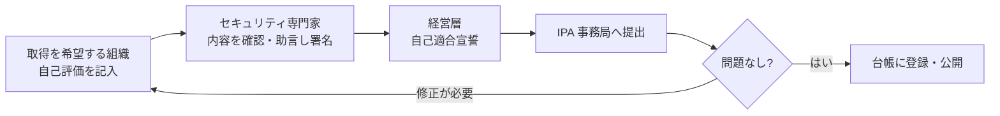

**★4: 第三者評価＋技術検証**

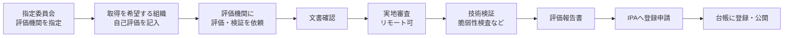

★3・★4とも、原則として**すべての評価基準への適合**が求められます。不適合があっても、適切に是正し、専門家や評価機関の了承を得られれば取得できる設計です【一次: IPA 詳細情報ページ（制度構築方針p.23の抜粋）】。

### 2.5 費用（登録料）

IPAは2026年9月18日に料金設定を公表しました【一次: IPA 料金表 https://www.ipa.go.jp/security/scs/rcu1hd00000075om-att/pricelist.pdf】。金額は消費税込みで、適用時期は申請日が基準です。

| 区分 | 2028年3月31日までの申請 | 2028年4月1日以降の申請 |
|---|---|---|
| ★3 登録希望組織の登録料 | 10,000円（1年分） | 20,000円（1年分） |
| ★4 登録希望組織の登録料 | 60,000円（3年分） | 60,000円（3年分） |
| SCSセキュリティ専門家の登録料 | 無料 | 無料 |

> これは**IPAへの登録料だけ**です。対策の実施費用、ツール費用、専門家や評価機関に支払う確認・評価の費用は、別途かかります【二次: 各社解説】。見積もりは、支援範囲を揃えて複数社から取ると比較しやすくなります。

評価機関などの指定を受けたい事業者向けの料金（申請料・指定料）も、同じ料金表で公表されています（例: 評価機関は、2028年3月31日まで申請料15万円、指定料30万円（3年分））【一次: IPA 料金表】。

### 2.6 スケジュール（2026年11月6日時点）

| 時期 | 内容 | 状況 |
|---|---|---|
| 2026年3月27日 | 制度構築方針を公表 | 確定【一次】 |
| 2026年4月21日 | IPAの特設サイトを公開、★3・★4の要求事項・評価基準を公開 | 確定【一次】 |
| 2026年8月28日〜9月 | 基本規程、制度基準、制度手順などを順次公開 | 確定【一次】 |
| 2026年9月18日 | 料金設定を公表 | 確定【一次】 |
| 2026年10月28日 | 評価用ガイドと解説書を公開 | 確定【一次: IPA https://www.ipa.go.jp/security/scs/index.html】 |
| 2026年11月末頃 | ★3・★4の登録申請の手引を公表 | 予定【二次】。私が確認した範囲では、本日時点で未公表 |
| 2026年12月下旬 | 評価機関・技術検証事業者・研修事業者の指定・公表 | 予定【二次】 |
| 2027年1月以降 | SCSセキュリティ専門家の登録受付 | 予定【一次/二次】 |
| 2027年3月 | ★3・★4の登録申請の受付開始 | 予定【二次】 |

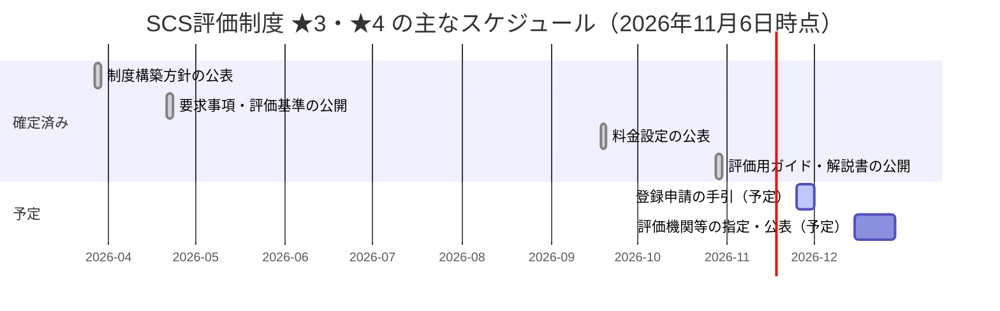

> 専門家の登録受付と★3・★4の申請受付は、開始時期だけが示された予定のため図には載せていません。上の表で確認してください。
>
> 予定は変更されることがあります。**IPAの特設サイトを必ず確認してください**: https://www.ipa.go.jp/security/scs/index.html

### 2.7 制度を騙る勧誘への注意

IPAの特設サイトには、制度に関する注意喚起が掲載されています（2026年4月30日付）【一次: IPA https://www.ipa.go.jp/security/scs/index.html】。制度の運営はIPAで、取得手続きの窓口もIPA（事務局）です。「今すぐ取得を代行する」「登録しないと取引停止になる」などの勧誘を受けたら、IPAの公式サイトで事実を確認してください。

### 2.8 確認問題（第2章）

1. ★3と★4の評価方法の違いは何ですか。
2. 2026年11月6日時点で、★3・★4の登録申請は受け付けられていますか。
3. ★3を取得していなくても、★4を申請できますか。

<details>
<summary>解答例</summary>

1. ★3は専門家確認付きの自己評価、★4は評価機関による第三者評価（文書確認、実地審査、技術検証）。
2. いいえ。2027年3月の受付開始が予定されています。
3. できます。上位の★は下位の要求を包含するため、★3の取得は前提ではありません。

</details>

---

## 3. ★3 取得ステップバイステップ

★3は、「広く知られた脆弱性を悪用する一般的な攻撃」に対処できる水準です。ここでは、公開されている情報をもとに、準備の手順を8ステップで整理します。

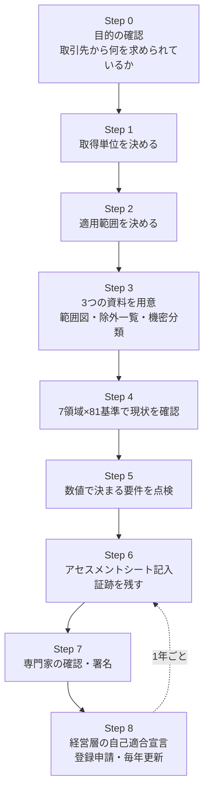

### Step 0: 目的を確認する

- 取引先から★3や★4を求められているのか、それとも将来に備えた準備なのかを確認します。
- 求められていない場合、一般的な業務委託や部材の取引であれば、まず★3を目指すのが現実的とされています【二次: Admina】。
- ★4では、発注側に「取引先のセキュリティ対策状況を年1回以上把握する」基準があり、重要な機密情報の共有先や、事業継続上重要な取引先などが対象になりえます（基準2-1-3-1）【二次: Admina】。自社がそうした取引先に当たるかを、先に見積もっておきます。

### Step 1: 取得単位を決める

取得単位とは、登録を申請する組織の区切りです【二次: Admina（IPAの自己評価等ガイドの解説）】。

| 取得単位 | 条件のイメージ |
|---|---|
| 法人単位（原則） | 特になし |
| 事業部・事業所単位 | 組織の区分と、その責任者が明確。期間限定のプロジェクトではない |
| 企業グループ単位 | 含まれる全法人が共通のIT基盤と共通のセキュリティ対応方針を持つ |

### Step 2: 適用範囲を決める

適用範囲に含める対象を、次の表で整理します【二次: Admina（IPAの解説書の整理）】。

| 区分 | 主な対象 |
|---|---|
| 必ず含める | インターネットに公開しているサーバ（Web、メールなど） |
| 含める | 社内サーバ、PC・スマートデバイス、利用中のクラウドサービス（SaaS・IaaS）、境界のFW・ルータ・VPN機器、グループ共通ネットワーク |
| 端末の扱い | 会社支給端末は場所を問わず含める。業務に使う個人所有端末（BYOD）も含める |
| 含めない | 委託先所有の端末、顧客向けサービスの基盤、境界防護で分離された製造現場の制御（OT）システムなど |

除外する場合は、除外対象と理由を一覧にし、範囲との境界にファイアウォールやVLANなどの保護策が必要です。

### Step 3: 先に用意する3つの資料

| 資料 | 用途 |
|---|---|
| 範囲・除外部分の境界を示す概要図／ネットワーク図 | 適用範囲の説明 |
| 除外対象と理由の一覧 | 除外の妥当性の説明 |
| 「機密情報」「重要な機密情報」「事業継続上重要なシステム」などの一覧 | どの基準をどのシステムに適用するかの整理 |

この3つ目の分類が決まっていないと、たとえば「重要な機密情報を扱うクラウドには常に多要素認証」という基準を、どのサービスに適用すべきかが決まりません。

### Step 4: 7つの評価領域で現状を確認する

★3の要求事項・評価基準は、7つの大分類で構成されています。件数は次のとおりです【二次: Admina】。

| 領域 | 要求事項 | 評価基準 | ★3で求められる主な対策 |
|---|---|---|---|
| 1. ガバナンスの整備 | 3 | 8 | 統括する役員と担当の明確化、守秘義務、対応方針の策定と周知 |
| 2. 取引先管理 | 3 | 4 | 接続している外部システムの把握、機密情報の取り決め、インシデント時の役割分担 |
| 3. リスクの特定 | 4 | 11 | PC・サーバ・ネットワーク機器の台帳、機密区分のルール |
| 4. 攻撃等の防御 | 13 | 48 | ID管理、認証・多要素認証、アクセス権、教育・訓練、バックアップ、パッチ適用、マルウェア対策、FW |
| 5. 攻撃等の検知 | 1 | 3 | 不正アクセスの検知・遮断、ログとアラートの分析 |
| 6. インシデントへの対応 | 1 | 6 | 対応手順、連絡先、役割、報告様式 |
| 7. インシデントからの復旧 | 1 | 1 | 事業継続上重要なシステムの目標復旧レベルと対策 |
| **合計** | **26** | **81** | |

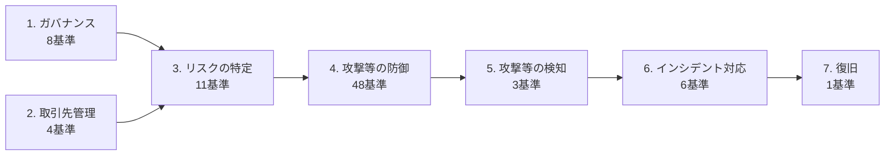

81基準のうち、48基準が「攻撃等の防御」に集中しており、準備の工数も最も多くかかる領域です【二次: Admina】。

### Step 5: 数値で決まっている要件を先に点検する

設定値や頻度が決まっている基準は、自社の設定と食い違っていると手戻りになります。次は二次情報にもとづく一覧です。**必ずIPAの要求事項・評価基準（Ver.1.1）で原文を確認してください**。

| 基準 | 内容（要約） |
|---|---|
| 4-1-3-3 | 多要素認証は、異なる2種類以上の要素（知識・所有・生体など）を使う |
| 4-1-3-4 | 多要素認証の知識情報として使うパスワードは8文字以上 |
| 4-1-4-1 | PCログオン等は、10回以上の失敗でロックするか試行間隔を延ばす |
| 4-1-4-2 | PCログオン等は、6文字以上のパスワードかPIN |
| 4-2-2-1 | インシデント対応の教育・訓練を、新規受入れ時かつ年1回以上 |
| 4-4-4-2 | 「重大」「高リスク」やCVSS基本値7.0以上などの脆弱性を直すアップデートは、リリースから14日以内に適用。やむを得ず14日以内に適用できない場合は、適用に向けた対応計画を作り、適用までの間、次のいずれかの対策を実施する。攻撃を観測済みの脆弱性: 悪用対象の機能の無効化、ベンダー推奨の回避策、適用範囲のネットワークからの分離、不正通信の遮断機器等を導入済みの場合の監視・設定の一時的な強化。攻撃を観測していない脆弱性: 対応計画を完了まで管理・記録【一次: IPA 自己評価等ガイド No.4-4-4-2 https://www.ipa.go.jp/security/scs/rcu1hd0000007a2i-att/SCS-410-self-assess-guide-v1.0.pdf】 |
| 年1回以上の点検 | 体制、外部システム把握、ルール遵守、機密情報管理、訓練内容、インシデント体制などを年1回以上点検 |

> 「点検は年1回以上」という基準は、**実施日を記録に残す**ことが重要です。最新の実施日が1年以上前だと、確認で指摘されます【二次: Admina】。

### Step 6: アセスメントシートに記入し、証跡を残す

- IPAがアセスメントシートを公開しています（利用は任意。独自様式でも、評価基準、対象外の欄、自己評価結果、質問事項と回答欄を含める必要があります）【二次: Admina】。
- 評価基準を**対象外**にできるのは、ガイドの「対象外となるための条件」に当たり、専門家が妥当と認めた場合だけです【二次: Admina】。
- 証跡には、規程や記録に加えて、システムの設定画面、管理ツールの画面表示やCSV出力も含められます。紙の台帳を作り直す必要はありません【二次: Admina】。
- 申請後、登録期間中にIPAが調査する際に、保管したアセスメントシートが改ざんされていないかをハッシュ値で照合する運用が想定されています【二次: Admina】。

### Step 7: セキュリティ専門家の確認を受ける

専門家は、記入内容を次の4つの観点で確認します【二次: Admina】。

| 観点 | 確認内容 | 指摘される例 |
|---|---|---|
| 網羅性 | 質問への回答がもれなくあるか。対策の有効範囲が適切か | 未記載の回答 |
| 正確性 | 回答が質問の趣旨に合っているか | 趣旨とずれた回答 |
| 適時性 | 内容の時点が適切か | 年1回の点検の最終実施日が1年以上前 |
| 一貫性 | 他の回答と矛盾していないか | 別の質問の回答との食い違い |

専門家になれる資格は、情報処理安全確保支援士、公認情報セキュリティ監査人（CISA）、CISSP、CISM、ISO/IEC 27001主任審査員などが対象で、研修の修了と事務局への登録が必要です【一次: IPA 詳細情報ページ】。

> 確認が見るのは、アセスメントシートに書かれた内容の妥当性です。書いた内容が事実であるかは、申請する企業が責任を負います。自己評価の結果に虚偽があった場合、取得した★が取り消されることがあります【一次: IPA 詳細情報ページ】。

### Step 8: 経営層の自己適合宣言、登録申請、毎年の更新

1. 経営層が、自己評価の結果にもとづいて適合を宣言します。
2. 専門家（★3確認責任者）が適合と判断し、自己適合宣言に係る署名又は記名が済んだアセスメントシート全体をPDF化します。
3. そのPDFのSHA-256ハッシュ値を算出し、**PDFとハッシュ値の両方を証跡として保管**したうえで、**ハッシュ値を制度運営機関へ提出**します【一次: IPA 自己評価等ガイド 3.3 https://www.ipa.go.jp/security/scs/rcu1hd0000007a2i-att/SCS-410-self-assess-guide-v1.0.pdf】。
4. 登録申請でほかに何を提出するかは、公表予定の「★3・★4 登録申請の手引」で確認します。
5. 問題なければ台帳に登録・公開されます。
6. ★3の有効期間は1年です。毎年、アセスメントシートを更新し、専門家の確認を受けます。
7. 適用範囲が変わった場合や、達成状況に大きく影響する変更（大規模なリプレイスやクラウド移行など）があった場合は、速やかに再確認を受けます【二次: Admina】。

### 3.1 初学者がつまずきやすいポイント

| つまずき | 対処 |
|---|---|
| 適用範囲を決めずに基準から読み始める | Step 1・2を先に済ませる |
| SaaSの全体像が分からない | 部門契約も含めて棚卸しする（シャドーITを含む） |
| 「定める」の意味が分からない | ルールを文書化し、そのルールにもとづいて運用すること、と読む |
| ★4の項目まで先回りして工数が膨らむ | ★3の81基準に集中する。ただし、アクセス権の棚卸しなど、★3でも「定める」が求められるものがある |
| ISMSがあるから大丈夫と考える | パスワード長や14日以内のパッチ適用など、数値の基準は個別に差分確認が必要 |

### 3.2 中小企業向けの支援

- IPAは「サイバーセキュリティお助け隊サービス（新類型）」の実証事業を進めています。診断、改善計画、ツール導入、規程整備、専門家確認、申請支援をまとめて提供する取り組みで、実証期間は2026年10月〜2027年9月の予定です【一次: IPA https://www.ipa.go.jp/security/sme/otasuke-scs.html ／ 期間は二次情報で確認】。
- 「中小企業の情報セキュリティ対策ガイドライン」第4.0版には、★3・★4の対策に備えられる内容が含まれます【二次: INTERNET Watch https://internet.watch.impress.co.jp/docs/news/2097212.html】。
- SECURITY ACTIONの宣言は、最初の一歩として取り組みやすい準備です【二次: キヤノンMJ https://canon.jp/biz/trend/securityaction】。

---

## 4. ★4の概要

★4は、「初期侵入を防ぐ」だけでなく、侵入後の被害拡大を抑え、取引先のデータやシステムの保護に貢献できる水準です。自社の役割に適したサプライチェーン強靭化策が講じられていることも求められます【一次: IPA 詳細情報ページ】。

### 4.1 ★3との違い

| 観点 | ★3 | ★4 |
|---|---|---|
| 評価者 | セキュリティ専門家（書類の確認） | 評価機関（第三者評価）、技術検証事業者 |
| 評価内容 | 書類の確認 | 文書確認、**実地審査**、**技術検証** |
| 有効期間 | 1年 | 3年（二次情報では、期間中も毎年、自己評価結果を評価機関へ提出） |
| 追加される主な対策領域 | — | 組織ガバナンスの強化、取引先管理、システム防御・検知、インシデント対応・事業継続などの包括的な対策 |

### 4.2 評価の流れ（制度構築方針の想定）

【一次: IPA 詳細情報ページ（制度構築方針p.23の抜粋）】

| 工程 | 所要の想定 | 内容 |
|---|---|---|
| 文書確認 | 1〜2日程度 | 提出書類を確認する |
| 実地審査 | 1〜2日程度（リモート可） | ヒアリング、画面確認、証跡の確認。例: 脆弱性の管理体制、インシデント対応手順、事業継続要件に沿った復旧準備 |
| 技術検証 | 1〜2日程度 | インターネット公開機器（VPN装置、ルータなど）に対する脆弱性検査 |

- 評価は、決めた適用範囲の中から対象をサンプリングして実施する想定です。
- 技術検証の代替として、直近の脆弱性検査の結果の提出・確認が検討されています。
- 不適合の指摘があった場合、一定期間内（例: 指摘通知から1か月以内）に是正報告を出して了承されれば取得できる想定です。

### 4.3 発注側の責務にも注意

★4の基準には、重要な取引先の対策状況を年1回以上把握するなど、「自社が発注者として取引先を管理する」ことが含まれます（基準2-1-3-1）【二次: Admina】。つまり、★4を目指す企業は、自社の取引先にも対策状況の確認を求める立場になります。

---

## 5. 脅威分析（脅威モデリング）入門

### 5.1 SCSと脅威分析の関係

| | SCS評価制度 | 脅威分析 |
|---|---|---|
| 問い | 業界共通の水準を満たしているか | **自社の**何が、どう攻撃されうるか |
| 性質 | 共通の物差し（チェックリスト型） | 自社に合わせた分析（考える型） |
| 弱点 | 水準を満たしても、自社固有の弱点は見つからないことがある | 手法が自由で、結果が人によってばらつく |
| 組み合わせ方 | 共通の水準を土台にする | 土台の上に、自社固有のリスクを足す |

つまり、**SCSで「最低限の水準」を満たし、脅威分析で「自社固有のリスク」を見つけて補う**、という使い分けが基本です。★5が「自組織のリスクを適切に把握・マネジメントする」ことを求める想定であることからも、この組み合わせは今後ますます重要になります【一次: IPA 詳細情報ページ】。

### 5.2 脅威分析の土台: 4つの質問

脅威モデリングの第一人者である Adam Shostack が整理した「4つの質問（Four Question Framework）」が、現在でも広く使われています【開発者: Adam Shostack https://shostack.org/files/papers/The_Four_Question_Framework.pdf ／ https://github.com/adamshostack/4QuestionFrame】。

| # | 質問 | 意味 | この章の対応 |
|---|---|---|---|
| Q1 | What are we working on?（何を作っているのか） | 対象の範囲と構造を明らかにする | 5.4 |
| Q2 | What can go wrong?（何がうまくいかなくなりうるか） | 脅威を洗い出す | 5.5 |
| Q3 | What are we going to do about it?（それにどう対処するか） | 対策や対応方針を決める | 5.6〜5.7 |
| Q4 | Did we do a good job?（うまくやれたか） | 振り返りと検証 | 5.8 |

Shostack自身は、これらは「手法（メソドロジー）」ではなく「枠組み（フレームワーク）」であり、具体的な答え方は自由だと述べています【開発者: Threat Modeling Podcast での発言 https://threatmodel.buzzsprout.com/2152378/12826352】。なお、Threat Modeling Manifestoでは、4つ目を「十分うまくやれたか（good enough）」とする表現が好まれました【開発者: https://github.com/adamshostack/4QuestionFrame】。

### 5.3 進め方の全体像

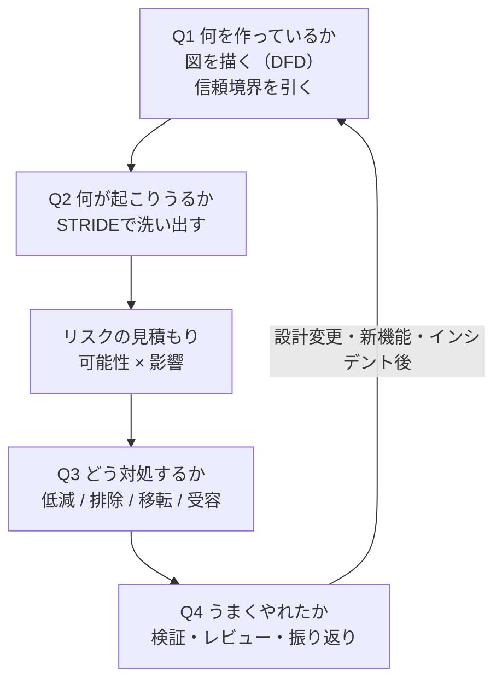

### 5.4 Q1: 対象を図にする（データフロー図と信頼境界）

最初に、対象システムの「登場人物」と「データの流れ」を図にします。これを**データフロー図（DFD）**といいます。そのうえで、「信頼できる範囲」と「信頼できない範囲」の境目（**信頼境界**）を引きます。境界をまたぐ矢印は、攻撃が起きやすい場所です。

次は、一般的な社外向けWebサービスの例です。

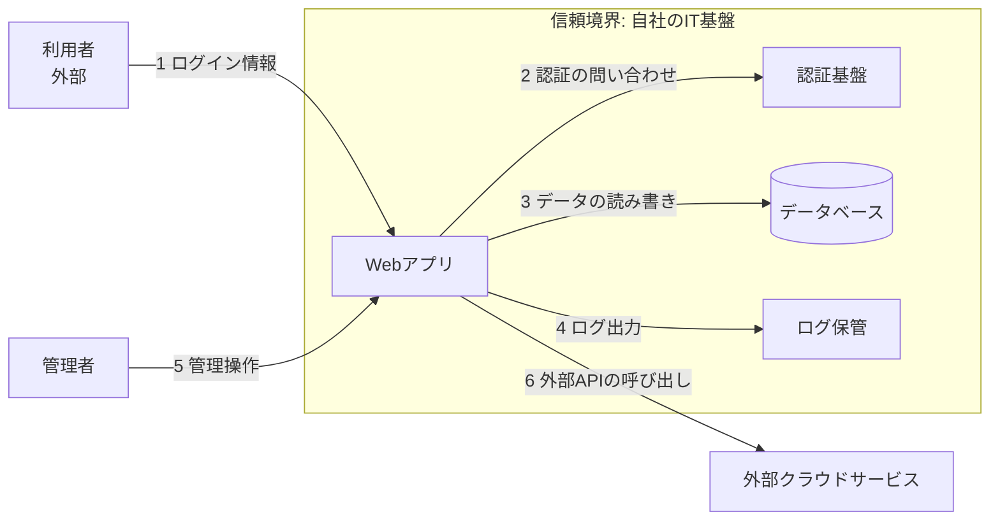

作図のコツは次のとおりです。

- 最初から完璧を目指さず、**ホワイトボードの手描き程度**で始める。
- 登場人物（人、システム、データ置き場）に名前をつける。
- 「誰が」「何を」「どこへ」送るのかを、矢印1本ずつに書く。
- 外部サービス、取引先とのデータ連携、管理者の操作経路を**必ず**描く。

### 5.5 Q2: 何が起こりうるか（STRIDE）

STRIDEは、Microsoftで1990年代後半に開発された脅威の分類法で、いまも最も広く使われている手法の1つです【二次: DeepStrike https://deepstrike.io/blog/threat-modeling】。6つの観点で、図の要素や矢印に「当てはめて」考えます。

| 頭文字 | 脅威 | 破られる性質 | 例（日常のたとえ） | 典型的な対策の方向性 |
|---|---|---|---|---|
| S | Spoofing（なりすまし） | 認証 | 他人のIDカードで入館する | 多要素認証、パスキー |
| T | Tampering（改ざん） | 完全性 | 契約書の金額を書き換える | 署名、ハッシュ、アクセス制御 |
| R | Repudiation（否認） | 否認防止 | 「そんな操作はしていない」と言い逃れる | 監査ログ、ログの保護 |
| I | Information disclosure（情報漏えい） | 機密性 | 機密書類が公開フォルダに置かれる | 暗号化、アクセス権の最小化 |
| D | Denial of service（サービス拒否） | 可用性 | 店の前に人が殺到して営業できない | 冗長化、レート制限、バックアップ |
| E | Elevation of privilege（権限昇格） | 認可 | 一般社員が管理者権限を得る | 最小権限、権限の分離、パッチ適用 |

使い方のコツは、**図の要素ごとに「S/T/R/I/D/E のどれが起こりうるか」と自問する**ことです。

### 5.6 リスクを見積もる（初学者向けの簡単な方法）

洗い出した脅威のすべてに対処する時間はありません。「可能性」と「影響」を3段階で見積もって、優先順位をつけます【筆者整理】。

| 可能性＼影響 | 小（1） | 中（2） | 大（3） |
|---|---|---|---|
| 高（3） | 3 | 6 | 9 |
| 中（2） | 2 | 4 | 6 |
| 低（1） | 1 | 2 | 3 |

- 6以上を「優先して対処」、3〜4を「計画的に対処」、2以下を「受容も検討」とする、といった社内ルールを決めておくと運用しやすくなります。
- DREADなど、より細かい点数方式もありますが、主観に左右されやすいため、最初はこの簡易方式から始めるのが無難です【筆者整理】。
- IPAも、「10大脅威」のような一般的な順位ではなく、自組織の環境に照らして優先順位を決めるべきだと述べています（第1章参照）。

### 5.7 Q3: どう対処するか（4つの対応方針）

Shostackは、脅威への対応を4つの語彙で整理しています【二次: DeepStrike 経由で紹介】。

| 方針 | 意味 | 例 |
|---|---|---|
| 低減（Mitigate） | 起こりにくくする、被害を小さくする | 多要素認証の導入、ログの監視 |
| 排除（Eliminate） | 機能やデータそのものをなくす | 使っていない公開ポートを閉じる、不要なデータを持たない |
| 移転（Transfer） | 他者に負担してもらう | 保険、クラウド事業者の責任範囲に任せる、委託 |
| 受容（Accept） | リスクを理解したうえで許容する | 影響が小さい脅威を、経営層の承認のもとで受け入れる |

> 「受容」は、放置とは違います。**誰が、いつ、なぜ受け入れたのか**を記録に残します。

### 5.8 Q4: うまくやれたかを確かめる

最初は、機械的な確認から始めます。

- 図は描けたか。信頼境界は引けたか。
- 脅威のリストは作れたか。それぞれに対応方針を決めたか。
- 対策の実装は、確かに行われたか。テストやレビューで確認したか。
- 次回の見直しのタイミング（設計変更、新機能追加、インシデント発生後）を決めたか。

### 5.9 道具（無理に使わなくてよい）

| 道具 | 特徴 | 備考 |
|---|---|---|
| ホワイトボード・付箋 | 最も手軽。最初はこれで十分 | — |
| OWASP Threat Dragon | 無料のDFD作成・脅威管理ツール | 【二次: DeepStrike】 |
| pytm、Threagile | コードで脅威モデルを書く（モデルのコード化） | 【二次: DeepStrike】 |
| Microsoft Threat Modeling Tool | STRIDEにもとづく作図・脅威提案 | 【二次: DeepStrike】 |
| IriusRisk | 商用の脅威モデリング基盤 | 【二次: DeepStrike】 |

### 5.10 攻撃者の視点を足す: MITRE ATT&CK

STRIDEは「設計の弱点」を洗い出すのに向いています。一方、**実際の攻撃者が何をするか**を知るには、MITRE ATT&CKが役立ちます。ATT&CKは、実際に観測された攻撃者の行動を、戦術（Tactics）と技術（Techniques）で体系化した知識ベースです。

| 時期 | バージョン | 主な変更 |
|---|---|---|
| 2026年4月28日 | v19 | 「Defense Evasion」が「Stealth」と「Defense Impairment」に分割された【二次: Positive Technologies 系ニュース https://dbugs.ptsecurity.com/news/mitre-has-released-the-scheduled-att-ck-matrix-v19-update-20260428】 |
| 2026年10月13日 | v20 | AI関連の攻撃者行動（直接・間接のプロンプトインジェクション、AIを使った情報窃取、AI結果の汚染など）を扱う、9つのEnterprise技術・サブ技術が追加された【二次: https://gbhackers.com/mitre-attack-v20-ai-techniques/amp/ ／ https://letsdatascience.com/news/mitre-adds-ai-attack-techniques-to-attck-35cf4042】 |

- MITREの更新情報の一次ページ: https://attack.mitre.org/resources/updates/
- 主要リリースは、毎年4月と10月です【二次: https://www.bdemerson.com/article/mitre-attack-framework】。
- 古い資料は「ATT&CKは14戦術」と書いていることがあります。バージョンを確認して読んでください。

**使い方の例**: STRIDEで見つけた脅威（例: なりすまし）に、ATT&CKの技術（例: 窃取した認証情報の悪用）を結びつけると、「どのログを取り、どんな検知ルールを作れば気づけるか」が具体的になります【筆者整理】。

### 5.11 AIエージェントの脅威分析: 「致死的三位一体」で考える

AIエージェントやAI機能を業務に組み込む企業が増えています。IPAの10大脅威2026でも、AIをめぐるサイバーリスクが組織編3位に入りました（第1章）。

AI関連の脅威分析で、最初に使うべき考え方が、Simon Willison が提唱した **lethal trifecta（致死的な三つ組）** です。次の3つが**1つのエージェントに同時にそろう**と、プロンプトインジェクションを通じてデータが外部へ流出する経路が成立します【開発者: Simon Willison。解説記事 https://aiweekly.co/alerts/willison-names-lethal-trifecta-behind-ai-agent-data-leaks ／ 本人のブログ https://simonwillison.net/tags/prompt-injection/】。

| 要素 | 内容 | 例 |
|---|---|---|
| ① 非公開データへのアクセス | 機密情報、社内文書、メール、認証情報に触れられる | 社内ドキュメントの検索 |
| ② 信頼できない内容への接触 | 外部のWebページ、メール、チケット、文書を読み込む | 問い合わせメール、公開ウェブ |
| ③ 外部への通信 | データを外に出す経路がある | メール送信、URLアクセス、API呼び出し |

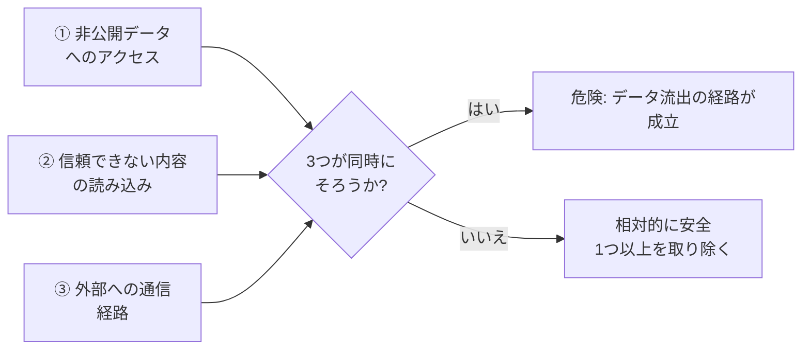

Willisonの主張の要点は、「AIベンダーがこの問題を解決してくれるわけではなく、**ツールの組み合わせを避ける設計を自分たちで行う**必要がある」ことです【開発者: 上記の解説記事による紹介】。

- 対策の考え方は、**3つのうち少なくとも1つを取り除く**ことです。モデルに「注入を無視せよ」と指示するだけでは防げない、という実務的な指摘もあります【二次: https://learnagentic.substack.com/p/what-is-the-lethal-trifecta】。
- 二次情報によれば、OWASPが2026年6月11日に公表したエージェント向けの報告では、プロンプトインジェクションが「Top 10 for Agentic Applications」の10分類のうち6つに関係すると整理されています【二次: https://memx.app/blog/lethal-trifecta-ai-agent-data-exfiltration/ ／ OWASPの原典での確認を推奨】。

### 5.12 脅威分析でありがちな失敗

| 失敗 | 対策 |
|---|---|
| 完璧な図を描こうとして始まらない | 1時間で、手描きの図から始める |
| 技術者だけで行い、業務の視点が抜ける | 業務担当者、運用担当者も1人は参加させる |
| 脅威を洗い出して満足してしまう | 必ず「対応方針」と「担当者・期限」まで決める |
| 一度やって終わり | 設計変更、新機能、インシデントのたびに見直す |
| 外部サービスや取引先との接続を図に描かない | 外部連携は、攻撃の入口になりやすい。必ず描く |

---

## 6. ハンズオン: 架空の会社「ミライ製作所」で、脅威分析からSCS準備までつなげる

> この章の会社は**架空**です。数字や構成は学習用に作成した【筆者整理】であり、実在の企業や制度上の判定ではありません。

### 6.1 設定

- 会社: 自動車部品の二次サプライヤー。従業員50名。
- 取引: 発注元から図面データを受け取り、製造・納品する。発注元から、「SCS★3を取得できる見込みか教えてほしい」と相談された。
- 情シス: 兼任1名。
- 主なIT基盤: 社内ファイルサーバ、クラウドのメール、図面共有用の「取引先ポータル」（クラウドサービス）、VPN機器（リモート保守用）、社員のノートPC。

### 6.2 Q1: 図を描く（取引先ポータルへの図面連携）

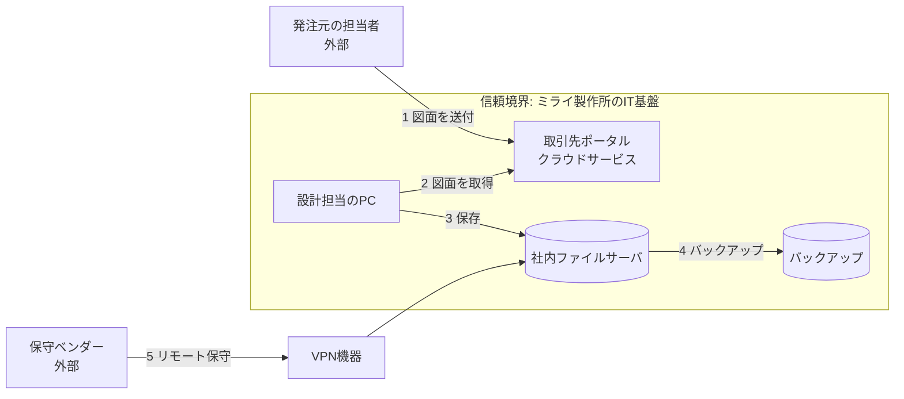

### 6.3 Q2: STRIDEで脅威を洗い出す

| # | 対象 | STRIDE | 脅威の内容 | 可能性 | 影響 | スコア |
|---|---|---|---|---|---|---|
| 1 | 取引先ポータル（アカウント） | S | 設計担当のパスワードが盗まれ、第三者が図面を閲覧する | 3 | 3 | **9** |
| 2 | VPN機器 | E | 公開されているVPN機器の既知の脆弱性を悪用され、社内に侵入される | 2 | 3 | **6** |
| 3 | 社内ファイルサーバ | T | ランサムウェアで図面が暗号化される | 2 | 3 | **6** |
| 4 | バックアップ | D | バックアップも同じネットワークに置かれ、同時に暗号化される | 2 | 3 | **6** |
| 5 | 保守ベンダーの経路 | S | ベンダー側の端末が侵害され、その接続を通じて侵入される | 2 | 2 | **4** |
| 6 | ファイルサーバ | I | 退職者のアカウントが残り、不要なアクセスが可能なまま | 2 | 2 | **4** |
| 7 | 全体（ログ） | R | ログを残していないため、事故時に原因を追えない | 2 | 2 | **4** |

### 6.4 Q3: 対応方針を決める

| # | 方針 | 具体策 | 担当・期限（例） |
|---|---|---|---|
| 1 | 低減 | ポータルとメールに多要素認証を必須化、適用漏れの点検 | 情シス・11月中 |
| 2 | 低減 | VPN機器の脆弱性情報を購読し、重要な更新は14日以内に適用する運用を決める | 情シス・12月中 |
| 3・4 | 低減 | バックアップをネットワーク分離し、復元テストを実施 | 情シス・1月中 |
| 5 | 低減＋移転 | 保守ベンダーとの契約に、機密情報の取り扱いとインシデント時の連絡・役割分担を明記 | 総務・1月中 |
| 6 | 低減 | 退職者アカウント削除の手順化と、年1回の権限棚卸し | 情シス・総務・12月中 |
| 7 | 低減 | 主要システムのログの取得範囲と保管期間を決める | 情シス・2月中 |

### 6.5 SCSの評価領域との対応づけ【筆者整理】

脅威分析で見つけた対策が、SCS★3のどの領域に当たるかを整理します。基準の番号や条件は、IPAの原典で確認してください。

| 脅威# | 主に関係する領域 | 補足 |
|---|---|---|
| 1 | 4. 攻撃等の防御（認証・多要素認証） | 基準4-1-3-2: 重要な機密情報を扱うクラウドサービスでの多要素認証【二次: Admina】 |
| 2 | 4. 攻撃等の防御（パッチ適用）、3. リスクの特定（機器の台帳） | 基準4-4-4-2: 14日以内の適用【二次: Admina】 |
| 3・4 | 4. 攻撃等の防御（バックアップ）、7. 復旧 | 復旧レベルの目標設定が必要 |
| 5 | 2. 取引先管理 | 外部システム・委託先との取り決め |
| 6 | 4. 攻撃等の防御（ID管理・アクセス権） | 基準4-1-1-3: 不要IDの速やかな削除、4-1-7-1: 棚卸し【二次: Admina】 |
| 7 | 5. 攻撃等の検知 | ログとアラートの分析 |

### 6.6 この演習から学ぶこと

- 脅威分析で見つけた対策のほとんどが、SCS★3の評価領域とつながります。つまり、**脅威分析は★3の準備をそのまま前に進めます**。
- 一方で、スコアの高い脅威から順に対策を打てば、限られた人手でも、効果の大きい順に進められます。
- 脅威分析の結果は、そのまま「ガバナンス」の領域で求められる**リスクの認識と、対応方針の根拠**にもなります。

---

## 7. 開発者視点の最新ベストプラクティス（国際的な開発者の投稿から）

この章では、2026年に起きた実際の攻撃と、それを受けた国際的な開発者・研究者の提言をまとめます。SCSは自社のIT基盤が対象ですが、**開発環境もIT基盤の一部**です。ここで紹介する対策は、SCS制度の対象外の部分も含む、ソフトウェア供給網全体のベストプラクティスです。

### 7.1 2026年に起きた主な事例

Simon Willison のブログ（供給網タグ）には、2026年の主要事例が時系列で整理されています【開発者: https://simonwillison.net/tags/supply-chain/】。

| 時期 | 事例 | 何が起きたか | 学べること |
|---|---|---|---|
| 2026年3月24日 | LiteLLM（PyPI） | 悪意あるバージョンが公開され、認証情報を窃取するコードが混入。起点は、CIで使われていたセキュリティスキャナ Trivy の侵害とみられる | **セキュリティツール自体も攻撃面**。インストールだけで実行される仕組みに注意 |
| 2026年3月25日 | LiteLLM の被害分析 | 悪性版の公開中のダウンロードは約47,000件。LiteLLMに依存する2,337パッケージのうち88%は、影響を避けられる形でバージョンを固定していなかった | **バージョン固定**の重要性 |
| 2026年3月31日 | Axios（npm） | 長期有効なnpmトークンの漏えいが原因とみられる。悪意ある依存が追加された | **長期トークン**のリスク。信頼された公開（Trusted Publishing）の導入 |
| 2026年4月3日 | Axios の事後報告 | 保守担当者個人を標的にした、巧妙なソーシャルエンジニアリング攻撃だった | **人**が狙われる |
| 2026年8月〜9月 | Rust関連（arrayref等） | ビデオ通話などをきっかけに、端末にコマンドを実行させて侵害する手口。Rust のセキュリティチームが警告 | 「仕事の誘い」を装った攻撃への警戒 |
| 2026年7月22日 | PyPI | 公開から14日を過ぎたリリースへの新規ファイルのアップロードを拒否する変更 | 長期安定版の汚染を防ぐ仕組み |

出典: Simon Willison のブログのまとめ、およびそこからリンクされた一次情報（Rust公式ブログ https://blog.rust-lang.org/2026/09/17/targeted-attacks/ ／ https://blog.rust-lang.org/2026/08/20/supply-chain-attack-on-arrayref/ ／ PyPI公式ブログ https://blog.pypi.org/posts/2026-07-22-releases-now-reject-new-files-after-14-days/ ／ Axios事後報告 https://github.com/axios/axios/issues/10636 ／ LiteLLM https://github.com/BerriAI/litellm/issues/24512）。

次の図は、2026年の攻撃に共通する流れの一例です【筆者整理】。

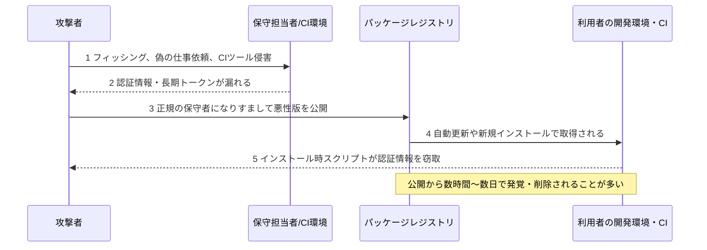

### 7.2 ベストプラクティス1: 依存関係のクールダウン（新バージョンをすぐ入れない）

**考え方**: 供給網攻撃は、公開直後の数時間〜数日の間に発覚して取り下げられることが多いため、**新しいバージョンを公開直後に取り込まない**だけで、被害の多くを避けられます。William Woodruff はこれを「dependency cooldowns（依存関係のクールダウン）」と名づけ、実装が非常に簡単で、多くの場合は無料で導入できると述べています【開発者: https://blog.yossarian.net/2025/11/21/We-should-all-be-using-dependency-cooldowns ／ Willisonによる紹介 https://simonwillison.net/2025/Nov/21/dependency-cooldowns/】。

主要ツールの対応状況は、Andrew Nesbitt が2026年3月にまとめています【開発者: https://nesbitt.io/2026/03/04/package-managers-need-to-cool-down.html ／ Willisonによる紹介 https://simonwillison.net/2026/Mar/24/package-managers-need-to-cool-down/】。

| ツール | 対応 | 備考 |
|---|---|---|
| pnpm 10.16 | `minimumReleaseAge` | 2025年9月 |
| Yarn 4.10.0 | `npmMinimalAgeGate` | 2025年9月 |
| Bun 1.3 | `minimumReleaseAge` | 2025年10月 |
| Deno 2.6 | `--minimum-dependency-age` | 2025年12月 |
| uv 0.9.17 | 相対期間の `--exclude-newer` | 2025年12月 |
| pip 26.0／26.1 | `--uploaded-prior-to`（26.1で日数指定に対応） | 2026年1月／4月 |
| npm 11.10.0 | `min-release-age` | 2026年2月 |

pip 26.1での使い方の例（Willisonの検証例）です【開発者: https://simonwillison.net/2026/Apr/28/pip-261/】。

```bash
# 公開から少なくとも4日経ったバージョンだけを取得する
pip install llm --uploaded-prior-to P4D
```

- Dependabot と Renovate にも、同様のクールダウン機能があります【開発者: 上記Woodruffの投稿による】。
- **設定値の単位や名前はツールごとに異なります**。公式ドキュメントで確認してから設定してください。
- **例外の扱い**: セキュリティ修正のためのアップデートまで遅らせてはいけません。Willisonは、依存先のリリースノートやセキュリティ勧告を注視することを併せて勧めています【開発者: 上記】。

### 7.3 ベストプラクティス2: 長期トークンをやめ、信頼された公開（Trusted Publishing）へ

- Axios の事例では、長期有効なnpmトークンの漏えいが原因とみられ、同プロジェクトには、Trusted Publishing（GitHub Actionsのワークフローだけが公開できる仕組み）の導入を求める課題が、すでに起票されていました【開発者: Willison https://simonwillison.net/2026/Mar/31/supply-chain-attack-on-axios/】。
- ただし、Trusted Publishing を有効にしても、トークンや手動での公開が**自動的に止まるわけではありません**。npm では、パッケージの Settings → Publishing access で「Require two-factor authentication and disallow tokens」を選んでトークンでの公開を制限し、使っていないトークンは失効させます【一次: npm https://docs.npmjs.com/trusted-publishers】。この設定でも、2要素認証に応答する手動公開はできます【一次: npm https://docs.npmjs.com/requiring-2fa-for-package-publishing-and-settings-modification】。
- PyPI は、Trusted Publishing を使うと**デジタル署名付きの証明（attestation）**がデフォルトで付く仕組みを提供しています【開発者: Willison https://simonwillison.net/2024/Nov/14/pypi-digital-attestations/】。
- 一方で、二次情報によれば、Trusted Publishing を悪用するワームも観測されています。**信頼された公開を使えば万全、ではない**点に注意してください【二次: https://phoenix.security/accelerating-supply-chain-attacks-npm-pypi-vsx-ai-enabled-2026/】。
- 同じ二次情報では、必須の2要素認証や Trusted Publishing の導入後に、PyPI と NuGet では悪性パッケージが減ったと報告されています。

**チェックリスト**:
- [ ] 公開用の長期トークンが、どこに保存されているかを棚卸しした
- [ ] 公開はCI（OIDC）経由に統一し、トークンでの公開を禁止して、不要なトークンを失効させた
- [ ] 2要素認証つきの手動公開は残ることを理解し、公開権限を持つメンテナーを最小限にした
- [ ] 公開アカウントには、パスキー等のフィッシング耐性のある認証を使っている

### 7.4 ベストプラクティス3: 攻撃の原因を知る（Filippo Valsorda の分析）

Filippo Valsorda は、2024〜2025年のOSS供給網侵害18件を調べ、根本原因を分類しました【開発者: https://words.filippo.io/compromise-survey/ ／ Willisonによる紹介 https://simonwillison.net/2025/Oct/10/a-retrospective-survey/】。

| 根本原因 | 件数の目安 | 対策の方向 |
|---|---|---|
| フィッシング | 5件 | パスキー/WebAuthn |
| 長期有効な認証情報の窃取 | 約5件 | 短命トークン、Trusted Publishing |
| 管理権限の引き継ぎ（後に信頼できないと判明） | 3件 | 引き継ぎ時の確認、権限の最小化 |
| GitHub Actionsのワークフロー設定の不備（PRやコメントで資格情報が漏れる） | 4件 | ワークフローの権限と起動条件の見直し |
| 失効したドメインの再取得 | 1件 | メールアドレスの検証、ドメインの更新管理 |

> **学びのポイント**: 原因の多くは「高度な技術」ではなく、**認証情報と運用の基本**です。SCS★3が求める、ID管理・認証・アクセス制御といった「基礎的な対策」と、方向が一致しています。

### 7.5 ベストプラクティス4: セキュリティツール自体を攻撃面として扱う

LiteLLM の事例は、CIで使われていたセキュリティスキャナ（Trivy）の侵害が、そこから窃取された認証情報を通じて、別の人気パッケージの汚染につながったとみられる点で教訓的です【開発者: Willison https://simonwillison.net/2026/Mar/24/malicious-litellm/ ／ 二次: CrowdStrike解説 https://www.crowdstrike.com/en-us/blog/from-scanner-to-stealer-inside-the-trivy-action-supply-chain-compromise/（Willisonの記事内で紹介）】。

- CIに渡す**シークレットは最小限**にする。ジョブごとに権限を絞る。
- 二次情報では、攻撃が長引いた要因として、**認証情報の入れ替え（ローテーション）が不完全**だったことが指摘されています【二次: https://www.rapidfort.com/blog/pypi-npm-and-the-new-frontline-of-software-supply-chain-attacks】。インシデント後は、関係するすべての認証情報を失効・再発行します。
- CIの外向き通信を制限し、ビルド環境は内部ミラーや信頼できるレジストリに限定する、という提言もあります【二次: Zscaler https://www.zscaler.com/blogs/security-research/supply-chain-attacks-surge-march-2026】。

### 7.6 ベストプラクティス5: バージョンの固定とロックファイル

- LiteLLM の分析では、依存パッケージの88%が、被害を避けられる形でバージョンを固定していませんでした（上記7.1）。
- pip には、ロックファイル（`pylock.toml`）を作る `pip lock` コマンドがあります【開発者: Willison https://simonwillison.net/2026/Apr/28/pip-261/】。pip 26.1 からは、`pip install -r pylock.toml` でロックファイルを読み込めます【一次: pip https://pip.pypa.io/en/stable/news/】。

```bash
# 依存関係と、そのすべての依存先を、ロックファイルに書き出す
pip lock datasette llm
```

```bash
# CIでの例: ロックファイルにある依存だけをインストールする
pip install -r pylock.toml --no-deps
```

- **ロックファイルはコミットする。CIでは、ロックファイルどおりにインストールする。**
- pip のロックファイル読み込みは**実験的機能**です。将来、予告なく変更・削除されることがあります【一次: pip https://pip.pypa.io/en/stable/cli/pip_install/ ／ 開発者: Richard Si https://ichard26.github.io/blog/2026/04/whats-new-in-pip-26.1/】。
- 既定では、ロックされた要件が、**ロックされていない依存を追加で取り込む**ことがあります。これを防ぐ場合は `--no-deps` を付けます【開発者: Richard Si 上記】。
- CIで `--no-deps` を使うのは、対象環境に必要な依存が**すべてロックされている**場合に限ります。足りない依存は補われません。
- 生成したロックファイルが有効と保証されるのは、**生成に使ったPythonバージョンとプラットフォームだけ**です【一次: pip https://pip.pypa.io/en/stable/cli/pip_lock/】。CIや本番の環境が異なる場合は、その環境向けに生成してください。

### 7.7 ベストプラクティス6: インストール時に勝手にコードが動かないようにする

二次情報によれば、2026年の攻撃では、コードを自動で実行させる仕組みが多用されています。**インストールやビルドの処理中**に動くものには、npm の postinstall や Cargo の `build.rs` があります。**インストール後**に動くものには、PyPI のインポート時実行や、Python の起動時に処理される `.pth` ファイルがあります【二次: https://tuxcare.com/blog/supply-chain-broke-in-2026/ ／ https://safeguard.sh/resources/blog/postinstall-script-attacks-package-managers】。

LiteLLM 1.82.8 の悪性版は `.pth` ファイル（`litellm_init.pth`）を含んでいました。このファイルは通常、インストール後に Python が起動した時点で実行されるため、`import litellm` をしなくても動きます【開発者: Willison https://simonwillison.net/2026/Mar/24/malicious-litellm/ ／ 二次: SafeDep https://safedep.io/malicious-litellm-1-82-8-analysis】。

対策の方向性は次のとおりです。

- インストール時スクリプトの**許可リスト化**（例: Bun の `trustedDependencies`、LavaMoat の allow-scripts）【二次: safeguard.sh ／ 一次: Bun https://bun.sh/docs/pm/lifecycle】
- 開発・CI環境を**隔離（サンドボックス）**して、認証情報を置かない
- 開発者の端末に、クラウドの管理者認証情報や長期トークンを置かない

### 7.8 ベストプラクティス7: 人を狙う攻撃への備え

- Axios の事後報告は、保守担当者個人に対する巧妙なソーシャルエンジニアリングが原因だったと報告しています【開発者: Willison https://simonwillison.net/2026/Apr/3/supply-chain-social-engineering/】。
- Rust のセキュリティチームは、ビデオ通話を設定して「欠けているコーデックのインストール」や、「クリップボードのコマンドの実行」を促す手口の攻撃キャンペーンを警告しています【開発者: Rust公式ブログ https://blog.rust-lang.org/2026/09/17/targeted-attacks/ ／ Willisonによる紹介 https://simonwillison.net/2026/Sep/17/targeted-attacks-on-rustaceans/】。
- **組織の対策**: 外部からの「仕事・案件の依頼」に伴う、**知らないソフトのインストールやコマンド実行を禁止**するルールを、開発者向けに明文化する。教育・訓練でこの手口を扱う（SCS★3の教育・訓練の基準にも合致します）。

### 7.9 ベストプラクティス8: 出所を検証する（SLSA、署名、再現ビルド）

- **SLSA（Supply-chain Levels for Software Artifacts）** は、サプライチェーンのセキュリティを段階的に高めるための仕様で、業界の合意にもとづき、一連のレベルで増していく保証を示します【一次: https://slsa.dev/spec/】。
- 2025年11月にバージョン1.2が公開され、新たに**Source Track**（ソースコードの作成・レビュー・管理の脅威を扱う）が加わりました【一次: https://slsa.dev/blog/2025/11/announce-slsa-v1.2】。

| トラック | 守る対象 | 概要（SLSA v1.2） |
|---|---|---|
| Build Track | ビルドの過程 | ビルドの出所を示すプロバナンスの保証を、レベルで段階的に高める |
| Source Track | ソースコードの管理 | Level 2は履歴とプロバナンス、Level 3は技術的制御の継続的な強制に焦点を当てる |

- Googleの「OSS Rebuild」は、npm、PyPI、Cratesの人気パッケージを再ビルドして、SLSAプロバナンスを公開する取り組みです【開発者: Willison https://simonwillison.net/2025/Jul/23/oss-rebuild/】。
- **自社の開発では**: まず、公開成果物にプロバナンス（出所の証明）を付ける。受け取る側では、可能な範囲で署名や証明を検証する。

> 注意: SLSAなどの**製品の出荷物の安全性**の話は、SCS評価制度の直接の対象（IT基盤）とは別の領域です。ただし、供給網全体の信頼性を高める、補完的な取り組みとして位置づけられます。

### 7.10 ベストプラクティス9: 部品表と脆弱性情報の活用

- 使っているOSSの**インベントリ（一覧）**を持つことが出発点です。Microsoftの「OSS Secure Supply Chain Framework」の簡易版は、依存パッケージのコピーの保持、スキャナの実行、更新の追跡、そして**インベントリの維持**を勧めています【開発者: Willison による紹介 https://simonwillison.net/2022/Aug/6/secure-supply-chain/】。
- 脆弱性データベース **OSV.dev** は、開かれたAPIを提供しています。Willison はこれを使い、`requirements.txt` などに含まれる脆弱性を調べるツールを作っています【開発者: https://simonwillison.net/2026/Mar/29/python-vulnerability-lookup/】。
- **GitHub Advisory Database** も、依存先の勧告を追うための情報源として挙げられています【開発者: Willisonの投稿による】。

### 7.11 ベストプラクティス10: 公開リリースの「不自然さ」に気づく

Willison は、悪性のAxiosのバージョンが、対応する**GitHub上のリリースなしに**公開されていた点に注目し、LiteLLMでも同じパターンがあったと指摘しています。「リポジトリのリリースやタグと、レジストリの公開版が対応しているか」は、疑わしい更新に気づくための**有用な目安**になりえます【開発者: https://simonwillison.net/2026/Mar/31/supply-chain-attack-on-axios/】。

### 7.12 ベストプラクティスとSCS評価領域の対応表【筆者整理】

| ベストプラクティス | 対応するSCS★3の領域（目安） | 補足 |
|---|---|---|
| 依存関係のクールダウン、ロックファイル | 3. リスクの特定、4. 攻撃等の防御（更新の管理） | 開発環境のIT基盤としての管理 |
| Trusted Publishing、短命トークン | 4. 攻撃等の防御（ID・認証・アクセス制御） | 長期トークンの棚卸し |
| フィッシング耐性のある認証（パスキー） | 4. 攻撃等の防御（多要素認証） | 4-1-3 系の基準 |
| CIのシークレット最小化、認証情報のローテーション | 4. 攻撃等の防御、6. インシデント対応 | インシデント後の失効手順 |
| 人を狙う攻撃への教育 | 4. 攻撃等の防御（教育・訓練） | 年1回以上の訓練 |
| 依存インベントリ、OSV・勧告の購読 | 3. リスクの特定 | 台帳の考え方と共通 |
| SLSA・署名・プロバナンス | 制度の直接の対象外（補完的） | 取引先への信頼性の説明に役立つ |
| AIエージェントの三つ組の分離 | 3. リスクの特定、4. 攻撃等の防御 | 脅威分析で扱う（5.11） |

---

## 8. 90日アクションプラン

### 8.1 計画（2026年11月〜2027年2月）

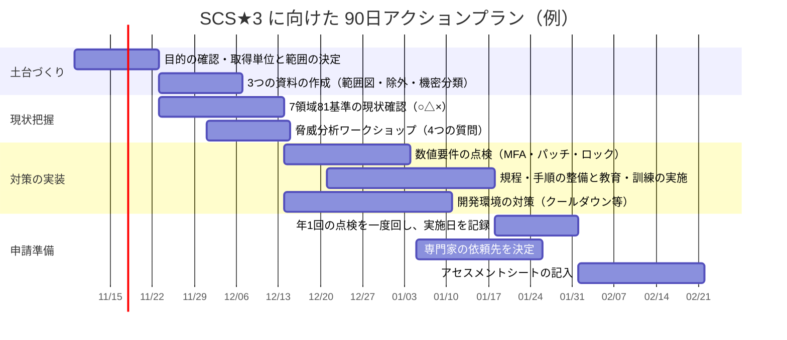

### 8.2 今週中にできること（最初の一歩）

- [ ] 取引先から求められている★の段階を確認する
- [ ] 取得単位の案（法人単位か、事業部単位か）を決める
- [ ] IPAの特設サイトで最新資料を確認し、要求事項・評価基準、自己評価等ガイド、解説書、アセスメントシートを入手する
- [ ] 利用中のSaaS・クラウドの一覧を作る（部門契約も含める）
- [ ] 「重要な機密情報」「重要なシステム」の定義を決める
- [ ] 多要素認証が適用されていないアカウントを洗い出す

### 8.3 脅威分析を回す最小セット（60〜90分のワークショップ）

| 時間 | やること | 成果物 |
|---|---|---|
| 0〜20分 | 対象を決め、ホワイトボードにDFDを描く（Q1） | 図、信頼境界 |
| 20〜50分 | 要素ごとにSTRIDEで脅威を出す（Q2） | 脅威リスト |
| 50〜70分 | 可能性×影響で優先度をつける | 優先度つきの表 |
| 70〜90分 | 上位の脅威の対応方針、担当、期限を決める（Q3） | 対応計画（Q4の確認日も決める） |

### 8.4 開発チーム向けチェックリスト

- [ ] パッケージマネージャ、Dependabot/Renovate に、クールダウンを設定した
- [ ] ロックファイルをコミットし、CIでロックどおりにインストールしている
- [ ] 公開用の長期トークンを廃止し、Trusted Publishing（OIDC）へ移行した
- [ ] CIのシークレットを最小化し、ジョブごとに権限を絞った
- [ ] インストール時スクリプトを許可リスト化した
- [ ] 外部からの依頼に伴う、見知らぬソフトのインストール・コマンド実行を禁止するルールを周知した
- [ ] 依存OSSのインベントリを作り、脆弱性勧告（OSV、GitHub Advisory）を購読している
- [ ] AIエージェントに、「非公開データ・信頼できない入力・外部通信」の3つがそろっていないかを点検した

---

## 9. よくある質問（FAQ）

**Q1. SCS評価制度は法律で義務づけられていますか。**
A. 私が確認できた範囲では、任意の登録制度として説明されています【二次: NTTコミュニケーションズ https://www.ntt.com/bizon/scs-2026.html】。ただし、取引先から取得を求められる可能性はあります。最新の位置づけはIPAと経済産業省で確認してください。

**Q2. ★3と★4、どちらから始めるべきですか。**
A. 取引先の要求が最優先です。要求がなければ、まず★3が現実的です。★3を経ずに★4を申請することもできます。

**Q3. 脅威分析はSCSの取得に必須ですか。**
A. 必須とは限りません。ただし、自社固有のリスクを知る有効な方法で、★5が想定するリスクマネジメントにつながります。

**Q4. 小さな会社でも脅威分析はできますか。**
A. できます。ホワイトボードと、60〜90分の時間があれば始められます。

**Q5. 依存関係のクールダウンを設定すると、脆弱性修正が遅れませんか。**
A. 遅れる可能性があります。セキュリティ修正は例外として扱い、勧告を購読して、緊急のものは別手順で適用してください。

**Q6. AIエージェントを使う場合、何から確認すればよいですか。**
A. 「非公開データ・信頼できない入力・外部通信」の3つが、同じエージェントにそろっていないかを確認します。そろっているなら、どれか1つを取り除く設計を検討します。

**Q7. 制度の資料はどこで入手できますか。**
A. IPAの特設サイト（https://www.ipa.go.jp/security/scs/index.html）の「要求事項・評価基準」ページから、最新の資料が入手できます。

---

## 付録A. 用語集

| 用語 | 説明 |
|---|---|
| SCS評価制度 | サプライチェーン強化に向けたセキュリティ対策評価制度 |
| IPA | 情報処理推進機構。SCS評価制度の運営主体 |
| 取得単位 | ★の登録を申請する組織の区切り（法人、事業部、グループなど） |
| 適用範囲 | 評価の対象にするIT基盤の範囲 |
| アセスメントシート | 自己評価を記入するIPA公開の様式 |
| DFD | データフロー図。登場人物とデータの流れを描いた図 |
| 信頼境界 | 信頼できる範囲とできない範囲の境目 |
| STRIDE | なりすまし、改ざん、否認、情報漏えい、サービス拒否、権限昇格の6分類 |
| MITRE ATT&CK | 実際に観測された攻撃者の行動を体系化した知識ベース |
| SLSA | ソフトウェア供給網の完全性を段階的に高める仕様 |
| Trusted Publishing | CIの身元（OIDC）にもとづき、長期トークンなしで公開できる仕組み |
| 依存関係のクールダウン | 公開から一定期間が経つまで新バージョンを取り込まない運用 |
| プロバナンス | 成果物の出所とビルド方法を示す、検証可能な証明 |
| lethal trifecta | 非公開データ・信頼できない内容・外部通信が1つのエージェントにそろう状態 |

---

## 付録B. 出典URL一覧

### B.1 SCS評価制度（一次情報）

| 出典 | URL |
|---|---|
| 経済産業省: SCS評価制度 | https://www.meti.go.jp/policy/netsecurity/scs.html |
| IPA: SCS評価制度（トップ・お知らせ） | https://www.ipa.go.jp/security/scs/index.html |
| IPA: SCS評価制度の詳細情報 | https://www.ipa.go.jp/security/scs/details.html |
| IPA: 要求事項・評価基準 | https://www.ipa.go.jp/security/scs/requirements-criteria.html |
| IPA: よくある質問 | https://www.ipa.go.jp/security/scs/faq.html |
| IPA: 料金設定のお知らせ（PDF、2026年9月18日） | https://www.ipa.go.jp/security/scs/rcu1hd00000075om-att/pricelist.pdf |
| 経済産業省: 制度構築方針（PDF、2026年3月27日） | https://www.ipa.go.jp/security/scs/rcu1hd0000007ajp-att/20260327001-br.pdf |
| IPA: ★3・★4 自己評価等ガイド（PDF） | https://www.ipa.go.jp/security/scs/rcu1hd0000007a2i-att/SCS-410-self-assess-guide-v1.0.pdf |
| IPA: ★3・★4 要求事項・評価基準 解説書（PDF） | https://www.ipa.go.jp/security/scs/rcu1hd0000007a2i-att/SCS-620-handbook-v1.0.pdf |
| IPA: サイバーセキュリティお助け隊サービス（新類型）実証事業 | https://www.ipa.go.jp/security/sme/otasuke-scs.html |
| IPA: 情報セキュリティ10大脅威 2026 | https://www.ipa.go.jp/security/10threats/10threats2026.html |
| IPA: 10大脅威 2026 決定のプレス発表 | https://www.ipa.go.jp/pressrelease/2025/press20260129.html |
| IPA: 10大脅威 2026 組織編 解説（PDF） | https://www.ipa.go.jp/security/10threats/omgdg50000008fi8-att/kaisetsu_2026_soshiki.pdf |

### B.2 SCS評価制度（二次情報・解説）

| 出典 | URL | 備考 |
|---|---|---|
| Admina（マネーフォワード）: ★3取得チェックリスト | https://admina.moneyforward.com/jp/blog/scs-star3-checklist | 81基準・数値要件・取得手順の詳細。ベンダー記事のため、原典で再確認すること |
| Admina: SCS評価制度とは | https://admina.moneyforward.com/jp/blog/security-scs | |
| INTERNET Watch: 制度構築方針の公表 | https://internet.watch.impress.co.jp/docs/news/2097212.html | |
| NTTコミュニケーションズ: SCS評価制度解説 | https://www.ntt.com/bizon/scs-2026.html | |
| キヤノンMJ: SECURITY ACTION | https://canon.jp/biz/trend/securityaction | |
| VWS: 登録料・スケジュール | https://vws-biz.com/column/scs-evaluation-system | |

### B.3 脅威分析（開発者・標準）

| 出典 | URL | 区分 |
|---|---|---|
| Adam Shostack: Four Question Framework（ホワイトペーパー） | https://shostack.org/files/papers/The_Four_Question_Framework.pdf | 開発者 |
| Adam Shostack: 4QuestionFrame（GitHub） | https://github.com/adamshostack/4QuestionFrame | 開発者 |
| Threat Modeling Podcast: Adam Shostack 回 | https://threatmodel.buzzsprout.com/2152378/12826352 | 開発者 |
| DeepStrike: Threat Modeling 2026 | https://deepstrike.io/blog/threat-modeling | 二次 |
| MITRE ATT&CK: 更新情報 | https://attack.mitre.org/resources/updates/ | 一次 |
| ATT&CK v20 の解説（AI関連技術の追加） | https://gbhackers.com/mitre-attack-v20-ai-techniques/amp/ | 二次 |
| Simon Willison: prompt-injection タグ | https://simonwillison.net/tags/prompt-injection/ | 開発者 |
| lethal trifecta の解説 | https://aiweekly.co/alerts/willison-names-lethal-trifecta-behind-ai-agent-data-leaks | 二次 |

### B.4 ソフトウェア供給網（国際的な開発者・公式発表）

| 出典 | URL | 区分 |
|---|---|---|
| Simon Willison: supply-chain タグ（2026年の事例の時系列まとめ） | https://simonwillison.net/tags/supply-chain/ | 開発者 |
| William Woodruff: We should all be using dependency cooldowns | https://blog.yossarian.net/2025/11/21/We-should-all-be-using-dependency-cooldowns | 開発者 |
| Andrew Nesbitt: Package Managers Need to Cool Down | https://nesbitt.io/2026/03/04/package-managers-need-to-cool-down.html | 開発者 |
| Filippo Valsorda: A Retrospective Survey of 2024/2025 Open Source Supply Chain Compromises | https://words.filippo.io/compromise-survey/ | 開発者 |
| Richard Si: What's new in pip 26.1 | https://ichard26.github.io/blog/2026/04/whats-new-in-pip-26.1/ | 開発者 |
| Axios 事後報告 | https://github.com/axios/axios/issues/10636 | 一次 |
| npm Docs: Trusted publishing | https://docs.npmjs.com/trusted-publishers | 一次 |
| npm Docs: 公開時の2要素認証の要求 | https://docs.npmjs.com/requiring-2fa-for-package-publishing-and-settings-modification | 一次 |
| pip: リリースノート | https://pip.pypa.io/en/stable/news/ | 一次 |
| pip: `pip install` | https://pip.pypa.io/en/stable/cli/pip_install/ | 一次 |
| pip: `pip lock` | https://pip.pypa.io/en/stable/cli/pip_lock/ | 一次 |
| Bun: Lifecycle scripts | https://bun.sh/docs/pm/lifecycle | 一次 |
| LiteLLM 悪性版の報告 | https://github.com/BerriAI/litellm/issues/24512 | 一次 |
| Rust公式ブログ: 標的型攻撃への警告 | https://blog.rust-lang.org/2026/09/17/targeted-attacks/ | 一次 |
| Rust公式ブログ: arrayref への供給網攻撃 | https://blog.rust-lang.org/2026/08/20/supply-chain-attack-on-arrayref/ | 一次 |
| PyPI公式ブログ: 14日を過ぎたリリースへの新規ファイルを拒否 | https://blog.pypi.org/posts/2026-07-22-releases-now-reject-new-files-after-14-days/ | 一次 |
| SLSA 仕様 | https://slsa.dev/spec/ | 一次 |
| SLSA v1.2 公開のお知らせ | https://slsa.dev/blog/2025/11/announce-slsa-v1.2 | 一次 |
| Google: OSS Rebuild | https://security.googleblog.com/2025/07/introducing-oss-rebuild-open-source.html | 一次 |
| OSV.dev | https://osv.dev/ | 一次 |
| CrowdStrike: Trivy Action の侵害の解説 | https://www.crowdstrike.com/en-us/blog/from-scanner-to-stealer-inside-the-trivy-action-supply-chain-compromise/ | 二次 |
| Zscaler: 2026年3月の供給網攻撃 | https://www.zscaler.com/blogs/security-research/supply-chain-attacks-surge-march-2026 | 二次 |
| TuxCare: 2026年の供給網攻撃のまとめ | https://tuxcare.com/blog/supply-chain-broke-in-2026/ | 二次 |
| SafeDep: 悪性 LiteLLM 1.82.8 の分析 | https://safedep.io/malicious-litellm-1-82-8-analysis | 二次 |
| Phoenix Security: 供給網攻撃の加速 | https://phoenix.security/accelerating-supply-chain-attacks-npm-pypi-vsx-ai-enabled-2026/ | 二次 |

### B.5 今回の検索では本文を取得していない、既知の公式資料

次のページは、既知の公式資料ですが、今回の検索では本文を確認していません。学習の際に直接開いて確認してください。

| 資料 | URL |
|---|---|
| Threat Modeling Manifesto | https://www.threatmodelingmanifesto.org/ |
| OWASP Threat Modeling Cheat Sheet | https://cheatsheetseries.owasp.org/cheatsheets/Threat_Modeling_Cheat_Sheet.html |
| OWASP Top 10 for Agentic Applications | OWASP公式サイトで検索（二次情報で言及あり） |

---

## 付録C. 注意事項と更新履歴

### C.1 このガイドの限界

- 制度は立ち上げの途中です。**「予定」と記した項目は変更される可能性があります**。
- 評価基準の個別番号や数値は、一部を二次情報（ベンダーの解説記事）から取っています。申請や社内の意思決定には、**必ずIPAの最新の一次資料**を使ってください。
- 「登録申請の手引」（2026年11月末頃の公表予定）、評価機関・技術検証事業者の詳細要件、専門家の登録手順は、公表後に最新情報を確認してください。
- 第6章は架空の例です。実際の適合判断は、専門家に確認してください。
- 本ガイドは、法的助言や認証の判定ではありません。

### C.2 更新履歴

| 日付 | 内容 |
|---|---|
| 2026年11月6日 | 初版。2026年11月6日時点のウェブ情報にもとづいて作成 |
| 2026年11月7日 | レビュー指摘を反映。★3の提出物とハッシュ値、4-4-4-2の未適用時の対応、Trusted Publishing の範囲、pip のロックファイルの制約、`.pth` の実行時点、Bun の `trustedDependencies`、予定の図示を、一次情報にもとづいて修正 |
