# Secrets and Lies: Digital Security in a Networked World, 15th Anniversary Edition 初学者向けステップバイステップ解説ガイド

| 項目 | 内容 |
|---|---|
| 対象書籍 | *Secrets and Lies: Digital Security in a Networked World, 15th Anniversary Edition*（Bruce Schneier 著、John Wiley & Sons） |
| 想定読者 | セキュリティの初学者、開発者・QA エンジニア、セキュリティを「製品」ではなく「仕組み」として理解したい人 |
| 情報基準日 | 2026年10月11日（この日までに確認できたウェブ情報に基づく） |
| 表記ルール | 出典がある記述には `[S1]` のように出典番号を付けています。`【補足】` は、出典の裏付けとは別に、解説者が理解の助けとして加えた説明です |
| 図表ルール | フローチャートは Mermaid、表と図解は Markdown のみを使用（ASCII 図解は使用しません） |

> **このガイドの位置づけ**
> 本ガイドは書籍の複製ではなく、公開されている目次・公式紹介・著者サイト・書評・関連する専門家の発信をもとにした「読み解きの地図」です。章ごとの詳細な記述や数値は、必ず原書で確認してください。2015年版で追加された序文（Foreword）の本文は、今回の調査では全文を確認できていません。

---

## 目次

1. [Step 0: まずこの本の全体像をつかむ](#step-0-まずこの本の全体像をつかむ)
2. [Step 1: 本書の核心メッセージ](#step-1-本書の核心メッセージ)
3. [Step 2: Part 1 The Landscape（第2〜5章）](#step-2-part-1-the-landscape第25章)
4. [Step 3: Part 2 Technologies（第6〜17章）](#step-3-part-2-technologies第617章)
5. [Step 4: Part 3 Strategies（第18〜25章）](#step-4-part-3-strategies第1825章)
6. [Step 5: 2026年の視点で読み直す](#step-5-2026年の視点で読み直す)
7. [Step 6: 実務への落とし込み](#step-6-実務への落とし込み)
8. [Step 7: 理解度チェック](#step-7-理解度チェック)
9. [用語集](#用語集)
10. [学習ロードマップ](#学習ロードマップ)
11. [出典 URL 一覧](#出典-url-一覧)

---

## Step 0: まずこの本の全体像をつかむ

### 0-1. 書誌情報

| 項目 | 内容 |
|---|---|
| 原題 | Secrets and Lies: Digital Security in a Networked World |
| 著者 | Bruce Schneier |
| 初版 | 2000年（John Wiley & Sons）[S1] |
| 本書の版 | 15th Anniversary Edition（ハードカバー、ISBN 978-1-119-09243-8）[S1] |
| ページ数 | 432〜448ページ（情報源により表記が異なる）[S1]\[S4\] |
| 15周年版の特徴 | 著者による新しい序文（Foreword）が追加された記念版 \[S4\]\[S6\] |
| 著者について | 国際的に知られるセキュリティ技術者。ブログ「Schneier on Security」とニュースレター「Crypto-Gram」で発信を続けている [S1]\[S4\] |
| 他言語版 | 中国語、フランス語、ドイツ語、イタリア語、日本語（翔泳社）、韓国語、ポルトガル語、ロシア語などが著者サイトに掲載 [S1] |

**一言でいうと:** 「暗号やファイアウォールを導入すれば安全になる」という思い込みを解きほぐし、セキュリティを *システム全体と人間を含む継続的な営み* として理解させる入門書です。

### 0-2. 本書が書かれた理由

著者は序文（Preface）で、この本を「ある間違いを正すために書いた」と述べています。以前の著書 *Applied Cryptography* で、数学（暗号）によってデジタル世界の安全を実現できるかのように語ってしまった、という反省です [S2]。

読者の多くは暗号を「ふりかけるだけで安全になる魔法の粉」のように受け取りました。しかし現実のセキュリティには、人間、組織、バグだらけの複雑なコンピュータが関わります [S2]。この反省が本書全体の出発点です。

> 【補足】たとえるなら、玄関のドアだけを最新の金庫扉にして、窓や裏口、鍵を預かる人の管理を放置している家のようなものです。ドアの強度（暗号）は立派でも、家全体（システム）は安全ではありません。

### 0-3. 本書の構成（全25章＋付録）

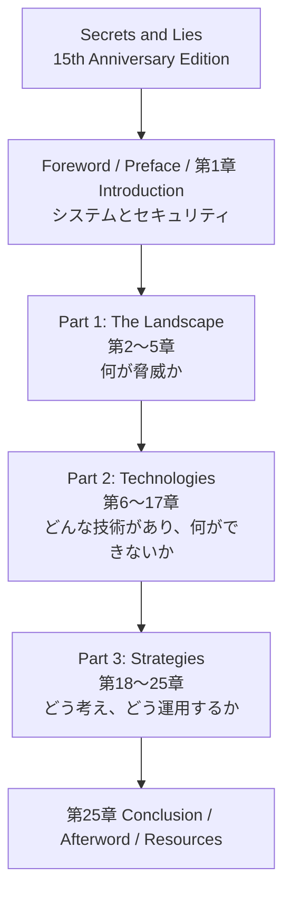

### 0-4. 章別の地図

ページ番号は 2004 年ペーパーバック版の目次に基づきます [S5]。15周年版の目次でも主要章のページ番号は一致しています \[S4\]。

| Part | 章 | タイトル | ページ | 一言要約 |
|---|---|---|---|---|
| — | 1 | Introduction | 1 | システムとは何か、なぜセキュリティが難しいか |
| 1 Landscape | 2 | Digital Threats | 14 | 攻撃の「変わらない本質」と「変わる性質」 |
| 1 | 3 | Attacks | 23 | 犯罪・プライバシー侵害・パブリシティ攻撃・法的攻撃 |
| 1 | 4 | Adversaries | 42 | 誰が攻撃者で、何を狙うのか |
| 1 | 5 | Security Needs | 59 | 守るべき性質（ニーズ）を整理する |
| 2 Technologies | 6 | Cryptography | 85 | 暗号が「できること」と「できないこと」 |
| 2 | 7 | Cryptography in Context | 102 | 暗号を現実のシステムに組み込むときの落とし穴 |
| 2 | 8 | Computer Security | 120 | OS・アクセス制御・セキュリティモデル |
| 2 | 9 | Identification and Authentication | 135 | 本人確認の方法と限界 |
| 2 | 10 | Networked-Computer Security | 151 | ネットワークにつながったコンピュータへの攻撃（Web など） |
| 2 | 11 | Network Security | 176 | IP・DNS・DoS など、通信路の問題 |
| 2 | 12 | Network Defenses | 188 | ファイアウォールなどの防御技術 |
| 2 | 13 | Software Reliability | 202 | バグが脆弱性になる仕組み |
| 2 | 14 | Secure Hardware | 212 | 耐タンパー性、スマートカード、サイドチャネル |
| 2 | 15 | Certificates and Credentials | 225 | 証明書・PKI の約束と現実 |
| 2 | 16 | Security Tricks | 240 | 実践的な小技（データベースのセキュリティなど） |
| 2 | 17 | The Human Factor | 255 | 人間こそ最大の変数 |
| 3 Strategies | 18 | Vulnerabilities and the Vulnerability Landscape | 274 | 脆弱性の全体像 |
| 3 | 19 | Threat Modeling and Risk Assessment | 288 | 脅威を整理し、リスクを見積もる |
| 3 | 20 | Security Policies and Countermeasures | 307 | ポリシーと対策 |
| 3 | 21 | Attack Trees | 318 | 攻撃を木構造で分析する |
| 3 | 22 | Product Testing and Verification | 334 | 製品の検証と選定 |
| 3 | 23 | The Future of Products | 353 | 複雑さとセキュリティ、製品の将来 |
| 3 | 24 | Security Processes | 367 | 予防・検知・対応という「プロセス」 |
| — | 25 | Conclusion | 389 | まとめ |

> 著者は、この本を最初から最後まで通して読み、その後もう一度読むことを勧めているという紹介があります [S9]。初学者は、まず本ガイドの Step 1〜4 で全体像をつかんでから原書に進むと挫折しにくくなります。

---

## Step 1: 本書の核心メッセージ

### 1-1. 三つのキーワード

| キーワード | 意味 | 初学者向けの言い換え |
|---|---|---|
| 暗号は魔法の粉ではない | 暗号は重要だが、セキュリティの一部分にすぎない [S2]\[S7\] | 「128ビット鍵だから安全」と言われたら、他の部分はどうなのかを疑う |
| 鎖は最も弱い輪で決まる | システムの安全性は最も弱い部分で決まる [S2] | 攻撃者は一番守りが薄い所を狙う |
| Security is a process, not a product | セキュリティは製品ではなくプロセス [S2] | 「買って終わり」ではなく「運用し続ける」もの |

Palo Alto Networks の *Cybersecurity Canon* の書評は、セキュリティは箱から出して手に入るものではなく、人・プロセス・技術を課題に適用して得るものだと整理しています \[S8\]。

### 1-2. 「技術だけ」と「システム全体」の違い

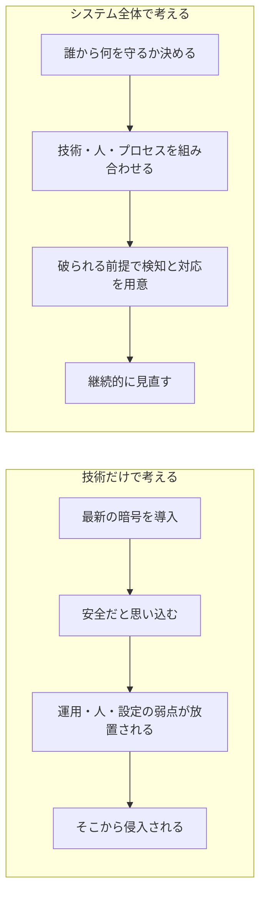

### 1-3. 本書を貫く問い

Schneier の古い論文 *Attack Trees*（1999）では、「安全」という言葉は、誰から、どのくらいの期間守るのかが決まって初めて意味を持つ、と指摘されています [S10]。この問いは本書全体に通底します。

| 問い | 考えること |
|---|---|
| 何を守るのか | 資産（データ、サービス、信頼、人命など） |
| 誰から守るのか | 攻撃者の種類・動機・能力 |
| どのくらいの期間か | 一時的な保護か、長期の機密か |
| いくらまで投資するか | 守る価値と対策コストのバランス |
| 破られたらどうするか | 検知と対応、復旧 |

### Step 1 の演習

1. あなたの職場のシステムを一つ選び、「何を」「誰から」「どのくらいの期間」守る必要があるかを表に書き出してください。
2. 「暗号化しているから大丈夫」と言われた場面を思い出し、暗号以外に確認すべき点を三つ挙げてください。

---

## Step 2: Part 1 The Landscape（第2〜5章）

Part 1 は「何が起きていて、誰が、なぜ攻撃するのか」を整理する部分です。

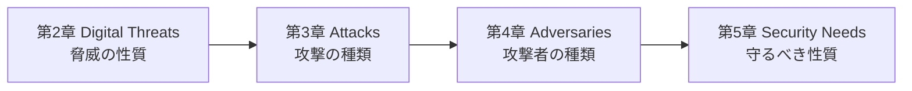

### 2-1. 第2章 Digital Threats

攻撃には「昔から変わらない本質」（金銭、情報、権力などを狙う）と、「デジタルで変わった点」があります。

| デジタルで変わった点 | 内容 | 現代の例【補足】 |
|---|---|---|
| 自動化（Automation） | 一度作った攻撃を大量に自動実行できる | 大量のフィッシングメール、自動スキャン |
| 遠隔性（Action at a distance） | 地球の反対側から攻撃できる | 国境を越えるランサムウェア |
| 技術の伝播（Technique propagation） | 一人が作った手法が誰でも使える形で広がる | 攻撃ツールキットの流通 |

さらに「プロアクション（先回り）対リアクション（事後対応）」という視点が扱われます [S5]。

### 2-2. 第3章 Attacks

目次からは、攻撃が次の四系統で整理されていることが確認できます [S3]。

| 系統 | 内容 | 例【補足】 |
|---|---|---|
| Criminal Attacks（犯罪的攻撃） | 金銭や価値のある情報を狙う | 不正送金、詐欺、データ窃取 |
| Privacy Violations（プライバシー侵害） | 個人情報の不正取得・利用 | 個人情報の流出、追跡 |
| Publicity Attacks（パブリシティ攻撃） | 注目を集めるための攻撃 | Web サイトの改ざん |
| Legal Attacks（法的攻撃） | 法制度を利用した攻撃 | 不当な訴訟、法的圧力 |

### 2-3. 第4章 Adversaries

目次では、Hackers、Lone Criminals、Malicious Insider、Industrial Espionage といった攻撃者像が確認できます [S3]。本書ではほかに、組織犯罪、警察、テロリスト、国家の情報機関、情報戦の主体なども論じられています【補足】。

| 攻撃者像 | 主な動機 | 一般的な能力 | 守る側の視点 |
|---|---|---|---|
| ハッカー（愉快犯・探究者） | 好奇心、名声 | 知識は高いが資源は限定的 | 公開されている弱点を放置しない |
| 単独犯罪者 | 金銭 | 既製ツールを活用 | 基本対策で多くを防げる |
| 内部者 | 金銭、恨み、過失 | 正規の権限を持つ | 権限の最小化、監査 |
| 産業スパイ | 競争優位 | 資金と時間がある | 重要資産の分離、特別な保護 |
| 国家機関 | 諜報、妨害 | 非常に高い資源 | 一般企業が単独で防ぎ切るのは困難 |

> 【補足】「全員を同じ強さの敵として想定する」のは非現実的です。攻撃者像ごとに対策の優先順位を変えることが、本書の中心的な実践テーマの一つです。

### 2-4. 第5章 Security Needs

守るべき性質を整理する章です。目次には Multilevel Security（多段階セキュリティ）の項目があります [S3]。一般に、機密性（見せない）、完全性（改ざんさせない）、可用性（使えるようにする）に加え、本人確認、監査、匿名性といった「ニーズ」を分けて考えます【補足】。

| ニーズ | 平たく言うと | 失われると |
|---|---|---|
| 機密性 | 許可された人だけが見られる | 情報漏えい |
| 完全性 | 勝手に書き換えられない | データ改ざん、不正取引 |
| 可用性 | 必要なときに使える | サービス停止 |
| 認証 | 相手が本人だと確かめられる | なりすまし |
| 監査 | 後から何が起きたか追跡できる | 原因不明、責任追及不能 |

### Step 2 の演習

1. 自社システムで想定すべき攻撃者を三種類選び、それぞれの動機と能力を書いてください。
2. 同じシステムについて、機密性・完全性・可用性のうち最も重視すべきものを理由とともに選んでください。

---

## Step 3: Part 2 Technologies（第6〜17章）

Part 2 は、セキュリティ技術を一つずつ取り上げ、**何ができて、何ができないか** を示す部分です \[S7\]。

### 3-1. 技術と限界の対応表

| 章 | 技術 | できること | できないこと（限界の例） |
|---|---|---|---|
| 6 | 暗号 | 通信や保存データの機密性・完全性を数学的に守る | 鍵の管理ミス、実装バグ、人間の過ちは防げない |
| 7 | 暗号の実装 | 現実の通信プロトコルに組み込む | 鍵長・プロトコル設計・実装のどこかが弱いと全体が崩れる |
| 8 | コンピュータセキュリティ | OS やアクセス制御で権限を分離する | 複雑なシステムでは設定ミスが残る |
| 9 | 識別と認証 | パスワード、トークン、生体認証で本人確認 | どの方式も万能ではない（盗難、偽造、誤認識） |
| 10〜12 | ネットワーク保護 | ファイアウォール等で通信を制限・監視する | 許可された通信に紛れた攻撃には弱い |
| 13 | ソフトウェアの信頼性 | テストや設計でバグを減らす | バグを完全にゼロにはできない |
| 14 | セキュアハードウェア | 耐タンパー性のあるチップ、スマートカード | サイドチャネル攻撃などの物理的手法 |
| 15 | 証明書・PKI | 公開鍵と本人を結びつける | 信頼の連鎖のどこかが破られると崩れる |
| 16 | セキュリティの小技 | 実践的な工夫の積み重ね | 単独では全体を守れない |
| 17 | 人間要因 | 教育、設計、運用で誤りを減らす | 人はゼロリスクにはならない |

この章立ては、目次と書評で確認できる範囲（Cryptography、Types of Cryptographic Attacks、Key Length and Security、Types of Protocol Attacks、Security Models、Web Security、IP/DNS Security、DoS/DDoS、E-Mail Security、Attacks on Faulty Code、Side-Channel Attacks、Attacks against Smart Cards、Database Security など）に基づいています [S3]\[S7\]。

### 3-2. 深掘り A: 暗号の「できること／できないこと」（第6・7章）

書評では、本書の暗号に関する解説は技術者にも経営層にも評価の高い部分だとされています \[S4\]。

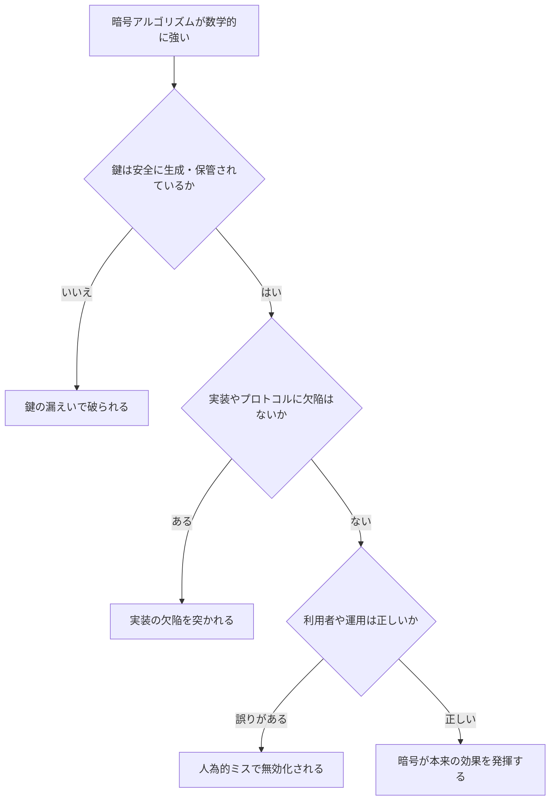

**覚えておくポイント**

- 「どの暗号を使うか」より「どう使うか」で安全性が決まる。
- 現実の攻撃は、数学的な暗号解読よりも、鍵・実装・人間の弱点を狙うことが多い。

### 3-3. 深掘り B: 認証（第9章）

| 要素 | 例 | 弱点 |
|---|---|---|
| 知っているもの | パスワード、PIN | 漏えい、使い回し、推測 |
| 持っているもの | トークン、スマートカード、スマホ | 紛失、盗難、複製 |
| 本人の特徴 | 指紋、顔 | 変更不能、誤認識、偽造 |

本書は、生体認証やアクセストークンといった代替手段とその欠点も扱っています \[S7\]。

> 【補足】現在は、複数要素を組み合わせる多要素認証や、パスワードを使わない仕組み（passkey など）が普及しています。ただし、どれも「完全」ではなく、回復手順（アカウント復旧）や人間への働きかけが新たな弱点になる、という本書の見方は今も有効です。

### 3-4. 深掘り C: 証明書と信頼（第15章）

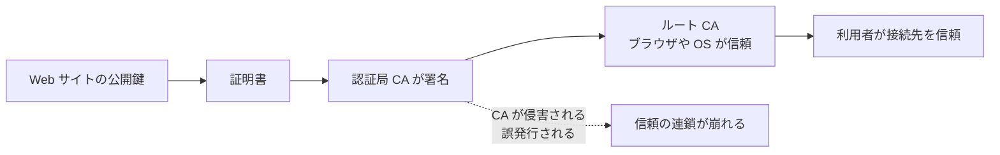

【補足】証明書の署名は、発行者（CA）が「この公開鍵はこの識別子（ドメイン名など）に属する」という結び付きを承認したことを示します。TLS クライアントは、証明書パス（信頼済みルートまでの署名の連鎖、有効期限、失効状態など）と接続先名の一致を検証し、接続先が名乗ったドメインの鍵を持つ相手であることを確認します。しかし、その事業者全体の誠実さや運用の安全性、提供するサービスの信頼性までは保証しません。この区別は、本書が繰り返し強調する「技術が約束することと、現実の安全のずれ」の好例です。

### 3-5. 深掘り D: 人間要因（第17章）

人間要因は、本書が最後まで繰り返し戻ってくるテーマです。2026年の最新データでも、データ侵害の **62%** に人間要素が関与していたと報告されています（前年は60%）[S17]。詳細は Step 5 で扱います。

### 3-6. 多層防御の考え方

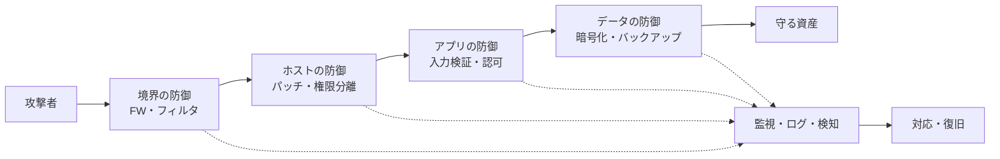

### Step 3 の演習

1. 自分が使っているサービスで、「認証」「暗号」「ログ」のどこが一番弱そうか考えてください。
2. 「HTTPS だから安全」と言う人に、何を確認すべきか（証明書、サーバ設定、アプリの脆弱性、運用）を説明してみてください。

---

## Step 4: Part 3 Strategies（第18〜25章）

Part 3 は、**考え方と運用** の部分です。個々の技術を超えて、リスクを見積もり、対策を選び、継続的に回す方法を扱います。

### 4-1. 第18章 脆弱性の全体像

脆弱性は、設計・実装・設定・運用・人の各層に存在します。目次には Risk、Attack Methodology といった項目があります [S3]。

### 4-2. 第19章 Threat Modeling and Risk Assessment

目次には Risk Assessment、The Point of Threat Modeling、Getting the Threat Wrong が含まれます [S3]。

**脅威モデリングの現代的な入口: Shostack の4つの問い**

Adam Shostack が提唱する Four Question Frame は、脅威モデリングの標準的な共通言語として広く使われています [S13]。

| 問い | 目的 |
|---|---|
| 1. 私たちは何に取り組んでいるのか | 対象と範囲を決める |
| 2. 何がうまくいかない可能性があるのか | 脅威を洗い出す（最も難しく、最も重要） |
| 3. それに対して私たちは何をするのか | 対策・受容・移転などを決める |
| 4. 十分にうまくやれたか | 振り返り、改善する |

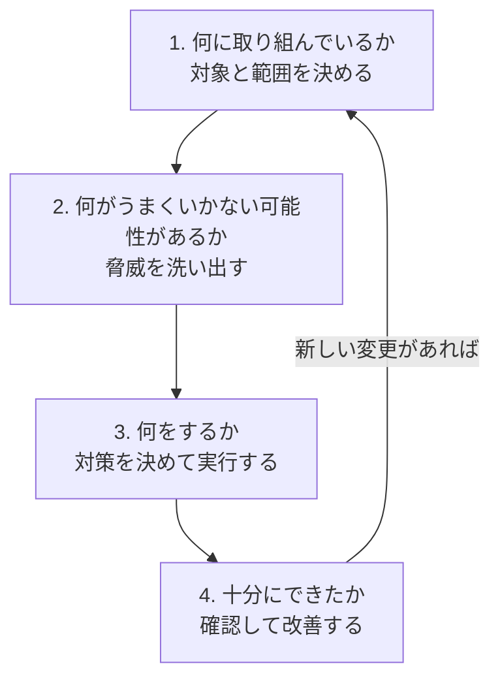

Shostack は、すべての機能に重い文書を作る必要はなく、変更の大きさに応じて「ダイヤルを回す」ように深さを調整することを勧めています [S13]。

**リスク評価の古典的な考え方【補足】**

リスクは「起きたときの影響」と「起きやすさ」で整理します。数値化が難しい場合は、次のような簡易マトリクスから始められます。

| 影響＼可能性 | 低い | 中 | 高い |
|---|---|---|---|
| 大きい | 要注意（対策を検討） | 優先対応 | 最優先 |
| 中 | 受容も可 | 計画的に対応 | 優先対応 |
| 小さい | 受容 | 受容または低コスト対策 | 計画的に対応 |

> 本書は、リスクの数値化が難しいことや、脅威の想定を誤ること（Getting the Threat Wrong）の危険を重視しています [S3]。数字の見かけの精密さに安心しないことが大切です。

### 4-3. 第20章 Security Policies and Countermeasures

ポリシー（方針）と、それを実現する対策の関係を扱います [S3]。

| 層 | 例【補足】 |
|---|---|
| 方針（なぜ・何を守るか） | 情報セキュリティポリシー、重要資産の定義 |
| 基準（どの水準で守るか） | パスワード長、パッチ適用期限 |
| 手順（どう実行するか） | 入退社時のアカウント処理、インシデント対応手順 |
| 技術的対策 | アクセス制御、暗号化、監視 |

### 4-4. 第21章 Attack Trees（攻撃木）

Schneier が1999年に Dr. Dobb's Journal で紹介した手法です [S10]。ルートに攻撃者の目標を置き、それを達成する方法を枝分かれさせて整理します。コストや必要な技能などを各ノードに割り当てると、「最も安い攻撃」「最も低スキルで可能な攻撃」などを問い合わせられ、対策を入れたときの「もしも」の検討もできます [S10]。Wikipedia は、攻撃木が防衛・航空宇宙分野などでも使われてきたことを述べています [S20]。

**演習用の例: オンラインバンキングで不正送金する**

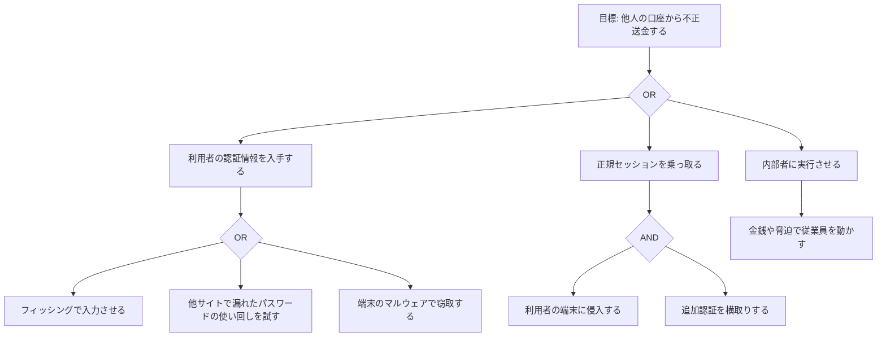

**ノードに属性を付ける（例）**

| 葉ノード | コスト | 必要技能 | 発覚しやすさ | 想定される対策 |
|---|---|---|---|---|
| フィッシング | 低 | 低 | 中 | 利用者教育、フィッシング耐性のある認証 |
| パスワード使い回しの試行 | 低 | 低 | 中 | レート制限、漏えいパスワードの検査、多要素認証 |
| マルウェアによる窃取 | 中 | 中〜高 | 低〜中 | 端末保護、取引内容の確認 |
| 追加認証の横取り | 中 | 中 | 中 | 取引内容を表示する署名型の承認 |
| 内部者の買収 | 高 | 低 | 低 | 権限分離、二人承認、監査ログ |

> 【補足】この表は演習用の想定値です。実際の値は、自社の環境と攻撃者像に合わせて評価してください。

Shostack の著書 *Threat Modeling*（初版）の第4章「Attack Trees」でも、攻撃木は脅威を見つけるための「ビルディングブロック」として位置づけられています。特に、他人が作った木を使う、新しく作る、といった使い方が紹介されています [S14]。なお、第2版 *Designing for Security in an AI World* の第4章は「Trust and Boundaries」で、攻撃木の章ではありません。

### 4-5. 第22章 Product Testing and Verification

目次には Discovering Security Flaws After the Fact、Evaluating and Choosing Security Products といった項目があります [S3]。

| 製品を選ぶときの問い【補足】 | 理由 |
|---|---|
| 何の脅威から、どの範囲を守る製品か | 「万能」をうたう製品は疑う |
| 第三者の評価や検証があるか | ベンダーの宣伝だけに頼らない |
| 失敗したときにどう振る舞うか | 失敗時に安全側に倒れるか |
| 運用に必要な人員・手順は何か | 製品を買っても運用が回らないと意味がない |
| 更新や脆弱性対応の体制はあるか | 長期運用に耐えるか |

### 4-6. 第23章 The Future of Products

目次には Software Complexity and Security が含まれます [S3]。複雑さはセキュリティの敵であり、システムが複雑になるほど、予期しない相互作用（創発的な性質）が増えます [S9]。この論点は、Step 5 の CrowdStrike 事例で現実の姿を確認できます。

### 4-7. 第24章 Security Processes

本書の結論の一つが「プロセス」です。Emerald に掲載された書評では、良いセキュリティは予防・検知・対応の三つを含む、とまとめられています [S9]。

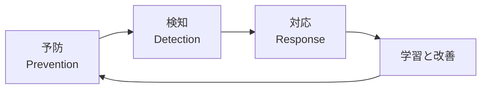

目次には Processes、Manage Risk、Outsourcing Security Processes が含まれます [S3]。

**NIST CSF 2.0 との対応**

NIST Cybersecurity Framework 2.0 は2024年2月に公開され、従来の5機能に Govern を加えた6機能で構成されます [S16]。

| 本書の考え方 | NIST CSF 2.0 の機能 | 内容 |
|---|---|---|
| 方針・責任・リスク管理 | Govern（統治） | 戦略、方針、役割、監督 |
| 資産と脅威の把握 | Identify（特定） | 自組織のリスクを理解する |
| 予防 | Protect（防御） | リスクを管理するための保護策 |
| 検知 | Detect（検知） | 攻撃や侵害の発見・分析 |
| 対応 | Respond（対応） | 検知したインシデントへの行動 |
| 復旧 | Recover（復旧） | 影響を受けた資産と業務の回復 |

> 【補足】「Security is a process」という本書の主張は、公的フレームワークが「統治（Govern）」を独立した機能として追加した流れと整合しています。

### 4-8. 第25章 Conclusion

結論は、セキュリティに「銀の弾丸」はなく、継続的なプロセスで地道に取り組むものだ、というものです。出版社の紹介も、デジタル・セキュリティに即効薬はないと述べています [S1]。

### Step 4 の演習

1. 自分のサービスの「最悪の結果」（例: 顧客データの大量流出）をルートにして、攻撃木を作ってみてください。
2. 作った攻撃木の葉ノードごとに、コスト・技能・検知しやすさを三段階で評価し、最も「安くて簡単な」経路を特定してください。
3. その経路に対策を入れたとき、次に安い経路が何になるかを検討してください。

---

## Step 5: 2026年の視点で読み直す

2000年（15周年版は2015年）の本が、2026年にどこまで有効かを確認します。

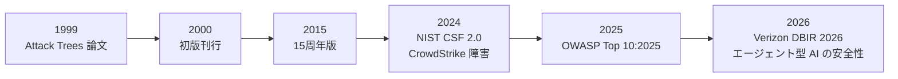

### 5-1. 「今も有効」な主張と「更新が必要」な点

| 本書の主張 | 2026年の状況 | 評価 |
|---|---|---|
| 人間が最大の変数 | Verizon DBIR 2026 は、データ侵害の62%に人間要素が関与したと報告（前年60%）。60%を下回ったことはない [S17] | 非常に有効 |
| 技術だけでは解決しない | DBIR は、AI は新しい攻撃を発明するというより、既知の手法を加速・拡大していると整理 [S17] | 有効 |
| 複雑さが安全の敵 | 2024年の CrowdStrike 障害は、複雑で相互依存したシステムの脆さを示した [S12] | 非常に有効 |
| セキュリティはプロセス | NIST CSF 2.0 が Govern を追加し、継続的な管理を強調 [S16] | 有効 |
| 攻撃の自動化・拡大 | 生成 AI を攻撃の自動化に使う例が増えている [S17] | さらに強まった |
| データと命令の混在は根本的な弱点 | LLM のプロンプトインジェクションは同じ構造的問題 [S11] | 新しい形で再登場 |

### 5-2. Schneier 自身の最近の論考

**(1) LLM の「データと制御の経路」問題（2024年、更新2026年）[S11]**

Schneier は、昔の電話網が音声と制御信号を同じ経路で運んでいたために不正が可能だったことを例に出し、バッファオーバーフローや SQL インジェクションもすべて「データが命令と誤認される」問題だと説明します。プロンプトインジェクションも同じ構造で、LLM ではデータと命令を分けにくいことが根本の難しさだと論じています。

> 【補足】本書が描いた「機能の追加が新しい脆弱性を生む」という構図が、LLM という新しい技術で繰り返されています。

**(2) CrowdStrike 障害と市場が生む脆さ（2024年）[S12]**

Schneier と Barath Raghavan は、冗長性や慎重さが短期的には利益にならないため、市場原理が脆いシステムを生む、と論じます。段階的な展開（カナリアリリース）などで被害を抑えられたはずだが、それにはコストがかかる、という指摘です。さらに、セキュリティと回復力は特定のチェックリストではなく、「壊して直す」プロセスによって得られる、と述べています。

> これは「Security is a process」を経済の観点から言い直したものとして読めます。

### 5-3. OWASP Top 10:2025

OWASP は2025年版 Top 10 を公開しました [S15]。

| 順位 | カテゴリ | 本書との接点 |
|---|---|---|
| A01 | Broken Access Control（アクセス制御の不備） | 第8章 コンピュータセキュリティ |
| A02 | Security Misconfiguration（設定ミス）。2021年の5位から上昇 | 第16・17章 設定と人為的ミス |
| A03 | Software Supply Chain Failures（サプライチェーンの不備）。旧 Vulnerable and Outdated Components の拡張 | 第23章 複雑さと依存関係 |
| A04 | Cryptographic Failures（暗号化の不備） | 第6・7章 暗号の使い方 |
| A05 | Injection（インジェクション） | 第13章 ソフトウェアの信頼性 |
| A06 | Insecure Design（安全性を欠いた設計） | 第19〜21章 脅威モデリング |
| A07 | Authentication Failures（認証の不備） | 第9章 認証 |
| A08 | Software or Data Integrity Failures（完全性の不備） | 第13・15章 |
| A09 | Security Logging and Alerting Failures（ログとアラートの不備） | 第24章 検知 |
| A10 | Mishandling of Exceptional Conditions（例外的な状況への不適切な対応） | 第13章 障害時の挙動 |

> 【補足】Top 10 の大半は、本書が2000年に整理した論点（アクセス制御、設定、暗号の使い方、認証、検知）と重なっています。「新しい名前の古い問題」が多いことがわかります。

### 5-4. Verizon DBIR 2026 の読み方

- 人間要素の関与は62%（前年60%）[S17]。
- AI は主に既知の攻撃手法を加速・拡大していると整理されている [S17]。
- サードパーティ（取引先・サプライヤ）経由の侵害の増加が指摘されている [S17]。

> 注意: 二次情報で見かける約12,000件と22,000件超は、情報源間の食い違いではなく年次と区分の違いです。約12,000件は2025年版の確認済み侵害の件数で、2026年版は31,000件超のインシデントと22,000件超の確認済み侵害を分析対象としています。数値を引用するときは、版（年次）と「インシデント」「確認済み侵害」の区分を明記し、Verizon の公式レポートで確認してください [S17]。

### 5-5. エージェント型 AI という新しい前線

2026年は、AI が単に答えるだけでなく「行動する」エージェント型システムの安全性が議論の中心になっています。

- USENIX Security 2026 に採択された論文が、AI エージェントの設計・攻撃・防御を体系的にサーベイしています [S18]。
- 英国の大学などによる専門家30名規模の議論をまとめた論文も、エージェント型 AI のセキュリティとプライバシーの課題を整理しています [S18]。
- NIST が2026年1月に AI エージェントの安全性に関する取り組みを開始したという解説があります（二次情報）[S19]。

> 【補足】エージェントが外部データを読み、ツールを呼び、実世界に作用する構造は、本書の「システム全体で守る」「最小権限」「検知と対応」の考え方をそのまま適用すべき領域です。

### Step 5 の演習

1. OWASP Top 10:2025 の各項目が、本書のどの章の論点に対応するかを自分で表にしてください。
2. 自分が関わるシステムに LLM やエージェントがあるなら、「データと命令が混ざる箇所」を洗い出してください。

---

## Step 6: 実務への落とし込み

### 6-1. 本書の概念を開発・テスト活動に対応づける

| 本書の概念 | 開発・QA での活動 |
|---|---|
| 攻撃者像の整理（第4章） | ペルソナに「悪意のある利用者」を加える |
| 守るべきニーズ（第5章） | 非機能要件にセキュリティ要件を明記する |
| 暗号の使い方（第6・7章） | 鍵管理・暗号設定のレビュー項目を作る |
| 認証の限界（第9章） | 認証・回復フローの異常系テスト |
| ソフトウェアの信頼性（第13章） | 入力検証・境界値・ファジングの観点を追加 |
| 人間要因（第17章） | 設定ミスや誤操作を前提にしたガードレール設計 |
| 脅威モデリング（第19章） | スプリント内で Four Question Frame を軽く回す [S13] |
| 攻撃木（第21章） | 葉ノードをテストケース・検知ルールに変換する |
| 製品検証（第22章） | 導入前の評価チェックリストを標準化 |
| セキュリティプロセス（第24章） | 検知・対応の演習（テーブルトップ）を定期実施 |

### 6-2. 攻撃木からテストケースへ

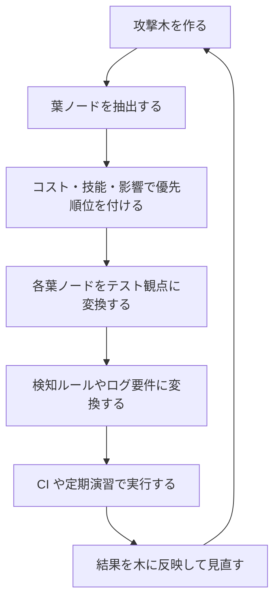

### 6-3. 30日・60日・90日の導入プラン【補足】

| 期間 | やること | 成果物 |
|---|---|---|
| 最初の30日 | 守る資産・攻撃者像・最悪シナリオを一枚にまとめる | 資産と脅威の一覧 |
| 31〜60日 | 重要機能ごとに攻撃木と脅威モデルを作成する | 攻撃木、優先度付きの対策リスト |
| 61〜90日 | 優先対策の実装、検知ルールの整備、対応演習を実施 | 改善済みの設定、ログ要件、演習レポート |

### 6-4. 日常で使えるチェックリスト

- [ ] このシステムは「誰から」「何を」守るのかを説明できる
- [ ] 暗号化していても、鍵の管理と運用手順がある
- [ ] 認証の回復手順（パスワード再設定など）も脅威として検討した
- [ ] 外部の依存（ライブラリ、SaaS、取引先）の障害や侵害を想定した
- [ ] 破られる前提で、検知と対応の手順がある
- [ ] 設定ミスを防ぐ仕組み（レビュー、自動検査）がある
- [ ] 人為的ミスを前提にしたガードレールがある
- [ ] 変更のたびに脅威モデルを軽く見直している

---

## Step 7: 理解度チェック

### 問題

1. 著者が本書を書いた理由（反省点）を、一文で説明してください。
2. 「Security is a process, not a product」は何を意味しますか。
3. デジタル世界で攻撃が変わった三つの性質を挙げてください。
4. 攻撃者像を整理する理由は何ですか。
5. 暗号が現実のシステムで破られやすい原因を三つ挙げてください。
6. 攻撃木の AND ノードと OR ノードの違いは何ですか。
7. Shostack の4つの問いを日本語で述べてください。
8. セキュリティプロセスを構成する三つの要素は何ですか。
9. NIST CSF 2.0 で新たに追加された機能は何ですか。
10. Schneier が LLM のプロンプトインジェクションを説明するときに使った、昔の電話網の例は何を示していますか。

### 解答

1. 以前の著書で、暗号（数学）だけでデジタル世界の安全が得られるかのように描いてしまった誤りを正すため [S2]。
2. 一度導入すれば終わりではなく、人・技術・運用を含めた継続的な営みとして取り組むべきだ、という意味 [S2]\[S8\]。
3. 自動化、遠隔性（距離を超えた攻撃）、技術の伝播【補足】。
4. 攻撃者の動機や能力によって、現実的な対策と優先順位が変わるため。
5. 鍵の管理ミス、実装やプロトコルの欠陥、人間の誤り【補足】。
6. OR は「どれか一つ成功すれば親の目標が達成される」、AND は「すべて成功して初めて達成される」ことを表す。
7. 何に取り組んでいるのか／何がうまくいかない可能性があるのか／それに対して何をするのか／十分にできたのか [S13]。
8. 予防、検知、対応 [S9]。
9. Govern（統治） [S16]。
10. データと制御信号が同じ経路を通ると、データが命令として扱われてしまい、不正が可能になるという構造的問題 [S11]。

---

## 用語集

| 用語 | 意味 |
|---|---|
| Adversary | 攻撃者。動機と能力で分類して考える |
| Attack Tree | 攻撃の目標を根にして、達成方法を木構造で整理する手法 [S10] |
| Authentication | 相手が本人であることの確認 |
| Countermeasure | 脅威に対する対策 |
| Cryptography | 暗号。機密性・完全性などを数学的に守る技術 |
| Defense in Depth | 多層防御。一つの防御が破られても他で止める考え方 |
| Human Factor | 人間要因。誤操作、騙されやすさ、使いやすさの問題 |
| PKI | 公開鍵基盤。証明書で公開鍵と本人を結びつける仕組み |
| Risk Assessment | リスク評価。影響と可能性を見積もる |
| Side-Channel Attack | 消費電力・処理時間などの副次的な情報から秘密を推測する攻撃 |
| Threat Modeling | 脅威を洗い出し、対策を設計する活動 [S13] |
| Vulnerability | 脆弱性。攻撃に悪用される弱点 |
| Prompt Injection | LLM に悪意ある指示を紛れ込ませる攻撃 [S11] |
| Supply Chain | ソフトウェアが依存する部品・ビルド・配布の連鎖 [S15] |

---

## 学習ロードマップ

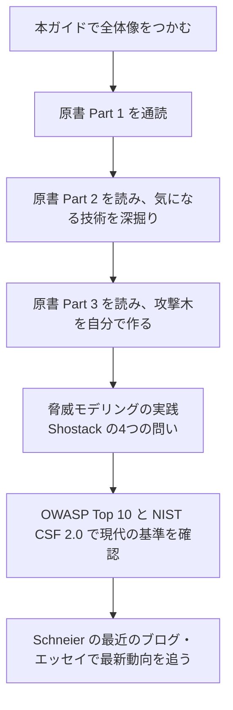

| ステップ | 教材 | 目的 |
|---|---|---|
| 1 | 本書（原書） | 考え方の土台 |
| 2 | Schneier の *Applied Cryptography*（暗号の詳細） | 本書が「訂正」した対象を理解し、暗号の技術面を補う [S2] |
| 3 | Shostack *Threat Modeling*（脅威モデリング） | 攻撃木を含む脅威発見の実践 [S14] |
| 4 | OWASP Top 10:2025 | Web アプリの現在の主要リスク [S15] |
| 5 | NIST CSF 2.0 | 組織運営のフレームワーク [S16] |
| 6 | Schneier on Security（ブログ）、Crypto-Gram（ニュースレター） | 最新の論考 [S1] |

> 著者サイトには、本書のほか複数の著書が掲載されています。最新刊として *Rewiring Democracy*（2025年）が案内されています [S1]。

---

## 出典 URL 一覧

> 確認日: 2026年10月11日時点。日付や数値は変更される可能性があるため、引用前に原典で再確認してください。

### A. 書籍・著者の一次情報

| 番号 | 内容 | URL |
|---|---|---|
| S1 | Bruce Schneier 公式サイトの書籍ページ（書誌、他言語版、書評リンク） | https://www.schneier.com/books/secrets-and-lies/ |
| S2 | 本書の Preface（執筆の動機、「プロセス」の主張） | https://www.schneier.com/books/secrets-and-lies-pref/ |
| S3 | 本書の Table of Contents（著者サイト） | https://www.schneier.com/books/secrets-and-lies-cont |
| S10 | Schneier「Attack Trees」（Dr. Dobb's Journal, 1999年12月） | https://www.schneier.com/academic/archives/1999/12/attack_trees.html |
| S11 | Schneier「LLMs' Data-Control Path Insecurity」（Communications of the ACM, 2024年5月） | https://www.schneier.com/essays/archives/2024/05/llms-data-control-path-insecurity.html |
| S12 | Raghavan & Schneier「The CrowdStrike Outage and Market-Driven Brittleness」（Lawfare, 2024年7月） | https://www.schneier.com/essays/archives/2024/07/the-crowdstrike-outage-and-market-driven-brittleness.html |

### B. 書誌・目次・書評

| 番号 | 内容 | URL |
|---|---|---|
| S4 | 15周年版の紹介と目次（Wiley 系の書誌情報） | https://www.betterread.com.au/book/secrets-and-lies-digital-security-in-a-networked-world-15th-anniversary-edition.do ／ https://www.wiley-vch.de/de/fachgebiete/computer-und-informatik/secrets-and-lies-978-1-119-09243-8 ／ https://porchlightbooks.com/products/secrets-and-lies-bruce-schneier-9781119092438 |
| S5 | 章ごとのページ番号付き目次 | https://archive.neural.it/init/default/show/1725 |
| S6 | 15周年版の章リスト（Skillsoft） | https://skillsoft.com/book/secrets-and-lies-digital-security-in-a-networked-world-15th-anniversary-edition-46f5d480-f383-11e6-bb2f-0242c0a80b05 |
| S7 | 15周年版の書評（I Programmer） | https://i-programmer.info/bookreviews/143-security/8772-secrets-and-lies-digital-security-in-a-networked-world-15th-anniversary-edition.html |
| S8 | Palo Alto Networks「The Cybersecurity Canon: Secrets and Lies」 | https://www.paloaltonetworks.com/blog/2014/05/cybersecurity-canon-secrets-lies/ |
| S9 | Emerald Insight の書評 | https://emerald.com/insight/content/doi/10.1108/info.2003.5.1.78.4/full/html |

### C. 脅威モデリング・フレームワーク

| 番号 | 内容 | URL |
|---|---|---|
| S13 | Adam Shostack「Four Question Frame」（GitHub）／白書／O'Reilly「97 Things」第69章 | https://github.com/adamshostack/4QuestionFrame ／ https://shostack.org/files/papers/The_Four_Question_Framework.pdf ／ https://www.oreilly.com/library/view/97-things-every/9781098152161/ch69.html |
| S14 | Shostack *Threat Modeling* 第4章 Attack Trees（抜粋） | https://shostack.org/files/tmbookchapters/Chapter4-AttackTrees-web.pdf |
| S16 | NIST Cybersecurity Framework 2.0（公式ページ、2024年2月公開）／解説 | https://www.nist.gov/cyberframework ／ https://cpl.thalesgroup.com/compliance/what-is-nist-csf-2 |
| S20 | Attack tree（Wikipedia） | https://en.wikipedia.org/wiki/Attack_tree |

### D. 2025〜2026年の現状データ

| 番号 | 内容 | URL |
|---|---|---|
| S15 | OWASP Top 10:2025（公式）／イントロダクション | https://owasp.org/Top10/2025/ ／ https://owasp.org/Top10/2025/0x00_2025-Introduction/ |
| S17 | Verizon 2026 Data Breach Investigations Report（公式）／二次解説 | https://www.verizon.com/business/resources/reports/dbir/ ／ https://abnormal.ai/blog/blog-verizon-2026-dbir-key-takeaways ／ https://ninjio.com/blog/verizon-dbir-2026-human-element-security-awareness-training/ |
| S18 | The Attack and Defense Landscape of Agentic AI（USENIX Security 2026 採択、arXiv）／エージェント型 AI のセキュリティ課題（専門家による展望論文） | https://arxiv.org/abs/2603.11088 ／ https://strathprints.strath.ac.uk/96806/ |
| S19 | AI エージェントの安全性に関する2026年の動向（二次情報） | https://www.penligent.ai/hackinglabs/ai-agent-security-after-the-goalposts-moved-2/ ／ https://www.kdnuggets.com/are-ai-agents-your-next-security-nightmare |

### E. 調査上の注意

- 章ごとの詳細な記述は、公開されている目次・紹介文・書評・著者サイトの情報を基に整理したものです。原書の本文を直接確認できていない部分は、`【補足】` を付けて区別しています。
- ページ数は情報源により432〜448ページと表記が異なります。
- Verizon DBIR の分析対象の件数は版（年次）と区分（インシデント／確認済み侵害）で異なるため、数値の引用時は両方を明記し、公式レポートで確認してください。
- NIST の2026年1月の取り組みやエージェント関連の動向は、一部が二次情報に基づきます。重要な判断に使う場合は NIST の公式発表を確認してください。

---

*作成基準日: 2026年10月11日*
