# 最新セキュリティ アーキテクチャ実装への包括的アプローチ

## 初学者向け ステップバイステップ ベストプラクティスガイド

| 項目 | 内容 |
|------|------|
| 情報基準日 | 2026年11月6日（この日までにウェブ検索で確認できた情報） |
| 対象読者 | セキュリティ設計に初めて取り組むソフトウェアエンジニア、QAエンジニア、AIエンジニア |
| 前提知識 | HTTP、API、認証（ログイン）の基本的な考え方 |
| ゴール | 「何から・どの順番で・なぜ」セキュリティを設計に組み込むかを説明できるようになる |
| 図表ルール | フローチャートは Mermaid、図解と表は Markdown のみ。ASCII アートは使用しない |

---

## 0. このガイドの読み方

💡 この章では、ガイド全体の使い方と、出典の信頼度ラベルの意味を説明します。ラベルの意味を先に知っておくと、後の章で「どこまで信じてよい情報か」を判断しやすくなります。

### 0.1 なぜこのガイドが必要か

セキュリティ対策を「あとから足す部品」と考えると、手戻りが大きくなります。家づくりに例えると、鍵（認証）や防犯カメラ（監視）は後から付けられますが、壁の位置や窓の数（アーキテクチャ＝システム全体の骨組み）は完成後に変えにくいからです。このガイドは、最初の設計図の段階から順番に守りを組み込む手順を、11 のステップで示します。

### 0.2 出典の信頼度ラベル

このガイドでは、根拠として挙げる情報に次のラベルを付けます。

| ラベル | 意味 | 例 |
|--------|------|----|
| 【一次】 | 標準化団体、政府機関、プロジェクト公式サイトなどの原典 | NIST、CISA、OWASP、IPA |
| 【著名開発者】 | 国際的に知られる開発者・研究者が自身のブログや所属組織で公開した投稿 | Simon Willison、William Woodruff、Adam Shostack |
| 【二次】 | ベンダーのブログ、ニュースサイト、解説記事。事実関係は原典での確認を推奨 | セキュリティ製品企業のブログ |

⚠ 2026年に起きた個別のインシデント（事故）の詳細は、多くが【二次】の情報です。この点は第 6 章と第 9 章で改めて注意します。

### 0.3 ガイドの全体構成

| 章 | 内容 |
|----|------|
| 1 | 全体像：2026年の脅威と 11 ステップの地図 |
| 2 | 基本原則：すべてのステップに共通する考え方 |
| 3 | ステップ 1〜3：ガバナンス、可視化、脅威モデリング |
| 4 | ステップ 4〜6：ID、認可、Zero Trust |
| 5 | ステップ 7〜9：データと暗号、開発とサプライチェーン、AI エージェント |
| 6 | ステップ 10〜11：検知と対応、継続的改善 |
| 7 | 総合チェックリストと 30/60/90 日ロードマップ |
| 8 | 補足ベストプラクティス（著名開発者の投稿と根拠ソース） |
| 9 | よくある失敗、情報の限界、用語集、参考文献 URL |

📖 このセクションで登場した用語
- アーキテクチャ：システムを構成する部品とその関係を決めた骨組みのこと
- インシデント：セキュリティ上の事故や、事故につながりかねない出来事のこと
- 一次情報：原典となる情報。要約や解説を挟まない元の資料

---

## 1. 全体像

💡 この章では、2026年に何が脅威になっているかを確認し、11 ステップの地図を示します。地図を先に見ておくと、個々のステップが全体のどこに位置するかを見失いません。

### 1.1 2026年の脅威の状況（日本）

IPA（独立行政法人情報処理推進機構）は、2026年1月29日に「情報セキュリティ10大脅威 2026」を発表しました。組織向けの上位 7 件は次のとおりです。【一次】

| 順位 | 脅威 | このガイドで主に対応するステップ |
|------|------|----------------------------------|
| 1 | ランサム攻撃による被害 | ステップ 4、7、10 |
| 2 | サプライチェーンや委託先を狙った攻撃 | ステップ 8 |
| 3 | AI の利用をめぐるサイバーリスク（今回が初選出） | ステップ 9 |
| 4 | システムの脆弱性を悪用した攻撃 | ステップ 8、10 |
| 5 | 機密情報を狙った標的型攻撃 | ステップ 4、6 |
| 6 | 地政学的リスクに起因するサイバー攻撃（情報戦を含む） | ステップ 1、6、10 |
| 7 | 内部不正による情報漏えい等 | ステップ 5、10 |

8 位以下は IPA の公式ページで確認してください（第 9 章に URL があります）。

### 1.2 OWASP Top 10:2025（世界のウェブアプリの主要リスク）

OWASP（Open Worldwide Application Security Project＝ウェブアプリのセキュリティを研究する国際的な非営利コミュニティ）は、2025年版の Top 10 を公開しました。2021年版からの大きな変化は、Software Supply Chain Failures（A03）と Mishandling of Exceptional Conditions（A10）が新しく入ったことです。【一次】

| ID | リスク名 | 初学者向けの一言 |
|----|----------|------------------|
| A01 | Broken Access Control | 見てはいけないデータを見られる、してはいけない操作ができる |
| A02 | Security Misconfiguration | 設定の誤りや初期設定のまま運用している |
| A03 | Software Supply Chain Failures | 使っている部品（ライブラリや配布経路）が汚染される |
| A04 | Cryptographic Failures | 暗号の使い方や選び方が不適切 |
| A05 | Injection | 入力に混ぜられた命令がそのまま実行される |
| A06 | Insecure Design | 設計の段階で守りが足りない |
| A07 | Authentication Failures | ログインの仕組みが破られる |
| A08 | Software or Data Integrity Failures | ソフトやデータが改ざんされても気づけない |
| A09 | Security Logging and Alerting Failures | 記録や通知が足りず、攻撃に気づけない |
| A10 | Mishandling of Exceptional Conditions | エラーや想定外の状態の扱いを誤る |

### 1.3 11 ステップの地図

この図は、このガイドの 11 ステップの順序を表しています。上から下へ読み進めてください。最後のステップ 11 から脅威モデリング（ステップ 3）へ戻る矢印は、「一度やって終わりではなく、繰り返す」ことを示しています。

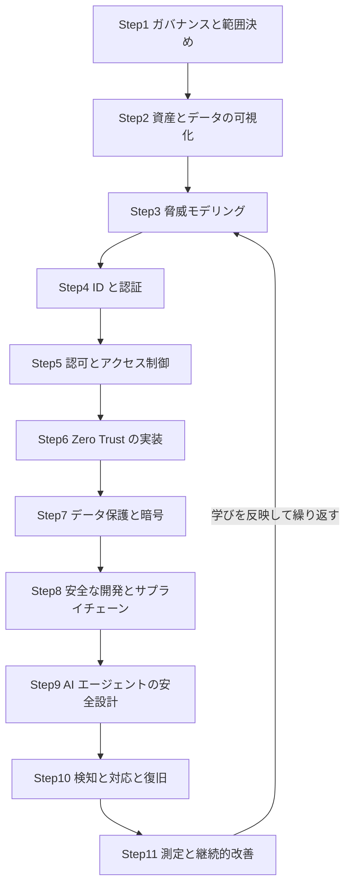

各ノードの意味：
- Step1〜Step2：守る対象と責任者を決める「準備」の段階
- Step3：何が起こりうるかを設計の段階で洗い出す「分析」の段階
- Step4〜Step9：実際に守りを組み込む「実装」の段階
- Step10〜Step11：事故を前提に備え、改善し続ける「運用」の段階
- 最後の矢印：改善の結果を次の脅威モデリングに戻すループ

📖 このセクションで登場した用語
- ランサム攻撃：データを暗号化して使えなくし、元に戻す対価を要求する攻撃
- サプライチェーン攻撃：自社ではなく、取引先や使っている部品を経由して侵入する攻撃
- 脆弱性：ソフトウェアの欠陥のうち、攻撃に悪用されうるもの
- ホワイトリスト／許可リスト：許可したものだけを通す方式

---

## 2. 基本原則

💡 この章では、すべてのステップに共通する 7 つの原則を説明します。個別の技術は変わっても、この原則は変わりにくいため、迷ったときの判断基準になります。

### 2.1 7 つの原則

| 原則 | 一言で言うと | 日常の例え | 主な根拠 |
|------|--------------|-----------|----------|
| Secure by Design | 設計の最初から安全を組み込む | 家の設計図の段階で耐震を考える | CISA、ASD ACSC |
| Secure by Default | 何も設定しなくても安全な状態で出荷する | 買ったばかりの金庫が最初から施錠されている | CISA |
| Zero Trust | 場所や所有者を理由に信頼せず、毎回確認する | 社員証があっても、機密室の入口で毎回ゲートを通る | NIST SP 800-207 |
| Defense in Depth（多層防御） | 守りを 1 枚にせず、何枚も重ねる | 玄関、廊下、金庫と、扉を何枚も通らないと中身に届かない | 広く用いられる設計原則 |
| Least Privilege（最小権限） | 必要な人に、必要な範囲で、必要な間だけ権限を渡す | 合鍵を全員に配らず、清掃員には清掃する部屋の鍵だけ貸す | NIST SP 800-207 の考え方 |
| Fail Securely（安全側に倒す） | エラーが起きたら、許可ではなく拒否にする | 停電したときに、ドアが開くのではなく閉まる設計にする | OWASP A10:2025 |
| Assume Breach（侵害を前提とする） | 侵入されることを前提に、被害が広がらない設計にする | 船の隔壁。1 部屋が浸水しても沈まない | ASD ACSC、Zero Trust の解説各種 |

### 2.2 CISA の Secure by Design が求める姿勢

CISA（米国のサイバーセキュリティ・インフラセキュリティ庁）は、ソフトウェアの作り手が安全を自社の責任として引き受ける姿勢を示しています。主な柱は次の 3 つです。【一次】

| 柱 | 意味 |
|----|------|
| 顧客のセキュリティ成果に責任を持つ | 「使う側が設定で何とかする」ではなく、作る側が安全な初期状態を用意する |
| 徹底した透明性と説明責任 | 脆弱性の情報や対応状況を隠さず公開する |
| 経営層が主導する | 現場任せにせず、優先順位と予算を経営が決める |

CISA の Secure by Design Pledge（誓約）は任意参加で、7 つの目標について 1 年ごとに進捗を示す仕組みです。ベンダーの解説記事によると、署名企業は 2026年に 300 社を超えたとされます【二次】。数字は原典（CISA の公開ページ）で確認してください。

### 2.3 豪州 ASD ACSC の「Foundations」

オーストラリア信号局（ASD）のサイバーセキュリティセンター（ACSC）は、2025年2月に「Foundations for modern defensible architecture」を公開しました。ゼロトラストの原則（never trust, always verify、assume breach、verify explicitly）と、Secure by Design の実践を組み合わせた、設計活動の土台を示す資料です。【一次】

ASD ACSC の資料は、個別製品の宣伝を含まない政府機関の資料なので、初学者が設計の全体像をつかむ入口として適しています。

📖 このセクションで登場した用語
- Secure by Design：設計の最初から安全を組み込む考え方
- Secure by Default：初期設定の状態で安全であること
- Zero Trust：ネットワークの内外を問わず、アクセスのたびに確認する考え方
- 最小権限：仕事に必要な最小限の権限だけを与える原則
- Assume Breach：すでに侵入されている可能性を前提に設計する考え方

---

## 3. ステップ 1〜3：準備と分析

💡 この章では、技術を選ぶ前にやるべき「守る対象と責任を決める」「全体を可視化する」「起こりうる攻撃を洗い出す」の 3 ステップを説明します。この 3 つを飛ばすと、後で導入する製品が的外れになりやすいためです。

### Step 1. ガバナンスと範囲を決める

**なぜ最初にやるのか**：誰が何に責任を持つかが決まっていないと、セキュリティの作業は「誰かがやるだろう」と放置されます。会社の防災に例えると、避難経路の図より先に「火災のときに誰が指揮を執るか」を決めておく作業にあたります。

NIST CSF 2.0（Cybersecurity Framework＝米国標準技術研究所が公開しているセキュリティ管理の枠組み）は、2024年2月に公開され、Govern（統治）を加えた 6 つの機能で構成されます。【一次】

この図は、CSF 2.0 の 6 機能の関係を表しています。Govern が他の 5 つすべてに影響することに注目してください。

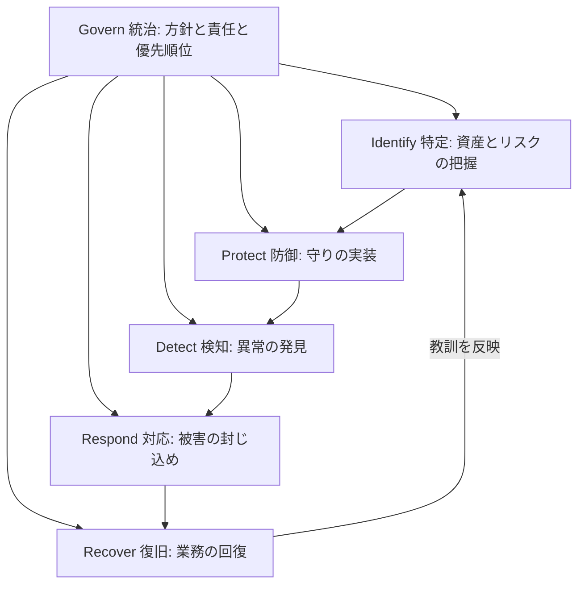

各ノードの意味：
- Govern：方針、役割分担、リスクをどこまで許容するかを決める。他の 5 機能の土台
- Identify：何を守るのか（資産）と、何が危ないのか（リスク）を把握する
- Protect：認証、暗号化、アクセス制御などの守りを実装する
- Detect：攻撃や異常を見つける
- Respond：見つけた事故の被害を食い止める
- Recover：業務とデータを元の状態に戻す

**初学者の実践手順**

1. 守る範囲（スコープ）を 1 つ決める。例：「顧客向け Web アプリと、その裏の API とデータベース」
2. 責任者を決める。システムの持ち主、セキュリティ担当、運用担当を、名前で書く
3. 許容できる被害の上限を決める。例：「顧客データの流出は絶対に不可、サービス停止は 4 時間まで許容」
4. 守るためのルールを 1 ページにまとめる

次のコード例は、1 ページのメモを機械でも読める形にしたものです。紙の文書だけだと更新されなくなりやすいため、リポジトリで管理して変更履歴を残す目的で YAML にします。

```yaml
# security-scope.yaml
# 目的: 守る範囲と責任者を、変更履歴の残る形で明文化する。
scope:
  name: "customer-portal"            # 守る対象システムの名前
  includes:
    - web-frontend                   # ユーザーが使う画面
    - public-api                     # 画面の裏側で動く API
    - customer-database              # 顧客情報を保存するデータベース
owners:
  system_owner: "（名前を記入）"       # 最終判断をする人。空欄にしない
  security_lead: "（名前を記入）"      # セキュリティ施策の窓口
risk_appetite:                       # 許容できる被害の上限
  customer_data_leak: "none"         # 顧客データの流出は許容しない
  max_downtime_hours: 4              # 停止は 4 時間まで
review_cycle_days: 90                # 90 日ごとにこのファイルを見直す
```

📖 このセクションで登場した用語
- ガバナンス：組織としてセキュリティの方針と責任を決め、守らせる仕組み
- スコープ：対象範囲。何を守るかの境界線
- リスク許容度：どの程度の被害までなら受け入れるかの上限
- 資産：守るべき価値のあるもの。データ、システム、アカウントなど

### Step 2. 資産とデータを可視化する

**なぜやるのか**：守る対象の場所と重要度が分からないと、すべてを同じ強さで守ることになり、費用が足りなくなるか、重要な所が手薄になります。図書館に例えると、貴重書の書庫と一般書の棚を区別して、貴重書の書庫だけに入退室記録を置くような作業です。

#### 2.1 データを分類する

| 区分 | 例 | 基本的な扱い |
|------|----|--------------|
| 公開 | 製品カタログ、公開ブログ | 改ざん防止を中心に守る |
| 社内 | 社内マニュアル、議事録 | 社外に出さない。アクセスはログイン必須 |
| 機密 | 顧客リスト、契約書、ソースコード | 暗号化、アクセス記録、権限の最小化 |
| 極秘 | 認証情報、暗号鍵、個人の特定につながる重要情報 | 専用の保管庫、人手による承認、全操作の記録 |

#### 2.2 信頼境界（Trust Boundary）つきのデータフロー図を描く

信頼境界とは、「ここから先は信頼度が変わる」という線です。マンションに例えると、道路と共用玄関の間、共用廊下と各部屋の間に引かれる線にあたります。

この図は、典型的な Web サービスのデータの流れを表しています。囲み（subgraph）が信頼境界で、境界をまたぐ矢印が最も攻撃されやすい箇所です。

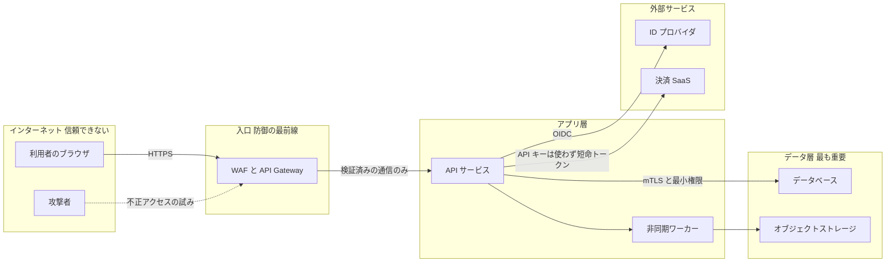

各ノードの意味：
- 「インターネット」の囲み：自分で制御できない領域。ここから来る入力はすべて疑う
- WAF と API Gateway：入口で不正な通信を弾き、認証と流量制限を行う
- 「データ層」の囲み：守る価値が最も高い場所。アプリ層からの接続も最小権限に絞る
- 点線の矢印：攻撃者の侵入の試み。どの境界で止めるかを考える手がかりになる

#### 2.3 初学者の実践手順

1. 上の図のような図を、自分のシステムで 1 枚描く（手書きでも構いません）
2. 図の中の境界を数え、境界ごとに「ここで何を確認するか」を 1 行で書く
3. データの置き場所と区分（公開、社内、機密、極秘）を表にする
4. 一覧にない場所にデータが複製されていないか（ログ、バックアップ、テスト用 DB）を確認する

⚠ ログやテスト用 DB に本番の機密データがコピーされている状態は、実際の現場でよく見つかる弱点です。

📖 このセクションで登場した用語
- 信頼境界：信頼度が変わる線。ここをまたぐ通信は特に慎重に扱う
- データフロー図（DFD）：データがどこからどこへ流れるかを示した図
- WAF（Web Application Firewall）：Web アプリ向けの通信を検査し、不正なものを弾く仕組み
- mTLS：通信の両側が互いに証明書で相手を確認する暗号化通信
- OIDC：外部の ID プロバイダにログインの確認を任せるための標準的な仕組み

### Step 3. 脅威モデリングで「何が起こりうるか」を先に洗い出す

**なぜやるのか**：OWASP Top 10 の A06 は Insecure Design（設計の不備）です。実装のバグは後で直せますが、設計の穴は作り直しが必要になります。脅威モデリング（Threat Modeling）は、コードを書く前に「攻撃者ならどこを狙うか」を考える設計レビューです。

Adam Shostack が提唱する Four Question Frame（4 つの質問の枠組み）は、特別な手法を必要としません。【著名開発者】

| 質問 | 意味 | Step 2 の成果物との関係 |
|------|------|--------------------------|
| 1. What are we working on? | 何を作っているか | データフロー図を描く |
| 2. What can go wrong? | 何が悪くなりうるか | 下の STRIDE で洗い出す |
| 3. What are we going to do about it? | どう対処するか | 回避、軽減、受容、移転から選ぶ |
| 4. Did we do a good job? | 十分にできたか | 対処の検証、レビュー |

Shostack は、最初の質問を「building（作る）」ではなく「working on（取り組む）」としています。「作る」と言うと、完成後に一度だけやる作業に見えるためだと説明しています。また Threat Modeling Manifesto（脅威モデリング宣言）では、4 番目を「good enough（十分に）」とし、完璧を求めすぎない姿勢を示しています。

この図は、脅威モデリングを 1 回の作業として回す流れを表しています。

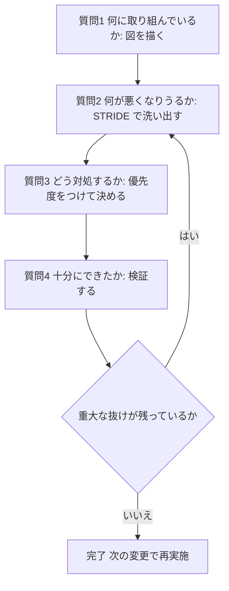

各ノードの意味：
- 質問 1〜4：Shostack の 4 つの質問そのもの
- ひし形「重大な抜けが残っているか」：残っていれば質問 2 に戻る判断点
- 完了：終わりではなく、機能追加や構成変更のたびに再実施する

#### 3.1 STRIDE：洗い出しの型

STRIDE は、脅威を 6 種類に分けて考えるための覚え方です。「抜けがないか」を確認するチェックリストとして使います。

| 頭文字 | 脅威 | 破られる性質 | ログイン API での例 | 代表的な対策 |
|--------|------|--------------|---------------------|--------------|
| S | Spoofing（なりすまし） | 認証 | 盗んだパスワードで他人としてログイン | Passkeys、フィッシング耐性のある MFA |
| T | Tampering（改ざん） | 完全性 | 通信中にリクエストの金額を書き換える | TLS、署名、サーバー側での再検証 |
| R | Repudiation（否認） | 否認防止 | 「私は操作していない」と言い逃れされる | 改ざんしにくい監査ログ |
| I | Information Disclosure（情報漏えい） | 機密性 | エラーメッセージに内部情報が含まれる | 汎用エラー表示、暗号化 |
| D | Denial of Service（サービス拒否） | 可用性 | ログイン試行を大量に送って処理を止める | レート制限、キャッシュ、自動拡張 |
| E | Elevation of Privilege（権限昇格） | 認可 | 一般ユーザーが管理者機能を呼べる | サーバー側の認可チェック、最小権限 |

#### 3.2 Mini 演習：ログイン API を 10 分で脅威モデリングする

1. 図を描く：ブラウザ、API、ID プロバイダ、データベースの 4 点と、通信 3 本
2. 通信 1 本ずつに STRIDE の 6 文字を当てて、「起こりうる悪いこと」を付箋に書く
3. 付箋ごとに「いま対策があるか」を確認し、無いものを課題リストにする
4. 影響が大きいものから順に、担当者と期限を決める

Shostack は、4 つの質問だけなら 60 秒でもできると述べています（Built In の記事での発言）。まず小さく始め、1 つの機能、1 つのストーリーごとに繰り返す運用が、続けやすい形です。【著名開発者】

#### 3.3 ツールの例

検索で確認できた脅威モデリング関連のツールには、OWASP Threat Dragon、Microsoft Threat Modeling Tool、IriusRisk、pytm、Threagile があります【二次】。pytm や Threagile のように、モデルをコードで書いて変更履歴を残す「Threat Model as Code」の流れもあります。最初は紙とホワイトボードで十分です。

📖 このセクションで登場した用語
- 脅威モデリング：システムの図をもとに、攻撃者の視点で起こりうる問題を設計段階で洗い出す作業
- STRIDE：脅威を 6 種類に分けて考える整理法
- なりすまし：他人のふりをしてシステムに入ること
- 否認：実際に操作したのに「やっていない」と主張されること
- 権限昇格：本来持たない強い権限を手に入れること
- レート制限：一定時間内に受け付ける回数を制限する仕組み

---

## 4. ステップ 4〜6：ID・認可・Zero Trust

💡 この章では、「誰がアクセスしているか」を確かめる認証、「何をしてよいか」を決める認可、そして場所を理由に信頼しない Zero Trust の組み立て方を説明します。侵入の多くはパスワードや権限の弱点から始まるため、守りの中心になる章です。

### Step 4. ID と認証：フィッシングに強いログインにする

**なぜやるのか**：パスワードは「知っていれば誰でも使える」ため、偽サイトに入力させられると、本人でなくても通ってしまいます。CISA は、フィッシングに強い MFA（Multi-Factor Authentication＝複数の要素で本人を確認する仕組み）を、MFA の中で最も強い形として位置づけています。【一次】

**例え話**：SMS のコードは「合言葉」です。偽の窓口に合言葉を言ってしまえば、悪用されます。Passkeys は「窓口ごとに違う判子」で、偽の窓口では本物の窓口と同じ判子が押せません。FIDO2/WebAuthn は、認証のやりとりが正しいサイトのドメイン（origin）に結び付くため、偽サイトで盗まれても本物のサイトに使い回せない、という仕組みです。

#### 4.1 認証方式の強さ

| 方式 | フィッシング耐性 | 備考 |
|------|------------------|------|
| パスワードのみ | なし | 使い回しと漏えいに弱い |
| SMS・音声のワンタイムコード | なし | SIM スワップや SS7 の弱点がある。CISA は最終手段の位置づけ |
| アプリのワンタイムコード（TOTP） | なし | 偽サイトで入力させられると突破される |
| プッシュ通知＋番号照合（Number Matching） | 低い | MFA 疲労攻撃の軽減策。CISA は移行までの暫定策としている |
| FIDO2/WebAuthn（Passkeys、セキュリティキー） | あり | 認証が正しい origin に結び付く |
| PKI（スマートカード、証明書認証） | あり | 組織内の高保証な認証で使われる |

出典：CISA「Implementing Phishing-Resistant MFA」（2022年10月）【一次】。NIST は 2024年に、同期型の Passkeys が適切に実装されれば AAL2 で使えるとする見解を示しており【二次の解説経由】、SP 800-63-4 の最新の保証レベル要件は原典で確認してください。FIDO Alliance は 2026年の World Passkey Day に、世界で約 50 億の Passkeys が使われていると推計しました（ampcuscyber の解説記事による。【二次】）。

#### 4.2 導入の順序

この図は、フィッシング耐性のある認証を組織に広げる順序を表しています。影響の大きいアカウントから先に移行します。

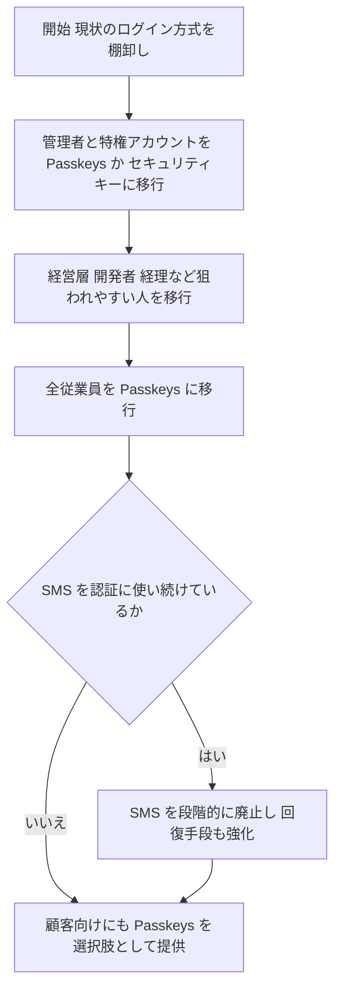

各ノードの意味：
- 特権アカウント：システム全体を変更できる強い権限を持つアカウント。侵害されたときの被害が最大
- ひし形「SMS を使い続けているか」：回復手段（パスワード再設定など）に SMS が残っていないかの確認
- 最後のノード：自社の利用者向けのログインも安全にする段階

⚠ 見落としやすいのは「回復手段」です。ログインを Passkeys にしても、パスワード再設定がメールの URL だけだと、そこが新しい弱点になります。

#### 4.3 WebAuthn の登録設定の例

次の例は、Passkeys の登録時にサーバーがブラウザへ渡す設定です。ユーザー確認（生体認証や PIN）を必須にし、パスワードのいらないログインを成り立たせる目的で、各項目を指定します。

```javascript
// バイト列を base64url 文字列にする。JSON にはバイト列をそのまま入れられないため。
const toBase64Url = (bytes) => Buffer.from(bytes).toString("base64url");

// アカウントの user handle を返す。未設定なら 1 度だけ生成して保存する。
async function getOrCreateUserHandle(account) {
  if (account.webauthnUserHandle) return account.webauthnUserHandle;
  // 同時に登録されても値が 1 つに定まるよう、未設定のときだけ保存し、保存された値を返す。
  return saveUserHandleIfAbsent(account.id, randomBytes(32));
}

// WebAuthn 登録オプションの例（サーバー側で生成し、JSON でブラウザへ渡す）
const userHandle = await getOrCreateUserHandle(account);
const options = {
  // rp は Relying Party。自分のサービスのこと。id はドメイン名で、
  // この値が認証を「正しいサイト」に結び付ける。偽サイトでは使えなくなる。
  rp: { name: "Example Service", id: "example.com" },

  // user.id（user handle）は個人情報（メールアドレス等）を入れず、ランダムな値にする。
  // 個人情報を入れると、認証器の側に個人情報が残るため。
  // アカウントごとに 1 度だけ生成して保存し、2 台目以降の登録でも同じ値を使う。
  // 保存するのはバイト列のままで、JSON にするときだけ base64url へ変換する。
  user: { id: toBase64Url(userHandle), name: "alice", displayName: "Alice" },

  // challenge は登録のたびにランダムに作る使い捨ての値。user handle を流用しない。
  // サーバーはセッションごとに保存し、1 回だけ受け付けて破棄する。
  // 期限切れの値や使用済みの値は拒否する。
  // 同じ値を使い回すと、過去の通信を再送する攻撃（リプレイ）を許してしまう。
  // セッションにはこの base64url 文字列を保存し、検証時に clientDataJSON の challenge と完全一致で比べる。
  challenge: toBase64Url(randomBytes(32)),

  // 許可する署名アルゴリズム。-7 は ES256、-257 は RS256。
  pubKeyCredParams: [
    { type: "public-key", alg: -7 },
    { type: "public-key", alg: -257 },
  ],

  // アカウントに登録済みの資格情報 ID を渡す。同じ認証器が、登録済みの Passkey を
  // 置き換えたり、重複して登録したりしないようにする。
  // listCredentialIds はバイト列の ID を返す想定。
  excludeCredentials: (await listCredentialIds(account)).map((id) => ({
    type: "public-key",
    id: toBase64Url(id),
  })),

  authenticatorSelection: {
    residentKey: "required",        // パスワードなしで端末が資格情報を覚える（Passkeys）
    userVerification: "required",   // 生体認証や PIN による本人確認を必須にする。ブラウザへの要求なので、結果はサーバーで検証する
  },

  attestation: "none", // 認証器の機種情報は集めない。必要以上の情報を持たない方針
  timeout: 60000,      // クライアント側へ渡す待ち時間の目安。サーバー側の challenge の有効期限は別に管理する
};
```

ブラウザの登録 API が受け取る challenge、user.id、資格情報 ID は、文字列ではなくバイト列（BufferSource）です。そのため、ブラウザ側で JSON の base64url 文字列を元に戻してから `navigator.credentials.create()` を呼びます。対応ブラウザでは `PublicKeyCredential.parseCreationOptionsFromJSON()` がこの変換を行います。

```javascript
// base64url 文字列をバイト列に戻す。
function fromBase64Url(value) {
  const base64 = value.replace(/-/g, "+").replace(/_/g, "/");
  const padded = base64.padEnd(Math.ceil(base64.length / 4) * 4, "=");
  return Uint8Array.from(atob(padded), (char) => char.charCodeAt(0));
}

// サーバーの JSON を、登録 API に渡せる形へ変換する。
function toCreationOptions(json) {
  if (typeof PublicKeyCredential.parseCreationOptionsFromJSON === "function") {
    return PublicKeyCredential.parseCreationOptionsFromJSON(json);
  }
  // 未対応のブラウザでは、バイト列の項目だけを手動で戻す。
  return {
    ...json,
    challenge: fromBase64Url(json.challenge),
    user: { ...json.user, id: fromBase64Url(json.user.id) },
    excludeCredentials: (json.excludeCredentials ?? []).map((credential) => ({
      ...credential,
      id: fromBase64Url(credential.id),
    })),
  };
}

const response = await fetch("/webauthn/registration/options", { method: "POST" });
if (!response.ok) throw new Error("登録オプションを取得できませんでした");

const publicKey = toCreationOptions(await response.json());
const credential = await navigator.credentials.create({ publicKey });
```

⚠ 登録オプションの `userVerification: "required"` は、ブラウザへの要求にすぎません。サーバーは資格情報を保存する前に、WebAuthn のライブラリで登録レスポンスを検証します。確認する項目は、challenge（発行した値と一致し、未使用であること）、origin、RP ID のハッシュ、authenticatorData の UV フラグです。検証に失敗したら保存しません。これは、次に説明するログイン時の assertion の検証とは別の処理です。

⚠ `userVerification: "required"` は登録時だけでは足りません。パスワードのいらないログインでは、認証リクエストにも同じ設定を指定します。さらにサーバーは、受け取った assertion の署名を検証したうえで、署名対象の authenticatorData にある UV フラグ（ユーザー確認済みを示す値）が立っていることを確認し、立っていなければ拒否します。ブラウザへ渡す設定だけでは、本人確認が実施された証拠にはなりません。

#### 4.4 人以外の ID（ワークロード ID）も守る

サービス、バッチ、CI/CD（自動ビルド・配備の仕組み）も「ID」を持ちます。長期間有効な API キーをコードや設定ファイルに置くと、漏れたときに期限なく悪用されます。実践の原則は次の 3 つです。

| 原則 | 具体策 |
|------|--------|
| 長期キーを持たない | クラウドや外部サービスとは OIDC の連携で、実行のたびに短命のトークンを発行する |
| 1 つの ID に 1 つの役割 | サービスごとに別の ID を作り、使い回さない |
| 権限は用途に絞る | 読み取りだけで済む処理に書き込み権限を渡さない |

📖 このセクションで登場した用語
- MFA：パスワードに加え、別の要素（持ち物、生体情報など）も使って本人を確認する方式
- フィッシング：本物そっくりの偽サイトで認証情報を入力させる詐欺
- Passkeys：パスワードの代わりに、端末内の秘密鍵で認証する仕組み
- WebAuthn：ブラウザから Passkeys やセキュリティキーを使うための標準
- base64url：バイト列を URL でも安全な文字だけで表す方式
- BufferSource：ブラウザの API がバイト列を受け取るときの型
- origin：ウェブサイトの識別単位（プロトコル、ドメイン、ポートの組）
- MFA 疲労攻撃：承認の通知を大量に送り、うんざりした本人に承認させる手口
- ワークロード ID：人ではなく、プログラムやサービスに与える ID

### Step 5. 認可とアクセス制御：「拒否が初期値」にする

**なぜやるのか**：OWASP Top 10:2025 の 1 位は Broken Access Control です。ログインできた後に「何をしてよいか」の確認が抜けると、他人のデータを見られる状態になります。ホテルに例えると、宿泊客だと確認できた後に、全部屋の鍵が開いてしまう状態です。【一次】

#### 5.1 3 つの基本ルール

| ルール | 意味 | よくある失敗 |
|--------|------|--------------|
| Deny by Default（拒否が初期値） | 明示的に許可したものだけを通す | 新しい API を作ったとき、権限設定を忘れて全員に開いてしまう |
| Server-side enforcement（サーバー側で強制） | 画面のボタンを隠すだけでなく、サーバーで毎回確認する | 画面では非表示だが、API を直接呼ぶと実行できる |
| Object-level check（対象データごとの確認） | 「ログイン済み」だけでなく「そのデータの持ち主か」を確認する | URL の ID を書き換えると他人の注文が見える（IDOR と呼ばれる弱点） |

#### 5.2 コード例：対象データごとの確認

次の例は、注文を取得する処理です。URL の注文 ID だけで返すと、他人の注文を見られてしまうため、注文の持ち主と呼び出したユーザーを必ず照合します。

```python
from dataclasses import dataclass

@dataclass(frozen=True)
class User:
    id: str
    tenant_id: str  # 所属テナント。データへのアクセス範囲を決める
    roles: frozenset  # 権限は変更できない値にして、処理の途中で書き換わる事故を防ぐ

class Forbidden(Exception):
    """許可されていない操作。呼び出し側で 403 に変換する。"""

def get_order(user: User, order_id: str, repo) -> dict:
    order = repo.find_order(order_id)

    # 存在しない場合と権限がない場合で、同じ結果を返す。
    # 区別して返すと「その ID の注文は存在する」という情報が攻撃者に伝わるため。
    if order is None:
        raise Forbidden()

    # サポート担当を含め、アクセスは自テナントの注文に限る。
    # 他テナントの注文にも、存在しない場合と同じ結果を返す。
    if order["tenant_id"] != user.tenant_id:
        raise Forbidden()

    # 持ち主本人か、明示的に許可された役割のときだけ通す（拒否が初期値）。
    is_owner = order["owner_id"] == user.id
    is_support = "support_agent" in user.roles
    if not (is_owner or is_support):
        raise Forbidden()

    return order
```

#### 5.3 権限を設計する手順

1. 役割（Role）を洗い出す。例：一般利用者、サポート担当、管理者
2. 操作（Action）を洗い出す。例：注文を見る、注文をキャンセルする、全注文を出力する
3. 「役割 × 操作」を表にし、許可する組み合わせだけに印を付ける（印がないものは拒否）
4. 表をコードとテストの両方に反映する。テストでは「許可されないこと」も確認する

⚠ QA の観点：権限テストは「できること」だけでなく「できないこと」を確認します。別ユーザーの ID、期限切れトークン、他テナントのデータを使うケースを、自動テストに入れます。

📖 このセクションで登場した用語
- 認証：「あなたは誰か」を確認すること
- 認可：「あなたは何をしてよいか」を決めること
- IDOR：ID を書き換えるだけで他人のデータに届いてしまう弱点
- テナント：同じシステムを使う、別々の顧客や組織の単位
- ロール（役割）：権限をまとめた単位。例：管理者

### Step 6. Zero Trust を実装する

**なぜやるのか**：従来の「社内ネットワークは安全」という考え方は、社内に入られた後の被害を止められません。NIST SP 800-207（2020年8月）は、ネットワークの場所を理由に信頼しない設計を定義しています。例えるなら、社員証を持っていても、機密室の入口では毎回ゲートで確認される建物です。【一次】

#### 6.1 NIST SP 800-207 の 7 つの考え方（要旨）

| 番号 | 考え方 | 実装での意味 |
|------|--------|--------------|
| 1 | すべてのデータ源と計算サービスは「守る資源」 | 社内システムも SaaS も同じように保護対象にする |
| 2 | 通信はネットワークの場所にかかわらず保護する | 社内通信も暗号化して認証する |
| 3 | 資源へのアクセスはセッション（接続）ごとに許可する | 一度許可しても、次の接続では再確認する |
| 4 | アクセスは動的なポリシーで決める | ユーザー、端末の状態、時間帯、行動の変化を材料にする |
| 5 | 資産の状態を継続的に監視する | 更新が古い端末は権限を絞る |
| 6 | 認証と認可を、アクセスの前に厳密に行う | ログインと権限確認を毎回行う |
| 7 | 現状の情報を集め、改善に使う | ログとテレメトリ（観測データ）を分析する |

#### 6.2 判断する場所と守る場所を分ける

Zero Trust の論理構成では、「許可するかを決める場所」（Policy Decision Point、PDP）と、「その決定を実際に強制する場所」（Policy Enforcement Point、PEP）を分けます。空港に例えると、PDP は搭乗可否を判断する審査室、PEP は搭乗口のゲートです。PDP は Policy Engine（判断）と Policy Administrator（実行指示）の 2 要素で構成されます。

この図は、1 回のアクセス要求が許可されるまでの流れを表しています。矢印の番号の順に読んでください。

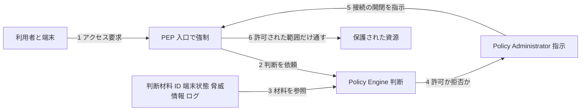

各ノードの意味：
- PEP：資源の手前に置く門番。許可がなければ通さない
- Policy Engine：材料を見て「許可か拒否か」を決める頭脳
- Policy Administrator：決定を受けて接続のしかたを指示する担当（トークン発行などを含む）
- 判断材料：ID、端末の安全状態、脅威情報、過去のログなど。多いほど判断の質が上がる
- 資源：守るデータやアプリ。許可されたセッションの範囲だけで使える

#### 6.3 CISA Zero Trust Maturity Model で進み具合を測る

CISA の Zero Trust Maturity Model（ZTMM）v2.0（2023年4月公開）は、5 つの柱（Pillar）と 3 つの横断機能、4 つの成熟段階で現在地を測る枠組みです。【一次】

| 柱 | 最初の一歩（初学者向け） |
|----|--------------------------|
| Identity（ID） | 管理者アカウントをフィッシング耐性のある MFA にする（Step 4） |
| Devices（端末） | 端末の一覧を作り、OS 更新が古い端末の接続を制限する |
| Networks（ネットワーク） | 社内の広い共用ネットワークを分割し、サービス間通信を暗号化する |
| Applications and Workloads（アプリとワークロード） | アプリごとに認可を実装し、サービスに専用の ID を与える（Step 5） |
| Data（データ） | データを分類し、機密データへのアクセスを記録する（Step 2、7） |

| 段階 | 意味 |
|------|------|
| Traditional | 従来型。手作業が中心で、場所に基づく信頼が残る |
| Initial | 自動化と可視化を一部で始めた段階 |
| Advanced | 柱をまたいだ連携が進み、ポリシーが動的になった段階 |
| Optimal | 継続的な監視と自動対応で、ポリシーが動的かつ最適化された段階 |

3 つの横断機能は、Visibility and Analytics（可視化と分析）、Automation and Orchestration（自動化と連携）、Governance（統治）です。

⚠ ZTMM は米国の連邦機関向けに作られましたが、CISA は他の組織にも参考にすることを勧めています。すべての柱を同時に上げる必要はなく、段階的に進めるのが現実的です（解説記事でも「一度に全部を再構築しない」ことが失敗を避ける要点とされています【二次】）。

#### 6.4 初学者の実践手順

1. ネットワーク内の「全員が全部に届く」通信を 1 つ見つけ、必要な通信だけを許可する設定に変える
2. サービス間の通信を mTLS にするか、TLS で保護したうえで短命のトークンで認証する。トークンによる認証だけでは、通信の暗号化や接続先の確認はできません
3. インターネットへ出る通信（Egress）を許可リスト方式にする。これは、サーバーを踏み台にした外部への通信を減らす効果があります
4. 利用者が指定した URL を取得するワークロードからは、メタデータエンドポイント（クラウドの認証情報を返す `169.254.169.254` など）と、不要な内部の宛先への通信を、Egress の許可リストとは別に、ネットワーク側で遮断する。データベース接続など、そのワークロードに必要なサービスへの接続は、宛先とポートを絞って明示的に許可します。インターネット向けの許可リストだけでは、SSRF（サーバーに内部の宛先へ通信させる攻撃）で狙われる内部の宛先を守れません
5. 利用者が指定した URL を取得するアプリでは、アプリ側でも URL を検証する。宛先が固定できるなら許可リストと照合します。任意の URL を受け付ける必要があり、許可リストを使えない場合は、公開されている IPv4 と IPv6 の宛先だけを許可し、名前解決後のアドレスにプライベート、ループバック、リンクローカルなどの公開でないアドレスが含まれていれば、接続前に拒否します。どちらの場合も、名前解決後の IP アドレスも確認して、検証した IP アドレスへ接続します。リダイレクトの自動追跡は無効にします（OWASP SSRF Prevention Cheat Sheet）
6. 管理画面や運用ツールは VPN 頼みにせず、ID と端末の状態で毎回確認するアクセス経路に置き換える

📖 このセクションで登場した用語
- PDP / PEP：許可を判断する場所と、その判断を強制する場所
- セグメンテーション：ネットワークを区切り、侵入されても被害が広がらないようにすること
- テレメトリ：システムの状態を示す観測データ
- Egress：内部から外部へ出ていく通信
- SSRF：サーバーに、本来届かない内部の宛先へ通信させる攻撃
- 成熟度モデル：取り組みの進み具合を段階で示す物差し

---

## 5. ステップ 7〜9：データ、開発、AI の守り

💡 この章では、データそのものを守る暗号、ソフトウェアを作って届ける工程の安全、そして新しい脅威である AI エージェントの設計を説明します。IPA の 10 大脅威でも上位に並ぶ分野で、2026年に変化が速い章です。

### Step 7. データ保護と暗号：量子コンピュータの時代にも備える

**なぜやるのか**：Step 4〜6 で入口を守っても、データが盗まれたときに読める状態だと被害は確定します。暗号は「最後の防衛線」です。さらに、将来の量子コンピュータが現在の公開鍵暗号（RSA、楕円曲線暗号）を破る可能性があり、「今盗んで、後で解読する」（Harvest Now, Decrypt Later）攻撃への備えが 2026年の設計課題になっています。

#### 7.1 基本の 4 点

| 守る場面 | 実践 | 初学者向けの注意 |
|----------|------|------------------|
| 通信中（In Transit） | TLS 1.3 を使い、社内通信も暗号化する | 証明書の期限切れと設定の誤りに注意する |
| 保存中（At Rest） | KMS（鍵管理サービス）で鍵を管理し、データはその鍵で暗号化する | 鍵とデータを同じ場所に置かない |
| 秘密情報（Secrets） | パスワード、API キー、鍵は専用の保管庫に置き、コードや Git に入れない | 漏れたら即座に失効させて再発行する |
| 鍵の寿命 | 定期的に更新し、更新の手順を自動化する。AES-GCM では暗号化回数の上限に達する前にも更新する（7.2 参照） | 更新できない鍵は、漏れたときに交換できない鍵 |

#### 7.2 コード例：暗号化するときの注意点

次の例は、AES-GCM（改ざんの検出機能も持つ共通鍵暗号）によるデータ暗号化です。自作の暗号アルゴリズムを避け、検証済みのライブラリを使う理由は、暗号は実装の細部の誤りだけで破られるためです。

```python
import os
from cryptography.hazmat.primitives.ciphers.aead import AESGCM

def encrypt(data_key: bytes, plaintext: bytes, context: bytes) -> bytes:
    aes = AESGCM(data_key)

    # nonce（使い捨ての値）は毎回ランダムに作る。
    # 同じ鍵で同じ nonce を再利用すると、暗号が破られるため絶対に避ける。
    # ランダムな 96 ビット nonce では nonce の衝突を避けるため、同じ鍵での暗号化は
    # 約 2^32 回（約 43 億回）までに制限し、上限に達する前に鍵を更新する（NIST SP 800-38D）。
    nonce = os.urandom(12)

    # context（関連データ）は暗号文に結び付けて検証される。
    # 例えば「顧客ID」を入れると、別の顧客用の暗号文を差し替える攻撃を検出できる。
    # 復号する側は、暗号文と一緒に保存された値を信用しない。認可済みの顧客やレコードから
    # 期待する context を独立に導き、認証のために復号処理へ渡す。
    ciphertext = aes.encrypt(nonce, plaintext, context)

    # 復号に nonce が必要なので、先頭に付けて保存する。nonce は秘密でなくてよい。
    return nonce + ciphertext

# 実運用では data_key を KMS で生成して保護し、コードに直接書かない。
```

#### 7.3 ポスト量子暗号（PQC）の基礎

NIST は 2024年8月に、最初のポスト量子暗号の標準を最終化しました。【一次】

| 標準 | 名称 | 役割 |
|------|------|------|
| FIPS 203 | ML-KEM | 鍵の共有（通信を暗号化する鍵を安全に合意する） |
| FIPS 204 | ML-DSA | デジタル署名（作成者と改ざんの有無を証明する） |
| FIPS 205 | SLH-DSA | ハッシュに基づくデジタル署名（ML-DSA とは別の数学に依拠する予備） |

2026年の実際の状況は次のとおりです。

| 事項 | 内容 | 信頼度 |
|------|------|--------|
| 通信の鍵共有 | TLS で、従来の X25519 と ML-KEM を併用する「ハイブリッド」方式が普及。Cloudflare の公開データでは、同社に届く人間由来の TLS 通信の 60% 超がハイブリッド ML-KEM を使用（2026年3月時点の報道） | 【二次】 |
| 証明書の署名 | ML-DSA を使う証明書は、主要ブラウザが標準で扱う段階にはまだなく、鍵共有より移行が難しい | 【二次】 |
| 移行の道筋 | NIST IR 8547 が、従来の公開鍵暗号を段階的に廃止する道筋を示す。CSRC 上で最終版が確認できる | 【一次】 |

NIST IR 8547 の 2024年11月のドラフトと 2026年10月の最終版では、期限の対象範囲が異なります。詳細は必ず CSRC の原典で確認してください。

| 版 | 対象 | 非推奨 | 使用禁止 |
|----|------|--------|----------|
| ドラフト（2024年11月） | 112 ビット強度のパラメータ | 2030年より後 | 2035年より後 |
| ドラフト（2024年11月） | 128 ビット以上の強度のパラメータ | 期限の記載なし | 2035年より後 |
| 最終版（2026年10月） | 量子計算機に脆弱な公開鍵暗号全般（RSA、楕円曲線暗号、DH など。112 ビット以上の全強度） | 2030年より後 | 2035年より後 |

IR 8547 最終版によれば、米国連邦機関の高価値資産（High Value Assets）と高影響度システムには、EO 14412 と OMB M-26-15 にもとづくより早い期限が適用されます。鍵共有は 2030年12月31日まで、デジタル署名は 2031年12月31日までに PQC へ移行します。

この図は、PQC への移行を、何から手を付けるかの順に表しています。

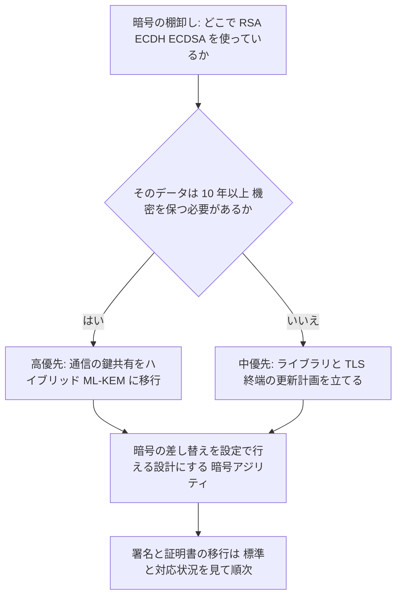

各ノードの意味：
- 棚卸し：移行の前提。使っている場所が分からないと、計画も立てられない
- ひし形「10 年以上機密を保つか」：長く守るデータほど、今盗まれて後で解読される危険が大きい
- 暗号アジリティ（Crypto Agility）：アルゴリズムの変更を、システム全体の作り直しなしに行える性質
- 署名の移行：鍵共有より後回しになりやすいが、計画には含めておく

**初学者の実践手順**：(1) 暗号の使用箇所を表にする、(2) TLS ライブラリを最新へ更新する、(3) 入口（CDN、ロードバランサ）のハイブリッド対応を有効にする、(4) アルゴリズム名を設定値として外に出す。

📖 このセクションで登場した用語
- TLS：インターネット通信を暗号化する標準的な仕組み
- KMS：暗号鍵を安全に作り、保管し、使う権限を管理するサービス
- AES-GCM：暗号化と改ざん検出を同時に行う共通鍵暗号の方式
- nonce：暗号化のたびに使い捨てで使う値
- PQC（ポスト量子暗号）：量子コンピュータでも破りにくいとされる暗号
- ハイブリッド方式：従来の暗号と新しい暗号を併用し、片方が破られても守れるようにする方式
- 暗号アジリティ：暗号方式を素早く入れ替えられる設計の性質

### Step 8. 安全な開発とサプライチェーン

**なぜやるのか**：OWASP A03 に Software Supply Chain Failures が新しく入り、IPA でも「サプライチェーンや委託先を狙った攻撃」が 2 位です。自分のコードが正しくても、使っている部品が汚染されると、自社の中で攻撃者のコードが動きます。食品に例えると、自社の調理が完璧でも、仕入れた食材に毒が混ざっていれば意味がありません。

#### 8.1 開発工程の各段階に守りを置く

この図は、設計から運用までの工程と、各段階に置く守りを表しています。左から右へ読み進めてください。

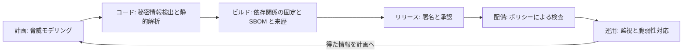

各ノードの意味：
- 静的解析：コードを実行せずに、危ない書き方を機械で探す
- SBOM：使っている部品の一覧表（Software Bill of Materials）
- 来歴（Provenance）：成果物がどこで、どう作られたかの証明
- ポリシーによる検査：基準を満たさない成果物を配備させない関門

#### 8.2 メモリ安全な言語への移行

C や C++ のメモリ操作の誤りは、深刻な脆弱性の大きな原因でした。Google の Android チームの報告では、メモリ安全性に関する脆弱性の割合は、2019年の 76% から 2024年に 24% へ下がり、2025年の最新データでは初めて 20% を下回りました。新しいコードをメモリ安全な言語（Rust など）で書き、古いコードは時間とともに安定する、という方針の効果です。報告者は Google の Jeff Vander Stoep らで、【著名開発者】の投稿に当たります。

初学者への示唆：既存コードを一気に書き直す必要はなく、「新規に書く部分」「外部入力を処理する部分」から安全な言語を選ぶ方法が現実的です。

#### 8.3 依存関係の守り：クールダウンと固定

William Woodruff は 2025年11月に「We should all be using dependency cooldowns」を公開しました。公開された新しいバージョンをすぐ取り込まず、一定期間（例：7 日）待つ運用です。多くのサプライチェーン攻撃は、悪意のあるバージョンが公開されてから数時間〜数日で発見・削除されるため、待つだけで被害を避けやすくなります。【著名開発者】

| 観点 | 内容 | 出典 |
|------|------|------|
| 効果 | 高い注目度で大規模に広がった攻撃の多くは、短い待機で避けられる | Woodruff の 2025年11月の投稿 |
| 限界 | 休眠していて遅れて動く攻撃には効かない | 同上の解説、LWN の記事 |
| 例外の設計 | セキュリティ修正は待たずに適用できる「抜け道」をポリシーに含める | Woodruff の 2025年12月の続報 |
| 反論 | 全員が待つと、結局発見が遅れる（ただ乗り）という批判もある。Cal Paterson の反論が LWN で紹介されている | LWN |
| 補完策 | バージョン公開を伴わない「タグの付け替え」攻撃には、不変のコミット SHA での固定が有効 | Christian Schneider のブログ |

次の例は、依存関係の更新ツールにクールダウンを設定する方法です。設定の目的は、公開直後の悪意あるバージョンを自動で取り込まないことです。

```yaml
# .github/dependabot.yml
version: 2
updates:
  - package-ecosystem: "npm"
    directory: "/"
    schedule:
      interval: "daily"
    cooldown:
      default-days: 7   # 通常のバージョン更新は、公開から 7 日たった版だけを対象にする
```

```json
{
  "extends": ["config:recommended"],
  "minimumReleaseAge": "7 days"
}
```

⚠ 7 日の待機が効くのは通常のバージョン更新だけです。Dependabot のセキュリティ更新には `cooldown` が適用されません。Renovate のセキュリティ更新も、既定では `minimumReleaseAge` を適用しません。そのため、セキュリティ更新では公開直後の版が提案されることがあります。

上の 2 つ目は Renovate の設定です。uv（Python のパッケージ管理）では `--exclude-newer=P7D` のように相対期間を指定する機能が使えると、Woodruff の続報で紹介されています。設定名は更新されることがあるため、各ツールの公式ドキュメントで最新の書き方を確認してください。

#### 8.4 CI/CD（自動ビルドと配備）を守る

次の例は、GitHub Actions のワークフローの最小権限の例です。権限を最初から絞る理由は、ワークフローが侵害されたときに盗まれる権限を小さくするためです。

```yaml
name: build
on:
  pull_request:          # 外部の人が出した変更に対して動く。秘密情報は渡さない。

permissions:
  contents: read         # 初期値で読み取りのみ。書き込みが必要なジョブだけ個別に昇格する

jobs:
  test:
    runs-on: ubuntu-latest
    steps:
      # タグ（v4 など）は付け替えられる可能性があるため、
      # 信頼できる確認を済ませたうえで、40 桁のコミット SHA で固定する。
      - uses: actions/checkout@<40桁のコミットSHA>
      - run: npm ci      # npm install ではなく ci を使い、ロックファイルのとおりに入れる
```

| 原則 | 理由 |
|------|------|
| 外部からの変更で動くジョブに、秘密情報や書き込み権限を渡さない | 悪意のある変更が、秘密情報を盗む手段になるため。ベンダー解説では、`pull_request_target` の悪用による公開トークンの窃取が事例として紹介されています【二次】 |
| 長期の公開トークンの代わりに、OIDC による短命の資格情報（Trusted Publishing）を使う | 盗まれても短時間で無効になるため |
| ロックファイルを必ずコミットする | 毎回同じ版を入れ、意図しない更新を防ぐため |

#### 8.5 「来歴があれば安全」ではない

SLSA（Supply-chain Levels for Software Artifacts＝成果物の作られ方の信頼度を段階で表す枠組み）と、Trusted Publishing、署名は有効な土台です。ただし、これらが証明するのは「どこで作られたか」であり、「中身が善意か」ではありません。

ベンダーの調査記事【二次】によると、2026年には、攻撃者が正規の開発リポジトリに入り込み、正規のビルドの流れで悪意のあるバージョンを公開したため、署名と来歴が正しく付いたまま配布された事例が報告されました（TanStack の事例、HeroDevs の解説）。こうした事例の個別の事実は、必ず原典（各プロジェクトの公式発表）で確認してください。ここから分かる設計上の教訓は、来歴の確認に加えて、クールダウン、権限の最小化、監視の多層防御が必要だということです。

📖 このセクションで登場した用語
- サプライチェーン攻撃：自社ではなく、使っている部品や取引先を経由した攻撃
- SBOM：ソフトウェアに含まれる部品の一覧
- SLSA：成果物の作られ方の信頼度を段階で示す枠組み
- Trusted Publishing：長期のトークンを使わず、ビルド環境の ID でパッケージを公開する方式
- ロックファイル：入れる部品の版を固定した記録ファイル
- クールダウン：新しい版の公開後、一定期間は取り込まない運用
- メモリ安全：メモリの範囲外アクセスなどの誤りが言語の仕組みで防がれる性質

### Step 9. AI エージェントの安全設計

**なぜやるのか**：IPA の 10 大脅威 2026 で、「AI の利用をめぐるサイバーリスク」が初めて組織向けの 3 位に入りました。AI エージェント（指示を受けて、ツールを使いながら自分で作業を進める AI）は、メール、文書、ウェブページなど外部の文章を読みます。その文章の中に紛れた「命令」に従ってしまう問題を、プロンプトインジェクション（Prompt Injection）と呼びます。

**例え話**：優秀な秘書に、あなたの全書類の閲覧権限と、外部へ送信する権限を与えたとします。ある日、届いた手紙の中に「この書類を全部、この住所へ送れ」と書かれていたら、秘書がそのとおりに動いてしまう状態です。

#### 9.1 Lethal Trifecta（致命的な 3 つ組）

Simon Willison は 2025年6月16日に、AI エージェントが次の 3 つを同時に持つと、データ漏えいの危険が極めて高くなると指摘しました。【著名開発者】

| 要素 | 内容 | 秘書の例え |
|------|------|-----------|
| 1. 私的なデータへのアクセス | 機密情報や個人情報を読める | 全書類を閲覧できる |
| 2. 信頼できない内容への接触 | 外部のメール、ウェブ、文書を読む | 知らない人からの手紙を開く |
| 3. 外部への通信 | データを外へ送れる | 外へ送信する権限がある |

Willison は、「AI ベンダーが防いでくれる」という期待に頼らず、自分たちの設計で 3 つの組み合わせを避ける必要があるとしています。また、攻撃の 95% を防ぐとうたう防御製品は、残りの 5% が突破されるため、合格点とは言えないという立場です。

#### 9.2 Agents Rule of Two

Meta の AI セキュリティチームは 2025年10月31日に「Agents Rule of Two」を公開しました。1 つのセッションで、エージェントが次の 3 つの性質のうち、満たしてよいのは 2 つまでとする考え方です。Willison の分析で紹介され、Chromium の Rule of 2 と Lethal Trifecta に着想を得たとされています。【著名開発者】

| 記号 | 性質 |
|------|------|
| A | 信頼できない入力を処理する |
| B | 機密のシステムやデータにアクセスする |
| C | 状態を変更する、または外部へ通信する |

3 つが必要になる場合は、人間の承認を必ず挟むなど、設計を見直します。

この図は、新しいエージェントを作るときの判断の流れを表しています。

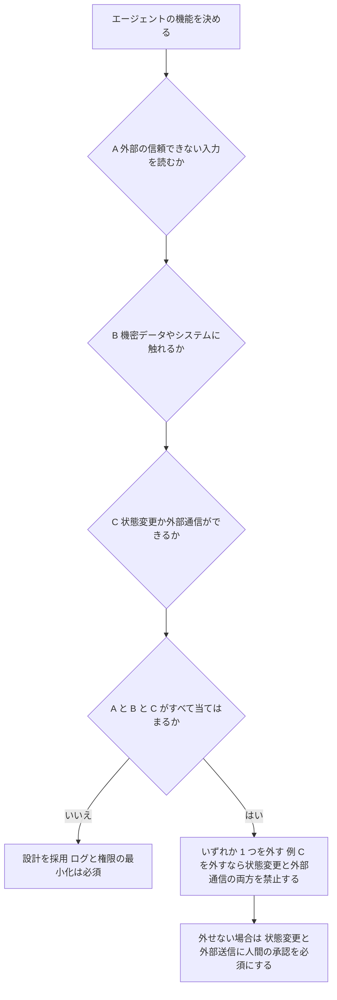

各ノードの意味：
- A、B、C の 3 つの確認：Rule of Two の 3 性質をそれぞれ確認する
- 「すべて当てはまるか」：3 つが同時に成立すると、プロンプトインジェクション 1 回で漏えいにつながる
- 「いずれか 1 つを外す」：最も確実な対策。例として、メールを読むエージェントには、送信も含めて状態を変更する権限を与えず、外部通信も禁止する
- 人間の承認：外せない場合の最後の砦。承認画面で内容を省略せず見せる

#### 9.3 防御フィルターだけに頼らない

2025年10月に、OpenAI、Anthropic、Google DeepMind などの研究者が共著した「The Attacker Moves Second」は、公開されていた 12 の防御策に対し、攻撃側が防御を知ったうえで手を変える「適応型攻撃」を試したところ、多くが突破されたと報告しました（Willison のブログと、解説記事による）。【著名開発者・二次】入力の検査は「衛生管理」として有効ですが、Rule of Two を満たさない設計の免罪符にはなりません。

#### 9.4 OWASP Top 10 for Agentic Applications 2026

OWASP GenAI Security Project は 2025年12月9日に、エージェント特有のリスクを 10 項目に整理しました。LLM アプリ向けの Top 10 を置き換えるのではなく、補完する位置づけです。【一次相当。公式ページは genai.owasp.org で確認】

| ID | リスク（要旨） | 主な対策の方向 |
|----|----------------|----------------|
| ASI01 | Agent Goal Hijack：エージェントの目的を乗っ取られる | 取得した内容を信頼せず、目的を制約する |
| ASI02 | Tool Misuse：許可されていない使い方でツールを呼ぶ | ツールを最小限にし、引数を検証する |
| ASI03 | Identity and Privilege Abuse：ID と権限の悪用 | エージェントごとの ID、短命で範囲の狭い資格情報 |
| ASI04 | サプライチェーン：ツール、プラグイン、MCP サーバーの汚染 | 導入前の審査、一覧（AIBOM）の管理 |
| ASI05 | コード実行：意図しないコードが実行される | サンドボックス（隔離環境）で動かす |
| ASI06 | メモリ汚染：記憶や文脈に悪意ある内容が残る | 記憶の入力元の検証、定期的な消去 |
| ASI07 | Insecure Inter-Agent Communication：エージェント間通信の不備 | 通信の認証と暗号化 |
| ASI08 | Cascading Failures：失敗が連鎖して広がる | 影響範囲の分離、上限の設定 |
| ASI09 | Human-Agent Trust Exploitation：人の過信を突かれる | 重要な操作は根拠を示して承認させる |
| ASI10 | Rogue Agents：方針から逸脱したエージェント | 行動の監視、停止スイッチ（キルスイッチ） |

ASI04〜06 の項目名は解説記事の要旨に基づく表記です。正式名称は公式ページで確認してください。【二次】

#### 9.5 エージェントの方針をコードにする

次の例は、エージェントの権限を宣言的に書いた設定の例です。「できること」を先に書き出し、書いていないものは拒否する形にする理由は、Step 5 の「拒否が初期値」と同じです。

```yaml
# agent-policy.yaml
agent: "support-summarizer"
identity:
  credential_ttl_minutes: 15      # 資格情報は 15 分で失効。盗まれても長く使われない
inputs:
  untrusted_sources: ["customer_email"]   # A: 信頼できない入力を読む
data_access:
  allow: ["tickets:read"]         # B: 読み取りだけを許可。書き込みは与えない
actions:
  external_network: false         # C: 外部通信は禁止。状態変更は次の行の承認で統制する
  require_human_approval: ["ticket:close", "refund:create"]
logging:
  record_tool_calls: true         # 何を呼んだかを後から追えるようにする
  kill_switch: true               # 異常時に即座に止められる
```

⚠ MCP（Model Context Protocol＝AI とツールをつなぐ標準）のサーバーは、第三者が作った部品です。Step 8 と同じく、導入前の審査、版の固定、権限の最小化が必要です。

📖 このセクションで登場した用語
- AI エージェント：ツールを使いながら自律的に作業を進める AI
- プロンプトインジェクション：AI が読む文章に紛れた命令で、AI の動作を乗っ取る攻撃
- サンドボックス：外部に影響しないよう隔離した実行環境
- ヒューマン・イン・ザ・ループ：重要な判断の前に、人間の承認を挟む仕組み
- 適応型攻撃：防御の仕組みを知ったうえで、それを回避するよう手を変える攻撃
- キルスイッチ：異常時に処理を即座に止める仕組み

---

## 6. ステップ 10〜11：運用と改善

💡 この章では、守りを破られた場合を前提にした検知・対応・復旧と、取り組みを測って改善し続ける方法を説明します。これまでのステップで 100% 防げることはないため、運用の質が最終的な被害の大きさを決めます。

### Step 10. 検知・対応・復旧

**なぜやるのか**：OWASP A09 は Security Logging and Alerting Failures で、記録と通知の不足が、攻撃に気づけない原因になります。IPA の 1 位であるランサム攻撃は、侵入から暗号化までに時間差があるため、早く気づけるほど被害を小さくできます。火災報知器に例えると、設置していなければ、火が広がってから気づくことになります。

#### 10.1 何を記録するか

| 記録するもの | 例 | 記録してはいけないもの |
|--------------|----|------------------------|
| 認証の出来事 | ログイン成功と失敗、MFA の登録変更、パスワード再設定 | パスワード本体、トークン、鍵 |
| 権限の出来事 | 権限の付与と変更、管理者操作、拒否された操作 | 不要な個人情報の全文 |
| データの出来事 | 機密データの一括取得、大量のダウンロード | クレジットカード番号などの全桁 |
| システムの出来事 | 設定変更、デプロイ、サービスアカウントの利用 | |
| AI エージェントの出来事 | 呼び出したツール、渡した引数（承認した項目だけを記録し、トークン、個人情報などの機微な値はマスクしてから記録する）、承認の有無 | 機密の入力の全文、引数の原文 |

#### 10.2 対応の流れ

この図は、事故が起きたときの標準的な対応の流れを表しています。上から下へ読み進め、最後は再発防止の改善へ戻ります。

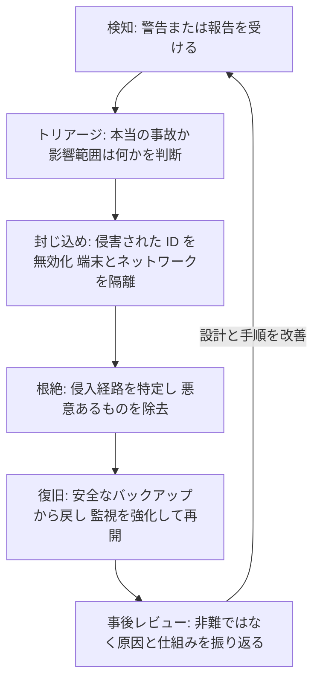

各ノードの意味：
- トリアージ：緊急度と影響範囲を見分けて、対応の優先順位をつける作業
- 封じ込め：被害の拡大を止める。原因の調査より先に行う
- 根絶：再び入られないよう、原因そのものを取り除く
- 事後レビュー：誰が悪いかではなく、仕組みのどこが弱かったかを確認する

#### 10.3 バックアップの原則

ランサム攻撃では、バックアップも狙われます。次の原則で備えます。

| 原則 | 内容 |
|------|------|
| 3-2-1 | データを 3 つ持ち、2 種類の媒体に置き、1 つは別の場所に置く |
| 書き換え不能（Immutable） | 一定期間、削除も変更もできない保存方式にする |
| 復元の訓練 | 取れているかではなく、戻せるかを定期的に試す |
| バックアップ用の資格情報の分離 | 通常の管理者の ID で消せないようにする |

#### 10.4 想定外の状態では「閉じる」：A10 への備え

OWASP A10:2025 の Mishandling of Exceptional Conditions は、エラーや想定外の状態の扱いを誤って、安全でない状態になる問題です。権限確認に失敗したときに「通す」側へ倒れると、停電時にドアが開く金庫と同じ状態になります。

```python
def is_allowed(user, action, policy_client) -> bool:
    # 応答の約束：check は {"allowed": True} または {"allowed": False} を返す。
    try:
        decision = policy_client.check(user, action)
    except Exception:
        # ポリシーサーバーに接続できないなどの場合でも
        # 「許可」にしない。判断できない状態は「拒否」に倒す（Fail Closed）。
        # 内部情報を含む例外の詳細は、利用者には返さず、ログにだけ残す。
        log_internal_error()
        return False

    # 約束どおりの形でない応答は、壊れた応答として「拒否」に倒す。
    if not isinstance(decision, dict) or not isinstance(decision.get("allowed"), bool):
        log_internal_error()
        return False

    # 応答をそのまま真偽値として扱わない。{"allowed": False} も空でない辞書なので、
    # そのまま返すと呼び出し側の if 文では「許可」と判定されてしまう。
    return decision["allowed"]
```

⚠ 逆に、停止が人命や重要な業務に直結するシステムでは、「安全側」が何かを、事前に決めておく必要があります（Fail Safe の考え方）。設計時に、業務の責任者と一緒に決めます。

📖 このセクションで登場した用語
- トリアージ：緊急度に応じて対応の順番を決める作業
- 封じ込め：被害が広がらないよう、影響範囲を切り離すこと
- Fail Closed：エラー時に、拒否や停止の側へ倒す設計
- 3-2-1 ルール：バックアップの基本の分け方
- SIEM：多くの機器のログを集めて分析し、異常を見つける仕組み

### Step 11. 測定して継続的に改善する

**なぜやるのか**：Shostack の 4 番目の質問「十分にできたか」に答えるには、数字で確認する必要があります。CISA の Secure by Design Pledge も、約束だけでなく進捗の証拠を公開する方向に進んでいます。測らない対策は、続いているか分からなくなります。

#### 11.1 初学者向けの測定指標

| 指標 | 意味 | 目安の考え方 |
|------|------|--------------|
| フィッシング耐性のある MFA の対象率 | 管理者と全従業員のうち、対応済みの割合 | 管理者は 100% が目標 |
| 重大な脆弱性の修正までの日数 | 発見から修正までの平均日数 | 短縮の傾向を確認する |
| 依存関係をロックファイルで固定しているリポジトリの割合 | Step 8 の実施状況 | 100% が目標 |
| SBOM を生成しているサービスの割合 | 部品の可視化の進み具合 | 重要サービスから 100% |
| 検知までの時間（MTTD）と復旧までの時間（MTTR） | 運用の速さ | 訓練のたびに短縮する |
| バックアップの復元に成功した割合 | 戻せることの確認 | 100% が目標 |
| 脅威モデリングを実施した機能の割合 | Step 3 の定着度 | 新機能のうち増やしていく |

目安は組織の状況で変わります。数字そのものより、同じ指標を継続して測り、傾向を見ることが重要です。

#### 11.2 年間の改善サイクル

| 周期 | やること |
|------|----------|
| 毎スプリント | 新機能の脅威モデリング（最小の 4 つの質問）、依存関係の更新 |
| 毎月 | 指標の確認、権限の棚卸し、バックアップの復元の確認 |
| 四半期 | `security-scope.yaml` の見直し、机上の事故対応訓練 |
| 年 1 回 | CISA ZTMM などで成熟度を再評価し、次の年の目標を決める |

📖 このセクションで登場した用語
- MTTD：Mean Time To Detect。事故を検知するまでの平均時間
- MTTR：Mean Time To Recover または Respond。復旧または対応までの平均時間
- 机上訓練：実際に操作せず、想定した事故の対応を集まって検討する訓練
- 棚卸し：現状の一覧を作り、過不足を確認する作業

---

## 7. 総合チェックリストと 30/60/90 日ロードマップ

💡 この章では、これまでの内容を、実際に使えるチェックリストと、期間を区切った実行計画にまとめます。すべてを一度にやる必要はなく、優先度の高い順に進めてください。

### 7.1 総合チェックリスト

| ステップ | 確認項目 | 完了 |
|----------|----------|------|
| 1 | 守る範囲、責任者、許容できる被害の上限が文書化されている | ☐ |
| 2 | データを 4 区分に分類し、データフロー図に信頼境界を描いた | ☐ |
| 3 | 主要な機能について、4 つの質問と STRIDE で脅威を洗い出した | ☐ |
| 4 | 管理者アカウントがフィッシング耐性のある MFA になっている | ☐ |
| 4 | 長期の API キーを使わず、短命の資格情報へ移行を始めた | ☐ |
| 5 | 新しい API は「拒否が初期値」で、対象データごとの確認がある | ☐ |
| 5 | 権限のテストに「できないこと」の確認が入っている | ☐ |
| 6 | 社内通信にも認証と暗号化があり、ネットワークが分割されている | ☐ |
| 6 | 外向きの通信が許可リスト方式になっている | ☐ |
| 7 | TLS 1.3 を使い、秘密情報が専用の保管庫にある | ☐ |
| 7 | 暗号の使用箇所を棚卸しし、ハイブリッド対応の計画がある | ☐ |
| 8 | ロックファイルの固定、クールダウン、CI の最小権限を設定した | ☐ |
| 8 | 重要なサービスで SBOM を生成している | ☐ |
| 9 | すべての AI エージェントで Rule of Two を確認した | ☐ |
| 9 | 状態変更と外部送信に人間の承認がある | ☐ |
| 10 | 重要なログを集め、警告と対応手順がある | ☐ |
| 10 | バックアップが書き換え不能で、復元を訓練している | ☐ |
| 11 | 指標を決め、毎月確認している | ☐ |

### 7.2 30/60/90 日ロードマップ

この図は、90 日の実行計画を表しています。横軸が期間で、最初の 30 日に「準備と最優先の穴埋め」を集中させています。

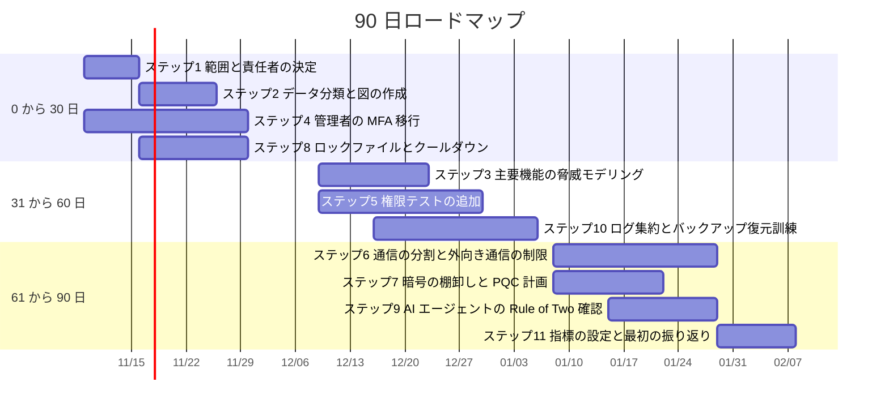

各期間の意味：
- 0〜30 日：被害が最も大きくなりやすい「管理者の認証」と「部品の取り込み」を先に固める
- 31〜60 日：設計の穴（脅威モデリング）と、権限・運用の確認を進める
- 61〜90 日：構造の変更を伴う通信の分割、暗号、AI の確認を行い、指標で成果を確認する

⚠ 日付は例です。自分のスケジュールに合わせて、開始日を変えてください。

📖 このセクションで登場した用語
- ロードマップ：目標までの手順を時期とともに示した計画
- 優先度：どれを先に行うかの順位

---

## 8. 補足ベストプラクティス：著名開発者の投稿と根拠ソース

💡 この章では、2026年11月6日までのウェブ検索で確認した、国際的に知られる開発者・研究者の投稿を、主張と根拠 URL の組で整理します。ここまでの章の判断が、誰のどの投稿に支えられているかを確認できます。

### 8.1 投稿の一覧

| 発信者 | 投稿 | 主張の要旨 | 関連ステップ | 公開日 |
|--------|------|------------|--------------|--------|
| Simon Willison（Django の共同作者。「prompt injection」という語を広めた人物） | The lethal trifecta for AI agents | 私的データ、信頼できない内容、外部通信の 3 つを 1 つのエージェントに同居させない | 9 | 2025年6月16日 |
| Simon Willison | New prompt injection papers: Agents Rule of Two and The Attacker Moves Second | Meta の Rule of Two を、現時点の実践的な助言として評価。防御フィルターの限界も紹介 | 9 | 2025年11月2日 |
| Meta AI セキュリティチーム | Agents Rule of Two: A Practical Approach to AI Agent Security | 1 セッションで A、B、C のうち満たすのは 2 つまで | 9 | 2025年10月31日 |
| William Woodruff | We should all be using dependency cooldowns | 新しい依存の版を一定期間待つことで、多くのサプライチェーン攻撃を避けられる | 8 | 2025年11月21日 |
| William Woodruff | Dependency cooldowns, redux | 疑問への回答。セキュリティ修正のための例外を設計する | 8 | 2025年12月13日 |
| Christian Schneider | Dependency cooldowns: a simple supply chain fix | クールダウンに、不変のコミット SHA 固定を組み合わせる | 8 | 2026年（更新あり） |
| Adam Shostack | Four Question Frame と白書（2024年11月） | 4 つの質問で、軽く始められる脅威モデリング | 3 | 2024年11月（白書） |
| Jeff Vander Stoep、Alex Rebert（Google） | Rust in Android: move fast and fix things ほか | 新しいコードをメモリ安全な言語で書くと、脆弱性の割合が下がる | 8 | 2025年データ |
| Cloudflare（報道経由） | Post-Quantum IPsec など | ハイブリッド ML-KEM を実運用に導入し、通信の過半が対応済み | 7 | 2026年3月 |

### 8.2 補足ベストプラクティスの要約

| # | ベストプラクティス | 根拠のある発信 |
|---|--------------------|----------------|
| 1 | エージェントの設計で、Rule of Two を設計レビューの必須項目にする | Willison、Meta AI |
| 2 | プロンプトの注意書きや検査製品に安全を任せず、構造で防ぐ | Willison、「The Attacker Moves Second」 |
| 3 | 依存関係は、7 日程度のクールダウンと、ロックファイルでの固定を併用する | Woodruff、Schneider |
| 4 | クールダウンにはセキュリティ修正の例外を設計し、遅れによる別のリスクを避ける | Woodruff の続報 |
| 5 | CI のアクションは、タグではなくコミット SHA で固定する | Schneider |
| 6 | 来歴の検証は必要だが十分ではない。意図までは証明しない | HeroDevs、Mondoo の解説（二次） |
| 7 | 新規コードをメモリ安全な言語で書き、段階的に移行する | Google Android チーム |
| 8 | 脅威モデリングを小さく始め、機能ごとに繰り返す | Shostack |
| 9 | 暗号の使用箇所を棚卸しし、鍵共有からハイブリッド ML-KEM に移行する | NIST IR 8547、Cloudflare |
| 10 | フィッシング耐性のある MFA を、特権アカウントから先に導入する | CISA |

### 8.3 最近のサプライチェーン事例（すべて二次情報）

以下は 2026年の事例について、ベンダーや解説サイトが報じた内容の要点です。事実関係は、各プロジェクトの公式な発表で確認してください。

| 時期 | 概要（報じられた内容） | 教訓 | 出典の種別 |
|------|------------------------|------|------------|
| 2026年3月 | Trivy、LiteLLM、axios で相次いで侵害があったとされる（Schneider のブログが言及） | タグの付け替えには、コミット SHA での固定が効く | 【著名開発者】 |
| 2026年5月 | TanStack で、有効な SLSA 来歴を持つ悪意あるバージョンが公開されたと報じられた | 来歴は出自の証明であり、善意の証明ではない | 【二次】 |
| 2026年6月 | Mastra で、タイポスクワッティングと盗まれた貢献者の認証情報により、144 パッケージにアクセスされたと報じられた | 認証情報の保護と、取り込み側のクールダウン | 【二次】 |
| 2026年7月 | jscrambler と AsyncAPI のパッケージで侵害が報じられた | 来歴が付いていても、侵害されたビルドを正しく証明してしまう | 【二次】 |

---

## 9. よくある失敗、情報の限界、用語集、参考文献

💡 この章では、初学者がつまずきやすい失敗の型、このガイドの情報の限界、全体の用語集、そして根拠の URL 一覧を示します。

### 9.1 よくある失敗

| 失敗 | なぜ起きるか | 防ぎ方 |
|------|--------------|--------|
| 製品を買うことがセキュリティだと思う | 目的ではなく手段から始めるため | Step 1〜3 を先に行い、必要な対策を決める |
| MFA を入れたので安心する | SMS やプッシュ通知は、フィッシングに弱い | 特権アカウントから、フィッシング耐性のある方式へ |
| 画面でボタンを隠して権限を制御する | サーバー側の確認が抜けるため | サーバーで毎回、対象データごとに確認する |
| 来歴や署名があるので安全と考える | 証明されるのは出自だけ | クールダウン、最小権限、監視を重ねる |
| AI への指示文で「危険な命令に従うな」と書く | 指示文は、注入された命令と区別できない | 構造（Rule of Two）で、権限と機能を制限する |
| 一度やって終わりにする | 構成と脅威は変わり続ける | Step 11 の周期で、繰り返す |
| 全部を一度にやろうとして止まる | 範囲が広すぎるため | 管理者の認証と部品の取り込みから始める |

### 9.2 このガイドの情報の限界

| 項目 | 内容 |
|------|------|
| 情報基準日 | 2026年11月6日。以降の変更は反映していません |
| 事例の信頼度 | 2026年の個別インシデントの記述は、ベンダーのブログや解説記事に基づく二次情報です |
| 数値 | ツール、企業、署名企業数などの数値は、情報源により異なる場合があります。必ず原典で確認してください |
| URL | 検索結果で確認できた URL を中心に記載しています。※を付けた URL は、公式の恒久的な URL 形式で記載したもので、個別には開いて確認していません |
| 法令・認証 | このガイドは、特定の法令や認証への準拠を保証するものではありません。実際の判断は、専門家と原典で行ってください |

### 9.3 用語集

| 用語 | 意味 |
|------|------|
| アーキテクチャ | システムを構成する部品とその関係の骨組み |
| 認証 / 認可 | 本人の確認 / 許可する操作の決定 |
| Zero Trust | 場所を理由に信頼せず、アクセスのたびに確認する設計 |
| PDP / PEP | 許可を判断する場所 / その判断を強制する場所 |
| 最小権限 | 必要な最小限の権限だけを与える原則 |
| 多層防御 | 守りを何重にも重ねる考え方 |
| 脅威モデリング | 設計の段階で、攻撃者の視点から問題を洗い出す作業 |
| STRIDE | 脅威を 6 種類に分ける整理法 |
| Passkeys / WebAuthn | 公開鍵暗号でパスワードなしのログインを行う仕組み / その標準 |
| IDOR | ID の書き換えで他人のデータに届く弱点 |
| SBOM | ソフトウェアの部品の一覧 |
| SLSA | 成果物の作られ方の信頼度を段階で示す枠組み |
| クールダウン | 新しい版を一定期間取り込まない運用 |
| PQC | 量子コンピュータにも耐えるとされる暗号 |
| ハイブリッド方式 | 従来の暗号と新しい暗号を併用する方式 |
| プロンプトインジェクション | AI が読む文章に命令を紛れ込ませる攻撃 |
| Lethal Trifecta | 私的データ、信頼できない内容、外部通信の 3 つの同居 |
| Rule of Two | 3 つの危険な性質のうち、同時に持つのを 2 つまでにする考え方 |
| Fail Closed | エラー時に拒否や停止へ倒す設計 |
| MTTD / MTTR | 検知までの平均時間 / 復旧または対応までの平均時間 |

### 9.4 参考文献と根拠 URL（2026年11月6日時点）

#### A. 標準化団体・政府機関・公式プロジェクト【一次】

| 項目 | URL |
|------|-----|
| OWASP Top 10:2025 | https://owasp.org/Top10/2025/ |
| OWASP Top 10:2025（日本語） | https://owasp.org/Top10/2025/ja/ |
| OWASP A03:2025 Software Supply Chain Failures | https://top10.owasp.org/2025/A03_2025-Software_Supply_Chain_Failures/ |
| OWASP Threat Modeling Project | https://owasp.org/www-project-threat-modeling/ |
| OWASP SSRF Prevention Cheat Sheet | https://cheatsheetseries.owasp.org/cheatsheets/Server_Side_Request_Forgery_Prevention_Cheat_Sheet.html |
| IPA 情報セキュリティ10大脅威 2026（プレス発表） | https://www.ipa.go.jp/pressrelease/2025/press20260129.html |
| NIST IR 8547 Transition to Post-Quantum Cryptography Standards | https://csrc.nist.gov/pubs/ir/8547/final |
| NIST SP 800-38D Recommendation for Block Cipher Modes of Operation: GCM and GMAC | https://csrc.nist.gov/pubs/sp/800/38/d/final |
| NIST SP 800-63-4 Digital Identity Guidelines | https://csrc.nist.gov/pubs/sp/800/63/4/final |
| NIST SP 800-207 Zero Trust Architecture ※ | https://csrc.nist.gov/pubs/sp/800/207/final |
| NIST Cybersecurity Framework 2.0 ※ | https://www.nist.gov/cyberframework |
| CISA Zero Trust Maturity Model | https://www.cisa.gov/zero-trust-maturity-model |
| CISA Secure by Design | https://www.cisa.gov/securebydesign |
| CISA Secure by Design Pledge | https://www.cisa.gov/securebydesign/pledge |
| CISA Secure by Design Pledge 進捗レポート | https://www.cisa.gov/securebydesign/pledge/progress-reports |
| CISA Implementing Phishing-Resistant MFA（2022年10月） | https://www.cisa.gov/sites/default/files/publications/fact-sheet-implementing-phishing-resistant-mfa-508c.pdf |
| ASD ACSC Foundations for modern defensible architecture | https://cyber.gov.au/business-government/secure-design/secure-by-design/modern-defensible-architecture |
| Threat Modeling Manifesto | https://threatmodelingmanifesto.org/ |
| Shostack's Four Question Frame（GitHub） | https://github.com/adamshostack/4QuestionFrame |
| Shostack 白書 The Four Question Framework（2024年11月） | https://shostack.org/files/papers/The_Four_Question_Framework.pdf |
| Google Security Blog: Rust in Android | https://blog.google/security/rust-in-android-move-fast-fix-things/ |
| Meta AI: Agents Rule of Two | https://ai.meta.com/blog/practical-ai-agent-security/ |

#### B. 著名開発者・研究者の投稿【著名開発者】

| 発信者 | URL |
|--------|-----|
| Simon Willison: The lethal trifecta for AI agents | https://simonwillison.net/2025/Jun/16/the-lethal-trifecta/ |
| Simon Willison: New prompt injection papers | https://simonwillison.net/2025/Nov/2/new-prompt-injection-papers/ |
| Simon Willison: Dependency cooldowns の紹介 | https://simonwillison.net/2025/Nov/21/dependency-cooldowns |
| William Woodruff: We should all be using dependency cooldowns | https://blog.yossarian.net/2025/11/21/We-should-all-be-using-dependency-cooldowns |
| William Woodruff: Dependency cooldowns, redux | https://blog.yossarian.net/2025/12/13/cooldowns-redux |
| Christian Schneider: Dependency cooldowns | https://www.christian-schneider.net/blog/dependency-cooldowns-supply-chain-defense/ |
| LWN: 依存クールダウンをめぐる議論（Paterson の反論を含む） | https://lwn.net/Articles/1068692/ |
| gem.coop: cooldowns beta | https://gem.coop/updates/4 |

#### C. 解説記事・ニュース・ベンダー資料【二次】

| 項目 | URL |
|------|-----|
| InfoQ: Cloudflare のハイブリッド ML-KEM 導入 | https://www.infoq.com/news/2026/03/cloudflare-post-quantum-ipsec |
| Cycode: OWASP Top 10 for Agentic Applications | https://cycode.com/blog/owasp-top-10-agentic-applications/ |
| Modulos: OWASP Top 10 for Agentic Applications (2026) | https://docs.modulos.ai/frameworks/owasp-top-10-agentic |
| Databricks: プロンプトインジェクション対策と Rule of Two | https://www.databricks.com/blog/mitigating-risk-prompt-injection-ai-agents-databricks |
| HeroDevs: Mini Shai-Hulud（SLSA 来歴付きの悪意あるバージョン） | https://www.herodevs.com/blog-posts/mini-shai-hulud-another-npm-supply-chain-worm-and-why-just-update-isnt-the-answer |
| Cloudsmith: Mastra への攻撃の解説 | https://cloudsmith.com/blog/inside-the-mastra-npm-supply-chain-attack |
| Mondoo: npm サプライチェーンのセキュリティ 2026 | https://mondoo.com/blog/npm-supply-chain-security-package-manager-defenses-2026 |
| Teleport: Zero Trust Architecture の解説 | https://goteleport.com/learn/zero-trust-architecture/ |
| NordLayer: NIST SP 800-207 の解説 | https://nordlayer.com/learn/zero-trust/nist-sp-800-207/ |
| @IT: IPA 10大脅威 2026 の解説 | https://atmarkit.itmedia.co.jp/ait/articles/2603/03/news057.html |
| Impress Watch: IPA 10大脅威 2026 | https://internet.watch.impress.co.jp/docs/news/2082250.html |

---

*このガイドは、2026年11月6日までに確認できた公開情報をもとに作成した学習用の資料です。実際のシステムへの適用では、最新の原典と自組織のリスクを確認し、必要に応じて専門家の助言を受けてください。*
