# ソフトウェア開発 セキュリティ完全ガイド（2026年11月版）

> **SDLC・OWASP・AI・サプライチェーン・PQC を初学者向けにステップバイステップで解説**
>
> - 情報基準日: **2026年11月7日**（この日までにウェブ検索で確認できた情報に基づく）
> - 対象読者: Webアプリ・API・OSS・AIアプリを開発し始めたエンジニア、QAエンジニア、技術リーダー
> - 図解ルール: フローチャート・シーケンス図は **Mermaid**、表は **Markdown** で記述（ASCII アートは不使用）
> - 出典: 各章末と「第8章」「参考文献」に URL を掲載。**数値・日付は必ず一次情報で再確認**してください

---

## 目次

1. [このガイドの読み方と全体マップ](#第0章-このガイドの読み方と全体マップ)
2. [第1章 2026年11月の脅威ランドスケープ](#第1章-2026年11月の脅威ランドスケープ)
3. [第2章 Secure SDLC（安全な開発ライフサイクル）](#第2章-secure-sdlc安全な開発ライフサイクル)
4. [第3章 OWASP Top 10:2025 完全理解](#第3章-owasp-top-102025-完全理解)
5. [第4章 AI 時代のセキュリティ（AI生成コード・LLM・エージェント・MCP）](#第4章-ai-時代のセキュリティ)
6. [第5章 ソフトウェアサプライチェーン防御](#第5章-ソフトウェアサプライチェーン防御)
7. [第6章 PQC（耐量子計算機暗号）移行](#第6章-pqc耐量子計算機暗号移行)
8. [第7章 統合ロードマップ（30/60/90日）](#第7章-統合ロードマップ306090日)
9. [第8章 補足ベストプラクティスと根拠ソース](#第8章-補足ベストプラクティスと根拠ソース)
10. [第9章 用語ミニ辞典](#第9章-用語ミニ辞典)
11. [情報の確度に関する注意](#情報の確度に関する注意)
12. [参考文献（URL一覧）](#参考文献url一覧)

---

## 第0章 このガイドの読み方と全体マップ

### 0.1 3行でわかる要点

1. **2026年の主戦場は「自分のコード」ではなく「自分が信頼している他人のコードと道具」**です。OWASP Top 10:2025 では *ソフトウェアサプライチェーンの失敗* が新たに3位に入りました。
2. **AI は「コードを書く側」にも「攻撃される側（エージェント）」にもなりました。** AI が書いたコードは"未レビューの外部コントリビューション"として扱い、AIエージェントには**最小権限**を与えます。
3. **暗号の寿命が前倒しされています。** NIST は 2026年10月27日に IR 8547 最終版を公表し、RSA/ECC を **2030年を過ぎると非推奨、2035年を過ぎると NIST の標準・ガイドライン上で使用不可**としました。さらに Google・Cloudflare は **2029年**を自社の完了目標に設定しています。

### 0.2 全体マップ

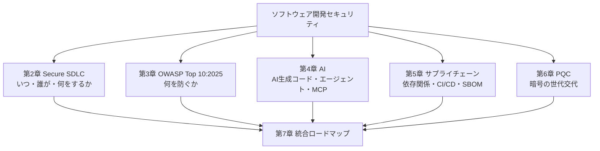

### 0.3 レベル別おすすめ読み順

| あなたの状況 | 最初に読む | 次に読む | 最後に |
|---|---|---|---|
| セキュリティ初学者 | 第1章 → 第3章 | 第2章 | 第9章（用語集） |
| 開発チームのリーダー | 第2章 → 第7章 | 第5章 | 第6章 |
| AI/LLMアプリ開発者 | 第4章 | 第3章（A01/A05） | 第5章 |
| OSS メンテナ・パッケージ公開者 | 第5章 | 第2章 | 第6章 |
| 基盤・暗号・プラットフォーム担当 | 第6章 | 第5章 | 第7章 |

### 0.4 このガイドで使う3つの原則

| 原則 | 意味 | 例 |
|---|---|---|
| **信頼しない・検証する** | 入力・依存関係・AI出力・CI上のコードをすべて「未検証」とみなす | 依存パッケージは固定（ロックファイル）＋署名/来歴の確認 |
| **最小権限** | 人・サービス・CIトークン・AIエージェントに必要最小限だけ渡す | CIの `permissions: contents: read` |
| **失敗時は安全側（Fail Closed）** | エラー時に"通す"のではなく"止める" | 認可チェックで例外が起きたら拒否 |

---

## 第1章 2026年11月の脅威ランドスケープ

### 1.1 いま何が起きているか（5大トレンド）

| # | トレンド | 一言でいうと | 代表的な根拠（詳細は各章） |
|---|---|---|---|
| 1 | **自己増殖型ワームによる npm/PyPI 汚染** | 盗んだ公開トークンで、被害者の他のパッケージにも感染を広げる | 2026年5月 TanStack/Mini Shai-Hulud、8月 ChainDrop（keyv 他 444+パッケージ） |
| 2 | **CI/CD の悪用** | ビルド用の仕組み（GitHub Actions 等）自体が侵入口になる | `pull_request_target` の誤用、Actions キャッシュ汚染、OIDC トークン窃取 |
| 3 | **プロンプトインジェクションの常態化** | AIが読む文章（Web・メール・Issue）に仕込んだ命令で乗っ取る | OWASP Agentic Top 10（2025/12/9公開）、「致命的三位一体」 |
| 4 | **AI生成コードの品質ギャップ** | 速く書けるが、安全とは限らない | Veracode 2026年10月版: セキュリティ合格率 62%（前回 56%） |
| 5 | **暗号移行の期限前倒し** | 「2035年でいい」から「2029年を目標に」へ | NIST IR 8547 最終版（2026/10/27）、Google 2029 年目標（2026/3/25） |

### 1.2 数字で見る現状

| 指標 | 値 | 出典・注記 |
|---|---|---|
| 2025年に新たに確認された悪意あるOSSパッケージ | 454,600 超（前年比 +75%） | Sonatype 2026 レポート（Patrowl の記事経由で引用） |
| サプライチェーン侵害の平均コスト／特定・封じ込め日数 | 約 491 万ドル／267 日 | IBM Cost of a Data Breach 2025（同上） |
| OWASP A03（サプライチェーン）の発生率 | 5.19%（Top10 中で最高）だが CVE の紐付けは少ない | Qualys ブログ。**攻撃が起きていてもスキャナに"署名"が無い**ことを示唆 |
| 侵害の入口としての脆弱性悪用 | 31%（資格情報窃取を上回る） | 2026 Verizon DBIR（Veracode ブログ経由） |
| 解消に1年超かかっている脆弱性（"セキュリティ負債"）を抱える組織 | 82% | Veracode 2026 State of Software Security |
| AI生成コードのセキュリティ合格率（平均） | 62%（2026年10月） | Veracode。XSS(CWE-80)は夏版で合格率 15% |
| MCP サーバーに対する CVE（2026年1〜2月だけで） | 30件超 | Cycode のまとめ |

> **初学者向けメモ**: 数字は"傾向をつかむ道具"です。調査会社ごとに母集団や基準が違うので、**一つの数字を鵜呑みにしない**のがコツです。

### 1.3 攻撃者の視点: なぜ"手前"を狙うのか

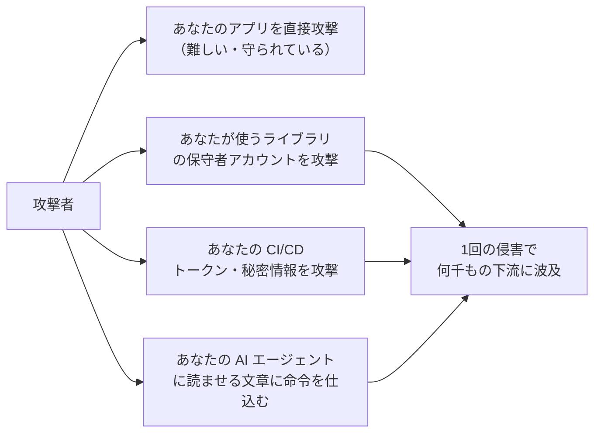

**ポイント**: 攻撃者は"1社ずつ"より"1か所で大量に"を好みます。だから防御側も、**自分の外側にある信頼の連鎖**を点検する必要があります。

---

## 第2章 Secure SDLC（安全な開発ライフサイクル）

### 2.1 Secure SDLC とは

**SDLC**（Software Development Life Cycle）は「要件 → 設計 → 実装 → テスト → リリース → 運用」という開発の流れです。**Secure SDLC** は、その各段階にセキュリティ活動を組み込むことです。「最後にペンテストをして終わり」ではなく、**早い段階（Shift Left）から継続的に**行います。

### 2.2 全体フロー（セキュリティゲート付き）

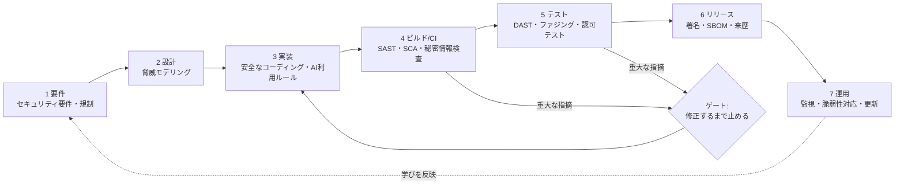

### 2.3 参考にする"公式の型": NIST SSDF

**SSDF（Secure Software Development Framework, NIST SP 800-218）** は、安全な開発の実践を4つのグループに整理した枠組みです。

| グループ | 略称 | 中身（やさしい言い換え） |
|---|---|---|
| Prepare the Organization | PO | 方針・役割・ツール・教育を整える |
| Protect the Software | PS | ソースコード・成果物を改ざんから守る |
| Produce Well-Secured Software | PW | 設計・実装・レビュー・テストで安全に作る |
| Respond to Vulnerabilities | RV | 脆弱性を見つけて直し、根本原因まで分析する |

**2026年11月時点の更新状況**

| 項目 | 状況（調査時点） |
|---|---|
| SSDF 1.1（SP 800-218） | 2022-02 に最終版 |
| **SSDF 1.2（SP 800-218 Rev.1）** | 2025-12-17 に初版ドラフト公開、コメント受付は 2026-01-30 に終了。ドラフトでは **PO.6 継続的改善**、**PW.10 堅牢で信頼できる更新**、**AI がコードを生成する場合**への言及などが追加。NIST の公式一覧ページ（更新日 2026-04-13）では私が確認した時点で Draft 表記。**最終版の有無は NIST 公式で要確認** |
| SP 800-218A | 生成AI・デュアルユース基盤モデル向けの SSDF コミュニティプロファイル（2024-07-26 最終） |

### 2.4 ステップバイステップ: 各フェーズでやること

#### Step 1: 要件定義 —「何を守るか」を言葉にする

| やること | 具体例 | 成果物 |
|---|---|---|
| 守る資産を洗い出す | 個人情報、決済情報、APIキー、ソースコード | 資産一覧 |
| セキュリティ要件を書く | 「管理画面は多要素認証必須」「ログは 1 年保存」 | 要件定義書の非機能要件 |
| 規制・契約を確認する | 個人情報保護法、PCI DSS、**EU CRA**（第5章参照） | コンプライアンス表 |
| 検証基準を決める | **OWASP ASVS** のレベル（L1/L2/L3）を選ぶ | 目標レベルの合意 |

> **ASVS（Application Security Verification Standard）** は"Webアプリが満たすべきセキュリティ要件のチェックリスト"です。「何をもって安全とするか」を決める物差しになります。

#### Step 2: 設計 — 脅威モデリングで"壊れ方"を先に考える

**脅威モデリング**は、コードを書く前に「どう攻撃されるか」を考える作業です。Adam Shostack が広めた4つの問いが定番です。

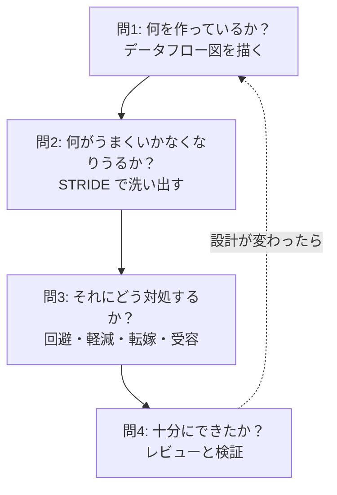

**STRIDE 早見表**（初学者はまずこれだけ）

| 頭文字 | 脅威 | 一言で | 典型的な対策 |
|---|---|---|---|
| S | なりすまし（Spoofing） | 他人のふりをする | 強い認証（パスキー、MFA） |
| T | 改ざん（Tampering） | データを書き換える | 署名、整合性チェック、入力検証 |
| R | 否認（Repudiation） | 「やっていない」と言える | 監査ログ、改ざん検知 |
| I | 情報漏えい（Information disclosure） | 見せてはいけないものが見える | 暗号化、アクセス制御 |
| D | サービス拒否（Denial of service） | 使えなくする | レート制限、タイムアウト |
| E | 権限昇格（Elevation of privilege） | 本来できないことができる | 最小権限、認可の一元化 |

**AI 機能を含む設計では**、データフロー図に「LLM」「ツール」「ベクトルDB」「外部コンテンツ」を必ず描き込み、**どこに"信頼できない文章"が入ってくるか**を線で示します（第4章）。

#### Step 3: 実装 — 安全なコーディングの基本ルール

| ルール | 理由 | 関連（第3章） |
|---|---|---|
| 入力は検証し、出力は文脈に合わせてエスケープ | インジェクション/XSS の根本対策 | A05 |
| SQL は必ずパラメータ化クエリ | 文字列連結が SQL インジェクションの原因 | A05 |
| 認可チェックはサーバー側で、リソース単位で行う | クライアントの制御は回避できる | A01 |
| 秘密情報（鍵・トークン）をコードに書かない | リポジトリ流出で即漏えい | A02/A04 |
| エラー時は拒否（Fail Closed）し、内部情報は返さない | 例外処理の不備が悪用される | A10 |
| 暗号は実績ある標準ライブラリを使う（自作しない） | 実装ミスが最大のリスク | A04/第6章 |
| **AI が書いたコードも人間が理解してからマージ** | 第4章参照 | 全般 |

#### Step 4: ビルド/CI — 自動チェックの"安全網"

| ツール分類 | 何を見つける | 例（製品名は一例） | いつ動かす |
|---|---|---|---|
| **SAST** | ソースコードの脆弱なパターン | CodeQL、Semgrep など | プルリクエストごと |
| **SCA** | 依存ライブラリの既知脆弱性・ライセンス | Dependabot、OSV-Scanner など | PR ごと＋毎日 |
| **シークレットスキャン** | コミットされた鍵・トークン | gitleaks、GitHub secret scanning など | コミット前＋PR |
| **IaC スキャン** | Terraform/K8s の設定ミス | Checkov、Trivy など | PR ごと |
| **コンテナスキャン** | ベースイメージの脆弱性 | Trivy、Grype など | ビルドごと |

> **注意**: ツールは"導入して終わり"ではなく、**誤検知の整理（トリアージ）とSLA**（例: 重大は7日以内に修正）まで決めて初めて機能します。

#### Step 5: テスト — 「攻撃者として」確認する

| テスト | 目的 | 初学者へのヒント |
|---|---|---|
| **認可テスト** | 他人のデータにアクセスできないか | ユーザーAのトークンでユーザーBのIDを指定してみる |
| **DAST** | 動いているアプリへの疑似攻撃 | ステージング環境で実行 |
| **ファジング** | 想定外入力でクラッシュしないか | パーサー・デコーダに有効 |
| **異常系テスト** | タイムアウト・不正データ・巨大入力 | **A10**（例外処理）対策に直結 |
| **依存関係の動作確認** | 更新後も壊れないか | 自動テストを厚くして"更新を怖がらない" |

#### Step 6: リリース — 「これは正規の成果物」と証明できる状態にする

| 項目 | 内容 | 詳細 |
|---|---|---|
| 署名 | 成果物（コンテナ、パッケージ）に署名 | 第5章 |
| **SBOM** | 部品表を成果物と一緒に出す | 第5章（CISA 2026 年版） |
| 来歴（Provenance） | どこで・どのソースから・どう作ったかの証明 | 第5章（SLSA） |
| 変更管理 | 本番反映は二人承認・ブランチ保護 | 全般 |

#### Step 7: 運用 — 見つけて、直して、学ぶ

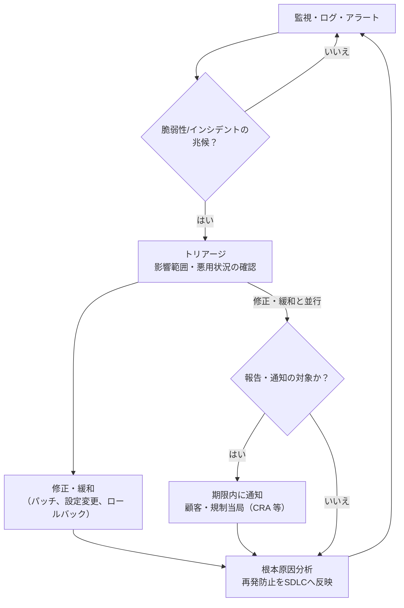

- **EU CRA（サイバーレジリエンス法）**: EU 市場向けの"デジタル要素を持つ製品"の製造者は、**2026年9月11日から**、悪用が確認された脆弱性と重大インシデントを ENISA の Single Reporting Platform 経由で報告する義務があります。いずれも**認知から早期警告 24 時間以内、続報 72 時間以内**。最終報告は、**悪用が確認された脆弱性は是正・緩和措置が利用可能になってから 14 日以内、重大インシデントは 72 時間の続報から 1 か月以内**です。詳細は第5章。

### 2.5 Secure SDLC セルフチェック（20問）

| # | 質問 | はい/いいえ |
|---|---|---|
| 1 | 守る資産とデータ分類を一覧にしている | |
| 2 | ASVS など検証基準のレベルを決めている | |
| 3 | 新機能の設計時に脅威モデリングをしている | |
| 4 | 認可チェックを共通部品に集約している | |
| 5 | シークレットをコード・CI ログに出さない仕組みがある | |
| 6 | PR で SAST/SCA/シークレットスキャンが自動で走る | |
| 7 | 重大な指摘がある場合はマージできない（ゲート） | |
| 8 | 依存関係はロックファイルで固定している | |
| 9 | 新しく公開された依存バージョンをすぐには取り込まない（待機期間）| |
| 10 | CI のアクションを SHA で固定している | |
| 11 | CI トークンは最小権限・短寿命である | |
| 12 | 成果物に署名し、SBOM を生成している | |
| 13 | 本番反映に二人承認がある | |
| 14 | ログ・アラートがあり、見る人が決まっている | |
| 15 | 脆弱性対応の SLA（期限）を決めている | |
| 16 | インシデント対応手順を年1回は訓練している | |
| 17 | AI コーディング支援の利用ルールがある | |
| 18 | AI エージェントの権限が最小化されている | |
| 19 | 暗号の使用箇所を棚卸ししている | |
| 20 | 振り返り（ポストモーテム）をSDLCに反映している | |

> 「いいえ」が多くても大丈夫です。**第7章の30/60/90日計画**で優先順位をつけて進めましょう。

---

## 第3章 OWASP Top 10:2025 完全理解

### 3.1 OWASP Top 10 とは

OWASP（Open Worldwide Application Security Project）が公表する、**Webアプリで特に重大なリスクのランキング**です。「全部を暗記する」のではなく、**開発者の共通言語**として使います。2025年版は、データと業界アンケートに基づき更新され、**新カテゴリが2つ**加わりました。

### 3.2 2025年版の一覧と変化

| 順位 | カテゴリ | 2021年版からの変化 | 一言で |
|---|---|---|---|
| A01 | **Broken Access Control**（アクセス制御の不備） | 1位継続。**SSRF は A01 に統合** | 見てはいけない/操作してはいけないものに触れる |
| A02 | **Security Misconfiguration**（設定ミス） | 5位 → 2位に上昇 | 初期設定・過剰な公開・不要機能の有効化 |
| A03 | **Software Supply Chain Failures**（サプライチェーンの失敗） | **新規**（旧「脆弱で古いコンポーネント」を拡張） | 依存・ビルド・配布の信頼が壊れる |
| A04 | **Cryptographic Failures**（暗号の失敗） | 2位 → 4位 | 暗号化しない/弱い暗号/鍵管理の不備 |
| A05 | **Injection**（インジェクション） | 3位 → 5位 | 入力が命令として実行される |
| A06 | **Insecure Design**（安全でない設計） | 4位 → 6位 | 設計段階の欠陥 |
| A07 | **Authentication Failures**（認証の失敗） | 名称変更（旧: Identification and Authentication Failures） | ログイン・セッション管理の不備 |
| A08 | **Software or Data Integrity Failures**（ソフトウェア/データの完全性の失敗） | 8位継続 | 署名なし更新・信頼できないデシリアライズ |
| A09 | **Security Logging and Alerting Failures**（ログとアラートの失敗） | 名称変更（"Monitoring"→"Alerting"） | 記録しても通知しなければ気づけない |
| A10 | **Mishandling of Exceptional Conditions**（例外状況の不適切な処理） | **新規** | エラー・タイムアウト時に"危険な側"へ倒れる |

> 出典: OWASP 公式 Top 10:2025、および複数の解説記事（第8章に URL）。

### 3.3 カテゴリ別: 初学者向け解説と対策

#### A01: Broken Access Control（アクセス制御の不備）

**例え話**: ホテルのカードキーで、自分の部屋以外のドアも開いてしまう状態。

**よくある失敗**: URL の ID を書き換えると他人の注文が見える（IDOR）。管理者用 API が一般ユーザーにも使える。

```typescript
// ❌ 悪い例: ログインしているかしか見ていない
app.get("/api/orders/:id", requireLogin, async (req, res) => {
  const order = await db.orders.findById(req.params.id);
  res.json(order); // 他人の注文でも返してしまう
});

// ✅ 良い例: 「このユーザーのものか」を必ず検証（サーバー側・リソース単位）
app.get("/api/orders/:id", requireLogin, async (req, res) => {
  const order = await db.orders.findOne({
    id: req.params.id,
    ownerId: req.user.id, // 所有者条件をクエリに含める
  });
  if (!order) return res.status(404).end(); // 存在有無も漏らさない
  res.json(order);
});
```

**対策チェック**: 既定は拒否（Deny by default）／認可ロジックを一元化／所有者チェックをクエリ条件に含める／**SSRF 対策**（サーバーが取得してよい宛先を許可リストで制限し、内部アドレス・メタデータサービスへのアクセスを遮断）。

#### A02: Security Misconfiguration（設定ミス）

**例え話**: 金庫を買ったのに、初期暗証番号「0000」のまま使う。

| よくあるミス | 対策 |
|---|---|
| クラウドストレージの公開設定 | 既定で非公開、IaC スキャンで検知 |
| デバッグ画面・スタックトレースの本番露出 | 本番ではデバッグ無効、汎用エラー表示 |
| 不要なポート/サービス/サンプルアプリ | 最小構成のイメージ、ハードニング |
| セキュリティヘッダ未設定 | CSP、HSTS、X-Content-Type-Options などを設定 |

#### A03: Software Supply Chain Failures（サプライチェーンの失敗）★新規

**例え話**: 食材（ライブラリ）・調理場（CI）・配送（レジストリ）のどこかに毒を混ぜられる。

- 対象は**依存ライブラリだけでなく、ビルドシステム、CI/CD、パッケージの配布、ベンダーへの信頼**まで広がりました。
- **詳しくは第5章**で、2026年の実例と対策を段階的に解説します。

#### A04: Cryptographic Failures（暗号の失敗）

| よくある失敗 | 正しい方向 |
|---|---|
| 平文で保存/送信 | TLS を使用、機密データは保存時にも暗号化 |
| パスワードを高速ハッシュ（MD5/SHA-1）で保存 | **Argon2id**、bcrypt、scrypt などパスワード専用のハッシュ |
| 自作暗号、古いアルゴリズム（DES、RC4 等） | 実績ある標準ライブラリと推奨アルゴリズム |
| 鍵をコードやリポジトリに置く | シークレット管理サービス、定期ローテーション |
| **将来の量子計算機への備えがない** | **暗号の棚卸しと PQC 計画**（第6章） |

#### A05: Injection（インジェクション）

```python
# ❌ 悪い例: 文字列連結で SQL を組み立てる
cursor.execute(f"SELECT * FROM users WHERE name = '{name}'")

# ✅ 良い例: パラメータ化クエリ（値は「データ」として扱われる）
cursor.execute("SELECT * FROM users WHERE name = %s", (name,))
```

- SQL だけでなく、OS コマンド、LDAP、NoSQL、テンプレート、**プロンプト（第4章）** にも同じ構造があります。
- 共通の原則は「**命令とデータを混ぜない**」。Simon Willison は、プロンプトインジェクションを「信頼できる内容と信頼できない内容を同じ文脈に混ぜる問題」と位置づけ、SQL インジェクションにちなんで命名しています。

#### A06: Insecure Design（安全でない設計）

- 実装を完璧にしても直らない"設計の欠陥"です（例: 回数制限がないパスワード再発行、残高チェックの競合状態）。
- **対策**: 脅威モデリング（2.4 Step 2）、セキュリティ要件の事前定義、悪用ケース（アビューズケース）のテスト。

#### A07: Authentication Failures（認証の失敗）

| 対策 | 理由 |
|---|---|
| **パスキー（FIDO2/WebAuthn）** や MFA の提供 | パスキーはフィッシング耐性がある。MFA 全般に同じ耐性があるわけではなく、OTP 型 MFA のコードはリアルタイムのフィッシングで盗み取られ、中継され得る |
| ログイン試行のレート制限・ロックアウト | 総当たり・クレデンシャルスタッフィング対策 |
| セッション ID はログイン後に再発行、適切な有効期限 | セッション固定攻撃の防止 |
| 弱い/漏えい済みパスワードの拒否 | 推測攻撃の成功率を下げる |

#### A08: Software or Data Integrity Failures（完全性の失敗）

- **署名のない更新**、**信頼できないデータのデシリアライズ**、**CI で検証なしにダウンロードして実行**などが該当します。
- A03 が"依存関係レベル"なのに対し、A08 は**信頼境界でのコード/データの完全性**に焦点があります。
- **対策**: 成果物の署名と検証、ハッシュ固定、安全なデシリアライズ形式（JSON 等）の使用。

#### A09: Security Logging and Alerting Failures（ログとアラートの失敗）

| 記録すべきイベント | 注意点 |
|---|---|
| ログイン成功/失敗、権限変更、認可の拒否 | **パスワード・トークン・個人情報はログに出さない** |
| 管理操作、重要データの参照/エクスポート | 改ざんされにくい場所へ転送 |
| 異常（短時間の大量失敗など） | **アラートが"誰に"届き、"いつまでに"見るか**を決める |

#### A10: Mishandling of Exceptional Conditions（例外状況の不適切な処理）★新規

**例え話**: 自動ドアが故障したとき「開きっぱなし」になるか「閉まったまま」になるか。

```python
# ❌ 悪い例: 認可サービスの障害時に"通してしまう"（Fail Open）
def can_access(user, resource):
    try:
        return auth_service.check(user, resource)
    except Exception:
        return True  # エラー時に許可 → 危険

# ✅ 良い例: 障害時は拒否し、ログに残す（Fail Closed）
def can_access(user, resource):
    try:
        return auth_service.check(user, resource)
    except Exception as e:
        logger.error("auth check failed", exc_info=e)  # 内部情報は応答に含めない
        return False
```

**対策**: 例外は必ず捕捉して安全側に倒す／タイムアウト・リトライ上限・リソース上限を設定／異常系テスト（第2章 Step 5）／ユーザーには汎用メッセージ、詳細はログへ。

### 3.4 OWASP の関連資産（使い分け）

| 資産 | 用途 | 使うタイミング |
|---|---|---|
| **Top 10** | 意識合わせ・教育 | 新人研修、リスクの共通言語 |
| **ASVS** | 検証要件のチェックリスト | 要件定義・受入テスト |
| **SAMM** | 組織のセキュリティ成熟度評価 | 年次の改善計画 |
| **Cheat Sheet Series** | 実装レシピ集 | コーディング中の参照 |
| **WSTG** | テスト手順書 | ペンテスト・QA |

> **QAエンジニアの方へ**: Top 10 をテスト観点表に変換し、A01（認可の網羅）、A05（入力境界値）、A10（異常系）を自動テスト化すると、効果が大きく出ます。

---

## 第4章 AI 時代のセキュリティ

AI まわりは 3 つの異なる問題に分けると整理しやすくなります。

| 区分 | 問い | 主なリスク | 主な拠り所 |
|---|---|---|---|
| **A. AI が書くコード** | AI の出力を信用してよいか | 脆弱なコード、存在しない/偽のパッケージ名の提案 | Veracode 調査、SSDF（AI をコード生成者として扱う） |
| **B. AI を組み込んだアプリ（LLM アプリ）** | 入力・出力・データをどう守るか | プロンプトインジェクション、情報漏えい | OWASP Top 10 for LLM Applications |
| **C. 自律的に動く AI（エージェント・MCP）** | 権限を持った AI が乗っ取られたら | 目的の乗っ取り、ツール悪用、権限濫用 | OWASP Top 10 for Agentic Applications、OWASP MCP Top 10 |

### 4.1 A. AI が書いたコードを安全に使う

#### 現状データ

- Veracode の 2026 年夏版では、100 超のモデルの平均セキュリティ合格率は **56%** で、前年（55%）からほぼ横ばいでした。構文の正しさはほぼ 100% なのに、安全性は伸びていません。
- 2026 年 10 月 29 日公表の更新版では、平均が **62%**、脆弱なコードの割合が **44% → 38%** に改善しました。ただし「4割近くは依然として脆弱」で、**言語差**（Java が最も低く、Python が最も高い）やモデル差が大きいままです。
- 夏版では、XSS（CWE-80）に対する合格率が **15%** と特に低い結果でした。

> **初学者向けの結論**: AI は"とても速い新人"です。成果物は**レビューとテストを通してから**採用します。

#### ステップバイステップ: AI コーディング支援の安全な使い方

| Step | やること | 理由 |
|---|---|---|
| 1 | AI が出したコードを**自分で説明できるまで**マージしない | 理解していないコードは保守できず、脆弱性にも気づけない |
| 2 | PR に「AI 生成部分あり」と明記し、通常と同じ（または厳しめの）レビューをする | 責任の所在を明確にする |
| 3 | SAST・SCA・シークレットスキャンを **必須ゲート**にする | 人の目だけに頼らない |
| 4 | **提案された依存パッケージの実在と、名前・公開元が正規プロジェクトの公式ドキュメントと一致することを確認**してから追加する | 存在しない名前を AI が提示し、攻撃者がその名前で悪性パッケージを公開する手口（"スロップスクワッティング"）があり、実在だけでは正規と判断できないため |
| 5 | プロンプトに**セキュリティ要件**を明示（例:「パラメータ化クエリを使う」「入力検証を含める」） | 何も指示しないと安全性が後回しになりやすい |
| 6 | 機密データ（顧客情報・鍵・内部コード）を外部の AI サービスに貼らない規則を作る | データ持ち出しの防止 |
| 7 | 利用する AI ツール・モデル・拡張機能を**一覧管理**（承認制） | 野良ツールの混入防止 |

### 4.2 B. LLM を組み込んだアプリの基本

**OWASP Top 10 for LLM Applications（2025年版）** の主な項目（筆者の知識に基づく一覧。今回の検索では個別に再確認していないため、公式サイトで最新版を確認してください）:

| ID | 名称 | 初学者向けの一言 |
|---|---|---|
| LLM01 | Prompt Injection | AI が読む文章に仕込まれた命令に従ってしまう |
| LLM02 | Sensitive Information Disclosure | 学習・文脈に含まれる機密を出力してしまう |
| LLM03 | Supply Chain | モデル・データ・プラグインの供給元が汚染される |
| LLM04 | Data and Model Poisoning | 学習・微調整データに毒を混ぜられる |
| LLM05 | Improper Output Handling | AI の出力を無検証でコード実行・HTML 描画する |
| LLM06 | Excessive Agency | AI に権限・機能を与えすぎる |
| LLM07 | System Prompt Leakage | システムプロンプト内の秘密が漏れる |
| LLM08 | Vector and Embedding Weaknesses | RAG の検索基盤の弱点を突かれる |
| LLM09 | Misinformation | もっともらしい誤りを信じてしまう |
| LLM10 | Unbounded Consumption | 無制限な利用でコスト・障害が発生する |

**最重要の設計原則**: **AI の出力は"信頼できない入力"として扱う**（LLM05）。AI が返した文字列を、そのまま SQL・シェル・HTML・URL として使いません。これは第3章 A05（インジェクション）と同じ考え方です。

### 4.3 C. AI エージェントと「致命的三位一体（Lethal Trifecta）」

**AI エージェント**は、計画を立て、ツール（メール、ファイル、Web、社内 API など）を呼び出して**実際に行動**するAIです。

Simon Willison（"prompt injection" の命名者）は 2025 年 6 月 16 日に、次の 3 つが 1 つのエージェントに揃うと、攻撃者がデータを盗めると警告しました。

| # | 要素 | 例 |
|---|---|---|
| 1 | **機密データへのアクセス** | 社内ドキュメント、メール、非公開リポジトリ |
| 2 | **信頼できないコンテンツへの露出** | Web ページ、受信メール、誰でも書ける Issue、PDF |
| 3 | **外部への通信手段** | HTTP リクエスト、メール送信、リンクの描画 |

**なぜ"プロンプトで禁止"では防げないのか**: LLM は、運用者の指示も、読み込んだ文章中の指示も、**同じ一続きのトークン**として受け取ります。どの命令が正規かを確実に区別できないため、Willison は「ガードレール製品が 95% 防げる」という売り文句を、Web セキュリティでは不合格点だと批判し、**3 要素の組み合わせそのものを避ける**ことを勧めています。

#### Meta の「Agents Rule of Two」（2025年10月31日公表）

Willison の 3 要素を発展させ、Meta は **[A] 信頼できない入力の処理、[B] 機密システムまたは非公開データへのアクセス、[C] 状態変更または外部通信**を評価します。**人間の承認なしに動くエージェントは、1 セッション内で満たしてよいのは 2 つまで**とします。現在有効な権限だけでなく、**蓄積したセッション履歴**も含めて判定します。

一度読んだ機密データは、読み取り権限を外してもコンテキスト内に残ります。そこに信頼できない入力と外部通信を組み合わせる前に、**攻撃経路を断つ安全な遷移**（例: 外部通信を無効化し、同じセッションでは再有効化しない）か、**機密データや未検証の履歴を引き継がない新しいコンテキスト**への切り替えが必要です。権限の切り替えだけでカウントをリセットしてはいけません。

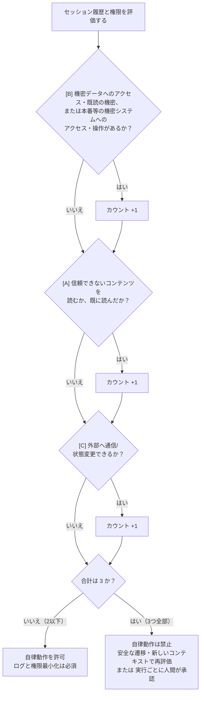

信頼できない入力を読み、本番システムを操作できるエージェントは **[A]・[B]・[C] のすべて**を満たすため、この方針では自律動作を許可しません。根拠: [Meta の公式解説](https://ai.meta.com/blog/practical-ai-agent-security/)。

#### OWASP Top 10 for Agentic Applications 2026（2025年12月9日公開）

| ID | リスク | 一言で | 主な防御 |
|---|---|---|---|
| ASI01 | Agent Goal Hijack（目的の乗っ取り） | 読んだ内容で目的や計画を書き換えられる | 取得内容は信頼しない、目的を制約し計画を検証 |
| ASI02 | Tool Misuse & Exploitation（ツールの悪用） | 許可外の使い方でツールを呼ぶ | ツールの最小権限（"最小エージェンシー"）、引数検証 |
| ASI03 | Identity & Privilege Abuse（ID・権限の濫用） | エージェントの権限が広すぎる/使い回される | エージェント単位の ID、短寿命・限定スコープの資格情報 |
| ASI04 | Agentic Supply Chain Vulnerabilities | ツール・プラグイン・MCP サーバー・モデルの汚染 | 承認制、AIBOM（AI 部品表）、バージョン固定 |
| ASI05 | Unexpected Code Execution | 想定外のコード実行 | サンドボックス、実行前の確認 |
| ASI06 | Memory & Context Poisoning | 記憶・文脈に毒を仕込まれ、後から発火 | 記憶の出所管理、定期的な検査・消去 |
| ASI07 | Insecure Inter-Agent Communication | エージェント間通信の盗聴・なりすまし | 相互認証、メッセージ署名 |
| ASI08 | Cascading Failures | 1 つの誤りが連鎖して拡大 | 遮断機構、影響範囲の制限 |
| ASI09 | Human-Agent Trust Exploitation | 人が AI の出力を過信して危険な操作を承認 | 重要操作の確認 UI、根拠の提示 |
| ASI10 | Rogue Agents | 方針から逸脱して動き続ける | 挙動の監視、キルスイッチ |

- OWASP の 2026 年 6 月 11 日の報告では、**プロンプトインジェクションが 10 カテゴリのうち 6 つに関係**すると整理されています（Help Net Security）。
- Google の 2026 年 4 月の Common Crawl 調査では、公開 Web 上のプロンプトインジェクション試行のうち**悪意あるものが 2025 年 11 月〜2026 年 2 月で 32% 増加**したと報じられています（CSO Online）。

#### ステップバイステップ: エージェントを安全に作る

| Step | やること | 具体例 |
|---|---|---|
| 1 | 3 要素（非信頼入力・機密システム/データ・状態変更/外部通信）を履歴も含めて棚卸しする | 上のフローチャートで判定 |
| 2 | **権限を最小化**する | 読み取り専用トークン、対象リポジトリ/フォルダを限定 |
| 3 | 外部通信を**許可リスト**にする | 送信先ドメイン固定、画像/リンクの自動展開を制限 |
| 4 | 影響の大きい操作は**人間の承認**を挟む | 送金、削除、外部送信、本番デプロイ |
| 5 | 実行環境を**隔離**する（サンドボックス） | コンテナ、ネットワーク制限、一時的な認証情報 |
| 6 | **記憶・RAG の出所**を管理する | 誰が書いたデータかをメタデータで保持 |
| 7 | 全てのツール呼び出しを**ログ**に残し、異常を検知する | 想定外のツール連鎖や大量取得にアラート |
| 8 | **キルスイッチ**を用意する | 即時停止・トークン失効の手順 |
| 9 | レッドチーム演習（インジェクションの試験）を継続的に行う | Issue・メール・Webに罠を仕込んで試す |

> **補足（権限モデルの落とし穴）**: 2026 年には、AI コーディングツールで「許可済みコマンド（例: `git branch`）経由で任意のペイロードが実行される」脆弱性（CVE-2026-22708, Cursor）も報じられています。**許可リストは、実行環境が汚染されていないことが前提**になる点に注意してください。

### 4.4 MCP（Model Context Protocol）のセキュリティ

MCP は、AI エージェントを外部ツールやデータにつなぐ標準的な仕組みです。普及が速く、**セキュリティが追いついていない**ことが 2026 年の特徴です。

| 事実 | 内容 | 出典 |
|---|---|---|
| OWASP MCP Top 10 | 2026 年時点で **ベータ（v0.1）**。トークン管理、ツールポイズニング、シャドウ MCP サーバー、コンテキストの過剰共有など | OWASP プロジェクトページ |
| 脆弱性の増加 | 2026 年 1〜2 月だけで 30 件超の CVE | Cycode |
| 公開サーバー | 認証なしで到達可能な MCP サーバーが約 20 万台との報告（2026年4月） | mcp.directory のまとめ（二次情報のため要検証） |

**主な MCP 固有リスク**

| リスク | 内容 | 対策 |
|---|---|---|
| **ツールポイズニング** | ツール説明文に、人間には見えず AI には見える命令を仕込む（例: 秘密鍵の中身を引数に含めさせる） | 説明文の差分レビュー、承認済みバージョンの固定（"ラグプル"対策） |
| **シャドウ MCP サーバー** | 組織が把握していない MCP が社内で動く | 利用 MCP の台帳管理、ネットワークでの検出 |
| **トークンの扱いの不備** | `.env` の内容がツールから返る、長寿命トークン | 秘密情報の分離、短寿命・最小スコープの認可 |
| **認証・認可の欠如** | 認証なしで公開 | 既定で認証必須、ローカル専用はローカルにだけバインド |

**初学者の実践ルール（MCP）**

1. **信頼できる提供元のサーバーだけ**使い、バージョンを固定する。
2. 1 つのエージェントに**多数の MCP を同時接続しない**（Palo Alto Networks Unit 42 は、5 つの MCP サーバーを接続した際の攻撃成功率が 78.3% だったと報告。Cycode の記事経由）。
3. **読み取り系と書き込み系を分離**する。
4. サーバーの設定ファイルや接続先を**コードレビュー対象**にする。

---

## 第5章 ソフトウェアサプライチェーン防御

### 5.1 サプライチェーン攻撃とは

あなたのソフトウェアは、他人が作った**ライブラリ**、他人が提供する**ビルド基盤（CI）**、他人が運営する**配布所（レジストリ）**の上に成り立っています。このどこかが汚染されると、**あなたのコードに欠陥がなくても**被害を受けます。

### 5.2 2026 年の主な事件（時系列）

| 時期 | 事件 | 要点 | 学べること |
|---|---|---|---|
| 2025年9月 | Shai-Hulud（第1波） | 700 超の npm パッケージが感染 | 自己増殖型ワームの原型 |
| 2026年3月 | PyPI のバックドア | 約 3 時間公開され、約 47,000 回ダウンロード（Help Net Security） | **数時間でも被害は大きい** → 新版を即座に取り込まない |
| 2026年5月11〜12日 | **Mini Shai-Hulud / TanStack** | TanStack、Mistral AI、UiPath 等を含む 160 超の npm/PyPI パッケージ。**正規の CI から正規の OIDC トークンで公開**され、**有効な来歴（provenance）証明書付き**だった | **来歴があっても安全とは限らない** |
| 2026年6月 | IronWorm | Rust 製、eBPF ルートキット、Tor 経由で通信。36 パッケージ。信頼できる公開（Trusted Publishing）関連の秘密も狙う | 開発者・CI の秘密情報が標的 |
| 2026年8月4日 | **ChainDrop（keyv ほか）** | メンテナの GitHub アカウント侵害から、**444 超のパッケージ・1,381 バージョン**に拡大（月間インストール合計 20 億超、Aikido の集計）。`preinstall` フックで実行 | **インストール時スクリプト**が感染経路 |

> **補足**: 件数や影響は、調査主体や時点により異なります（例: Microsoft は 400 超、Aikido は 444 超など）。**一次情報（各社アドバイザリ）で最新値を確認**してください。

### 5.3 ワームはどう広がるか

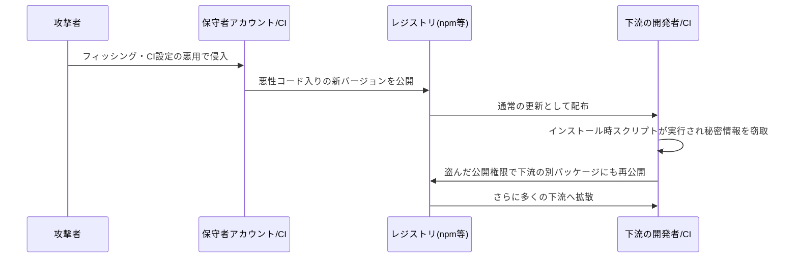

**ポイント**
- 感染経路は多くの場合 **`preinstall` / `postinstall` などのインストール時スクリプト**です。アプリが import する前、**インストールした瞬間**に実行されます。
- 盗まれる対象は **npm/GitHub トークン、クラウド鍵、SSH 鍵、AI サービスの API キー**などの**秘密情報**です。
- 「長寿命トークンをやめて **Trusted Publishing（OIDC）** に移行する」という 2025 年のアドバイスは有効ですが、**CI 自体が侵害されると、その仕組みも悪用される**ことが 2026 年 5 月に示されました。

### 5.4 防御の全体像（多層防御）

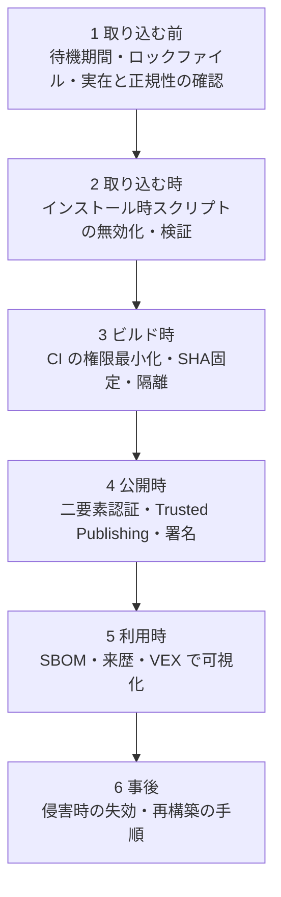

### 5.5 ステップバイステップ: 今日からできる 12 の対策

#### Step 1: 依存関係を固定する（ロックファイル）

| エコシステム | 推奨 | 補足 |
|---|---|---|
| npm | `npm ci`（ロックファイル通りにインストール） | `npm install` は更新が入り得る |
| Python | ハッシュ付きの固定（例: `pip install --require-hashes`） | ツールは uv/pip-tools など |
| Go / Rust | `go.sum` / `Cargo.lock` をコミット | |

#### Step 2: 「新しすぎる版」を取り込まない（待機期間 / クールダウン）

悪性版は多くの場合**数時間〜数日で発見・削除**されます。そこで、**公開から数日たった版だけ**を使う設定が有効です。

| ツール | 設定例 | 出典 |
|---|---|---|
| Bun | `bunfig.toml` に `minimumReleaseAge = 259200`（3日。秒単位） | GitHub 上の実プロジェクトの記述 |
| Renovate | `{ "matchManagers": ["github-actions"], "minimumReleaseAge": "7 days" }` | DEV Community の記事 |
| npm CLI | 2026 年 2 月の 11.10.0 で `min-release-age` を導入と紹介（**設定名・単位は公式ドキュメントで要確認**） | DEV Community の年表 |
| Dependabot | `cooldown` 設定（**書式は公式ドキュメントで要確認**） | 各種解説 |

> 緊急のセキュリティ修正は例外にできるよう、**手動で待機を上書きする手順**も用意します。

#### Step 3: インストール時スクリプトを無効にする

```bash
# CI や本番ビルドでは、依存のインストール時スクリプトを実行しない
npm ci --ignore-scripts
```

- 必要なパッケージだけを許可リストで例外にします（ネイティブビルドが必要なものなど）。
- ChainDrop 等は `preinstall` で動くため、**この 1 行で被害を避けられた可能性**があります。

#### Step 4: CI（GitHub Actions）を固くする

```yaml
name: ci
on:
  pull_request:            # ✅ fork への秘密情報の提供可否はリポジトリ・組織設定も確認
permissions:
  contents: read           # ✅ 既定は読み取りのみ
jobs:
  build:
    runs-on: ubuntu-latest
    permissions:
      contents: read
    steps:
      # ✅ アクションは「タグ」ではなく「コミットSHA」で固定し、コメントで版を残す
      - uses: actions/checkout@<40桁のコミットSHA> # v7.x.x
        with:
          persist-credentials: false
      - run: npm ci --ignore-scripts
      - run: npm test
```

`pull_request` だけで秘密情報の遮断が保証されるわけではありません。特に非公開リポジトリの fork PR では、リポジトリ・組織の Actions 設定によって秘密情報の提供を許可できます。**適用される両方の設定を確認し、`Send secrets to workflows from pull requests` を無効にして、信頼できないコードへ秘密情報を渡さない**運用にします（[GitHub 公式ドキュメント](https://docs.github.com/en/repositories/managing-your-repositorys-settings-and-features/enabling-features-for-your-repository/managing-github-actions-settings-for-a-repository#enabling-workflows-for-forks-of-private-repositories)）。

| ルール | 理由 |
|---|---|
| **全アクションを 40 桁の SHA で固定** | タグは付け替えられる。SHA は不変 |
| `permissions` を最小化（既定 read） | トークンが盗まれても被害を限定 |
| **`pull_request_target` を避ける**（使うなら fork のコードを checkout しない） | 基盤リポジトリの秘密情報で外部コードが動く"pwn request"の温床 |
| `${{ github.event.pull_request.title }}` 等を **シェルに直接埋め込まない** | PR タイトルやブランチ名にコマンドを仕込まれる |
| キャッシュ・成果物の信頼境界を意識（ビルドと公開のジョブを分離） | 2026年5月の TanStack ではキャッシュ汚染と OIDC トークン窃取が連鎖 |
| Dependabot/Renovate で**アクションも更新**（SHA 固定は放置すると古くなる） | 固定と更新の両立 |

**GitHub 側の動き（2026年）**: GitHub は 2025 年 8 月に Actions ポリシーで **SHA 固定の強制/ブロック**に対応し、2025 年 10 月に **Immutable Releases** を GA、2025 年 11 月に `pull_request_target` が常にデフォルトブランチのワークフローを使うよう変更しました。2026 年 6 月 18 日には `actions/checkout` v7.0.0 が信頼できないトリガーでの fork コードの checkout を既定で防ぎ、**2026 年 12 月 2 日**には、明示ポリシーのない公開リポジトリで `pull_request_target` をブロックする既定ポリシーの**適用開始が予定**されています（Wiz の解説による。予定は変更され得るため公式 changelog を確認）。

#### Step 5: 公開側（メンテナ）の対策

| 対策 | 内容 |
|---|---|
| 公開アカウントに**フィッシング耐性のある MFA**（パスキー/セキュリティキー） | アカウント乗っ取りが ChainDrop の起点 |
| 長寿命トークンを廃止し **Trusted Publishing（OIDC）** へ | ただし**公開できるワークフローを限定**（ブランチ・環境・承認の条件付き） |
| 公開ジョブを**専用の保護された環境**で実行し、手動承認を挟む | CI 侵害時の自動公開を防ぐ |
| 公開パッケージ数が多い場合は**権限を分割** | 1 トークンで全パッケージに届かないようにする |
| 来歴（provenance）を付ける | ただし**来歴＝安全ではない**ことを利用者に周知 |

#### Step 6: 秘密情報を守る・漏れても被害を小さくする

- 開発端末と CI の**シークレットを最小化**（環境変数にむやみに置かない）。
- 認証情報は**短寿命・用途限定**にする。
- 万一の窃取に備え、**ローテーション手順**を事前に文書化する。

#### Step 7: SBOM を作る・使う（CISA 2026 年版）

**SBOM（Software Bill of Materials）** は「ソフトウェアの部品表」です。

| 項目 | 内容 |
|---|---|
| 公表 | 2026 年 7 月 29 日、CISA が NSA・FBI・15 の国際機関と共同で **「2026 Minimum Elements for a SBOM」** を公表。2021 年の NTIA 基準を置き換え |
| 追加・強化 | コンポーネントの**ハッシュ**、**ライセンス**、SBOM **生成ツール名**、**生成コンテキスト**、**SBOM 作成者の電子署名** など。機械処理可能な識別子を要求 |
| 形式 | **SPDX** と **CycloneDX**（SWID タグは言及されなくなった） |
| 法的拘束力 | CISA の文書自体に**強制力はない**。ただし調達要件や **EU CRA** などで参照される |

**活用の 3 ステップ**: ①ビルドごとに自動生成 → ②**VEX**（「この CVE はうちの製品では悪用不可」という声明）と組み合わせて優先順位付け → ③署名して成果物と一緒に配布・保管。

#### Step 8: SLSA と来歴（Provenance）

- **SLSA** は、ビルドの信頼性を段階的に高める枠組みです（ソースの出所、ビルドの隔離、来歴の署名など）。
- 2026 年 5 月の事件が示したとおり、**来歴は"どこで作られたか"の証明であって、"中身が安全"の証明ではありません**。来歴＋待機期間＋権限最小化＋監視を**組み合わせる**のが正解です。

#### Step 9: パッケージの実在と正規性の確認（AI 提案の依存を含む）

- 追加前に、**パッケージの実在と、名前・公開元が正規プロジェクトの公式ドキュメントと一致すること**を確認。公開日・ダウンロード数・リポジトリ・メンテナも補助情報として確認しますが、実在や人気だけでは正規と判断しません。
- 名前が似ている別物（タイポスクワッティング）に注意。

#### Step 10: 継続的な脆弱性監視

- 依存の既知脆弱性は **SCA**（OSV 等）で毎日検知。
- 優先順位は、**悪用の有無（KEV/EPSS）・到達可能性・VEX** で決める。

#### Step 11: 規制への備え（EU CRA）

| 日付 | できごと |
|---|---|
| 2024-12-10 | CRA 発効 |
| **2026-09-11** | **報告義務（第14条）開始**。悪用が確認された脆弱性・重大インシデントを、ENISA の Single Reporting Platform（SRP）から、ENISA と各国 CSIRT に同時通知。SRP は同日に稼働開始 |
| 2027-12-11 | 大半の要件が全面適用 |

- 両報告種別とも、**認知から早期警告 24 時間以内、続報 72 時間以内**。最終報告は、**悪用が確認された脆弱性は是正・緩和措置が利用可能になってから 14 日以内、重大インシデントは 72 時間の続報から 1 か月以内**です（[欧州委員会の公式説明](https://digital-strategy.ec.europa.eu/en/policies/cra-reporting)）。
- 9 月 11 日以前に把握していて、**悪用が確認されていなかった**脆弱性は、遡って報告する義務はない、と整理する解説があります。
- **OSS スチュワード**には限定的な義務があります。**自社が"製造者"に当たるか**は、プロダクトごとに確認してください（法的助言ではありません）。

#### Step 12: 侵害を知ったときの手順（インシデント対応）

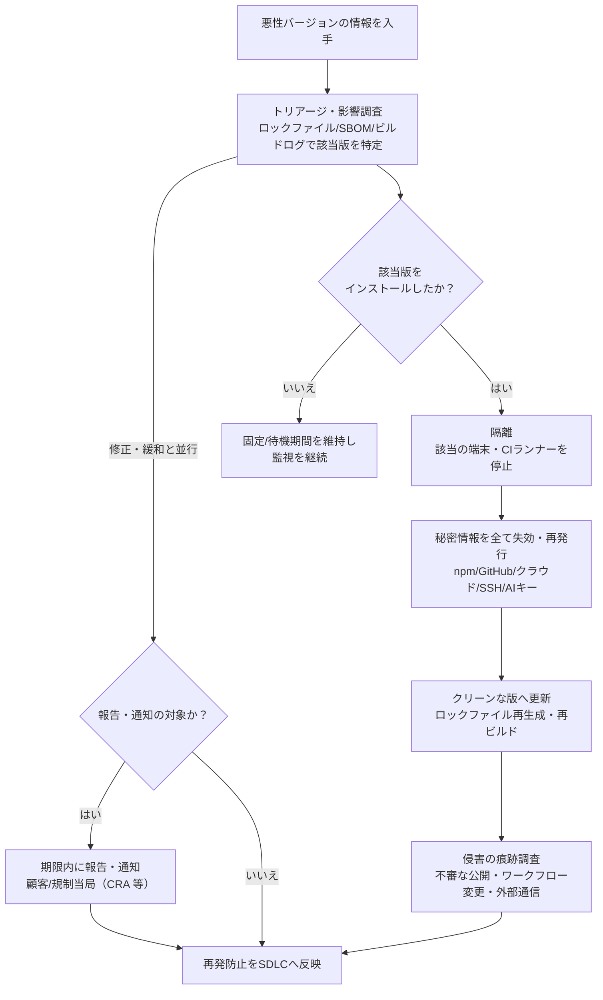

### 5.6 サプライチェーン セルフチェック

| # | チェック項目 | 状態 |
|---|---|---|
| 1 | ロックファイルをコミットし、CI は `npm ci` 等を使っている | |
| 2 | 新バージョンの待機期間（例: 3〜7日）を設定している | |
| 3 | CI でインストール時スクリプトを無効化している | |
| 4 | 全 GitHub Actions を SHA 固定している | |
| 5 | `permissions` は既定 read、`pull_request_target` は使っていない | |
| 6 | 公開アカウントにパスキー/ハードウェアキーを設定している | |
| 7 | 長寿命のレジストリトークンを廃止した | |
| 8 | ビルドごとに SBOM を生成・署名している | |
| 9 | 侵害時の「秘密情報ローテーション手順書」がある | |
| 10 | CRA 等の通知窓口と担当者が決まっている | |

---

## 第6章 PQC（耐量子計算機暗号）移行

### 6.1 なぜ今 PQC なのか（初学者向け）

| 用語 | 意味 |
|---|---|
| **量子計算機** | 特定の計算が極端に速くなる新しい計算機 |
| **CRQC** | 暗号を実際に破れるほど大規模な量子計算機（Cryptographically Relevant Quantum Computer） |
| **Shor のアルゴリズム** | CRQC 上で RSA・楕円曲線暗号（ECC）を破れる方法 |
| **HNDL（Harvest Now, Decrypt Later）** | **今は暗号文を盗んで保存し、将来 CRQC で解読する**攻撃 |
| **PQC** | 量子計算機でも破られにくいとされる新しい暗号（普通のコンピュータ上で動く） |

**ポイント**
- **暗号化（鍵交換）**は HNDL のため**今すぐ**対策が必要です。
- **署名**は、CRQC が現れるまで偽造できないため緊急度が一段下がると言われてきましたが、2026 年に **Google は認証（署名）の移行を優先する**と表明しました（鍵の盗用リスクと、長期使用される署名鍵の存在のため）。
- **対称暗号（AES など）**は大きな問題がないとされています（Filippo Valsorda は「Grover は問題にならない」と述べています）。

### 6.2 NIST の標準化状況（2026年11月7日時点）

| 標準 | アルゴリズム | 用途 | 状態 |
|---|---|---|---|
| **FIPS 203** | **ML-KEM**（旧 Kyber） | 鍵確立（鍵交換） | **最終**（2024-08-13） |
| **FIPS 204** | **ML-DSA**（旧 Dilithium） | デジタル署名 | **最終**（2024-08-13） |
| **FIPS 205** | **SLH-DSA**（旧 SPHINCS+） | ハッシュベース署名（予備） | **最終**（2024-08-13） |
| FIPS 206 | **FN-DSA**（旧 Falcon） | コンパクトな署名 | **策定中**（NIST の公開一覧に最終版なし） |
| （番号未定） | **HQC** | 予備の鍵カプセル化（2025年3月選定） | 策定中 |
| SP 800-227 | KEM の推奨事項 | 実装ガイド | 最終（2025-09-18） |
| CSWP 39（更新版） | 暗号アジリティ | 暗号を入れ替えやすくする設計 | 最終（2026-06-29） |
| **IR 8547** | **移行計画** | **いつ何をやめるか** | **最終（2026-10-27）** |

**NIST IR 8547 最終版の要点**（[NIST 原文の第4章](https://nvlpubs.nist.gov/nistpubs/ir/2026/NIST.IR.8547.pdf)で移行期限を確認）

| 項目 | 内容 |
|---|---|
| 非推奨（Deprecated） | RSA/ECC 等の量子計算機に脆弱な公開鍵暗号は **2030年を過ぎると非推奨**。**鍵長に関わらず**（P-256 や RSA-3072 も含む）対象 |
| 使用禁止（Disallowed） | **2035年を過ぎると NIST の標準・ガイドライン上で使用不可** |
| 米連邦の高価値資産等 | 鍵確立は **2030-12-31**、署名は **2031-12-31** までに PQC へ（大統領令 14412・OMB M-26-15 に基づくとする報道。**二次情報のため原文で要確認**） |

### 6.3 各社・各国の期限は"NIST より早い"ことがある

| 主体 | 目標 | 補足 |
|---|---|---|
| NIST | 2030年を過ぎると非推奨／2035年を過ぎると使用不可 | NIST の標準・ガイドライン上（上記） |
| **Google** | **2029 年**までに自社の移行完了 | 2026-03-25 公表。Android 17 で ML-DSA に対応予定 |
| **Cloudflare** | **2029 年** | 2026-04-07 に内部目標を前倒し |
| Microsoft | 2033 年 | postquantum.com の整理による |
| 英国 NCSC | 2028 年までに発見・計画、2031 年に最優先を移行、2035 年完了 | arXiv 論文の整理による |
| **日本（政府機関等）** | **原則 2035 年まで**。**2026 年度中にロードマップ策定** | 内閣官房 国家サイバー統括室の中間とりまとめ（2025-11-20） |

> **重要な読み方**: Google も Cloudflare も「2029年に CRQC が存在する」と予測しているわけではなく、「**もう否定しきれない**ので前倒しで備える」という立場です（PQShield の解説）。自分の守るデータの**寿命**が長いほど、早く動くべきです。

### 6.4 いま実際に広まっているもの

- 主要ブラウザは **X25519MLKEM768**（X25519 と ML-KEM-768 の**ハイブリッド**）を TLS 鍵交換の既定にしています（Chrome 131+、Firefox 132+、Edge 131+、Safari 26+ など）。
- Cloudflare は 2026 年 4 月時点で、人間による通信の **65%** が PQ 鍵交換を使っていると報告しています（記事経由）。
- Go の `crypto/tls` は Go 1.24 以降、対応相手とは既定でハイブリッド鍵交換を使います（Filippo Valsorda の 2025 年講演）。
- **署名（証明書）は未成熟**: WebPKI の実運用での ML-DSA 証明書はまだ広がっていません。**鍵交換が先、署名が後**という順序感になっています。

### 6.5 "ハイブリッド"か"純粋 PQ"か（専門家の論点）

| 立場 | 主張 | 出典 |
|---|---|---|
| **鍵交換はハイブリッド** | X25519 + ML-KEM の併用が事実上の標準。純 ML-KEM を単独で使う主張は少数 | 複数の解説 |
| **署名はハイブリッド不要派** | Filippo Valsorda は 2026 年 4 月、複合（ハイブリッド）署名は移行時間と複雑さを増やすだけだとし、**ML-DSA-44 へ直接移行**を主張 | words.filippo.io |
| 慎重派 | ML-DSA の実装は新しくバグが出やすいため、ハイブリッドが被害を限定できるという意見も | postquantum.com の整理 |
| 補足 | Google の Sophie Schmieg は、署名偽造の被害は鍵失効で限定できるため、ハイブリッド署名の必要性は鍵交換より低いと IETF で述べたと紹介 | 同上 |

> **初学者向けの結論**: 鍵交換は **ハイブリッド（X25519+ML-KEM-768）**、署名は **まず標準ライブラリとプロトコルの対応状況に従う**。専門家の間でも意見が割れる領域なので、**自分で暗号を組み合わせない**ことが最優先です。

Filippo Valsorda の「(Post-Quantum) Cryptographic Right Answers」（2026年10月12日）の主な推奨は次のとおりです。

| 用途 | 推奨 |
|---|---|
| 鍵交換 | X25519 + ML-KEM-768（安全な標準プロトコルの中で） |
| 公開鍵暗号（HPKE） | MLKEM768-X25519（X-Wing）+ HKDF-SHA256 + AES-128-GCM、または PQ 鍵付き age |
| 署名 | ML-DSA-44 |

### 6.6 ステップバイステップ: PQC 移行計画の作り方

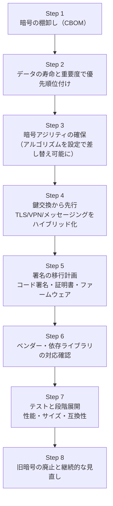

#### Step 1: 暗号の棚卸し（CBOM: Cryptographic Bill of Materials）

| 調べること | 例 | 方法 |
|---|---|---|
| どこで公開鍵暗号を使っているか | TLS、SSH、VPN、JWT 署名、コード署名、証明書、データベース暗号化、メール | コード検索（`RSA`, `ECDSA`, `secp256r1` 等）、設定ファイル、証明書一覧、ネットワーク観測 |
| 誰が管理しているか | 自社コード/OSS/ベンダー製品/クラウドサービス | 資産台帳と SBOM を突き合わせる |
| 鍵の寿命 | 10 年以上保護が必要なデータ | データ分類 |

#### Step 2: 優先順位付けの考え方

| 優先度 | 条件 | 例 |
|---|---|---|
| 高 | **長期保護が必要**なデータを**ネットワーク越し**に送る（HNDL の標的） | 医療・研究・政府・金融の長期機密通信 |
| 高 | **長寿命の署名鍵**や信頼の起点 | ルート CA、ファームウェア署名、コード署名 |
| 中 | 短命なセッションのみ | 一般的な Web 通信（ブラウザ側は既にハイブリッド） |
| 低 | 数日で価値が失われるデータ | 一時的な通知 |

#### Step 3: 暗号アジリティ（入れ替えやすい設計）

```python
# ❌ 悪い例: アルゴリズムをコードに直書き
signature = rsa_sign(private_key, data)

# ✅ 良い例: アルゴリズムを設定とメタデータで管理（差し替え・併用が可能）
cfg = load_crypto_policy()             # 例: {"sign": "ml-dsa-44", "kem": "x25519-mlkem768"}
signature = signer_for(cfg["sign"]).sign(private_key, data)
envelope = {"alg": cfg["sign"], "sig": signature}  # どのアルゴリズムで署名したかを必ず記録
```

- 鍵・署名・証明書の**サイズ増加**（PQC は鍵や署名が大きい）を前提に、プロトコルの上限（パケット、フィールド長、DB カラム）を見直します。ML-KEM-768 の暗号文は 1 KB 超、SLH-DSA の署名は数十 KB になり得ます。

#### Step 4: 鍵交換のハイブリッド化（先行して実施）

| 対象 | 実施内容 |
|---|---|
| TLS（Web/API） | TLS ライブラリ・リバースプロキシ・CDN を、X25519MLKEM768 に対応する版へ更新。**既定で有効なことが多い**ので、まず**現状の実際のネゴシエーション結果を確認** |
| VPN・社内通信 | 製品のロードマップを確認。WireGuard など**プロトコルの更新が必要**なものは要注意 |
| 保存データ | 将来の復号に備え、長期保存データの暗号方式を見直す |

#### Step 5: 署名の移行計画

- **コード署名・ファームウェア・ドキュメント署名・社内 PKI**を洗い出す。
- 標準化が確定している **ML-DSA（FIPS 204）** を第一候補に、サイズ制約が厳しい場合は **FN-DSA（FIPS 206 の確定待ち）**、長期の信頼の起点では **SLH-DSA（FIPS 205）**。
- 証明書チェーン全体（ルート・中間・葉）の対応状況と、クライアント側（OS・ブラウザ・組み込み機器）の対応を確認。

#### Step 6: ベンダー・OSS への確認事項

| 質問 | 理由 |
|---|---|
| FIPS 203/204/205 対応の時期は？ | 調達・更新計画に直結 |
| 暗号モジュールの検証（FIPS 140-3 等）の予定は？ | 規制業界で必須になり得る |
| 旧暗号の廃止予定は？ | 2030/2035 のスケジュールに間に合うか |

#### Step 7: テスト項目

| 観点 | 内容 |
|---|---|
| 互換性 | 古いクライアントがハイブリッド非対応でも通信できるか（フォールバック） |
| 性能 | ハンドシェイクのサイズ・遅延、CPU・メモリ |
| 中間機器 | ファイアウォール/プロキシが大きな ClientHello を扱えるか |
| 実装品質 | 実績あるライブラリ（FIPS 検証済みなど）を使い、**自作しない**。ML-DSA 実装は新しいため、最新の修正を取り込む |

### 6.7 開発者が「今週」できる PQC アクション

| # | アクション | 難易度 |
|---|---|---|
| 1 | 自分たちのサービスが **どの TLS ライブラリ/バージョン**で動いているか確認する | 易 |
| 2 | ブラウザ・API クライアントで**ハイブリッド鍵交換が実際に使われているか**を確認する | 易 |
| 3 | コード内の `RSA`/`ECDSA`/`ECDH` を **grep して一覧化**する | 易 |
| 4 | JWT・署名付き Cookie・Webhook の**署名アルゴリズム**をリスト化する | 中 |
| 5 | **アルゴリズム名を設定化**し、署名データに識別子を持たせる設計に直す | 中 |
| 6 | 主要ベンダーに **PQC ロードマップ**を問い合わせる | 易 |
| 7 | 長期保存データの**保護期間**を定義する | 中 |

---


## 第7章 統合ロードマップ（30/60/90日）

### 7.1 優先順位の考え方

「全部やる」は続きません。**被害が大きく、かつ短時間で効果が出るもの**から着手します。

| 優先 | 領域 | 理由 |
|---|---|---|
| 最優先 | CI/CD と秘密情報、依存関係の取り込み方 | 2026 年の実害が最も多く、設定変更で効果が出る |
| 高 | AI エージェントの権限、AI 生成コードのゲート | 導入が急速で、ルールがまだ無い組織が多い |
| 高 | OWASP A01/A05/A10 のテスト自動化 | 影響が大きく、QA で再現しやすい |
| 中 | SBOM・来歴・VEX の整備、CRA 対応 | 仕組みづくりに時間がかかる |
| 計画的に | PQC 棚卸しと移行設計 | 期限は先だが、棚卸しは今すぐ始められる |

### 7.2 90日ロードマップ

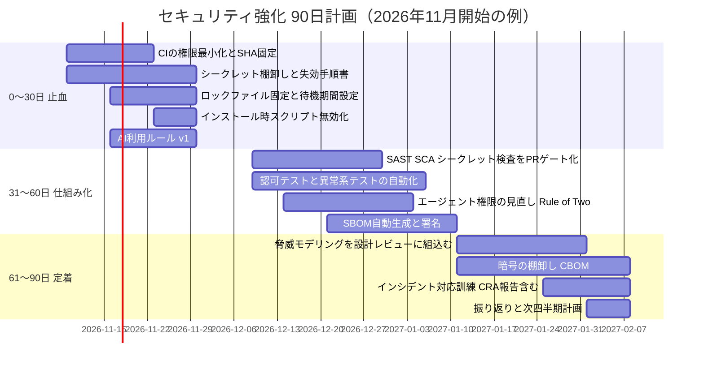

### 7.3 役割別チェックリスト

| 役割 | 今月やること | 来月やること |
|---|---|---|
| **開発者** | `npm ci --ignore-scripts` に切替／AI 生成コードを理解してからマージ／SQL はパラメータ化 | 認可を共通部品に集約／アルゴリズム名の設定化 |
| **QA エンジニア** | 他人のリソース ID を指定する認可テストを追加／異常系（タイムアウト・巨大入力）を追加 | DAST とファジングを CI に統合／AI 機能のインジェクションテストを追加 |
| **テックリード** | PR ゲートの定義／脅威モデリングの導入／レビュー基準に AI 生成コードを追加 | SBOM・来歴の運用／ASVS レベルの合意 |
| **プラットフォーム/SRE** | Actions の SHA 固定と権限最小化／公開アカウントのパスキー化 | シークレットの短寿命化／TLS のハイブリッド鍵交換の確認 |
| **セキュリティ担当** | 失効・ローテーション手順書／MCP・AI ツールの台帳 | PQC 計画と CRA 報告窓口の整備 |
| **経営・管理者** | 予算と優先順位の承認／責任者の指名 | 四半期ごとのレビュー |

### 7.4 成功の測り方（KPI の例）

| KPI | 目標の例 |
|---|---|
| 重大脆弱性の平均修正日数 | 7 日以内 |
| SHA 固定された Actions の割合 | 100% |
| 長寿命トークンの数 | 0（または期限付き） |
| PR ゲートを通過したマージの割合 | 100% |
| SBOM が付いたリリースの割合 | 100% |
| 暗号の棚卸し完了率 | 四半期ごとに更新 |
| エージェントのうち Rule of Two を満たす割合 | 100%（例外は承認制） |

---

## 第8章 補足ベストプラクティスと根拠ソース

ここでは、本文を補う実践と、**その根拠となる情報源**を一覧にします。国際的に知られた開発者・研究者・企業の発信を優先して選びました。各 URL は、今回のウェブ検索で実際に確認できたものです。

### 8.1 AI・エージェント

| # | ベストプラクティス | 根拠・提唱者 | URL |
|---|---|---|---|
| 1 | 「機密データ・信頼できない入力・外部通信」の **3 要素を 1 つのエージェントに同居させない** | **Simon Willison**（"prompt injection" の命名者）。「LLM ベンダーが守ってくれるわけではない」と述べ、自衛を促している | https://simonwillison.net/2025/Jun/16/the-lethal-trifecta/ |
| 2 | 「95% 検知」をうたうガードレール製品を**唯一の防御にしない** | 同上。Web セキュリティでは 95% は不合格点という指摘 | https://simonwillison.net/2025/Jun/16/the-lethal-trifecta/ |
| 3 | 人間の承認なしで動くエージェントは **履歴も含めて 1 セッション内で 3 要素のうち 2 つまで**（Rule of Two） | Meta（2025-10-31） | https://ai.meta.com/blog/practical-ai-agent-security/ |
| 4 | プロンプトインジェクションは**アーキテクチャ由来**と捉え、権限と通信経路で封じる | OWASP 2026 報告（Help Net Security の解説） | https://www.helpnetsecurity.com/2026/06/11/owasp-prompt-injection-ai-security-failures/ |
| 5 | エージェントに **ID・短寿命の資格情報・キルスイッチ**を与える | OWASP Top 10 for Agentic Applications 2026 の解説 | https://cycode.com/blog/owasp-top-10-agentic-applications/ |
| 6 | Agentic Top 10 を**リスクの語彙**、LLM Top 10 を**モデル層の語彙**として併用 | Modulos のガイド | https://docs.modulos.ai/frameworks/owasp-top-10-agentic |
| 7 | **MCP サーバーの台帳管理**と、ツール説明文の差分レビュー（ツールポイズニング対策） | OWASP MCP Top 10／Invariant Labs（2025-04）の整理 | https://owasp.org/projects/mcp-top-10 |
| 8 | MCP の既知の CVE・露出状況を定期確認する | mcp.directory の 2026 年まとめ（二次情報） | https://mcp.directory/blog/mcp-security-200000-exposed-servers-owasp-mcp-top-10-cves |
| 9 | 永続メモリを持つエージェントは、**汚染された記憶が後から発火**し得る前提で設計 | CSO Online | https://www.csoonline.com/article/4184681 |
| 10 | **AI 生成コードは未レビューの外部コードとして扱い**、マージ前に検査 | Veracode 2026 レポートと解説 | https://sdtimes.com/agentic-security/veracode-finds-ai-generated-code-security-has-barely-improved-since-last-year/ |
| 11 | モデル選定もセキュリティ判断（合格率にモデル差が大きい） | Veracode 2026-10 版プレスリリース | https://www.veracode.com/?p=33104 |
| 12 | SSDF の更新動向（AI をコード生成者として扱う観点）を追う | NIST の説明資料（2026-05-20） | https://csrc.nist.gov/csrc/media/presentations/2026/ssdf-update-and-devsecops-project/20260520-ogata-ssdf-devsecops.pdf |

### 8.2 サプライチェーン・CI/CD

| # | ベストプラクティス | 根拠・提唱者 | URL |
|---|---|---|---|
| 13 | 全アクションを **コミット SHA で固定**し、権限を最小化し、`pull_request_target` を避ける | GitHub の Actions ポリシー更新と実務ガイド | https://github.blog/changelog/2025-08-15-github-actions-policy-now-supports-blocking-and-sha-pinning-actions/ |
| 14 | 2026 年 5 月 TanStack 事件の**攻撃連鎖**（fork PR → キャッシュ汚染 → OIDC トークン窃取）から対策を学ぶ | 事後分析（Medium） | https://medium.com/@jordanritter/security-hardening-github-workflows-at-scale-d291a33774e1 |
| 15 | 2026 年の GitHub 側の防御変更と**残る攻撃面**を把握する | Wiz の解説 | https://www.wiz.io/blog/github-actions-security-pwn-request-reckoning |
| 16 | `pull_request_target` と `checkout` の組み合わせを禁止し、更新には待機期間を置く | DEV Community の実務ガイド | https://dev.to/sachincool/lazy-sres-guide-to-secure-systems-part-2-the-actions-you-didnt-pin-428g |
| 17 | **依存の新版に待機期間（例: 3 日）**を設け、PR を `pull_request` で動かす。fork への秘密情報の提供を無効にするリポジトリ・組織設定も確認 | 実プロジェクトのセキュリティ方針 | https://github.com/strait-dev/ui/security |
| 18 | **来歴（provenance）があっても安全とは限らない**。Trusted Publishing 経由でも侵害され得る | Orca Security／DEV Community | https://orca.security/resources/blog/tanstack-npm-supply-chain-worm/ |
| 19 | 同上の年表（2025〜2026 の主要事件）を確認 | DEV Community | https://dev.to/marco_odev/npm-supply-chain-the-worm-that-walked-in-through-trusted-publishing-4pm8 |
| 20 | **インストール時スクリプトが感染経路**であることを前提に無効化を検討 | Datadog Security Labs（ChainDrop 分析） | https://securitylabs.datadoghq.com/articles/npm-worm-compromises-popular-npm-packages/ |
| 21 | 感染後は**資格情報を全て侵害済みとみなして失効** | Microsoft Threat Intelligence／シンガポール CSA | https://www.csa.gov.sg/alerts-and-advisories/advisories/ad-2026-009/ |
| 22 | Microsoft の分析で、**侵害されたトークンから他パッケージへ再公開**する仕組みを理解する | Microsoft Security Blog | https://www.microsoft.com/en-us/security/blog/2026/08/04/chaindrop-supply-chain-compromise-anatomy-self-propagating-worm/ |
| 23 | **SBOM は署名し、VEX と組み合わせて運用**する | CISA 2026 Minimum Elements の解説 | https://fossa.com/blog/cisa-releases-2026-minimum-sbom-elements/ |
| 24 | SBOM の新基準（ハッシュ・ライセンス・生成ツール・署名）を確認 | Help Net Security | https://www.helpnetsecurity.com/2026/07/30/cisa-sbom-guidance-updated/ |
| 25 | **CRA の報告プロセス**を製品ごとに設計（SRP への登録、認知から24/72時間、最終報告は脆弱性の是正・緩和措置が利用可能になってから14日以内／重大インシデントの72時間の続報から1か月以内） | 欧州委員会の公式ページ | https://digital-strategy.ec.europa.eu/en/policies/cra-reporting |
| 26 | 報告義務の実務ポイント（誰が・何を・いつ） | Jones Day | https://www.jonesday.com/en/insights/2026/07/eu-cyber-resilience-act-24hour-reporting-duties-start-september-11-2026 |
| 27 | SRP の稼働と初期リリースの制約 | Help Net Security | https://helpnetsecurity.com/2026/09/14/enisa-cra-single-reporting-platform |

### 8.3 SDLC・OWASP

| # | ベストプラクティス | 根拠・提唱者 | URL |
|---|---|---|---|
| 28 | OWASP Top 10:2025 の**公式一覧**を共通言語にする | OWASP | https://owasp.org/Top10/2025/ |
| 29 | A03（サプライチェーン）は**発生率が高いが CVE が少ない**＝スキャナだけでは見えない | Qualys のデータ解説 | https://blog.qualys.com/qualys-insights/2026/06/15/what-changed-in-owasp-top-10-2025-and-recommendations-for-each-category |
| 30 | **ASVS と WSTG** でテスト範囲を決める | HackStack の解説 | https://hackstacksecure.com/blogs/owasp-top-10-2025-what-changed/ |
| 31 | SSDF 1.2 ドラフトの**一次資料**を読む | NIST SP 800-218 Rev.1 IPD | https://csrc.nist.gov/pubs/sp/800/218/r1/ipd |
| 32 | SSDF 関連文書の**最新状況**を NIST で確認する | NIST SSDF 公開資料一覧 | https://csrc.nist.gov/projects/ssdf/publications |
| 33 | SSDF 改訂への**専門家の見解**（脅威モデリングの第一人者） | **Adam Shostack** のブログ | https://shostack.org/blog/NIST-800-218-revision/ |
| 34 | 規制（EO 等）が SSDF 更新を促している経緯を追う | disclose.io の政策週報 | https://blog.disclose.io/policy-pulse-issue-7-week-of-march-22-2026 |

### 8.4 PQC・暗号

| # | ベストプラクティス | 根拠・提唱者 | URL |
|---|---|---|---|
| 35 | 「**Right Answers**」: 鍵交換は X25519+ML-KEM-768、署名は ML-DSA-44、対称暗号は現行で問題なし | **Filippo Valsorda**（元 Go 暗号チーム、2026-10-12） | https://words.filippo.io/right-answers/ |
| 36 | Go の TLS が既定でハイブリッド鍵交換を使う実例を知る | Filippo Valsorda の講演まとめ | https://words.filippo.io/2025-state/ |
| 37 | **認証（署名）の移行を優先**し、2029 年を目標にする | **Heather Adkins / Sophie Schmieg**（Google, 2026-03-25） | https://blog.google/innovation-and-ai/technology/safety-security/cryptography-migration-timeline/ |
| 38 | 「2029 年」は**予測ではなく"否定しきれない"ための備え**。長寿命データは今すぐリスク | **Thom Wiggers**（PQShield） | https://pqshield.com/on-quantum-timelines-what-does-2029-actually-mean/ |
| 39 | **ハイブリッド署名の是非**は専門家でも割れている。論点を把握して選ぶ | postquantum.com の整理 | https://postquantum.com/post-quantum/pqc-migration-risk-hybrid/ |
| 40 | NIST IR 8547 **最終版**（2030年を過ぎると非推奨／2035年を過ぎると NIST の標準・ガイドライン上で使用不可）を一次情報で確認 | NIST CSRC 公式の公開一覧 | https://csrc.nist.gov/Projects/post-quantum-cryptography/publications |
| 41 | 最終版の**ドラフトからの変更点**（鍵長を問わず非推奨） | CSA の研究ノート／postquantum.com | https://labs.cloudsecurityalliance.org/research/csa-research-note-nist-ir8547-pqc-transition-20261030-csa-st/ |
| 42 | HQC を待たず **ML-KEM を先に導入**する | postquantum.com の規制まとめ | https://postquantum.com/security-pqc/us-pqc-regulatory-framework-2026/ |
| 43 | 主要ブラウザ・CDN の**ハイブリッド鍵交換の普及状況**を把握 | 解説記事（Cloudflare 報告を引用） | https://pete.lostsource.net/posts/2026-05-26-your-traffic-is-post-quantum.html |
| 44 | **日本政府**の方針（原則 2035 年、2026 年度にロードマップ策定） | 内閣官房 国家サイバー統括室／@IT | https://atmarkit.itmedia.co.jp/ait/articles/2512/08/news045.html |
| 45 | 同上: 中間とりまとめの概要と**対象・移行期限** | 内閣官房 資料 | https://www.cas.go.jp/jp/seisaku/pqc/dai2/sanko.pdf |
| 46 | 総務省 令和8年版 情報通信白書での整理 | 総務省 | https://www.soumu.go.jp/johotsusintokei/whitepaper/ja/r08/html/nd225310.html |

---

## 第9章 用語ミニ辞典

| 用語 | 意味（やさしい説明） |
|---|---|
| **SDLC** | ソフトウェア開発の一連の流れ。要件から運用まで |
| **Shift Left** | セキュリティ活動を工程の早い段階（左側）へ前倒しする考え方 |
| **SSDF** | NIST の安全な開発の実践集（SP 800-218） |
| **ASVS** | OWASP の検証要件チェックリスト |
| **STRIDE** | 脅威の 6 分類（なりすまし・改ざん・否認・情報漏えい・サービス拒否・権限昇格） |
| **SAST / DAST / SCA** | ソースの静的検査／動作中アプリの動的検査／依存ライブラリの検査 |
| **IDOR** | URL の ID を変えると他人のデータが見える欠陥（A01 の代表例） |
| **SSRF** | サーバーを踏み台にして内部へアクセスさせる攻撃（2025 年版では A01 に統合） |
| **Fail Closed / Fail Open** | 障害時に拒否する/許可する。前者が安全 |
| **プロンプトインジェクション** | AI が読む文章に命令を仕込んで操る攻撃 |
| **致命的三位一体（Lethal Trifecta）** | 機密データ・信頼できない入力・外部通信が揃ったエージェントの危険な状態 |
| **Rule of Two** | 承認なしで動くエージェントは、3 要素のうち 2 つまで、という設計予算 |
| **MCP** | AI をツールやデータにつなぐ標準プロトコル |
| **ツールポイズニング** | ツールの説明文に AI だけに効く命令を仕込む攻撃 |
| **SBOM / VEX** | ソフトウェア部品表／「この脆弱性は当製品では悪用不可」という声明 |
| **SLSA / Provenance** | ビルドの信頼性の段階基準／成果物の来歴証明 |
| **Trusted Publishing（OIDC）** | 長寿命トークンの代わりに、CI の身元証明で短期の公開権限を得る仕組み |
| **ワーム** | 自分自身を他の対象にも複製して広がる悪性コード |
| **CRA** | EU のサイバーレジリエンス法。製品の脆弱性報告などを義務化 |
| **HNDL** | 今は暗号文を盗み、将来量子計算機で解読する攻撃 |
| **CRQC** | 実際に暗号を破れる規模の量子計算機 |
| **ML-KEM / ML-DSA / SLH-DSA / FN-DSA / HQC** | NIST の PQC アルゴリズム。鍵交換（ML-KEM、HQC）と署名（ML-DSA、SLH-DSA、FN-DSA） |
| **ハイブリッド** | 従来暗号と PQC を併用し、片方が破られても守れるようにする方式 |
| **暗号アジリティ** | 暗号アルゴリズムを後から差し替えやすい設計 |
| **CBOM** | 暗号の部品表（どこで何の暗号を使っているかの一覧） |

---

## 情報の確度に関する注意

このガイドは 2026 年 11 月 7 日までのウェブ検索結果に基づきます。以下は、**確度が分かれる点**です。公開・社内共有の前に必ず一次情報で確認してください。

| # | 項目 | 注意点 |
|---|---|---|
| 1 | **SSDF 1.2（SP 800-218 Rev.1）の最終版** | 初版ドラフトは 2025-12-17 公開。EO で最終版期限が 2026-03-31 とされていた一方、NIST の公式一覧ページでは調査時点でドラフト表記でした。**最終化の有無は NIST で要確認** |
| 2 | **FIPS 206（FN-DSA）・HQC** | NIST の公開一覧では最終版を確認できませんでした。「策定中」と記述しています |
| 3 | **米国の大統領令 14412・OMB M-26-15** | 「連邦の高価値資産は鍵確立 2030 年・署名 2031 年」という期限は、**二次情報（解説記事）に基づく**記述です。一次資料で確認してください |
| 4 | **NIST IR 8547 の公開日** | NIST 公式の一覧で **2026-10-27 最終**を確認しました。別の情報サイトに"2025 年に最終"と読める誤記があるため、公式を優先してください |
| 5 | **インシデントの件数・影響** | ChainDrop 等は、報告主体・時点で数字が異なります（400 超／444 超／1,300 バージョン超 など） |
| 6 | **GitHub の 2026-12-02 の適用開始** | Wiz の解説に基づく**予定**です。公式 changelog で最新を確認してください |
| 7 | **npm の `min-release-age`／Dependabot の `cooldown`** | 設定名・単位は、公式ドキュメントで確認してください（本文の例は二次情報に基づく） |
| 8 | **OWASP LLM Top 10 の項目一覧** | 私の知識に基づく一覧で、今回の検索では個別に再確認していません |
| 9 | **MCP サーバー 20 万台の露出** | 二次情報です。一次の調査（OX Security 等）を確認してください |
| 10 | **ベンダー調査の数値**（Veracode、Qualys、Sonatype 等） | 製品を持つ企業の調査であり、方法論や母集団に偏りがあり得ます |
| 11 | **法令・規制の解釈（CRA 等）** | 本ガイドは法的助言ではありません。自社が「製造者」等に当たるかは専門家に確認してください |

---

## 参考文献（URL一覧）

### 標準・公式機関

| 資料 | URL |
|---|---|
| OWASP Top 10:2025 | https://owasp.org/Top10/2025/ |
| OWASP MCP Top 10 | https://owasp.org/projects/mcp-top-10 |
| NIST PQC プロジェクト 公開文書一覧（IR 8547 最終 他） | https://csrc.nist.gov/Projects/post-quantum-cryptography/publications |
| NIST SP 800-218 Rev.1（SSDF 1.2）初版ドラフト | https://csrc.nist.gov/pubs/sp/800/218/r1/ipd |
| NIST SSDF 公開資料一覧 | https://csrc.nist.gov/projects/ssdf/publications |
| NIST SSDF/DevSecOps 更新資料（2026-05-20） | https://csrc.nist.gov/csrc/media/presentations/2026/ssdf-update-and-devsecops-project/20260520-ogata-ssdf-devsecops.pdf |
| 欧州委員会 CRA 報告義務 | https://digital-strategy.ec.europa.eu/en/policies/cra-reporting |
| CRA 報告ガイド（独立サイト） | https://www.cyberresilienceact.eu/reporting.html |
| シンガポール CSA アドバイザリ（ChainDrop/Shai-Hulud） | https://www.csa.gov.sg/alerts-and-advisories/advisories/ad-2026-009/ |
| 内閣官房 PQC 移行 中間とりまとめ概要 | https://www.cas.go.jp/jp/seisaku/pqc/dai2/sanko.pdf |
| 総務省 令和8年版 情報通信白書 | https://www.soumu.go.jp/johotsusintokei/whitepaper/ja/r08/html/nd225310.html |

### 著名な開発者・研究者・企業の発信

| 発信者 | 資料 | URL |
|---|---|---|
| Simon Willison | The lethal trifecta for AI agents | https://simonwillison.net/2025/Jun/16/the-lethal-trifecta/ |
| Filippo Valsorda | (Post-Quantum) Cryptographic Right Answers | https://words.filippo.io/right-answers/ |
| Filippo Valsorda | The 2025 Go Cryptography State of the Union | https://words.filippo.io/2025-state/ |
| Google（Heather Adkins, Sophie Schmieg） | Quantum frontiers may be closer than they appear | https://blog.google/innovation-and-ai/technology/safety-security/cryptography-migration-timeline/ |
| PQShield（Thom Wiggers） | On Quantum Timelines: What Does "2029" Actually Mean? | https://pqshield.com/on-quantum-timelines-what-does-2029-actually-mean/ |
| Adam Shostack | NIST 800-218 revision | https://shostack.org/blog/NIST-800-218-revision/ |
| Microsoft Threat Intelligence | ChainDrop supply chain compromise | https://www.microsoft.com/en-us/security/blog/2026/08/04/chaindrop-supply-chain-compromise-anatomy-self-propagating-worm/ |
| Datadog Security Labs | 'ChainDrop' worm compromises hundreds of popular npm packages | https://securitylabs.datadoghq.com/articles/npm-worm-compromises-popular-npm-packages/ |
| Aikido | Keyv and friends compromised in npm supply chain attack | https://www.aikido.dev/blog/keyv-and-friends-compromised-in-npm-supply-chain-attack |
| JFrog（BleepingComputer 経由） | IronWorm | https://www.bleepingcomputer.com/news/security/new-ironworm-malware-hits-36-packages-in-npm-supply-chain-attack/ |
| Wiz | The Pwn Request Reckoning | https://www.wiz.io/blog/github-actions-security-pwn-request-reckoning |
| GitHub | Actions policy: blocking and SHA pinning | https://github.blog/changelog/2025-08-15-github-actions-policy-now-supports-blocking-and-sha-pinning-actions/ |

### 解説・調査・報道

| 資料 | URL |
|---|---|
| Qualys: What Changed in OWASP Top 10 2025 | https://blog.qualys.com/qualys-insights/2026/06/15/what-changed-in-owasp-top-10-2025-and-recommendations-for-each-category |
| Patrowl: OWASP Top 10 2025 と 2026 データ | https://patrowl.io/en/blog/owasp-top-10-2025-what-s-changed-and-the-2026-data |
| HackStack: OWASP Top 10:2025 と検証方法 | https://hackstacksecure.com/blogs/owasp-top-10-2025-what-changed/ |
| Cycode: OWASP Top 10 for Agentic Applications | https://cycode.com/blog/owasp-top-10-agentic-applications/ |
| Cycode: OWASP MCP Top 10 | https://cycode.com/blog/owasp-mcp-top-10/ |
| Modulos: OWASP Agentic Top 10 | https://docs.modulos.ai/frameworks/owasp-top-10-agentic |
| Help Net Security: Prompt injection と agentic 失敗 | https://www.helpnetsecurity.com/2026/06/11/owasp-prompt-injection-ai-security-failures/ |
| CSO Online: Lethal trifecta の現在 | https://www.csoonline.com/article/4184681 |
| memx: Lethal trifecta と Rule of Two | https://memx.app/blog/lethal-trifecta-ai-agent-data-exfiltration/ |
| mcp.directory: MCP セキュリティ 2026 | https://mcp.directory/blog/mcp-security-200000-exposed-servers-owasp-mcp-top-10-cves |
| SD Times: Veracode 2026 GenAI（夏版） | https://sdtimes.com/agentic-security/veracode-finds-ai-generated-code-security-has-barely-improved-since-last-year/ |
| Veracode: 2026 GenAI Code Security Report ブログ | https://www.veracode.com/blog/2026-genai-code-security-report-ai-risk |
| Veracode: 2026-10 版プレスリリース | https://www.veracode.com/?p=33104 |
| Orca: TanStack/Mini Shai-Hulud | https://orca.security/resources/blog/tanstack-npm-supply-chain-worm/ |
| DEV Community: Trusted Publishing とワーム | https://dev.to/marco_odev/npm-supply-chain-the-worm-that-walked-in-through-trusted-publishing-4pm8 |
| Medium: GitHub ワークフロー強化 | https://medium.com/@jordanritter/security-hardening-github-workflows-at-scale-d291a33774e1 |
| DEV Community: 未固定アクションの危険 | https://dev.to/sachincool/lazy-sres-guide-to-secure-systems-part-2-the-actions-you-didnt-pin-428g |
| GitHub 実プロジェクトの方針例 | https://github.com/strait-dev/ui/security |
| FOSSA: CISA 2026 SBOM 最小要素 | https://fossa.com/blog/cisa-releases-2026-minimum-sbom-elements/ |
| Help Net Security: CISA SBOM 新基準 | https://www.helpnetsecurity.com/2026/07/30/cisa-sbom-guidance-updated/ |
| Jones Day: CRA 24 時間報告 | https://www.jonesday.com/en/insights/2026/07/eu-cyber-resilience-act-24hour-reporting-duties-start-september-11-2026 |
| Help Net Security: ENISA SRP 稼働 | https://helpnetsecurity.com/2026/09/14/enisa-cra-single-reporting-platform |
| postquantum.com: NIST IR 8547 最終版 | https://postquantum.com/security-pqc/nist-ir-8547-final/ |
| CSA 研究ノート: IR 8547 | https://labs.cloudsecurityalliance.org/research/csa-research-note-nist-ir8547-pqc-transition-20261030-csa-st/ |
| postquantum.com: 米国 PQC 規制まとめ | https://postquantum.com/security-pqc/us-pqc-regulatory-framework-2026/ |
| postquantum.com: ハイブリッドの是非 | https://postquantum.com/post-quantum/pqc-migration-risk-hybrid/ |
| ArcQubit: NIST PQC 標準ガイド | https://www.arcqubit.ai/blog/nist-pqc-standards-guide |
| 解説: あなたの通信は既に PQ | https://pete.lostsource.net/posts/2026-05-26-your-traffic-is-post-quantum.html |
| @IT: 日本政府の PQC 移行方針 | https://atmarkit.itmedia.co.jp/ait/articles/2512/08/news045.html |
| Impress: NCO 中間とりまとめ | https://internet.watch.impress.co.jp/docs/news/2065972.html |
| disclose.io: Policy Pulse（SSDF 期限） | https://blog.disclose.io/policy-pulse-issue-7-week-of-march-22-2026 |

---

*本ガイドは学習・社内教育を目的とした一般的な情報提供です。製品選定・法令対応・暗号方式の最終判断は、一次情報と専門家の助言に基づいて行ってください。*
