# ISC2 SSCP（Systems Security Certified Practitioner）初学者向け完全ガイド

> **対象読者**: ITの実務経験が浅い方〜セキュリティ運用に初めて取り組む方
> **準拠**: ISC2 公式「SSCP Certification Exam Outline」（**2025年10月1日発効版**）
> **情報時点**: 2026年10月16日（ウェブで確認した内容。試験料金や規約は変更されるため、受験前に必ず ISC2 公式で再確認してください）
> **起点URL**: <https://www.isc2.org/certifications/sscp>

---

## 目次

- [0. このガイドの使い方](#0-このガイドの使い方)
- [1. SSCPとは何か](#1-sscpとは何か)
- [2. 試験概要（CAT方式・出題比率）](#2-試験概要cat方式出題比率)
- [3. 学習ロードマップ](#3-学習ロードマップ)
- [4. ドメイン1: セキュリティの概念と実践（16%）](#4-ドメイン1-セキュリティの概念と実践16)
- [5. ドメイン2: アクセス制御（15%）](#5-ドメイン2-アクセス制御15)
- [6. ドメイン3: リスクの特定・監視・分析（15%）](#6-ドメイン3-リスクの特定監視分析15)
- [7. ドメイン4: インシデント対応と復旧（14%）](#7-ドメイン4-インシデント対応と復旧14)
- [8. ドメイン5: 暗号（9%）](#8-ドメイン5-暗号9)
- [9. ドメイン6: ネットワークと通信のセキュリティ（16%）](#9-ドメイン6-ネットワークと通信のセキュリティ16)
- [10. ドメイン7: システムとアプリケーションのセキュリティ（15%）](#10-ドメイン7-システムとアプリケーションのセキュリティ15)
- [11. 試験当日の戦略と頻出の落とし穴](#11-試験当日の戦略と頻出の落とし穴)
- [12. 出典・参考URL一覧](#12-出典参考url一覧)

---

## 0. このガイドの使い方

### 0.1 各項目の構成

各ドメインは、公式アウトラインの項目番号（例: 2.1）に沿って次の順で解説します。

| 要素 | 内容 |
|---|---|
| **やさしい説明** | 初学者向けに、何のための仕組みかを平易に説明 |
| **試験で問われるポイント** | アウトラインに明記されたキーワードの意味と区別 |
| **ベストプラクティス** | 実務で推奨される運用・設定の考え方 |
| **確認クイズ** | ドメイン末尾で理解度チェック |

### 0.2 表記ルール

- 英語の技術用語は原語を保持しています（試験は英語・日本語・スペイン語で提供されますが、用語は英語で覚えると安全です）。
- 「出典」はドメインごとに末尾へ、全体は [12章](#12-出典参考url一覧) にまとめています。

### 0.3 重要な前提（正確性について）

- 本書の「試験範囲」は ISC2 公式アウトライン（2025年10月1日版）に基づきます。
- 「ベストプラクティス」は NIST・ISO・IETF・OWASP などの公開標準・ガイドラインに基づく**一般的な推奨**であり、組織の方針・法令・製品仕様が優先されます。
- 試験料金（約 USD 249 と複数の第三者サイトが記載）や再受験規定は変更され得るため、**必ず ISC2 公式で確認**してください。

---

## 1. SSCPとは何か

### 1.1 一言でいうと

**「セキュリティ運用の現場担当者（プラクティショナー）」の実務能力を証明する ISC2 の認定資格**です。

公式アウトラインは、SSCP を「情報セキュリティの方針・手順に従って、IT基盤を**実装・監視・管理**し、機密性・完全性・可用性を確保する能力を確認するもの」と説明しています。

### 1.2 ISC2 資格の中での位置づけ

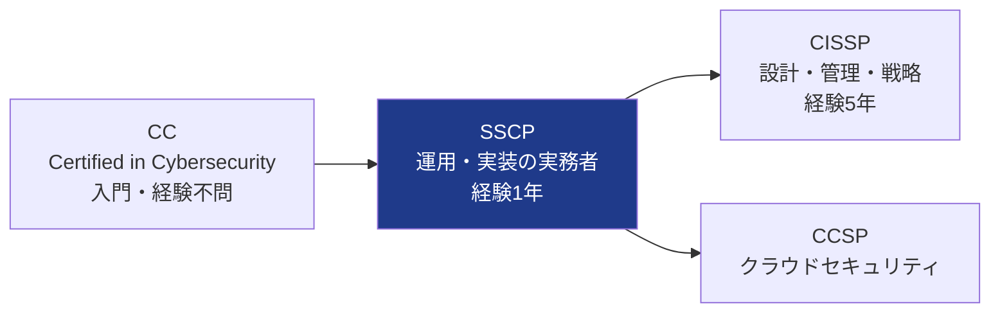

| 資格 | 主な焦点 | 向いている人 |
|---|---|---|
| CC | 基礎知識 | 未経験・学生・異業種からの転向 |
| **SSCP** | **運用・実装・監視（ハンズオン）** | **SOC/NOC、システム管理者、ネットワーク管理者** |
| CISSP | セキュリティ全体のマネジメント | リーダー・アーキテクト・管理職 |

> CISSP の経験要件（5年）は本書の根拠ページでは確認していないため、ISC2 公式で確認してください。

### 1.3 受験資格・認定要件（公式アウトライン・公式ページより）

| 項目 | 内容 |
|---|---|
| 必要な実務経験 | **1年以上のフルタイム経験**（7ドメインのうち1つ以上）。パートタイムやインターンも算入可 |
| 学位による代替 | コンピュータサイエンス・IT 等の学士／修士で**最大1年分**を充当できる場合がある |
| 経験が不足する場合 | 試験に合格すれば **Associate of ISC2** となり、**2年以内**に経験を満たせば SSCP 認定 |
| 認定規格 | ANAB 認定（ISO/IEC 17024）。米国 DoDM 8140.03 の承認対象 |
| 提供言語 | 英語・日本語・スペイン語 |
| 試験会場 | Pearson VUE テストセンター |

> **ポイント**: 「経験がなくても受験・合格はできる」点を押さえましょう。合格後は Associate として経験を積めます。

---

## 2. 試験概要（CAT方式・出題比率）

### 2.1 試験フォーマット（2025年10月1日〜）

| 項目 | 内容 |
|---|---|
| 方式 | **CAT（Computerized Adaptive Testing）** |
| 試験時間 | **2時間** |
| 問題数 | **100〜125問**（受験者ごとに変動） |
| 形式 | 択一式＋アドバンスト形式（Advanced item types） |
| 合格基準 | **1000点満点中700点**（スケールドスコア） |

### 2.2 CATとは（初学者向け）

CAT は、**回答に応じて次の問題の難易度が変わる**試験方式です。

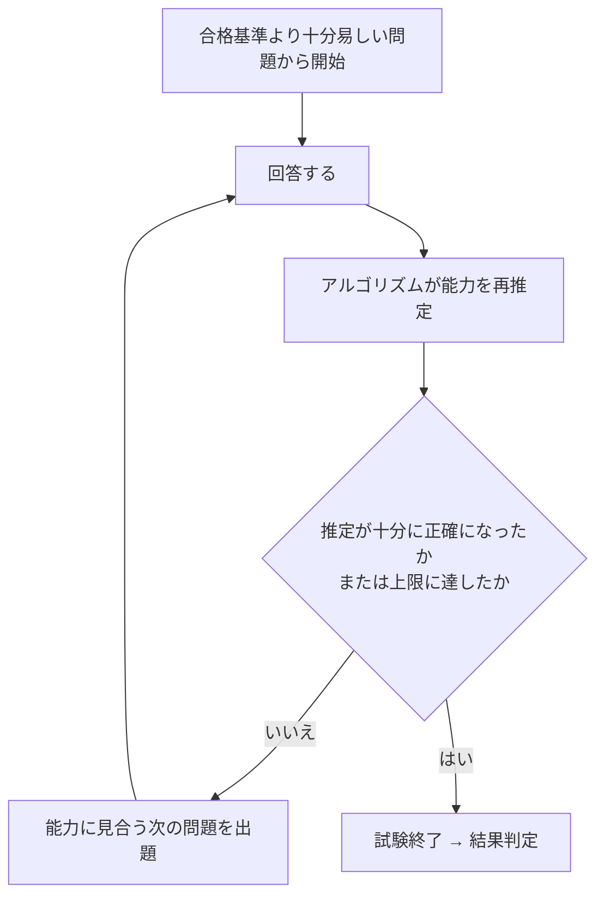

- ISC2 の説明では、解答するたびに推定能力の精度が上がるため、**出題数が人によって変わります**。
- CAT では**問題の見直し（Item review）はできません**（ISC2 の CAT FAQ）。一問ずつ確実に答えます。
- 難しい問題が増えても、それは「能力が高いと推定されている」可能性があり、必ずしも不合格のサインではありません。

### 2.3 7ドメインの出題比率（公式アウトライン）

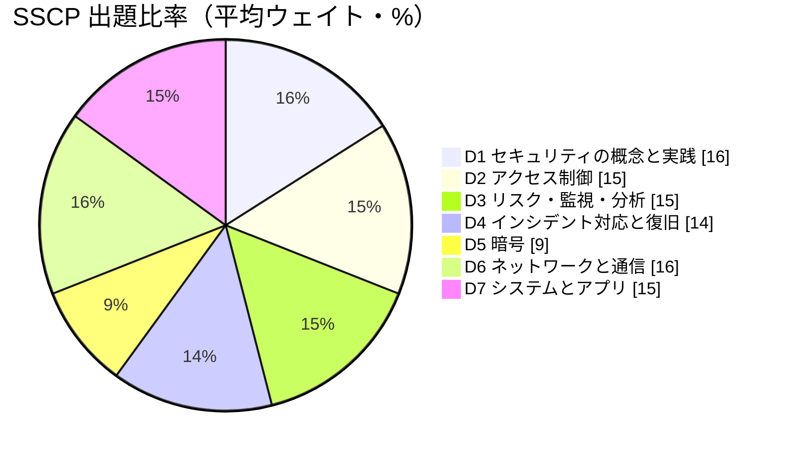

| # | ドメイン | ウェイト | 学習の優先度 |
|---|---|---|---|
| 1 | Security Concepts and Practices | 16% | 高（全ドメインの土台） |
| 2 | Access Controls | 15% | 高 |
| 3 | Risk Identification, Monitoring and Analysis | 15% | 高 |
| 4 | Incident Response and Recovery | 14% | 中〜高 |
| 5 | Cryptography | 9% | 中（最小だが理解が他ドメインに波及） |
| 6 | Network and Communications Security | 16% | 高（最大タイ） |
| 7 | Systems and Application Security | 15% | 高 |

> ウェイトは**平均値**であり、受験フォームごとに多少変動します。暗号が最小でも、他ドメイン（ネットワーク、アクセス制御）で暗号知識を使うため軽視は禁物です。

---

## 3. 学習ロードマップ

### 3.1 推奨ステップ

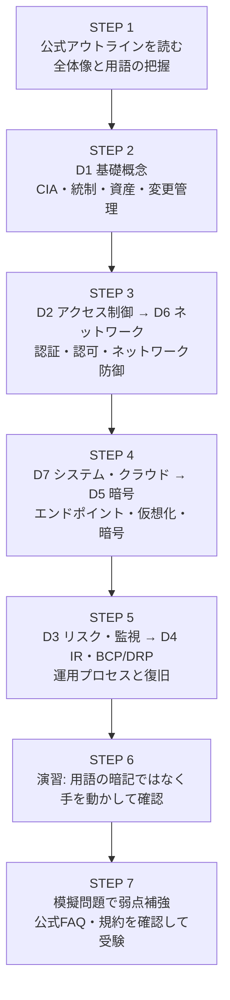

### 3.2 8週間の例

| 週 | 内容 | ゴール |
|---|---|---|
| 1 | アウトライン精読＋D1 | CIA、統制の分類、資産・変更管理を説明できる |
| 2 | D2 | 認証要素、SSO/連携、IAMライフサイクル、アクセス制御モデルの区別 |
| 3 | D6（前半） | OSI/TCP-IP、ポート、ネットワーク攻撃と対策 |
| 4 | D6（後半）＋D7（前半） | NAC・FW・IDS/IPS、無線、IoT、マルウェア |
| 5 | D7（後半）＋D5 | エンドポイント、クラウド、仮想化、暗号とPKI |
| 6 | D3 | リスク管理、脆弱性管理、ログ・SIEM |
| 7 | D4 | IRライフサイクル、フォレンジック、BCP/DRP |
| 8 | 総復習・模擬問題 | 弱点ドメインの再学習 |

### 3.3 ハンズオン演習のすすめ（無料ツール中心）

| ドメイン | 演習例 |
|---|---|
| D2 | OS のユーザー/グループ/権限設定、MFA の有効化 |
| D5 | OpenSSL で鍵生成・ハッシュ・証明書確認 |
| D6 | Wireshark でパケット観察、ローカルFWのルール作成 |
| D3 | OSS の SIEM/ログ基盤（Wazuh 等）でログ収集とアラート調整 |
| D7 | 仮想マシン／コンテナの構築と堅牢化 |

---

## 4. ドメイン1: セキュリティの概念と実践（16%）

> **ねらい**: セキュリティ全体の「共通言語」と運用の基本動作を身につける。他のすべてのドメインの土台です。

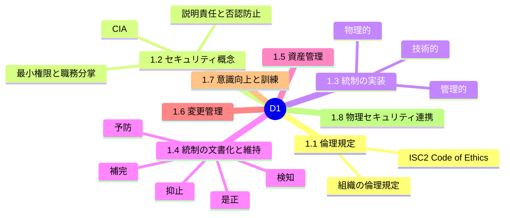

### 4.1 【1.1】倫理規定（Code of Ethics）への準拠

#### やさしい説明
セキュリティ担当者は、組織の機密情報やシステムへ強い権限を持ちます。だからこそ、**守るべき行動規範**が必要です。

#### 試験で問われるポイント

| 項目 | 内容 |
|---|---|
| ISC2 Code of Ethics | 4つの規範（正規の項目順は ISC2 公式で確認）。要旨は **①社会・公共の利益と信頼される共通善の保護、②誠実・公正・責任ある行動、③依頼者・雇用主への適切で有能なサービス提供、④専門職の発展と保護** |
| 優先順位 | 規範が衝突した場合、**公共の安全・社会の利益が最優先**、その後に組織・個人の順で考える |
| 組織の倫理規定 | 就業規則・行動規範・AUP（許容使用ポリシー）に従う |

#### ベストプラクティス
- 倫理的ジレンマ（例: 上司が規制報告の義務を無視している）では、**事実の記録 → 内部エスカレーション → 必要に応じ法令に基づく適切な対応**という順で進め、独断で情報を外部に漏らさない。
- 特権アクセスで知り得た情報の私的利用を禁止する（職務分掌・監査ログで裏付ける）。
- 倫理規定は**入社時と年次で再確認**し、署名・記録を残す。

---

### 4.2 【1.2】セキュリティ概念を理解する

#### やさしい説明
情報セキュリティの目的は、情報を**守る・正しく保つ・使えるようにする**ことです。これを **CIA** と呼びます。

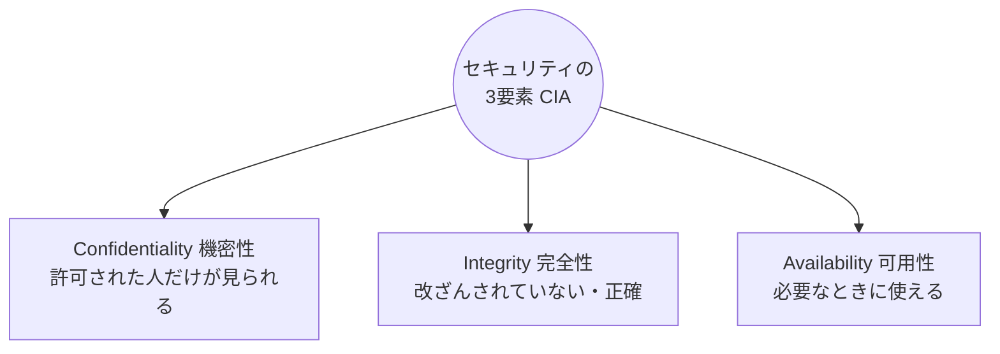

#### 概念の整理

| 概念 | 意味 | 実現手段の例 | 破られる例 |
|---|---|---|---|
| **Confidentiality** | 権限のない者に開示されない | 暗号化、アクセス制御、DLP | 情報漏えい、盗聴 |
| **Integrity** | 不正な変更がない | ハッシュ、デジタル署名、変更管理、ACL | データ改ざん、不正な設定変更 |
| **Availability** | 必要時に利用可能 | 冗長化、バックアップ、DDoS対策 | DDoS、ランサムウェア、障害 |
| **Accountability（説明責任）** | 誰が何をしたか追跡できる | 個人別ID、監査ログ、時刻同期 | 共有アカウントで追跡不能 |
| **Non-repudiation（否認防止）** | 「やっていない」と否定できない | デジタル署名、監査証跡 | 署名なしメールで送信否認 |
| **Least privilege（最小権限）** | 業務に必要な最小限の権限のみ | RBAC、JIT権限付与 | 管理者権限の常時付与 |
| **Separation of Duties（職務分掌）** | 重要業務を複数人に分ける | 承認フロー、二人制 | 一人が申請と承認を兼任 |

#### 関連する設計原則（試験でよく登場）

| 原則 | 説明 |
|---|---|
| Defense in Depth（多層防御） | 単一の対策に頼らず、層を重ねる |
| Need-to-know | 職務上知る必要がある情報のみ付与 |
| Fail-safe / Fail-secure | 障害時に安全側（閉じる／開ける）へ倒す方針を明確化 |
| Economy of mechanism | 仕組みはシンプルにする（複雑さは脆弱性の温床） |

#### ベストプラクティス
- 権限は**既定で拒否（Deny by default）**し、必要な分だけ許可する。
- 共有アカウントを廃止し、**個人IDで説明責任を担保**する（やむを得ない場合は PAM でチェックアウトと操作記録）。
- 申請者と承認者を分け、**特権操作は二人承認**にする。

---

### 4.3 【1.3】セキュリティ統制を特定・実装する

#### 3つの「性質」による分類

| 分類 | 説明 | 例（アウトラインに明記） |
|---|---|---|
| **Technical（技術的）** | システムで実装 | ファイアウォール、IDS、ACL |
| **Physical（物理的）** | 物理的な対策 | マントラップ、カメラ、錠 |
| **Administrative（管理的）** | 人・規則による対策 | ポリシー、標準、手順、ベースライン |

#### 管理文書の階層

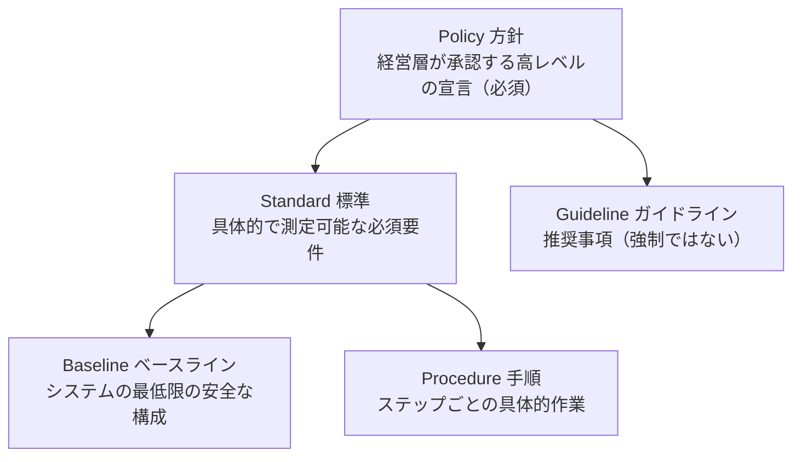

| 文書 | 強制力 | 抽象度 |
|---|---|---|
| Policy | 必須 | 最も高い |
| Standard | 必須 | 中 |
| Baseline | 必須（最低限の構成） | 中〜低 |
| Procedure | 必須（作業手順） | 低（具体的） |
| Guideline | **任意（推奨）** | 柔軟 |

#### コンプライアンス要件の評価と定期監査
- **Assessing compliance requirements**: 自組織に適用される法令・業界規格（例: 個人情報保護法、PCI DSS、ISO/IEC 27001）を洗い出し、統制にマッピングする。
- **Periodic audit and review**: 統制が**設計どおりに実装され、有効に機能している**かを定期的に確認する。

#### ベストプラクティス
- 統制は**リスクに基づいて選定**し、「コストが便益を超えない」ことを確認する。
- 統制は**多層で重ねる**（技術＋物理＋管理の組み合わせ）。
- 内部監査・外部監査・自己評価を**年次計画**に組み込み、指摘事項は**期限付きで是正**する。

---

### 4.4 【1.4】機能的セキュリティ統制を文書化・維持する

#### 「機能」による分類（5種類）

| 種類 | 目的 | 例 |
|---|---|---|
| **Deterrent（抑止）** | 攻撃・違反の意欲をそぐ | 警告バナー、監視カメラの掲示、懲戒規定 |
| **Preventive（予防）** | 発生そのものを防ぐ | FW、アクセス制御、暗号化、錠 |
| **Detective（検知）** | 発生を見つける | IDS、ログ監視、監査、CCTV |
| **Corrective（是正）** | 発生後に回復・修正 | パッチ適用、バックアップからの復元、IR |
| **Compensating（補完）** | 主統制が実施できない時の代替 | MFAが導入できない旧システムへの追加監視＋ネットワーク隔離 |

> **覚え方**: 時系列は「抑止・予防（前）→ 検知（中）→ 是正（後）」。**補完**は「代替策」と覚える。

#### ベストプラクティス
- 各統制について、**目的・範囲・責任者・実施頻度・証跡（エビデンス）**を文書化する。
- 例外運用（補完統制）は**期限・承認者・残存リスク**を明記し、定期レビューする。
- 統制の有効性は**テスト結果・メトリクス**で継続的に検証する。

---

### 4.5 【1.5】資産管理ライフサイクルを支援・実装する

対象は **ハードウェア・ソフトウェア・データ**です。

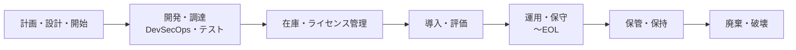

| フェーズ | 重要ポイント | ベストプラクティス |
|---|---|---|
| 計画・設計・開始 | 要件・リスクの早期把握 | セキュリティ要件を**最初から**盛り込む（Security by Design） |
| 開発・調達 | DevSecOps、テスト | CI/CDに脆弱性スキャンを組み込む。調達時にベンダーのセキュリティ評価 |
| 在庫・ライセンス | OSS/商用の把握 | **資産台帳（CMDB）**を維持。OSSライセンスと SBOM の管理 |
| 導入・評価 | 設定・受入テスト | ベースラインに沿った構成、脆弱性診断後に本番投入 |
| 運用・保守・EOL | パッチ・監視 | EOL/EOS を事前把握し、**サポート切れ前に移行計画** |
| 保管・保持 | 法令・規程に従う | データ分類ごとの**保持期間**を定義し、暗号化して保管 |
| 廃棄・破壊 | 情報の復元不能化 | 媒体のサニタイズ（Clear/Purge/Destroy）を実施し**証明書・記録**を残す |

#### データ分類の例

| 区分 | 例 | 主な扱い |
|---|---|---|
| 公開 | プレスリリース | 制限なし |
| 社内限り | 社内手順書 | 社外持ち出し制限 |
| 機密 | 顧客情報、設計書 | 暗号化・アクセス制限・ログ |
| 極秘 | 経営戦略、認証情報 | 厳格な承認・最小権限 |

#### ベストプラクティス
- すべての資産に**オーナー（所有者）**を割り当てる（責任の明確化）。
- 媒体廃棄は NIST SP 800-88 の考え方（Clear＝論理的消去／Purge＝復元困難化／Destroy＝物理破壊）で、**媒体の種類と機密度**に応じて選ぶ。クラウドではデータ消去の代わりに**暗号鍵の破棄（Crypto-erase）**を併用することがある。

---

### 4.6 【1.6】変更管理ライフサイクルを支援・実装する

#### やさしい説明
本番環境の変更は、障害や脆弱性の最大の原因の一つです。**計画・承認・テスト・記録**で変更を安全に行う仕組みが変更管理です。

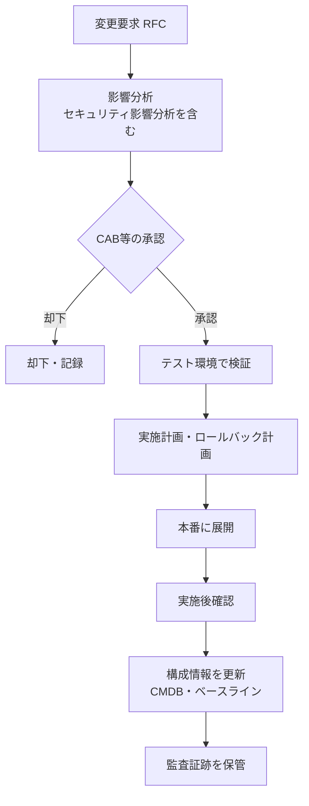

| 要素 | 内容 |
|---|---|
| Change management | 役割・責任・手順・コミュニケーション・監査 |
| Security impact analysis | 変更が機密性・完全性・可用性やコンプライアンスに与える影響を評価 |
| Configuration management (CM) | 構成を**ベースライン化**し、差分を管理（ドリフト検知） |
| 変更の種類 | 標準（定型・事前承認）、通常（CAB承認）、緊急（事後レビュー） |

#### ベストプラクティス
- **緊急変更も事後に必ずレビュー**し、記録を残す。
- すべての変更に**ロールバック手順**を用意する。
- 構成は**コード化（IaC）してバージョン管理**し、承認済み変更のみを自動展開する。
- 構成ドリフトを検知するツールで、**ベースラインとの差異を定期確認**する。

---

### 4.7 【1.7】セキュリティ意識向上とトレーニング

| 手法 | 内容 |
|---|---|
| ソーシャルエンジニアリング対策 | 手口の周知、報告窓口の周知 |
| フィッシング訓練 | 模擬メールで耐性を測定 |
| 机上演習（Tabletop） | シナリオを使い、役割と手順を口頭で確認 |
| 啓発コミュニケーション | ポスター、ニュースレター、短い動画 |

#### ベストプラクティス
- 研修は**入社時＋定期＋役割別**（一般職員・管理職・特権管理者・開発者）に実施する。
- フィッシング訓練は**懲罰ではなく学習**を目的に設計し、報告率（報告した人の割合）をKPIにする。
- 事故事例を**自組織向けに具体化**し、定期的に更新する。

---

### 4.8 【1.8】物理セキュリティ運用との連携

| 領域 | 対策例 |
|---|---|
| データセンター／施設評価 | 立地リスク、入退室管理、電源・空調・消火の冗長性 |
| バッジ・来訪者管理 | 入館証、来訪者の記録・同伴、立ち入り範囲の制限 |
| 私物デバイス制限 | 持込み制限、撮影・USBの制限、ロッカー運用 |

| 物理統制 | 防ぐリスク |
|---|---|
| **Mantrap（マントラップ）** | 共連れ（tailgating/piggybacking） |
| ロック・ケージ・ラック施錠 | 機器への不正アクセス |
| CCTV | 抑止・検知・事後調査 |

#### ベストプラクティス
- 論理セキュリティ（認証・暗号）だけでは不十分。**物理侵入は論理対策を迂回**されるため、セキュリティ部門と施設部門で**合同評価**を行う。
- 来訪者は**常時同伴**、入館ログは**一定期間保管**する。

---

### 4.9 ドメイン1 確認クイズ

| # | 問題 | 答え |
|---|---|---|
| 1 | 申請者と承認者を別人にする統制原則は？ | Separation of Duties（職務分掌） |
| 2 | 強制力があるのは Policy と Guideline のどちらか？ | Policy（Guidelineは推奨） |
| 3 | MFAを導入できない旧システムに追加の監視と隔離を行うのは何統制？ | Compensating（補完）統制 |

### 4.10 ドメイン1 出典

- ISC2 Exam Outline（2025/10/1）: <https://www.isc2.org/certifications/sscp/sscp-certification-exam-outline>
- ISC2 Ethics: <https://www.isc2.org/about/ethics>
- NIST SP 800-88（媒体サニタイズ）: <https://csrc.nist.gov/pubs/sp/800/88/r1/final>
- NIST SP 800-53 Rev.5（CM・AT・PE等の統制）: <https://csrc.nist.gov/pubs/sp/800/53/r5/upd1/final>

---
## 5. ドメイン2: アクセス制御（15%）

> **ねらい**: 「誰が（認証）」「何に対して（認可）」「どこまでできるか（アクセス制御）」を、人・デバイス・システム間で管理する。

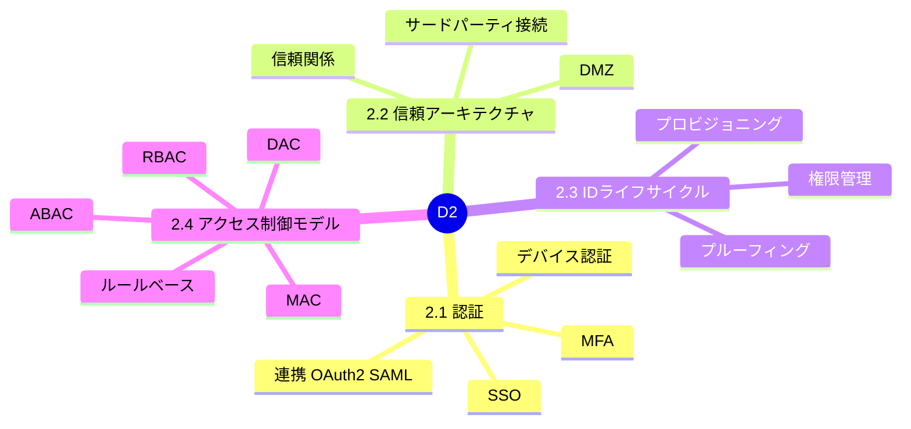

### 5.1 【2.1】認証方式を実装・維持する

#### やさしい説明
**認証（Authentication）**は「本人であること」の確認、**認可（Authorization）**は「何をしてよいか」の決定です。この2つは別物です。


#### 認証要素

| 要素 | 説明 | 例 | 主な弱点 |
|---|---|---|---|
| Something you **know** | 知識 | パスワード、PIN | 漏えい・推測・使い回し |
| Something you **have** | 所持 | ICカード、トークン、スマホ、FIDOキー | 紛失・盗難 |
| Something you **are** | 生体 | 指紋、顔、虹彩 | 変更不可、偽造・誤認識 |
| Somewhere you are / When | 場所・時間（補助要素） | IP、地理、勤務時間 | 偽装可能（単独では弱い） |

> **MFA（多要素認証）は「異なる種類の要素」を2つ以上**組み合わせること。パスワード＋秘密の質問は**どちらも知識要素**なので多要素ではありません。

#### 認証強度の目安

| 方式 | 強度の傾向 | 備考 |
|---|---|---|
| パスワードのみ | 低 | フィッシング・使い回しに弱い |
| SMS / 音声コード | 中 | SIMスワップ等のリスク |
| TOTP（認証アプリ） | 中〜高 | フィッシングの中継（リアルタイム）には弱い |
| プッシュ承認 | 中 | **MFA疲労攻撃**に注意（番号照合で緩和） |
| **FIDO2 / WebAuthn / パスキー** | **高** | **フィッシング耐性**あり（ドメインに束縛） |

#### SSO（シングルサインオン）と連携（Federation）

| 技術 | 役割 | 要点 |
|---|---|---|
| Kerberos | チケットベースのSSO（社内AD） | 時刻同期が重要（時計ずれで失敗） |
| ADFS | ADを起点とした連携の仕組み | SAML等でクラウドとの連携 |
| **SAML 2.0** | 認証結果（アサーション）をXMLで受け渡し | 企業向けSaaSのSSOで一般的 |
| **OpenID Connect (OIDC)** | **認証**をOAuth 2.0上に実装 | IDトークン（JWT）で本人情報 |
| **OAuth 2.0** | **認可**（アクセス委譲） | 認証プロトコルではない。アクセストークンで権限委譲 |

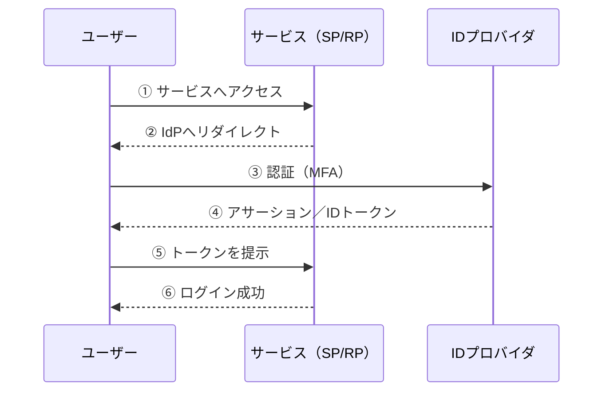

> **試験の定番**: 「OAuth2 は認可、OIDC は認証、SAML は企業SSO向けの認証連携」。

#### デバイス認証

| 方式 | 強度 | 備考 |
|---|---|---|
| **証明書（クライアント証明書）** | 高 | 802.1X（EAP-TLS）等で利用 |
| **TPM** | 高 | チップ内に鍵を保管。デバイスの完全性・証明に利用 |
| MACアドレス | **低** | 容易に偽装できるため**単独では認証にならない** |

#### ベストプラクティス（パスワード・認証）
NIST SP 800-63-4（2025年7月最終版）の方向性を中心に整理します。

| 項目 | 推奨の方向性 |
|---|---|
| 長さ | **長さを重視**（単独認証のパスワードは**15文字以上**、MFAの一部の場合は8文字以上が目安。詳細は SP 800-63B-4 を確認） |
| 複雑性ルール | 大小英数記号の**強制はしない**（長いパスフレーズを推奨） |
| 定期変更 | **漏えいの兆候がない限り、定期的な強制変更は行わない** |
| ブロックリスト | 漏えい済み・辞書的パスワードを**拒否**する |
| 保管 | **ソルト付きの低速ハッシュ**（Argon2id、bcrypt、scrypt、PBKDF2など） |
| 入力 | **貼り付けを許可**（パスワードマネージャを使えるようにする） |
| 特権アカウント | **フィッシング耐性のあるMFA**（FIDO2等）を優先 |
| ロックアウト | 試行回数制限＋レート制限（無期限ロックはDoSに悪用され得る） |

- **共有・汎用アカウントを廃止**し、緊急用（ブレークグラス）アカウントは厳重管理・使用時にアラート。
- SSO化で**パスワードの数を減らす**ことが、実質的なセキュリティ向上になる。

---

### 5.2 【2.2】インターネットワークの信頼アーキテクチャ

#### 信頼関係（Trust relationships）

| 種類 | 説明 |
|---|---|
| **One-way（一方向）** | A が B を信頼するが、B は A を信頼しない |
| **Two-way（双方向）** | お互いに信頼する |
| **Transitive（推移的）** | A→B、B→C なら A→C も信頼される（**広がりすぎに注意**） |
| **Zero trust** | **ネットワーク上の位置では信頼しない**。常に検証（Never trust, always verify） |

> 推移的信頼は、侵害された1ドメインから**他へ波及**しやすい。NIST SP 800-207 は、ゼロトラストを「**ネットワークの境界ではなく、リソース保護に焦点を当てる**」考え方として整理している。

#### ネットワークゾーン

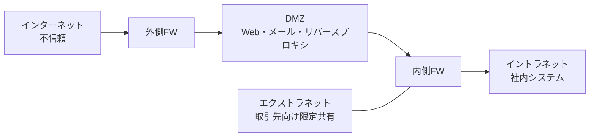

| ゾーン | 説明 |
|---|---|
| Internet | 不特定多数。信頼しない |
| **DMZ** | 外部公開サーバを置く緩衝領域。内部へ**直接**通信させない |
| Intranet | 組織内部のネットワーク |
| Extranet | 取引先など**限定された外部**と共有する領域 |

#### サードパーティ接続（API・拡張・ミドルウェア）

| リスク | 対策 |
|---|---|
| APIの過剰権限 | OAuthスコープの**最小化**、トークン有効期限の短縮 |
| 認証不備 | APIキー単独に頼らず、OAuth/mTLS、**APIゲートウェイ**でレート制限 |
| サプライチェーン | 利用前のセキュリティ評価、契約でSLA/監査権、依存関係のSBOM管理 |
| アプリ拡張（アドオン） | 承認制（許可リスト方式）、権限の定期棚卸し |

#### ベストプラクティス
- **DMZ のサーバが侵害されても内部へ到達できない**よう、FWで厳格に制御する。
- 取引先接続は**専用セグメント＋最小限のルール＋ログ監視**。
- 将来的には**ゼロトラスト（ユーザ・デバイス・コンテキストで都度判断）**へ段階移行する。

---

### 5.3 【2.3】IDマネジメントライフサイクル


| 要素 | 説明 | ベストプラクティス |
|---|---|---|
| **Proofing** | 実在する本人かの確認 | 強度は用途に応じる（高リスクは対面/書類＋生体確認） |
| **Authorization** | 必要権限の決定 | **申請→上長承認→システム管理者承認** |
| **Provisioning** | 作成・権限付与 | **HR連携で自動化**（入社・異動・退職＝Joiner/Mover/Leaver） |
| **Maintenance** | 役割変更・基準変更 | **定期的な権限棚卸し（Access Recertification）** |
| **De-provisioning** | 退職・契約終了 | **即日無効化**。使い回し防止のため削除前に一定期間無効化→削除 |
| **Entitlement** | 継承権限・リソース権限 | **権限の肥大化（Privilege Creep）**を防ぐ（異動時に旧権限を剥奪） |
| **IAMシステム** | 統合管理基盤 | 一元管理、ワークフロー、監査ログ |

#### ベストプラクティス
- **孤立アカウント（Orphaned Account）**を定期検出して削除。
- サービスアカウントにも**所有者・有効期限・ローテーション**を設定。
- 付与の根拠（誰がいつ承認したか）を**監査証跡**として保管。

---

### 5.4 【2.4】アクセス制御モデル

| モデル | 誰が決める？ | 判断基準 | 特徴 | 典型例 |
|---|---|---|---|---|
| **MAC**（Mandatory） | **システム/管理者**（利用者は変更不可） | ラベル（機密レベル）と許可（クリアランス） | 最も厳格 | 軍・政府、SELinux |
| **DAC**（Discretionary） | **所有者（Owner）**が裁量で付与 | ACL | 柔軟だが漏えいリスク | 一般的なファイル共有 |
| **RBAC**（Role-based） | 管理者が**役割**に権限を紐付け | 役割（職務） | 管理が容易、最小権限と相性が良い | 企業システム |
| **Rule-based** | システムが**ルール**で自動判断 | 時間・IPなどの固定ルール | 例外が少ない | FWのACL、営業時間のみ許可 |
| **ABAC**（Attribute-based） | ポリシーエンジン | **属性**（ユーザ・リソース・環境の組み合わせ） | きめ細かい・動的 | ゼロトラスト、クラウドIAMポリシー |

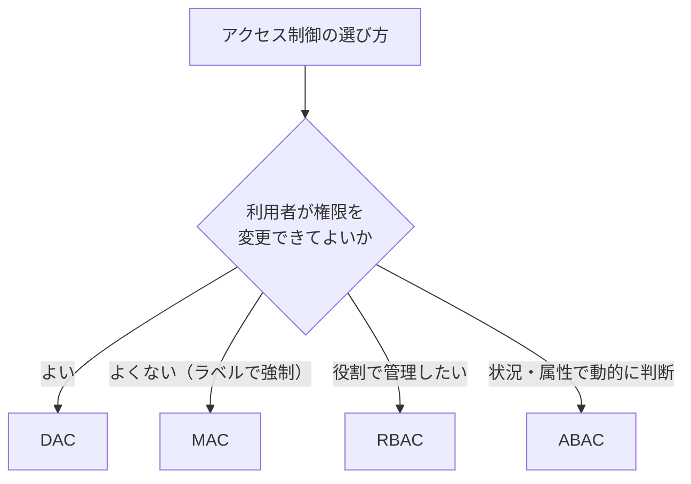

#### PAM（特権アクセス管理）
| 機能 | 内容 |
|---|---|
| Vault（保管庫） | 特権パスワード・鍵を暗号化して保管、利用時に払い出し |
| **JIT（Just-in-Time）** | 必要な時間だけ権限を付与 |
| セッション記録 | 特権操作を録画・ログ化 |
| 承認ワークフロー | 重要操作は事前承認 |

#### ベストプラクティス
- 基本は **RBAC**。例外・動的な要件に **ABAC** を併用。
- 管理者は**通常業務用アカウントと特権アカウントを分離**する。
- 特権は**常時付与せず JIT**、監査証跡を保管する。

---

### 5.5 ドメイン2 確認クイズ

| # | 問題 | 答え |
|---|---|---|
| 1 | OAuth 2.0 は認証と認可のどちらのためのプロトコル？ | **認可**（アクセス委譲）。認証はOIDC |
| 2 | パスワード＋秘密の質問は MFA か？ | **いいえ**（どちらも知識要素） |
| 3 | 所有者が自分のファイルの権限を決めるモデルは？ | DAC |

### 5.6 ドメイン2 出典

- NIST SP 800-63-4（Digital Identity Guidelines・2025年7月最終）: <https://csrc.nist.gov/pubs/sp/800/63/4/final> ／ 実装資料: <https://pages.nist.gov/800-63-4-Implementation-Resources/>
- NIST SP 800-207（Zero Trust Architecture）: <https://csrc.nist.gov/pubs/sp/800/207/final>
- OAuth 2.0（RFC 6749）: <https://www.rfc-editor.org/rfc/rfc6749>
- OpenID Connect Core 1.0: <https://openid.net/specs/openid-connect-core-1_0.html>
- OASIS SAML 2.0: <https://docs.oasis-open.org/security/saml/v2.0/>
- FIDO Alliance: <https://fidoalliance.org/>

---

## 6. ドメイン3: リスクの特定・監視・分析（15%）

> **ねらい**: リスクを**見つけ・評価し・扱い**、ログや監視で**継続的に状況を把握**し、結果を**伝える**。

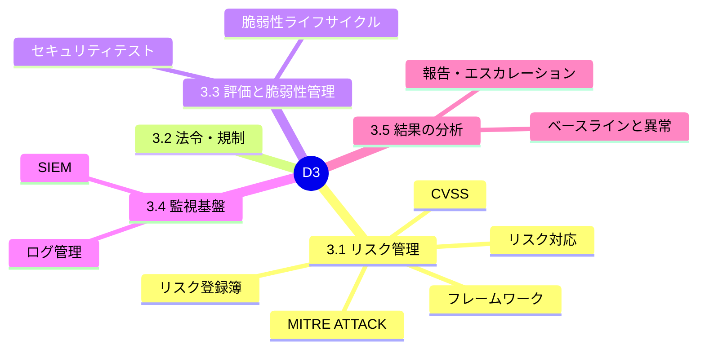

### 6.1 【3.1】リスク管理を理解する

#### 基本用語

| 用語 | 意味 | 例 |
|---|---|---|
| Asset（資産） | 守る対象 | 顧客DB |
| Threat（脅威） | 害を及ぼす可能性のある事象 | ランサムウェア |
| Vulnerability（脆弱性） | 悪用され得る弱点 | 未パッチのOS |
| Likelihood（可能性） | 発生しやすさ | 高・中・低 |
| Impact（影響） | 発生時の損害 | 金銭・信用・法的 |
| **Risk（リスク）** | 脅威が脆弱性を悪用し資産に損害を与える可能性 | **可能性 × 影響** |

#### 定量的評価の公式（試験の定番）

| 指標 | 式 | 意味 |
|---|---|---|
| SLE（単一損失予測） | **AV × EF** | 1回の発生で失う金額（AV=資産価値、EF=損失割合） |
| ARO（年間発生率） | — | 1年に何回起きるか |
| **ALE（年間損失予測）** | **SLE × ARO** | 年間の期待損失 |

> **例**: 資産 1,000万円、EF 50%、ARO 0.2 → SLE=500万円、**ALE=100万円**。対策費が年間100万円を**大きく上回る**なら、その対策は経済的に見合わない可能性がある。

#### リスク対応（Risk treatment）

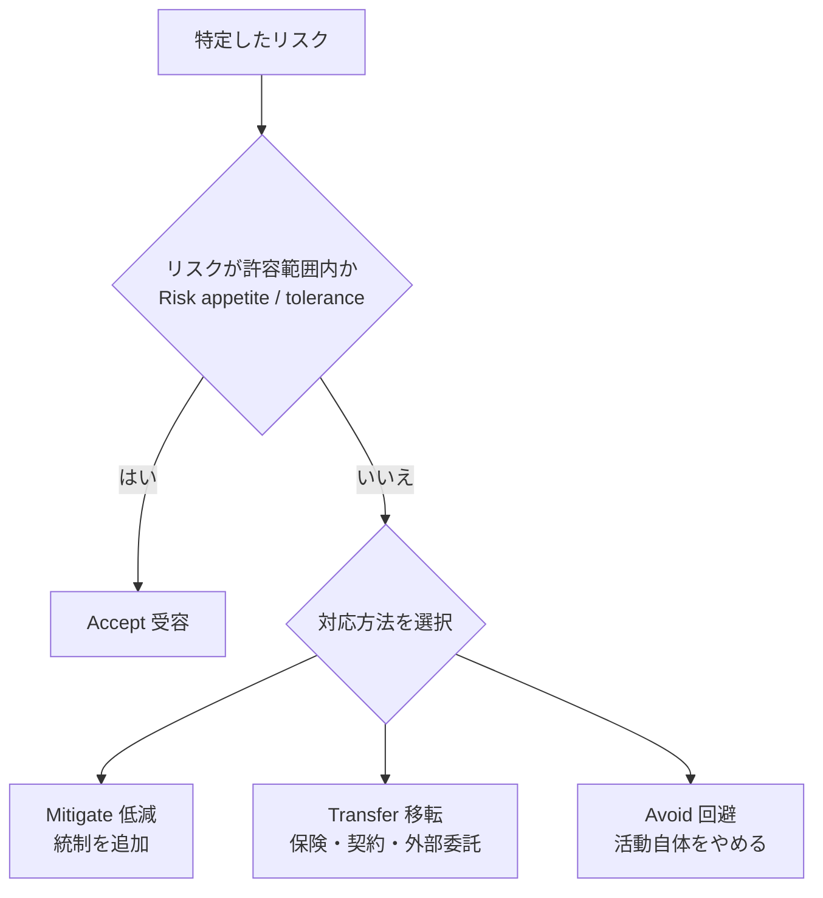

| 対応 | 意味 | 例 |
|---|---|---|
| **Mitigate** | 低減 | パッチ適用、MFA導入 |
| **Transfer** | 移転（責任の一部を他者へ） | サイバー保険、マネージドサービス |
| **Accept** | 受容（意識的に受け入れる） | 低影響リスクを承認して残す |
| **Avoid** | 回避 | リスクの高い機能を廃止 |
| Ignore | 無視（アウトラインに記載） | **評価せず放置することは対応ではない**。受容は**経営の承認と記録**を伴う |

> 試験では「**Ignore は不適切な対応**（正式な管理プロセスではない）」という文脈で出ることが多い。**Accept は文書化された意思決定**。

#### リスクの可視化・共有

| 要素 | 説明 |
|---|---|
| **Risk register** | リスクの一覧（内容・影響・可能性・対応・担当・期限） |
| **脅威インテリジェンス共有** | 他組織・ISAC・公的機関と情報共有 |
| **IOC（Indicators of Compromise）** | 侵害の痕跡（悪意あるIP、ハッシュ、ドメイン等） |
| **CVSS** | 脆弱性の深刻度を0.0〜10.0で評価（共通基準） |
| **MITRE ATT&CK** | 攻撃者の戦術・技術のナレッジベース。検知カバレッジ分析に利用 |

#### CVSS 深刻度の目安（v3.x/v4.0で共通する区分）

| スコア | 深刻度 |
|---|---|
| 0.0 | None |
| 0.1〜3.9 | Low |
| 4.0〜6.9 | Medium |
| 7.0〜8.9 | High |
| 9.0〜10.0 | Critical |

> CVSS は「**技術的な深刻度**」であり、**自組織での優先度**は資産の重要度・露出・悪用実績（例: CISA KEV）も加味して決める。

#### リスク管理フレームワーク

| フレームワーク | 概要 |
|---|---|
| **NIST RMF**（SP 800-37 Rev.2） | カテゴライズ→選択→実装→評価→認可→監視 のサイクル |
| NIST SP 800-30 Rev.1 | リスクアセスメントの手法 |
| **NIST CSF 2.0** | Govern, Identify, Protect, Detect, Respond, Recover の6機能 |
| ISO/IEC 27001 / 27005 | ISMS（マネジメントシステム）／リスクマネジメント |

#### 脅威モデリングの例（STRIDE）

| 文字 | 脅威 | 侵害される性質 |
|---|---|---|
| **S**poofing | なりすまし | 認証 |
| **T**ampering | 改ざん | 完全性 |
| **R**epudiation | 否認 | 否認防止 |
| **I**nformation disclosure | 情報漏えい | 機密性 |
| **D**enial of service | サービス拒否 | 可用性 |
| **E**levation of privilege | 権限昇格 | 認可 |

#### ベストプラクティス
- リスク評価は**スコープ（範囲）を明確にし**、定期的（年次＋大きな変更時）に見直す。
- リスク受容は**リスクオーナーが承認**し、期限付きで再評価する。
- 脅威情報は**自組織の資産に関連するもの**に絞って運用に落とす（IOCをSIEM/EDRへ取り込む）。

---

### 6.2 【3.2】法的・規制上の懸念

| 論点 | 内容 | ベストプラクティス |
|---|---|---|
| Jurisdiction（管轄） | データの所在地・事業国の法が適用される | **データ所在地**と**契約の準拠法**を明確化 |
| Privacy（プライバシー） | 個人情報の取得・利用・越境移転の規制 | データ最小化、利用目的の明示、保持期限 |
| 代表的な規制 | 日本の個人情報保護法（APPI）、EUのGDPR、米国のHIPAA、PCI DSS（カード業界） | 適用有無を**法務と合同**で判断 |
| Limitations | 監視・調査権限の制約 | **従業員の同意と就業規則**で根拠を整備 |

> 法令の解釈は**法務部門・専門家**の領分。SSCPは「**気づいて、エスカレーションする**」役割。

---

### 6.3 【3.3】セキュリティ評価・脆弱性管理

#### 脆弱性管理ライフサイクル

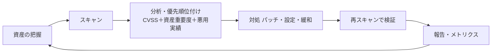

| 種類 | 内容 | 注意 |
|---|---|---|
| 脆弱性スキャン | 既知の脆弱性を網羅的に検出 | **認証付き（Authenticated）スキャン**の方が精度が高い |
| ペネトレーションテスト | 実際に侵入を試みる | **書面の許可・範囲（Rules of Engagement）**が必須 |
| ブラック/グレー/ホワイトボックス | 事前情報の量の違い | 目的に合わせて選択 |
| 設計/アーキテクチャレビュー | 設計段階の評価 | 早期ほど是正コストが小さい |
| サプライヤレビュー | 外部委託先の評価 | 契約・監査権・証跡で確認 |

#### ベストプラクティス
- 優先度は **CVSSだけで決めず**、露出（インターネット公開か）、悪用実績（CISA KEV）、資産重要度で決定。
- 修復の期限（SLA）を深刻度ごとに設定（例: Critical は数日以内）。**組織の方針に合わせて設定**。
- **パッチ管理**は検証環境→段階展開→ロールバック計画（NIST SP 800-40 Rev.4 参照）。
- 修復できない場合は**補完統制**（隔離・WAF・監視強化）＋期限付きの**リスク受容**を文書化。

---

### 6.4 【3.4】セキュリティプラットフォームの運用と監視

#### 継続的監視（Continuous Monitoring）の流れ

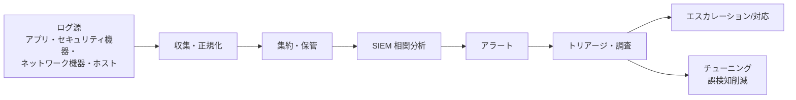

#### 関心のあるイベント（Events of interest）

| 種別 | 例 |
|---|---|
| エラー・省略 | 認証失敗の連続、ログ欠落 |
| 異常 | 通常と異なる時間・場所のアクセス |
| 不正な変更 | 許可なき設定変更、権限変更 |
| コンプライアンス違反 | 保存期間超過、暗号化されていないデータ転送 |
| ポリシー違反 | 禁止されたソフトの実行 |

#### ログ管理

| 観点 | ベストプラクティス |
|---|---|
| ポリシー | 何を・どこへ・どれだけ保管するかを**文書化** |
| 完全性 | **ハッシュ・WORM（追記専用）**で改ざん防止 |
| 保全 | 保持期間を**法令・契約**に合わせ、調査時は**法的保全** |
| 構成 | **中央集約**し、攻撃を受けたホストからでも消せないようにする |
| **時刻同期** | **NTPで統一**（相関分析と証拠性に必須） |
| 個人情報 | ログへの機微情報（パスワード等）出力を避ける・マスキング |
| チューニング | ノイズを減らし重要アラートに集中 |

#### SIEMの役割
- 複数ソースのログを**相関分析**し、リアルタイムに検知。
- 追跡・監査対応（レポート、検索）。
- **ユースケース（検知ルール）**を MITRE ATT&CK と対応づけて整備。

---

### 6.5 【3.5】監視結果の分析

| 要素 | 内容 | ベストプラクティス |
|---|---|---|
| **ベースラインと異常** | 通常状態（ベースライン）との差異を検出 | 通常の稼働パターンを**先に学習・文書化** |
| 相関 / ノイズ削減 | 複数イベントを結びつけ誤検知を削減 | しきい値・ホワイトリスト管理を継続的に見直し |
| 可視化・メトリクス | ダッシュボード、タイムライン、傾向 | **MTTD（検知まで）/ MTTR（対応まで）**等のKPIを追跡 |
| 調査・分析 | イベントデータの深掘り | 5W1H＋タイムラインで再構築 |
| **文書化と伝達** | 調査結果の報告、**エスカレーション** | 受け手に合わせた表現（経営層は影響とリスク、技術者は詳細） |

#### エスカレーションの考え方
1. **事実を正確に記録**（日時、対象、観測事項）。
2. **影響範囲と深刻度**を暫定判断。
3. **定められた連絡経路**で報告（個人判断で握りつぶさない）。
4. 経過を**時系列で更新**。

---

### 6.6 ドメイン3 確認クイズ

| # | 問題 | 答え |
|---|---|---|
| 1 | ALE の計算式は？ | **SLE × ARO** |
| 2 | 対策費が想定損失より大きく、リスクを承認して残す対応は？ | **Accept（受容）**（文書化・承認が必要） |
| 3 | ログ調査で時刻の整合性を確保する最も基本的な対策は？ | **NTPによる時刻同期** |

### 6.7 ドメイン3 出典

- NIST SP 800-37 Rev.2（RMF）: <https://csrc.nist.gov/pubs/sp/800/37/r2/final>
- NIST SP 800-30 Rev.1: <https://csrc.nist.gov/pubs/sp/800/30/r1/final>
- NIST Cybersecurity Framework: <https://www.nist.gov/cyberframework>
- FIRST CVSS: <https://www.first.org/cvss/>
- MITRE ATT&CK: <https://attack.mitre.org/>
- CISA KEV カタログ: <https://www.cisa.gov/known-exploited-vulnerabilities-catalog>
- NIST SP 800-40 Rev.4（パッチ管理）: <https://csrc.nist.gov/pubs/sp/800/40/r4/final>
- NIST SP 800-92（ログ管理）: <https://csrc.nist.gov/pubs/sp/800/92/final>
- ISO/IEC 27001: <https://www.iso.org/standard/27001>

---
## 7. ドメイン4: インシデント対応と復旧（14%）

> **ねらい**: 事故が起きたときに、**慌てず・手順どおり・証拠を守りながら**事業を復旧し、再発を防ぐ。

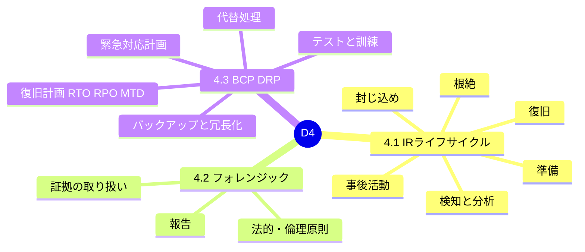

### 7.1 【4.1】インシデント対応ライフサイクル

#### やさしい説明
**イベント**（観測できる事象）のうち、セキュリティ上の悪影響を及ぼす（または及ぼす恐れのある）ものが**インシデント**です。すべてのイベントがインシデントではありません。

```mermaid
flowchart TD
    P["1 準備 Preparation<br/>体制・手順・訓練・ツール"] --> D["2 検知・分析・エスカレーション<br/>Detection and Analysis"]
    D --> C["3 封じ込め Containment<br/>被害の拡大を止める"]
    C --> E["4 根絶 Eradication<br/>原因の除去"]
    E --> R["5 復旧 Recovery<br/>安全に通常運用へ戻す"]
    R --> L["6 事後活動 Post-incident<br/>教訓・改善"]
    L -. "改善を反映" .-> P
```

> **補足**: NIST SP 800-61 Rev.3（2025年4月最終版）は、IRを **CSF 2.0 の6機能（Govern, Identify, Protect, Detect, Respond, Recover）** と結びつけ、リスクマネジメントの一部として位置づけ直しました。SSCP アウトラインが挙げる上記の6段階は、試験対策として依然として基本の骨格です。

| フェーズ | やること | ベストプラクティス |
|---|---|---|
| **準備** | 役割定義、IR計画、連絡網、訓練、ツール整備 | **IR計画を文書化**し、連絡先・権限（誰が遮断を決定できるか）を**事前に決める**。年1回以上の机上演習 |
| **検知・分析・エスカレーション** | アラートの確認、影響範囲、深刻度判断、報告 | **初動の記録（誰が、いつ、何を）**。トリアージ基準を明文化。広報・法務・経営層への**連絡経路** |
| **封じ込め** | 短期（隔離）と長期（修復までの暫定運用） | **証拠を保全してから**遮断（電源断は揮発性データを失う）。ネットワーク隔離を優先 |
| **根絶** | マルウェア除去、脆弱性修正、侵害アカウントの失効 | **根本原因**まで対処（再感染の防止）。認証情報の全面リセット |
| **復旧** | クリーンなバックアップから復元、監視強化 | 復旧前に**健全性を確認**、復旧後は**一定期間の強化監視** |
| **事後活動** | 教訓の共有、改善、文書化 | **非難のない（Blameless）振り返り**、改善タスクに担当と期限 |

#### 封じ込めの判断（例）

| 状況 | 推奨される初動 |
|---|---|
| 1台のPCがマルウェア感染 | ネットワークから**隔離**（電源は落とさない）、EDRで隔離、証拠保全 |
| ランサムウェアが拡散中 | 影響セグメントを**即時遮断**、バックアップの保護（オフライン/イミュータブル） |
| 特権アカウントの漏えい疑い | アカウント無効化、セッション失効、キーのローテーション |

#### ベストプラクティス（全体）
- **「あとで見るメモ」ではなくチケット/ケース管理**で全作業を時系列記録する。
- 外部連絡（顧客・当局・メディア）は**広報・法務が主導**し、技術者は事実を提供する。
- 法令・契約による**報告期限**（例: 個人情報漏えい時の当局報告）を事前に把握する。

---

### 7.2 【4.2】フォレンジック調査

#### 法的・倫理的原則

| 区分 | 内容 |
|---|---|
| 手続の種類 | **民事（Civil）／刑事（Criminal）／行政（Administrative）**で証明基準が異なる |
| 倫理 | 中立性、権限の範囲内での調査、証拠の秘匿 |
| ポリシー準拠 | 組織のセキュリティポリシーに沿った調査（従業員の同意・通知の整備） |

#### 証拠の取り扱い

```mermaid
flowchart LR
    F["ファーストレスポンダー<br/>現場の保全"] --> T["トリアージ<br/>優先順位付け"]
    T --> A["取得 Acquisition<br/>書き込み防止・イメージ化"]
    A --> H["ハッシュ値で完全性を記録"]
    H --> CO["保管・移送<br/>Chain of Custody"]
    CO --> AN["コピーを分析"]
    AN --> RP["報告"]
```

| 要素 | 説明 |
|---|---|
| **Chain of Custody（証拠保全の連鎖）** | 「誰が・いつ・どこで・何を扱ったか」の**切れ目のない記録**。欠けると証拠能力を失う |
| **Order of Volatility（揮発性の順序）** | **揮発性が高いものから**取得: レジスタ/キャッシュ → メモリ → ネットワーク状態/プロセス → ディスク → リモートログ/バックアップ |
| **イメージ取得** | **書き込み防止（Write Blocker）**を使い、ビット単位のコピーを取得。**分析はコピーで行う** |
| **ハッシュ** | 取得時・分析前後で値を記録し**同一性**を証明 |
| **現場保全** | 電源・ネットワークの扱いは慎重に（むやみに電源を切らない） |

#### 報告
- 事実と意見を**分離**し、再現可能な手順・時刻・ツールのバージョンを記載。
- 読み手（経営層・法務・捜査機関）に応じて**専門用語を補足**。

#### ベストプラクティス
- 調査用の端末・ツールは**事前に準備**し、使用前に**健全性を確認**。
- 法的措置の可能性があるときは**法務・外部専門家へ早期に相談**し、独断で調査を進めない。
- フォレンジック手順は NIST SP 800-86 を参照して**自組織の手順**にする。

---

### 7.3 【4.3】BCP と DRP

#### 用語の整理

| 用語 | 意味 |
|---|---|
| **BCP**（事業継続計画） | **事業そのもの**を止めない／早く再開するための計画（人・場所・手順を含む） |
| **DRP**（災害復旧計画） | **ITシステム**を復旧する計画（BCPの一部） |
| **BIA**（事業影響度分析） | 業務停止時の影響を分析し、**復旧の優先順位**を決める |
| **MTD**（Maximum Tolerable Downtime） | 事業が**許容できる最大停止時間** |
| **RTO**（Recovery Time Objective） | システムを**復旧させる目標時間**（RTO < MTD） |
| **RPO**（Recovery Point Objective） | **どの時点までデータを戻すか**（許容データ損失量） |
| **WRT**（Work Recovery Time） | 復旧後、データ整合や業務再開に要する時間 |

```mermaid
flowchart LR
    DIS["障害発生"] --> RPO["RPO<br/>直前の復旧ポイント<br/>までのデータ損失"]
    DIS --> RTO["RTO<br/>システム復旧まで"]
    RTO --> WRT["WRT<br/>業務再開の確認作業"]
    RTO --> MTD["MTD<br/>RTO と WRT の合計が<br/>これ以内でなければならない"]
    WRT --> MTD
```

> **関係式**: **RTO + WRT ≦ MTD**。RPO が小さいほどバックアップ/レプリケーション頻度が必要になり、**コストが上がる**。

#### 緊急対応計画

| 種類 | 例 |
|---|---|
| 情報システム継続計画 | システム障害時の手順 |
| パンデミック | 在宅勤務への切替え、要員の代替 |
| 自然災害 | 避難、安否確認、拠点切替え |
| クライシス管理 | 経営層・広報の対応、意思決定の指揮系統 |

#### 代替処理拠点

| 種類 | 状態 | 復旧速度 | コスト |
|---|---|---|---|
| **Hot site** | 設備・データが常時稼働・同期 | 数分〜数時間 | 高 |
| **Warm site** | 設備あり、データは最新でない | 数時間〜数日 | 中 |
| **Cold site** | 空間・電源のみ | 数日〜数週 | 低 |
| クラウドDR | 必要時に環境を起動 | 設計次第 | 従量課金で最適化しやすい |

#### バックアップ方式

| 方式 | 内容 | 復元に必要なもの | 特徴 |
|---|---|---|---|
| Full | 全データ | その1つのみ | 復元が速い、取得が重い |
| Incremental | 前回（full or incr）からの差分 | Full＋すべてのIncremental | 取得が速い、復元が遅い |
| Differential | 前回Fullからの差分 | Full＋最新のDifferential | 中間 |

**3-2-1ルール**: **3**つのコピーを、**2**種類の媒体で、**1**つは**オフサイト**に保管。ランサムウェア対策としては、さらに**オフライン／イミュータブル（変更不可）**のコピーを持つ。

#### テストと訓練

| 種類 | 内容 | 影響 |
|---|---|---|
| Read-through（読み合わせ） | 計画書を関係者が確認 | 最小 |
| **Tabletop（机上演習）** | シナリオを議論 | 小 |
| Walkthrough | 手順を現場で追う | 小〜中 |
| **Simulation** | 模擬障害で実行 | 中 |
| Parallel | 本番と並行で復旧環境を稼働 | 中〜大 |
| **Full interruption** | 本番を実際に止めて切替え | 最大（慎重に） |

#### ベストプラクティス
- BIAで**業務の優先順位**を決め、RTO/RPOを**業務側と合意**する。
- **バックアップは「復元できて初めて有効」**。復元テストを定期的に実施し、結果を記録。
- BCP/DRPは**変更のたびに更新**（組織変更、システム刷新）し、連絡網は常に最新に。
- 電源・回線・拠点の**単一障害点（SPOF）**を洗い出して冗長化。

---

### 7.4 ドメイン4 確認クイズ

| # | 問題 | 答え |
|---|---|---|
| 1 | フォレンジックで最初に取得すべき証拠は？ | **揮発性が高いもの**（メモリ等） |
| 2 | 「どの時点のデータまで戻すか」を表す指標は？ | **RPO** |
| 3 | 実際にコピーでなく原本を分析してはいけない主な理由は？ | **原本の完全性を保つため**（証拠能力の維持） |

### 7.5 ドメイン4 出典

- NIST SP 800-61 Rev.3（2025年4月）: <https://csrc.nist.gov/pubs/sp/800/61/r3/final>
- NIST SP 800-86（フォレンジックの統合）: <https://csrc.nist.gov/pubs/sp/800/86/final>
- NIST SP 800-34 Rev.1（情報システムの緊急時対応計画）: <https://csrc.nist.gov/pubs/sp/800/34/r1/upd1/final>
- ISO 22301（事業継続マネジメントシステム）: <https://www.iso.org/standard/75106.html>

---

## 8. ドメイン5: 暗号（9%）

> **ねらい**: 暗号を「何のために」「どれを」「どう運用するか」を理解する。**暗号の強さは、アルゴリズムよりも鍵管理で決まる**ことが多い。

```mermaid
mindmap
  root((D5))
    5.1 必要性
      機密性
      完全性と真正性
      データ区分
      規制
      エントロピー
    5.2 概念
      ハッシュ
      ソルト
      共通鍵と公開鍵
      署名
      強度
      攻撃
    5.3 安全なプロトコル
    5.4 PKI
      鍵管理
      Web of Trust
      サービスとプロトコル
      ユースケース
      限界
```

### 8.1 【5.1】暗号の目的と要件

| 目的 | 説明 | 手段 |
|---|---|---|
| 機密性 | 第三者が読めない | 暗号化 |
| 完全性 | 改ざんされていない | ハッシュ、MAC、署名 |
| 真正性 | 送信元が正しい | 署名、証明書 |
| 否認防止 | 送信を否認できない | **デジタル署名**（共通鍵のMACでは不可） |

| データ区分 | 説明 |
|---|---|
| PII | 個人を識別できる情報 |
| IP | 知的財産（設計、ソースコード等） |
| PHI | 医療情報 |

| 規制・業界基準 | 暗号に関する影響 |
|---|---|
| PCI DSS | カード会員データの保管・伝送の保護（暗号化・鍵管理） |
| ISO/IEC 27001 | 暗号の利用方針・鍵管理の要求 |

#### エントロピーと量子（アウトライン記載）
- **エントロピー**: 乱数の「予測困難さ」。**質の悪い乱数生成器は鍵を危うくする**（暗号論的に安全な乱数生成器 CSPRNG を使う）。
- **量子コンピュータ**: 十分に大規模なものが実現すると、**RSA・ECC（公開鍵暗号）は Shor のアルゴリズムで解読可能**、**共通鍵暗号は Grover のアルゴリズムで実効強度が約半分**になる。→ **AES-256**が推奨される方向。
- **ポスト量子暗号（PQC）**: NIST は 2024年8月に **FIPS 203（ML-KEM）、FIPS 204（ML-DSA）、FIPS 205（SLH-DSA）**を発行。
- **QKD（量子鍵配送）**: 量子力学の性質で鍵共有の盗聴を検知する技術。専用の機器・回線が必要で、一般のIT運用では限定的。
- **「今盗んで後で解読」（Harvest Now, Decrypt Later）**: 長期機密データは、早期に移行計画を立てる。

---

### 8.2 【5.2】暗号の概念を適用する

#### 共通鍵 vs 公開鍵

| 項目 | 共通鍵（Symmetric） | 公開鍵（Asymmetric） |
|---|---|---|
| 鍵 | **同じ鍵**で暗号化・復号 | **鍵ペア**（公開鍵／秘密鍵） |
| 速度 | **速い** | 遅い |
| 課題 | **鍵の配送** | 速度、公開鍵の信頼性（証明書で解決） |
| 代表 | **AES**（128/192/256） | **RSA**、**ECC**（P-256、Curve25519等）、DH/ECDH |
| 用途 | データ本体の暗号化 | **鍵交換、デジタル署名** |

```mermaid
flowchart LR
    A["送信者"] -- "1 公開鍵で共通鍵を保護して送付<br/>または DH で鍵合意" --> B["受信者"]
    A -- "2 共通鍵 AES でデータを暗号化" --> B
```

> 実際の通信（例: TLS）は**ハイブリッド方式**。公開鍵暗号で鍵を共有し、**共通鍵で高速に**データを暗号化する。

#### 運用モードの注意（共通鍵）

| モード | 評価 |
|---|---|
| **GCM** | **認証付き暗号（AEAD）**。推奨。**同じ鍵でIV/ナンスの再利用は厳禁** |
| CBC | 適切なパディング対策・MACが必要 |
| **ECB** | **パターンが漏れるため使用しない** |

#### ハッシュ・ソルト・MAC・署名

| 技術 | 説明 | 用途 | 注意 |
|---|---|---|---|
| **Hash** | 任意長データ→固定長の値（一方向） | 完全性、パスワード保管 | **MD5・SHA-1は衝突が実証され非推奨**。SHA-256/SHA-3を使用 |
| **Salt** | ハッシュ前に付加する**ランダム値** | **レインボーテーブル対策**、同一パスワードの識別防止 | ソルトは**秘密でなくてよい**が**ユーザごとにユニーク** |
| **HMAC** | 鍵付きハッシュ | **完全性＋認証**（共有鍵が必要） | **否認防止にはならない** |
| **デジタル署名** | ハッシュを**秘密鍵で署名**、公開鍵で検証 | **完全性・認証・否認防止** | 秘密鍵の保護が前提 |

```mermaid
flowchart LR
    M["メッセージ"] --> H["ハッシュ化"]
    H --> S["送信者の秘密鍵で署名"]
    S --> SIG["署名つきメッセージ"]
    SIG --> V["受信者が送信者の公開鍵で検証"]
    V --> OK{"ハッシュ値が一致"}
    OK -- "一致" --> G["完全性・真正性・否認防止を確認"]
    OK -- "不一致" --> NG["改ざんまたは偽装"]
```

#### パスワード保管のベストプラクティス
- **Argon2id / bcrypt / scrypt / PBKDF2** などの**意図的に遅い**関数＋**ユーザごとのソルト**を使用。
- 高速なSHA-256単体でのパスワードハッシュは**GPU総当たりに弱い**。

#### 暗号強度
- 強度は**アルゴリズム＋鍵長＋実装＋鍵管理**で決まる。
- 目安（現行の一般的推奨）: **AES-128以上（推奨AES-256）、RSA 2048ビット以上（長期は3072以上）、ECC 256ビット以上**。最新の推奨は **NIST SP 800-57 / 800-131A** を確認。
- **独自暗号を作らない**（実績ある標準アルゴリズムを使う）。

#### 暗号攻撃（Cryptanalysis）

| 攻撃 | 説明 | 対策 |
|---|---|---|
| ブルートフォース | 総当たり | 十分な鍵長／パスワード長 |
| 辞書攻撃・レインボーテーブル | よく使う語・事前計算表 | **ソルト＋低速ハッシュ**、ブロックリスト |
| 衝突攻撃・誕生日攻撃 | 同じハッシュを持つ別データ | 強いハッシュ（SHA-256以上） |
| 中間者（MITM） | 通信に割込み | 証明書の検証、TLS、HSTS |
| ダウングレード攻撃 | 弱い方式へ強制 | 古いプロトコル/暗号スイートを**無効化** |
| リプレイ攻撃 | 通信の再送 | ナンス、タイムスタンプ、セッション管理 |
| サイドチャネル | 時間・電力等の漏えい | 実装の対策、定評ある**ライブラリを使用** |
| 既知平文攻撃 など | 平文と暗号文の関係を利用 | 現代的アルゴリズムとモード |

---

### 8.3 【5.3】安全なプロトコルの理解と実装

| プロトコル | 用途 | 推奨・注意 |
|---|---|---|
| **TLS 1.3 / 1.2** | HTTPS等の通信保護 | **TLS 1.3優先**、1.2は強い暗号スイートのみ。**SSL・TLS1.0/1.1は無効化**。NIST SP 800-52 Rev.2 参照 |
| **IPsec** | VPN（ネットワーク層） | **ESP**（暗号化＋認証）が一般的。IKEで鍵交換。トンネル/トランスポートモード |
| **SSH** | 安全なリモート管理 | **鍵認証**、パスワード認証の無効化、rootログイン禁止 |
| **S/MIME・PGP** | メール暗号化・署名 | 鍵・証明書の配布と運用が課題 |
| **DKIM（＋SPF・DMARC）** | メール送信元の認証 | **なりすまし対策**（暗号化ではなく署名による真正性） |
| SFTP / FTPS | 安全なファイル転送 | **平文FTPは使用しない** |
| HTTPS＋**HSTS** | Web | HTTPからのダウングレードを防止 |
| DNSSEC | DNS応答の署名 | キャッシュポイズニング対策（機密性は提供しない） |

#### ベストプラクティス（プロトコル）
- 古いプロトコル（SSLv3、TLS1.0/1.1、3DES、RC4）を**無効化**。
- **前方秘匿性（Perfect Forward Secrecy; ECDHE）**を有効にし、鍵漏えい時の過去通信の解読を防ぐ。
- 証明書の**有効期限監視と自動更新**を整備。

---

### 8.4 【5.4】PKI（公開鍵基盤）

#### PKIの構成

```mermaid
flowchart TD
    ROOT["ルートCA<br/>オフライン保管"] --> INT["中間CA"]
    INT --> LEAF["サーバ/ユーザ証明書"]
    RA["RA 登録機関<br/>本人確認"] --> INT
    LEAF --> VER["利用者が証明書チェーンを検証"]
    INT --> REV["失効情報 CRL / OCSP"]
    VER --> REV
```

| 要素 | 役割 |
|---|---|
| **CA**（認証局） | 証明書の発行・署名 |
| **RA**（登録局） | 申請者の本人確認 |
| **証明書** | 公開鍵とIDを結びつけ、CAが署名（X.509） |
| **CRL / OCSP** | 失効した証明書の確認（OCSPはリアルタイム確認） |
| **Trust Anchor** | 信頼の起点（ルートCA） |

#### 鍵管理ライフサイクル

```mermaid
flowchart LR
    G["生成<br/>十分な乱数"] --> ST["保管<br/>HSM・KMS"]
    ST --> EX["配布・交換"]
    EX --> US["使用"]
    US --> RO["ローテーション"]
    RO --> RV["失効"]
    RV --> DE["破棄"]
    ST -. "エスクロー 例外的な預託" .-> ES["鍵のエスクロー"]
```

| 要素 | ベストプラクティス |
|---|---|
| 生成 | 暗号論的に安全な乱数、**用途別に鍵を分ける** |
| 保管 | **HSM（ハードウェアセキュリティモジュール）**やクラウドKMS。鍵を**ソースコードに埋め込まない** |
| 交換 | 安全な経路（公開鍵暗号やDH）。**鍵を平文でメール送付しない** |
| ローテーション | 定期＋侵害の疑い時に実施。**暗号期間（Cryptoperiod）**を定義 |
| 失効 | 紛失・漏えい時は**直ちに失効**し、CRL/OCSPで周知 |
| 破棄 | 復元不能に（鍵の消去、HSMのゼロ化） |
| エスクロー | 業務上の復旧のための預託。**厳格な二人制管理** |
| 職務分掌 | 鍵管理者と利用者を分ける、**スプリットナレッジ／二人制** |

#### Web of Trust（WOT）
- **中央のCAに頼らず**、利用者同士が互いの鍵に署名して信頼を築く方式（PGP/GPG）。
- 利点: 中央障害点がない。課題: **大規模運用・失効の周知が難しい**。
- ブロックチェーンも、分散的な信頼の例として挙げられる。

#### サービス・ユースケース

| ユースケース | 使用技術 |
|---|---|
| Web閲覧 | TLS＋サーバ証明書 |
| VPN | IPsec / TLS VPN＋証明書 |
| メール | S/MIME、DKIM |
| カード決済 | TLS、鍵管理、PCI DSS |
| ファイル転送 | SFTP、FTPS |
| PII伝送 | TLS＋アプリ層暗号化 |

#### PKIの限界・脆弱性
- **CAの侵害**（過去の事例あり）→ 偽の証明書が発行される。
- **失効確認の不備**（CRL/OCSPが機能しない）。
- **証明書の検証省略**（開発時に無効化したまま本番へ）。
- **鍵の管理不備**が最大の弱点。
- 公開TLS証明書の**最大有効期間は短縮が進行中**（CA/Browser Forumの決定。現在の日程は要確認）。**自動更新（ACME）の整備**が重要。

---

### 8.5 ドメイン5 確認クイズ

| # | 問題 | 答え |
|---|---|---|
| 1 | 否認防止を提供するのは HMAC とデジタル署名のどちら？ | **デジタル署名** |
| 2 | レインボーテーブル攻撃への主な対策は？ | **ソルト（ユーザごとにユニーク）＋低速ハッシュ** |
| 3 | 公開鍵暗号と共通鍵暗号を組み合わせて使う理由は？ | **公開鍵で鍵共有、共通鍵で高速に本体を暗号化**するため |

### 8.6 ドメイン5 出典

- NIST SP 800-57 Part 1（鍵管理）: <https://csrc.nist.gov/pubs/sp/800/57/pt1/r5/final>
- NIST SP 800-131A（暗号アルゴリズム・鍵長の移行）: <https://csrc.nist.gov/pubs/sp/800/131/a/r2/final>
- NIST SP 800-52 Rev.2（TLS）: <https://csrc.nist.gov/pubs/sp/800/52/r2/final>
- NIST SP 800-77 Rev.1（IPsec VPN）: <https://csrc.nist.gov/pubs/sp/800/77/r1/final>
- NIST ポスト量子暗号プロジェクト: <https://csrc.nist.gov/projects/post-quantum-cryptography>
- TLS 1.3（RFC 8446）: <https://www.rfc-editor.org/rfc/rfc8446>
- DKIM（RFC 6376）: <https://www.rfc-editor.org/rfc/rfc6376>
- PCI Security Standards Council: <https://www.pcisecuritystandards.org/>

---
## 9. ドメイン6: ネットワークと通信のセキュリティ（16%）

> **ねらい**: ネットワークの仕組みを理解し、**攻撃を知り、アクセスを制御し、機器を正しく配置・設定・運用**する。

```mermaid
mindmap
  root((D6))
    6.1 ネットワーク基礎
      OSI TCP IP
      トポロジ
      SDN SD-WAN
      ポートとプロトコル
    6.2 ネットワーク攻撃
      DDoS
      MITM
      DNSキャッシュポイズニング
    6.3 ネットワークアクセス制御
      802.1X
      RADIUS TACACS+
      リモートアクセス
    6.4 ネットワークセキュリティ
      配置
      セグメンテーション
      機器管理
    6.5 セキュリティ機器
      FW プロキシ WAF CASB
      IDS IPS
      NAC DLP UTM
    6.6 無線
    6.7 IoT
```

### 9.1 【6.1】ネットワークの基本概念

#### OSI参照モデルとTCP/IP

| 層 | OSI層名 | データ単位 | 代表的なプロトコル・機器 | 代表的な攻撃 |
|---|---|---|---|---|
| 7 | アプリケーション | データ | HTTP, DNS, SMTP, SSH | SQLi、XSS、フィッシング |
| 6 | プレゼンテーション | データ | TLS（暗号化）、文字コード | 弱い暗号、ダウングレード |
| 5 | セッション | データ | RPC、セッション管理 | セッションハイジャック |
| 4 | トランスポート | セグメント | **TCP, UDP** | SYNフラッド、ポートスキャン |
| 3 | ネットワーク | パケット | **IP, ICMP, IPsec**、ルータ | IPスプーフィング、ICMP攻撃 |
| 2 | データリンク | フレーム | **Ethernet、スイッチ、VLAN、ARP** | ARPスプーフィング、MACフラッディング、VLANホッピング |
| 1 | 物理 | ビット | ケーブル、ハブ、無線 | 盗聴、物理破壊 |

```mermaid
flowchart LR
    subgraph OSI["OSI 7層"]
        direction TB
        o7["7 アプリケーション"]
        o6["6 プレゼンテーション"]
        o5["5 セッション"]
        o4["4 トランスポート"]
        o3["3 ネットワーク"]
        o2["2 データリンク"]
        o1["1 物理"]
    end
    subgraph TCPIP["TCP/IP 4層"]
        direction TB
        t4["アプリケーション層<br/>OSI 5〜7"]
        t3["トランスポート層<br/>OSI 4"]
        t2["インターネット層<br/>OSI 3"]
        t1["ネットワークインターフェース層<br/>OSI 1〜2"]
    end
    o7 --> t4
    o4 --> t3
    o3 --> t2
    o1 --> t1
```

> **覚え方（上から）**: **A**ll **P**eople **S**eem **T**o **N**eed **D**ata **P**rocessing（Application, Presentation, Session, Transport, Network, Data link, Physical）。

#### TCPとUDP

| 項目 | TCP | UDP |
|---|---|---|
| 接続 | コネクション型（3ウェイハンドシェイク） | コネクションレス |
| 信頼性 | 再送・順序制御あり | なし |
| 用途 | Web、メール、SSH | DNS、音声/映像、DHCP |

```mermaid
sequenceDiagram
    participant C as クライアント
    participant S as サーバ
    C->>S: SYN
    S-->>C: SYN ACK
    C->>S: ACK
    Note over C,S: 接続確立
```

#### よく使うポートとプロトコル（暗記推奨）

| ポート | プロトコル | 安全か | 推奨 |
|---|---|---|---|
| 20/21 | FTP | **平文** | SFTP/FTPSへ |
| 22 | SSH / SFTP | 暗号化 | 鍵認証を使用 |
| 23 | Telnet | **平文** | **使用禁止**、SSHへ |
| 25 | SMTP | 平文（基本） | 587（認証＋STARTTLS）/ 465 |
| 53 | DNS | 平文（基本） | DNSSEC、DoT(853)/DoH |
| 67/68 | DHCP | — | DHCP snooping |
| 80 | HTTP | **平文** | **HTTPSへリダイレクト** |
| 110 / 143 | POP3 / IMAP | **平文** | 995 / 993（TLS） |
| 123 | NTP | — | 認証・信頼できるソース |
| 161/162 | SNMP | v1/v2cは弱い | **SNMPv3** |
| 389 / 636 | LDAP / LDAPS | 389は平文 | **LDAPS(636)** / StartTLS |
| 443 | HTTPS | 暗号化 | TLS 1.2/1.3 |
| 445 | SMB | — | 外部に公開しない、SMBv1無効 |
| 514 | Syslog | UDPは平文 | TLS対応のsyslog |
| 1812/1813 | RADIUS | — | 認証/アカウンティング |
| 3389 | RDP | — | **直接公開しない**、VPN/ゲートウェイ越し＋MFA |
| 49 | TACACS+ | 全体暗号化 | 機器管理で推奨 |

> **ポイント**: ポート番号は「**平文か暗号化か**」とセットで覚える。

#### IPアドレス
- **IPv4**（32bit）、**IPv6**（128bit）。**IPv6も同等のセキュリティ管理**が必要（FWルール、監視の見落とし注意）。
- プライベートアドレス（RFC 1918）: `10.0.0.0/8`、`172.16.0.0/12`、`192.168.0.0/16`。

#### トポロジ・ネットワーク関係

| 種類 | 特徴 | セキュリティ面 |
|---|---|---|
| スター | 中央機器に集約（現代の主流） | 中央機器が単一障害点 |
| バス／リング | 旧来型 | 現在はほぼ使われない |
| メッシュ | 冗長性が高い | 構成が複雑・コスト大 |
| **Client–Server** | 中央のサーバが資源を提供 | 集中管理しやすい |
| **P2P** | 対等な端末同士 | 管理が困難・情報漏えいリスク |

#### 伝送媒体

| 種類 | 例 | 注意 |
|---|---|---|
| 有線 | UTP/STP、光ファイバ | 光は盗聴困難。ケーブルの**物理保護** |
| 無線 | Wi-Fi、Bluetooth、セルラー | 電波は到達範囲外から傍受され得る→**暗号化必須** |

#### SDN / SD-WAN
- **SDN**: **制御プレーン（Control plane）とデータプレーン（Data plane）を分離**し、ソフトウェアで集中制御。
- **SD-WAN**: WAN接続をソフトウェアで制御し、拠点間通信を最適化・暗号化。
- セキュリティ: **コントローラ/管理APIの保護**（最重要）、認証・RBAC、変更の監査。

---

### 9.2 【6.2】ネットワーク攻撃と対策

| 攻撃 | 概要 | 主な対策 |
|---|---|---|
| **DDoS** | 大量の通信でサービスを妨害（ボットネット使用） | **CDN／DDoS対策サービス**、レート制限、冗長化、ISP連携、ブラックホール |
| **MITM** | 通信に割り込んで盗聴・改ざん | **TLS＋証明書検証**、HSTS、VPN、ARP対策 |
| **DNSキャッシュポイズニング** | DNSキャッシュに偽の応答を注入 | **DNSSEC**、ランダム化（送信元ポート/ID）、信頼できるリゾルバ |
| ARPスプーフィング | ARPを偽装して通信を横取り | **DAI（Dynamic ARP Inspection）**、静的ARP |
| MACフラッディング | スイッチのテーブルを溢れさせる | **ポートセキュリティ** |
| VLANホッピング | VLAN間の境界を越える | トランクの**既定VLAN変更**・不要なトランク無効化 |
| SYNフラッド | TCP接続要求を大量送信 | **SYN Cookies**、レート制限 |
| IPスプーフィング | 送信元IPを偽装 | **入口/出口フィルタ（BCP38）**、uRPF |
| ポートスキャン | 開いているポートの探索 | 不要ポートの閉鎖、IDS検知 |
| Smurf / 増幅攻撃 | 反射・増幅でDDoS | ブロードキャスト無効化、オープンリゾルバの排除 |

#### 対策の層

| 対策 | 役割 |
|---|---|
| **CDN** | 分散配信でDDoSを吸収・キャッシュ |
| **ファイアウォール** | 通信の許可/拒否 |
| **ネットワークアクセス制御（NAC）** | 接続端末の認証・健全性確認 |
| **IDPS** | 攻撃の検知・遮断 |

---

### 9.3 【6.3】ネットワークアクセス制御の管理

#### 802.1X（ポートベースNAC）

```mermaid
sequenceDiagram
    participant S as サプリカント（端末）
    participant A as オーセンティケータ（スイッチ/AP）
    participant R as 認証サーバ（RADIUS）
    S->>A: ① 接続（EAPOL）
    A->>S: ② ID要求
    S->>A: ③ ID応答
    A->>R: ④ EAPメッセージをRADIUSで転送
    R-->>A: ⑤ チャレンジ/認証処理
    R-->>A: ⑥ Access-Accept（VLAN割当て等）
    A-->>S: ⑦ ポートを開放
```

| 役割 | 説明 |
|---|---|
| Supplicant | 認証を受ける端末 |
| Authenticator | スイッチ／無線AP（ポートの開閉を制御） |
| Authentication Server | RADIUS等 |

#### RADIUS と TACACS+

| 項目 | RADIUS | TACACS+ |
|---|---|---|
| トランスポート | **UDP**（1812/1813） | **TCP 49** |
| 暗号化 | **パスワードのみ**暗号化 | **ペイロード全体**を暗号化 |
| AAA | 認証と認可が**結合** | **認証・認可・アカウンティングを分離** |
| 主な用途 | **ネットワークアクセス**（Wi-Fi、VPN、802.1X） | **ネットワーク機器の管理**（コマンド単位の認可） |
| 規格 | RFC 2865 等 | RFC 8907 |

> **ポイント**: ユーザの**ネットワーク接続認証＝RADIUS**、管理者の**機器操作認可＝TACACS+**。

#### リモートアクセス

| 方式 | 説明 | ベストプラクティス |
|---|---|---|
| **VPN（IPsec / TLS）** | 暗号トンネルで接続 | **MFA必須**、端末の健全性確認（ポスチャ） |
| **スプリットトンネル** | 一部の通信のみVPN経由 | リスクを理解し方針で決定（全通信VPNが安全寄り） |
| シンクライアント | 端末にデータを置かない | 端末紛失時のリスク低減 |
| **VDI（仮想デスクトップ）** | 仮想環境へ接続 | クリップボード・USB・印刷の制御 |

---

### 9.4 【6.4】ネットワークセキュリティの管理

#### 機器の配置

| 配置 | 説明 | 例 |
|---|---|---|
| **Inline（インライン）** | 通信が機器を**通過する** | FW、IPS（**遮断可能**だが障害点にも） |
| **Passive（パッシブ）** | コピーされた通信を**監視のみ** | IDS（TAP／SPANポート）。通信に影響しない |
| Virtual | 仮想アプライアンス | クラウド環境のFW/IDS |

#### セグメンテーション

```mermaid
flowchart TD
    INET["インターネット"] --> EFW["境界FW"]
    EFW --> DMZ["DMZ"]
    EFW --> CORE["コアスイッチ"]
    CORE --> V10["VLAN 10 一般業務"]
    CORE --> V20["VLAN 20 サーバ"]
    CORE --> V30["VLAN 30 管理用"]
    CORE --> V40["VLAN 40 IoT・来訪者"]
    V40 -. "原則遮断" .-> V20
```

| 手法 | 説明 |
|---|---|
| 物理分離 | 別機器・別回線（最も強い分離） |
| **VLAN** | L2での論理分離（VLAN間通信はL3/FWで制御） |
| **ACL / FWゾーン** | 通信の許可・拒否をルール化 |
| **マイクロセグメンテーション** | **ワークロード単位**で細かく制御（横展開の抑止） |
| 制御/データプレーン分離 | 管理系通信を**別経路**にする（Out-of-Band） |

#### 機器管理のベストプラクティス（Secure device management）
- **管理アクセスは SSH / HTTPS のみ**（Telnet・HTTP禁止）、管理用ネットワークから**のみ許可**。
- **工場出荷時の既定パスワード・アカウントを変更**し、不要サービスを無効化。
- **AAA**（TACACS+/RADIUS）で個人認証、権限は最小化。
- **SNMPv3**（認証＋暗号化）を使用、コミュニティ文字列「public」は使用しない。
- 設定の**バックアップ**、変更管理、ファームウェアの**定期更新**。
- ログを**中央に転送**（時刻同期）。

---

### 9.5 【6.5】ネットワークセキュリティ機器・サービスの運用

#### ファイアウォールの進化

| 種類 | 判断基準 | 特徴 |
|---|---|---|
| パケットフィルタ | IP/ポート（L3-4） | 高速・状態を持たない |
| **ステートフル** | 接続状態を追跡 | 現在の標準的な基本機能 |
| アプリケーション（プロキシ） | アプリ層の内容 | 詳細な検査、遅い |
| **NGFW** | アプリ識別・IPS・ユーザ識別 | 現代的な境界防御 |

| ベストプラクティス（FW） |
|---|
| **既定で拒否（Default Deny）**、必要な通信だけ許可（**最小限のルール**） |
| ルールに**説明・担当者・期限**を記載し、定期的に棚卸し（不要ルール削除） |
| **出口（Egress）フィルタ**も実施（マルウェアの外部通信を防ぐ） |
| 変更は**変更管理**を通す、設定はバージョン管理 |

#### プロキシ・WAF・CASB

| 機器・サービス | 役割 |
|---|---|
| **フォワードプロキシ** | 社内→外部のWebアクセスを中継（URLフィルタ、可視化） |
| **リバースプロキシ** | 外部→内部サーバを保護（負荷分散、隠蔽） |
| **WAF** | **Webアプリ層**（SQLi、XSS等）の攻撃を検知・遮断（OWASP Top 10対策の補完） |
| **CASB** | **クラウド利用の可視化・制御**（Shadow IT検出、DLP、アクセス制御） |

> **WAFは「脆弱性を直す代わり」ではなく、補完策**。根本対策はアプリの修正。

#### IDS と IPS

| 項目 | IDS | IPS |
|---|---|---|
| 機能 | **検知・通知** | **検知＋遮断** |
| 配置 | Passive（TAP/SPAN） | **Inline** |
| 検知方式 | シグネチャ／異常／ふるまい | 同左 |
| リスク | 見逃し | **誤検知で正常通信を遮断** |

| 用語 | 意味 |
|---|---|
| **False Positive（偽陽性）** | 正常を攻撃と誤判定 |
| **False Negative（偽陰性）** | 攻撃を見逃す（**より危険**） |
| NIDS / HIDS | ネットワーク型／ホスト型 |

- ベストプラクティス: **チューニング（誤検知削減）**、シグネチャの**定期更新**、アラートをSIEMへ連携。IPSは**最初は検知モードで運用→調整後にブロック**。

#### ルータ・スイッチのハードニング

| 項目 | 対策 |
|---|---|
| ポートセキュリティ | MAC数制限・不要ポート無効化 |
| **DHCP snooping** | 不正DHCPサーバ対策 |
| **DAI** | ARPスプーフィング対策 |
| **BPDUガード / STP保護** | 不正スイッチ接続・L2ループ防止 |
| ルータACL | 不要な通信の遮断、**ルーティングプロトコル認証** |
| 未使用ポート | **シャットダウン＋未使用VLANへ** |

#### トラフィック制御機器

| 機器 | 役割 |
|---|---|
| **ロードバランサ** | 負荷分散・可用性向上（SSLオフロード） |
| WAN最適化 | 帯域の最適化 |
| QoS / シェーピング | 重要通信を優先 |

#### NAC・DLP・UTM

| 機器 | 役割 | ベストプラクティス |
|---|---|---|
| **NAC** | 接続端末の**認証・健全性確認**（パッチ・AV状態） | 未許可端末は**隔離VLAN**へ |
| **DLP** | 機密データの**外部流出を検知・遮断**（メール、USB、クラウド） | **データ分類**とセットで運用。まず検知モードで誤検知を調整 |
| **UTM** | FW・IPS・AV・URLフィルタ等を**1台に統合** | 小規模向き。**単一障害点**になりやすい |

---

### 9.6 【6.6】無線通信のセキュリティ

| 技術 | 範囲 | セキュリティの要点 |
|---|---|---|
| **Wi-Fi** | 数十m | WPA3推奨 |
| **Bluetooth** | 数m | ペアリング管理、不要時はオフ、古いバージョンの脆弱性 |
| **NFC** | 数cm | 近距離だが、リレー攻撃・スキミングに注意 |
| **セルラー（4G/5G）** | 広域 | キャリア依存、端末側でVPN/暗号 |

#### Wi-Fiセキュリティの比較

| 方式 | 強度 | 備考 |
|---|---|---|
| **WEP** | **破られている** | **使用禁止** |
| WPA（TKIP） | 弱い | 非推奨 |
| **WPA2**（AES-CCMP） | 良 | **PSKは辞書攻撃に弱い**ので長い共有鍵が必須 |
| **WPA3** | **最良** | Personalは **SAE**（辞書攻撃への耐性強化）、前方秘匿性。Enterpriseは強い暗号 |

| EAP方式 | 特徴 |
|---|---|
| **EAP-TLS** | **クライアント・サーバ双方の証明書**。最も強力（運用負荷は大） |
| PEAP / EAP-TTLS | サーバ証明書＋内側でパスワード認証。**サーバ証明書の検証を必ず有効化** |

#### ベストプラクティス（無線）
- 企業は **WPA2/WPA3-Enterprise（802.1X）**。個人用のPSKを使い回さない。
- **ゲスト用SSID**を分離し、社内ネットワークと隔離する。
- **不正AP（Rogue AP）検知**を行い、WPSは無効化。
- 管理画面は**無線側から使えないようにする**。

---

### 9.7 【6.7】IoT のセキュリティと監視

| リスク | 対策 |
|---|---|
| 既定パスワード | **初期設定の変更**、ユニークなクレデンシャル |
| パッチ未適用／**EOL** | **ファームウェア更新計画**、サポート終了前に更換 |
| 管理されていない端末 | **資産台帳に登録**、定期的な探索 |
| 横展開 | **専用VLAN／ネットワーク隔離**、必要最小限の通信のみ許可 |
| 通信の平文 | 暗号化対応製品の選定、ゲートウェイで保護 |

#### ベストプラクティス
- 導入前に**セキュリティ評価（調達基準）**を設け、アップデート提供期間を確認。
- IoT専用のセグメントに配置し、**インターネット向けは必要なFQDN/ポートのみ許可**。
- 通信の**ベースラインを監視**し、異常（想定外の宛先）を検知。

---

### 9.8 ドメイン6 確認クイズ

| # | 問題 | 答え |
|---|---|---|
| 1 | DNSキャッシュポイズニングの主な対策は？ | **DNSSEC**（＋ランダム化） |
| 2 | ネットワーク機器の管理でコマンド単位の認可に向くのは？ | **TACACS+** |
| 3 | 通信を遮断できる機器はIDSとIPSのどちら？ | **IPS（インライン配置）** |

### 9.9 ドメイン6 出典

- NIST SP 800-41 Rev.1（ファイアウォール）: <https://csrc.nist.gov/pubs/sp/800/41/r1/final>
- NIST SP 800-94（IDPS）: <https://csrc.nist.gov/pubs/sp/800/94/final>
- RADIUS（RFC 2865）: <https://www.rfc-editor.org/rfc/rfc2865>
- TACACS+（RFC 8907）: <https://www.rfc-editor.org/rfc/rfc8907>
- Wi-Fi Alliance セキュリティ: <https://www.wi-fi.org/discover-wi-fi/security>
- OWASP Top 10: <https://owasp.org/www-project-top-ten/>
- CIS Controls: <https://www.cisecurity.org/controls>

---

## 10. ドメイン7: システムとアプリケーションのセキュリティ（15%）

> **ねらい**: 悪意あるコードや攻撃を理解し、**端末・クラウド・仮想環境**を堅牢に運用する。

> **注意（アウトライン構成の読み取りについて）**: 公式PDFの文書抽出ではドメイン7の小項目（7.2〜7.3）の箇条書きの境界が前後して表示されます。本書は**トピック単位**（エンドポイント保護／EDR／モバイル管理）で整理しています。最終的な項目配置は公式PDFで確認してください。

```mermaid
mindmap
  root((D7))
    7.1 悪意あるコード・活動
      マルウェア
      悪意ある活動
      ソーシャルエンジニアリング
      ふるまい分析
    7.2 エンドポイント保護
      HIDS HIPS
      ホストFW
      許可リスト
      ディスク暗号化
      TPM
      セキュアブラウジング
    7.3 EDRとモバイル管理
      EDR
      BYOD COPE MDM
      コンテナ化
    7.4 クラウド
      デプロイモデル
      サービスモデル
      責任共有
      法規制
    7.5 仮想環境
      ハイパーバイザ
      コンテナ
      ストレージ
      脅威と対策
```

### 10.1 【7.1】悪意あるコードと活動の特定・分析

#### マルウェアの種類

| 種類 | 特徴 | 例・ポイント |
|---|---|---|
| **ウイルス** | 宿主ファイルに感染し、**ユーザの操作で拡散** | 実行ファイル感染 |
| **ワーム** | **自己増殖**してネットワークで拡散 | 脆弱性悪用 |
| **トロイの木馬** | 正規を装う | 偽アプリ |
| **ランサムウェア** | データを暗号化して身代金要求 | **バックアップが最大の対策** |
| **スパイウェア** | 情報を窃取 | キーロガー |
| **スケアウェア** | 偽警告で購入・インストールを誘導 | 偽のウイルス警告 |
| **ルートキット** | OS深部に潜伏して存在を隠蔽 | 検出が困難、**再インストールが必要な場合も** |
| **バックドア／トラップドア** | 正規の認証をバイパスする入口 | 開発者の裏口が残る事例 |
| **ファイルレスマルウェア** | ディスクにファイルを置かず**メモリ/正規ツール**で動作 | PowerShell等の悪用（**ふるまい検知が有効**） |
| ボット | 遠隔操作される端末 | ボットネット |

#### 悪意ある活動

| 活動 | 説明 | 主な対策 |
|---|---|---|
| **内部脅威（Insider threat）** | 内部者による不正・過失 | 最小権限、職務分掌、ログ監視、DLP、退職時手続き |
| **データ窃取** | 情報の持ち出し | DLP、暗号化、出口監視 |
| **DDoS / ボットネット** | サービス妨害 | CDN、レート制限 |
| **ゼロデイ攻撃** | **未知の脆弱性**を悪用 | **多層防御**、EDR（ふるまい検知）、ネットワーク分離、仮想パッチ |
| **Web攻撃** | SQLi、XSS、CSRF等 | **セキュア開発**、WAF、入力検証 |
| **APT** | 特定組織を長期間狙う高度な攻撃 | 多層防御、脅威ハンティング、ログの長期保存 |

#### 対策（Countermeasures）

| カテゴリ | 例 |
|---|---|
| マルウェア対策 | アンチマルウェア、**封じ込めと修復**手順、ソフトウェアの健全性 |
| 活動対策 | **ユーザ教育**、システムの**堅牢化**、**パッチ適用**、**隔離**、DLP |

#### ソーシャルエンジニアリング

| 手口 | 説明 |
|---|---|
| **Phishing** | 偽メール・偽サイトで認証情報を窃取 |
| Spear phishing / **Whaling** | 特定個人／**経営層**を狙う標的型 |
| **Smishing / Vishing** | SMS／電話によるフィッシング |
| Impersonation | 権威者・取引先などへのなりすまし |
| **Scarcity / Urgency** | 「今すぐ」「残りわずか」と**焦らせる心理操作** |
| スパム | 大量の迷惑メール |

- 対策: **報告しやすい仕組み**、MFA（フィッシング耐性型が理想）、**DMARC/SPF/DKIM**、メールゲートウェイ、**疑わしいときは別経路（既知の連絡先）で確認**。

#### ふるまい分析
- **UEBA**（ユーザ・エンティティ行動分析）、機械学習/AI、データ分析で**通常から外れた行動**を検知。
- 利点: 未知の脅威に強い。課題: **誤検知とベースライン整備**。

---

### 10.2 【7.2】エンドポイントデバイスのセキュリティ

| 技術 | 役割 | ベストプラクティス |
|---|---|---|
| **HIDS**（Host-based IDS） | ホスト上の**検知**（ファイル改ざん・ログ） | 重要サーバに導入。FIMと併用 |
| **HIPS**（Host-based IPS） | 検知＋**遮断** | 誤遮断に備え段階導入 |
| **ホストFW** | 端末ごとの通信制御 | **既定拒否**、集中管理 |
| **アプリケーションホワイトリスト（許可リスト）** | **許可したアプリのみ実行** | **未知のマルウェアにも強い**（運用負荷は高い） |
| **エンドポイント暗号化（FDE）** | ディスク全体を暗号化（BitLocker, FileVault, LUKS） | **紛失・盗難対策**。回復キーの安全な保管 |
| **TPM** | チップ内で鍵を保護、**起動の完全性**確認 | FDE・デバイス認証と組み合わせ。**HSM**はサーバ/鍵管理向けの専用機器 |
| **セキュアブラウジング** | 安全なWeb利用（証明書検証、URLフィルタ） | ブラウザの最新化、**証明書警告の無視を禁止** |

#### 堅牢化（Hardening）の基本
1. **不要なサービス・ソフトを削除**（攻撃対象領域の縮小）
2. **パッチ**を計画的に適用
3. **最小権限**（日常業務は標準ユーザ）
4. **既定パスワード変更**
5. **ログ有効化・転送**
6. **CIS Benchmarks等**の基準に準拠した**ベースライン**を適用

---

### 10.3 【7.3】EDR とモバイル端末管理

#### EDR（Endpoint Detection and Response）

| 項目 | アンチウイルス（AV） | EDR |
|---|---|---|
| 検知 | 主に**シグネチャ** | **ふるまい**・テレメトリ |
| 可視性 | 限定的 | **プロセス、通信、ファイル操作**の履歴 |
| 対応 | 隔離・削除 | **端末隔離、調査、ロールバック、脅威ハンティング** |
| 位置づけ | 基本防御 | **侵入後の検知・対応**に強い |

```mermaid
flowchart LR
    EP["エンドポイントのテレメトリ"] --> AN["ふるまい分析"]
    AN --> AL["アラート"]
    AL --> RES["自動/手動の対応<br/>ネットワーク隔離・プロセス停止"]
    RES --> INV["調査・脅威ハンティング"]
    INV --> TUN["検知ルールの改善"]
```

- ベストプラクティス: **全端末への展開と稼働状況の監視**（エージェント停止の検知）、SIEM/SOAR連携、**24時間体制の運用（SOC/MDR）**の検討。

#### モバイル端末管理

| 用語 | 意味 | 特徴 |
|---|---|---|
| **BYOD** | 私物端末を業務利用 | コスト低・**管理が難しい**・私的データとの分離が課題 |
| **COPE** | 会社所有・**私的利用も許可** | バランス型 |
| 会社所有・業務専用 | 私的利用不可 | 最も管理しやすい |
| **MDM** | 端末の登録・設定配布・**リモートワイプ**・ポリシー強制 | 端末全体を管理 |
| **MAM** | **アプリ単位**の管理・データ制御 | BYODで私的領域に干渉しにくい |
| **コンテナ化** | 業務データを**隔離された領域**に格納 | 私用と業務の分離 |

#### ベストプラクティス（モバイル）
- **画面ロック・端末暗号化・OS最新化**を必須化（準拠していない端末はアクセス拒否）。
- **紛失時のリモートロック/ワイプ**手順を整備し、報告ルールを周知。
- 業務アプリは**公式ストア＋許可リスト**、**脱獄/root端末の検出**。

---

### 10.4 【7.4】クラウドセキュリティ

#### 定義（NIST SP 800-145）

| 区分 | 内容 |
|---|---|
| 展開モデル | **Public / Private / Hybrid / Community** |
| サービスモデル | **IaaS / PaaS / SaaS** |
| 主な特性 | オンデマンド、ネットワークアクセス、リソースプール、迅速な伸縮性、従量課金 |

#### 責任共有モデル（Shared Responsibility）

| 領域 | オンプレ | IaaS | PaaS | SaaS |
|---|---|---|---|---|
| データ・アクセス管理（ID） | 利用者 | **利用者** | **利用者** | **利用者** |
| アプリケーション | 利用者 | 利用者 | 利用者（一部） | **事業者** |
| OS・ミドルウェア | 利用者 | **利用者** | 事業者 | 事業者 |
| 仮想化・サーバ・ストレージ・ネットワーク | 利用者 | 事業者 | 事業者 | 事業者 |
| 物理（施設・電源） | 利用者 | 事業者 | 事業者 | 事業者 |

> **決まり文句**: 「**クラウドの“セキュリティ”は事業者、クラウド“上”のセキュリティは利用者**」。**データ・ID・設定の責任は常に利用者側に残る**。

```mermaid
flowchart TD
    A["クラウドで障害・侵害が発生"] --> B{"原因はどこ？"}
    B -- "設定ミス・過剰権限・公開設定" --> U["利用者の責任"]
    B -- "物理設備・ハイパーバイザ障害" --> P["事業者の責任"]
    U --> M["多くの事故は設定ミス起因<br/>CSPMで継続的に検査"]
```

#### 法規制・外部委託

| 論点 | 内容 | ベストプラクティス |
|---|---|---|
| プライバシー・データ所有 | 個人データの所在・越境 | データ所在地を**契約で指定** |
| 管轄・監視 | 現地法による**政府アクセス** | 暗号化＋**顧客管理鍵（BYOK/HYOK）** |
| **eDiscovery** | 訴訟時の電子証拠開示 | **保全（Legal hold）**とデータ検索ができる契約 |
| **Shadow IT** | 無許可のクラウド利用 | **CASB**・SaaS検出・承認フロー |
| **SLA** | 可用性・性能の保証 | **補償範囲を確認**（SLAはセキュリティを保証しない） |
| データポータビリティ | 他社へ移行できるか | **ロックイン**対策、標準形式 |
| 廃棄・監査 | 契約終了時のデータ消去証明、監査権 | **暗号鍵の破棄（Crypto-erase）**、第三者認証（SOC 2、ISO 27001） |

#### クラウドの基本対策

| 領域 | 推奨 |
|---|---|
| ID | **MFA**、最小権限、**ルートアカウントは日常使用しない**、短期クレデンシャル |
| データ | 保存時・転送時の暗号化、**顧客管理鍵**、公開設定の定期点検 |
| ネットワーク | セキュリティグループ最小化、VPC分離、**VPC/Private接続** |
| ログ | 管理操作ログの**有効化・長期保存・改ざん防止** |
| 設定 | **CSPM**（設定ミスの継続検査）、IaCレビュー |
| バックアップ | 別アカウント/別リージョンに**イミュータブル**な複製 |

#### データの保管・処理・伝送
- 保管（at rest）・伝送（in transit）・処理中（in use）の**各状態で保護**（暗号化、アクセス制御）。
- **アーカイブ・バックアップ・復旧・レジリエンス**を、SLAとRTO/RPOに合わせて設計。

---

### 10.5 【7.5】安全な仮想環境の運用・保守

#### ハイパーバイザ

| 種類 | 説明 | 例の位置づけ |
|---|---|---|
| **Type 1（ベアメタル）** | ハードウェア上で直接動作 | **サーバ・クラウド基盤**で一般的 |
| **Type 2（ホスト型）** | OS上のアプリとして動作 | 開発・検証用途 |

```mermaid
flowchart TB
    subgraph T1["Type 1 ベアメタル"]
        direction TB
        h1["ハードウェア"] --> hv1["ハイパーバイザ"] --> vm1["VM 1"]
        hv1 --> vm2["VM 2"]
    end
    subgraph T2["Type 2 ホスト型"]
        direction TB
        h2["ハードウェア"] --> os["ホストOS"] --> hv2["ハイパーバイザ"] --> vm3["VM"]
    end
```

#### 仮想環境のリスクと対策

| 脅威 | 説明 | 対策 |
|---|---|---|
| **VMエスケープ** | VMから**ハイパーバイザ/ホストへ脱出** | **ハイパーバイザを常に最新化**、不要機能の無効化、管理面の分離 |
| VMスプロール | 管理されないVMの増殖 | **ライフサイクル管理**、定期棚卸し |
| スナップショット/イメージの流出 | 秘密情報が含まれる | **暗号化・アクセス制限** |
| 管理プレーンの侵害 | 管理コンソールを乗っ取られる | **MFA、専用ネットワーク、最小権限** |
| ブルートフォース | 管理画面・RDP等 | **ロックアウト/レート制限、MFA**、公開しない |
| **脅威ハンティング** | 検知を待たず**仮説に基づいて潜む脅威を探索** | ログ・EDRテレメトリを活用、**ATT&CK**を仮説の起点に |

#### 仮想アプライアンスとコンテナ

| 項目 | 説明・ベストプラクティス |
|---|---|
| **仮想アプライアンス** | FW・IDS等を仮想で提供。**更新・構成管理**は物理機器と同様 |
| **コンテナ** | OSカーネルを共有する軽量な隔離。**VMより分離が弱い**点に留意 |
| イメージ管理 | **信頼できるレジストリ**、**脆弱性スキャン**、最小のベースイメージ |
| 実行時 | **非rootで実行**、読み取り専用ファイルシステム、不要な特権の付与禁止 |
| シークレット | **イメージに埋め込まない**（シークレット管理基盤を使用） |
| オーケストレーション | RBAC、ネットワークポリシー、監査ログ（NIST SP 800-190 参照） |

#### 継続性・レジリエンスとストレージ管理
- **高可用性（HA）・ライブマイグレーション・複製**で障害に備え、**バックアップは別系統**に保管。
- **ストレージ管理**: データ保護の対象（重複排除・バックアップストレージ等）に対する**アクセス制御・暗号化・保持管理**。バックアップ基盤も**侵害の標的**になるため分離・保護する。

---

### 10.6 ドメイン7 確認クイズ

| # | 問題 | 答え |
|---|---|---|
| 1 | SaaSで常に利用者側に残る責任は？ | **データとID/アクセス管理**（設定含む） |
| 2 | ディスクにファイルを置かず動作するマルウェアの検出に有効なのは？ | **EDR等のふるまい検知** |
| 3 | 私物端末で業務アプリ単位のデータを制御する管理手法は？ | **MAM** |

### 10.7 ドメイン7 出典

- NIST SP 800-145（クラウドの定義）: <https://csrc.nist.gov/pubs/sp/800/145/final>
- NIST SP 800-190（コンテナセキュリティ）: <https://csrc.nist.gov/pubs/sp/800/190/final>
- NIST SP 800-124 Rev.2（モバイルデバイス）: <https://csrc.nist.gov/pubs/sp/800/124/r2/final>
- NIST SP 800-125（仮想化）: <https://csrc.nist.gov/pubs/sp/800/125/final>
- CIS Benchmarks: <https://www.cisecurity.org/cis-benchmarks>
- MITRE ATT&CK: <https://attack.mitre.org/>

---
## 11. 試験当日の戦略と頻出の落とし穴

### 11.1 CAT試験の立ち回り

| やること | 理由 |
|---|---|
| **一問ずつ確実に解く** | CATでは**後から見直せない**（Item review不可） |
| 迷ったら**消去法**で絞り、最も適切な選択肢を選ぶ | 出題は「最も適切（BEST）」「最初に行うこと（FIRST）」が多い |
| 時間配分は**2時間÷最大125問＝1問あたり約1分** | 長考して後半で焦らない |
| 難しい問題が続いても動揺しない | CATは能力に合わせて難度が上がるため |
| 受験前に**公式の受験規定・本人確認書類・会場情報**を確認 | 直前のトラブル回避 |

### 11.2 設問の読み方（SSCPらしい視点）

```mermaid
flowchart TD
    Q["設問を読む"] --> K{"キーワードは？<br/>FIRST / BEST / MOST"}
    K --> S{"状況はどれか"}
    S -- "インシデント発生中" --> I["証拠保全 → 封じ込め → 根絶 → 復旧<br/>手順の順序を確認"]
    S -- "設計・設定の選択" --> D["最小権限・多層防御・既定拒否<br/>に合う選択肢"]
    S -- "リスク判断" --> R["リスクに見合う費用か<br/>承認と記録があるか"]
    I --> A["最も適切な選択肢を選ぶ"]
    D --> A
    R --> A
```

#### 選択肢を選ぶ指針
1. **人命・安全が最優先**（災害・事故時）。
2. **方針・手順・承認プロセスに従う**（個人判断で独断しない）。
3. **根本原因への対処**＞一時しのぎ。ただし**緊急時は封じ込めが先**。
4. **最小権限・既定拒否・多層防御**に合致するものを選ぶ。
5. **記録（証跡）を残す**ものが望ましい。
6. 「すべて」「常に」「絶対」を含む極端な選択肢は疑う。

### 11.3 頻出の落とし穴（まとめ）

| よく間違える点 | 正しい理解 |
|---|---|
| OAuth2を認証と思い込む | **OAuth2＝認可**、OIDC＝認証 |
| MFAの要素の数え方 | **異なる種類**の要素の組み合わせのみ |
| HMACで否認防止できる | **できない**（共有鍵）。**デジタル署名**が必要 |
| MACアドレス認証は強い | **偽装が容易**で弱い |
| IDSで通信を遮断できる | **IPS**（インライン）が遮断 |
| RPOとRTOの混同 | **RPO＝データ**、**RTO＝時間**。RTO+WRT≦MTD |
| WAFがあれば脆弱性修正は不要 | **補完策**。根本はアプリ修正 |
| クラウドは事業者がすべて守る | **データ・ID・設定は利用者の責任** |
| ガイドラインは必須 | **Guidelineは推奨**。Policy/Standardは必須 |
| 電源を即座に切るのが正しい初動 | **揮発性データ（メモリ）が消える**。方針に従い隔離・保全 |
| Ignoreもリスク対応の一つ | **評価せずに放置は不適切**。Acceptは**承認・記録**を伴う |
| 暗号は小ドメインなので軽視 | 他ドメイン（NW・アクセス制御）で必須知識 |

### 11.4 最終チェックリスト

- [ ] CIA、AAA、否認防止、最小権限、職務分掌を**自分の言葉**で説明できる
- [ ] 統制の分類（技術/物理/管理 × 抑止/予防/検知/是正/補完）を例付きで言える
- [ ] 認証要素・SSO/SAML/OAuth2/OIDC・IAMライフサイクルを説明できる
- [ ] MAC/DAC/RBAC/ルールベース/ABACを区別できる
- [ ] ALE計算、リスク対応4種、CVSS区分、SIEMの役割を言える
- [ ] IRの6段階とフォレンジック（揮発性順序・Chain of Custody）を説明できる
- [ ] BIA、RTO/RPO/MTD、サイト種別、バックアップ方式、3-2-1を説明できる
- [ ] 共通鍵/公開鍵/ハッシュ/ソルト/署名の違いと用途を説明できる
- [ ] PKI（CA/RA/CRL/OCSP）と鍵管理ライフサイクルを説明できる
- [ ] OSI各層の機器・攻撃・対策と主要ポートを答えられる
- [ ] 802.1X、RADIUS vs TACACS+、FW/IDS/IPS/WAF/NAC/DLP/UTMを区別できる
- [ ] WPA2/WPA3、EAP-TLS、IoTのリスクと対策を説明できる
- [ ] マルウェア種別、EDR、MDM/MAM、責任共有モデル、VM/コンテナの対策を説明できる

---

## 12. 出典・参考URL一覧

### 12.1 確認状況の凡例

| 記号 | 意味 |
|---|---|
| ◎ | 本ガイド作成時（2026年10月16日）に**ウェブで内容を直接確認**したページ |
| ○ | 標準・仕様の**公式公開ページ**（URLの一般的な所在に基づく。内容・版は閲覧時に最新を確認） |

> ○のURLは、改訂・統合・名称変更でリンク先が変わる場合があります。リンク切れの際は、規格番号でISC2・NIST・IETFの公式サイトを検索してください。

### 12.2 ISC2 公式（試験仕様・規約）

| # | 内容 | URL | 確認 |
|---|---|---|---|
| 1 | SSCP 認定ページ（経験要件、DoD 8140.03、ANAB、受験パッケージ） | <https://www.isc2.org/certifications/sscp> | ◎ |
| 2 | SSCP 試験アウトライン（出題ドメイン・比率・試験仕様） | <https://www.isc2.org/certifications/sscp/sscp-certification-exam-outline> | ◎ |
| 3 | SSCP 試験アウトライン PDF（2025年10月1日発効・英語） | <https://edge.sitecorecloud.io/internationf173-xmc4e73-prodbc0f-9660/media/Project/ISC2/Main/Media/documents/exam-outlines/MAR-EXAMS-SSCP-Exam_Outline-English---10012025---FINAL.pdf> | ◎ |
| 4 | CAT（コンピュータ適応型試験）FAQ | <https://www.isc2.org/certificatons/CISSP-CAT> | ◎ |
| 5 | CAT 移行のお知らせ（2025年10月1日・SSCP 100〜125問／2時間） | <https://www.isc2.org/insights/2025/05/computerized-adaptive-testing-examination-format-updates> | ◎ |
| 6 | 試験スコアリングFAQ（0〜1000のスケールドスコア、合格700） | <https://www.isc2.org/register-for-exam/exam-scoring-faqs> | ◎ |
| 7 | 試験申込・規約・再受験規定 | <https://www.isc2.org/register-for-exam> | ○ |
| 8 | ISC2 Code of Ethics | <https://www.isc2.org/about/ethics> | ○ |
| 9 | SSCP 推奨参考文献 | <https://www.isc2.org/certifications/references> | ○ |

### 12.3 NIST（米国標準技術研究所）

| # | 内容 | URL | 確認 |
|---|---|---|---|
| 10 | SP 800-61 Rev.3 インシデント対応（2025年4月・CSF 2.0対応） | <https://csrc.nist.gov/pubs/sp/800/61/r3/final> | ◎ |
| 11 | SP 800-63-4 デジタルアイデンティティ（2025年7月最終版） | <https://csrc.nist.gov/pubs/sp/800/63/4/final> | ◎ |
| 12 | SP 800-63-4 実装資料（4分冊のWeb版） | <https://pages.nist.gov/800-63-4-Implementation-Resources/> | ◎ |
| 13 | SP 800-37 Rev.2（RMF） | <https://csrc.nist.gov/pubs/sp/800/37/r2/final> | ○ |
| 14 | SP 800-30 Rev.1（リスクアセスメント） | <https://csrc.nist.gov/pubs/sp/800/30/r1/final> | ○ |
| 15 | SP 800-53 Rev.5（セキュリティ・プライバシー統制） | <https://csrc.nist.gov/pubs/sp/800/53/r5/upd1/final> | ○ |
| 16 | Cybersecurity Framework（CSF 2.0） | <https://www.nist.gov/cyberframework> | ○ |
| 17 | SP 800-86（フォレンジック） | <https://csrc.nist.gov/pubs/sp/800/86/final> | ○ |
| 18 | SP 800-34 Rev.1（緊急時対応計画） | <https://csrc.nist.gov/pubs/sp/800/34/r1/upd1/final> | ○ |
| 19 | SP 800-88（媒体サニタイズ） | <https://csrc.nist.gov/pubs/sp/800/88/r1/final> | ○ |
| 20 | SP 800-92（ログ管理） | <https://csrc.nist.gov/pubs/sp/800/92/final> | ○ |
| 21 | SP 800-40 Rev.4（パッチ管理） | <https://csrc.nist.gov/pubs/sp/800/40/r4/final> | ○ |
| 22 | SP 800-57 Part 1（鍵管理） | <https://csrc.nist.gov/pubs/sp/800/57/pt1/r5/final> | ○ |
| 23 | SP 800-131A（暗号の移行） | <https://csrc.nist.gov/pubs/sp/800/131/a/r2/final> | ○ |
| 24 | SP 800-52 Rev.2（TLS） | <https://csrc.nist.gov/pubs/sp/800/52/r2/final> | ○ |
| 25 | SP 800-77 Rev.1（IPsec VPN） | <https://csrc.nist.gov/pubs/sp/800/77/r1/final> | ○ |
| 26 | ポスト量子暗号プロジェクト（FIPS 203/204/205） | <https://csrc.nist.gov/projects/post-quantum-cryptography> | ○ |
| 27 | SP 800-207（ゼロトラスト） | <https://csrc.nist.gov/pubs/sp/800/207/final> | ○ |
| 28 | SP 800-41 Rev.1（ファイアウォール） | <https://csrc.nist.gov/pubs/sp/800/41/r1/final> | ○ |
| 29 | SP 800-94（IDPS） | <https://csrc.nist.gov/pubs/sp/800/94/final> | ○ |
| 30 | SP 800-124 Rev.2（モバイルデバイス） | <https://csrc.nist.gov/pubs/sp/800/124/r2/final> | ○ |
| 31 | SP 800-125（仮想化） | <https://csrc.nist.gov/pubs/sp/800/125/final> | ○ |
| 32 | SP 800-145（クラウドの定義） | <https://csrc.nist.gov/pubs/sp/800/145/final> | ○ |
| 33 | SP 800-190（コンテナ） | <https://csrc.nist.gov/pubs/sp/800/190/final> | ○ |

### 12.4 その他の標準・業界資料

| # | 内容 | URL | 確認 |
|---|---|---|---|
| 34 | OAuth 2.0（RFC 6749） | <https://www.rfc-editor.org/rfc/rfc6749> | ○ |
| 35 | OpenID Connect Core 1.0 | <https://openid.net/specs/openid-connect-core-1_0.html> | ○ |
| 36 | SAML 2.0（OASIS） | <https://docs.oasis-open.org/security/saml/v2.0/> | ○ |
| 37 | FIDO Alliance | <https://fidoalliance.org/> | ○ |
| 38 | TLS 1.3（RFC 8446） | <https://www.rfc-editor.org/rfc/rfc8446> | ○ |
| 39 | DKIM（RFC 6376） | <https://www.rfc-editor.org/rfc/rfc6376> | ○ |
| 40 | RADIUS（RFC 2865） | <https://www.rfc-editor.org/rfc/rfc2865> | ○ |
| 41 | TACACS+（RFC 8907） | <https://www.rfc-editor.org/rfc/rfc8907> | ○ |
| 42 | FIRST CVSS | <https://www.first.org/cvss/> | ○ |
| 43 | MITRE ATT&CK | <https://attack.mitre.org/> | ○ |
| 44 | CISA Known Exploited Vulnerabilities カタログ | <https://www.cisa.gov/known-exploited-vulnerabilities-catalog> | ○ |
| 45 | OWASP Top 10 | <https://owasp.org/www-project-top-ten/> | ○ |
| 46 | CIS Controls / CIS Benchmarks | <https://www.cisecurity.org/controls> ／ <https://www.cisecurity.org/cis-benchmarks> | ○ |
| 47 | Wi-Fi Alliance（WPA3） | <https://www.wi-fi.org/discover-wi-fi/security> | ○ |
| 48 | ISO/IEC 27001 | <https://www.iso.org/standard/27001> | ○ |
| 49 | ISO 22301（事業継続） | <https://www.iso.org/standard/75106.html> | ○ |
| 50 | PCI Security Standards Council | <https://www.pcisecuritystandards.org/> | ○ |

### 12.5 本ガイドの記述に関する注意

| 事項 | 内容 |
|---|---|
| 試験仕様の根拠 | 2025年10月1日発効のアウトライン（2時間・100〜125問・700/1000点・CAT・英日西の3言語）に基づく |
| 試験料金 | 複数の第三者サイトが約 USD 249 と記載。**公式サイトでの確認が必要**（地域・時期で変動し得る） |
| 結果の通知方法 | 第三者サイトには「数値スコアが通知されない」との記述もあるが、公式のスコアリングFAQでは0〜1000の換算・合格700と説明。**通知形式は受験時にISC2の最新案内で確認** |
| ドメイン7の項目配置 | 公式PDFのテキスト抽出で小項目の境界が曖昧なため、トピック単位で整理（内容は公式アウトラインの語句に基づく） |
| 数値・推奨値 | 暗号強度、パスワード長、証明書有効期間などは**時間とともに更新**される。最新の公式文書を確認 |
| 法的助言 | 法令・契約の解釈は法務専門家へ。本書は試験対策・一般的なベストプラクティスの解説 |

---

*このガイドは学習目的の解説資料です。受験・認定に関する正式な情報は、必ず [ISC2公式サイト](https://www.isc2.org/certifications/sscp) で確認してください。*
