# The Web Application Hacker's Handbook 完全入門ガイド

> **Finding and Exploiting Security Flaws(第2版)を初学者向けにステップバイステップで解説**
>
> - 作成基準日: **2026年10月11日**(この日までにウェブ検索で確認できた情報に基づく)
> - 対象読者: Webアプリのセキュリティを初めて体系的に学ぶ開発者・QAエンジニア・セキュリティ初学者
> - 表記ルール: 図解は **Mermaid** と **Markdown の表** のみ(ASCIIアートは使用しない)
> - 根拠となる情報源は、末尾の「参考文献・ソースURL一覧」にまとめています

---

## 目次

| # | セクション | 内容 |
|---|-----------|------|
| 0 | このガイドの使い方 | 読み進め方と前提 |
| 1 | 書籍の基本情報 | 書誌・著者・全21章の構成 |
| 2 | 2026年の視点での位置づけ | 本書の「今も有効な部分」と「補完が必要な部分」 |
| 3 | 倫理と法律(必読) | 許可のない診断は行わない |
| 4 | 学習ロードマップ | 初学者向けの読む順番 |
| 5 | Step 1〜Step 13 | 章ごとの詳しい解説 |
| 6 | 本書の手法と現代の標準の対応表 | OWASP Top 10:2025 などとの対応 |
| 7 | 8週間の学習プラン | 手を動かす計画 |
| 8 | 開発者向け防御チェックリスト | 攻撃を知った後の「直し方」 |
| 9 | 確認クイズ | 理解度チェック |
| 10 | 用語集 | 初学者がつまずきやすい言葉 |
| 11 | 参考文献・ソースURL一覧 | 根拠の出典 |

---

## 0. このガイドの使い方

この本は「攻撃者の視点で、Webアプリの弱点を見つけて突く方法」を体系化した実践書です。攻撃手法を学ぶ目的は **防御を正しく設計するため** です。

### 0.1 このガイドの読み方

| ステップ | やること | 目安 |
|---------|---------|------|
| ① | まず「2. 位置づけ」と「4. ロードマップ」を読む | 15分 |
| ② | Step 1〜3 で土台(HTTP・防御の基本)を固める | 1〜2時間 |
| ③ | Step 4〜9 で「調べる→認証→セッション→アクセス制御→DB」と進む | 半日〜 |
| ④ | Step 10〜13 で応用・ツール・手順書(方法論)へ | 半日〜 |
| ⑤ | 各章末の「確認ポイント」と第9章のクイズで復習 | 1時間 |
| ⑥ | PortSwigger Web Security Academy の無料ラボで **実際に手を動かす** | 継続 |

### 0.2 前提知識

| 分野 | 必要レベル |
|------|-----------|
| HTTP / HTML | 「ブラウザがサーバーにリクエストを送り、レスポンスが返る」を説明できる程度 |
| プログラミング | Python か JavaScript で簡単なコードが読める程度 |
| SQL | `SELECT` / `WHERE` が分かる程度 |
| セキュリティ | 初心者で問題なし |

### 0.3 このガイドが著作物の代わりにならない点

本ガイドは各章の **要点を自分の言葉で整理した学習補助資料** です。書籍本文の転載ではありません。詳細な手順・演習・チェックリストは、必ず書籍本体と公式ラボで確認してください。

---

## 1. 書籍の基本情報

### 1.1 書誌

| 項目 | 内容 |
|------|------|
| 書名 | The Web Application Hacker's Handbook: Finding and Exploiting Security Flaws |
| 版 | **第2版**(本ガイドの対象) |
| 著者 | Dafydd Stuttard(ダフィッド・スタッタード)、Marcus Pinto(マーカス・ピント) |
| 出版社 | John Wiley & Sons |
| 発行 | 2011年8月 |
| ページ数 | 912ページ(Google ブックス表記) |
| ISBN | 9781118175248(Google ブックス掲載) / 978-1-118-02647-2(Wiley 印刷版の型番) |
| 初版 | 2007年10月、768ページ(副題は *Discovering and Exploiting Security Flaws*) |
| 付属サイト | 本書の攻撃を試せる環境、章末問題の解答、要約版の方法論とチェックリストを提供(出版社紹介による) |

### 1.2 著者について

| 著者 | 肩書き・実績 |
|------|-------------|
| **Dafydd Stuttard** | 独立系セキュリティコンサルタント・開発者。「PortSwigger」の名義で、世界的に使われる Web 診断ツール **Burp Suite** を開発 |
| **Marcus Pinto** | セキュリティ教育・コンサルティング会社 **MDSec** の共同創業者。金融・政府・通信・小売などの大規模Webアプリの診断と研修を担当 |

> **ポイント**: Burp Suite を作った本人が書いた本なので、「ツールでどう調べるか」と「人間の発想でどう突くか」の両輪で書かれているのが特徴です。

### 1.3 全21章の構成(ページ番号は Google ブックスの目次より)

| 章 | 英語タイトル | 日本語での内容 | 開始頁 | おおよその分量 |
|----|-------------|----------------|-------:|---------------:|
| 1 | Web Application (In)security | Webアプリが危険になる背景 | 1 | 16頁 |
| 2 | Core Defense Mechanisms | 防御の基本メカニズム | 17 | 22頁 |
| 3 | Web Application Technologies | HTTP・エンコードなど基礎技術 | 39 | 34頁 |
| 4 | Mapping the Application | アプリの全体像を調べる | 73 | 44頁 |
| 5 | Bypassing Client-Side Controls | クライアント側の制御を回避 | 117 | 42頁 |
| 6 | Attacking Authentication | 認証への攻撃 | 159 | 46頁 |
| 7 | Attacking Session Management | セッション管理への攻撃 | 205 | 52頁 |
| 8 | Attacking Access Controls | アクセス制御への攻撃 | 257 | 30頁 |
| 9 | Attacking Data Stores | データストア(SQLiなど)への攻撃 | 287 | 70頁 |
| 10 | Attacking Back-End Components | バックエンド連携部分への攻撃 | 357 | 48頁 |
| 11 | Attacking Application Logic | アプリのロジックの欠陥 | 405 | 26頁 |
| 12 | Attacking Users: Cross-Site Scripting | XSS | 431 | 70頁 |
| 13 | Attacking Users: Other Techniques | CSRF・クリックジャッキング等 | 501 | 70頁 |
| 14 | Automating Customized Attacks | 診断の自動化 | 571 | 44頁 |
| 15 | Exploiting Information Disclosure | 情報漏えいの活用 | 615 | 18頁 |
| 16 | Attacking Native Compiled Applications | ネイティブ(C/C++)アプリへの攻撃 | 633 | 14頁 |
| 17 | Attacking Application Architecture | アーキテクチャへの攻撃 | 647 | 22頁 |
| 18 | Attacking the Application Server | アプリサーバーへの攻撃 | 669 | 32頁 |
| 19 | Finding Vulnerabilities in Source Code | ソースコードからの脆弱性発見 | 701 | 46頁 |
| 20 | A Web Application Hacker's Toolkit | 診断ツール群 | 747 | 44頁 |
| 21 | A Web Application Hacker's Methodology | 診断の手順書(方法論) | 791 | 約62頁 |

> 「おおよその分量」は次の章の開始頁との差で算出した目安です(巻末の索引は853頁から)。

### 1.4 本書の全体構造

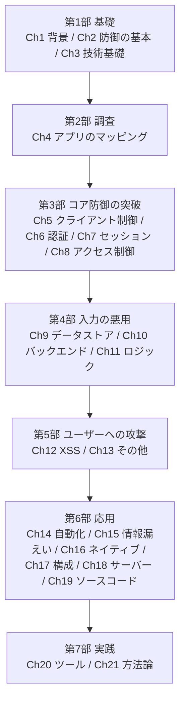

---

## 2. 2026年の視点での位置づけ

### 2.1 まず結論

| 観点 | 評価 |
|------|------|
| **考え方・方法論** | 今も有効。「入力を疑う」「境界を越える部分を調べる」「認証・セッション・アクセス制御を順に確認する」は普遍的 |
| **個々の技術例** | 一部は古い。2011年当時の Flash・Silverlight・Java アプレット、旧ブラウザの挙動などは現在ほぼ主戦場ではない |
| **新しい攻撃クラス** | 本書の範囲外が多い。リクエストスマグリング、キャッシュ汚染、SSTI、JWT/OAuth、GraphQL、LLM関連など |
| **学び方** | 本書で「型」を学び、**PortSwigger Web Security Academy** のラボで現代版を練習するのが効率的 |

### 2.2 本書の「後継」にあたる公式学習環境

Stuttard 氏自身が、2019年10月の Web Security Academy 正式公開の際に、第3版への強い需要に対する答えがこのアカデミーだと説明しています(Infosecurity Magazine の報道)。無料で、解説と実践ラボの両方が用意されています。

| 項目 | 内容 |
|------|------|
| 運営 | PortSwigger(Burp Suite の開発元) |
| 費用 | 無料(ラボ利用には無料アカウント登録が必要) |
| 構成 | 各トピックに「学習資料」と「脆弱性ラボ」の2本立て |
| 難易度 | Apprentice(入門)/ Practitioner(実践)/ Expert(上級) |
| 学習パス | 2023年9月に導入。初心者向けに順序立てた学習経路を提供 |
| 初心者への推奨 | 運営側は **SQLインジェクションとXSSから始める** ことを推奨 |

### 2.3 本書の内容と現代の状況の対応(要点)

| 本書の領域 | 2026年時点の見え方 |
|-----------|-------------------|
| 認証・セッション | 原理は不変。実運用では MFA・パスキー(FIDO2/WebAuthn)・SameSite Cookie などの対策が一般化 |
| アクセス制御 | **最重要のまま**。OWASP Top 10:2025 でも A01 の首位。2021年版の SSRF は A01 に統合された |
| インジェクション | 原理は不変。**プリペアドステートメント(パラメータ化クエリ)** が基本対策 |
| XSS | 原理は不変。フレームワークの自動エスケープ、CSP が普及。ただし DOM ベースは今も重要 |
| クライアント側制御 | SPA・モバイルアプリ・API が中心になり、「クライアントを信用しない」原則はさらに重要 |
| ネイティブ脆弱性(Ch16) | メモリ安全言語の普及で位置づけは変化。ただし C/C++ 資産は残る |
| HTTP | HTTP/2 以降の普及に伴い、**HTTP/1.1 のあいまいさに起因する desync 攻撃** が研究の焦点に(Kettle 氏の2025年研究) |

### 2.4 この分野の代表的な国際的実践者(参照元)

| 人物・組織 | 立場・功績 | 本ガイドでの参照 |
|-----------|-----------|----------------|
| **Dafydd Stuttard** | 本書著者、Burp Suite 作者 | 書誌・思想 |
| **Marcus Pinto** | 本書著者、MDSec 共同創業者 | 書誌 |
| **James Kettle** | PortSwigger Director of Research。HTTP desync 攻撃(リクエストスマグリングの再燃)、Web キャッシュ汚染、single-packet attack、サーバーサイドテンプレートインジェクション等の研究で知られる | 最新研究・年次トップ10 |
| **Nicolas Grégoire / Soroush Dalili / STÖK / LiveOverflow** | 年次 Top 10 Web Hacking Techniques の審査員 | 最新動向 |
| **OWASP Foundation** | Top 10、ASVS、WSTG、Cheat Sheet Series | 標準・チェックリスト |

---

## 3. 倫理と法律(必読)

### 3.1 絶対に守るルール

| ルール | 説明 |
|--------|------|
| **許可のない対象に試さない** | 他人のサイトに脆弱性スキャンや攻撃的な入力を送る行為は、不正アクセス等の法的問題になり得る(日本では不正アクセス禁止法などが関係する) |
| **練習は許可された環境で** | PortSwigger Web Security Academy のラボ、自分のローカル環境、明示的に許可された診断契約・バグバウンティの範囲内のみ |
| **範囲(スコープ)を守る** | 診断対象のURL・時間帯・手法の範囲を文書で合意する |
| **見つけたら責任ある開示** | 脆弱性を見つけた場合は、悪用せず、提供元の窓口に報告する |
| **実データに触れない** | 本番の個人情報などを取得・保存しない |

### 3.2 本ガイドの方針

- 攻撃は **「概念」と「防御に必要な理解」** に重点を置きます。
- 実在サービスに対する具体的な攻略手順は載せません。
- コード例は、**脆弱になる理由** と **安全な書き方** の対比に使います。

> 注: 法律の解釈は個別の状況で変わります。不明な場合は専門家(弁護士・所属組織の法務)に相談してください。

---

## 4. 学習ロードマップ

### 4.1 初学者向け推奨ルート

本書は章順に読むこともできますが、**初学者は「土台→最頻出の脆弱性→実践」の順** が効率的です。

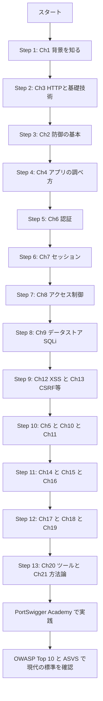

### 4.2 学習の3つの柱

| 柱 | 内容 | 使う教材 |
|----|------|---------|
| **理解** | なぜその脆弱性が起きるのかを説明できる | 本書 + 本ガイド |
| **実践** | 許可された環境で再現し、直す | PortSwigger Academy のラボ |
| **標準** | 現代の基準で漏れなく確認する | OWASP Top 10:2025、ASVS 5.0、WSTG、Cheat Sheet Series |

---
## 5. ステップ別詳細解説

> 各Stepは「**何を学ぶか → 重要概念 → 攻撃者の考え方 → 防御 → 2026年の視点 → 確認ポイント**」の順で進みます。

---

### Step 1: 第1章「Web Application (In)security」— なぜWebアプリは危険になるのか

#### 何を学ぶか
Webアプリが「組織の玄関口」になった経緯と、典型的な欠陥が生まれる構造的な理由です。

#### 重要概念

| 概念 | 初心者向けの説明 |
|------|----------------|
| Webアプリの進化 | 昔は静的なページ中心だったが、今は銀行・EC・業務システムがブラウザ上で動く。つまり **攻撃対象が大きくなった** |
| 防御が難しい理由 | 開発チームは「機能を作る」ことに集中し、セキュリティは後回しになりがち |
| 根本問題 | **ユーザーの入力は信用できない**。しかしアプリは入力を受け取らないと動かない |
| 攻撃の影響 | 個人情報の漏えい、不正な取引、他のユーザーの乗っ取り |

#### 攻撃者の考え方
攻撃者は「アプリが開発者の想定どおりに使われる」という前提を疑います。画面に表示されない項目、想定外の順序、想定外の値を試します。

#### 防御
**「入力は敵意があるかもしれない」という前提で設計する** こと。これが後の全章に共通する出発点です。

#### 確認ポイント
- [ ] Webアプリが攻撃されやすい構造的な理由を2つ説明できる
- [ ] 「ユーザー入力を信用しない」とはどういうことか説明できる

---

### Step 2: 第3章「Web Application Technologies」— HTTPと基礎技術

> 順序の都合で、第2章より先に第3章を読みます。HTTPを知らないと防御メカニズムも理解しにくいためです。

#### 何を学ぶか
攻撃を理解する前提となる、HTTP・Cookie・各種エンコード方式です。

#### 重要概念

| 概念 | 説明 | なぜ重要か |
|------|------|-----------|
| リクエスト / レスポンス | ブラウザが要求を送り、サーバーが応答する | **すべての攻撃はリクエストの改変から始まる** |
| HTTPメソッド | GET(取得)、POST(送信)など | メソッドによって保護の仕方が変わる |
| ステータスコード | 200 成功、302 リダイレクト、401/403 認証・認可エラー、500 サーバーエラー | 応答の違いから内部の状況を推測できる |
| ヘッダー | `Cookie`、`Host`、`Content-Type` など | 認証情報やサーバー情報が載る |
| Cookie | サーバーがブラウザに持たせる小さなデータ | **セッション管理の中心** |
| ステートレス性 | HTTP自体は前のリクエストを覚えない | だから「セッション」という仕組みが別途必要 |
| エンコード | URLエンコード、HTMLエンコード、Base64、16進数など | **フィルタ回避と防御の双方で核心** |

#### HTTPとセッションの流れ

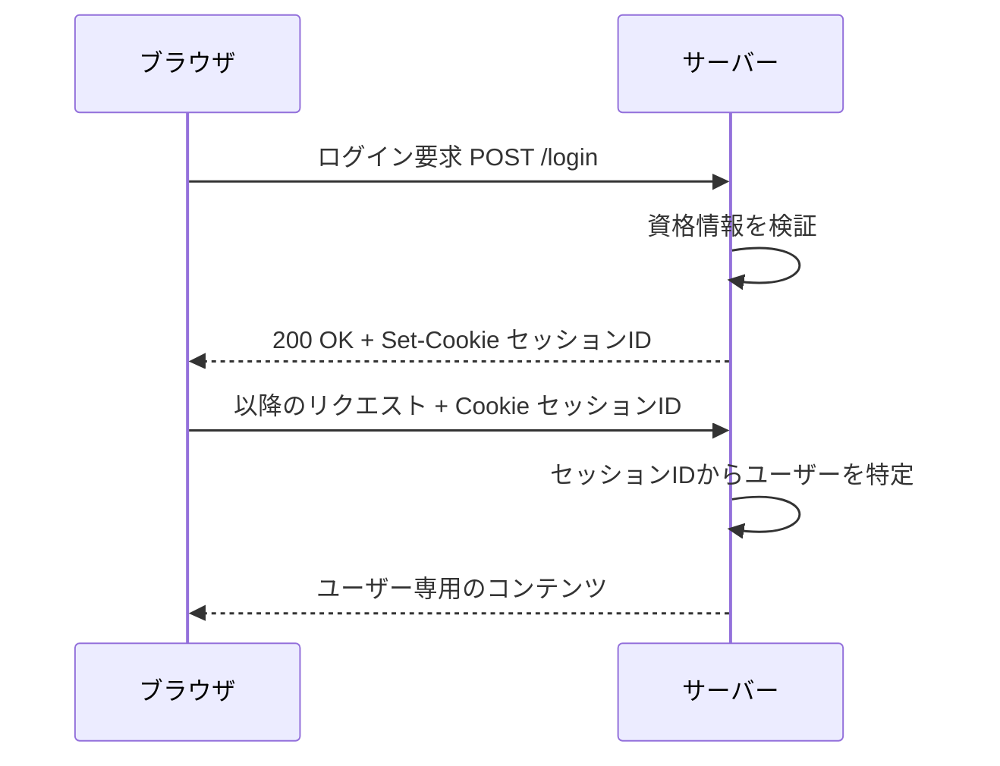

#### エンコードの落とし穴(概念)

| エンコード | 用途 | セキュリティ上の注意 |
|-----------|------|---------------------|
| URLエンコード | URLで使えない文字を安全に送る | 二重エンコードなどでフィルタをすり抜けることがある |
| HTMLエンコード | HTML内で特別な文字を文字として表示 | **XSS対策の基本(出力時に適切に変換)** |
| Base64 | バイナリを文字列化 | **暗号ではない**。見た目が複雑でも誰でも戻せる |
| Unicode / UTF-8 | 多言語対応 | 正規化の違いで検証を回避される場合がある |

#### 防御
- 「見えにくい」ことを安全だと思わない(Base64は暗号ではない)
- 検証と変換(デコード)の **順序** を意識する

#### 2026年の視点
HTTP/2・HTTP/3 が普及しましたが、アプリ層の考え方(リクエスト、ヘッダー、Cookie)は同じです。一方で、**フロントエンドとバックエンドが別々にHTTPを解釈する構成** では、解釈の食い違いが攻撃につながります(Step 12 のコラムで触れます)。

#### 確認ポイント
- [ ] Cookie がなぜセッション管理に必要か説明できる
- [ ] Base64 が暗号ではない理由を説明できる
- [ ] URLエンコードとHTMLエンコードの用途の違いを言える

---

### Step 3: 第2章「Core Defense Mechanisms」— 防御の4本柱

#### 何を学ぶか
ほとんどのWebアプリが備える **共通の防御メカニズム** です。攻撃者はこの4つの「弱点」を探します。

#### 4本柱

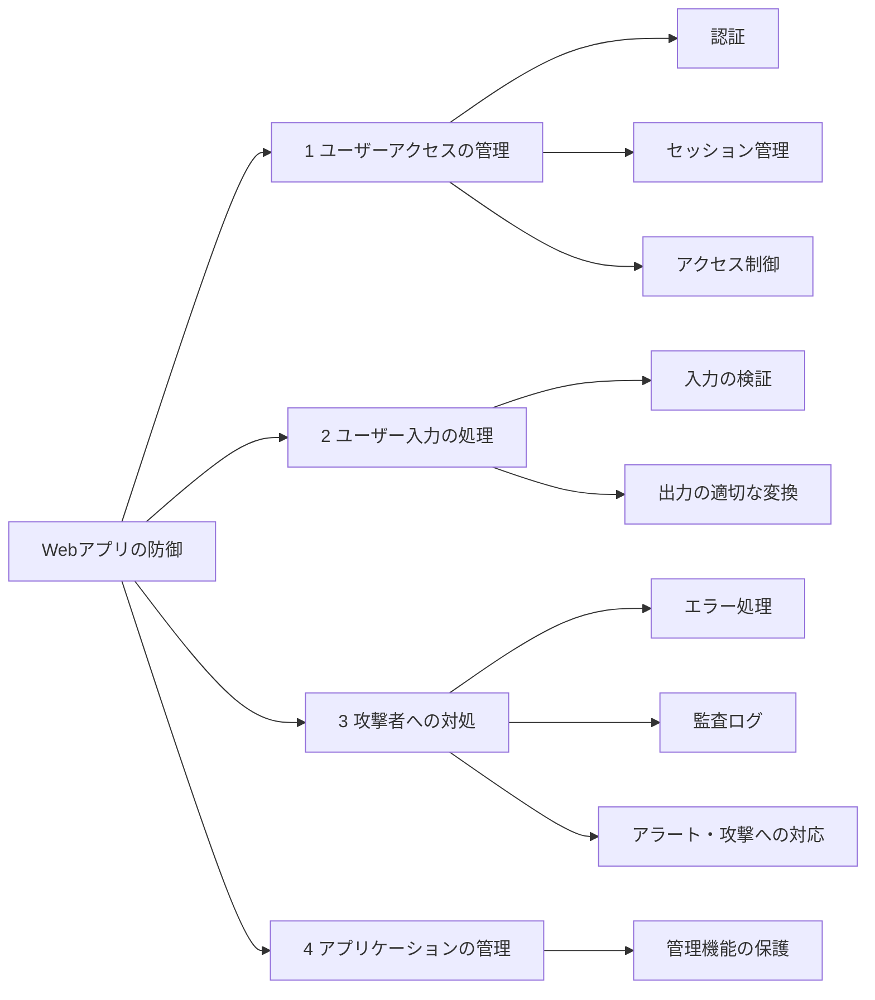

| 柱 | 内容 | 破られると何が起きる | 対応する章 |
|----|------|--------------------|-----------|
| **ユーザーアクセス** | 誰か(認証)・通信の継続(セッション)・何ができるか(アクセス制御) | なりすまし、他人のデータの閲覧・操作 | Ch6, 7, 8 |
| **ユーザー入力** | 入力を検証し、出力時に安全な形に変換 | インジェクション、XSS | Ch9, 10, 12 |
| **攻撃者への対処** | エラー処理、ログ、アラート、反撃・遮断 | 攻撃に気づけない、情報漏えい | Ch15 |
| **アプリの管理** | 管理画面・設定の保護 | 管理者権限の奪取 | Ch18 |

#### 入力処理の基本戦略(初心者が必ず押さえる点)

| 方式 | 説明 | 評価 |
|------|------|------|
| ブラックリスト | 「危険な文字列」を拒否する | **回避されやすく、単独では不十分** |
| ホワイトリスト | 「許可する形式」だけを通す | 有効。ただし万能ではない |
| サニタイズ | 危険な文字を除去・変換する | 文脈を誤ると不十分 |
| 境界での検証 | 信頼境界を越えるときに検証する | **設計の考え方として重要** |
| 出力時エンコード・パラメータ化 | 使う場所の文脈に合わせて安全に扱う | **インジェクション・XSS対策の本命** |

> OWASP のチートシートも、入力検証だけではXSSやSQLインジェクションの主たる防止策にならず、出力のエンコードとパラメータ化クエリが本命だと整理しています。

#### 2026年の視点
OWASP Top 10:2025 では、本章の領域が次のカテゴリに現れます。

| 本章の領域 | 2025年版の対応カテゴリ |
|-----------|----------------------|
| アクセス制御 | A01 Broken Access Control |
| 設定・管理 | A02 Security Misconfiguration |
| 認証 | A07 Authentication Failures |
| ログ・アラート | A09 Security Logging and Alerting Failures |
| エラー処理 | A10 Mishandling of Exceptional Conditions(2025年版で新設) |

#### 確認ポイント
- [ ] 防御の4本柱を言える
- [ ] ブラックリスト方式が弱い理由を説明できる
- [ ] 「境界で検証し、出力時に安全化する」の意味を説明できる

---

### Step 4: 第4章「Mapping the Application」— アプリの全体像を調べる

#### 何を学ぶか
攻撃(診断)の前に、**対象に何があるか** をすべて洗い出す工程です。ここを丁寧にやるほど、後の発見が増えます。

#### 全体フロー

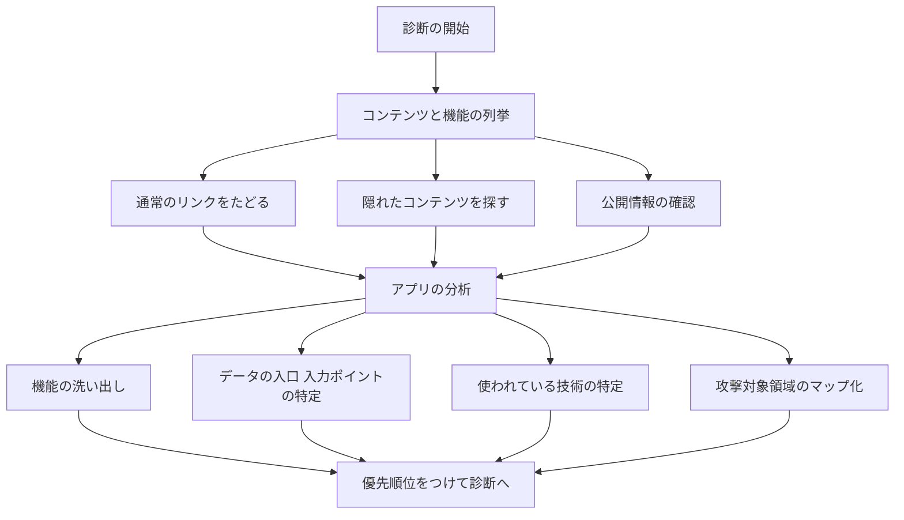

#### 重要概念

| 概念 | 説明 |
|------|------|
| スパイダリング | リンクを自動でたどってページを集める |
| 隠れたコンテンツの探索 | リンクされていない旧バージョン、バックアップ、テスト用ページ、管理画面など |
| 入口(エントリポイント) | URLパラメータ、フォーム、Cookie、ヘッダーなど、ユーザーが値を渡せる場所 |
| 技術の特定 | サーバー、フレームワーク、言語を知ると、既知の弱点を絞れる |
| 攻撃対象領域(アタックサーフェス) | 攻撃され得る場所の総体 |

#### 攻撃者の考え方
「画面にあるもの」だけでなく **「画面にないが存在するもの」** を探します。公開されたJavaScriptの中のAPIパス、古い機能の残骸などが典型です。

#### 防御
- 使っていない機能・古いバージョン・テスト環境を **本番に残さない**
- 管理機能を公開面から切り離す
- エラーや応答で内部情報を出しすぎない

#### 2026年の視点
SPAやAPI中心の構成では、**JavaScriptのバンドルやAPI仕様(OpenAPI等)** がマッピングの重要な材料になります。マッピングの手順自体は変わりません。

#### 確認ポイント
- [ ] 「入口(エントリポイント)」とは何か、例を3つ挙げられる
- [ ] なぜ隠れたコンテンツの探索が必要か説明できる

---
### Step 5: 第6章「Attacking Authentication」— 認証への攻撃

#### 何を学ぶか
「あなたは誰か」を確かめる仕組み(ログイン、パスワード再設定、ログイン状態の維持)の弱点です。

#### 認証の弱点の分類

| 分類 | 具体例(概念) | 防御の方向性 |
|------|-------------|-------------|
| **設計上の弱点** | 弱いパスワードを許す、ブルートフォース(総当たり)への耐性がない | パスワードポリシー、試行回数制限、アカウントロック、MFA |
| **エラーメッセージ** | 「ユーザーが存在しません」「パスワードが違います」を区別して返す | **どちらでも同じ文言**にする(応答時間の差にも注意) |
| **パスワード再設定** | 推測しやすい質問、予測可能なリンク、有効期限なし | 推測不能なトークン、短い有効期限、使い捨て |
| **ログイン状態の維持** | 「ログインしたままにする」の実装が弱い | 推測不能で失効できるトークン |
| **ユーザー名の列挙** | 登録済みかどうかが外から分かる | 応答を統一する |
| **実装の不備** | 検証が一部だけ、ユーザー名の一意性が不十分 | 認証処理全体の見直し |
| **初期パスワードの配布** | 予測できる初期値、安全でない配布経路 | ランダム生成、初回変更の強制 |

#### 認証のチェックの流れ(診断者目線)

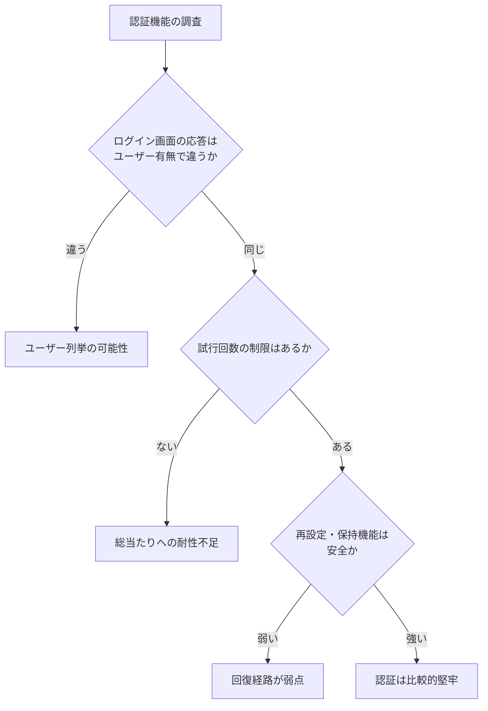

#### 防御の実装例(Python:パスワードの保存)

```python
# 悪い例: 平文や単純なハッシュは漏えい時に即座に危険
# hashlib.sha256(password.encode()).hexdigest()  # 速すぎるハッシュは総当たりに弱い

# 良い例: パスワード専用の遅いハッシュ(例: argon2)
from argon2 import PasswordHasher

ph = PasswordHasher()
hashed = ph.hash("ユーザーが入力したパスワード")   # 保存するのはこの値
ph.verify(hashed, "ユーザーが入力したパスワード")   # 一致しなければ例外
```

#### 2026年の視点
| 本書の時代 | 現在 |
|-----------|------|
| パスワード中心 | MFA が標準的、**パスキー(FIDO2/WebAuthn)** が普及 |
| 独自の認証実装 | OAuth 2.0 / OpenID Connect / SSO の利用が一般的(その設定ミスが新たな弱点) |
| 資格情報の使い回し | **クレデンシャルスタッフィング**(漏えい済みの組み合わせの流用)対策が重要 |

OWASP Top 10:2025 では **A07 Authentication Failures** に該当します。

#### 確認ポイント
- [ ] 「ユーザーが存在しません」と返すことの何が問題か説明できる
- [ ] パスワードをSHA-256単体で保存するのが推奨されない理由を言える

---

### Step 6: 第7章「Attacking Session Management」— セッション管理への攻撃

#### 何を学ぶか
ログイン後の「同じ人だ」という状態を保つ **セッショントークン** の弱点です。トークンを盗まれる・推測される・使い回されると、パスワードなしでなりすまされます。

#### セッショントークンのライフサイクル

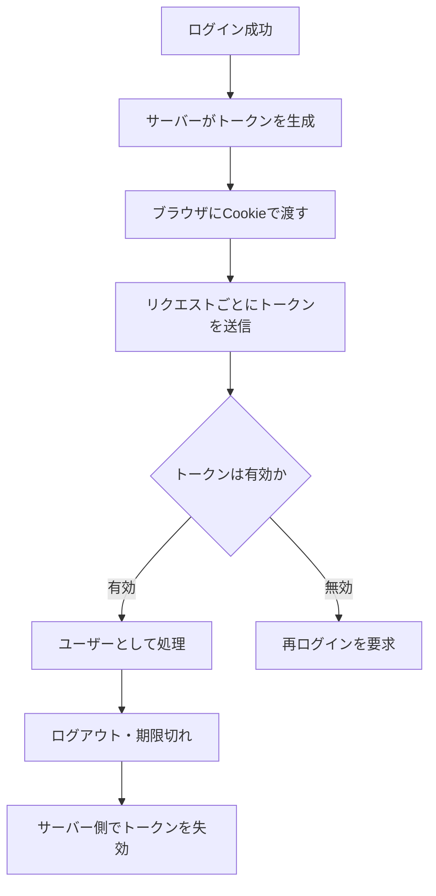

#### 弱点の2系統

| 系統 | 内容 | 例(概念) |
|------|------|---------|
| **トークン生成の弱点** | 推測できる・規則性がある | 連番、時刻ベース、予測可能な乱数 |
| **トークン取り扱いの弱点** | 盗まれる・固定される | 暗号化されない通信で送信、URLに載る、ログに残る、ログアウトで失効しない、**セッション固定** |

#### セッション固定(Session Fixation)の考え方
攻撃者が用意したセッションIDを被害者に使わせ、被害者がログインした後、同じIDで攻撃者もログイン状態になる、という攻撃です。**ログイン成功時にセッションIDを再発行する** ことで防げます。

#### 防御のチェックリスト

| 対策 | 内容 |
|------|------|
| 推測不能なトークン | 暗号論的に安全な乱数を使う |
| `Secure` 属性 | HTTPSのときだけCookieを送る |
| `HttpOnly` 属性 | JavaScriptからCookieを読めなくする(XSSの被害を軽減) |
| `SameSite` 属性 | 他サイトからのリクエストにCookieを付けにくくする(CSRF対策に有効) |
| ログイン時の再発行 | セッション固定を防ぐ |
| ログアウト時の失効 | **サーバー側で**セッションを破棄する |
| 有効期限 | 無操作・絶対期限の両方を設定 |

```python
# Flask での Cookie 属性の設定例
from flask import Flask
app = Flask(__name__)
app.config.update(
    SESSION_COOKIE_SECURE=True,     # HTTPSのみ
    SESSION_COOKIE_HTTPONLY=True,   # JavaScriptから読めない
    SESSION_COOKIE_SAMESITE="Lax",  # クロスサイト送信を制限
)
```

#### 2026年の視点
- 主要ブラウザは `SameSite` 属性が未指定の Cookie を `Lax` 相当で扱う方向に進んでいます(Chrome は2020年以降)。ただし **明示的に設定する** のが安全です。
- JWT(JSON Web Token)をセッションに使う設計が一般化しました。署名の検証漏れ、アルゴリズムの扱い、失効の難しさが現代の弱点です(本書の範囲外のため、Web Security Academy の JWT 関連教材で補ってください)。

#### 確認ポイント
- [ ] `Secure` / `HttpOnly` / `SameSite` の役割をそれぞれ説明できる
- [ ] セッション固定攻撃の防ぎ方を言える

---

### Step 7: 第8章「Attacking Access Controls」— アクセス制御への攻撃

#### 何を学ぶか
「ログインしている人が、**何をしてよいか**」の制御の欠陥です。OWASP Top 10:2025 でも首位(A01)で、現代でも最も重要な領域の一つです。

#### 用語

| 用語 | 意味 | 例 |
|------|------|----|
| 認証(Authentication) | 誰かを確かめる | ログイン |
| 認可 / アクセス制御(Authorization) | 何をしてよいかを決める | 一般ユーザーは管理画面に入れない |
| **垂直権限昇格** | 低い権限のユーザーが、上位の権限の機能を使う | 一般ユーザーが管理機能を実行 |
| **水平権限昇格** | 同じ権限の他人のデータにアクセスする | 他のユーザーの注文履歴を見る |
| **IDOR**(安全でない直接オブジェクト参照) | URLやパラメータのIDを変えるだけで他人のデータに届く | `/orders?id=1001` を `1002` に変える |

#### アクセス制御が破られる典型パターン

| パターン | 説明 |
|---------|------|
| 画面上で隠すだけ | ボタンを非表示にしても、URLを直接叩かれれば動く |
| 多段階プロセスの途中の検証漏れ | 最初のステップだけ検査し、後続のステップは検査しない |
| 静的リソース | ファイル自体のURLが推測でき、制御されていない |
| HTTPメソッドによる差 | GETは制限したがPOSTは制限していない |
| プラットフォーム設定の誤り | URL単位の制限が抜けている |

#### 正しい判定の流れ(サーバー側で毎回)

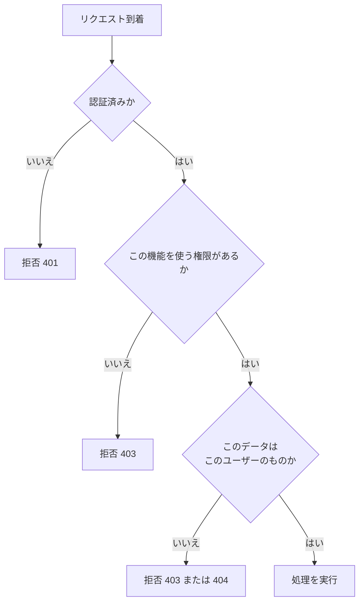

#### 脆弱なコードと安全なコード(IDOR)

```python
# 前提: db は Python 標準の sqlite3.Connection(プレースホルダーは ? 形式)
#       db.row_factory = sqlite3.Row を設定し、行を dict に変換して JSON で返す
# 脆弱: IDだけで取得。誰のデータかを確認していない
@app.get("/orders/<int:order_id>")
def get_order(order_id):
    row = db.execute("SELECT * FROM orders WHERE id = ?", (order_id,)).fetchone()
    if row is None:
        abort(404)
    return dict(row)

# 安全: 所有者の条件も一緒に確認し、公開する列だけを取得する
@app.get("/orders/<int:order_id>")
def get_order(order_id):
    row = db.execute(
        "SELECT id, status, total, created_at FROM orders WHERE id = ? AND user_id = ?",
        (order_id, current_user.id),
    ).fetchone()
    if row is None:
        abort(404)
    return dict(row)  # SELECT した公開列だけが応答に含まれる
```

#### 防御の原則

| 原則 | 説明 |
|------|------|
| **デフォルト拒否** | 明示的に許可した場合だけ通す |
| **サーバー側で必ず検査** | クライアントの画面制御を信用しない |
| **一元化** | 認可のチェックを共通部品にまとめ、実装漏れを防ぐ |
| **推測できないIDは補助にすぎない** | UUIDを使っても、所有者の確認は必須 |
| **テストの自動化** | 「ユーザーAがユーザーBのデータを取得できない」ことを自動テストする |

#### 2026年の視点
OWASP Top 10:2025 の A01 は、2021年版の SSRF(サーバーサイドリクエストフォージェリ)を統合しています。サーバーが外部・内部への通信を代行する機能は、アクセス制御の観点で検討すべきです。

#### 確認ポイント
- [ ] 垂直・水平権限昇格の違いを具体例で説明できる
- [ ] IDOR が起きる原因と、直し方を言える

---

### Step 8: 第9章「Attacking Data Stores」— SQLインジェクションとデータストア

#### 何を学ぶか
本書で最も分量が多い章の一つ(約70頁)です。**ユーザー入力がデータベースへの命令の一部になってしまう** 問題を扱います。

#### SQLインジェクションが起きる仕組み

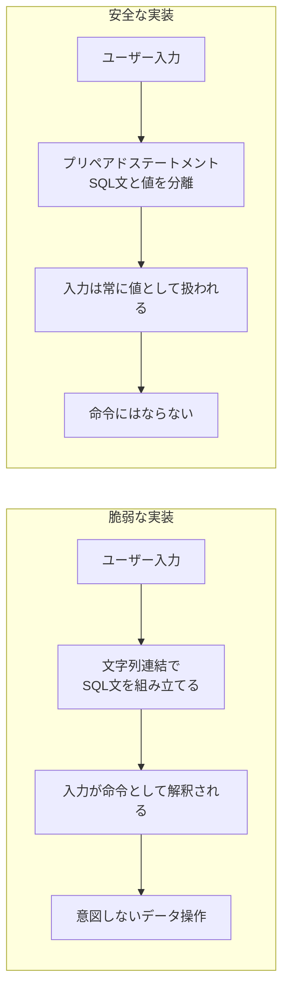

#### 脆弱なコードと安全なコード

```python
# 前提: cursor は Python 標準の sqlite3.Cursor(プレースホルダーは ? 形式)
# 脆弱: 入力を文字列連結でSQLに埋め込んでいる
query = "SELECT * FROM users WHERE name = '" + name + "'"
cursor.execute(query)

# 安全: プレースホルダで値を分離(パラメータ化クエリ)
cursor.execute("SELECT * FROM users WHERE name = ?", (name,))
```

> OWASP のチートシートは、SQL文の一部にユーザー入力を文字列連結で組み込むとSQLインジェクションの脆弱性になり、**パラメータ化クエリが確実な対策** だと説明しています。

#### 攻撃の分類(概念)

| 種類 | 概要 |
|------|------|
| 通常のSQLi | エラーや結果が画面に表示され、情報が見える |
| **ブラインドSQLi** | 結果は見えないが、応答の違い・遅延などから情報を推測する |
| UNION型 | 別のテーブルの結果を同じ画面に出させる |
| 二次(セカンドオーダー)SQLi | 入力が一度保存され、後で別の処理で実行される |
| 他のデータストア | **NoSQL / XPath / LDAP** などにも同種の問題がある |

> 本ガイドでは、具体的な攻撃用の文字列は扱いません。練習は Web Security Academy の SQLインジェクションのラボで、許可された環境のみで行ってください。

#### 防御

| 対策 | 内容 |
|------|------|
| **パラメータ化クエリ(最優先)** | SQLと値を完全に分離する |
| ORM の安全な使い方 | 生SQLの文字列連結を避ける |
| 最小権限 | アプリ用のDBアカウントに必要最小限の権限だけ与える |
| エラーの抑制 | 詳細なDBエラーを利用者に見せない |
| 動的に変えられない部分 | テーブル名・列名などはホワイトリストで検証する |

#### 2026年の視点
- OWASP Top 10:2025 では **A05 Injection**。ORM やフレームワークの普及で減りましたが、生SQL・レポート機能・NoSQLなどで今も発生します。
- 実践では、PortSwigger の SQLi 教材(UNION攻撃、ブラインド、チートシート)が体系的です。

#### 確認ポイント
- [ ] SQLインジェクションが起きる根本原因を一文で説明できる
- [ ] パラメータ化クエリがなぜ有効か説明できる
- [ ] ブラインドSQLiとは何か説明できる

---
### Step 9: 第12章・第13章「Attacking Users」— XSS、CSRF など、ユーザーへの攻撃

#### 何を学ぶか
ここまでは「サーバーへの攻撃」でした。この2章は **他のユーザー(の ブラウザ)を狙う攻撃** です。XSSだけで第12章(約70頁)を使い、第13章でその他を扱います。

#### 9-1. クロスサイトスクリプティング(XSS)

**XSSとは**: 攻撃者が用意したスクリプトが、被害者のブラウザで **そのサイトの権限で** 実行されてしまう問題です。

| 種類 | 仕組み | 特徴 |
|------|--------|------|
| **反射型(Reflected)** | 入力値がそのままレスポンスに反映される | 被害者が細工されたリンクを開く必要がある |
| **格納型(Stored)** | 入力がサーバーに保存され、他のユーザーの画面に表示される | 掲示板・コメント欄など。被害が広がりやすい |
| **DOM型(DOM-based)** | サーバーを経由せず、ブラウザ上のJavaScriptが危険な使い方をする | 現代のSPAで重要 |

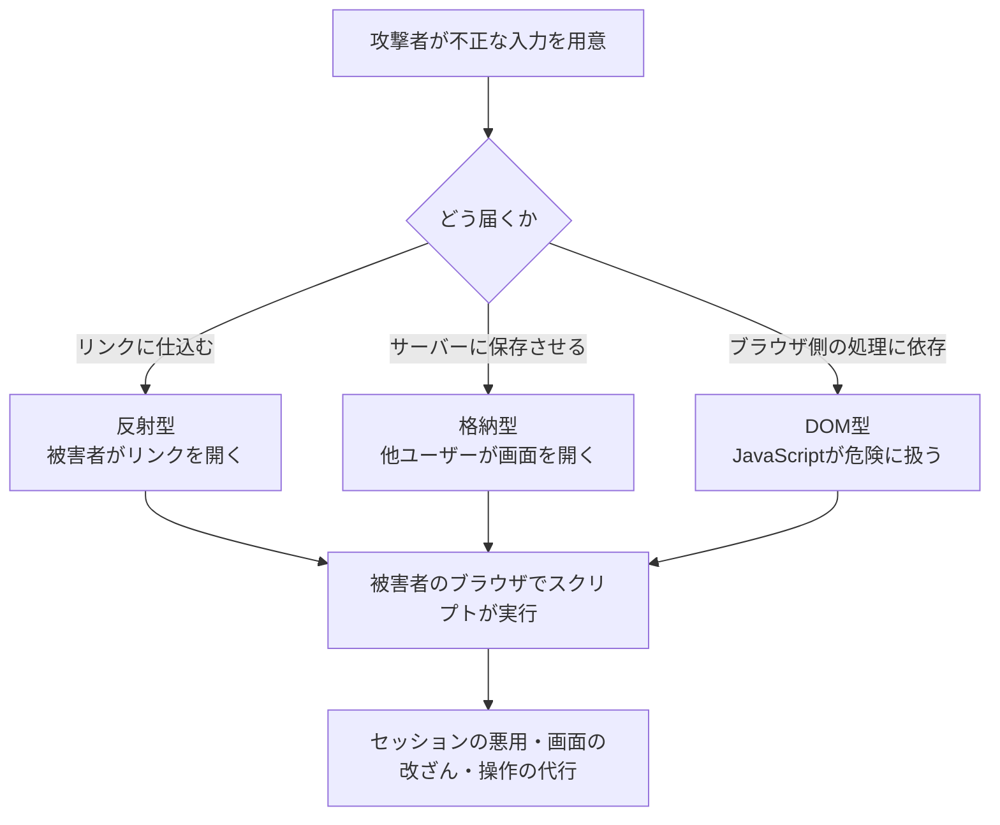

**防御(最重要)**

| 対策 | 説明 |
|------|------|
| **出力時のエンコード** | HTMLの本文・属性・JavaScript・URLなど、**出力先の文脈に合わせて** 変換する |
| フレームワークの自動エスケープ | React、Vue、テンプレートエンジンの既定動作を活かし、**わざと無効にする機能(`dangerouslySetInnerHTML` など)を避ける** |
| **CSP(Content Security Policy)** | 実行できるスクリプトの出所を制限する多層防御 |
| `HttpOnly` Cookie | スクリプトによるCookie窃取を防ぐ |
| 危険なDOM操作の回避 | `innerHTML` ではなく `textContent` を使う |

```python
# 出力時エンコードの考え方(Python標準ライブラリ)
import html
safe = html.escape(user_input)   # < > & " ' を安全な表現に変換して出力する
```

> 注意: この `html.escape` の例は、**HTMLのテキスト文脈(要素の本文など)へ出力する場合に限った**ものです。JavaScript、CSS、URLなど別の文脈へ出力する場合は、それぞれの文脈に適したエンコードが必要であり、この例をそのまま流用しないでください。

```javascript
// DOM型XSSの予防: 文字列としてだけ挿入する
element.textContent = userInput;      // 安全
// element.innerHTML = userInput;     // 危険: HTMLとして解釈される
```

#### 9-2. その他のユーザー攻撃(第13章)

| 攻撃 | 概念 | 主な防御 |
|------|------|---------|
| **CSRF**(クロスサイトリクエストフォージェリ) | ログイン中のユーザーのブラウザを使い、本人の意図しない操作を送らせる | CSRFトークン、`SameSite` Cookie、重要操作での再認証 |
| **クリックジャッキング(UIリドレス)** | 透明なフレームでユーザーに別の場所をクリックさせる | `X-Frame-Options` や CSP の `frame-ancestors` |
| **オープンリダイレクト** | 正規サイトのURLから攻撃者のサイトへ誘導する | リダイレクト先のホワイトリスト検証 |
| **HTTPヘッダーインジェクション** | 改行などで応答ヘッダーを細工する | 入力から改行を除去・拒否 |
| **同一オリジンポリシー / CORS の誤設定** | 他サイトからデータを読まれる | 許可するオリジンを厳密に指定 |
| **ローカルプライバシー** | ブラウザ内に残る情報の漏えい | キャッシュ制御、機微情報を残さない |

#### CSRFの流れ

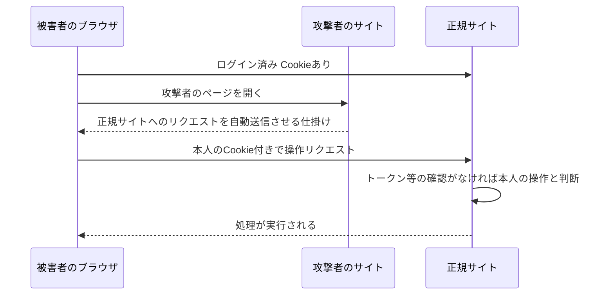

#### 2026年の視点
- XSSの原理は不変ですが、**フレームワークの自動エスケープとCSP** が普及し、「危険な機能を使う箇所」「DOM型」「文脈の取り違え」が主戦場です。
- CSRFは `SameSite` 既定の変化で状況が変わりましたが、サブドメインや同一サイト内の経路、トークンの未実装などは依然確認対象です。
- 年次の研究動向では、PortSwigger の「Top 10 Web Hacking Techniques」が、新しいクライアント側・サーバー側の攻撃手法を毎年まとめています(Step 13 参照)。

#### 確認ポイント
- [ ] 反射型・格納型・DOM型の違いを説明できる
- [ ] XSS対策で「入力検証」より「出力エンコード」が重要な理由を言える
- [ ] CSRFが成立する条件と、トークンで防げる理由を説明できる

---

### Step 10: 第5章・第10章・第11章 — クライアント制御、バックエンド連携、ロジックの欠陥

#### 10-1. 第5章「Bypassing Client-Side Controls」

**要点**: ブラウザ側で行う制御(入力の長さ制限、JavaScriptによる検証、隠しフィールド、選択肢の限定)は、**ユーザーが自由に改変できるので防御にならない** という原則です。

| クライアント側の仕組み | 攻撃者から見ると | 正しい対応 |
|----------------------|-----------------|-----------|
| 隠しフィールド(価格など) | 値を変えて送れる | **価格は必ずサーバー側で決める** |
| JavaScriptの入力検証 | 無効化・迂回できる | 同じ検証をサーバー側で必ず行う |
| ドロップダウンの選択肢 | 任意の値を送れる | サーバー側で許可値を検証 |
| 長さ制限(maxlength) | 超える値を送れる | サーバー側で制限 |

> 本書は Java アプレット・ActiveX・Flash・Silverlight などの「シッククライアント」も扱いますが、現在はこれらが使われる場面はまれです。**現代版は、SPA・モバイルアプリ・APIクライアント** と読み替えてください。

#### 10-2. 第10章「Attacking Back-End Components」

**要点**: Webアプリは裏でOS・ファイルシステム・XMLパーサー・メールサーバー・他のシステムと連携します。**ユーザー入力がそれらへの命令やパスの一部になる** と、インジェクションが発生します。

| 種類 | 概念 | 防御 |
|------|------|------|
| **OSコマンドインジェクション** | 入力がOSのコマンドの一部になる | シェルを使わない(引数配列で実行)、入力のホワイトリスト化 |
| **パストラバーサル** | `../` のような指定でアクセス範囲外のファイルに届く | パスの正規化と、許可ディレクトリ内かの検証 |
| **ファイルインクルージョン** | 入力でインクルードするファイルが決まる | 動的インクルードを避ける |
| **XMLインジェクション / XXE** | XMLの外部エンティティ機能を悪用する | 外部エンティティ・DTDの無効化 |
| **SOAP / メール(SMTP)インジェクション** | 入力がメッセージ構造に混入する | 入力の検証とライブラリのパラメータ化機能 |
| **バックエンドへのHTTPリクエスト注入** | サーバーが発行するリクエストを細工する | 宛先のホワイトリスト、内部アドレスの遮断 |

```python
# OSコマンド: 脆弱な書き方と安全な書き方
import ipaddress
import re
import subprocess

# ホスト名の各ラベルは英数字で始まり英数字で終わる(先頭の "-" を許さない)
LABEL = r"[A-Za-z0-9](?:[A-Za-z0-9-]{0,61}[A-Za-z0-9])?"
HOSTNAME_RE = re.compile(rf"{LABEL}(?:\.{LABEL})*")

def validate_host(host: str) -> str:
    """IPアドレスまたはホスト名の形式だけを許可する(-c などのオプション注入を防ぐ)"""
    try:
        return str(ipaddress.ip_address(host))
    except ValueError:
        pass
    if len(host) <= 253 and HOSTNAME_RE.fullmatch(host):
        return host
    raise ValueError("invalid host")

# 脆弱: シェル経由で文字列連結(入力がコマンドとして解釈され得る)
# subprocess.run("ping -c 1 " + host, shell=True)

# 安全: シェルを介さず引数を配列で渡し、検証済みの host だけを宛先にする
# "--" はオプションの終端(Linux の iputils ping や macOS の ping など、対応する実装の場合)
safe_host = validate_host(host)
subprocess.run(["ping", "-c", "1", "--", safe_host], check=True)
```

#### 10-3. 第11章「Attacking Application Logic」

**要点**: コードのバグではなく **「設計の前提の誤り」** を突く攻撃です。自動スキャナでは見つけにくく、**人間の発想が最も効く領域** です。

| パターン | 例(概念) |
|---------|---------|
| 想定外の順序 | 支払いステップを飛ばして注文確定に進める |
| 想定外の値 | 数量にマイナスを指定して金額を減らす |
| 信頼の取り違え | クライアントから来た「割引率」をそのまま信用する |
| 状態管理の不備 | 一度きりのクーポンを何度も使える |
| **競合状態(レースコンディション)** | 同時に複数のリクエストを送り、チェックと更新の隙間を突く |

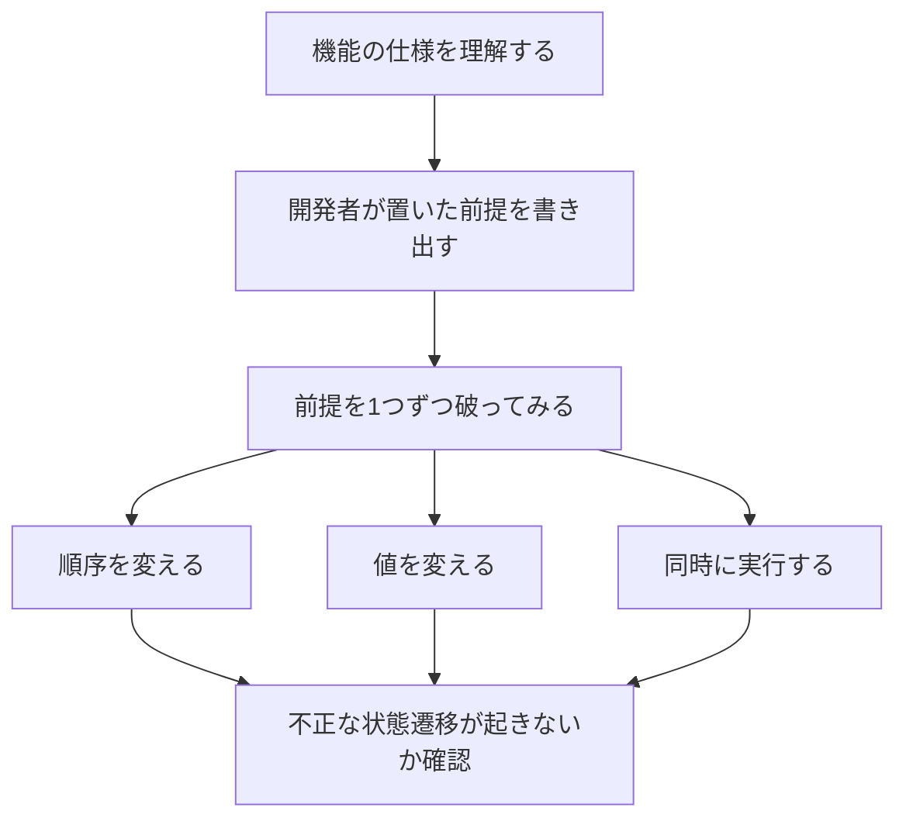

**防御**: 重要な処理は **状態遷移の検証** をサーバー側で行い、金額・数量などの不変条件(例:合計は常に0以上)を明示的にチェックします。競合状態への対策は、役割ごとに分けて考えます。

- **冪等性**(冪等キーなど): 同じリクエストが重複して届いたときに、処理が二重に実行されるのを抑える
- **確認と更新の一体化**: 確認から更新までロックを保持する、条件付き更新(例:`UPDATE ... WHERE balance >= :amount`)を使う、またはトランザクションで確認と更新を原子化する

#### 2026年の視点
- ロジックの欠陥は OWASP Top 10:2025 の **A06 Insecure Design** と関係が深い領域です。
- 競合状態は、PortSwigger の研究で **single-packet attack** のような手法が整理され、現代的な再現が容易になりました(James Kettle 氏の研究として知られる)。

#### 確認ポイント
- [ ] クライアント側の検証だけでは守れない理由を説明できる
- [ ] OSコマンドを安全に実行する方法を言える
- [ ] ロジックの欠陥がスキャナで見つかりにくい理由を説明できる

---

### Step 11: 第14章・第15章・第16章 — 自動化、情報漏えい、ネイティブアプリ

#### 11-1. 第14章「Automating Customized Attacks」

**要点**: 手作業では時間がかかる作業を、**カスタム自動化** で効率化する考え方です。

| 用途 | 内容 |
|------|------|
| 識別子の列挙 | ユーザーIDや注文番号などを機械的に変えて応答の違いを見る |
| データの収集 | 反応の違いから、情報を段階的に集める |
| ファジング | 多様な入力を大量に与え、異常な挙動を探す |

**防御側の視点**: 自動化された試行を前提に、**レート制限・異常検知・ボット対策** を設計します。

#### 11-2. 第15章「Exploiting Information Disclosure」

**要点**: エラーメッセージ、ソースコード内のコメント、デバッグ情報、バナー情報など、**一見無害な情報が次の攻撃の手がかりになる** という内容です。

| 漏れる情報 | 悪用のされ方 | 防御 |
|-----------|-------------|------|
| 詳細なエラー(スタックトレース) | 内部構造・使用技術の推測 | 利用者には汎用メッセージ、詳細はログへ |
| HTMLやJSのコメント | 内部仕様・旧機能の発見 | 公開物から除去 |
| サーバーのバージョン情報 | 既知の脆弱性の絞り込み | 不要なバナーを抑制 |
| 公開されたバックアップ・設定 | 認証情報の漏えい | 公開領域に置かない |

> OWASP Top 10:2025 の **A10 Mishandling of Exceptional Conditions**(例外的な状況への不適切な対応)は、エラー処理を扱う新カテゴリです。

#### 11-3. 第16章「Attacking Native Compiled Applications」

**要点**: C/C++ などで書かれたネイティブコードにある **バッファオーバーフロー、整数の問題、書式文字列** などの話です。分量は約14頁で、Webアプリ全体の中では補足的な位置づけです。

| 概念 | 説明 |
|------|------|
| バッファオーバーフロー | 確保した領域を超えてデータを書き込む |
| 整数の問題 | 桁あふれ・符号の取り違え |
| 書式文字列 | 書式指定を入力で操作される |

**2026年の視点**: メモリ安全な言語(Rust、Go、Java、C# など)の採用が広がり、Web層から直接問題になる機会は減りました。ただし、C/C++ の資産(画像処理・パーサーなど)は残るため、**境界での入力検証とサンドボックス化** が引き続き重要です。

#### 確認ポイント
- [ ] 自動化が診断で役立つ場面を2つ挙げられる
- [ ] 詳細なエラーメッセージを利用者に見せない理由を説明できる

---

### Step 12: 第17章・第18章・第19章 — アーキテクチャ、サーバー、ソースコード

#### 12-1. 第17章「Attacking Application Architecture」

| テーマ | 内容 | 防御 |
|--------|------|------|
| 階層型アーキテクチャ | 複数層のうち、**ある層が侵害されたとき他層に波及** しないか | 層ごとの最小権限、通信の制限 |
| 共有ホスティング / ASP | 同じ基盤を複数の顧客が使う場合の **分離の甘さ** | テナント分離、設定の見直し |

> 現代版: **クラウド、コンテナ、マルチテナントSaaS** での分離(テナント間のデータ漏えい)に読み替えてください。

#### 12-2. 第18章「Attacking the Application Server」

| 弱点 | 説明 | 防御 |
|------|------|------|
| 既定の認証情報 | 初期IDとパスワードのまま | 初期値の変更・無効化 |
| 既定のコンテンツ | サンプル・管理画面が残っている | 不要物の削除 |
| ディレクトリ一覧の有効化 | ファイル一覧が見える | 無効化 |
| 危険なHTTPメソッド | 不要なメソッドが有効 | 必要なものだけ許可 |
| 脆弱なサーバーソフトウェア | 古いバージョン | **パッチ管理・SBOM・依存関係の更新** |
| WAF(Webアプリケーションファイアウォール) | 防御層だが **回避され得る** | 多層防御の一部として使い、**根本対策の代わりにしない** |

> OWASP Top 10:2025 では、**A02 Security Misconfiguration** が2021年版から3つ順位を上げて2位、**A03 Software Supply Chain Failures** が新設されました。本章の「サーバー・設定・ソフトウェア更新」の領域は、現代ではサプライチェーンの観点まで広げて考える必要があります。

#### 12-3. 第19章「Finding Vulnerabilities in Source Code」

**要点**: ソースコードを読んで脆弱性を見つける **コードレビュー** の手法です。

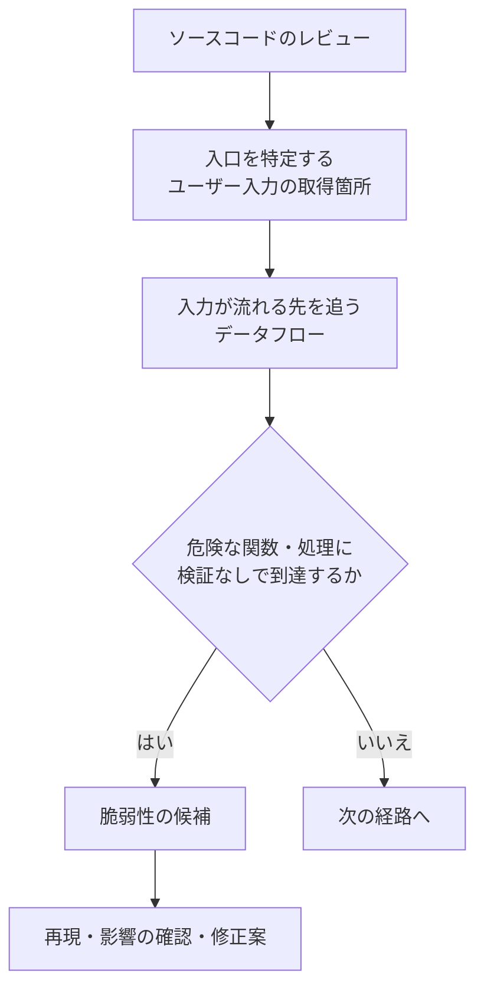

| 観点 | 内容 |
|------|------|
| 入口と出口 | 入力を受ける場所と、DB・OS・HTML出力などの危険な出口を探す |
| 言語ごとの特徴 | Java、ASP.NET、PHP、Perl、JavaScript などの危険な構文・関数を知る |
| ツール活用 | 静的解析(SAST)、依存関係の脆弱性検査(SCA)、grep的な探索 |

**2026年の視点**: SAST/SCA に加え、LLM をコード解析に使う動きが出ています。James Kettle 氏は2026年4月のポッドキャスト(ASW #380)で、LLM やエージェントが脆弱性研究に与える影響を論じています。一方で、**強力なツールチェーンを持つことが鍵**で、AIの出力は人間が検証する必要があります。

#### 確認ポイント
- [ ] 層ごとの最小権限が必要な理由を説明できる
- [ ] WAF を根本対策の代わりにしてはいけない理由を言える
- [ ] コードレビューで「入口→出口」を追う意味を説明できる

---

### Step 12 コラム: 本書の後に生まれた重要な攻撃「HTTP desync(リクエストスマグリング)」

本書の範囲を超えますが、現代のWebセキュリティで外せない領域なので概要だけ紹介します。

| 項目 | 内容 |
|------|------|
| 概要 | フロントエンド(CDNやプロキシ)とバックエンドが **HTTPリクエストの境界を異なる解釈** で処理すると、攻撃者のリクエストが他のユーザーのリクエストに混入する |
| 研究者 | James Kettle 氏(PortSwigger)。HTTP desync 攻撃を研究し、リクエストスマグリングを再び注目させた |
| 2025年の研究 | Black Hat USA 2025 と DEF CON 33 で「HTTP/1.1 Must Die: The Desync Endgame」を発表(DEF CON での講演は2025年8月8日)。Cloudflare 内部の desync が、約2,400万サイトに影響し得たという事例も紹介 |
| 主張の要点 | リクエストスマグリングはHTTP/1.1の **プロトコル上の根本的な欠陥** とみなすべきで、上流までHTTP/2以降を使うことが有効な解決策になる |
| 実務への示唆 | HTTP/2をHTTP/1.1に変換して裏側に流す構成(ダウングレード)は、あいまいさを再導入するので注意 |
| 学習先 | Web Security Academy の HTTP request smuggling 教材とラボ |

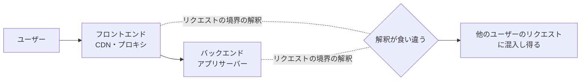

---

### Step 13: 第20章・第21章 — ツールと方法論、そして最新動向

#### 13-1. 第20章「A Web Application Hacker's Toolkit」

| カテゴリ | 役割 | 代表例 |
|---------|------|-------|
| ブラウザと拡張機能 | 通信の確認と操作 | 主要ブラウザの開発者ツール |
| **インターセプトプロキシ** | ブラウザとサーバーの間で、リクエストを **止めて・見て・書き換える** | **Burp Suite**(PortSwigger)、OWASP ZAP |
| スキャナ | 既知の問題を自動検出 | Burp Scanner、ZAP など |
| 手動テスト用ツール | リクエストの再送・繰り返し・大量送信 | Burp の Repeater / Intruder |

> インターセプトプロキシは、この本で最も重要な道具です。「ブラウザの画面を信用せず、実際のリクエストを見る」という本書の姿勢を体現しています。

#### 13-2. 第21章「A Web Application Hacker's Methodology」

本書の集大成として、**診断作業をタスクの階層(チェックリスト)に整理** した章です。第2版の目次では、先頭の「アプリの内容をマップする」「アプリを分析する」から、「アプリケーションサーバーの脆弱性を調べる」までが含まれます。以下は、章の考え方に沿った全体像です(タスクの番号と名称は本ガイド作成者による整理で、確認できた目次は冒頭・11番目のみです。細目と正式な名称は必ず書籍で確認してください)。

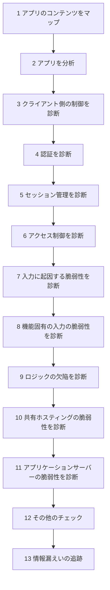

| 方法論の狙い | 説明 |
|-------------|------|
| **漏れをなくす** | 経験者の勘に頼らず、毎回同じ観点を確認する |
| **人間+機械の組み合わせ** | 人の発想と自動化の総当たりを併用する |
| **付属サイトの活用** | 書籍の付属サイトで要約版チェックリストが提供されている |

#### 13-3. 最新動向の押さえ方(2026年10月時点)

| 情報源 | 何が分かるか | 最新情報の例 |
|-------|-------------|-------------|
| **PortSwigger Research: Top 10 Web Hacking Techniques** | 年に一度、その年の革新的なWeb攻撃研究を投票と審査員で選定 | **2025年版は第19回**。63件のノミネートから選出。審査員は Nicolas Grégoire、Soroush Dalili、STÖK、LiveOverflow(Fabian)、James Kettle |
| 2025年版の1位 | 受賞テーマ | Vladislav Korchagin 氏の「Successful Errors: New Code Injection and SSTI Techniques」。ブラインドなSSTIをエラーベースで攻略する新手法と、検出のためのポリグロット手法 |
| 2025年の潮流 | 研究者の見解 | **サイドチャネル** が悪用の基本技術として台頭、**パーサーの解釈差(Parser Differentials)** も上位に |
| 2026年の見通し | Kettle 氏の発言 | LLMやエージェントが次の年のリストに影響を与えると見ている(2026年4月28日配信のポッドキャスト) |
| **OWASP Top 10:2025** | 最も重大なリスクの標準的なリスト | 次の第6章参照 |

---
## 6. 本書の手法と現代の標準の対応表

### 6.1 OWASP Top 10:2025 の一覧

OWASP Top 10:2025 は2025年11月に発表され、最終版は2026年1月に公開されたと報じられています。2021年版以来の更新で、**ソフトウェアサプライチェーンの不備**(A03)と **例外的な状況への不適切な対応**(A10)が新設され、2021年版の SSRF は A01 に統合されました。

| 順位 | カテゴリ(英語) | 日本語(OWASP公式の日本語版) |
|-----|---------------|------------------------------|
| A01 | Broken Access Control | アクセス制御の不備 |
| A02 | Security Misconfiguration | セキュリティ設定の不備 |
| A03 | Software Supply Chain Failures | ソフトウェアサプライチェーンの不備 |
| A04 | Cryptographic Failures | 暗号化の不備 |
| A05 | Injection | インジェクション |
| A06 | Insecure Design | 安全性を欠いた設計 |
| A07 | Authentication Failures | 認証の不備 |
| A08 | Software or Data Integrity Failures | ソフトウェアまたはデータの完全性の不備 |
| A09 | Security Logging and Alerting Failures | セキュリティログとアラートの不備 |
| A10 | Mishandling of Exceptional Conditions | 例外的な状況への不適切な対応 |

### 6.2 本書の章 × 現代の標準・学習先

> 対応は **学習用の目安** として本ガイド作成者が整理したものです。厳密な1対1の対応ではありません。

| 本書の章 | OWASP Top 10:2025 の関連 | Web Security Academy の関連トピック | OWASP チートシートの例 |
|---------|-------------------------|----------------------------------|----------------------|
| Ch2 防御の基本 | A09 / A10 / 全般 | Getting started | Logging、Input Validation |
| Ch5 クライアント制御 | A06 | Business logic、API testing | Input Validation |
| Ch6 認証 | A07 | Authentication、OAuth、JWT | Authentication、Credential Stuffing Prevention |
| Ch7 セッション | A07 | JWT、CSRF | Session Management |
| Ch8 アクセス制御 | **A01** | Access control、IDOR | Access Control、IDOR Prevention |
| Ch9 データストア | A05 | SQL injection、NoSQL injection | SQL Injection Prevention、Injection Prevention |
| Ch10 バックエンド | A05 / A01(SSRF) | OS command injection、Path traversal、XXE、SSRF | OS Command Injection Defense、XXE Prevention、SSRF Prevention |
| Ch11 ロジック | A06 | Business logic、Race conditions | (設計・脅威モデリング) |
| Ch12 XSS | A05 | XSS、DOM-based、CSP | XSS Prevention、DOM based XSS Prevention |
| Ch13 その他 | A01 / A02 | CSRF、Clickjacking、CORS | CSRF Prevention |
| Ch15 情報漏えい | A10 / A02 | Information disclosure | Error Handling、Logging |
| Ch17・18 構成・サーバー | **A02 / A03** | Web cache poisoning、HTTP request smuggling | (設定・依存関係の管理) |
| Ch19 ソースコード | 全般 | — | Injection Prevention、Deserialization |

### 6.3 本書にない(または薄い)現代の重要トピック

| トピック | 内容 | 学習先 |
|---------|------|-------|
| **HTTP desync(リクエストスマグリング)** | プロキシとバックエンドのHTTP解釈の食い違い | Academy、Kettle 氏の研究 |
| **Webキャッシュ汚染 / キャッシュデセプション** | キャッシュの仕組みを悪用 | Academy |
| **SSTI(サーバーサイドテンプレートインジェクション)** | テンプレートへの入力混入 | Academy、2025年Top10の1位 |
| **SSRF** | サーバーに内部へ通信させる | Academy、OWASP SSRF Prevention |
| **JWT / OAuth / SSO** | 現代的な認証・認可の設計ミス | Academy |
| **GraphQL / API** | API中心の構成特有の問題 | Academy(API testing) |
| **WebSocket** | 常時接続の通信の問題 | Academy |
| **Web LLM attacks** | LLMを組み込んだアプリへの攻撃 | Academy |
| **サプライチェーン** | 依存関係・ビルドの侵害 | OWASP Top 10:2025 A03 |

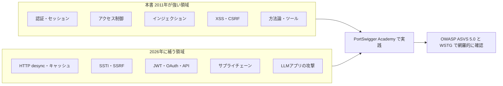

### 6.4 OWASP の関連標準

| 標準 | 概要 | 最新状況(2026年10月時点で確認できた範囲) |
|------|------|-----------------------------------------|
| **OWASP Top 10** | 最も重大なリスクの啓発資料 | 2025年版(2026年1月に最終版が公開されたと報じられている)。Parasoft の解説では、175,000件超のCVEを分析し、10カテゴリに248のCWEが対応 |
| **ASVS**(Application Security Verification Standard) | Webアプリとサービスのセキュリティ要件の標準 | **5.0.0 が2025年5月**(Global AppSec EU Barcelona 2025 で発表)。約350の要件・17カテゴリに再編 |
| **WSTG**(Web Security Testing Guide) | Webアプリのテスト手順の決定版 | 安定版は **v4.2**。**v5.0 を開発中** |
| **Cheat Sheet Series** | 開発者向けの簡潔な対策集 | 継続更新中。XSS、SQLi、CSRF、SSRF、XXE、IDOR、クレデンシャルスタッフィング等を網羅 |

> **使い分け**: ASVS は「**作るときの要求・検証基準**」、WSTG は「**診断のときの手順**」、Cheat Sheet は「**直すときの具体策**」、Top 10 は「**優先順位と啓発**」です。

---

## 7. 8週間の学習プラン

> 1週あたり、平日30〜60分+週末2時間程度を想定した例です。

| 週 | テーマ | 本書の章 | 実践(Web Security Academy) | 週末の成果物 |
|----|--------|---------|---------------------------|-------------|
| 1 | 土台 | Ch1・Ch3・Ch2 | Burp Suite または ZAP の導入、通信の観察 | HTTPの流れを自分の言葉で図にまとめる |
| 2 | 調べ方と認証 | Ch4・Ch6 | Authentication のラボ(Apprentice) | 認証の弱点チェック表 |
| 3 | セッションと認可 | Ch7・Ch8 | Access control のラボ | IDORの再現と修正コード |
| 4 | SQLi | Ch9 | SQL injection の入門〜中級ラボ | パラメータ化クエリへの書き換え例 |
| 5 | XSSとCSRF | Ch12・Ch13 | XSS(反射型・格納型・DOM型)、CSRF | 出力エンコードとCSRFトークンの実装メモ |
| 6 | バックエンド・ロジック | Ch5・Ch10・Ch11 | OS command injection、Path traversal、Business logic | ロジックの前提を書き出す演習 |
| 7 | 応用と運用 | Ch14〜Ch19 | Information disclosure、SSRF、XXE | 診断対象のリスク一覧 |
| 8 | 方法論とまとめ | Ch20・Ch21 | 未経験トピック1つ(例:request smuggling の入門) | 方法論をもとにした自作チェックリスト |

**学習のコツ**
- 運営側は、初心者に **SQLインジェクションとXSSから** 始めることを推奨しています。
- ラボの解答例を **写すだけにしない**。「なぜそのペイロードが効くのか」「どう直すか」まで説明できるようにする。
- 無料アカウントで、Apprentice → Practitioner と進める。
- 学習を一通り終えたら、Burp Suite Certified Practitioner(BSCP)のような任意の認定も目標になる(認定の詳細は公式で確認)。

---

## 8. 開発者向け防御チェックリスト

攻撃を学んだ後は、**自分のアプリで何を確認し、どう直すか** が重要です。

| 領域 | 確認項目 | 対策の方向 |
|------|---------|-----------|
| 認証 | パスワード保存に専用ハッシュを使っているか | argon2 / bcrypt / scrypt など |
| 認証 | ログイン失敗の応答が一律か、試行制限があるか | 統一メッセージ、レート制限、MFA |
| セッション | `Secure` / `HttpOnly` / `SameSite` を設定しているか | Cookie属性を明示 |
| セッション | ログイン時にセッションIDを再発行しているか | 再発行 |
| アクセス制御 | **すべてのエンドポイントでサーバー側の認可判定** があるか | デフォルト拒否、共通部品化 |
| アクセス制御 | データの所有者を検査しているか | クエリに所有者条件を含める |
| インジェクション | SQLを文字列連結していないか | パラメータ化クエリ |
| インジェクション | OSコマンドをシェル経由で実行していないか | 引数配列、ホワイトリスト |
| XSS | 出力時に文脈別のエンコードをしているか | フレームワークの自動エスケープ、CSP |
| XSS | `innerHTML` や `dangerouslySetInnerHTML` を使っていないか | `textContent`、サニタイザ |
| CSRF | 状態を変える操作に CSRFトークン等の主対策があるか | CSRFトークン(シンクロナイザトークン等)、Origin/Referer 検証 |
| CSRF | 多層防御として Cookie に `SameSite` を設定しているか(単独では不十分) | `SameSite=Lax` / `Strict` |
| ロジック | 金額・数量・状態遷移をサーバー側で検証しているか | 不変条件のチェック、冪等性、ロック |
| 情報漏えい | 詳細なエラーを利用者に出していないか | 汎用メッセージ、詳細はログへ |
| 設定 | 既定アカウント、サンプル、デバッグ機能が残っていないか | 本番から除去 |
| 依存関係 | 依存ライブラリの脆弱性を継続検査しているか | SCA、更新運用(OWASP A03 対応) |
| ログ | 認証失敗・権限エラーを記録し、アラートがあるか | 監査ログ、監視(OWASP A09 対応) |
| HTTP構成 | プロキシ〜バックエンドのHTTP解釈のずれがないか | 上流・下流のHTTP/2以降の利用、構成の監査 |

---

## 9. 確認クイズ

### 9.1 問題

| # | 問題 |
|---|------|
| 1 | Webアプリのセキュリティの出発点となる原則を一文で述べよ |
| 2 | Base64 が暗号でない理由を説明せよ |
| 3 | 認証と認可(アクセス制御)の違いを例で説明せよ |
| 4 | ログイン失敗時に「ユーザー名が存在しません」と返す設計の問題点は何か |
| 5 | `Secure` / `HttpOnly` / `SameSite` の役割をそれぞれ述べよ |
| 6 | IDOR とは何か。どう直すか |
| 7 | SQLインジェクションの根本原因と、最優先の対策は何か |
| 8 | 反射型・格納型・DOM型XSSの違いを述べよ |
| 9 | 隠しフィールドの価格を信用してはいけない理由を述べよ |
| 10 | WAF を導入したのに、根本対策が必要なのはなぜか |

### 9.2 解答例

| # | 解答例 |
|---|--------|
| 1 | ユーザーの入力(およびクライアント側から来る値すべて)を信用しない |
| 2 | 単なる表現形式の変換で、鍵なしで誰でも元に戻せるため |
| 3 | 認証は「誰か」の確認(ログイン)。認可は「何をしてよいか」の制御(一般ユーザーが管理画面に入れない等) |
| 4 | 登録済みのユーザー名が外部から推測でき(ユーザー列挙)、総当たりの標的にされるため。どちらの失敗でも同じ文言にする |
| 5 | `Secure`: HTTPSのみで送る。`HttpOnly`: JavaScriptから読めない。`SameSite`: 他サイトからのリクエストへの付与を制限 |
| 6 | IDなどを変えるだけで他人のデータに届く欠陥。サーバー側でデータの所有者を必ず検査する |
| 7 | 入力がSQLの命令の一部として解釈されること。パラメータ化クエリ(SQLと値の分離) |
| 8 | 反射型: 入力が即座に応答へ反映。格納型: 保存され他ユーザーの画面で実行。DOM型: ブラウザ側のJSの危険な処理 |
| 9 | クライアントは利用者が自由に改変できるため。価格はサーバー側で決める |
| 10 | WAFは回避され得る補助的な層で、脆弱性そのものは残るため。多層防御の一部として位置づける |

---

## 10. 用語集

| 用語 | 説明 |
|------|------|
| 攻撃対象領域(アタックサーフェス) | 攻撃され得る入口の総体 |
| インターセプトプロキシ | ブラウザとサーバーの間で通信を止めて確認・改変できるツール |
| ペイロード | 脆弱性の検証や攻撃のために送る入力データ |
| ファジング | 多様な入力を大量に与えて異常を探す手法 |
| ブラインド(攻撃) | 結果が直接は見えず、応答の違いや遅延から推測する攻撃 |
| 垂直・水平権限昇格 | 上位の権限を得る / 同権限の他人のデータにアクセスする |
| IDOR | 識別子の変更で他人のオブジェクトに到達できる欠陥 |
| セッション固定 | 攻撃者が決めたセッションIDを被害者に使わせる攻撃 |
| CSP | ブラウザが実行できるスクリプトの出所を制限するポリシー |
| 同一オリジンポリシー | 異なるオリジン間のデータアクセスを制限するブラウザの基本ルール |
| CORS | 同一オリジンポリシーを、許可したオリジンに対して緩める仕組み |
| SSRF | サーバーに、攻撃者の望む宛先へリクエストを送らせる攻撃 |
| SSTI | テンプレートエンジンに入力が混入して、サーバー側で評価される問題 |
| desync | フロントとバックエンドのHTTPリクエスト境界の解釈が食い違う現象 |
| SAST / SCA | ソースコードの静的解析 / 依存ライブラリの脆弱性検査 |
| ASVS | OWASP のセキュリティ要件・検証標準 |
| WSTG | OWASP の Web セキュリティテストガイド |

---

## 11. 参考文献・ソースURL一覧

> 取得日: **2026年10月11日**。本ガイドの事実関係(書誌・最新動向・標準の更新状況)は、以下の情報源の記載に基づきます。国際的に著名な実践者(Dafydd Stuttard、James Kettle、OWASP コミュニティ、PortSwigger Research)の公開資料を優先して参照しました。

### 11.1 書籍の基本情報

| 内容 | URL |
|------|-----|
| 書誌・目次・ページ数(Google ブックス) | https://books.google.co.jp/books/about/The_Web_Application_Hacker_s_Handbook.html?id=NSBHAAAAQBAJ&redir_esc=y |
| 第2版の概要・目次(O'Reilly) | https://www.oreilly.com/library/view/-/9781118026472/ |
| 初版の概要(2007年10月・768頁) | https://www.oreilly.com/library/view/-/9780470170779/ |
| 第2版の目次と章頁(Wiley-VCH) | https://wiley-vch.de/de/fachgebiete/computer-und-informatik/the-web-application-hacker-39-s-handbook-978-1-118-02647-2 |
| 第2版の章構成(Skillsoft) | https://skillsoft.com/book/the-web-application-hackers-handbook-finding-and-exploiting-security-flaws-second-edition-e843be00-f037-11e6-be4a-0242c0a80906 |
| 著者の研修シラバス(章との対応) | https://blackhat.com/html/bh-us-12/training/courses/bh-us-12-training_DSMP-WebAppHkrHBook.html |
| Web Security Academy 公開の報道(第3版への需要への答え) | https://www.infosecurity-magazine.com/news/portswigger-launches-web-security |

### 11.2 OWASP(標準・チェックリスト)

| 内容 | URL |
|------|-----|
| OWASP Top 10:2025(公式・英語) | https://owasp.org/Top10/2025/ |
| OWASP Top 10:2025(公式・日本語) | https://owasp.org/Top10/2025/ja/ |
| 2025年版の変更点の解説(Fastly) | https://www.fastly.com/blog/new-2025-owasp-top-10-list-what-changed-what-you-need-to-know |
| 2025年版の解説・2021年版との比較・データ規模(Parasoft) | https://parasoft.com/blog/owasp-top-10/ |
| ASVS プロジェクトページ | https://owasp.org/asvs |
| ASVS 5.0 のリリース解説(約350要件・17カテゴリ) | https://assuranceinaction.intertek.com/post/102kghm/owasp-release-version-5-0-of-the-application-security-verification-standard-asvs |
| WSTG プロジェクトページ(v4.2 安定版・v5.0 開発中) | https://owasp.org/wstg |
| WSTG プロジェクト情報 | https://owasp.org/projects/web-security-testing-guide |
| Cheat Sheet Series(ASVS対応索引) | https://cheatsheetseries.owasp.org/IndexASVS.html |
| 入力検証とパラメータ化クエリの解説(OWASP Wiki アーカイブ) | https://wiki.owasp.org/index.php?oldid=206089&title=Input_Validation_Cheat_Sheet |

### 11.3 PortSwigger / James Kettle(最新の研究動向)

| 内容 | URL |
|------|-----|
| Top 10 Web Hacking Techniques of 2025 | https://portswigger.net/research/top-10-web-hacking-techniques-of-2025 |
| 同・ノミネート募集(選定基準) | https://portswigger.net/research/top-10-web-hacking-techniques-of-2025-nominations-open |
| HTTP/1.1 must die: the desync endgame(論文) | https://portswigger.net/research/http1-must-die |
| 同・AppSec リーダー向け解説 | https://portswigger.net/blog/http-1-1-must-die-what-this-means-for-appsec-leadership |
| DEF CON 33 講演情報(2025年8月8日) | https://infocondb.org/con/def-con/def-con-33/http11-must-die-the-desync-endgame |
| Kettle 氏へのインタビュー(Security Weekly ASW #380、2026年4月28日配信) | https://www.scworld.com/podcast-episode/asw-380 |
| 2025年Top10の受賞テーマの紹介(YesWeHack) | https://www.yeswehack.com/news/notepad-hijack-pwn-claude-code |

### 11.4 学習プラットフォーム

| 内容 | URL |
|------|-----|
| Web Security Academy 学習資料一覧 | https://portswigger.net/web-security/all-materials |
| 学習パス導入の告知(2023年9月) | https://portswigger.net/blog/new-learning-paths-from-the-web-security-academy |
| 初心者への推奨(運営担当者の回答) | https://forum.portswigger.net/thread/wow-where-do-i-start-as-a-beginner-on-web-security-academy-help-plz-0c00bf2c |
| Academy の構成の紹介(Oneconsult) | https://www.oneconsult.com/en/?p=26078 |

---

## 付録: このガイドを使う際の注意

| 項目 | 内容 |
|------|------|
| 本の版 | 本ガイドは **第2版(2011年)** が対象。個々の技術例は古くなっている部分がある |
| 情報の鮮度 | 標準・研究動向は **2026年10月11日時点** で確認できた範囲。OWASP WSTG v5.0 など、今後更新されるものがある |
| 一般知識に基づく記述 | SameSite の既定の扱い、パスキー、各種防御策の説明などは、一般的な技術知識に基づく補足。実装時は各ブラウザ・フレームワークの最新ドキュメントで確認すること |
| 方法論の細目 | 第21章のタスク番号・名称は作成者の整理。**書籍の目次で確認** すること |
| 倫理 | 許可のない対象には、いかなる検証も行わない |
| 対応表 | 第6章の対応表は学習用の目安で、公式の対応ではない |
